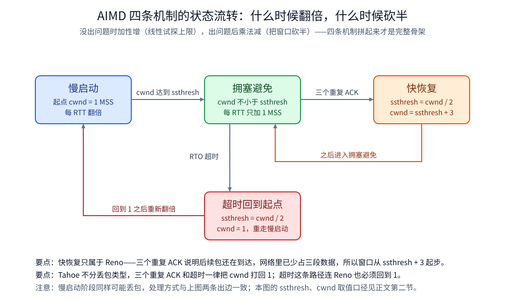
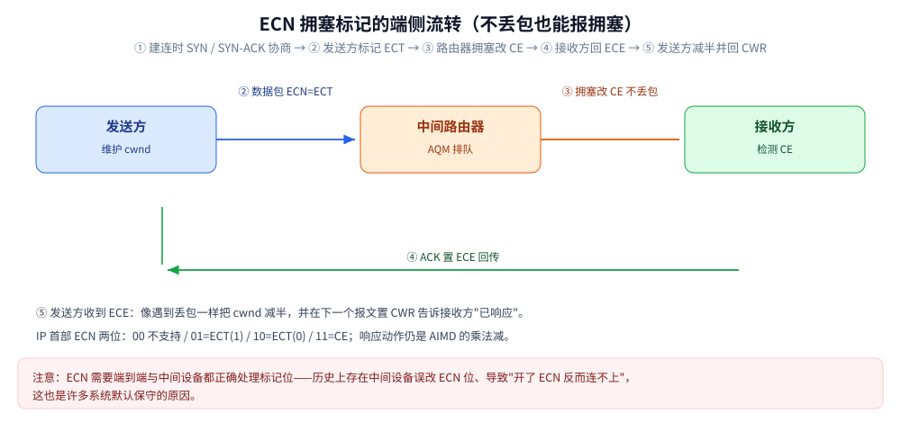
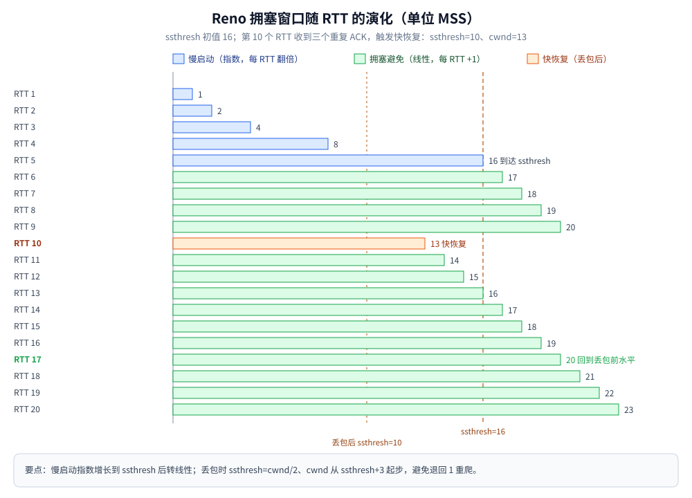
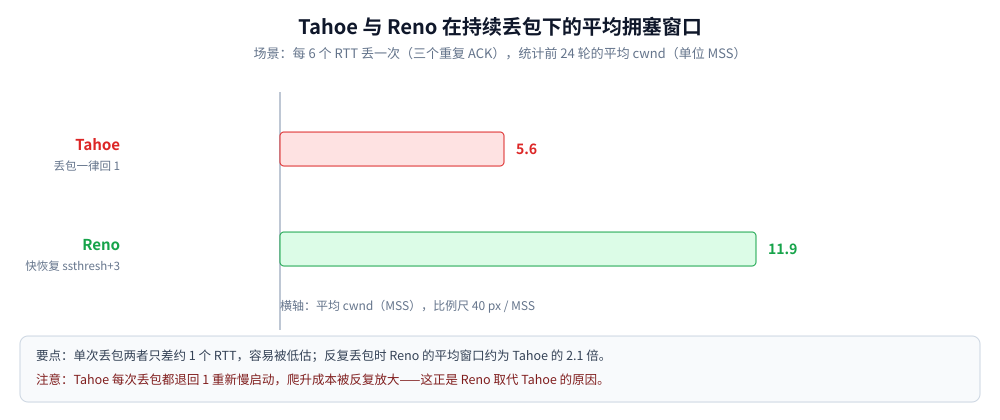
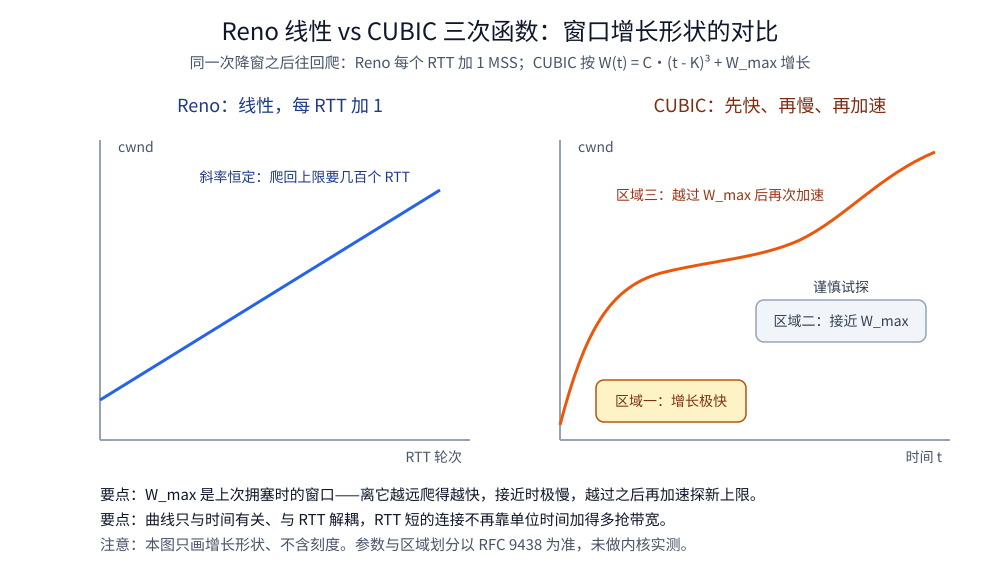

# TCP 拥塞控制算法

> 覆盖：慢启动 / 拥塞避免 / 快重传 / 快恢复四条机制，Tahoe 与 Reno 的差别，ECN 的协商与回显，以及 CUBIC 与 BBR 各自解决什么问题；含 Go 模拟实测（cwnd 逐 RTT 演化 + 持续丢包下的平均窗口）。
>
> 不覆盖：TCP 报文结构（含 `ECE` / `CWR` 字段）、三次握手、滑动窗口分别见 [TCP协议基础与报文结构.md](TCP协议基础与报文结构.md)、[TCP三次握手.md](TCP三次握手.md)、[TCP滑动窗口.md](TCP滑动窗口.md) 各篇；流量控制与拥塞控制的对照见 [TCP滑动窗口.md](TCP滑动窗口.md)。
>
> 本篇为按主题归纳的算法整理（非逐字摘录），主要依据 RFC 5681（TCP Congestion Control）、RFC 9438（CUBIC，取代 RFC 8312）、RFC 3168（ECN）与 BBR 的公开论文。
> 内容整理自个人学习笔记，素材见 [素材清单](../../../../素材清单.md)。
>
> ⚠️ 实测口径：第三节的 cwnd 演化由本机 Go 模拟程序跑出（**模拟器读数，非内核真实 cwnd**），3.2 另给真实内核对照组；**未实测** BBR 的真实吞吐与 ECN 的端到端回显。

---

## 一、拥塞控制为什么不是流量控制？

两者经常被混为一谈，但看的对象完全不同：

| | 流量控制（flow control） | 拥塞控制（congestion control） |
|---|---|---|
| 关心谁 | **接收方**还能收多少 | **网络中间链路**还扛得住多少 |
| 窗口名 | `rwnd`（接收窗口，接收方通告） | `cwnd`（拥塞窗口，发送方自己维护） |
| 失控后果 | 接收方缓冲被打爆（对端过载） | 中间路由器排队溢出、丢包连片（网络崩溃） |
| 对应算法 | 滑动窗口 | **慢启动 / 拥塞避免 / 快重传 / 快恢复** |

⭐ 发送方**实际能发多少 = `min(rwnd, cwnd)`** —— 一个管对端、一个管网内，谁小听谁的。

📎 两个窗口逐项对照的图已画在 [TCP滑动窗口.md](TCP滑动窗口.md)（其 `images/` 下的 `rwnd与cwnd对照`），本篇不重画，只看这一对关系在拥塞侧的含义。

## 二、AIMD 的四条机制分别是什么？

拥塞控制的骨架是 **AIMD**（加性增、乘法减）：没出问题时**线性**试探上限，出问题后**把窗口砍半**。四条机制拼起来才完整：



图注：四条机制是同一套「加性增、乘法减」在不同事件上的分支 —— 慢启动与拥塞避免负责**怎么涨**，超时与快重传 / 快恢复负责**怎么退**，退多少决定了下一次爬升的起点。

### 2.1 慢启动（slow start）：指数增长找上限

连接刚建好时，发送方**不知道链路能扛多少**，于是从 **cwnd = 1 MSS** 开始，每收到一个 ACK 就把 cwnd +1 MSS —— 效果是**每个 RTT 翻倍**（1 → 2 → 4 → 8 …）。

⚠️ 名字有误导性：它一点都不"慢"，**是指数增长**；"慢"指的是**起点小**（相对于一上来就发满窗口）。

### 2.2 拥塞避免（congestion avoidance）：线性增长

慢启动不能一直翻倍（很快就撞上拥塞），所以有个门限 **`ssthresh`**：

```text
cwnd < ssthresh  → 慢启动（每 RTT 翻倍）
cwnd >= ssthresh → 拥塞避免（每 RTT 只 +1 MSS，线性）
```

### 2.3 超时：乘法减，回到起点

重传定时器（RTO）超时，说明包可能**丢得比较彻底**（连 ACK 都没回来），于是：

```text
ssthresh = cwnd / 2     ← 记住"上次撞墙的位置"
cwnd = 1                ← 回到起点，重新慢启动
```

### 2.4 快重传与快恢复：不必等到超时

接收方收到**失序报文**时会重复 ACK 最后一个有序字节。发送方收到**三个重复 ACK**（说明后续包还在到达，只是中间丢了一个）就能**立即重传**，不用等 RTO —— 这是**快重传**。

重传之后怎么调窗口，就是 **Tahoe 与 Reno 的分水岭**：

| 版本 | 丢包类型 | ssthresh | cwnd |
|---|---|---|---|
| **Tahoe** | 三个重复 ACK 或超时 | `cwnd/2` | **1**（一律回起点，重走慢启动） |
| **Reno** | 三个重复 ACK | `cwnd/2` | **`ssthresh + 3`**（快恢复，不回到 1） |
| **Reno** | 超时 | `cwnd/2` | 1（超时仍然回起点） |

⭐ 为什么要 `+3`：三个重复 ACK 意味着**已经有三段数据离开了网络**，网络里少占三个 MSS，所以窗口可以从 `ssthresh + 3` 起步，然后进入拥塞避免。

### 2.5 ECN：让路由器用「标记」而不是「丢包」来报拥塞

前面四条机制的共同前提是「**拥塞表现为丢包**」。ECN（Explicit Congestion Notification，RFC 3168）想绕开这个前提：**让路由器在不丢包的情况下告诉端点「我这儿排队了」**。

**协商与回显的完整流程**：

```text
① 协商（只在建连时）
   客户端在 SYN 里带上 ECN 相关选项 + 置 ECE、CWR 位
   服务端在 SYN+ACK 里同样置位 → 双方都确认「这个连接可以用 ECN」

② 发送方给数据包打「可被标记」的底标
   IP 首部的 ECN 字段置为 ECT(0) / ECT(1)（表示「拥塞时请标记我，不要直接丢」）

③ 路由器拥塞时改标记，而不是丢包
   ECT → CE（Congestion Experienced）

④ 接收方看到 CE，在 ACK 里置 ECE 位回传

⑤ 发送方收到 ECE：像遇到丢包一样把 cwnd 减半
   ⭐ 并在下一个报文里置 CWR，告诉接收方「我已经响应了这次拥塞」
```

**IP 首部 ECN 字段的位布局**（ToS/DS 字节的最低两位，取值由 RFC 3168 规定，属协议常量而非抓包读数）：

| 两位取值 | 名称 | 谁来置位 | 含义 |
|---|---|---|---|
| `00` | Not-ECN | 不支持 ECN 的端点 | 拥塞时只能靠丢包传递信号 |
| `10` | `ECT(0)` | 发送方 | 「我支持被标记」，路由器拥塞时可以改写我 |
| `01` | `ECT(1)` | 发送方 | 同义的另一路编码，用于区分两类可标记流量 |
| `11` | `CE` | 中间路由器 | Congestion Experienced —— **已拥塞但没有丢包** |

**本机容器实测（Linux 侧开关）**：`golang:1.26-alpine` 容器（内核 `6.18.54.1-microsoft-standard-WSL2`）读 `/proc/sys/net/ipv4/tcp_ecn` 得 **`2`**，连跑 4 次读数一致；同一容器里 `tcp_available_congestion_control` 为 **`reno cubic`**、`tcp_congestion_control` 为 **`cubic`**。按内核 `ip-sysctl` 文档，`2` 表示**只对入向连接启用 ECN 协商**（`0` 关闭、`1` 双向启用）。

> ⚠️ **未实测**：`ECT` / `CE` 标记位本身没抓包验证——本机无 `tcpdump` / `tshark`，容器里也没有 `iproute2`（`ss`、`tc` 均不可用），看不到 IP 首部的这两位。上表按 RFC 3168 的字段定义给出。

| 好处 | 代价 / 前提 |
|---|---|
| **不丢包就知道拥塞**：避免重传，延迟更平稳 | ⚠️ 需要**端到端都支持**，中间设备还要正确处理 ECN 字段 |
| 与 AQM（如 fq_codel / RED）配合效果好 | ⚠️ 历史上存在**中间设备错误处理 ECN 位**的情况（把置位当异常丢弃或改写），导致「开了 ECN 反而连不上」——这也是许多系统默认保守的原因 |
| 对短流尤其友好（不用经历丢包重传） | Linux 侧由 `net.ipv4.tcp_ecn` 控制（取值含义随内核版本演进，**以本机 `sysctl` 与文档为准**） |

⭐ **ECN 与 AIMD 的关系**：ECN **不改变** AIMD 的形状——它只是把「拥塞信号」从「丢包」换成了「标记」；第 ⑤ 步响应的动作仍然是**乘法减**。所以它属于「拥塞信号的获取方式」的改进，而不是新算法。



> 📎 抓包里认 ECN：`ECE` / `CWR` 是 TCP 首部标志位（见 [TCP协议基础与报文结构.md](TCP协议基础与报文结构.md) 1.5 的标志位表）；IP 首部的 ECN 字段在 `tcpdump -vv` 的 IP 行里可见。

## 三、丢包之后，Tahoe 与 Reno 各怎么走？⭐

用 RTT 轮次做时钟模拟（cwnd 单位 MSS，`ssthresh` 初始 16，**第 10 个 RTT 丢包**）：

```text
== Reno：第 10 个 RTT 发生 三个重复 ACK ==
RTT    cwnd     阶段         说明
1      1        慢启动
2      2        慢启动
3      4        慢启动
4      8        慢启动
5      16       慢启动
6      17       拥塞避免
7      18       拥塞避免
8      19       拥塞避免
9      20       拥塞避免
10     13       快恢复        三个重复 ACK → ssthresh=10，cwnd=13
11     14       拥塞避免
12     15       拥塞避免
13     16       拥塞避免
14     17       拥塞避免
15     18       拥塞避免
16     19       拥塞避免
17     20       拥塞避免       ← 第 17 个 RTT 回到丢包前水平
18     21       拥塞避免
19     22       拥塞避免
20     23       拥塞避免

→ 丢包前 cwnd = 20；恢复到该水平：Reno 第 17 个 RTT，Tahoe 第 18 个 RTT
```

Tahoe 的对应过程是：第 10 个 RTT **cwnd = 1**（`ssthresh=10`）→ 重新慢启动 2、4、8、16 → 之后每轮 +1 才爬回来。



**持续丢包场景（每 6 个 RTT 丢一次，统计 24 轮的平均 cwnd）**：

```text
   Tahoe  平均 cwnd = 5.6
   Reno   平均 cwnd = 11.9
```



⭐ **结论**：丢包越频繁，「回到 1 重爬」的代价越明显 —— 持续丢包时 Reno 的平均窗口是 Tahoe 的 **2.1 倍**。这就是 Tahoe 被 Reno 取代的原因。
⚠️ 单次丢包的差距看起来只有 1 个 RTT，**别被单次数据骗了**：AIMD 的代价要在**反复丢包**下才显出来。

### 3.1 上面的读数怎么复现

**本节要点**：整节是**确定性模拟**（拿 RTT 轮次当时钟），不是内核抓包；口径写死在下面，任何人跑一遍都能得到同样的表。

```bash
# 脚本放在仓库外的实验目录，只有校验和跑数用；不进笔记目录
MSYS_NO_PATHCONV=1 docker run --rm -v D:/www/dev-notes:/w -w /w golang:1.26-alpine \
  sh -c "go build -o /tmp/cc /w/.workbuddy/tmp/round495/w2ra1_cc_sim.go && /tmp/cc"
```

模拟口径（与上面表格逐条对应）：

| 参数 | 取值 | 依据 |
|---|---|---|
| 起始 cwnd | 1 MSS | 2.1 节 |
| `ssthresh` 初值 | 16 | 本节首行 |
| 丢包时刻 | 第 10 个 RTT，三个重复 ACK | 本节首行 |
| `ssthresh` 重算 | `cwnd / 2`，**整数除法** | 2.3 / 2.4 节 |
| Reno 丢包后 cwnd | `ssthresh + 3` | 2.4 节 |
| Tahoe 丢包后 cwnd | 一律回 1 | 2.4 节 |
| 持续丢包 | 第 6、12、18、24 轮各丢一次，统计前 24 轮 | 本节末段 |

实测环境：`golang:1.26-alpine`，`go1.26.8 linux/amd64`。**连跑 5 次输出逐字节相同**（纯确定性算法，不含时间因素），关键读数固定为：Reno 第 **17** 个 RTT 回到丢包前水平、Tahoe 第 **18** 个 RTT；24 轮平均 cwnd **Reno 11.9 / Tahoe 5.6**，比值 **2.1 倍**。

### 3.2 真实内核的对照组：起点不是 1

**本节要点**：模拟从 1 MSS 起爬，真实 Linux **初始窗口就是 10 MSS** —— 所以上面那张表只能用来讲算法形状，不能当内核读数。

同一容器（内核 `6.18.54.1-microsoft-standard-WSL2`）里建一条回环 TCP 连接，用 `getsockopt(TCP_INFO)` 采样（Go 标准库 `syscall` 即可，容器里没有 `ss` 也不影响）：

| 量 | 读数 | 说明 |
|---|---|---|
| `snd_cwnd`（刚建连、尚未发数据） | **10 MSS** | 真实内核的初始窗口，不是模拟里的 1 |
| `snd_mss` | 32741 B | 回环 MTU 大，一个 MSS 就有 32 KB |
| `snd_ssthresh` | 2147483647 | 没触发过拥塞，门限等于「不设限」 |
| `tcp_congestion_control` | `cubic` | 内核可用算法只有 `reno cubic` |
| `rto` | 204 ms | 四次采样的峰值样本都读到这里 |

64 MB 回环 bulk transfer 的**变化量**（连跑 4 次，只断言趋势）：耗时 40.8 ~ 134.3 ms、吞吐 476.7 ~ 1567.3 MB/s、采样 8 ~ 36 次、峰值 `snd_cwnd` **16 ~ 38 MSS**、`rtt` 26 ~ 217 µs、`total_retrans` 0 ~ 2 次。

⭐ 趋势结论：起始 `snd_cwnd` 恒为 **10 MSS**；无丢包期间窗口**只涨不跌**（10 → 16~38 MSS）；建连时与峰值采样时 `ca_state` 都是 **0（Open）**，从未进入恢复或丢包态。

⚠️ **未实测**：真实丢包下的窗口塌陷。容器内没有 `iproute2`（`ss` / `tc` 都不可用），无法用 `tc netem` 注入丢包，本机也没有特权网络——所以第三节的曲线全部来自 3.1 的确定性模拟，不是内核读数。

## 四、CUBIC 把「每轮 +1」换成了什么？

Reno 的拥塞避免是**线性**的（每 RTT +1），这在**高带宽长肥管道**（BDP 很大）上有两个毛病：

1. **爬到上限太慢**：窗口掉到一半后，恢复回来要几百个 RTT；
2. **对 RTT 不公平**：RTT 短的连接每单位时间加得多，会抢占 RTT 长的连接的带宽。

CUBIC（Linux 默认）用一个**三次函数**替代线性增长：

```text
W(t) = C·(t - K)³ + W_max
```

- `W_max` 是**上次拥塞时的窗口**（它"知道"墙在哪）；
- 窗口离 `W_max` 越远、增长越快；**接近 `W_max` 时增长极慢**（谨慎试探），越过之后再加速探测新上限；
- 增长曲线只与**时间**有关，与 RTT 解耦 → 对 RTT 更公平。



⚠️ **规范引用要更新**：CUBIC 的**当前规范是 [RFC 9438](https://www.rfc-editor.org/rfc/rfc9438.html)**（2023-08），它**取代了 RFC 8312**（2018）。
引旧编号不算"错"，但会显得不跟标准；两者的核心公式一致，差异在参数与描述细节（如 `β` 取值与区域划分），**以 RFC 9438 为准**。

## 五、BBR 为什么不把丢包当作主要拥塞信号？

Reno / CUBIC 的共同假设是「**丢包 = 拥塞**」。但在**有随机丢包**的链路（无线、跨洋链路）上，这个假设不成立：明明没堵，却因为丢包把窗口砍半，吞吐被压住。

BBR（Google，2016）换了个思路——**直接测两个量**：

| 测什么 | 怎么测 | 用来干什么 |
|---|---|---|
| **瓶颈带宽** | 记录 ACK 到达速率的最大值（delivery rate） | 决定**发多快**（pacing rate） |
| **最小 RTT** | 一段时间内的 RTT 最小值 | 决定**在途多少**（inflight 上限） |

⭐ 于是发送速率 = **瓶颈带宽 × 最小 RTT**（即 BDP），**丢包不再是降速的主要信号**。

⚠️ **但「BBR 完全无视丢包」是不准确的说法**——准确的表述有三条限定：

| 限定 | 说明 |
|---|---|
| **丢包仍有一条兜底规则** | BBR 保留了「**短期丢包率超过阈值就压缩 inflight**」的保护（设计里约 2% 量级），否则它会一直按 BDP 全速发，对链路里的其他流过于激进 |
| **它不是 IETF 标准** | BBR 没有 RFC，是 Google 的方案，版本在持续演进（v1 / v2 / v3…）；**不同版本的丢包容忍与公平性策略有差异**，说"BBR 的行为"时必须带版本或实现口径 |
| **公平性问题需外部配合** | 与基于丢包的算法共享瓶颈时更容易抢带宽，通常需要 AQM（如 fq_codel）配合 |

> ⭐ 一句话：**BBR 把「丢包」从「主信号」降级为「兜底约束」**，主力信号换成了带宽与最小 RTT——这才是它和 Reno/CUBIC 的真正分界。

## 六、四种算法怎么选？

| 算法 | 拥塞信号 | 窗口调整 | 适合 |
|---|---|---|---|
| **Tahoe** | 丢包（超时/重复 ACK） | 一律回 1 | 历史版本，只在讲演进时出现 |
| **Reno** | 丢包 | 快恢复时 `ssthresh+3`，超时回 1 | 教科书主线 |
| **CUBIC** | 丢包 | 三次函数探测（与 RTT 解耦） | 高带宽长肥管道，Linux 默认（规范：RFC 9438） |
| **BBR** | **带宽与最小 RTT**（丢包只作兜底约束） | 按 BDP 定速率 | 有随机丢包的链路、跨洋/无线 |

⭐ **ECN（2.5 节）横跨这一列**：它不是"第五种算法"，而是**换一种拥塞信号的获取方式**——
把「丢包」换成「标记」，响应动作仍是 AIMD。所以「开了 ECN 用哪种算法」是两个独立的选择。

## 七、应用场景

**本节要点**：拥塞算法直接决定「长肥管道上能跑多快」，是服务器内核参数与网关 / CDN 调优的一部分。

| 场景 | 涉及哪一块 | 为什么值得注意 |
|---|---|---|
| 跨机房 / 跨洲长肥管道 | 拥塞窗口增长方式 | BBR 在随机丢包链路上通常优于 CUBIC，详见 本篇第五节 |
| 公网丢包链路的吞吐抖动 | 快重传 / 快恢复 | 持续丢包下 Reno 与 Tahoe 差距 2 倍以上，详见 本篇第三节 |
| 网关 / 反向代理的上游连接 | 内核拥塞算法选型 | 上游长连接的吞吐受它影响，详见 [反向代理原理.md](../../代理与网关/反向代理原理.md) 第六节 |
| 「发得出、收得慢」 | 拥塞窗口 vs 接收窗口 | 实际发送量取两者最小值，详见 [TCP滑动窗口.md](TCP滑动窗口.md) |
| 抓包看到的「重复 ACK」 | 丢包 / 乱序判据 | 三个重复 ACK 才触发快重传，详见 [抓包实战.md](../../观测与排障/抓包实战.md) 3.2 |

## 八、具体使用

**本节要点**：拥塞算法在 Linux 上是**可切换的内核参数**，观测点在 `ss -i` 与 `nstat`；⚠️ 以下命令为 Linux 侧，**本机为 Windows，未实测**。

```bash
# 1) 看默认算法与可选项
sysctl net.ipv4.tcp_congestion_control           # 常见值：cubic（默认）/ reno / bbr
sysctl net.ipv4.tcp_available_congestion_control

# 2) 切换到 BBR（需要内核模块 tcp_bbr，通常配合 fq 队列）
sysctl -w net.ipv4.tcp_congestion_control=bbr
sysctl -w net.core.default_qdisc=fq

# 3) 看单条连接的 cwnd / rtt / 重传（-i 打印 TCP 内部信息）
ss -tin state established

# 4) 看协议累计统计：重传、超时与丢包信号
nstat -az | grep -E 'TcpRetransSegs|TcpExtTCPLostRetransmit'
```

⭐ 判据：**先 `ss -i` 看单连接的 `cwnd` / `rtt` / `retrans` 是否异常，再 `nstat` 看全局趋势**；改内核参数属于全局动作，先在测试机验证。

## 延伸追问

- **拥塞控制和流量控制的区别？** → 流量控制看**接收方**的 `rwnd`（对端通告），拥塞控制看**网络**的 `cwnd`（发送方维护）；实际发送量取 `min(rwnd, cwnd)`。
- **慢启动为什么叫"慢"？** → 名字指的是**起点小**（cwnd=1 MSS），过程其实是指数增长（每 RTT 翻倍）。它是为了在**不知道链路容量**时先小步试探。
- **快重传为什么是"三个"重复 ACK？** → 一两个重复 ACK 可能只是**乱序**；连收三个说明丢包之后的报文已经在到达，即**丢的是单个包**而非整条链路拥塞 —— 可以立即重传且不用把窗口砍到 1。⚠️ 但从抓包看，**重复 ACK 本身也可能是乱序**，判据要结合「后续是否真的发生重传」一起看（见 [抓包实战.md](../../观测与排障/抓包实战.md) 3.2）。
- **为什么 `ssthresh` 要设成 `cwnd/2`，而不是清零？** → 它是"上次撞墙的位置"的一份记忆。链路容量通常没变，从半程重新爬比从 1 重新爬快得多（这就是 Tahoe → Reno 的改进点）。
- **Reno 的 `cwnd = ssthresh + 3` 里的 3 是什么？** → 三个重复 ACK 说明**已有三段数据离开网络**，网络里相应少占三个 MSS，所以窗口可以从 `ssthresh + 3` 起步。
- **实测里单次丢包 Reno 只比 Tahoe 快 1 个 RTT，那 Reno 的意义在哪？** → 单次看不出来，**持续丢包**时差距才显出来：每 6 个 RTT 丢一次时，Reno 平均 cwnd 11.9、Tahoe 只有 5.6（2.1 倍）。
- **CUBIC 相比 Reno 改了什么？** → 把线性的"每轮 +1"换成以 `W_max` 为基准的三次函数探测：远离上次拥塞点时长得快、接近时极慢，并且增长只与时间有关（与 RTT 解耦），因此更适合高 BDP 链路也更公平。⚠️ 引用规范用 **RFC 9438**（它取代了 RFC 8312）。
- **ECN 是怎么工作的？** → 建连时双方在 SYN / SYN-ACK 里**协商**支持 ECN；发送方把 IP 首部的 ECN 字段置为 `ECT`；路由器拥塞时把标记改成 `CE`（**不丢包**）；接收方在 ACK 里置 `ECE` 回传；发送方据此把 `cwnd` 减半，并置 `CWR` 告诉接收方"我已经响应了"。⚠️ 它需要端到端与中间设备都支持，历史上有中间设备误处理 ECN 位导致连接异常的情况。
- **BBR 为什么说"不看丢包"？这个说法准确吗？** → **不完全准确**。BBR 把丢包从**主信号**降级为**兜底约束**：主力是「瓶颈带宽 × 最小 RTT」，但仍有「短期丢包率超阈值就压缩 inflight」的保护规则。而且 BBR **不是 IETF 标准**（无 RFC），版本在演进，讨论它的行为要带版本口径。
- **开了 ECN 是不是就不用选算法了？** → 不是。ECN 只改变**拥塞信号的获取方式**（用标记代替丢包），收到信号后的动作仍然是 AIMD 的乘法减。所以「用不用 ECN」与「用 CUBIC 还是 BBR」是两个独立选择。

---

## 关联

- **上游/总纲**：[网络分层与数据包旅程.md](../../网络分层与数据包旅程.md) — 传输层的定位
- **对照/互补**：[TCP滑动窗口.md](TCP滑动窗口.md) — 流量控制（`rwnd`）与拥塞控制（`cwnd`）的分工
- **对照/互补**：[TCP协议基础与报文结构.md](TCP协议基础与报文结构.md) — `ECE` / `CWR` 字段
- **对照/互补**：[网络通信链路详解.md](../../网络通信链路详解.md) — 端到端链路上的实际表现
- **下游机制**：[反向代理原理.md](../../代理与网关/反向代理原理.md) — 上游长连接的吞吐
- **下游机制**：[抓包实战.md](../../观测与排障/抓包实战.md) — 重复 ACK、重传与零窗口的判读

> 反向引用（本篇被下列文档引到）：[并发限制器.md](../../../../04-架构与系统/分布式/稳定性/并发限制器.md)
