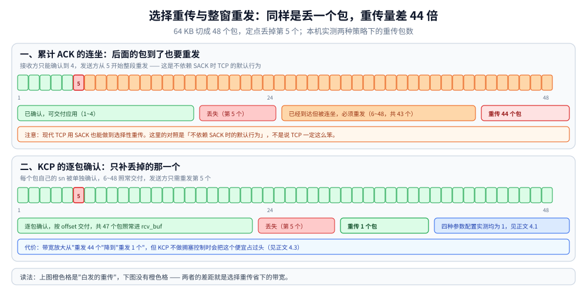
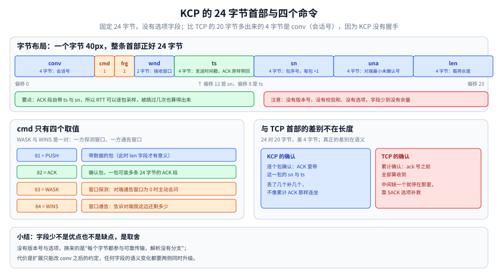
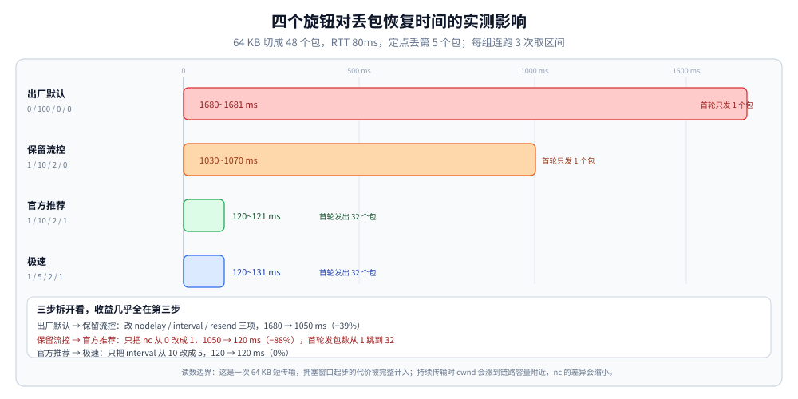

# KCP 协议与可靠传输

> 覆盖：KCP 作为一个**用户态 ARQ 算法库**的机制——24 字节首部、选择重传与 `fastack`、RTO 的下界、四个旋钮（`nodelay` / `interval` / `resend` / `nc`）各自改了什么，以及它们在本机实测里对「丢包恢复时间」与「带宽放大」的实际影响。
>
> 不覆盖：UDP 的首部、分片与接收队列丢包见 [UDP与数据报传输.md](UDP与数据报传输.md)；QUIC 在 UDP 上重建的完整传输层（三个包号空间、流、两层流控）见 [QUIC底层传输机制.md](QUIC底层传输机制.md)；TCP 的重传与拥塞控制见 [TCP拥塞控制算法.md](../tcp/TCP拥塞控制算法.md) 与 [TCP滑动窗口.md](../tcp/TCP滑动窗口.md)；横向选型见 [通信选型.md](../../选型/通信选型.md)。
>
> 内容整理自个人学习笔记，算法实现参照 [kcp-go v5.6.73](https://github.com/xtaci/kcp-go)，原版为 skywind3000 的 [KCP](https://github.com/skywind3000/kcp)，素材见 [素材清单](../../../../素材清单.md)。
>
> ✅ 实测口径：第四节的参数矩阵与随机丢包矩阵为**本机容器实测**（Linux `golang:1.26-alpine` + `kcp-go v5.6.73`，两个 KCP 对象在纯用户态驱动，中间是 40ms 单向延迟的模拟链路，**不走 socket**）；⚠️ **未实测**真实公网链路、KCP 的 FEC 模式、以及与 TCP 的同链路吞吐对比（本机无法给 TCP 注入定点丢包，做不出公平对照）。

---

## 一、KCP 是什么，它与 TCP 的分歧点在哪？

**本节要点**：KCP 是**一个 24 字节首部的可靠传输算法库**，不是协议栈——它自己不碰 socket，`Input` / `Update` / `Recv` 都由调用方驱动。它与 TCP 的分歧只有一句话：**TCP 假设"链路稳定、丢包就是拥塞"，KCP 假设"丢包就是丢了，重传要快"**。

### 1.1 一句话定位

| | TCP | KCP |
|---|---|---|
| 形态 | 内核协议栈 | **用户态算法库**，无 I/O |
| 首部 | 20 字节起（含选项可到 60） | **固定 24 字节** |
| 连接建立 | 三次握手 | **没有握手**，靠 32 位 `conv` 号区分会话 |
| 序号 | 字节偏移（`seq`） | **包序号（`sn`）**，每包 +1 |
| 确认 | 累计 ACK + 可选 SACK | 每包一条 `ts` + `sn` 的 ACK 段，一包可装多条 |
| 拥塞控制 | 必需，慢启动 + AIMD | **可选**（`nc` 参数），默认偏激进 |
| 加密 | 无（靠 TLS 叠在上面） | 库本身不带，`kcp-go` 另配 `BlockCrypt` |

⭐ 从这张表能看出 KCP 的定位：它把 TCP 里"该有的都有、但都偏保守"的那部分**重做一遍，并且把每个保守点都做成可调参数**。

### 1.2 分水岭：谁为丢包付账

```text
TCP 的选择：宁可慢，也不要把链路打满 → 丢包 = 拥塞信号 → 退让
KCP 的选择：宁可多发，也不要让应用等 → 丢包 = 事件 → 重传
```

这个选择决定了它们的适用面：

| 你的应用怕什么 | 该选谁 | 为什么 |
|---|---|---|
| **怕延迟**（游戏、实时音视频信令、远程桌面） | KCP | 一次多余的 RTT 用户能感知，多花 10% 带宽没人在意 |
| **怕占带宽**（大文件、批量同步、CDN 回源） | TCP | KCP 的激进重传与关闭拥塞窗口会把链路打满 |
| **怕丢数据**（支付、订单） | TCP 或 QUIC | 三者都能保证不丢；但 KCP 没有"连接"语义，需要自己补 |

### 1.3 它不做什么

- **不做握手**：`conv` 号对上就认为是同一个会话，**没有身份校验**——所以任何人都能往一个已知 `conv` 上灌包；
- **不做加密**：`kcp-go` 的 `BlockCrypt` 是另加的一层，KCP 本体只管可靠；
- **不做流**：一条 KCP 连接只有一个字节流式的消息队列（靠 `frg` 分片），没有 QUIC 那种多流；
- **不做拥塞控制的"礼貌退让"**：`nc=1` 时连拥塞窗口都不看，见第四节。

> ⚠️ 最后一条是 KCP 最容易被误读的地方：它**不是"实现了更好的拥塞控制"**，而是**把拥塞控制关掉了**。关掉的代价必须由使用方自己承担（限速、只在内网/自建链路用）。

---

## 二、TCP 的"保守"具体慢在哪三处？

**本节要点**：KCP 的每个机制都对应 TCP 的一个具体保守点。看清这三处，才能判断"换成 KCP 到底能省多少"。

### 2.1 重传判据偏慢

| 判据 | TCP | KCP |
|---|---|---|
| 快速重传触发 | **3 次重复 ACK** | `resend` 参数，可设 2（被跳过 2 次就重传） |
| 超时重传的下界 | RTO 通常不低于 **200ms** 量级 | `nodelay=1` 时最小 RTO 降到 **30ms**，否则 100ms（源码常量 `IKCP_RTO_NDL=30` / `IKCP_RTO_MIN=100`） |
| RTO 计算公式 | `SRTT + 4 × RTTVAR` | `SRTT + max(interval, 4 × RTTVAR)`，下界另受上面那条约束 |

⭐ 差别最大的是**超时下界**：RTT 20ms 的链路丢一个包，TCP 可能要等 200ms 才重传，KCP 30ms 就够了——**一次恢复差 6 倍**。

### 2.2 重传粒度偏粗

TCP 的 ACK 是"累计"的：确认了 100，就意味着 100 之前全收到。一旦中间丢了一个，**后面的数据虽然到了也只能等**，重传时通常从丢失点往后再发一遍（Go-Back-N 的放大）。

```text
TCP：发了 1..48，第 5 个丢了
     → 接收方只能确认到 4 → 发送方从 5 开始重发
     → 5..48 这 44 个包不管到没到，都要再发一遍
KCP：发了 1..48，第 5 个丢了
     → 接收方逐包 ACK，6..48 照常确认
     → 发送方只重发第 5 个
```

⭐ 实测印证了这一条：64 KB 数据切成 **48** 个包，定点丢掉第 5 个，**四种参数配置下重传数都是 1**（见 4.1）。这就是"选择重传"与"整窗重发"的差别——按 TCP 的粗粒度算法，这一次丢包要重发 44 个包。



图里上下两行的差别就是"重传量"这一个量：上图橙色格是白发的重传（43 个），下图没有橙色格。右侧两个数字是同一实验的实测结果——TCP 口径 44 个、KCP 实测 1 个，差 44 倍。这是 KCP 在丢包场景下最直接的收益来源，也是最容易在评估时被忽略的一条。

> ⚠️ 严格说现代 TCP 也靠 SACK 做到了选择性重传，所以"TCP 一定整窗重发"是不成立的。准确的表述是：**KCP 把选择重传做成了默认行为，且确认信息是逐包的（每包一条 `ts`+`sn`），不依赖 SACK 选项能否塞进首部**。

### 2.3 发送节奏偏慢

TCP 的拥塞窗口从很小的值开始，每个 RTT 增长一次。KCP 也有 `cwnd`，但当 `nc=1` 时**直接不看它**。

⭐ 这一条在实测里影响最大，见 4.3——它贡献了约九成的恢复时间差异，比"重传快不快"重要得多。

---

## 三、KCP 用哪些动作换延迟？

**本节要点**：五个动作，每个都对应第二节的一个保守点。**动作本身都很简单，难的是知道每个动作各自付了什么账**。

### 3.1 24 字节首部：确认信息逐包带

```text
conv(4) | cmd(1) | frg(1) | wnd(2) | ts(4) | sn(4) | una(4) | len(4)
```

| 字段 | 长度 | 作用 |
|---|---|---|
| `conv` | 4 | 会话号，**没有握手，靠它认人** |
| `cmd` | 1 | `81` PUSH（数据）、`82` ACK、`83` WASK（探测窗口）、`84` WINS（通告窗口） |
| `frg` | 1 | 分片序号，用于把大消息切成多包 |
| `wnd` | 2 | 接收窗口剩余空间 |
| `ts` | 4 | 发送时间戳，**ACK 时原样带回**，用于算 RTT |
| `sn` | 4 | 包序号，每包 +1 |
| `una` | 4 | 发送方看到的"对端最小未确认号"，用于对方快速清理 |
| `len` | 4 | 载荷长度 |

⭐ `ts` 是 KCP 与 TCP 最大的结构差异：**TCP 的 ACK 报的是"我期望的下一个字节"，KCP 的 ACK 报的是"我收到了 `sn=X` 的那一包，它发出来时是 `ts=Y`"**。于是：

- RTT 可以对每个包单独采样（TCP 只能对"被累计确认的那个"采样）；
- 接收方一包可以塞进多个 ACK 段（每段 24 字节），批量确认；
- 发送方据此能算出"这一包被后来的 ACK 跳过了几次"（`fastack`）。



图的上半是 24 个字节按 40px 一字节排开后的比例感：`conv` 独占 4 字节，`cmd` 与 `frg` 各只有 1 字节，没有选项字段、没有版本号、没有校验和。下半是这张图真正要传达的一点——它和 TCP 的差别不在"24 对 20 字节"，而在确认语义：KCP 逐包确认、TCP 累计确认。

### 3.2 `fastack`：被跳过就重传

每收到一个 ACK，发送方会遍历 `snd_buf`，把"包号小于这个 ACK 的包号"的 `fastack` 计数 +1：

```text
发了 5，收到 ACK 6 → 5 的 fastack +1（意味着 6 到了而 5 还没被确认）
再收到 ACK 7 → 5 的 fastack +1 → 累计 2
若 resend=2，就在下一次 flush 时立刻重传 5，不等 RTO
```

⭐ 这是"不等超时"的关键：`resend=2` 比 TCP 的"3 次重复 ACK"更快一步，而且判据是**包号被跳过**，不需要真正的"重复 ACK"（TCP 要收到同一 ACK 号三次）。

⚠️ 但 `resend` 设太小会**过度重传**：80ms RTT 的链路上，一个包只是正常在途，也可能被后面的 ACK 跳过一次。所以在高 RTT 链路上 `resend=2` 会带来无效重传，带宽代价要用第四节的数据折算。

### 3.3 队列与窗口：`snd_queue` 与 `snd_buf`

```text
应用 Send() → snd_queue（待发） → flush → snd_buf（已发待确认，按 sn 有序）→ 收到 ACK 后出队
接收侧：收到的 PUSH → rcv_buf（按 sn 重排）→ 连续的一段交给应用 → rcv_queue
```

| 结构 | 放什么 | 满了会怎样 |
|---|---|---|
| `snd_queue` | 还没发过的包 | `Send` 返回错误或被上层阻塞 |
| `snd_buf` | 已发、未确认的包 | 窗口满 → 停止发送，等 ACK |
| `rcv_buf` | 乱序到达的包 | 超出接收窗口 → **直接丢弃**（`wnd` 字段告诉对端还剩多少） |

⭐ `rcv_buf` 的丢弃是"按窗口"而不是"按内存"：这与 UDP 的 socket 队列溢出是两回事（见 [UDP与数据报传输.md](UDP与数据报传输.md) 第六节）。KCP 的窗口是**协议层**的流控，应用读得慢只会让 `rcv_queue` 涨，不会让内核丢包。

### 3.4 四个旋钮：各自改了什么

| 旋钮 | 取值 | 改的是 | 代价 |
|---|---|---|---|
| `nodelay` | 0 / 1 | 最小 RTO：`100ms` / `30ms` | 太小会把正常抖动误判成丢包 |
| `interval` | 10~100 | flush 周期（ms），决定"多久看一次该发什么" | 越小 CPU 越高；**不改变单次传输的恢复时间**（见 4.3） |
| `resend` | 0 / 2 / 3 | 被跳过几次就快速重传；0 = 关闭 | 太小会过度重传，白占带宽 |
| `nc` | 0 / 1 | **要不要看拥塞窗口**；1 = 不看 | ⭐ 会把链路打满，挤掉同链路的其他流量 |

⭐ 官方 README 推荐的"极速模式"是 `NoDelay(1, 10, 2, 1)`——**四个旋钮全开**。很多人只记住了 `interval=10`，却没意识到 `nc=1` 才是那个影响最大的开关。

---

## 四、四个旋钮各自的代价（本机实测）

**本节要点**：把四个旋钮拆开跑，结论与"官方推荐极速模式"给人的印象不一样：**恢复时间几乎全部由 `nc` 决定，`interval` 从 10 改到 5 一点没变快**。

### 4.1 定点丢一个包：48 个包里只重传 1 个

实验设置：两个 KCP 对象在纯用户态驱动，中间一条 **40ms 单向延迟**（RTT 80ms）的模拟链路，载荷 **64 KB**（MTU 1400 → 切成 **48** 个包），**定点丢弃下行第 5 个包**，每组连跑 3 次。

| 配置 | `nodelay/interval/resend/nc` | 恢复时间 | 总包数 | 重传数 | 首轮发出包数 | 带宽放大 |
|---|---|---|---|---|---|---|
| 出厂默认 | `0 / 100 / 0 / 0` | 1680~1681 ms | 48 | 1 | **1** | 1.03 |
| 保留流控 | `1 / 10 / 2 / 0` | 1030~1070 ms | 48 | 1 | **1** | 1.03 |
| 官方推荐 | `1 / 10 / 2 / 1` | **120~121 ms** | 48 | 1 | **32** | 1.03 |
| 极速 | `1 / 5 / 2 / 1` | 120~131 ms | 48 | 1 | **32** | 1.03 |

这张表里有三条能直接读出的事实：

1. **重传数恒为 1** —— 丢了几个就补几个，不连带重发后面的 43 个；
2. **"首轮发出包数"是 1 还是 32，决定了恢复时间的量级**：`nc=0` 时拥塞窗口从极小值起步，48 个包要靠多轮 RTT 才发得完；
3. **`interval` 从 10 降到 5 没有任何改善**（120 → 120）——在这个场景里，瓶颈不是"多久 flush 一次"。



图按"改了什么"分三步读：第一步改 `nodelay`/`interval`/`resend` 三项换来 −39%，第二步只把 `nc` 改成 1 就换来 −88%，第三步把 `interval` 从 10 降到 5 是 0%。底部三行文字就是这三步的差值，它比任何一条流行说法都更能说明该拧哪个旋钮。

### 4.2 随机丢包：丢包率翻倍，恢复时间才翻倍

同一链路，随机丢包（固定随机种子，每组连跑 3 次取区间）：

| 丢包率 | 出厂默认 | 保留流控 | 官方推荐 | 极速 | 带宽放大 |
|---|---|---|---|---|---|
| 0% | 1379~1480 | 1069~1085 | 120~121 | 120~123 | 1.01 |
| 1% | 1380~1382 | 1051~1059 | 121~130 | 121~130 | 1.01 |
| 5% | 1582~1794 | 1121~1180 | 129~211 | 121~221 | 1.03 |
| 10% | 2180~2939 | 1366~1581 | 210~670 | 201~650 | 1.12 |

⭐ 两条读数值得记住：

- **丢包率从 0% 到 5%，恢复时间几乎不动**（出厂默认 1380 → 1582）——因为 64 KB 只丢 2~3 个包，而 KCP 只补这几个，补一个包的代价就是一次 RTT 量级；
- **带宽放大在 10% 丢包时才到 1.12** —— 12% 的额外流量换"丢包不放大延迟"，这就是 KCP 的账。⚠️ 注意这是**短传输**（48 个包）的账；长时间持续传输时，重传占比会随丢包率线性上升，不能直接外推。

### 4.3 最反直觉的一条：收益几乎全在 `nc`

把 4.1 的表按"改了什么"重排：

| 从 → 到 | 改的旋钮 | 恢复时间 | 变化 |
|---|---|---|---|
| 出厂默认 → 保留流控 | `nodelay`、`interval`、`resend` | 1680 → 1030 ms | **−39%** |
| 保留流控 → 官方推荐 | 只加了 `nc=1` | 1030 → 120 ms | **−88%** |
| 官方推荐 → 极速 | `interval` 10 → 5 | 120 → 120 ms | **0%** |

⭐ 也就是说：**"KCP 比 TCP 快"的绝大部分，来自"不看拥塞窗口"，而不是"重传判据更激进"或"flush 更频繁"**。这个结论与流行说法（"KCP 用 10%~20% 的带宽换 30%~40% 的延迟"）并不冲突，但归因不同——如果你的场景本来就不受拥塞窗口限制（比如已经跑在专线、或者单流小数据），KCP 的收益会远小于预期。

> ⚠️ **这条读数的边界**：本实验是"一次 64 KB 的短传输"，拥塞窗口起步的代价被完整计入。如果是长时间持续传输，`cwnd` 会涨到链路容量附近，`nc` 的差异会缩小。所以**不要把它读成"永远 88%"**，要读成"在短传输 + 高 RTT 的场景里，瓶颈在 `cwnd` 起步"。
>
> ⚠️ 另一条边界：`kcp-go v5.6.73` 的 `Update()` 不接受时间参数，内部取 `time.Since(refTime)`，所以本实验按**真实墙钟**推进，分辨率约 1~2ms。读数里的"120"不是精确值，是"1.5 个 RTT"这个量级。

### 4.4 带宽放大是怎么算的

```text
带宽放大 = 发送方真正发出去的字节数 ÷ 应用交给 KCP 的字节数
         （被链路上丢掉的包也算，因为它们同样占了链路）
```

64 KB 切成 48 个 1400 字节的包（最后一包不满）→ 首传约 66 KB，加 1 次重传 1.4 KB，实测 1.03 倍。10% 丢包时重传 3~7 个包，放大到 1.12 倍。

⭐ 这个数在**大文件**上会更难看：丢包率 `p` 时，重传带来的放大大致是 `1/(1−p)` 的量级——10% 丢包长期跑，理论上是 1.11 倍起，叠加超时重传的重复发送会更高。KCP 的 FEC 模式是另一个思路（用冗余包换重传次数），本篇未实测。

---

## 五、什么时候该用 KCP，什么时候不该用？

**本节要点**：判断只有一个问题——**这个场景里，"快一点"值不值"多占带宽 + 自己补连接语义"**。

| 判断 | 结论 | 依据 |
|---|---|---|
| 延迟是核心指标，带宽有余量 | ✅ 用 | 4.3 的收益在这一栏成立 |
| 单条链路要跑很多租户 | ❌ 别用 `nc=1` | 关闭拥塞窗口会挤掉同链路其他流量，必须自己限速 |
| 需要"连接"语义（鉴权、多路复用、优雅关闭） | ⚠️ 选 QUIC | KCP 只有 `conv` 号，见 1.3 |
| 需要跨公网、穿各种中间设备 | ✅ 可以 | 走 UDP，比 TCP 少受"中间设备看不懂就丢"的影响 |
| 需要加密 | ⚠️ 自己叠 | KCP 本体不管加密，`kcp-go` 要另配 `BlockCrypt` |
| 大文件 / 批量同步 | ❌ 选 TCP | 带宽放大的账在这一栏算不过来 |

⭐ 一条工程判据：**如果这条链路的容量是你独占的（自建专线、游戏房间、内网 RPC），KCP 的激进是免费的；只要链路是共享的，`nc=1` 就是在占别人的便宜。**

---

## 六、应用场景

**本节要点**：KCP 的落点几乎都在"实时交互"这一类——它对延迟的敏感度要求高于对带宽的敏感度。

| 场景 | 用 KCP 的哪一部分 | 为什么值得注意 |
|---|---|---|
| 实时对战游戏 | 选择重传 + 低 RTO | 状态包丢了要立刻补，等 200ms 玩家就感知到卡顿 |
| 实时音视频信令 | 同上，但**媒体流本身不用** | 媒体流用 RTP + FEC，重传反而加重拥塞 |
| 远程桌面 / 云游戏 | `nc=1` + 小 `interval` | 独占链路时激进策略的代价可控 |
| 弱网文件同步（小文件） | 选择重传 | 短传输场景下收益最明显，见 4.3 |
| 游戏加速器 / 专线中转 | 全开 | 链路是服务商独占的，`nc=1` 不侵占他人 |
| 通用微服务 RPC | ❌ 不建议 | 需要连接语义、鉴权、多路复用，gRPC over TCP/QUIC 更合适 |

---

## 七、具体使用

**本节要点**：KCP 的接入只有两件事——**驱动它（`Update` 要按周期调）**，以及**定四个旋钮（按链路 RTT 与是否独占链路定）**。前者漏了会表现为"能连上但不动"。

### 7.1 最小接入（Go + kcp-go）

```go
package kcplab

import (
	"log"
	"time"

	kcp "github.com/xtaci/kcp-go/v5"
)

// 服务端：Listen 之后每条连接就是一个 net.Conn，收发与 TCP 写法一致。
func serve(addr string) error {
	ln, err := kcp.ListenWithOptions(addr, nil, 0, 0) // 第三个参数起是 FEC，本篇不用
	if err != nil {
		return err
	}
	defer ln.Close()

	for {
		conn, err := ln.Accept()
		if err != nil {
			return err
		}
		go func() {
			defer conn.Close()
			// ⚠️ 四个旋钮在会话上设，不设就是出厂默认（等价 TCP 的保守）
			if s, ok := conn.(*kcp.UDPSession); ok {
				s.SetNoDelay(1, 10, 2, 0) // 先保留流控；确认链路独占再考虑把最后一位改成 1
				s.SetWindowSize(256, 256)
				s.SetACKNoDelay(true) // ACK 立即回，不等下一个 interval
			}
			buf := make([]byte, 64*1024)
			for {
				n, err := conn.Read(buf)
				if err != nil {
					return
				}
				if _, err := conn.Write(buf[:n]); err != nil {
					return
				}
			}
		}()
	}
}

// 客户端：Dial 之后同样是 net.Conn。
// ⚠️ KCP 没有握手，Dial 成功只代表本地对象建好了，不代表对端在线。
func dial(addr string) (kcp.UDPSession, error) {
	c, err := kcp.DialWithOptions(addr, nil, 0, 0)
	if err != nil {
		return nil, err
	}
	c.SetNoDelay(1, 10, 2, 0)
	c.SetWindowSize(256, 256)
	// 没有握手 → 第一次写出去可能石沉大海，业务侧要有自己的超时与重试
	_ = c.SetDeadline(time.Now().Add(5 * time.Second))
	return *c, nil
}

var _ = log.Println
```

### 7.2 四个旋钮怎么定

| 你的链路 | `nodelay` | `interval` | `resend` | `nc` |
|---|---|---|---|---|
| 独占、RTT < 50ms（内网、专线） | 1 | 10 | 2 | 1 |
| 独占、RTT 50~150ms（跨城专线） | 1 | 10 | 2 | 1 |
| 共享公网、RTT 高且抖动大 | 1 | 20~40 | 3 | **0** |
| 与 TCP 流量混跑的同一条链路 | 0 | 100 | 0 | **0** |

⭐ `interval` 的取值和 RTT 挂钩：它决定"多久看一次该发什么"，但**不会让单次恢复更快**（4.3 实测），主要影响的是"发送机会的粒度"。RTT 大、抖动大的链路上把它调小，只是在增加 CPU。

### 7.3 排查顺序

| 现象 | 先查什么 | 判据 |
|---|---|---|
| 能连上但一个字节都收不到 | 对端有没有 `conv` 相同、有没有在 `Update` | KCP 无握手，`Dial` 成功不代表对端存在 |
| 吞吐上不去 | 是不是 `nc=0` 且窗口小 | 看 `WaitSnd()` 是否长期贴着窗口上限 |
| 带宽比预期高很多 | `resend` 是不是太小 | 高 RTT 链路上 `resend=2` 会过度重传 |
| 延迟忽高忽低 | `interval` 与 ACK 是否延迟发送 | `SetACKNoDelay(true)` 能让 ACK 即时回 |
| 同链路其他业务被挤 | `nc` 是不是 1 | 关掉拥塞窗口后它不会给别人让路 |

---

## 延伸追问

- **KCP 是协议还是库？** → **库**。它不碰 socket，`Input` / `Update` / `Recv` 全由调用方驱动；`kcp-go` 只是在它外面套了 UDP 收发与加密。所以"部署一个 KCP 服务"本质上是"部署一个自己驱动 ARQ 的进程"。
- **KCP 为什么能比 TCP 快？** → 三个动作：重传判据更激进（`resend=2`、最小 RTO 30ms）、**只重传丢掉的那一个**、以及**可以关掉拥塞窗口**。本机实测里第三条贡献最大，见 4.3。
- **"只重传丢掉的那一个"实测能省多少？** → 64 KB / 48 个包、定点丢第 5 个，四种配置下**重传数都是 1**；按 TCP 的整窗重发算法要重发 44 个包。⚠️ 现代 TCP 用 SACK 也能做到选择重传，所以准确说法是"KCP 把它做成了默认且不依赖 SACK 选项空间"。
- **`interval` 调小会让恢复变快吗？** → **不会**。实测 `interval` 从 10 降到 5，恢复时间 120ms → 120ms。它影响的是发送机会的粒度与 CPU，不改变"丢一个包要等多久"。
- **那恢复时间到底由什么决定？** → 由**能不能一次把窗口内的包发出去**（`nc`）决定：`nc=0` 时首轮只发出 **1** 个包，48 个包要靠多轮 RTT 摊开，恢复时间 1030~1680ms；`nc=1` 时首轮发出 **32** 个包，恢复时间降到 120ms。
- **KCP 的带宽代价有多大？** → 短传输实测：0~1% 丢包时放大 **1.01 倍**，5% 时 1.03，10% 时 1.12。长期跑的话按 `1/(1−丢包率)` 量级估，不要拿短传输的数外推。
- **`nc=1` 到底关了什么？** → 关的是"发送前检查拥塞窗口"这一步。它不是"更好的拥塞控制"，而是**不做拥塞控制**——链路共享时会挤掉别人的流量，所以只在独占链路上用。
- **KCP 有连接吗？** → **没有握手**，只有 32 位 `conv` 会话号。所以 `Dial` 成功不代表对端在线，也无法鉴权；要鉴权只能在应用层加，或者改用 QUIC（它把 TLS 嵌进握手）。
- **KCP 的首部为什么是 24 字节？** → `conv4 + cmd1 + frg1 + wnd2 + ts4 + sn4 + una4 + len4`。比 TCP 的 20 字节多 4 字节，多出来的是 `conv`（会话号）——因为它没有四元组意义上的"连接"，只能靠这个数认会话。
- **`ts` 字段为什么比 TCP 的 `TSval` 重要？** → 因为 KCP 的 ACK 是**逐包**的：每个 ACK 段带回那一包的 `ts`，于是 RTT 可以对每个包单独采样，还能算出"这一包被后面的 ACK 跳过了几次"（`fastack`）。TCP 的 `TSval` 只用于 RTT 采样与 PAWS。
- **KCP 和 QUIC 都跑在 UDP 上，该怎么选？** → 看要不要"连接语义"：QUIC 有握手、加密、多流、两层流控、连接迁移，代价是复杂（用户态加密开销、UDP 可达性）；KCP 只有可靠 + 低延迟，胜在简单、可控、能把每个旋钮拧到底。参见 [QUIC底层传输机制.md](QUIC底层传输机制.md) 1.3 的"它不做什么"对照。
- **KCP 的 FEC 模式值得开吗？** → 本篇未实测。它的思路是"多发冗余包换少重传"，在**丢包率高但对延迟极敏感**的场景有意义；代价是固定比例（如 10%）的带宽开销，且丢包率低时纯属浪费。

---

## 关联

- **上游/总纲**：[网络分层与数据包旅程.md](../../网络分层与数据包旅程.md) — KCP 的封装位置：KCP → UDP → IP
- **上游/总纲**：[UDP与数据报传输.md](UDP与数据报传输.md) — 载体：数据报语义、8 字节首部、接收队列丢包
- **对照/互补**：[QUIC底层传输机制.md](QUIC底层传输机制.md) — 同样在 UDP 上重建可靠传输，但补齐了流、流控与加密
- **对照/互补**：[TCP拥塞控制算法.md](../tcp/TCP拥塞控制算法.md) — TCP 的 AIMD 与慢启动，对照 KCP 的 `nc` 旋钮
- **对照/互补**：[TCP滑动窗口.md](../tcp/TCP滑动窗口.md) — TCP 的累计 ACK 与 SACK，对照 KCP 的逐包 `ts`
- **对照/互补**：[TCP的Nagle与延迟确认.md](../tcp/TCP的Nagle与延迟确认.md) — 延迟确认的合并策略，对照 KCP 的 `SetACKNoDelay`
- **下游机制**：[通信选型.md](../../选型/通信选型.md) — TCP / UDP / KCP / QUIC 的横向选型
- **下游机制**：[限流算法.md](../../../../04-架构与系统/分布式/稳定性/限流算法.md) — `nc=1` 时业务侧必须自己补的那一层限速
