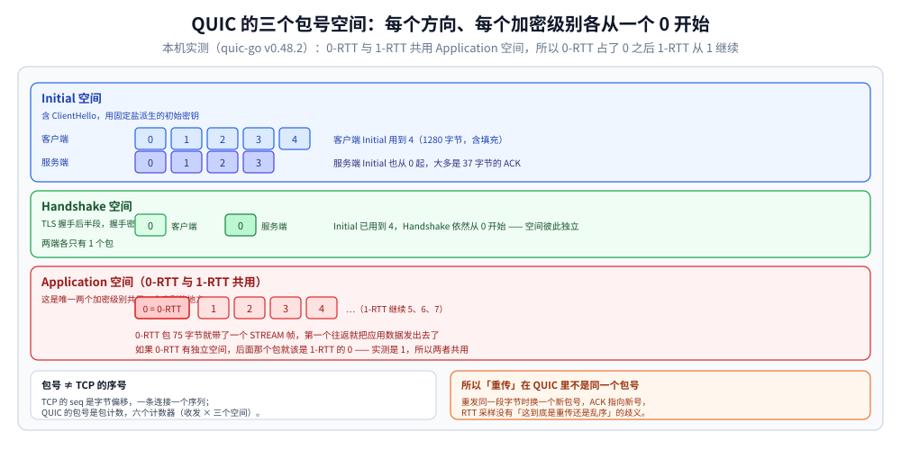
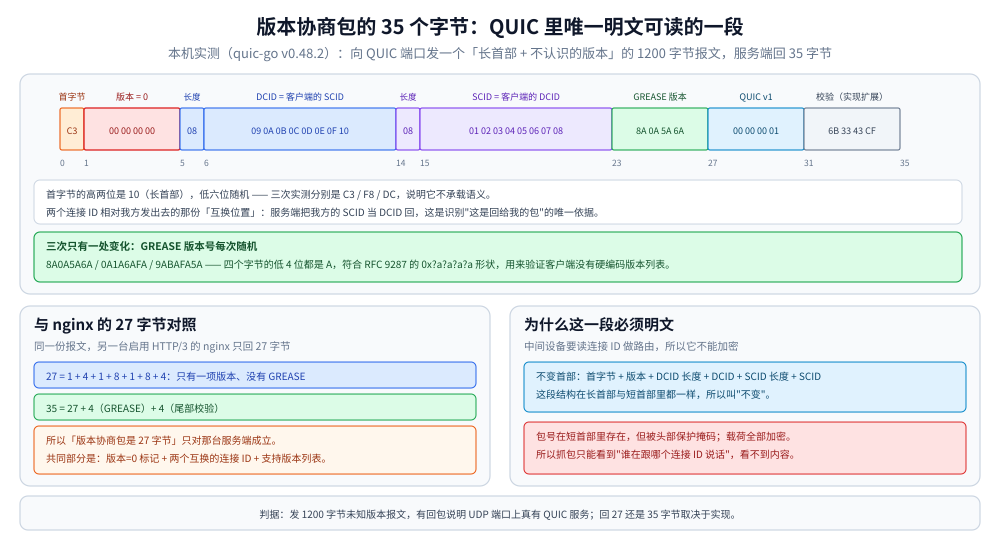
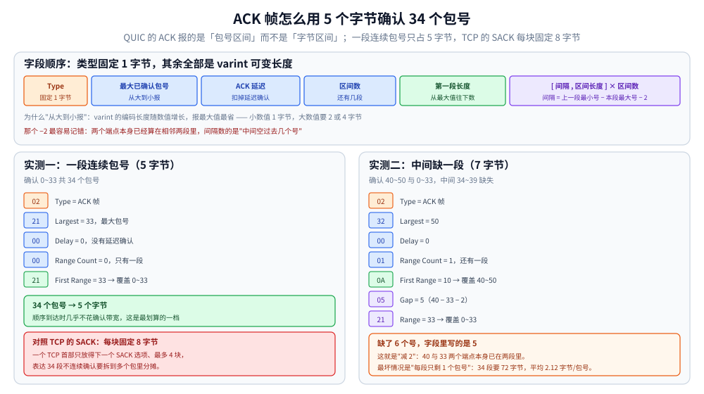

# QUIC 底层传输机制

> 覆盖：QUIC 作为**传输层协议**自己实现的那些机制——TLS 1.3 是内嵌进包而不是叠在字节流上、三个包号空间、ACK 帧的范围编码、流级重传与流编号、两层流控、丢失检测的两个阈值、0-RTT 在包号空间里的位置、连接迁移与不变首部，以及版本协商包的逐字节结构。
>
> 不覆盖：HTTP/3 为什么把 TCP 换掉、浏览器怎么发现 h3、`Alt-Svc` 与 `SVCB` 的实测见 [QUIC与HTTP3.md](../../应用层/QUIC与HTTP3.md)；TLS 1.3 握手与 ALPN 见 [HTTPS与TLS.md](../../应用层/HTTPS与TLS.md)；UDP 的首部、分片与接收队列见 [UDP与数据报传输.md](UDP与数据报传输.md)；TCP 侧的对照见 [TCP协议基础与报文结构.md](../tcp/TCP协议基础与报文结构.md) 与 [TCP滑动窗口.md](../tcp/TCP滑动窗口.md)；协议选型见 [通信选型.md](../../选型/通信选型.md)。
>
> 内容整理自个人学习笔记，规范依据 [RFC 9000](https://www.rfc-editor.org/rfc/rfc9000.html)（传输）、[RFC 9002](https://www.rfc-editor.org/rfc/rfc9002.html)（丢失检测与拥塞控制）、[RFC 9001](https://www.rfc-editor.org/rfc/rfc9001.html)（TLS 集成）、[RFC 9287](https://www.rfc-editor.org/rfc/rfc9287.html)（GREASE），素材见 [素材清单](../../../../素材清单.md)。
>
> ✅ 实测口径：第一节的包号空间与第五节 0-RTT、第六节的版本协商包为**本机容器实测**（Linux `golang:1.26-alpine`，`quic-go v0.48.2`，服务端与客户端在同一容器回环上）；第二节的 ACK 帧字节数由**手写编解码程序**得出（同一镜像，纯标准库）；⚠️ **未实测**真实公网链路上的丢包恢复、路径 MTU 探测与连接迁移（本机改不了 IP，也没有可注入丢包的中间设备）。

---

## 一、QUIC 到底在 UDP 上重建了什么？

**本节要点**：它不是一个"更快的 TCP"，而是**把连接的身份、可靠交付、加密三件事打包成一个整体**。重建的边界要看清：**重建了丢包重传与流控，没有重建"连接级的有序字节流"**。

### 1.1 五个洞，加上加密的位置

UDP 只给了端口与校验和（见 [UDP与数据报传输.md](UDP与数据报传输.md) 第三节的"不保证什么"表）。QUIC 要在它上面补齐五件事，每件都对应一个具体的机制：

| UDP 缺的 | QUIC 的补法 | 补在哪个字段/帧 |
|---|---|---|
| 送达确认 | 每个包有**包号**，接收方回 **ACK 帧** | 包号（首部）+ ACK 帧 |
| 有序交付 | **流内**按字节偏移排序，跨流不排序 | STREAM 帧的 Offset |
| 去重 | 包号单调递增且**不复用** | 包号 + 加密边界 |
| 流量控制 | **连接级 + 流级**两层窗口 | MAX_DATA / MAX_STREAM_DATA |
| 拥塞控制 | 可插拔，跑在用户态 | 不在协议字段里，是实现 |

⭐ 关键差别在第二行：**TCP 排的是"整条连接的一个字节序"，QUIC 排的是"每条流各自一个字节序"**。这一条决定了 QUIC 能给每条流单独重传，也让"QUIC 消除了队头阻塞"这句话只在"流之间"这个粒度上成立。

**加密的位置也一起变了。** TCP 上 TLS 是**叠上去**的一层：先握手、`ClientHello` 明文出去，协商出密钥之后才开始加密。QUIC 里 TLS 1.3 是**装进去**的——`ClientHello` 被塞进 CRYPTO 帧，作为 Initial 包的一部分发出，TLS 的握手消息因此也走 QUIC 自己的包号与丢失检测：

| 对照项 | TCP + TLS | QUIC + TLS 1.3 |
|---|---|---|
| TLS 记录在哪 | 独立的记录层，套在 TCP 字节流上 | **CRYPTO 帧**，装进 QUIC 的包 |
| 第一个包 | TCP 的 SYN，没有加密 | Initial 包，**已经有加密**（固定盐派生的初始密钥） |
| 证书何时出现 | TLS 1.2 明文传；1.3 在握手后半段 | Handshake 空间，**握手密钥加密**，抓包读不到 |
| 重传由谁做 | TCP 重传整段字节流 | QUIC 重传 CRYPTO 帧，与同空间的其它帧共用包号 |
| 协议协商 | ALPN 在 TLS 里 | 同样在 TLS 里——`ALPN` 是浏览器与服务器对暗号的唯一位置 |

⚠️ 但 Initial 包的加密**不提供保密性**：初始密钥由连接 ID 加一个公开的固定盐派生，谁都能算出来。它的作用是让首部格式统一，顺带让"版本协商包"成为唯一真正明文的一段（见 1.4）——不是拿来防窃听的。

### 1.2 三个包号空间（不是两个）

QUIC 的包号**按加密级别分开编号**，一共三个空间：

| 包号空间 | 装哪些包 | 谁在加密 |
|---|---|---|
| **Initial** | 握手的最初几个包，含 ClientHello | 固定盐派生的初始密钥（公开可算） |
| **Handshake** | TLS 握手后半段 | 握手密钥 |
| **Application** | **0-RTT 与 1-RTT 共用这一个** | 0-RTT 密钥 / 1-RTT 密钥 |

规范原文把 0-RTT 与 1-RTT 归在同一个包号空间里（[RFC 9000 §12.3](https://www.rfc-editor.org/rfc/rfc9000.html)），这一点在实测里能直接看到。

本机容器实测（`quic-go` 的 `ConnectionTracer` 在包组好、包刚收到这两个时刻回调，输出包号与帧列表）：

```text
相对ms   端   方向   包类型      包号  字节  帧
6      C   send  Initial      0  1280  CRYPTO
6      C   send  Initial      1  1280  CRYPTO
7      S   send  Initial      0    37  ACK            ← 服务端的 Initial 也从 0 开始
7      C   recv  Initial      0    37  ACK
9      S   send  Initial      1  1280  ACK+CRYPTO
9      S   send  Handshake    0   603  CRYPTO         ← Handshake 空间独立编号
9      C   recv  Handshake    0   603  CRYPTO
10     C   send  Handshake    0    75  ACK+CRYPTO
10     C   send  Initial      4  1280  ACK
```

⭐ 四条判据都能从这三行对上：**客户端与服务端各自独立编号**（都是 `Initial 0`）；**三个空间的编号互不影响**（`Initial` 用到 4，`Handshake` 仍然从 0 起）；**编号空间是按"方向 × 加密级别"算的**（同一个包号 0 在 `C send` 与 `S send` 里各出现一次，不冲突）。



图把三条泳道按加密级别分开，最容易读错的是最下面那条：**0-RTT 与 1-RTT 在同一个序列里**，所以 0-RTT 的包号是 0、紧随的 1-RTT 是 1。判据很简单——如果两者各有独立空间，1-RTT 的第一个包就该是 0，而实测不是。

> ⚠️ 这与 TCP 的 `seq` 有本质区别：TCP 的序号是**字节偏移**，一条连接只有一个序列；QUIC 的包号是**包计数**，一条连接有六个计数器（收发 × 三个空间），而且**每个计数器都从 0 开始、不循环**。

### 1.3 包号为什么必须"不复用"

TCP 重传时**沿用同一个 `seq`**，于是"收到一个重复的 `seq`"既可能是重传、也可能是乱序，接收方只能靠时间猜。QUIC 反过来：**每次发送都换一个新包号**，重传的内容装在新包里。

```text
TCP：重传 seq=1000 的那段 → 接收方看到两个 seq=1000，无法区分"重传"与"重复"
QUIC：重传 offset=1000 的字节 → 换一个新包号（比如 57），ACK 57 就明确表示收到了这一次
```

⭐ 这条设计换来两件事：**RTT 采样不再有歧义**（ACK 的是哪个包是确定的），以及**连接关闭后不必靠 `TIME_WAIT` 防"旧包串进新连接"**——旧包的包号在新连接上不会被复用成同一个含义。

> 但别因此说"QUIC 不需要等"：它仍然要在一段时间内**保留连接 ID**，以便把迟到的包识别成"旧连接的"，而不是新连接的。区别在于**端口可以立刻复用**（连接身份不靠四元组），这一点见第六节。

### 1.4 版本协商：明文里唯一能直接读的一段

QUIC 的所有包在 TLS 之外都被加密或做头部保护，唯独**版本协商包**（Version Negotiation）是明文。它就是"不变首部"的原样应用。

向一个 QUIC 端口发一个"长首部 + 不认识的版本"的 1200 字节报文，服务端（`quic-go`）回了 35 字节，连发三次：

```text
第1次：发出 1200 字节，收到 35 字节
  hex=C3 00 00 00 00 08 09 0A 0B 0C 0D 0E 0F 10 08 01 02 03 04 05 06 07 08 8A 0A 5A 6A 00 00 00 01 6B 33 43 CF
第2次：收到 35 字节
  hex=F8 00 00 00 00 08 09 0A 0B 0C 0D 0E 0F 10 08 01 02 03 04 05 06 07 08 00 00 00 01 0A 1A 6A FA 6B 33 43 CF
第3次：收到 35 字节
  hex=DC 00 00 00 00 08 09 0A 0B 0C 0D 0E 0F 10 08 01 02 03 04 05 06 07 08 9A BA FA 5A 00 00 00 01 6B 33 43 CF
```

逐段拆开（以第 1 次为例）：

| 偏移 | 字节 | 含义 |
|---|---|---|
| 0 | `C3` | 长首部（高两位 `10`）+ 低六位随机（三次分别是 `C3` / `F8` / `DC`） |
| 1–4 | `00 00 00 00` | **版本 = 0**，这是"版本协商包"的专用标记 |
| 5 | `08` | 目的连接 ID 长度 = 8 |
| 6–13 | `09 0A … 0F 10` | 目的连接 ID = **我发出去的源连接 ID**（互换） |
| 14 | `08` | 源连接 ID 长度 = 8 |
| 15–22 | `01 02 … 07 08` | 源连接 ID = **我发出去的目的连接 ID**（互换） |
| 23–26 | `8A 0A 5A 6A` | 服务端支持的版本之一（第 2 次这个位置变成了 `00 00 00 01`） |
| 27–30 | `00 00 00 01` | 另一个：`00000001` = **QUIC v1** |
| 31–34 | `6B 33 43 CF` | 保留的完整性校验（`quic-go` 的扩展，不是 RFC 9000 的必选字段） |

⭐ **三次只有一处变化**：支持版本列表里那个"看起来像乱码"的 4 字节。三次分别是 `8A0A5A6A`、`0A1A6AFA`、`9ABAFA5A`——它们都符合 `0x?a?a?a?a` 的形状，这是 [RFC 9287](https://www.rfc-editor.org/rfc/rfc9287.html) 定义的 **GREASE 版本号**：故意塞一个**永远不会被采用**的版本，用来验证"客户端有没有硬编码版本列表"。

> ⭐ 与旧读数的一条对照：另一台启用 HTTP/3 的 nginx（BoringSSL）对同样的报文只回 **27 字节**，组成是 `1 + 4 + 1 + 8 + 1 + 8 + 4`，**只有一项版本、没有 GREASE**。所以「版本协商包等于 27 字节」这个说法**只对那台服务端成立**——`quic-go` 这 35 字节里多出来的，是它自己塞的 GREASE 与尾部校验。



图按 24px 一字节画满 35 格，色块区分"不变首部"与"附加部分"：蓝紫两段是两个连接 ID（正是它们被互换，回包才能被认成"回给我的"），绿色那 4 字节是每次随机的 GREASE，浅蓝的 `00 00 00 01` 才是服务端真正支持的 QUIC v1。这是 QUIC 里唯一能直接读的一段明文，也是判断"UDP 端口上有没有 QUIC 服务"最省事的办法。

---

## 二、包号与 ACK：为什么"只确认包号"就够了？

**本节要点**：ACK 帧报的是**包号区间**，不是字节区间。因为包号连续、不复用，**一段连续包号可以只用五个字节表达**，这比 TCP 的 SACK 块省得多。

### 2.1 ACK 帧的字段

QUIC v1 的 ACK 帧（类型 `0x02`）长这样：

```text
Type(0x02) | 最大已确认包号 | ACK 延迟 | 区间数 | 第一段长度 | [间隔, 区间长度] × 区间数
                ↑ varint        ↑ varint   ↑ varint   ↑ varint
```

- **最大已确认包号**：从大到小报，因为它最可能是一个"大数"，而 varint 的编码长度随数值增长；
- **ACK 延迟**：接收方拖延了多久才回这个 ACK，用于把对端的延迟确认时间从 RTT 采样里扣掉；
- **区间数 + 第一段长度**：从最大包号往下数多少个连续包号被确认；
- 后面每多一个不连续段，加一对「间隔 + 区间长度」。**间隔的定义是"上一段最小包号 − 本段最大包号 − 2"**，这个 `−2` 是因为两个端点本身已经算在区间里。

### 2.2 一段连续包号占几个字节（本机实测）

用手写的编解码程序（同一镜像，纯标准库）构造并回解：

| 要确认的包号 | ACK 帧字节数 | 十六进制 |
|---|---|---|
| `0~33`（连续 34 个） | **5** | `02 21 00 00 21` |
| `40~50` 与 `0~33`（中间缺 34~39） | **7** | `02 32 00 01 0A 05 21` |
| 34 个**互不相邻**的包号（每 4 个确认 1 个） | **72** | 平均 **2.12 字节/包号** |

⭐ 第一行就是 QUIC 与 TCP 最直观的差别：**34 个包号，5 个字节**。同样 34 个不连续包号，TCP 的 SACK 选项每个块固定 **8 字节**（左边界 4 + 右边界 4），一个 TCP 首部只放得下一个 SACK 选项、最多 4 个块（32 字节），要表达 34 段得靠多个包分摊。



图上排是字段顺序，下排两个例子把每个字节对应到字段：`02 21 00 00 21` 五个字节就确认了 0~33；`02 32 00 01 0A 05 21` 七个字节确认两段、中间缺 6 个号。最值得记的是 `Gap = 40 − 33 − 2 = 5` 那个减 2——写错它会让接收方把区间算偏一个包。

> 这就是"ACK 帧不必复用"的经济基础：ACK 帧很短，丢了也无所谓，下一个包会带一个更新的 ACK 过来。

### 2.3 与实测里的 ACK 对得上

同一份 `quic-go` 实测的统计（客户端开 3 条流各写 20 KB，共 62 个 1-RTT 包）：

```text
客户端发出的 1-RTT 包号：0 ~ 61，共 62 个，断层 0 处
服务端发出的 ACK 帧：6 个，合计确认 172 个包号，单个 ACK 最大覆盖 34 个连续包号
```

⭐ **"合计确认 172 个"比"客户端只发了 62 个包"更大**，这不是算错，而是**同一个包号被多个 ACK 帧重复确认**了：ACK 帧是"我目前收到了哪些"的快照，每发一次就把当前的全部或部分区间重报一遍。TCP 的累计 ACK 也有同样的"重复"性质，区别在于 TCP 只用两个数（`ack` + 可选的 SACK 块）表达，QUIC 用可变长度的区间列表。

### 2.4 丢失检测：两个阈值，谁先到算谁

QUIC 不用"三次重复 ACK"这个判据（[RFC 9002 §6](https://www.rfc-editor.org/rfc/rfc9002.html)），改用两个并行的阈值：

| 判据 | 触发条件 | 与 TCP 的对照 |
|---|---|---|
| **包号阈值** | 收到一个包号比它大 **3** 的包被确认，且中间没有它的 ACK | 等价于 TCP 的"3 次重复 ACK"，但判据是包号差而不是 ACK 计数 |
| **时间阈值** | 距发送已超过 `9/8 × max(SRTT, 最新 RTT)` | TCP 的 RTO 是 `SRTT + 4×RTTVAR`，QUIC 用更激进的 1.125 倍 |

⭐ 时间阈值先到也会触发重传 —— **这是 QUIC 在小 RTT 链路上恢复更快的原因之一**：RTT 20ms 时它 22.5ms 就可以判丢，而 TCP 的 RTO 下限通常是 200ms 量级。

> ACK 的发送节奏也影响这个判定：规范要求**每收到 2 个需要确认的包就立即发 ACK**，最长不超过 `max_ack_delay`（默认 25ms）。ACK 发得晚，时间阈值那条就会把"还没确认"误判成"已经丢了"。

---

## 三、流：传输层的流与 HTTP/2 的流差在哪？

**本节要点**：HTTP/2 的流是**应用层的一个逻辑编号**，字节仍然挤在同一条 TCP 连接里；QUIC 的流是**传输层的一个独立字节序**，各有自己的偏移与重传边界。

### 3.1 流编号是算出来的，不是分配的

流 ID 的低 2 位编码了"谁发起、单向还是双向"：

| 低 2 位 | 谁发起 | 类型 | 实例 |
|---|---|---|---|
| `00` | 客户端 | 双向 | 0, 4, 8, 12 … |
| `01` | 服务端 | 双向 | 1, 5, 9, 13 … |
| `10` | 客户端 | 单向 | 2, 6, 10 … |
| `11` | 服务端 | 单向 | 3, 7, 11 … |

实测里客户端开 3 条双向流，抓到的 STREAM 帧流 ID 是 **`[0 4 8]`**，步长正好 4、偶数、低两位为 `00`，与上表一致。

⭐ 这个编号规则的用处是**让双方不需要协商就能同时开流**：客户端只用 0/4/8，服务端只用 1/5/9，永远不会撞。TCP 上没有"流"这个概念，HTTP/2 得自己分配流 ID 并同步。

### 3.2 包号是连接级的，流是逻辑的

同一份实测里，客户端的 62 个 1-RTT 包装的是三条流的 60 KB 数据：

```text
C send pn=2  STREAM   ← 三条流的帧混在同一个包号序列里
C send pn=3  STREAM
...
C send pn=61 STREAM
```

⭐ 这正是"流级重传"能成立的前提：**包号属于连接，字节偏移属于流**。丢一个包时，接收方知道少的是「哪个流的哪段字节」，于是可以只让那条流等，其他流的数据按各自的偏移继续交付。

| | HTTP/2 over TCP | HTTP/3 over QUIC |
|---|---|---|
| 流的身份 | 应用层帧里的 Stream ID | 传输层的流 ID + 每流独立偏移 |
| 一个 TCP 包/QUIC 包装什么 | 一个或多个流的帧 | 一个或多个流的帧 |
| 丢一个包之后 | **所有流的字节全部等待**（字节流是按序的） | 只有**受影响的流**等待，其他流继续 |
| 谁负责重传 | 内核 TCP，粒度是字节区间 | 用户态 QUIC，粒度是"包 + 流" |

### 3.3 流的状态机

每条流独立走四个状态（[RFC 9000 §3](https://www.rfc-editor.org/rfc/rfc9000.html)），关键在于**"半关闭"是常态**：

| 状态 | 含义 | 谁能继续发 |
|---|---|---|
| `idle` | 没开 | 发起方 |
| `open` | 双向可发 | 双方 |
| `half-closed` | 一方发了 `FIN` | 只剩另一方 |
| `closed` | 双方都 `FIN` 且数据确认 | 都不能 |

⭐ 与 TCP 的 `FIN` 不同，**流关闭不涉及握手**：一个 `STREAM` 帧带 `FIN` 标志就关了自己这一半，不需要对面回 `ACK` 才能关。HTTP/3 的一条请求可以在一半关掉之后继续收响应体。

---

## 四、两层流控：为什么 TCP 的一层不够？

**本节要点**：TCP 只有一个接收窗口，一条连接上的所有数据共享它；QUIC 拆成**连接级 + 流级**两层，所以"一条流把窗口吃满"不会连带压住其他流——但**连接级那一层仍然是共享的**。

### 4.1 两层窗口

| 层 | 帧 | 管什么 | 被谁吃满的后果 |
|---|---|---|---|
| **连接级** | `MAX_DATA` | 整条连接累计能发多少字节 | ⚠️ **所有流一起被压住** |
| **流级** | `MAX_STREAM_DATA` | 单条流累计能发多少字节 | 只有那一条流被压住 |

⭐ 这条设计回答了一个常见误解：**QUIC 消除的是"丢包连坐"与"单流吃满窗口连坐"，不是"流之间没有竞争"**。带宽预算（拥塞控制）与连接级窗口都还是整条连接共享的。

### 4.2 与 TCP 的对照

| | TCP | QUIC |
|---|---|---|
| 接收窗口 | `rwnd`（首部 16 位，可缩放） | `MAX_DATA` + `MAX_STREAM_DATA` |
| 发送窗口 | `min(rwnd, cwnd)` | `min(连接级, 流级, cwnd)` |
| 窗口更新 | 每个 ACK 都可能带新 `rwnd` | 显式的 `MAX_*` 帧，只在需要扩大时发 |
| 被阻塞方的告知 | 无 | `DATA_BLOCKED` / `STREAM_DATA_BLOCKED`（告诉对端"我想发但被卡住了"） |

> `DATA_BLOCKED` 这一对帧是 TCP 没有的：它让"窗口太小导致发不动"从**静默变慢**变成一条**可观测的信号**。

---

## 五、0-RTT 在包号空间里是哪个位置？

**本节要点**：0-RTT 不是一个"更快的握手"，而是**在握手还没完成时就用上一轮会话的密钥发应用数据**。它的传输层位置很特殊：**包在 Application 空间里，与 1-RTT 共用包号序列**。

### 5.1 实测：0-RTT 占掉包号 0，1-RTT 从 1 开始

第一次连接完整握手拿到会话票据，第二次用 `DialAddrEarly` 复用，`ConnectionState().Used0RTT` 为 `true`。第二个连接发出的前几个包：

```text
相对ms   端   方向   包类型      包号  字节  帧
408    C2  send  Initial      0  1280  CRYPTO
408    C2  send  Initial      1  1280  CRYPTO
408    C2  send  0-RTT        0    75  STREAM        ← 应用数据，第一个往返就出去了
410    C2  send  Initial      2  1280  ACK
411    C2  send  Handshake    0    75  ACK+CRYPTO
411    C2  send  1-RTT        1    25  RETIRE_CONNECTION_ID
411    C2  send  1-RTT        2    29  ACK
411    C2  send  1-RTT        3    59  ACK+STREAM
```

⭐ **0-RTT 的包号是 0，紧随其后的 1-RTT 包号是 1、2、3** —— 这就是"两者共用一个包号空间"的直接证据。如果 0-RTT 有独立空间，1-RTT 的第一个包应该是 0。

⭐ 另一条读数：`0-RTT` 包 **75 字节就带了一个 `STREAM` 帧**，而同一个连接的第一个 `Initial` 包是 1280 字节。Initial 之所以那么大，是因为**客户端 Initial 所在的报文有最小长度要求（1200 字节）**，用于防止放大攻击；0-RTT 包没有这个约束。

### 5.2 传输层还要为 0-RTT 做三件事

| 事项 | 为什么必须做 |
|---|---|
| **服务端显式开启** | 不是默认能力：0-RTT 意味着"用旧密钥解新数据"，服务端要主动承担重放风险 |
| **单独一段密钥** | 0-RTT 用上一轮会话的早期密钥，1-RTT 用本轮握手的密钥，加密级别不同 |
| **重放窗口** | 服务端要能识别"同一段 0-RTT 数据被重复发送"，否则一个 `POST` 会被执行两次 |

⚠️ **0-RTT 的危险不在传输层，而在语义层**：传输层能保证"这段字节完整送到了"，但**不能保证"只送到一次"**。所以能不能开 0-RTT，判据永远是"这个请求重放一次会不会出问题"，而不是"链路快不快"。业务侧的取舍见 [QUIC与HTTP3.md](../../应用层/QUIC与HTTP3.md) 2.3。

### 5.3 0-RTT 被拒绝之后

服务端可以拒绝 0-RTT（比如票据过期、集群里换了节点）。此时：

```text
客户端已发出的 0-RTT 包 → 服务端丢弃 → 客户端在握手完成后用 1-RTT 重发
```

⭐ 所以 0-RTT 的收益是"**可能**省一趟往返"，代价是"**可能**白发一趟"。它的期望收益要用"票据命中率"来算，不能按"每次都能省 1 RTT"估。

---

## 六、连接迁移：身份不在四元组里

**本节要点**：TCP 的连接身份是四元组，IP 一变就失配；QUIC 的身份是**连接 ID**，写在每个包的明文首部里。但"不断线"不等于"无代价"——路径变了，拥塞控制与 RTT 都要重新学。

### 6.1 TCP 与 QUIC 的身份对照

| | TCP | QUIC |
|---|---|---|
| 连接身份 | 源 IP:端口 + 目的 IP:端口 | 目的连接 ID（服务端分配）+ 源连接 ID（客户端分配） |
| 换网之后 | 四元组失配 → 连接作废 | 只要连接 ID 对得上，包仍属于同一条连接 |
| 端口复用 | 受 `TIME_WAIT` 约束 | 新连接用新连接 ID，端口可立刻复用 |
| 迁移要不要验证 | 没有"迁移"概念 | **必须**：`PATH_CHALLENGE` / `PATH_RESPONSE` 验一遍新路径 |

### 6.2 不变首部为什么必须明文

连接 ID 要能被中间设备（负载均衡、NAT）读到，所以它放在**不变首部**里，不加密：

```text
长首部：首字节(1) | 版本(4) | DCID 长度(1) | DCID(0~20) | SCID 长度(1) | SCID(0~20) | ...
短首部：首字节(1) | DCID(0~20) | 包号(1~4，被头部保护掩码) | 载荷
```

⭐ 这正是第一节版本协商包的字段来源：**那 35 个字节里除了首字节的低六位与尾部的 GREASE，全部是"不变首部"**。中间设备能读到连接 ID，却读不到包号与载荷——这就是"QUIC 既能被路由、又不被中间设备看懂"的分界。

> ⚠️ **包号被头部保护掩码**（用 AEAD 的输出做一次异或）。所以**抓包抓不到真实的 QUIC 包号**，也看不到 ACK 帧的内容。本节的包号读数来自协议栈内部的回调，不是抓包——这一点在排查时要分清。

### 6.3 迁移的三条代价

| 代价 | 说明 |
|---|---|
| **路径验证的往返** | 新路径要先发 `PATH_CHALLENGE`、收到 `PATH_RESPONSE` 才算可用 |
| **拥塞控制重置** | 新路径的带宽未知，旧的 `cwnd` 不能沿用（规范要求重置） |
| **RTT 重新测量** | 旧路径的 `SRTT` 对新路径没有意义，重传超时会从头学 |

⭐ 所以"地铁里刷视频不断线"的准确表述是：**连接不断、应用层不用重连**；但切换的那一两百毫秒里，吞吐会掉下来重新爬。

---

## 七、QUIC 的代价与它明确不做的事

**本节要点**：QUIC 把成本从"协议字段"挪到了"用户态实现 + UDP 可达性"。评估它值不值得用时，要看的不是"比 TCP 快多少"，而是**这三项代价在你的环境里成不成立**。

### 7.1 三项代价

| 代价 | 机制原因 | 典型症状 |
|---|---|---|
| **UDP 不可达 / 被限速** | 不少企业网与运营商对 UDP 有策略 | 首包超时后回退 TCP，用户感知为"慢一下" |
| **CPU 更高** | 协议栈在用户态，每包都要 AEAD 加解密与头部保护 | 高并发下 CPU 占用高于同带宽 TCP |
| **头部开销更大** | 长首部 + AEAD tag（16 字节）+ 连接 ID | 小包场景下有效载荷占比下降 |

### 7.2 它明确不做的事

| 不做 | 后果 |
|---|---|
| **不解决流之间的资源竞争** | 连接级窗口与拥塞控制仍由整条连接共享 |
| **不保证 0-RTT 只执行一次** | 重放风险留给应用语义 |
| **不做多路径** | 连接迁移是"换一条路"，不是"同时用两条路"（多路径是另一个草案） |
| **不做连接级有序** | 跨流不排序，需要全局顺序的应用要自己拼 |
| **不隐藏连接 ID** | 中间设备能看到你在跟哪个"连接"说话（可观测性上的双刃剑） |

---

## 八、应用场景

**本节要点**：QUIC 的机制收益集中出现在"**多流并发 + 有丢包 + 会换网**"这三个条件同时成立的场景；少任何一个，收益都会显著缩水。

| 场景 | 用到哪几个机制 | 为什么值得注意 |
|---|---|---|
| 弱网下的多资源页面 | 流级重传 + 包号不复用 | 一个流的丢包不再连坐其他流，详见本篇第三节 |
| 移动端换网 | 连接迁移（连接 ID） | Wi-Fi 切 4G 不断连，但要付路径验证与 cwnd 重置的代价，详见 6.3 |
| CDN / 边缘节点 | 版本协商 + 不变首部 | 边缘要能读连接 ID 做路由，同时不需要解密，详见 6.2 |
| 首访省一趟往返 | 0-RTT（Application 空间） | 收益按票据命中率折算，且只对幂等请求可用，详见第五节 |
| 视频 / 实时通信 | 流级重传 + 两层流控 | 一条大流不会把其他流饿死，但连接级窗口仍共享，详见第四节 |
| 网关与四层负载 | UDP 放行 + 连接 ID 粘性 | 连接 ID 而非四元组做会话保持，是 QUIC 场景下 LB 的必要改动 |

---

## 九、具体使用

**本节要点**：观察 QUIC 的传输层行为，主要靠**协议栈的 tracer 回调**（能拿到明文包号与帧列表）和**手工构造的明文报文**（版本协商包）。抓包只能看到"有 UDP 流量"。

### 9.1 用 tracer 拿包号与帧（Go + quic-go）

```go
package quiclab

import (
	"context"
	"fmt"

	quic "github.com/quic-go/quic-go"
	"github.com/quic-go/quic-go/logging"
)

// 装 tracer 的方式：在 quic.Config 里给 Tracer，它按连接返回一个 ConnectionTracer。
// ⚠️ Sent* 回调里的 ACK 帧是**独立参数**，不在 frames 列表里；Received* 回调的 ACK 在 frames 里。
func tracedConfig() *quic.Config {
	return &quic.Config{
		Tracer: func(ctx context.Context, p logging.Perspective, cid quic.ConnectionID) *logging.ConnectionTracer {
			return &logging.ConnectionTracer{
				SentShortHeaderPacket: func(hdr *logging.ShortHeader, size logging.ByteCount,
					ecn logging.ECN, ack *logging.AckFrame, frames []logging.Frame) {
					if ack != nil {
						fmt.Printf("send 1-RTT pn=%d ackRange=%d-%d frames=%d\n",
							hdr.PacketNumber, ack.LowestAcked(), ack.LargestAcked(), len(frames))
						return
					}
					fmt.Printf("send 1-RTT pn=%d frames=%d\n", hdr.PacketNumber, len(frames))
				},
				ReceivedShortHeaderPacket: func(hdr *logging.ShortHeader, size logging.ByteCount,
					ecn logging.ECN, frames []logging.Frame) {
					fmt.Printf("recv 1-RTT pn=%d frames=%d\n", hdr.PacketNumber, len(frames))
				},
			}
		},
	}
}
```

> ⚠️ 这是本篇实测用的那套接口（`quic-go v0.48.2`）。库在换代时改过签名：更新的版本把 `logging` 包整体移走了，`Input` 之类的内部方法签名也变过——**照抄旧博客的 tracer 代码大概率编译不过**，以 `go doc` 的输出为准。

### 9.2 手工发一个版本协商报文（不需要任何 QUIC 库）

```go
raddr, _ := net.ResolveUDPAddr("udp", "127.0.0.1:4433")
c, _ := net.DialUDP("udp", nil, raddr)
defer c.Close()

pkt := make([]byte, 1200) // VN 要求原始报文至少 1200 字节
pkt[0] = 0xC0              // 长首部 + fixed bit + Initial 类型 + 包号长度 0
binary.BigEndian.PutUint32(pkt[1:5], 0x1a2a3a4a) // 一个服务端不认识的版本
pkt[5] = 8
copy(pkt[6:14], []byte{1, 2, 3, 4, 5, 6, 7, 8})  // DCID
pkt[14] = 8
copy(pkt[15:23], []byte{9, 10, 11, 12, 13, 14, 15, 16}) // SCID
c.Write(pkt)
```

服务端会回一个版本协商包：**首字节高两位 `10`、紧接着 4 字节全 0、两个连接 ID 互换、尾部是它支持的版本列表**。这是判断"UDP 端口上到底有没有 QUIC 服务"最轻的办法——不需要客户端库，也不需要证书。

### 9.3 排查顺序

| 现象 | 先查什么 | 判据 |
|---|---|---|
| 站点时快时慢 | 是不是第一次走 TCP、第二次才走 h3 | 见 [QUIC与HTTP3.md](../../应用层/QUIC与HTTP3.md) 3.1 的两条发现路径 |
| 抓包看不到包号 | 头部保护 | 包号被掩码，属正常；要看包号只能用 tracer 或服务端日志 |
| 吞吐上不去但没丢包 | 连接级流控 | `MAX_DATA` 是否长期贴近已发字节数 |
| 某一条流卡住、其他流正常 | 流级重传 | 这正是设计行为，不是故障 |
| UDP 443 无响应 | 中间设备 | 发 1200 字节未知版本包，有 VN 回复说明 QUIC 服务在 |

---

## 延伸追问

- **QUIC 有几个包号空间？** → **三个**：Initial、Handshake、Application（0-RTT 与 1-RTT 共用）。本机实测：客户端 Initial 用到 4、Handshake 从 0 起、0-RTT 占掉 Application 空间的 0 之后 1-RTT 从 1 继续。
- **包号为什么不复用？** → 让"重传"变成"新包号的新包"，从而**消除 TCP 里"同一个 seq 出现两次"的重传歧义**：RTT 采样有确定的对象，连接关闭也不必靠 `TIME_WAIT` 隔离旧包。代价是包号不能当字节偏移用，字节偏移挪到了 STREAM 帧的 Offset 字段。
- **ACK 一段连续包号占几个字节？** → 实测**5 字节**（`02 21 00 00 21` 表示 0~33 共 34 个包号）；两段不连续 7 字节；34 段互不相邻 72 字节（平均 2.12 字节/包号）。TCP 的 SACK 每块固定 8 字节、一个首部只放得下一个 SACK 选项。
- **"合计确认 172 个包号"比"只发了 62 个包"多，是不是测错了？** → 不是。ACK 帧是"我目前收到哪些"的**快照**，每发一次都会把已有区间重报一遍，所以同一包号会被多次确认。TCP 的累计 ACK 同理，只是它只用两个数表达。
- **丢失检测不用"三次重复 ACK"，那用什么？** → 两个并行阈值：**包号阈值**（收到了比它大 3 的包号被确认）与**时间阈值**（超过 `9/8 × max(SRTT, 最新 RTT)`）。时间阈值先到也会重传——这是小 RTT 链路上比 TCP 快的原因之一。
- **0-RTT 的包号从几开始？** → 从 **0** 开始，并且**与 1-RTT 共用包号序列**：实测 0-RTT 是 pn=0，紧随的 1-RTT 是 pn=1。这说明 0-RTT 不是"另一个空间"，而是 Application 空间里的早期数据。
- **Initial 包为什么是 1280 字节，而 0-RTT 只有 75 字节？** → 规范要求**客户端 Initial 所在报文至少 1200 字节**（防放大攻击），实现会填充；0-RTT 没有这个约束，所以只装实际内容。
- **QUIC 的流 ID 怎么分配？** → 低 2 位编码"谁发起 + 单向还是双向"：客户端双向 0/4/8、服务端双向 1/5/9、客户端单向 2/6/10、服务端单向 3/7/11。实测开 3 条双向流拿到 `[0 4 8]`，双方各自在自己的号段里递增，不需要协商。
- **两层流控解决了什么、没解决什么？** → 解决"一条流吃满窗口连带压住其他流"；**没解决**带宽竞争——连接级 `MAX_DATA` 与拥塞控制仍是整条连接共享。
- **抓包为什么看不到 QUIC 的包号？** → 包号被**头部保护**掩码（用 AEAD 输出异或）。要看真实包号只能用协议栈的 tracer 回调或服务端日志，抓包只看得到"有 UDP 流量"与明文的连接 ID。
- **版本协商包到底多少字节？** → **不是固定值**。本机 `quic-go` 回 **35 字节**（`1+4+1+8+1+8+4+4`，多出来的是 GREASE 版本与尾部校验），另一台 nginx/BoringSSL 回 **27 字节**（`1+4+1+8+1+8+4`，无 GREASE）。共同部分是"版本=0 标记 + 两个互换的连接 ID + 支持版本列表"。
- **GREASE 版本号长什么样？** → `0x?a?a?a?a`：四个字节的低 4 位都是 `A`。实测三次分别是 `8A0A5A6A`、`0A1A6AFA`、`9ABAFA5A`——每次随机，用来验证客户端没有硬编码版本列表。
- **连接迁移为什么不用重新握手？** → 连接身份是**连接 ID** 而不是四元组，四元组变了连接仍对得上。但"不断线"不等于"无代价"：新路径要过 `PATH_CHALLENGE` / `PATH_RESPONSE` 验证，拥塞窗口要重置、RTT 要重新测。
- **QUIC 需要 `TIME_WAIT` 吗？** → 不需要靠它隔离旧包：包号不复用，旧包在新连接上没有歧义。但**连接 ID 仍要保留一段时间**，用来把迟到的包认成"旧连接的"而不是新连接的——区别在于端口可以立刻复用。

---

## 关联

- **上游/总纲**：[网络分层与数据包旅程.md](../../网络分层与数据包旅程.md) — QUIC 的封装顺序：HTTP/3 → QUIC → UDP → IP
- **上游/总纲**：[UDP与数据报传输.md](UDP与数据报传输.md) — 载体：8 字节首部、消息边界与 MTU 约束
- **对照/互补**：[QUIC与HTTP3.md](../../应用层/QUIC与HTTP3.md) — 应用层视角：HTTP/3 为什么换掉 TCP、两条发现路径与回退；机制细节以本篇为准
- **对照/互补**：[TCP协议基础与报文结构.md](../tcp/TCP协议基础与报文结构.md) — 首部字段、累计 ACK 与 SACK 的对照基线
- **对照/互补**：[TCP滑动窗口.md](../tcp/TCP滑动窗口.md) — TCP 的单层窗口，对照本篇第四节的连接级 + 流级两层
- **对照/互补**：[TCP四次挥手.md](../tcp/TCP四次挥手.md) — 为什么 TCP 要 `TIME_WAIT`，而 QUIC 用包号与连接 ID 回避它
- **对照/互补**：[KCP协议与可靠传输.md](KCP协议与可靠传输.md) — 同样在 UDP 上重建可靠传输，但**没有流、没有流控之外的连接语义**，取舍完全不同
- **下游机制**：[HTTPS与TLS.md](../../应用层/HTTPS与TLS.md) — TLS 1.3 如何被嵌进 QUIC 的 Initial 与 Handshake 两个空间
- **下游机制**：[NAT与连接跟踪.md](../../网络层与寻址/NAT与连接跟踪.md) — 连接 ID 与 NAT 映射超时的关系
- **运维/配置**：[11-HTTP3与QUIC支持.md](../../../linux/深入理解Nginx/11-HTTP3与QUIC支持.md) — nginx 侧怎么开 QUIC、`Alt-Svc` 怎么配
- **运维/配置**：[抓包实战.md](../../观测与排障/抓包实战.md) — QUIC 在抓包里能读到什么、读不到什么
