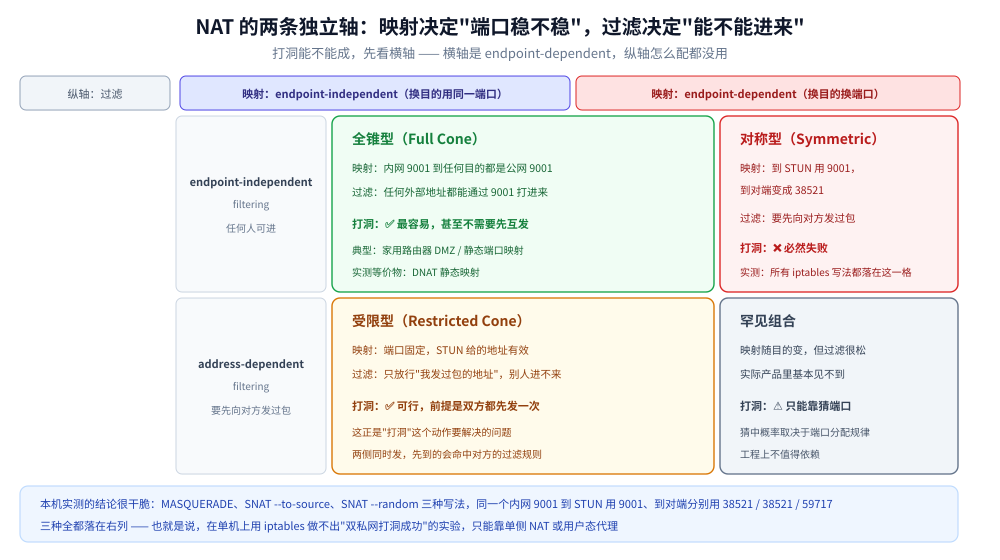
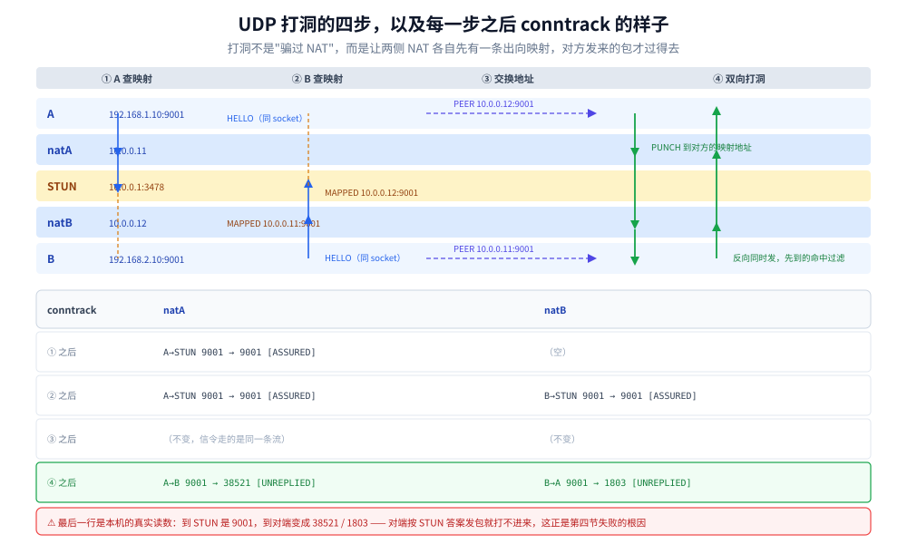
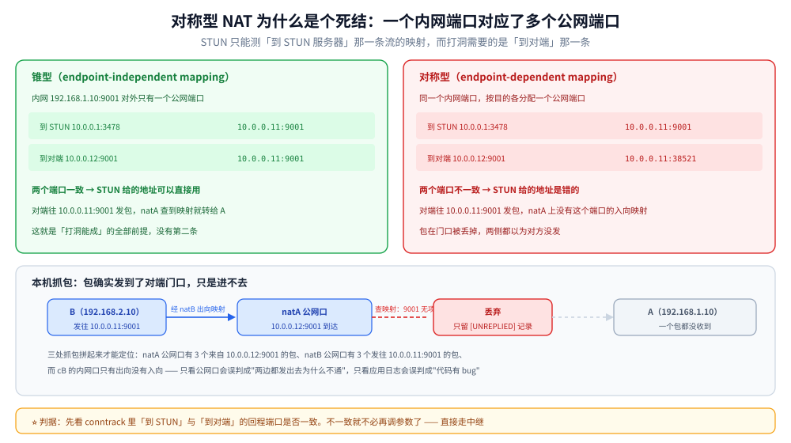

# UDP 打洞与 NAT 穿透

> 覆盖：NAT 维护的**映射**与**过滤**两张表、STUN 查询到的地址为什么经常用不上、打洞的四步时序与它成立的前提、对称型 NAT 为什么必然打不通（含 conntrack 与抓包证据）、四类 NAT 的判据，以及打不通时的三条出路。
>
> 不覆盖：TCP 打洞（需要 `SO_REUSEADDR` 与 TTL 技巧，机制与 UDP 差别大）不在本篇；NAT 的地址改写与 conntrack 超时表见 [NAT与连接跟踪.md](../../网络层与寻址/NAT与连接跟踪.md)；组播与广播的可达范围见 [组播与广播机制.md](组播与广播机制.md)；UDP 的首部与接收队列见 [UDP与数据报传输.md](UDP与数据报传输.md)；WebRTC 的完整信令与媒体协商属应用层，本篇只讲它的连通性检查（ICE）依赖的底层行为。
>
> 内容整理自个人学习笔记，NAT 行为分类依据 [RFC 4787](https://www.rfc-editor.org/rfc/rfc4787.html)，STUN 依据 [RFC 8489](https://www.rfc-editor.org/rfc/rfc8489.html)，ICE 依据 [RFC 8445](https://www.rfc-editor.org/rfc/rfc8445.html)，素材见 [素材清单](../../../../素材清单.md)。
>
> ✅ 实测口径：全文的拓扑、conntrack 读数、抓包与打洞结果均为**本机容器实测**（Linux `alpine:3.21`，容器内 `ip netns` 建 5 个命名空间：一台公网机、两个 NAT 网关、两台内网主机，用 `iptables` 做 SNAT/MASQUERADE，自写 STUN + rendezvous + 打洞程序，2026-10-24）；⚠️ **未实测**硬件路由器 / 运营商 NAT 的四类行为（本机只有 iptables 一种实现）、TCP 打洞、以及真实公网下的丢包与延迟。

---

## 一、两个私网主机为什么互相发不通？

**本节要点**：因为它们各自看到的「对方地址」都是私网地址，**出了自己的网段就没人认识**。NAT 的作用是把这个地址换成一个公网地址，但换完之后只保证「**出向**能回来」，**入向**能不能进取决于另一张表。

### 1.1 先看现场：双私网 100% 丢包

实验拓扑（全部在一个容器里用 `ip netns` 搭，不是模拟器）：

```text
pub (10.0.0.1) ──── br0 ──── natA (10.0.0.11 / 192.168.1.1) ──── brA ──── cA (192.168.1.10)
                     │
                     └────── natB (10.0.0.12 / 192.168.2.1) ──── brB ──── cB (192.168.2.10)
```

两个 NAT 网关都是真的 `iptables` 规则 + `ip_forward=1`，内网主机以它为默认网关。先验证三个事实：

```text
===== 连通性：cA -> pub =====
2 packets transmitted, 2 packets received, 0% packet loss      ← 经 NAT 出公网，通

===== 连通性：cA -> cB（应不通，两侧都是私网） =====
2 packets transmitted, 0 packets received, 100% packet loss     ← 直接互访，不通

===== NAT 规则 =====
-A POSTROUTING -o eth0 -j MASQUERADE                            ← 两个网关各一条
```

`cA` 知道 `cB` 的地址是 `192.168.2.10`，但把这个地址交给内核后，`natA` 查路由发现 `192.168.2.0/24` 不在自己认识的范围里，包到不了；就算到了 `natB`，`natB` 也不知道该转给谁（它没有 `192.168.2.10` 的入向映射）。

### 1.2 NAT 维护的是两张表，不是一张

很多人把 NAT 理解成「地址转换」，但它实际维护两张独立的表，**打洞能不能成，本质是这两张表的配合**：

| 表 | 作用 | 建立时机 | 本机观察手段 |
|---|---|---|---|
| **映射表**（mapping） | 内网 `IP:port` ↔ 公网 `IP:port` | 内网**第一次出向发包**时建 | `conntrack -L -p udp` 里的 `src=...sport=...` 与回程 `dport=...` |
| **过滤表**（filtering） | 外部哪些源地址允许发进来 | 同上，但规则比映射**更窄** | 抓包看「公网口收到了、内网口没收到」 |

⭐ 关键：**映射存在 ≠ 入向可达**。一个「全锥型」NAT 的映射建好后，**任何**外部地址都能通过它打进来；而「地址受限型」只允许「你曾经发过包的那些地址」打进来。前者是打洞最容易成功的环境，后者也还能靠「先向对方发一次」解决，**对称型则直接没戏**（第四节）。

### 1.3 映射与过滤是两个独立轴

RFC 4787 把 NAT 行为拆成两个互不影响的维度，这是理解打洞的唯一框架：



图的读法是「先看横轴再看纵轴」：横轴决定**你的公网端口稳不稳定**（同一个内网端口到不同目标是否复用同一个公网端口），纵轴决定**别人能不能主动打进来**（是否需要你先向对方发过包）。

| 组合 | 通俗叫法 | 映射 | 过滤 | 打洞可行性 |
|---|---|---|---|---|
| EIM + EIF | **全锥型**（Full Cone） | 端口固定 | 任何人可进 | ✅ 最容易 |
| EIM + ADF | **地址受限 / 端口受限**（Restricted Cone） | 端口固定 | 要先向对方发过包 | ✅ 可行（先互发一次） |
| EDM + ADF | **对称型**（Symmetric） | **端口随目的变** | 要先向对方发过包 | ❌ 不可行 |
| EDM + EIF | 理论上存在，实际罕见 | 端口随目的变 | 任何人可进 | ⚠️ 靠猜端口 |

⭐ 表里最重要的是第三行：**对称型的「端口随目的变」直接摧毁了打洞的前提**——对端拿到的那个地址，是「你到 STUN 服务器的映射」，不是「你到他的映射」，两个端口根本不是一个。

---

## 二、STUN 告诉你的地址，和你实际用的地址是同一个吗？

**本节要点**：STUN 只能告诉你「**你到 STUN 服务器这条流**在 NAT 上的映射」。如果 NAT 的映射是 endpoint-dependent（端口随目的变），这个答案对「发往对端」的流**完全不适用**。这是打洞失败最常见、也最难自查的原因。

### 2.1 一次 STUN 查询的读数

自写的 STUN/rendezvous 服务跑在公网机上，两端各查一次自己的映射地址：

```text
########## 服务端看到的注册 ##########
REGISTER name=B mapped=10.0.0.12:9001
REGISTER name=A mapped=10.0.0.11:9001

########## A 端 ##########
MAPPED 10.0.0.11:9001
PEER addr=10.0.0.12:9001
```

看起来很完美：A 知道了自己对外是 `10.0.0.11:9001`，B 是 `10.0.0.12:9001`。两端的内网端口都是 9001，公网端口**也**是 9001，看起来 NAT 保住了端口。

于是双方开始互发（这才是打洞），结果：

```text
RESULT name=A mapped=10.0.0.11:9001 peer=10.0.0.12:9001 got_peer=true tx_punch=26 rx_peer=0
VERDICT A: PUNCH_FAIL（一个对端包都没收到）

RESULT name=B mapped=10.0.0.12:9001 peer=10.0.0.11:9001 got_peer=true tx_punch=29 rx_peer=0
VERDICT B: PUNCH_FAIL（一个对端包都没收到）
```

A 发了 26 个包，B 发了 29 个，**双方一个都没收到**。

### 2.2 conntrack 里看到的真相

去两个 NAT 网关上读连接跟踪表，问题立刻显形：

```text
--- natA（10.0.0.11 这台网关） ---
udp  17 27 src=192.168.1.10 dst=10.0.0.12 sport=9001 dport=9001 [UNREPLIED]
           src=10.0.0.12 dst=10.0.0.11 sport=9001 dport=38521       ← A→B 的映射端口是 38521
udp  17 117 src=192.168.1.10 dst=10.0.0.1 sport=9001 dport=3478       ← A→STUN 的映射端口是 9001
           src=10.0.0.1 dst=10.0.0.11 sport=3478 dport=9001
udp  17 27 src=10.0.0.12 dst=10.0.0.11 sport=9001 dport=9001 [UNREPLIED]
           src=10.0.0.11 dst=10.0.0.12 sport=9001 dport=9001
```

⭐ 对比第一条与第二条：**同一个内网 socket `192.168.1.10:9001`，到 STUN 用的是公网端口 `9001`，到 B 用的是 `38521`**。

也就是说：

- A 通过 STUN 学到的是 `10.0.0.11:9001`；
- 但 A 实际发往 B 时，NAT 给它分配的是 `10.0.0.11:38521`；
- B 按 STUN 答案往 `10.0.0.11:9001` 发包，`natA` 上**没有这个端口的入向映射**（它只属于「到 STUN」那条流），包被丢掉。

`natA` 的 conntrack 第三条也印证了这一点：`src=10.0.0.12 dst=10.0.0.11 sport=9001 dport=9001 [UNREPLIED]` —— B 的包确实到了 `natA`，但它作为一条**新的入向流**被记录，没有任何 DNAT 规则把它转给 `cA`。

### 2.3 为什么端口会变

因为 Linux conntrack 在分配 NAT 端口时，要求「**NAT 后的 `IP:port` 在全局唯一**」，而它检查的唯一性**不看目的地址**：

- A→STUN 已经占用了 `10.0.0.11:9001`；
- A→B 想再用 `9001` 时，内核认为这个「公网 `IP:port`」已被占用，于是从 `1024-65535` 里另挑一个（实测挑了 `38521`）。

⚠️ 这个实现细节直接导致了一个广泛流传的错误结论：「Linux 的 `iptables` MASQUERADE 是锥型 NAT，可以做打洞实验」。**本机实测不是**——它在 UDP 上表现为 endpoint-dependent mapping（端口随目的变），也就是对称型。第四节会把四种写法全试一遍。

---

## 三、打洞的完整时序是什么？

**本节要点**：打洞不是「骗过 NAT」，而是**让两侧 NAT 各自先建立一条出向映射**，然后对方发来的包才能通过过滤检查。所以它的前提只有一条：**对方拿到的地址端口，必须是你 NAT 上真实存在的那条映射**。

### 3.1 四步



图上标了每一步之后 conntrack 表的状态，这是理解打洞最有用的视角：

| 步 | 动作 | natA 的 conntrack | natB 的 conntrack |
|---|---|---|---|
| ① | A → STUN 查映射 | 新增 A→STUN（`[ASSURED]`） | — |
| ② | B → STUN 查映射 | — | 新增 B→STUN（`[ASSURED]`） |
| ③ | 信令交换彼此的公网地址 | 不变 | 不变 |
| ④ | A → B 的公网地址、B → A 的公网地址 | 新增 A→B（`[UNREPLIED]`） | 新增 B→A（`[UNREPLIED]`） |

⭐ 第 ④ 步两个方向的包是**同时**发的，谁先到谁后到不重要：**先到的那一方会命中对方 NAT 上的过滤规则**（因为对方也已经发出了），从而被放行。这就是「打洞」这个词的由来——两边各在墙上凿一个洞，正好对上。

### 3.2 单侧 NAT：实测成功

把 cA 改成直接接在公网（`10.0.0.21`），只有 cB 在 NAT 后，同样的程序立刻成功：

```text
cA(公网)=10.0.0.21/24
cB(私网)=192.168.2.10/24
连通性 cB -> cA: OK

--- A（公网侧）---
MAPPED 10.0.0.21:9001
PEER addr=10.0.0.12:9001
RESULT name=A mapped=10.0.0.21:9001 peer=10.0.0.12:9001 got_peer=true tx_punch=34 rx_peer=31
VERDICT A: PUNCH_OK（收到对端 31 个包）

--- B（NAT 后）---
MAPPED 10.0.0.12:9001
PEER addr=10.0.0.21:9001
RESULT name=B mapped=10.0.0.12:9001 peer=10.0.0.21:9001 got_peer=true tx_punch=31 rx_peer=31
VERDICT B: PUNCH_OK（收到对端 31 个包）
```

双向各收到 31 个包。但**要看清楚它是怎么成功的**：

```text
--- natB conntrack ---
udp 17 119 src=192.168.2.10 dst=10.0.0.21 sport=9001 dport=9001
           src=10.0.0.21 dst=10.0.0.12 sport=9001 dport=1803     ← B→A 的映射端口是 1803
udp 17  29 src=10.0.0.21 dst=10.0.0.12 sport=9001 dport=9001 [UNREPLIED]
           src=10.0.0.12 dst=10.0.0.21 sport=9001 dport=9001
```

- B 到 A 的映射端口是 **1803**，不是 STUN 报的 9001（同一个 NAT，换个目的就换端口，和 2.2 是同一个现象）；
- A 主动发到 `10.0.0.12:9001` 的包，**同样进不来**（第三条是它在 `natB` 上留下的无映射记录）；
- 那为什么 B 还收到了 31 个？因为 A 收到 B 的包之后，**回给了实际源地址** `10.0.0.12:1803`——这是 `1803` 对应的映射，能进。

⭐ 所以这次「成功」的本质是：**NAT 后的主机主动发起，公网主机按源地址回包**。这是最常见的客户端→服务器模型，不需要打洞。真正的「双私网打洞」需要两侧 NAT 都保端口，本机做不到（见 4.1）。

### 3.3 为什么必须同一个 socket

这是打洞实现里最容易写错的一条：**STUN 查询与打洞发包必须用同一个 socket（同一个本地端口）**。

原因很直接：NAT 的映射是**按内网 `IP:port` 建的**。如果查 STUN 用 9001、打洞用 9002，那查到的映射是 9001 的，而真正发包时用的是 9002 的映射——对端拿到的地址无效，和 2.2 的失败是同一个原因。

对应的代码约束：**先 `bind` 再 `connect`/`sendto`，全程不重建 socket**。用 `net.DialUDP` 之后再 `Close` 重开，映射就断了。

---

## 四、对称型 NAT 为什么打不通？

**本节要点**：因为对称型的映射是 **endpoint-dependent**——**同一个内网端口，发往不同目的会用不同的公网端口**。STUN 只能测「到 STUN 的那一条」，对方拿到的地址在「到对方的那一条」上不存在，于是必然失败。这是**协议层面的死结**，不是参数没调对。

### 4.1 四种配置的实测表

在同一个拓扑上换 `iptables` 规则，看映射行为与打洞结果：

| # | NAT 规则 | A→STUN 的映射 | A→B 的映射 | 端口是否一致 | 打洞结果 |
|---|---|---|---|---|---|
| 1 | `MASQUERADE` | `9001` | **`38521`** | ❌ | 失败（`rx_peer=0`） |
| 2 | `SNAT --to-source 10.0.0.11` | `9001` | **`38521`** | ❌ | 失败（`rx_peer=0`） |
| 3 | `SNAT --to-source 10.0.0.11 --random` | `15194` | **`59717`** | ❌ | 失败（`rx_peer=0`） |
| 4 | `SNAT --to-source 10.0.0.11:9001-9001` | `9001` | **无（端口冲突，项直接不存在）** | — | 失败（包发不出去） |
| 5 | 单侧 NAT（cA 在公网） | `9001` | `1803`（B 侧） | 部分一致 | **成功**（靠回给源地址） |

四组配置、四种写法，**没有一组能做出「同一内网 socket 到不同目标复用同一公网端口」**。

第 4 组尤其值得记：`--to-source` 指定固定端口后，`-p udp` 的所有出向流都想用 `10.0.0.11:9001`，而 A→STUN 已经占用了它，于是 A→B 那条 **NAT 项根本没建起来**，包直接被丢。表里「项直接不存在」就是这个意思。

```text
--- natA conntrack（cone 模式，只剩两条） ---
udp  17 119 src=192.168.1.10 dst=10.0.0.1 sport=9001 dport=3478    ← 到 STUN 的还在
           src=10.0.0.1 dst=10.0.0.11 sport=3478 dport=9001
udp  17  29 src=10.0.0.12 dst=10.0.0.11 sport=9001 dport=9001
           src=10.0.0.11 dst=10.0.0.12 sport=9001 dport=9001         ← 只剩 B 打进来的
```

### 4.2 抓包证据：包到了门口却进不来



图的上半是两张映射表，差别只有一行数字——`9001` 与 `38521`。就是这一行之差决定了成败：`natA` 只认自己表里有的端口，对端拿着旧答案来敲门，直接被拒。

失败时最容易产生错觉的是「我以为它没发出去」。抓三处，链路就清楚了：

```text
===== natA 公网口（10.0.0.11 eth0） =====
16:52:30.686758 IP 10.0.0.12.9001 > 10.0.0.11.9001: UDP, length 7     ← B 的包到了 natA
16:52:30.887806 IP 10.0.0.12.9001 > 10.0.0.11.9001: UDP, length 7
16:52:31.088744 IP 10.0.0.12.9001 > 10.0.0.11.9001: UDP, length 7
16:52:31.309276 IP 10.0.0.11.38521 > 10.0.0.12.9001: UDP, length 7    ← A 的包以 38521 出去

===== natB 公网口（10.0.0.12 eth0） =====
16:52:30.686750 IP 10.0.0.12.9001 > 10.0.0.11.9001: UDP, length 7     ← B 发出的
16:52:31.309286 IP 10.0.0.11.38521 > 10.0.0.12.9001: UDP, length 7    ← A 的发到了 natB

===== cB 内网口 =====
16:52:30.686643 IP 192.168.2.10.9001 > 10.0.0.11.9001: UDP, length 7  ← 只有出向
16:52:31.697995 IP 192.168.2.10.9001 > 10.0.0.11.9001: UDP, length 7
```

三方读数拼起来就是完整的因果链：

1. **B 的包到了 `natA` 的公网口**（源端口 9001，正是 STUN 报的端口）；
2. **A 的包以源端口 38521 出去**，到达 `natB` 的公网口（目的 9001）；
3. **`natB` 的内网口只有出向、没有入向** —— A 的包在 `natB` 门口被丢了，因为 `natB` 上 9001 端口没有指向 B 的入向映射（B 的映射是 1803）。

⭐ 判据：**看内网口有没有入向包**。只看公网口会误判成「两边都发出去了，怎么还不通」；只看应用日志会误判成「代码有 bug」。三层一起看，问题定位在三秒内。

### 4.3 在 Linux 上做打洞实验的陷阱

这一节的结论对写实验代码的人最有价值：

- **`MASQUERADE` 不是锥型**。它保端口的只是「第一条流」，换目的就换端口（2.2 已证）；
- **`SNAT --to-source` 不带端口也不是锥型**，行为与 `MASQUERADE` 一致；
- **`SNAT --to-source ip:port-port` 固定端口会冲突**，因为 conntrack 要求公网 `IP:port` 全局唯一（不看目的）；
- 于是**在单机上用 `iptables` 做不出「双私网打洞成功」的实验**——想验证成功路径，只能用单侧 NAT（3.2），或者用用户态代理自己实现一张「按内网 socket 索引」的映射表。

⚠️ 所以凡是在 Linux 容器里「演示打洞成功」的文章，都要看一眼它是不是偷偷用了单侧 NAT、或者干脆把两端的包都放行了。

---

## 五、四类 NAT 怎么区分？

**本节要点**：不用背名字，用两个动作就能测出来：**换一个 STUN 服务器看映射端口变不变**（测映射轴），**让第三方地址主动打进来**（测过滤轴）。

### 5.1 两轴四象限

回到 1.3 的那张图，把「怎么测」补进去：

| 要测什么 | 怎么测 | 结果解读 |
|---|---|---|
| **映射是否 endpoint-independent** | 用**两个不同地址**的 STUN 服务器各查一次 | 端口相同 → EIM；不同 → EDM（对称型） |
| **过滤是否 address-dependent** | 让一个**没打过交道的第三方**向你的映射地址发包 | 能收到 → EIF（全锥）；收不到 → ADF |
| **过滤是否 port-dependent** | 让「打过交道的地址」用**另一个端口**发 | 能收到 → 地址受限；收不到 → 端口受限 |

⭐ 顺序很重要：**先测映射**。映射是 EDM（对称型）的话，后面两项不用测了——打洞已经不可能，直接走中继。

### 5.2 本机 iptables 落在哪一格

按上表给本机三种配置定位：

| 配置 | 映射轴 | 过滤轴 | 归类 |
|---|---|---|---|
| `MASQUERADE` | EDM（换目的换端口） | ADF（要先出向） | **对称型** |
| `SNAT --to-source ip` | EDM | ADF | **对称型** |
| `SNAT --to-source ip --random` | EDM（更彻底） | ADF | **对称型** |

三种配置全落在同一格。这也解释了为什么 4.1 的四组实验没有一个能打通——**它们本质上是同一种 NAT**。

---

## 六、打不通时还有哪些路？

**本节要点**：对称型 NAT 下打洞是死路，只有两条出路——**中继（TURN）** 或者 **换传输层**（QUIC 的连接迁移不解决 NAT 穿透，但 TCP/QUIC 的单向连接能覆盖大部分客户端场景）。

### 6.1 中继（TURN）

思路最简单：**双方都主动连到公网上的中继服务器**，由它转发。因为是双向出向连接，任何类型的 NAT 都拦不住。

| 项 | 说明 |
|---|---|
| 成本 | 带宽全走中继，服务器要扛全量流量（视频场景代价极高） |
| 延迟 | 多一跳，且可能是跨地域的回源 |
| 可靠性 | **最高**——不依赖 NAT 类型，只要能出网就行 |
| 用在哪 | ICE 的最后一个候选（`relay`），只有在 `host` / `srflx` 都失败时才用 |

### 6.2 端口预测

对称型 NAT 的端口通常有规律（递增或按块分配），理论上可以「猜」下一个端口。实际工程里**几乎不用**：

- 各厂商实现差异极大，规律不稳定；
- 猜错就是白发包，还会被 IDS 当成扫描；
- 猜对的比例远低于中继的可靠性。

### 6.3 ICE 的候选对

WebRTC 的做法不是「选一种方案」，而是**把所有可能都列出来逐个试**：

| 候选类型 | 来源 | 何时有效 |
|---|---|---|
| `host` | 本机网卡地址 | 同一局域网内直连 |
| `srflx` | STUN 查到的映射地址 | 锥型 / 受限型 NAT，打洞成功 |
| `relay` | TURN 中继地址 | 对称型 NAT，打洞失败时的兜底 |

⭐ 所以「WebRTC 能穿透所有 NAT」这个说法**不准确**：它穿透不了的场景是靠 `relay` 兜住的，代价是带宽。真正决定成本的是**候选对里 `relay` 的占比**——这个比例在监控里叫「中继率」，是对称型用户占比的直接指标。

---

## 七、应用场景

| 场景 | 能不能只靠打洞 | 说明 |
|---|---|---|
| **P2P 文件传输** | 大部分可以 | 双方都是家用宽带时多为锥型/受限型，中继率通常很低 |
| **视频会议 / 音视频通话** | 可以，但要备中继 | 企业网络常见对称型，必须部署 TURN |
| **游戏联机** | 可以 | 主机模式（一个玩家当 server）本质是单侧直连 |
| **远程桌面 / 内网穿透** | 通常不用打洞 | 更常见的是反向隧道（内网主动连公网服务器） |
| **IoT 设备上报** | ❌ 不需要 | 设备主动连云端，走单侧 NAT 场景（3.2）即可 |
| **跨运营商 P2P** | 难 | 双方都可能在对运营商级 NAT（CGNAT）后面，几乎必然中继 |

⭐ 判据：**「双方是否都能接受一个公网端点」**。能接受就是单侧场景，不需要打洞；不能接受（必须是点对点）才需要打洞，并且必须准备中继兜底。

---

## 八、具体使用

### 8.1 Go（STUN 查询 + 打洞循环）

核心约束：**一个 socket 走完全程**，不许中途重建。

```go
// punch 用同一个 socket 完成：注册 -> 查对端 -> 双向打洞
func punch(stunAddr, name, peerName, local string, dur time.Duration) error {
	saddr, err := net.ResolveUDPAddr("udp4", stunAddr)
	if err != nil {
		return err
	}
	laddr, err := net.ResolveUDPAddr("udp4", local) // 固定本地端口，例如 ":9001"
	if err != nil {
		return err
	}
	// ⚠️ 只 bind 一次，后续所有收发都用这个 conn
	conn, err := net.ListenUDP("udp4", laddr)
	if err != nil {
		return err
	}
	defer conn.Close()

	conn.WriteToUDP([]byte("HELLO "+name), saddr)

	var peer *net.UDPAddr
	deadline := time.Now().Add(dur)
	buf := make([]byte, 2048)

	for time.Now().Before(deadline) {
		// 每秒问一次对端地址（信令，走 STUN 服务器）
		conn.WriteToUDP([]byte("PEER "+peerName), saddr)
		// 知道对端后，每 200ms 向对方的映射地址发包（这就是打洞）
		if peer != nil {
			conn.WriteToUDP([]byte("PUNCH "+name), peer)
		}

		conn.SetReadDeadline(time.Now().Add(100 * time.Millisecond))
		n, src, err := conn.ReadFromUDP(buf)
		if err != nil {
			continue // 超时正常，继续循环
		}
		fields := strings.Fields(string(buf[:n]))
		switch fields[0] {
		case "PEER": // "PEER <ip> <port>"
			peer = &net.UDPAddr{IP: net.ParseIP(fields[1]), Port: atoi(fields[2])}
		case "PUNCH": // 收到对方的洞，回一个确认
			conn.WriteToUDP([]byte("PUNCH-ACK "+name), src)
		case "PUNCH-ACK":
			return nil // 打通了
		}
	}
	return errors.New("punch timeout")
}
```

⚠️ 三个必须注意的点：

- **`net.UDPAddr` 里的 `Port` 要用 `strconv.Atoi` 解析并校验范围**，不要用 `fmt.Sscanf` 直接扫进指针（出错时 `Port` 会是 0，包发到 0 端口）；
- **`SetReadDeadline` 不要设太长**，它决定了打洞循环的节奏；设成 5 秒会让你每 5 秒才发一次包，对端早就放弃了；
- **不要用 `net.DialUDP`**，connected socket 只能收「已连接对端」的包，而打洞阶段需要收 STUN 服务器与对端两个源。

### 8.2 Java（DatagramChannel）

Java 侧同理，用 `DatagramChannel` 比 `DatagramSocket` 更适合「同一个 socket 收多个源」：

```java
import java.net.*;
import java.nio.ByteBuffer;
import java.nio.channels.DatagramChannel;
import java.nio.charset.StandardCharsets;

public class PunchClient {
    static void run(String stunHost, int stunPort, String name, String peerName, int localPort) throws Exception {
        InetSocketAddress stun = new InetSocketAddress(stunHost, stunPort);

        // 不 connect，保持非连接状态，才能同时收 STUN 与对端
        try (DatagramChannel ch = DatagramChannel.open()) {
            ch.bind(new InetSocketAddress(localPort)); // 固定本地端口，全程不换
            ch.configureBlocking(false);

            ch.send(ByteBuffer.wrap(("HELLO " + name).getBytes(StandardCharsets.UTF_8)), stun);

            ByteBuffer buf = ByteBuffer.allocate(2048);
            InetSocketAddress peer = null;
            long deadline = System.currentTimeMillis() + 8000;

            while (System.currentTimeMillis() < deadline) {
                ch.send(ByteBuffer.wrap(("PEER " + peerName).getBytes(StandardCharsets.UTF_8)), stun);
                if (peer != null) {
                    ch.send(ByteBuffer.wrap(("PUNCH " + name).getBytes(StandardCharsets.UTF_8)), peer);
                }

                buf.clear();
                SocketAddress src = ch.receive(buf);
                if (src != null) {
                    buf.flip();
                    String msg = StandardCharsets.UTF_8.decode(buf).toString();
                    String[] f = msg.trim().split("\\s+");
                    switch (f[0]) {
                        case "PEER" -> peer = new InetSocketAddress(f[1], Integer.parseInt(f[2]));
                        case "PUNCH" -> ch.send(ByteBuffer.wrap(("PUNCH-ACK " + name).getBytes(StandardCharsets.UTF_8)), src);
                        case "PUNCH-ACK" -> { System.out.println("PUNCH_OK from " + src); return; }
                    }
                }
                Thread.sleep(100);
            }
            System.out.println("PUNCH_FAIL");
        }
    }
}
```

### 8.3 排障命令

打洞问题的排查顺序必须是「**先看 NAT 表，再看三个位置的抓包**」，不要先加日志：

```bash
# ① 两侧 NAT 的映射表（最关键的一步：对比"到 STUN"与"到对端"的端口）
conntrack -L -p udp | grep -E 'sport=9001|dport=9001'
#   看回程 dport 是否一致：一致 → EIM；不一致 → 对称型，打洞必失败

# ② STUN 报的地址（应用侧打印或抓包）
tcpdump -n -i eth0 'udp port 3478'

# ③ 打洞包到了哪一跳（公网口 vs 内网口）
tcpdump -n -i <公网接口> 'udp and port 9001'   # NAT 外侧
tcpdump -n -i <内网接口> 'udp and port 9001'   # NAT 内侧：有没有"入向"包

# ④ 映射存活时间（UDP 的 conntrack 超时很短，保活必须比它勤）
sysctl net.netfilter.nf_conntrack_udp_timeout            # 常见 30
sysctl net.netfilter.nf_conntrack_udp_timeout_stream     # 常见 120（有回包后升级）
```

⚠️ 第 ④ 步是很多「打通了但过一会儿又断」的根因：**UDP 映射默认只有 30 秒**（见 [NAT与连接跟踪.md](../../网络层与寻址/NAT与连接跟踪.md) 第五节），所以打洞后必须**周期性发保活包**，间隔要显著小于 30 秒（工程上常用 10~15 秒）。保活包不需要带业务数据，一个字节足够。

---

## 延伸追问

- **为什么我不打洞，直接连对端的私网地址不行？** → 私网地址（`192.168.x` / `10.x`）出了自己的网段就没有意义，中间的路由器不认。要么两端在同一网段（那就不需要 NAT 穿透），要么必须走公网地址。
- **`MASQUERADE` 和 `SNAT` 在打洞上有区别吗？** → 本机实测**没有**：两者都是 endpoint-dependent（换目的换端口），见 4.1 的第 1、2 组。差别只在「源地址是自动取接口地址还是手工指定」。
- **为什么 UDP 的 NAT 映射比 TCP 短这么多？** → UDP 没有连接状态，NAT 只能靠超时判断「还用不用」。TCP 有 FIN/RST 可以显式回收，所以状态可以挂很久。这也是打洞必须保活的直接原因。
- **打洞成功后，流量还经过 STUN 服务器吗？** → 不经过。STUN 只在「查地址 + 交换地址」阶段用到，打洞成功后是两点直连。这也是 P2P 省带宽的原理。
- **IPv6 还需要打洞吗？** → 不需要。IPv6 没有 NAT，双方都有全球可达地址，直连即可。真正的障碍退化成「防火墙是否放行入向」，属于策略问题而不是地址转换问题。
- **TCP 打洞为什么比 UDP 难？** → 因为 TCP 的「同时打开」（simultaneous open）要求两端**几乎同时**发 SYN，且需要 `SO_REUSEADDR`、TTL 递减等技巧，成功率远低于 UDP。所以主流方案（WebRTC、QUIC）都优先 UDP。

## 关联

- **上游/总纲**：[NAT与连接跟踪.md](../../网络层与寻址/NAT与连接跟踪.md) — SNAT / DNAT、conntrack 五元组与超时表；本篇用到的映射与过滤都建立在那套机制上
- **上游/总纲**：[UDP与数据报传输.md](UDP与数据报传输.md) — 数据报语义与接收队列丢包；打洞的保活包为什么必须足够小、足够频繁
- **对照/互补**：[组播与广播机制.md](组播与广播机制.md) — 另一种「一份数据多个接收者」的 UDP 用法，但走的是二层泛洪而不是单播穿越
- **对照/互补**：[IP与路由基础.md](../../网络层与寻址/IP与路由基础.md) — 私网地址为什么不可路由、CIDR 与默认网关的作用
- **对照/互补**：[QUIC底层传输机制.md](QUIC底层传输机制.md) — QUIC 的连接迁移能应对「路径变化」，但不解决「初始不可达」；两者常被混为一谈
- **下游机制**：[通信选型.md](../../选型/通信选型.md) — 单播 / 组播 / 打洞 / 中继的横向选型
- **下游机制**：[限流算法.md](../../../../04-架构与系统/分布式/稳定性/限流算法.md) — TURN 中继是全量带宽成本，必须有准入与限速
