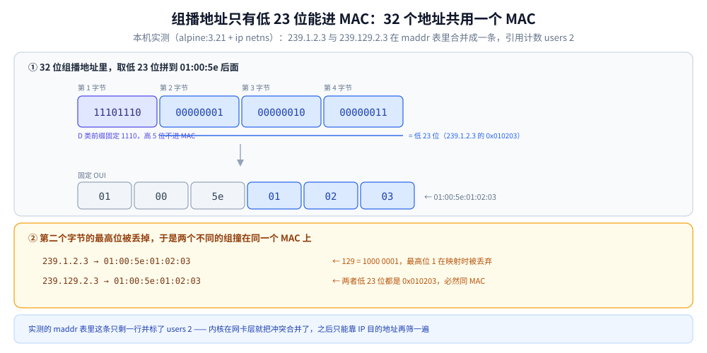
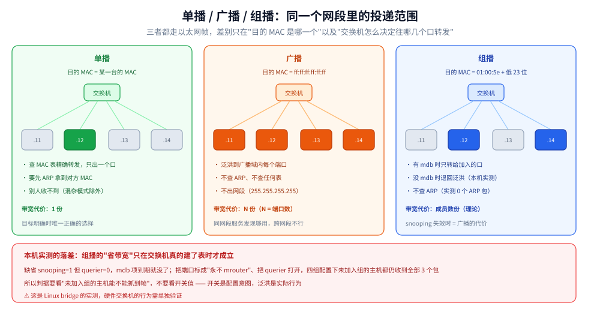
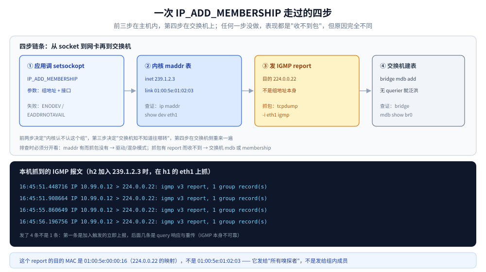

# 组播与广播机制

> 覆盖：IPv4 组播地址与它的 MAC 映射、加入组播组时内核做了什么（IGMP 报文与 `maddr` 表）、为什么「加入组才收得到」而网卡上早就抓得到帧、二层 snooping 为什么经常等于没开、TTL 与组播的作用域，以及广播的三种形态与它们的可达范围。
>
> 不覆盖：组播路由协议（PIM-SM / PIM-DM）与跨网段的组播转发——本机做不出多跳组播，只在第五节说清边界；UDP 的首部、校验和与接收队列丢包见 [UDP与数据报传输.md](UDP与数据报传输.md)；IPv6 侧的 MLD 与 NDP 见 [IPv6与双栈.md](../../网络层与寻址/IPv6与双栈.md) 第三、四节；二层转发与 VLAN 见 [以太网与二层转发.md](../../数据链路层/以太网与二层转发.md)。
>
> 内容整理自个人学习笔记，组播地址分配依据 [RFC 5771](https://www.rfc-editor.org/rfc/rfc5771.html)，IGMPv3 依据 [RFC 3376](https://www.rfc-editor.org/rfc/rfc3376.html)，IPv4 组播到以太网的映射依据 [RFC 1112](https://www.rfc-editor.org/rfc/rfc1112.html) 第 6.4 节，素材见 [素材清单](../../../../素材清单.md)。
>
> ✅ 实测口径：全文的 MAC 映射、`maddr` 表、IGMP 报文、snooping 三组对照、TTL 与 ARP 观察均为**本机容器实测**（Linux `alpine:3.21`，容器内用 `ip netns` 建一个 bridge `br0` 挂三台虚拟主机，2026-10-24）；⚠️ **未实测**跨网段组播转发（需要 PIM，本机只有单跳网段）与硬件交换机的 snooping 行为（本机只有 Linux bridge）。

---

## 一、组播地址是怎么变成 MAC 地址的？

**本节要点**：IPv4 组播地址是 **D 类（`224.0.0.0/4`）**，它没有「组播 MAC」可用——以太网只给了 23 位，所以 **28 位的组播地址被压进 23 位，天然有 32:1 的冲突**。这不是实现缺陷，是设计上的取舍。

### 1.1 D 类地址的三段用途

`224.0.0.0/4` 这一整个块都是组播，但里面按「谁能用、能走多远」又切成了三段：

| 段 | 范围 | 语义 | 典型地址 |
|---|---|---|---|
| **链路本地** | `224.0.0.0/24` | 永远不出本链路，**TTL 必须是 1**，路由器不转发 | `224.0.0.1` 全主机、`224.0.0.2` 全路由器、`224.0.0.22` IGMPv3 report |
| **预留 / 协议分配** | `224.0.1.0/24` ~ `224.0.255.0/24` | IANA 分配的公共协议用 | `224.0.0.251` mDNS、`224.0.0.252` LLMNR |
| **管理范围** | `239.0.0.0/8` | 私有组播，和 `10.0.0.0/8` 一个意思，**不同组织可以各用各的** | 本篇实验用的 `239.1.2.3` |

⭐ 判据看**第一段**：看到 `224.0.0.x` 就知道它不该被路由，看到 `239.x` 就知道这是「内网自己定义的组播」。中间那段（`224.0.1.x`）是 IANA 的公共池，实际项目里极少自己用。

### 1.2 01:00:5e 与低 23 位

以太网组播 MAC 的前 24 位固定是 `01:00:5e`，第 25 位（第一个字节的最低位之外的 `0`）留作 OUI 标志，剩下 **只有 23 位**给组播地址用：

```text
IPv4 组播地址（32 位）
  1110 1110 . xxxxxxxx . xxxxxxxx . xxxxxxxx
  └─ D 类 ─┘   └────────── 28 位 ──────────┘

取低 23 位 →  0 . xxxxxxx . xxxxxxxx . xxxxxxxx
                 └──── 只有这么多能进 MAC ────┘

MAC = 01:00:5e : 0 + 低23位
```



图里上半是位运算，下半是它的直接后果：第二个字节的最高位在映射时被丢掉，所以 `1` 和 `129` 得到同一个结果。这个 32:1 的比例不是实现缺陷，而是以太网只肯给 23 位导致的——要扩就得改帧格式，代价远大于收益。

本机实测换算（`mcast mac` 子命令，同一套位运算）：

```text
239.1.2.3        -> 01:00:5e:01:02:03  (低23位=0x010203)
239.129.2.3      -> 01:00:5e:01:02:03  (低23位=0x010203)   ← 同一个 MAC
239.255.255.255  -> 01:00:5e:7f:ff:ff  (低23位=0x7fffff)
224.0.0.1        -> 01:00:5e:00:00:01  (低23位=0x000001)
224.0.0.22       -> 01:00:5e:00:00:16  (低23位=0x000016)
```

`239.1.2.3` 与 `239.129.2.3` 只差在第二个字节的最高位（`1` vs `129`），而这一位在映射时被丢掉了，所以两者**落在同一个 MAC 上**。28 位组播空间压到 23 位，比例正好是 2^5 = **32 个组播地址共用一个 MAC**。

### 1.3 32:1 的冲突：一次实测

理论说完要看现场。在 h2 上同时加入 `239.1.2.3` 与 `239.129.2.3`，然后查它的组播 MAC 表：

```text
$ ip netns exec h2 ip maddr show dev eth1 | grep -E "01:00:5e|inet 239"
	link  01:00:5e:00:00:01
	link  01:00:5e:01:02:03 users 2
```

⭐ 注意最后那个 **`users 2`**：内核没有加两条 MAC，而是加了一条并把引用计数标成 2。这说明**冲突在网卡这一层就已经合并了**——后面内核只能靠 IP 目的地址再筛一遍。

这就解释了为什么「同一网段里两个不同的组播组可能互相收到对方的包」：在二层它们根本是同一个 MAC，网卡照单全收。真要隔离，只能靠三层（IP 目的地址）或 VLAN。

### 1.4 广播地址不是一种，是三种

广播没有「组」的概念，只有「范围」的概念，而范围由**地址形态**决定：

| 形态 | 地址 | 谁能收到 | 会不会被路由 |
|---|---|---|---|
| **有限广播** | `255.255.255.255` | 本链路所有主机 | ❌ 永远不转发（路由器丢弃） |
| **定向广播**（子网广播） | 网络号 + 全 1 主机位，如 `10.99.0.255` | 该子网内所有主机 | ⚠️ 取决于路由器 `directed-broadcast`，默认关 |
| **全子网广播**（老叫法） | 同上 | 同上 | 同上 |

本机实测两种都能在同网段收到（各 2 包）：

```text
BCAST to=255.255.255.255:9002 local=10.99.0.11:36014 count=2
BCAST to=10.99.0.255:9002  local=10.99.0.11:51731 count=2
→ h2 各收到 2 个包
```

⭐ 但两者的**代价完全不同**：`255.255.255.255` 是「不查路由表的本地广播」，`10.99.0.255` 要**走一次路由查询**才能确定出接口。这也是为什么很多程序用前者做服务发现（简单），却在多网卡机器上出问题（不知道该从哪块网卡发）——它压根没有路由信息可用。



三者的差别落在两处：**目的 MAC 是哪一个**，以及**交换机怎么决定往哪几个口转发**。注意最右边那句“没有 mdb 时退回泛洪”——本机实测下来，Linux bridge 在绝大多数配置组合里都走的是泛洪这条分支，第四节的四组对照读数会把这件事说透。

---

## 二、加入一个组播组，内核做了哪些事？

**本节要点**：`IP_ADD_MEMBERSHIP` 一次调用，内核要做三件事：**记进 `maddr` 表 → 让网卡接收这个 MAC → 发一个 IGMP report 告诉交换机**。三件事少一件都收不到包（或收不到该收的包）。

### 2.1 一次 `IP_ADD_MEMBERSHIP` 的完整链条



图里最容易混的是中间两步：**`maddr` 表（内核态）与网卡过滤器（硬件/驱动层）是两件事**，前者决定「内核认不认这个组」，后者决定「帧进不进得来」。Linux 把两者绑在一次调用里，但排查时经常只看了其中一边——所以会出现「`maddr` 里有、但网卡没收到」或者反过来。

| 步骤 | 发生在哪 | 观察手段 | 失败表现 |
|---|---|---|---|
| ① `setsockopt(IP_ADD_MEMBERSHIP)` | 应用 → 内核 | 代码返回值 | 报 `ENODEV` / `EADDRNOTAVAIL`（接口不对） |
| ② 加进 `maddr` 表 + 网卡过滤器 | 内核 → 驱动 | `ip maddr show dev X` | 表里有、抓包没——驱动或混杂模式问题 |
| ③ 发 IGMP Membership Report | 主机 → 交换机 | `tcpdump -i X igmp` | 抓不到 report，交换机不知道往哪转 |
| ④ 交换机更新 mdb（或泛洪） | 交换机 | `bridge mdb show` | mdb 没项 → 退回泛洪 |

### 2.2 `maddr` 表：加入前后的差

同一台主机，加入 `239.1.2.3` 前后各查一次：

```text
########## A. 加入前 ##########
8:	eth1
	link  33:33:00:00:00:01          ← IPv6 全节点
	link  01:00:5e:00:00:01          ← IPv4 全主机 224.0.0.1
	link  33:33:ff:fe:12:59
	inet  224.0.0.1
	inet6 ff02::1

########## C. 加入后 ##########
8:	eth1
	link  33:33:00:00:00:01
	link  01:00:5e:00:00:01
	link  33:33:ff:fe:12:59
	link  01:00:5e:01:02:03          ← 新增：239.1.2.3 的 MAC
	inet  239.1.2.3                  ← 新增：组地址本身
	inet  224.0.0.1
	inet6 ff02::1
```

⭐ 判据很简单：**`link` 行是 MAC，`inet` 行是 IP**。看到 `inet 239.x` 才说明这个 socket 真的加入了组；只有 `link 01:00:5e:xx` 可能只是别的东西（比如 `224.0.0.1` 全主机组一直存在，跟你的加入无关）。

顺便注意 `224.0.0.1` 那一条：**所有主机默认就加入了全主机组**，所以「我什么都没加，为什么能收到组播」这个问题，答案通常是收到了 `224.0.0.1` 或 `224.0.0.251` 这类默认组的流量。

### 2.3 IGMP v3 report 为什么发给 224.0.0.22

抓包看加入时到底发了什么：

```text
$ tcpdump -n -r igmp.pcap
16:45:51.448716 IP 10.99.0.12 > 224.0.0.22: igmp v3 report, 1 group record(s)
16:45:51.908664 IP 10.99.0.12 > 224.0.0.22: igmp v3 report, 1 group record(s)
16:45:55.860649 IP 10.99.0.12 > 224.0.0.22: igmp v3 report, 1 group record(s)
16:45:56.196756 IP 10.99.0.12 > 224.0.0.22: igmp v3 report, 1 group record(s)
```

三处细节值得记住：

1. **目的地址是 `224.0.0.22`，不是组地址 `239.1.2.3`**。这是 IGMPv3 与 v2 的重要差别：v2 的 report 直接发给组地址，v3 统一发给 `224.0.0.22`（IGMPv3 Reports 组），具体加入哪个组写在报文体的 group record 里。所以**抓包只按 `igmp` 过滤、不按组地址过滤**，否则会以为「report 没发出去」。
2. **发了 4 条不是 1 条**。第一条是加入触发的立即上报；后面几条是对 query 的响应与重传（IGMP 有随机延迟与重复上报机制，为的是容忍丢包——IGMP 本身也不可靠）。
3. **目的 MAC 是 `01:00:5e:00:00:16`**（`224.0.0.22` 的映射），不是 `01:00:5e:01:02:03`。也就是说**这个 report 是发给「所有 IGMPv3 嗅探者」的，交换机正是靠它建表**。

---

## 三、为什么「没加入组」也能在网卡上抓到包？

**本节要点**：一条铁律——**「帧到没到网卡」和「socket 收不收得到」是两个独立的判定**。组播帧默认会被泛洪到同一广播域的每个端口，但内核只会把它交给真正加入了这个组的 socket。

### 3.1 socket 收不到，不等于网卡没收到

实验：h2 **不**加入任何组，只在它的接口上 `tcpdump`，然后 h1 发 3 个组播包。

```text
########## A. h2 未加入组时 ##########
listening on eth1, link-type EN10MB (Ethernet), snapshot length 262144 bytes
16:46:24.416197 IP 10.99.0.11.52948 > 239.1.2.3.9001: UDP, length 13
16:46:24.617257 IP 10.99.0.11.52948 > 239.1.2.3.9001: UDP, length 13
16:46:24.817831 IP 10.99.0.11.52948 > 239.1.2.3.9001: UDP, length 13
3 packets captured
--- 此时 br0 的 mdb ---
dev br0 port vh2br grp ff02::1:ff23:fbd2 temp      ← 只有 IPv6，没有 239.1.2.3
```

**3 个包全抓到了**，尽管 h2 从未加入 `239.1.2.3`，交换机（这里是 Linux bridge）的 mdb 里也**没有**这个组的记录。

原因有两层：

- **二层**：bridge 对「mdb 里查不到的组播」按**未知流量泛洪**处理（和未知单播一个逻辑），所以帧照样从每个端口出去。
- **网卡/内核**：`tcpdump` 会把接口设成混杂模式，所以帧能进到抓包器；但**普通 socket 没有加入组就不会拿到这份数据**，因为内核在 IP 层按 membership 过滤。

⭐ 这条判据在排障时非常有用：**用 `tcpdump` 看到包，不代表你的程序应该收到它**。反过来，「`tcpdump` 看不到包」才说明问题在二层或更外面，和 `setsockopt` 无关。

### 3.2 membership 决定的是「内核交给谁」

把上一组实验的 h2 换成「加入组 + 收包」，同一份代码立刻收到 3 个：

```text
READY group=239.1.2.3:9001 iface=eth1 local=0.0.0.0:9001
RECV from=10.99.0.11:48920 len=13 payload="hello-mcast#1"
RECV from=10.99.0.11:48920 len=13 payload="hello-mcast#2"
RECV from=10.99.0.11:48920 len=13 payload="hello-mcast#3"
DONE recv=3
```

注意 `local=0.0.0.0:9001`：**接收组播必须 bind 在通配地址上**，不能 bind 具体单播地址，否则内核找不到匹配的 socket。这是组播接收最常见的「代码看起来对但收不到」的原因。

### 3.3 组播不查 ARP

组播和广播都在二层有「一对多」的目的地址，所以**都不需要 ARP 解析**——ARP 是用来把单播 IP 换成单播 MAC 的。

实测：h1 发组播的同时在它的出接口抓 ARP。

```text
$ tcpdump -i eth1 -n -c 10 'arp'
0 packets captured
0 packets received by filter
```

⭐ **0 包**。这条对排障很有意义：如果一段组播流量「不通」，去抓 ARP 是白费功夫——问题一定在别处（membership、路由、TTL、或交换机的 mdb）。相反，如果组播之后紧跟 ARP 请求，说明程序其实发的是单播。

### 3.4 组播需要一条显式的路由

这是本实验里第一个「意料之外的失败」：主机上有 `10.99.0.11/24`，网关也在同网段，但组播就是发不出去。

```text
$ ip netns exec h1 mcast send -group 239.1.2.3:9001 -iface eth1 -ttl 1 -count 3
建 UDP 连接失败: dial udp4 239.1.2.3:9001: connect: network is unreachable
```

补上一条组播路由后才正常：

```text
$ ip netns exec h1 ip route add 224.0.0.0/4 dev eth1
$ ip netns exec h1 ip route show | grep 224
224.0.0.0/4 dev eth1 scope link
```

⭐ 原因是 **`224.0.0.0/4` 不在默认路由的覆盖范围里**：默认路由是 `0.0.0.0/0`，理论上能匹配，但内核处理组播时会**单独查组播路由表**，查不到就返回 `ENETUNREACH`。很多「客户端发组播报 network unreachable」的问题根子都在这里——**要么显式加路由，要么在 `sendto` 前 `bind` 到具体接口地址**。

---

## 四、snooping 为什么经常等于没开？

**本节要点**：IGMP snooping 的本意是「只把组播转给加入了的端口，省带宽」。但它依赖一个前提：**交换机必须能分辨「这个端口后面是主机还是路由器」**。分辨不出来时，最保守的做法就是**全泛洪**——这时 snooping 等于没开。

### 4.1 mdb 与 querier 的关系

snooping 的转发表叫 **mdb**（multicast database），来源是收到的 IGMP report。但它有个内在矛盾：

- report 是**主机主动发的**，只在加入/离开时发一次；
- 交换机的 mdb 项是**会老化的**（本机 `multicast_membership_interval = 26000`，26 秒）；
- 要让项不过期，必须有人**周期性发 query** 让主机重新上报——这个角色叫 **querier**。

所以链路上**必须有一个 querier**（通常是路由器，或交换机自己兼任）。没有 querier 时，mdb 项到期就没了，交换机只能退回泛洪。

本机 bridge 的默认状态正好是「snooping 开、querier 关」：

```text
multicast_snooping           1
multicast_querier            0
multicast_querier_interval   25500
multicast_igmp_version       2
multicast_router             1
```

### 4.2 四组配置的对照实测

台子上加第三台主机 h3（**从不加入任何组**），然后用 h2 加入组、h1 发包，看 h3 在网卡上能抓到几个包：

| # | snooping | querier | 端口 `multicast_router` | mdb 有 `239.1.2.3` | h3（未加入）抓到 | h2（已加入）socket |
|---|---|---|---|---|---|---|
| A | 1 | 0 | 1（auto） | 无（未加入时） | **3 / 3** | 收不到 |
| B | 1 | 0 | 1（auto） | **有** | **3 / 3** | 3 个 |
| C | 1 | 1 | 1（auto） | 有 | **3 / 3** | 3 个 |
| D | 1 | 0 | **0**（永不 mrouter） | 有 | **3 / 3** | 3 个 |

四组都让 h3 收到了全部 3 个包。也就是说：**在这个 Linux bridge 上，无论怎么配，组播都在泛洪**。

### 4.3 结论：默认就是泛洪

这个结果和「snooping 应该只转给加入端口」的直觉相反，得解释清楚，否则用错。

关键在于 `multicast_router = 1`（auto）与 `multicast_igmp_version = 2` 这两个默认值的组合：

- **IGMPv2 没有「显式离开」以外的成员信息**，bridge 靠 `query/report` 判断端口角色；
- 没有 querier 就收不到 query，端口角色判不出来，bridge 按「所有端口都可能是路由器」处理；
- **mrouter 端口必须收到全部组播**（因为路由器后面可能挂着别的网段，那里的成员它管不着）。

于是「保守起见全泛洪」成了实际行为。真实网络里一模一样的现象：**大量二层交换机出厂默认开着 snooping 但没配 querier，组播实际按广播跑**。这也解释了一个常见困惑——「我明明用了组播省带宽，为什么链路还是被打满」。

⭐ 所以判据要改成看**结果**而不是看开关：`bridge mdb show` 有没有项是一层，**在未加入组的主机上抓包**才是最终判据。开关是配置意图，泛洪是实际行为。

---

## 五、TTL 决定组播能走多远？

**本节要点**：组播的 TTL 与单播的 TTL 语义相同——**每过一个路由器减 1，减到 0 就丢**。但组播还多一层「地址本身的作用域」：`224.0.0.0/24` 这类地址**无论 TTL 多大都不该被转发**。

### 5.1 TTL=0 与 TTL=1 的实测

先看一个反直觉的读数：TTL 设成 0，包**照样发得出去，也照样能到同链路的主机**。

```text
########## F1. TTL=0 ##########
SEND to=239.1.2.3:9001 iface=eth1 ttl=0 count=1 local=10.99.0.11:37553
SENT "hello-mcast#1"
--- h1 出接口上抓到的帧 ---
16:47:37.123992 IP 10.99.0.11.37553 > 239.1.2.3.9001: UDP, length 13
1 packet captured

########## F2. 接收端 ##########
RECV from=10.99.0.11:55054 len=13 payload="hello-mcast#1"
RECV from=10.99.0.11:55054 len=13 payload="hello-mcast#2"
DONE recv=2
```

两件事同时成立：**发送端没报错**，**接收端收到了**。原因在于 TTL 的语义是「允许再转发几次」，而**同链路投递不算转发**——主机自己发出的包下到以太网、被同网段主机直接收下，中间没有路由器参与 TTL 判断。

⚠️ 所以「TTL=0 应该发不出去」是个常见误解。真正的效果是：**TTL=0 的包一到第一个路由器就被丢**。跨网段才是它失效的地方。

### 5.2 224.0.0.0/24：永远不出链路

第一段说 `224.0.0.0/24` 是链路本地组播，这里补上它的另一半规则：**即使你把 TTL 设成 255，路由器也不该转发**。这是地址语义层面的约定，不靠 TTL 保证。

对照表：

| 组播地址 | TTL 设多大 | 预期范围 |
|---|---|---|
| `224.0.0.1`（全主机） | 任何值 | **只在本链路**，路由器不转发 |
| `224.0.0.22`（IGMPv3 report） | 1（协议规定） | 只在本链路 |
| `239.x.x.x`（管理范围） | 1 | 只在本链路 |
| `239.x.x.x` | > 1 | 可跨网段，**前提是有组播路由** |

### 5.3 跨网段为什么必须有组播路由

这是本篇明确**没做实测**的边界，原因说清楚：

单播的转发是**无状态**的——路由器看目的地址查表就走。组播不同：路由器必须知道**哪个下游网段上有成员**，否则不知道要不要复制一份过去。这个「成员信息」只能靠组播路由协议（PIM-SM 的 join、PIM-DM 的 flood-prune）收集，并且要维护一棵**分发树**。

所以：

- 没有 PIM 的路由器**不会转发任何组播**，哪怕 TTL=255、哪怕地址是 `239.x`；
- 配了 PIM 之后，组播的路径是**按树走**，不是按最短路径走——这也是组播排障比单播难的根本原因。

本实验只有单跳网段（一个 bridge），做不出这棵树，所以跨网段的行为只作机制陈述，未标实测。

---

## 六、应用场景

| 场景 | 用组播还是广播 | 为什么 |
|---|---|---|
| **服务发现（同一机房）** | 广播 `255.255.255.255` | 简单，不需要成员管理；但跨不了网段 |
| **服务发现（跨网段）** | 组播 `239.x`（如 mDNS 用 `224.0.0.251`） | 广播不跨网段，组播在有 PIM 时能跨 |
| **配置下发 / 集群同步** | 组播 | 一次发送全员收到，源端不需要维护成员列表 |
| **视频直播 / IPTV** | 组播 | 这是组播最经典的用途：一路流复制给多个接收者，源端带宽不随人数增长 |
| **行情推送** | 组播 | 交易所到券商的标准做法，延迟低且源端只发一份 |
| **点对点高频小包** | ❌ 都不要用 | 组播/广播的过滤成本高，直接 UDP 单播更快 |

⭐ 选型判据只有一条：**「一份数据，多个接收者，且接收者在网络层就能表达出共同兴趣」** —— 三条都满足才用组播。少一条就该用单播，否则你会付出「泛洪 + 过滤」的代价却拿不到收益。

---

## 七、具体使用

### 7.1 Go（加入、收、发、设 TTL）

标准库就够，不要引第三方包。**接收必须 bind 通配地址**，**发送要先绑出接口再设 TTL**。

```go
// 接收：加入组播组，收 3 秒
func recvMulticast(group, ifname string) error {
	gaddr, err := net.ResolveUDPAddr("udp4", group) // "239.1.2.3:9001"
	if err != nil {
		return err
	}
	ifi, err := net.InterfaceByName(ifname)
	if err != nil {
		return err
	}
	// ListenMulticastUDP 内部会 setsockopt(IP_ADD_MEMBERSHIP)，
	// 并把 socket bind 在通配地址上——这一步不能自己改成 bind 具体单播地址
	c, err := net.ListenMulticastUDP("udp4", ifi, gaddr)
	if err != nil {
		return err
	}
	defer c.Close()
	c.SetReadBuffer(4 << 20) // 组播突发容易被接收队列丢掉

	buf := make([]byte, 2048)
	for {
		c.SetReadDeadline(time.Now().Add(3 * time.Second))
		n, src, err := c.ReadFromUDP(buf)
		if err != nil {
			return nil // 超时退出
		}
		log.Printf("from=%s len=%d payload=%q", src, n, buf[:n])
	}
}

// 发送：绑出接口 + 设 TTL
func sendMulticast(group, ifname string, ttl int) error {
	gaddr, err := net.ResolveUDPAddr("udp4", group)
	if err != nil {
		return err
	}
	c, err := net.DialUDP("udp4", nil, gaddr)
	if err != nil {
		return err // 这里可能报 "network is unreachable"，见 3.4
	}
	defer c.Close()

	raw, err := c.SyscallConn()
	if err != nil {
		return err
	}
	var serr error
	raw.Control(func(fd uintptr) {
		// 不绑出接口时，多网卡机器上由内核按路由表挑，结果不可预期
		serr = syscall.SetsockoptInt(int(fd), syscall.IPPROTO_IP, syscall.IP_MULTICAST_TTL, ttl)
	})
	if serr != nil {
		return serr
	}
	_, err = c.Write([]byte("hello-mcast"))
	return err
}
```

⚠️ 两个坑：`net.ListenMulticastUDP` **不需要**你手动 `IP_ADD_MEMBERSHIP`，它已经做了；`IP_MULTICAST_LOOP` 默认是**开**的，所以本机发的组播本机也能收到——压测时如果不关掉，会把自己的流量算进去。

### 7.2 Java（MulticastSocket）

Java 的 API 把加入组和绑端口分开了，注意 `joinGroup` 的新旧签名差异：

```java
import java.net.*;
import java.nio.charset.StandardCharsets;

public class MulticastDemo {
    // 接收：绑定端口 -> 加入组 -> 设 TTL（发送前）
    static void receive(String groupIp, int port, String ifName) throws Exception {
        InetAddress group = InetAddress.getByName(groupIp);
        NetworkInterface nif = NetworkInterface.getByName(ifName);

        // 端口 9001 是本地端口；joinGroup 的端口参数是"组端口"，两者通常一致
        try (MulticastSocket socket = new MulticastSocket(port)) {
            // Java 14+ 推荐这种带 NetworkInterface 的重载；
            // 旧的 joinGroup(InetAddress) 在"哪个接口发出"上有歧义，已废弃
            socket.joinGroup(new InetSocketAddress(group, port), nif);
            socket.setSoTimeout(3000);

            byte[] buf = new byte[2048];
            DatagramPacket pkt = new DatagramPacket(buf, buf.length);
            while (true) {
                socket.receive(pkt);
                String msg = new String(pkt.getData(), 0, pkt.getLength(), StandardCharsets.UTF_8);
                System.out.printf("from=%s len=%d payload=%s%n", pkt.getSocketAddress(), pkt.getLength(), msg);
            }
        }
    }

    // 发送：TTL 在 socket 上设，不是每个包设
    static void send(String groupIp, int port, int ttl) throws Exception {
        InetAddress group = InetAddress.getByName(groupIp);
        try (MulticastSocket socket = new MulticastSocket()) {
            socket.setTimeToLive(ttl);            // 0~255
            socket.setLoopbackMode(false);        // false = 允许本机回环（默认）
            byte[] data = "hello-mcast".getBytes(StandardCharsets.UTF_8);
            socket.send(new DatagramPacket(data, data.length, group, port));
        }
    }
}
```

⭐ `setLoopbackMode(boolean disable)` 的参数语义是**反的**（传 `true` 表示**禁用**回环），这是 Java 里最容易写错的一行。要接收本机发的组播，必须传 `false`（或不设）。

### 7.3 命令与排障顺序

排障要按「链路从下往上」走，**不要一上来改代码**：

```bash
# ① 组播 MAC 有没有加进来（内核层）
ip maddr show dev eth1 | grep -E '01:00:5e|inet 239'

# ② 有没有发出 IGMP report（主机 -> 交换机）
tcpdump -i eth1 -n 'igmp'
#    注意：IGMPv3 的 report 发给 224.0.0.22，不要按组地址过滤

# ③ 交换机/bridge 有没有建表
bridge mdb show br0

# ④ 未加入组的主机上能不能抓到帧（二层是否泛洪）
ip netns exec h3 tcpdump -i eth1 -n -c 5 'udp and dst port 9001'

# ⑤ 组播路由存不存在（发送侧的 ENETUNREACH 多半是这里）
ip route show | grep 224

# ⑥ 广播可达性（区分有限广播与定向广播）
nc -u -b 255.255.255.255 9002 </dev/null
```

⚠️ 第 ② 步的过滤表达式是最容易出错的一步：写成 `tcpdump 'host 239.1.2.3'` 会**一条 report 都抓不到**，因为 report 的目的地址是 `224.0.0.22`。

---

## 延伸追问

- **为什么组播地址只有 23 位能进 MAC，不扩成 48 位？** → 以太网组播 MAC 的前 24 位是固定 OUI、第 25 位是标志位，只剩 23 位可用。要扩就得改以太网帧格式，代价远大于收益；冲突的后果只是「多收一些要丢掉的包」，由 IP 层过滤即可。工程上接受这个 32:1。
- **一个主机同时加入 32 个映射到同一 MAC 的组，会怎样？** → 网卡只加一条 MAC（`users 32`），内核收到帧后按 IP 目的地址分发给 32 个 socket。**带宽不省，但 CPU 多花**——这就是组播冲突的真实代价。
- **为什么 IGMPv3 要把 report 发给 224.0.0.22，而不是组地址？** → 为了「一次通告多个组」。v3 的 report 可以带多条 group record，统一发给 `224.0.0.22` 让交换机能一次解析多个组的加入/离开，减少报文数。
- **没有 querier 时 snooping 全泛洪，那配了 querier 是不是就好了？** → 理论上是的，但本实验的 Linux bridge 在配了 querier 后**仍然泛洪**（见 4.2 的 C 组）。所以「配了 querier 就一定省带宽」不成立，仍要以未加入主机上的抓包为准。硬件交换机的行为需要单独实测。
- **组播能用来做跨公网的服务发现吗？** → 不能。公网路由器几乎都关组播转发，且 `239.x` 属私有范围。跨公网只能用注册中心或单播探测。
- **广播和组播哪个更耗资源？** → 广播。广播会在**整个广播域**内被每台主机的中断处理一遍（哪怕没人监听），组播在有 snooping 时至少能只转给需要的端口。但在 snooping 失效（见第四节）时，两者等价。

## 关联

- **上游/总纲**：[网络分层与数据包旅程.md](../../网络分层与数据包旅程.md) — 组播在 IP 层的位置，以及它与单播共用同一套路由查找
- **上游/总纲**：[UDP与数据报传输.md](UDP与数据报传输.md) — 载体：数据报语义、8 字节首部、接收队列丢包
- **对照/互补**：[以太网与二层转发.md](../../数据链路层/以太网与二层转发.md) — 帧结构、MAC 表、泛洪规则；组播的 mdb 是 MAC 表之外的第二张表
- **对照/互补**：[IPv6与双栈.md](../../网络层与寻址/IPv6与双栈.md) — IPv6 用 MLD 替代 IGMP，组播 MAC 前缀换成 `33:33`
- **对照/互补**：[IP与路由基础.md](../../网络层与寻址/IP与路由基础.md) — 单播路由与 D 类地址的关系，以及为什么组播要单独查表
- **下游机制**：[UDP打洞与NAT穿透.md](UDP打洞与NAT穿透.md) — 同样是「一份数据多个接收者」之外的 UDP 用法，但走的是单播穿越
- **下游机制**：[通信选型.md](../../选型/通信选型.md) — 单播 / 广播 / 组播的横向选型
