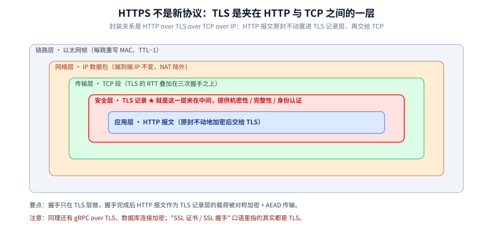
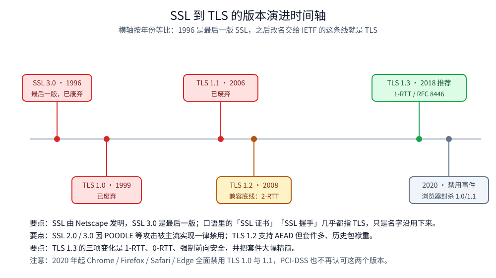
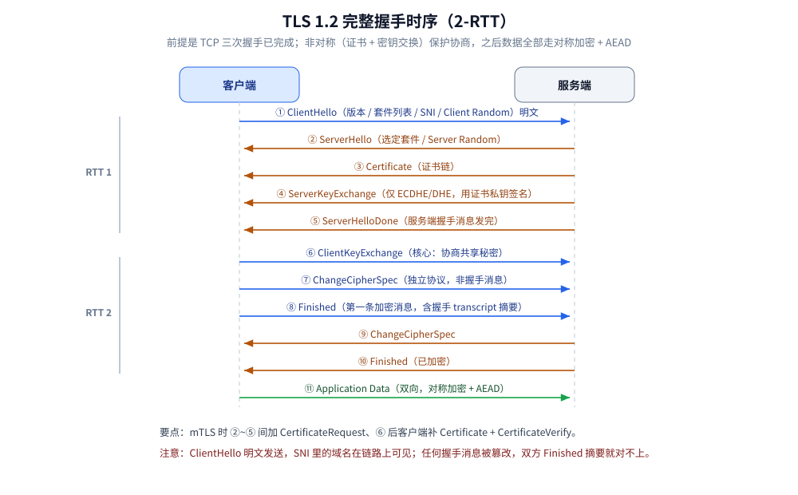
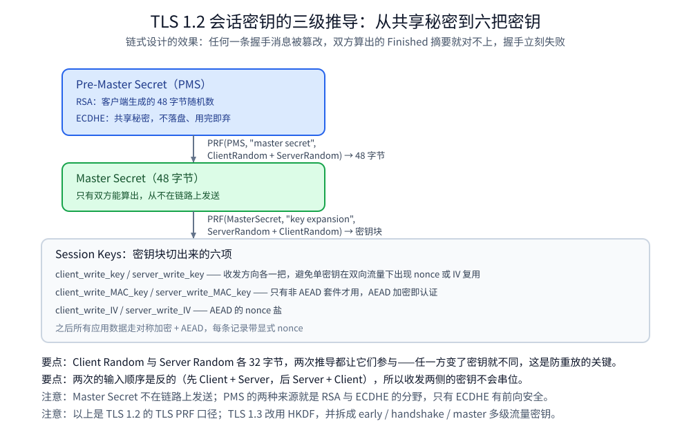
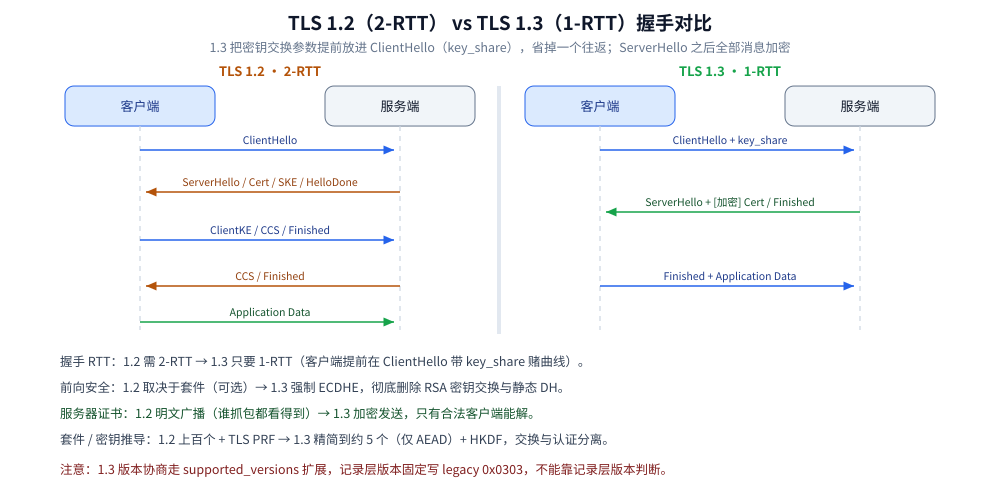
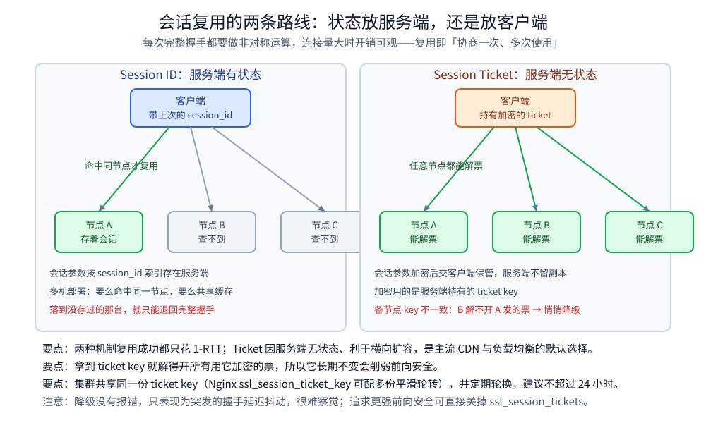

# HTTPS 与 TLS

> 覆盖：TLS 握手怎么走（TLS 1.2 全流程 / 1.3 的变化 / 会话复用）、证书在握手现场怎么用、怎么抓包排障，以及 Go 与 Java 的落地（含 mTLS 双向认证）。
>
> 不覆盖：证书与信任链的基础概念见 [数字证书与PKI.md](../../../06-工程实践/安全/数字证书与PKI.md)；证书字段、ACME 续期、证书固定与握手失败的逐项排障见 [证书与HTTPS排障.md](证书与HTTPS排障.md)；握手协商的密码套件见 [加密算法.md](../../../06-工程实践/安全/加密算法.md)；ALPN 与 QUIC 内嵌 TLS 1.3 见 [QUIC与HTTP3.md](QUIC与HTTP3.md)；TCP 三次握手的开销见 [TCP三次握手.md](../传输层/tcp/TCP三次握手.md)。
>
> 内容整理自个人学习笔记，素材见 [素材清单](../../../素材清单.md)。
>
> ⚠️ 实测口径：第九节的 Go / Java 代码可编译（Go 侧本机 `gofmt` / `go vet` 通过，Java 侧未编译）；`openssl` / `curl` 与 `SSLKEYLOGFILE` 解密为命令口径，**未实测**。

---

## 一、HTTPS 解决什么问题？

HTTP 全程明文，链路上任何一台设备都能看到并改写内容。TLS 解决的是**三大风险**：

| 风险 | 含义 | TLS 的对策 |
|---|---|---|
| **窃听**（机密性） | 中间人读到明文 | 握手后走**对称加密 + AEAD** |
| **篡改**（完整性） | 改了包而对方发现不了 | AEAD 认证标签 + 握手 transcript 摘要 |
| **冒充**（身份认证） | 连到了假服务器 | **X.509 证书 + CA 验签 + 域名校验** |

⚠️ **高频澄清：HTTPS 不是新协议**。分层是「应用层 HTTP / 安全层 TLS / 传输层 TCP / 网络层 IP」，TLS 是夹在中间的一层：**HTTPS = HTTP over TLS**，HTTP 报文原封不动塞进 TLS 记录层再交给 TCP（同理还有 gRPC over TLS、数据库连接加密）。

**再往下还有一层**：IP 数据包最终要装进**链路层的以太网帧**才出得了网卡，封装链完整写法是 `HTTP over TLS over TCP over IP over 链路层帧`。这一层跟 TLS 无关，但排障时最容易看错——**每一跳只重写链路层的 MAC 地址并把 IP 的 TTL 减 1，端到端 IP 不变（除非有 NAT）**，所以中间设备上看到的「改动」不是 TLS 造成的（逐项过程见 [网络分层与数据包旅程.md](../网络分层与数据包旅程.md) 第七节）。



握手的前提是 **TCP 三次握手已完成**（见 [TCP三次握手.md](../传输层/tcp/TCP三次握手.md)）——TLS 的 RTT 是**叠加在 TCP 之上**的额外开销，这也是后面为什么要压缩握手往返。另外，HTTPS 默认**只认证服务器**（单向认证），要认证客户端必须上 **mTLS**（第九节）。

## 二、TLS 与 SSL 是什么关系？

SSL 由 Netscape 发明，**SSL 3.0（1996）是最后一版**，之后改名交给 IETF 标准化，这条线就是 TLS：

| 版本 | 状态 | 说明 |
|---|---|---|
| SSL 2.0 / 3.0 | ⚠️ 已全面废弃 | POODLE 等攻击，主流实现一律禁用 |
| TLS 1.0（1999）/ 1.1（2006） | ⚠️ 已废弃 | **2020 年起 Chrome/Firefox/Safari/Edge 全部禁用**，PCI-DSS 也不再认可 |
| TLS 1.2（2008） | 兼容底线 | 支持 AEAD，但 2-RTT、套件多、历史包袱重 |
| TLS 1.3（2018, RFC 8446） | ⭐ 推荐 | 1-RTT、0-RTT、**强制前向安全**、套件大精简 |

口语里的「SSL 证书」「SSL 握手」其实几乎都是 TLS，只是名字沿用下来了。



图注：SSL 到 TLS 的版本演进时间轴：1996 最后一版 SSL、1999/2006/2008/2018 四个 TLS 版本与 2020 年浏览器禁用事件。

## 三、TLS 1.2 的完整握手是怎么走的？⭐

### 3.1 前提与目标
- 前提：**TCP 三次握手已完成**，双方在 TCP 之上开始 TLS 握手。目标：① 协商一套密码参数；② **安全地**协商出一个只有双方知道的对称会话密钥。
- 手段：**用非对称（证书 + 密钥交换）保护密钥协商，之后的数据全部走对称加密**。

### 3.2 两次往返的完整流程

```text
Client                                              Server
  |--- ① ClientHello ----------------------------------->|   RTT 1
  |<-- ② ServerHello ------------------------------------|
  |<-- ③ Certificate ------------------------------------|
  |<-- ④ ServerKeyExchange（仅 ECDHE/DHE）---------------|
  |<-- ⑤ CertificateRequest（仅 mTLS）-------------------|
  |<-- ⑥ ServerHelloDone -------------------------------|
  |--- ⑦ ClientKeyExchange ----------------------------->|   RTT 2
  |--- ⑧ Certificate + CertificateVerify（仅 mTLS）----->|
  |--- ⑨ ChangeCipherSpec ----------------------------->|
  |--- ⑩ Finished（已加密）----------------------------->|
  |<-- ⑪ ChangeCipherSpec -------------------------------|
  |<-- ⑫ Finished（已加密）------------------------------|
  |<========= ⑬ Application Data（对称加密）===========>|
```

📌 **与配图对应关系**：上面的编号把 **mTLS 才出现**的 `CertificateRequest` 与客户端 `Certificate + CertificateVerify` 也列了出来（⑤、⑧），所以一共 13 条；
`images/TLS1.2完整握手时序图.svg` 画的是**默认基线——单向认证**，这两条不出现，图里因此是 11 条消息（应用数据算最后一条）。
两边讲的流程完全一致，只是**单向 / 双向之差**，对号入座时看这条说明，不要以为少画了步骤。



1. **ClientHello**：支持的 TLS 版本、**Client Random**（32 字节随机数）、**密码套件列表**、压缩方法、扩展（**SNI** 域名、ALPN 如 h2/http1.1、supported_groups 曲线列表、signature_algorithms、session_ticket 等）。⚠️ 明文发送，**SNI 里的域名是可见的**。
2. **ServerHello**：选定版本与**一个**密码套件，回 **Server Random** 与 session_id；若复用会话则走第五节。
3. **Certificate**：服务端发**证书链**（自身证书 + 中间 CA 证书）。
4. **ServerKeyExchange**：**仅 ECDHE/DHE 时出现**，含 DH 参数与**服务端临时公钥**，并用**证书私钥签名**证明来源；RSA 密钥交换方式下没有这条。
5. **CertificateRequest**（可选，仅 mTLS）：要求客户端也提供证书。**ServerHelloDone** 表示「我这边的握手消息发完了」。
6. **ClientKeyExchange**：核心步骤，见 3.3。mTLS 下客户端还要发 **Certificate + CertificateVerify**——用自己的私钥对**前面所有握手 transcript 签名**，这才是真「证明你持有私钥」。
7. **ChangeCipherSpec**：**不是握手消息**，是独立协议类型的一句「我从下一条开始加密了」，本身不参与密钥协商。
8. **Finished**：第一条被加密的消息，内容是**此前所有握手消息的 PRF 摘要**，同时校验「双方算出的密钥一致」与「握手未被篡改」。
9. 服务端同样回 ChangeCipherSpec + Finished；之后所有应用数据走**对称加密 + AEAD**，每条记录带显式 nonce，乱序 / 重放 / 丢记录都会被 AEAD 发现。（1.2 时代有过 False Start 这类「发完 Finished 就先发数据」的小优化，未被广泛采纳，真正的解法是 TLS 1.3。）

### 3.3 密钥交换：RSA vs ECDHE ⭐
`ClientKeyExchange` 里发什么，取决于密钥交换算法：

| 维度 | **RSA 密钥交换** | **ECDHE（推荐）** |
|---|---|---|
| 客户端做什么 | 生成 48 字节 Pre-Master Secret，用**证书里的公钥加密**发送 | 生成**临时**密钥对，把自己的**临时公钥**明文发送 |
| 服务端做什么 | 用私钥解密得到 Pre-Master Secret | 用临时私钥算 `ECDH(client_pub, server_priv)` 得到共享秘密 |
| 私钥泄露的后果 | ⚠️ **致命**：历史流量可被回溯解密 | 临时私钥不落盘、用完即弃，历史会话依旧安全 |
| 前向安全 PFS | ❌ 无 | ⭐ ✅ 有 |
| TLS 1.3 | ❌ 已删除 | ✅ 唯一方式 |

> ⭐ **前向安全（PFS）**：一次长期私钥泄露不应危及**以往**会话。ECDHE 的 E 就是 **Ephemeral（临时）**——每次握手新生成密钥对，长期私钥**只用来签名、不用来加密流量**。这也是现在几乎所有 1.2 站点都用 `ECDHE_xxx` 套件的原因。

### 3.4 证书是怎么验证的
证书概念见 [数字证书与PKI.md](../../../06-工程实践/安全/数字证书与PKI.md)，这里只讲握手现场客户端做的事：

1. **逐级验签**：用上级 CA 公钥解开本级证书签名并比对摘要，一路向上到**本机信任库里的根证书**；
2. **有效期**：当前时间须在 `notBefore` ~ `notAfter` 之间；
3. **域名匹配**：⚠️ **只看 `SAN`（SubjectAltName）扩展**，`CN` 字段早已被主流实现废弃；
4. **吊销与用途**：查吊销状态（CRL 列表臃肿滞后，或 OCSP 在线查询，现代实践是服务端做 **OCSP Stapling**）；EKU 须含 `serverAuth`，Basic Constraints 决定它能否当中级 CA。

任一步失败即中断握手：浏览器报「您的连接不是私密连接」，Go 客户端报 `x509: certificate signed by unknown authority` 之类。

### 3.5 主密钥是怎么推导出来的

```text
Pre-Master Secret (PMS)：RSA = 客户端生成的 48 字节随机数；ECDHE = ECDH(client_priv, server_pub) 共享秘密
      │ PRF(PMS, "master secret", ClientRandom + ServerRandom) → 48 字节
      ▼
Master Secret
      │ PRF(MasterSecret, "key expansion", ServerRandom + ClientRandom) → 密钥块
      ▼
Session Keys: client_write_key / server_write_key
              client_write_MAC_key / server_write_MAC_key（非 AEAD 套件才用）
              client_write_IV / server_write_IV（AEAD 的 nonce 盐）
```

- **收发方向各用一把密钥**，避免单密钥在双向流量下出现 nonce / IV 复用问题；
- **两个随机数都参与推导**，任一方随机数变了密钥就不同，这是防重放的关键设计；
- 现代套件都是 **AEAD**（AES-GCM / ChaCha20-Poly1305），加密即认证，不再需要额外 MAC 密钥；
- ⚠️ 链式设计的效果：**任何握手消息被篡改，双方算出的 Finished 摘要就对不上，握手立刻失败**。

> 📌 **口径补充**：`Server Random` 与 `Client Random` 一样是 **32 字节**随机数；两次 PRF 调用的**输入顺序是反的**
> （第一次 `ClientRandom + ServerRandom`，第二次 `ServerRandom + ClientRandom`），所以收发两侧切出来的密钥不会串位。
> ⚠️ 另外明确一句：`Master Secret` 与下面切出的 `Session Keys` **都只在双方本地计算，从不在链路上发送**——
> 链路上跑的只有 PMS 的两种来源（RSA 加密后的 PMS / ECDHE 的临时公钥），这正是 3.1 节「安全地协商出只有双方知道的会话密钥」的落点。



图注：TLS 1.2 会话密钥的三级推导：PMS 经两次 PRF 得到 Master Secret 与密钥块，再切成收发方向各自的六项。

## 四、TLS 1.3 改了哪些地方？⭐

### 4.1 1-RTT 握手：客户端先「赌」密钥交换参数
省掉一个 RTT 的核心手段是 **客户端在 ClientHello 里直接带上 `key_share`（自己的临时公钥）**，把原本第二轮才做的事提前：

```text
Client                                                Server
  |--- ① ClientHello                                       |
  |       + supported_versions: 1.3                        |
  |       + key_share: X25519 公钥  ← 提前交东西           | ← 往返开始
  |<-- ② ServerHello + key_share（服务端公钥）--------------|
  |       ★ 此刻双方已算出 handshake traffic secrets         |
  |       ★ 之后所有握手消息全部加密                         |
  |<-- ③ [加密] EncryptedExtensions（ALPN 等）--------------|
  |<-- ④ [加密] Certificate（服务器证书也被加密了⭐）--------|
  |<-- ⑤ [加密] CertificateVerify（私钥签名 transcript）-----|
  |<-- ⑥ [加密] Finished ----------------------------------|
  |--- ⑦ [加密] Finished + Application Data -------------->| ← 握手完成
```

> ⭐ 注意 ④：**1.2 里服务器证书是明文广播的**（谁抓包都能看到你在访问哪个域名）；**1.3 里证书也被加密**，只有合法客户端能看到，直接缓解了证书嗅探与流量指纹。
>
> ⚠️ **赌错了怎么办**：服务端不支持客户端 `key_share` 里的曲线时回 **HelloRetryRequest** 要求换参数，握手退化成 2-RTT。所以服务端务必支持 `X25519` 和 `P-256`。

### 4.2 0-RTT（early data）与 ⚠️ 重放攻击
**原理**：客户端凭上次会话留下的 **PSK**，在第一个 flight 就带上 `early_data` 扩展并把应用数据直接发出去——**握手没走完请求已到达**，延迟等同明文 HTTP。

⚠️ **风险：0-RTT 数据不具备唯一性保证，天然可被重放**——攻击者录下这串 early data 重发，服务器会当成新请求处理。

| 安全属性 | TLS 1.3 完整握手 | 0-RTT |
|---|---|---|
| 机密性 / 完整性 | ✅ | ✅ |
| 前向安全 | ✅ | 部分（取决于 PSK 来源） |
| **防重放** | ✅ | ⚠️ **没有，需应用层兜底** |

正确做法：**只放幂等请求**（GET 静态资源），不下单 / 转账 / 登录；服务端用 single-use ticket 或一次性 nonce；应用层加 token 或时间窗；很多反向代理（如 Nginx `ssl_early_data`）默认关闭。

### 4.3 其他重要变化
- **彻底删除**：RSA 密钥交换、静态 DH、RC4 / 3DES / AES-CBC、MD5 / SHA-1 签名、TLS 压缩、重协商；
- **强制前向安全**：密钥交换只剩 DHE / ECDHE；
- **套件大精简 + 交换与认证分离**：套件名不再描述密钥交换且只留 AEAD，密钥交换参数走 `supported_groups` 扩展、签名算法走 `signature_algorithms` 扩展。1.2 是 `TLS_ECDHE_RSA_WITH_AES_128_GCM_SHA256` 一大串，1.3 只剩 `TLS_AES_128_GCM_SHA256`、`TLS_CHACHA20_POLY1305_SHA256` 等五个；
- **密钥推导改用 HKDF**，并拆成 early / handshake / master 多级流量密钥；
- ⚠️ **版本协商走 `supported_versions` 扩展**，记录层版本号固定写兼容用的 legacy 值 `0x0303`，所以**不能靠记录层版本判断是不是 1.3**。

### 4.4 TLS 1.2 vs 1.3 对比表

| 维度 | TLS 1.2 | TLS 1.3 |
|---|---|---|
| 首次握手延迟 | 2-RTT | ⭐ **1-RTT**（复用可 0-RTT） |
| 会话复用机制 | Session ID / Session Ticket | ⭐ PSK + 0-RTT early data |
| RSA 密钥交换 | 支持 | ❌ 删除 |
| 前向安全 | 取决于套件（可选） | ⭐ **强制** |
| 对称算法 | CBC / GCM / 流密码均有 | 仅 AEAD |
| 服务器证书 | 明文发送 | ⭐ **加密发送** |
| 密码套件数量 / 密钥推导 | 上百个 / TLS PRF | 5 个左右 / **HKDF** |



图注：TLS 1.2 与 TLS 1.3 握手并排对比：2-RTT 对 1-RTT，以及前向安全、证书可见性与套件/密钥推导的差别。

### 4.5 扩展阅读：ECH 与 `HTTPS` / `SVCB` 记录的关系

TLS 1.3 把**证书**加密了（4.1 的步骤 ④），但 **`ClientHello` 里的 SNI 仍然是明文**——中间设备照样能看到你在访问哪个域名。**ECH（Encrypted Client Hello）** 要解决的正是这一处泄露。

思路很直接：**用服务端公钥把整个 ClientHello（含内层 SNI）加密**，外层再放一个「公开的」ClientHello（SNI 指向一个公共前端），于是链路上只能看到「有人在连某个公共入口」。

⚠️ **它和 DNS 的 `HTTPS` / `SVCB` 记录是配套的**，这也是它值得放进这篇的原因：

| 环节 | 作用 |
|---|---|
| **在 DNS 的 `HTTPS` 记录里带 `ech` 参数（ECHConfigList）** | 客户端从这里拿到**加密 ClientHello 所需的公钥**——没有它就没法构造内层 ClientHello |
| **必须配合加密 DNS（DoH/DoT）与 DNSSEC** | 否则攻击者可以**把这段参数剥掉**，逼客户端退回明文 SNI，等于 ECH 被**静默降级** |
| **服务端部署要求** | 需要一个「外层 SNI」可达的前端（通常和 CDN / 反向代理配合），并按客户端能力决定是否启用 |

⭐ 所以 ECH 的部署门槛**不在 TLS 本身，而在 DNS 侧**：它把「域名隐私」这个目标从 TLS 层推到了**解析链**上。
这与 [DNS解析.md](../网络层与寻址/DNS解析.md) 里「DoH/DoT 解决传输、DNSSEC 解决完整性，两者都不解决隐私」是同一组关系的延伸——
ECH 恰好**同时需要**这两件事才能成立。

> ⚠️ 本节只作**扩展阅读**，不代表当前部署现状：ECH 的浏览器与服务端支持仍在演进；
> 而且它保护的只是「客户端到服务端这一段的域名可见性」，不影响证书验证与后续的应用层行为。

## 五、会话是怎么复用的？

每次完整握手都要做非对称运算（尤其 RSA 私钥解密极耗 CPU），连接量大时开销可观。思路是**协商一次、多次使用**。

### 5.1 Session ID vs Session Ticket

| 维度 | Session ID | Session Ticket |
|---|---|---|
| 谁有状态 | ⭐ **服务端**存会话参数，按 session_id 索引 | 服务端**无状态**：把会话参数**加密后交客户端保管** |
| 客户端怎么做 | 带上上次服务端给的 session_id | 在 `session_ticket` 扩展里带上这张票 |
| 多机 / 负载均衡 | ⚠️ 须命中同一节点，或共享 Redis 缓存 | ⭐ 天然支持横向扩展，任意节点都能解票 |
| 握手开销 | 复用成功 = 1-RTT | 同左 |

Session Ticket 因为无状态、利于横向扩容，是主流 CDN / 负载均衡的默认选择。



图注：会话复用的两条路线：Session ID 把状态放服务端（须命中同一节点），Session Ticket 把加密后的状态放客户端（任意节点可解票）。

### 5.2 TLS 1.3 的 PSK / 0-RTT
1.3 把上面两者统一成 **PSK**：**外部 PSK**（预置共享密钥，IoT / 内部服务）与**恢复 PSK**（由上次握手的 `resumption_master_secret` 推导，即新一代 Session Ticket）。客户端在 ClientHello 带 `pre_shared_key` + `early_data` 扩展，服务端接受后，**Finished 之前的 application data 就是 early data**。

### 5.3 ⚠️ Session Ticket 的密钥轮换
Ticket 是用**服务端持有的 ticket key 加密**后发给客户端的，于是：

- ⚠️ **ticket key 长期不变 ⇒ 前向安全被削弱**：拿到它就解开所有用它加密的票，进而解出留存的流量。Nginx / Apache 默认启动时生成一次 ticket key 并长期沿用；**集群各节点 key 不一致**时还会出现「节点 A 给的票，落到节点 B 解不开 → 悄悄降级成完整握手」，表现为**突发的握手延迟抖动**，很难察觉。

正确做法：集群**共享同一份** ticket key（Nginx `ssl_session_ticket_key`，可配多份平滑轮转）、**定期轮换（建议 ≤ 24h）**；追求更强前向安全可直接 `ssl_session_tickets off`。

## 六、握手现场是怎么用证书的？

**本节要点**：证书在握手里的作用是「证明公钥属于这个域名」。客户端会做五步校验：**逐级验签到信任库根证书 → 有效期 → SAN 域名 → 吊销状态 → EKU 用途**，任一步失败都中断握手。

| 证书链 | 谁提供 | 说明 |
|---|---|---|
| **leaf（站点证书）** | 服务端发送 | 含站点公钥与 SAN |
| **intermediate（中间 CA）** | 服务端发送 | ⚠️ **漏发是最常见的「仅部分客户端失败」原因** |
| **root（根 CA）** | 客户端信任库预置 | 服务端不需要发送 |

> X.509 字段逐项说明、信任链与自签证书、ACME 三种挑战、证书固定、六种握手错误、抓包过滤器、`SSLKEYLOGFILE` 解密、`openssl` / `keytool` 命令与到期监控，全部在 [证书与HTTPS排障.md](证书与HTTPS排障.md)。本节只保留「证书在握手里做什么」。

---

## 七、握手失败时看什么？

**先看 Alert 再猜原因**：握手失败的错误通常落在 `tls.alert_message` 里（如 `40 handshake_failure`、`42 bad_certificate`），结合 ClientHello 的 SNI、ServerHello 的套件与 Certificate 消息里的链，才能定位到「链 / 有效期 / SAN / 吊销 / 用途」中的哪一步。

⚠️ 抓 TLS 1.3 时 ServerHello 之后全是 Application Data 密文，看不到 Certificate / Finished——这是正常的（见 4.1），不是抓包坏了；要解密本机流量需配置 `SSLKEYLOGFILE`。

> Wireshark 过滤器、`SSLKEYLOGFILE` 的配置步骤、`openssl s_client` / `nmap ssl-enum-ciphers` / `curl -vI` 的完整命令与排障顺序，见 [证书与HTTPS排障.md](证书与HTTPS排障.md) 第四、五、八节。

---

## 八、应用场景

**本节要点**：TLS 的落点是「加密与身份」这一层，链路里凡是需要终止或透传加密的设备都会碰到它。

| 场景 | 涉及哪一块 | 为什么值得注意 |
|---|---|---|
| 反向代理 / 网关的 TLS 卸载 | 证书与 SNI | 卸载点在哪一跳，决定上游看到的是什么，详见 [反向代理原理.md](../代理与网关/反向代理原理.md) 第四节 |
| 全站 HTTPS 与 HSTS | 重定向与首访 | 首访明文跳一次是常见漏洞点，详见 本篇 10.1 |
| 客户端连接失败 | 证书链与校验 | 「只在部分网络下失败」多半是中间设备，详见 [证书与HTTPS排障.md](证书与HTTPS排障.md) 第四节 |
| 抓包看不到明文 | TLS 记录层 | `SSLKEYLOGFILE` 才能解密，详见 [证书与HTTPS排障.md](证书与HTTPS排障.md) 5.2 |
| 服务间 mTLS | 双向认证 | 内网零信任的基础，详见 本篇 9.1 |
| 握手耗时优化 | 会话复用与 0-RTT | 缩短或省掉一趟往返，详见 本篇第五节 |

## 九、具体使用

**本节要点**：Go 侧用标准库 `crypto/tls` 拼出服务端与客户端，Java 侧先用 `keytool` 备好 KeyStore 与 TrustStore，再初始化 `SSLContext`。

### 9.1 Go

#### 起一个 HTTPS 服务
最简写法是 `http.ListenAndServeTLS(":443", "fullchain.pem", "server.key", nil)`；生产要自己控 TLS 参数就用 `http.Server` + `TLSConfig`：

```go
srv := &http.Server{
	Addr:              ":443", // ReadHeaderTimeout 务必设，防慢速攻击
	Handler:           mux,
	ReadHeaderTimeout: 5 * time.Second,
	TLSConfig: &tls.Config{
		MinVersion: tls.VersionTLS12,
		// CipherSuites 留空即用 Go 的安全默认值（已剔除 CBC/3DES）；显式指定请务必自查
		CipherSuites: []uint16{
			tls.TLS_ECDHE_ECDSA_WITH_AES_128_GCM_SHA256,
			tls.TLS_ECDHE_RSA_WITH_AES_128_GCM_SHA256,
			tls.TLS_ECDHE_RSA_WITH_AES_256_GCM_SHA384,
			tls.TLS_ECDHE_ECDSA_WITH_CHACHA20_POLY1305,
		},
		CurvePreferences: []tls.CurveID{tls.X25519, tls.CurveP256}, // X25519 最快，放前面
	},
}
log.Fatal(srv.ListenAndServeTLS("fullchain.pem", "server.key"))
```

> ⚠️ 证书文件必须是 **fullchain**（服务器证书在前、中间证书在后），否则就是 6.3 里的「链不完整」。Go 1.18 起 `PreferServerCipherSuites` 已失效并标记废弃（服务端始终按自身偏好选择），不要再依赖它。

#### mTLS 双向认证 ⭐
**服务端**要求并校验客户端证书：

```go
pem, _ := os.ReadFile("ca.crt")                       // 签发客户端证书的 CA
pool := x509.NewCertPool()
pool.AppendCertsFromPEM(pem)
srv := &http.Server{
	Addr:    ":8443",
	Handler: mux,
	TLSConfig: &tls.Config{
		MinVersion: tls.VersionTLS13,
		ClientAuth: tls.RequireAndVerifyClientCert, // ⭐ 必须提供且必须过 CA 校验
		ClientCAs: pool,
		// 可选：链已被 Go 校过，这里再做业务级白名单（CN / SPIFFE ID / 自定义 OID）
		VerifyPeerCertificate: func(raw [][]byte, chains [][]*x509.Certificate) error {
			if len(chains) == 0 || len(chains[0]) == 0 {
				return errors.New("empty verified chain")
			}
			if cn := chains[0][0].Subject.CommonName; cn != "payment-client" {
				return fmt.Errorf("client CN %q not allowed", cn)
			}
			return nil
		},
	},
}
log.Fatal(srv.ListenAndServeTLS("fullchain.pem", "server.key"))
```

**客户端**加载自己的证书发起请求：

```go
cert, err := tls.LoadX509KeyPair("client.crt", "client.key") // err 记得判断
client := &http.Client{
	Timeout: 10 * time.Second,
	Transport: &http.Transport{TLSClientConfig: &tls.Config{
		Certificates: []tls.Certificate{cert},
		MinVersion:   tls.VersionTLS12,
	}},
}
resp, err := client.Post("https://api.internal:8443/pay", "application/json", body)
```

> ⚠️ `ClientAuth` 取值别搞混：`NoClientCert`（默认不要求）、`RequestClientCert`（要但不校验，**几乎没有安全意义**）、`RequireAnyClientCert`（要且必须有，但不校验签发者）、⭐ **`RequireAndVerifyClientCert`（要求并用 ClientCAs 完整校验，生产用这个）**、`VerifyClientCertIfGiven`。
> ⚠️ **`RequireAndVerifyClientCert` 不会查 CRL / OCSP**，要吊销客户端得自己在 `VerifyPeerCertificate` 里比对序列号黑名单，或改用短期证书 + 自动轮换。

#### 客户端自定义 tls.Config（含自签 CA）

```go
caPEM, _ := os.ReadFile("ca.crt")              // 自签 / 内部 CA 根证书
rootCAs, _ := x509.SystemCertPool()            // ⭐ 先取系统信任库，别用空池直接覆盖
if rootCAs == nil {
	rootCAs = x509.NewCertPool()
}
rootCAs.AppendCertsFromPEM(caPEM)
cfg := &tls.Config{
	RootCAs:    rootCAs,
	MinVersion: tls.VersionTLS12,
	ServerName: "api.internal",                // 通过 IP 访问时必须显式指定证书里的 SAN 名
	// ⚠️ 生产禁用：InsecureSkipVerify: true
}
client := &http.Client{Transport: &http.Transport{TLSClientConfig: cfg}}
```

> ⚠️ **`InsecureSkipVerify: true` 同时跳过证书校验与域名校验，等于放任中间人冒充**。自签证书的正确做法是上面的 `RootCAs`，而不是跳过校验——安全扫描工具会直接把前者判为高危。

#### `tls.Config` 常用字段

| 字段 | 作用 |
|---|---|
| `MinVersion` / `MaxVersion` | 限制协议版本（建议 `MinVersion: tls.VersionTLS12`） |
| `CipherSuites` | 套件白名单，**留空即用 Go 的安全默认值**（推荐留空） |
| `RootCAs` / `ClientCAs` | 客户端 / 服务端使用的信任根池 |
| `Certificates` / `GetCertificate` | 本端密钥对；多域名站点用后者按 SNI 动态返回 |
| `InsecureSkipVerify` | ⚠️ **生产禁用**（会同时跳过证书与域名校验） |
### 9.2 Java

#### 先分清 KeyStore 与 TrustStore ⭐

| 名称 | 装什么 | 谁用 |
|---|---|---|
| **KeyStore** | **自己的**私钥 + 证书链 | 由 `KeyManager` 读取 → **向对端出示证书**（服务端出示服务证书 / mTLS 时客户端出示客户端证书） |
| **TrustStore** | **信任的** CA 根 / 中间证书 | 由 `TrustManager` 读取 → **校验对端证书** |

JSSE 四个核心类：`SSLContext`（配置入口，由它产出 `SSLSocketFactory` / `SSLServerSocketFactory`）、`KeyManagerFactory`（KeyStore → `KeyManager[]`，管本地凭证）、`TrustManagerFactory`（TrustStore → `TrustManager[]`，管信任判断）、`SSLEngine`（Netty 等异步场景使用）。

> JVM 默认 TrustStore 是 `$JAVA_HOME/lib/security/cacerts`（密码 `changeit`）。⚠️ 老 JDK 的 cacerts 缺新根（如 Let's Encrypt 的 ISRG Root X1），会报 `PKIX path building failed`，需升级 JDK 或用 `-Djavax.net.ssl.trustStore` 指定。

#### 初始化 SSLContext

```java
public static SSLContext create(Path keyStore, char[] ksPass,
                                Path trustStore, char[] tsPass) throws Exception {
    KeyStore ks = KeyStore.getInstance("PKCS12");            // 1. 自己的凭证
    try (InputStream in = Files.newInputStream(keyStore)) {
        ks.load(in, ksPass);
    }
    KeyManagerFactory kmf = KeyManagerFactory.getInstance(KeyManagerFactory.getDefaultAlgorithm());
    kmf.init(ks, ksPass);
    KeyStore ts = KeyStore.getInstance("PKCS12");            // 2. 信任的 CA
    try (InputStream in = Files.newInputStream(trustStore)) {
        ts.load(in, tsPass);
    }
    TrustManagerFactory tmf = TrustManagerFactory.getInstance(TrustManagerFactory.getDefaultAlgorithm());
    tmf.init(ts);
    SSLContext ctx = SSLContext.getInstance("TLS");          // 3. 组装，由实现协商最高可用版本
    ctx.init(kmf.getKeyManagers(), tmf.getTrustManagers(), new SecureRandom());
    return ctx;
}
```

#### 客户端怎么用 ⭐
**① JDK 原生 `HttpsURLConnection`**

```java
char[] pw = "changeit".toCharArray();
SSLContext ctx = SslContextFactory.create(Path.of("client.p12"), pw, Path.of("truststore.p12"), pw);
HttpsURLConnection conn = (HttpsURLConnection)
        new URL("https://api.internal:8443/ping").openConnection();
conn.setSSLSocketFactory(ctx.getSocketFactory());   // ⭐ 换成我们自己的
conn.setRequestMethod("GET");
conn.setConnectTimeout(5000);
conn.setReadTimeout(5000);
try (var in = conn.getInputStream()) {
    System.out.println(new String(in.readAllBytes(), StandardCharsets.UTF_8));
}
```

**② OkHttp**（`sslSocketFactory` 两个参数缺一不可）

```java
TrustManagerFactory tmf =
        TrustManagerFactory.getInstance(TrustManagerFactory.getDefaultAlgorithm());
tmf.init((KeyStore) null);                          // 传 null = 用 JDK 默认信任库
X509TrustManager tm = (X509TrustManager) tmf.getTrustManagers()[0];
OkHttpClient client = new OkHttpClient.Builder()
        .sslSocketFactory(ctx.getSocketFactory(), tm)
        .build();
```

**③ Apache HttpClient 5**

```java
CloseableHttpClient httpclient = HttpClients.custom()
        .setConnectionManager(PoolingHttpClientConnectionManagerBuilder.create()
                .setSSLSocketFactory(new SSLConnectionSocketFactory(ctx))
                .build())
        .build();
```

> ⚠️ **绝不要在生产使用「信任所有证书」的 TrustManager**（网上流传的 `checkServerTrusted(...) {}` 空实现）——它让 HTTPS 退化成「只加密不认证」，中间人拿自签证书就能解密全部流量，Android / iOS 与合规扫描也会直接判定不通过；自签场景的正确做法是把内部 CA 加进 TrustStore。另外用 IP 访问 HTTPS 会因主机名校验失败，应使用证书里的 SAN 名作为 hostname，而**不是**把 `HostnameVerifier` 覆盖成总是通过。

#### Spring Boot 开启 HTTPS

```yaml
server:
  port: 8443
  ssl:
    enabled: true
    key-store: classpath:server.p12      # 也支持 file: 绝对路径
    key-store-type: PKCS12
    key-store-password: changeit
    key-alias: myapp
    protocol: TLS
    enabled-protocols: TLSv1.3,TLSv1.2  # ⚠️ 显式关掉 1.0/1.1
    ciphers: TLS_AES_128_GCM_SHA256,TLS_ECDHE_RSA_WITH_AES_128_GCM_SHA256  # 可选白名单
    # ---- mTLS 双向认证，需要时才打开 ----
    client-auth: need                    # none / want（可选）/ need（强制）
    trust-store: classpath:truststore.p12
    trust-store-password: changeit
```

HTTP → HTTPS 的重定向建议放在网关 / Nginx，或给 Tomcat 追加一个明文连接器做跳转。

```bash
# 生成自签证书（务必带 SAN，CN 已不被信任）
keytool -genkeypair -alias myapp -keyalg RSA -keysize 2048 -validity 365 \
        -storetype PKCS12 -keystore server.p12 -storepass changeit \
        -dname "CN=localhost,O=Dev" -ext "SAN=dns:localhost,ip:127.0.0.1"
# 导出证书给客户端 → 客户端导入信任 → 排障：查看证书链详情（有效期、SAN、签发者）
keytool -exportcert -alias myapp -keystore server.p12 -storepass changeit -file server.crt
keytool -importcert -alias myapp -file server.crt -keystore truststore.p12 \
        -storetype PKCS12 -storepass changeit -noprompt
keytool -list -v -keystore server.p12 -storepass changeit
```
（`-ext "SAN=..."` 必须写：现代 JDK 与浏览器**只认 SAN**，`CN` 匹配已废弃，少了它就报 `No subject alternative names present`。）

## 十、生产实践中有哪些坑？

### 10.1 全站 HTTPS 与 HSTS
全站 HTTPS + HTTP 301 跳转，再加 **HSTS**：`Strict-Transport-Security: max-age=31536000; includeSubDomains`。⭐ 浏览器会**记住**该域名只走 HTTPS，省掉一次跳转 RTT，还能挡 SSL Stripping 降级攻击。⚠️ `preload`（提交进浏览器内置列表）基本**不可回退**：一旦上线，某个子域名暂时没 HTTPS 就彻底打不开，务必确认全站（含所有子域）就绪再加。

**混合内容（mixed content）**：HTTPS 页面里加载 HTTP 子资源（图片 / js / iframe）即 mixed content，浏览器会**拦截**其中的脚本与 XHR 类资源。排查看控制台 Console 警告，修复办法是全站 HTTPS，或加 `Content-Security-Policy: upgrade-insecure-requests` 自动升级。

### 10.2 性能开销

| 项 | 说明 |
|---|---|
| 握手 CPU | 大头是**非对称运算**。**ECDHE（尤其 X25519）比 RSA 快得多**，RSA-2048 私钥运算在突发连接时会明显吃 CPU；也可在 LB / CDN 做 TLS 终结 |
| 减少握手次数 | 会话复用（Ticket / PSK）、长连接 keep-alive、HSTS 免跳转 |
| 协议版本 | ⭐ TLS 1.3 少一次 RTT；必要时用 0-RTT（注意重放）；HTTP/2 多路复用让多条请求复用一条 TLS 连接 |
| 对称加密 | AES-GCM 有 **AES-NI** 硬件加速几乎免费；移动端无加速时 `ChaCha20-Poly1305` 反而更快 |

**OCSP Stapling**：客户端自己跑去 CA 查 OCSP 既慢、又泄漏用户访问行为，还容易因查询超时拖垮握手。改成服务端定期取自己的 OCSP 响应，握手时「订」在 Certificate 消息后面一起发：

```nginx
ssl_stapling on;                                 # 服务端代取 OCSP 响应，握手时一起发出
ssl_stapling_verify on;
ssl_trusted_certificate /path/to/chain.pem;      # 含中间证书，用于验证 OCSP 响应
resolver 8.8.8.8 valid=300s;
```

### 10.3 证书与中间设备

> 证书到期监控（`blackbox_exporter` / `ssl_exporter` / 两级告警）、中间设备导致 TLS 1.3 握手失败、QUIC 的 UDP 443 被丢、以及证书链与 SAN 的排障，见 [证书与HTTPS排障.md](证书与HTTPS排障.md) 第四、六节。

## 延伸追问

- **HTTPS 握手过程？和 TCP 握手什么关系？** → TCP 三次握手先建立连接；TLS 在 TCP 之上再走：ClientHello → ServerHello → Certificate →（ECDHE 时）ServerKeyExchange → ServerHelloDone → ClientKeyExchange → 双方 ChangeCipherSpec + Finished，之后对称加密传数据。**TLS 的 RTT 是叠加在 TCP 之上的额外开销**。
- **HTTPS 是不是一个新协议？** → ⚠️ **不是**。它在 TCP 与 HTTP 之间插了一层 TLS，HTTP 报文原封不动交给 TLS 加密后再交 TCP，即 HTTP over TLS（同理还有 gRPC over TLS）。
- **TLS 1.2 与 1.3 最大的区别？** → ① 2-RTT → **1-RTT**（客户端提前在 ClientHello 带 `key_share`）；② **删除 RSA / 静态 DH，强制前向安全**；③ 套件精简到 5 个、只留 AEAD、交换与认证分离；④ **Hello 之后立刻加密，服务器证书也被加密**（1.2 里是明文）；⑤ PRF → **HKDF**。
- **为什么都用 ECDHE，不能用 RSA 密钥交换？** → RSA 方式下客户端把 Pre-Master Secret 用**服务器证书公钥**加密发送，**长期私钥一泄露，留存的历史流量可被全部解密，没有前向安全**。ECDHE 每次握手生成临时密钥对、用完即弃，长期私钥只签名不加密流量。
- **证书是怎么验证的？** → ① **逐级验签**到本机信任库根证书；② 校验**有效期**；③ 校验 **SAN 域名**（CN 已废弃）；④ 查**吊销**（CRL / OCSP，生产用 Stapling）；⑤ 校验用途 EKU。任一步失败即中断。
- **0-RTT 有什么风险？怎么用才安全？** → ⚠️ **重放攻击**：early data 不具备唯一性，录下来重发服务端照收。限定**幂等请求**、服务端 single-use ticket / 一次性 nonce、应用层加 token。**TLS 1.3 的 0-RTT 不提供防重放保证**。
- **Session ID 和 Session Ticket 区别？** → Session ID **服务端有状态**（多机需共享缓存或命中同节点）；Ticket 服务端**无状态**，把加密后的会话参数交客户端，天然支持横向扩展。⚠️ Ticket 加密密钥必须**集群共享 + 定期轮换**，否则既削弱前向安全，又会出现「跨节点解不开票、默默降级为完整握手」的延迟抖动。
- **抓包为什么看不到 HTTPS 内容？** → 握手后数据走**对称加密**，密钥只有协商双方持有，抓到的只是 TLS 记录密文。想解密只能：① 配 `SSLKEYLOGFILE` 让**本端**导出会话密钥给 Wireshark；② 在代理上做 MITM 并让客户端信任其根证书。
- **为什么不能只用对称或非对称？** → 对称**快但密钥分发难**（不可信信道里怎么先让双方拿到同一把密钥）；非对称**解决分发但慢**，还依赖证书解决「公钥是谁的」。所以是 ⭐ **用非对称安全协商出对称密钥，再用对称加密海量数据**——这正是 TLS 的做法。
- **HTTPS 一定安全吗？** → ⚠️ 不一定，它只保护**传输链路**：① 用了 `InsecureSkipVerify` / 信任所有证书的 TrustManager → 中间人可冒充；② 配了弱套件或 TLS 1.0/1.1；③ 私钥泄漏、CA 被攻破；④ 数据在**进入 TLS 之前和解密之后仍是明文**（日志、CDN 边缘、服务端内存）；⑤ HTTPS 拦不住 XSS / SQL 注入等应用层攻击。
- **ChangeCipherSpec 和 Finished 分别做什么？** → ChangeCipherSpec 是**独立协议**的一条信号：「我下面开始加密了」，本身不参与密钥协商；Finished 是**第一条加密消息**，内容是此前**全部握手消息的摘要**，用来校验「双方算出的密钥一致」+「握手没被篡改」，是抗降级攻击的关键一环。
- **单向认证和双向认证（mTLS）差在哪？什么时候用？** → 单向只客户端验服务器证书（浏览网页）；双向还要求**服务器验客户端证书**。用于**服务间调用、内网 API、零信任 / 服务网格、支付类金融接口**——把「我知道你的密码」升级为「你持有这张证书对应的私钥」。
- **TLS 1.3 把证书加密了，那还看得到我访问的域名吗？** → ⚠️ **看得到**：`ClientHello` 里的 **SNI 仍是明文**（否则服务端无法按域名选证书）。
  想连这一段也藏起来要用 **ECH**：把内层 ClientHello 整体加密，而所需的公钥通过 **DNS 的 `HTTPS` 记录**下发——所以 ECH **必须配合加密 DNS 与 DNSSEC**，否则参数被剥掉就会静默降级（见 4.5）。

## 关联

- **上游/总纲**：[网络分层与数据包旅程.md](../网络分层与数据包旅程.md) — HTTPS 的封装顺序：HTTP → TLS → TCP
- **对照/互补**：[QUIC与HTTP3.md](QUIC与HTTP3.md) — ALPN 协商与内嵌 TLS 1.3
- **对照/互补**：[HTTP与gRPC.md](HTTP与gRPC.md) — `h2` 的事实前提是 TLS 与 ALPN
- **对照/互补**：[TCP三次握手.md](../传输层/tcp/TCP三次握手.md) — TLS 握手的 RTT 叠加在 TCP 之上
- **对照/互补**：[DNS解析.md](../网络层与寻址/DNS解析.md) — SNI 与 ECH 依赖的 `HTTPS` / `SVCB` 记录、DoH 与 DNSSEC 的分工
- **下游机制**：[数字证书与PKI.md](../../../06-工程实践/安全/数字证书与PKI.md) — 证书与信任链的基础概念（单一来源）
- **下游机制**：[加密算法.md](../../../06-工程实践/安全/加密算法.md) — 握手协商的套件从哪来

> 反向引用（本篇被下列文档引到）：[HTTP客户端与连接池.md](../../../01-编程语言/go/网络编程/HTTP客户端与连接池.md)、[08-WWW服务器.md](../../linux/鸟哥服务器架设篇/08-WWW服务器.md)、[HTTP1.1与HTTP2的区别.md](HTTP1.1与HTTP2的区别.md)、[证书与HTTPS排障.md](证书与HTTPS排障.md)、[DNS安全与加密解析.md](../网络层与寻址/DNS安全与加密解析.md)、[网络通信链路详解.md](../网络通信链路详解.md)、[抓包实战.md](../观测与排障/抓包实战.md)、[OpenResty.md](../../../03-数据与中间件/中间件/网关与代理/OpenResty.md)、[文件存储与上传架构.md](../../../04-架构与系统/系统设计/文件存储与上传架构.md)、[Web攻击与防御.md](../../../06-工程实践/安全/Web攻击与防御.md)、[密码与敏感信息存储.md](../../../06-工程实践/安全/密码与敏感信息存储.md)、[摘要与数字签名.md](../../../06-工程实践/安全/摘要与数字签名.md)
