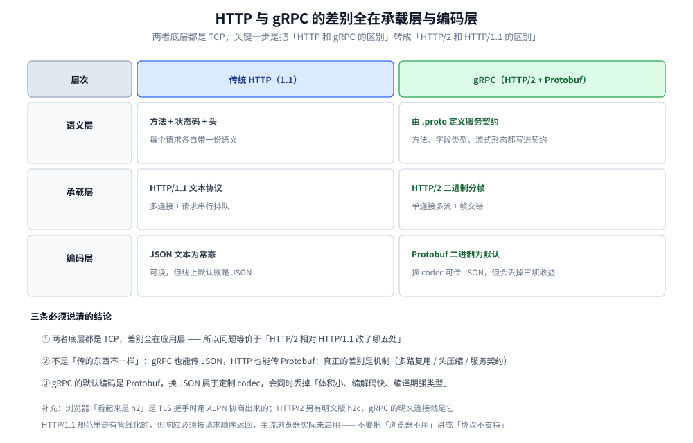
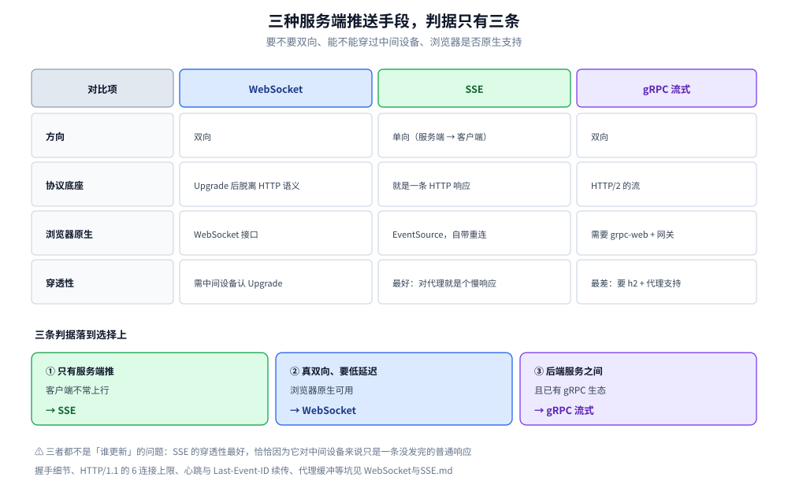
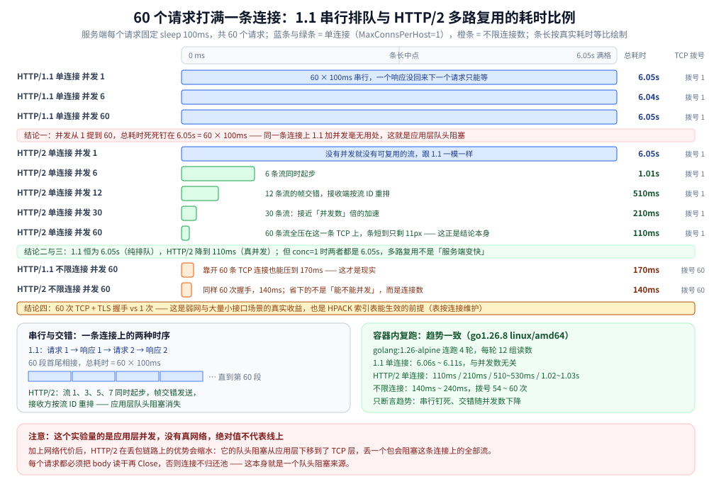
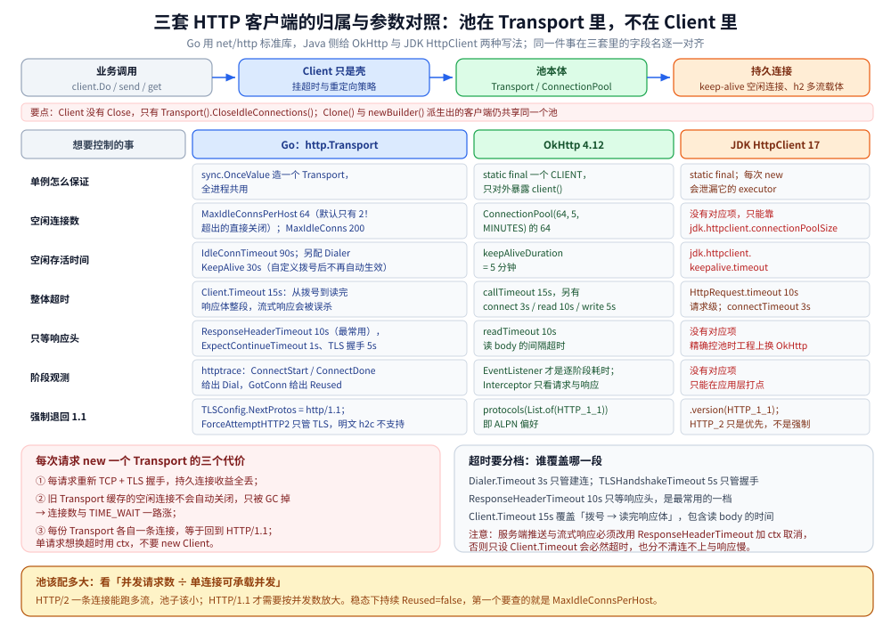
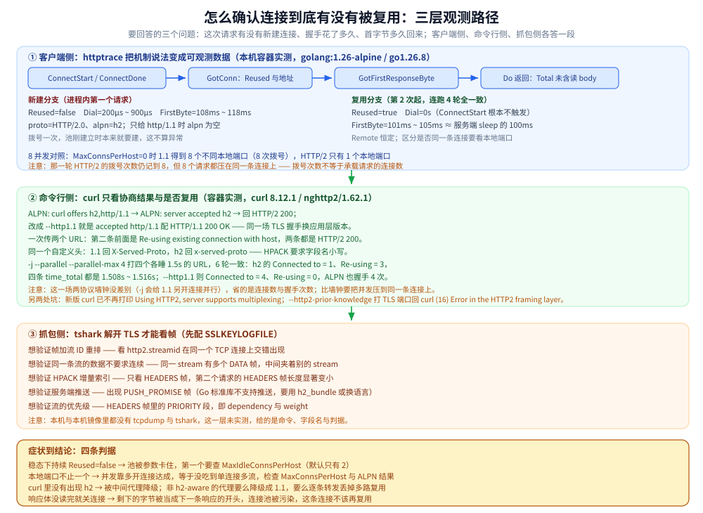

# HTTP 与 gRPC

> 覆盖：gRPC 与 HTTP 的本质差别（默认编码 Protobuf）、连接池与 `httptrace` 复用观测、多路复用实测，以及 WebSocket / SSE 的选型对照。
>
> 不覆盖：HTTP/1.1 与 HTTP/2 的差异机制见 [HTTP1.1与HTTP2的区别.md](HTTP1.1与HTTP2的区别.md)（本仓该主题的唯一详解源）；HTTP/2 的字节级机制见 [HTTP2机制.md](../../../03-数据与中间件/中间件/RPC框架/gRPC/HTTP2机制.md)；TLS 与 ALPN 见 [HTTPS与TLS.md](HTTPS与TLS.md)。
>
> 内容整理自个人学习笔记，素材见 [素材清单](../../../素材清单.md)。
>
> ✅ 实测口径：第五节（具体使用）的 Go 代码只用标准库，`go build` + `go vet` + `gofmt` 通过，60 请求多路复用实验**在本机真实跑过**；⚠️ **未实测**抓包一层（本机无 `tcpdump` / `tshark`），Java 侧只编译未运行。

---

## 一、HTTP 与 gRPC 有什么区别？

**本节要点**：**关键思路转换——这个问题等价于「HTTP/1.1 vs HTTP/2」**。
答不出这个转换，就会在"HTTP 和 gRPC 传的东西不一样"上绕圈。

### 1.1 先做问题转换（一句话点透）

> **gRPC 的底层就是 HTTP/2**。
> 所以"HTTP 和 gRPC 的区别"→ 转成 **"HTTP/2 和 HTTP/1.1 的区别"**
> （我们现在常用的 HTTP 是 1.1）。
>
> 而 **HTTP/1.1 和 HTTP/2 底层都是 TCP**，**底层是一样的**，
> 区别全在**应用层**。



把两个东西拆成三层看，就能看出「HTTP 和 gRPC 的区别」这个问题为什么等价于「HTTP/2 和 HTTP/1.1 的区别」——真正的差异集中在承载层与编码层，语义层是同一套 HTTP 语义。这也解释了为什么 gRPC 换成 JSON codec 仍然能跑：编码层是可替换的，承载层的多路复用与头压缩才是它快的原因。

⚠️ **一句必须先说清的前提**：HTTP/1.1 **规范里是有「管线化」（pipelining）的**——允许一个连接上连续发出多个请求，不必等前一个响应。
但**响应必须按请求顺序返回**，只要第一个请求慢，后面的响应就得排队；再加上中间设备与早期实现的兼容性问题，**主流浏览器实际上都没有启用它**。
所以准确说法是：**HTTP/1.1 具备管线化的协议能力，但它的实际行为近似「一次一个请求」**——这两件事要分开说，不能把「浏览器不用」讲成「协议不支持」。

### 1.2 HTTP/2 相对 HTTP/1.1 改了哪五处（只留结论）

> 完整机制见 [HTTP1.1与HTTP2的区别.md](HTTP1.1与HTTP2的区别.md)——它是本仓「HTTP/1.1 ↔ HTTP/2 对照」的**唯一详解源**。这里只保留与 gRPC 直接相关的结论，避免两处重复。

| # | 改动 | 结论（gRPC 视角） |
|---|---|---|
| **①** | **多路复用** | 一条连接跑多条流，消除**应用层**队头阻塞；**TCP 层**的仍在（丢一个包阻塞整条连接）——新篇第二、七节 |
| **②** | **二进制分帧** | 计算机对二进制解析有天然优势；这是「gRPC 解析优于 HTTP」的来源之一（另一个是默认 Protobuf，见 1.3） |
| **③** | **HPACK 头部压缩** | 索引表**按连接**维护 → 「一条连接跑更多请求」才能把收益吃满，这也是 HTTP/2 要减少连接数的原因之一 |
| **④** | **服务端推送** | 协议里有 `PUSH_PROMISE`，但**主流浏览器已移除**（Chrome 106 起）；不宜再当核心优势讲——新篇 6.1 |
| **⑤** | **流的优先级** | 原来的依赖树 + 权重**已被弃用**（RFC 9113 标记），改由 **RFC 9218** 的紧急度 + 增量承接——新篇 6.2 |

📎 多路复用的量化：同一连接上 60 个并发请求，HTTP/1.1 恒为 6.05s（60 × 100ms，纯排队），HTTP/2 降到 110ms（真并发）——见本篇 5.1 的完整表与复现程序。

⚠️ 常见错误说法「HTTP/1.1 需要额外配 TLS、HTTP/2 天然支持 TLS」**混淆了层次**：HTTP 与 TLS 是两层，两者都能跑在 TLS 之上、也都可以不跑。浏览器 HTTPS 之所以"看起来是 h2"，是握手时用 **ALPN** 协商出了 `h2`（实测见 [QUIC与HTTP3.md](QUIC与HTTP3.md) 3.3）；HTTP/2 另有明文版本 **`h2c`**，gRPC 的明文连接就是它。

### 1.3 ⚠️ 一个重要澄清（避免答错）

> **HTTP 和 gRPC 的区别，不是"传输内容的格式不同"。**
>
> - gRPC **也可以**用 JSON 传输（换 codec 即可，见 [不使用protoc的gRPC.md](../../../01-编程语言/go/网络编程/不使用protoc的gRPC.md)）；
> - HTTP **同样可以**传 JSON，**也可以**传 Protobuf。
>
> **真正的区别是「机制」**——
> 比如**怎么解决应用层队头阻塞**（多路复用）、**怎么压缩头部**（HPACK）、**怎么定义服务契约**（`.proto` + 代码生成）。

⚠️ 但补一句必要的限定：**gRPC 的标准默认编码就是 Protobuf**。所以「gRPC 默认传什么」和「gRPC 能不能传别的」是两回事：
**默认是 Protobuf（二进制、需 schema）**，换成 JSON 属于**定制 codec**，会同时丢掉「体积小、编解码快、编译期强类型」这三项收益。
不要因为「gRPC 也能用 JSON」就以为**线上常见配置**里 JSON 是常态。

### 1.4 抓住一到两个点讲透就够

> **不要五点平铺。**
> 比较扎实的选择是：**把「多路复用」讲明白**——尤其是**应用层队头阻塞与 TCP 层队头阻塞的区别**（1.2 表第 ① 行，完整机制见 [HTTP1.1与HTTP2的区别.md](HTTP1.1与HTTP2的区别.md) 第七节）；
> 或者**把「头部压缩」讲清楚**——重点答出「索引表**按连接**维护，所以复用同一条连接才能把收益吃满」。

---

## 二、连接复用了，那「一条消息到哪儿结束」？

**本节要点**：复用一条连接的前提是**每条消息都能被准确定界**。1.1 靠头部约定（长度 / 分块 / 关闭），2 换成「帧自带长度」，代价是引入**两级流控**。⚠️ 完整机制（三种定界方式、`Content-Length` 与 `Transfer-Encoding` 并存为何要按错误处理、两级窗口的初始值与边界）见 [HTTP1.1与HTTP2的区别.md](HTTP1.1与HTTP2的区别.md) 第三、五节；本节只留四条最常被问混的结论。

| 说法 | 准确性 |
| --- | --- |
| 「HTTP/1.1 靠 `Content-Length` 定界」 | 只说了一种——还有 **`chunked`**（0 长度块收尾）与**连接关闭**；三者根因都是 **TCP 是字节流、没有边界** |
| 「HTTP/2 的流控就是 TCP 流控」 | ❌ 两层独立：TCP 的 `rwnd` 管**接收方内核缓冲**，HTTP/2 用**连接级 + 流级**窗口管**多条流之间的配额**；而且**只有 `DATA` 帧受它约束** |
| 「HTTP/2 比 HTTP/1.1 多了流控」 | 要说得更准：多的是「**应用层多流之间的配额分配**」，**不取代** TCP 的流控，与拥塞控制（`cwnd`）也是三件不同的事 |
| 「HTTP/1.1 不支持连接复用」 | ❌ 支持——1.1 起**持久连接是默认行为**，只是**不能在同一条连接上并行多个响应** |

⭐ 一条落在工程上的结论：**「响应体不读完就关连接」会污染连接池**——剩下的字节会被当成下一条响应的开头。这也是为什么客户端必须把 body 读干再 `Close`（见 5.1）。

---

## 三、WebSocket 与 SSE：服务端推送怎么选？

**本节要点**：三种「服务端主动推」的手段，判据只有三条——**要不要双向**、**能不能穿过中间设备**、**浏览器是否原生支持**。

| | **WebSocket** | **SSE** | **gRPC 流式** |
|---|---|---|---|
| 方向 | 双向 | 单向（服务端 → 客户端） | 双向 |
| 协议底座 | `Upgrade` 后脱离 HTTP 语义 | 就是一条 HTTP 响应（`text/event-stream`） | HTTP/2 的流 |
| 浏览器原生支持 | ✅ `WebSocket` | ✅ `EventSource`（自带重连） | ❌ 需要 grpc-web + 网关 |
| 穿透性 | 需中间设备认 `Upgrade` | **最好**（对代理就是个慢响应） | 最差（要 h2 + 代理支持） |

**三条判据**：① 只有服务端推、客户端不常上行 → **SSE**；② 真双向、要低延迟 → **WebSocket**；③ 后端服务之间且已有 gRPC 生态 → **gRPC 流式**。



四个对比维度里只有「方向」和「穿透性」真正决定选型：SSE 之所以穿透性最好，是因为它对中间设备来说只是一条迟迟不结束的普通响应；WebSocket 需要中间设备认 Upgrade；gRPC 流式则要整条链路都支持 HTTP/2。三条判据从上往下问一遍，答案基本唯一。

> 握手细节、HTTP/1.1 的 6 连接上限、心跳与 `Last-Event-ID` 续传、代理缓冲等坑，见 [WebSocket与SSE.md](WebSocket与SSE.md)。

---

## 四、应用场景

**本节要点**：gRPC 与 HTTP 的取舍落在「服务间调用」与「浏览器/第三方对接」两类场景上。

| 场景 | 涉及哪一块 | 为什么值得注意 |
|---|---|---|
| 服务间 RPC | 默认 Protobuf + HTTP/2 | 强类型、体积小、可双向流，详见 本篇第一节 |
| 浏览器 / 第三方对接 | REST + JSON | 无需代码生成、可读性好，详见 [数据序列化.md](../选型/数据序列化.md) |
| 长连接被复用 | 连接池与 `httptrace` | 池子大小要看单连接可承载并发，详见 本篇 5.1 |
| 服务端推送 | WebSocket / SSE / gRPC 流 | 三者适用面不同，详见 [WebSocket与SSE.md](WebSocket与SSE.md) |
| 网关上的协议转换 | HTTP ↔ gRPC 转码 | 一条连接上跑两种语义，详见 [从零实现网关.md](../../../01-编程语言/go/网络编程/从零实现网关.md) |
| 连接池被污染 | body 不读完就关 | 残留字节会被当下一条响应，详见 本篇 5.1 |

## 五、具体使用

**本节要点**：连接池在 `Transport` 里而不在 `Client` 里，`httptrace` 把「是否复用」变成可观测数据 —— 这是本篇三条实测的抓手。

### 5.1 Go（HTTP 客户端与「租约」这两件事）

> 校验说明：本节 Go 代码只用标准库，`go build` + `go vet` + `gofmt` 通过；5.1 的实验**在本机真实跑过**（数据见文中表）。
> 前三个块属包 `httpdemo`，第四个块属包 `leasedemo`。

#### `http.Client`：池在 `Transport` 里，不在 `Client` 里

正文说 HTTP/1.1 的连接是"持久连接"——那么在 Go 里**谁在维护这些持久连接**？答案是 `http.Transport`。
于是本仓库那条「中间件实例必须单例」在这里的具体形态是：

```go
package httpdemo

import (
	"crypto/tls"
	"net"
	"net/http"
	"sync"
	"time"
)

// Transport 才是连接池本体：它缓存 keep-alive 空闲连接，也是 HTTP/2 复用流的载体。
//
// ⚠️ 每次请求都 new 一个 Transport 的代价（这是 Go 侧最常见的性能事故之一）：
//
//	① 每个请求都要重新 TCP + TLS 握手，正文说的"持久连接"收益全部丢掉；
//	② 旧 Transport 缓存的空闲连接**不会自动关闭**，只会被 GC 掉 → 连接数与 TIME_WAIT 一路涨；
//	③ 想复用 HTTP/2 的单连接多流？每份 Transport 各自一条连接，等于回到 HTTP/1.1。
var Transport = sync.OnceValue(func() *http.Transport {
	return &http.Transport{
		// 一旦自定义 DialContext，net.Dialer 的默认值就不再自动生效，
		// 必须**显式**把 KeepAlive 写回来（否则丢掉默认 15s 的 SO_KEEPALIVE）
		DialContext: (&net.Dialer{
			Timeout:   3 * time.Second, // 只管建连
			KeepAlive: 30 * time.Second,
		}).DialContext,

		ForceAttemptHTTP2: true, // TLS 下靠 ALPN 协商；明文 h2c 标准库不支持

		// ↓ 三个池参数，默认值在生产上几乎都不对
		MaxIdleConns:        200, // 全局空闲连接上限（默认不限）
		MaxIdleConnsPerHost: 64,  // ⚠️ 默认只有 2！超过 2 的空闲连接会被直接关闭 → QPS 一高就疯狂重建连接
		IdleConnTimeout:     90 * time.Second,
		// 想"一条连接扛全部并发"（真·多路复用）就把 MaxConnsPerHost 设成 1，见 5.1 实验

		// 超时要分档：Client.Timeout 覆盖"拨号→读完响应体"整个过程，
		// 只设它会让"下游慢响应"整段吃掉预算，也无法区分"连不上"和"响应慢"
		TLSHandshakeTimeout:   5 * time.Second,
		ResponseHeaderTimeout: 10 * time.Second, // 只等响应头，最常用的一档
		ExpectContinueTimeout: 1 * time.Second,  // 100-continue

		TLSClientConfig: &tls.Config{MinVersion: tls.VersionTLS12},
	}
})

var Client = sync.OnceValue(func() *http.Client {
	return &http.Client{
		Transport: Transport(), // ← 复用；需要临时改选项时用 Transport().Clone()，Clone 仍共享同一个连接池
		Timeout:   15 * time.Second,
		// 不设 CheckRedirect = 默认最多 10 跳；跨域跳转会带上前一个站的 Header，
		// 需要严格隔离时用自定义 CheckRedirect 把敏感头剥掉
	}
})
```

**三个必须记住的对照**：

| 想要 | 做法 | 不要做 |
|---|---|---|
| 单个请求更短的超时 | `ctx, cancel := context.WithTimeout(...)` 传进 `NewRequestWithContext` | 为每个超时 new 一个 Client |
| 只等响应头 3s | `Transport.ResponseHeaderTimeout` 或 Clone 后改 | 只设 `Client.Timeout`（它含读 body，流式响应会被误杀） |
| 用完释放空闲连接 | 进程退出前 `Transport().CloseIdleConnections()` | 以为 `Client` 有 `Close` |

> ⚠️ `Client.Timeout` 包含**读取响应体的时间**：正文「服务端推送」「流式响应」这类长连接场景，
> 用 `Timeout` 会必然超时，只能改用 `ResponseHeaderTimeout` + `ctx` 取消。

#### `httptrace`：把「连接是否复用」变成可观测数据

正文「多路复用」和「队头阻塞」是机制层面的说法，落到线上要回答的是：
**这次请求到底有没有新建连接？握手花了多久？首字节多久回来？**

```go
package httpdemo

import (
	"context"
	"net/http"
	"net/http/httptrace"
	"time"
)

// Timing 是一次请求的时间分解。HTTP/2 正常工作时应该看到：
// Dial≈0、Reused=true、FirstByte 接近下游真实耗时。
type Timing struct {
	Dial      time.Duration // 仅 Reused=false 时有效
	FirstByte time.Duration // 从发起请求算起，等价于"服务端处理 + 网络往返"
	Total     time.Duration // 到函数返回（未读完 body）
	Reused    bool
	Remote    string // 服务端地址：多路复用时**所有请求的 Remote 都一样**
}

func GetWithTrace(ctx context.Context, url string) (*http.Response, Timing, error) {
	var (
		t         Timing
		start     = time.Now()
		connStart time.Time
	)

	trace := &httptrace.ClientTrace{
		ConnectStart: func(_, _ string) { connStart = time.Now() },
		ConnectDone: func(_, _ string, err error) {
			if err == nil {
				t.Dial = time.Since(connStart)
			}
		},
		GotConn: func(i httptrace.GotConnInfo) {
			t.Reused = i.Reused
			if i.Conn != nil {
				t.Remote = i.Conn.RemoteAddr().String()
			}
		},
		GotFirstResponseByte: func() { t.FirstByte = time.Since(start) },
	}

	req, err := http.NewRequestWithContext(httptrace.WithClientTrace(ctx, trace), http.MethodGet, url, nil)
	if err != nil {
		return nil, t, err
	}
	resp, err := Client().Do(req)
	if err != nil {
		return nil, t, err
	}
	t.Total = time.Since(start)
	return resp, t, nil
}
```

> `Reused=false` 不一定是坏事（连接池刚建立时本来就要建），
> 但**稳态下仍然持续 `Reused=false`** 就说明池被参数卡住了——第一个要查的就是 `MaxIdleConnsPerHost`。

**容器实测**（`golang:1.26-alpine`，`go1.26.8 linux/amd64`；`httptest` 起 TLS 服务、每个请求固定 sleep 100ms；
把上面的 `GetWithTrace` 串行调 8 次，再把并发放到 8、`MaxConnsPerHost` 放到 0；连跑 4 轮，趋势一致）：

| 分支 / 场景 | 实测读数 |
|---|---|
| 新建（进程内第一个请求） | `Reused=false`、`Dial=200µs~900µs`、`FirstByte=108ms~118ms` |
| 复用（第二次起） | `Reused=true`、`Dial=0s`（`ConnectStart` 根本不触发）、`FirstByte=101ms~105ms`，≈ 服务端 sleep 的 100ms |
| 协商结果 | h2 时 `resp.Proto=HTTP/2.0`、`resp.TLS.NegotiatedProtocol=h2`；ALPN 里只给 `http/1.1` 时 `NegotiatedProtocol` 为空、`Proto=HTTP/1.1` |
| 8 并发且不限连接数 | HTTP/1.1 得到 **8 个不同本地端口**、8 次拨号；HTTP/2 只有 **1 个本地端口**（8 个请求全压在同一条连接上），但拨号次数仍记到 8 |

两条必须写清的口径：

- ⚠️ **`Remote` 相同不能证明复用**——它只是服务端地址，同一进程里本来就恒定；要区分「是不是同一条连接」得看 `Reused` 与本地端口（`GotConnInfo.Conn.LocalAddr()`）。
- ⚠️ **拨号次数不等于承载请求的连接数**——并发瞬间标准库会多拨几条连接，但请求仍然走已经建好的那条，量级判断时别把两者混为一谈。

> 📌 客户端 `httptrace`、命令行 `curl` / `openssl`、抓包 `tshark` 这三层怎么串起来回答同一个问题，见「使用三」开头的观测路径图。

#### 一条连接 vs 多条连接：正文「多路复用」的实测

这段是**在本机（Windows + Go，`httptest` 起 TLS 服务，每个请求固定 sleep 100ms，共 60 个请求）真实跑出来的**：

| 协议 | 最大并发 | `MaxConnsPerHost` | 总耗时 | TCP 拨号次数 |
|---|---|---|---|---|
| HTTP/1.1 | 1 | 1 | 6.05s | 1 |
| HTTP/1.1 | 6 | 1 | **6.04s** | 1 |
| HTTP/1.1 | 60 | 1 | **6.05s** | 1 |
| HTTP/2 | 1 | 1 | 6.05s | 1 |
| HTTP/2 | 6 | 1 | **1.01s** | 1 |
| HTTP/2 | 12 | 1 | **510ms** | 1 |
| HTTP/2 | 30 | 1 | 210ms | 1 |
| HTTP/2 | 60 | 1 | **110ms** | 1 |
| HTTP/1.1 | 60 | 不限（默认） | 170ms | **60** |
| HTTP/2 | 60 | 不限（默认） | 140ms | 60 |

**四行结论**（正好对应正文的四个论断）：

1. **同一条连接上，HTTP/1.1 加并发毫无用处**：并发从 1 提到 60，总耗时死死钉在 6.05s = 60×100ms——
   这就是**队头阻塞**：请求必须等前一个响应回来。
2. **HTTP/2 同一条连接上并发直接生效**：6 并发 → 1.01s，60 并发 → 110ms，接近"并发数"倍的加速，
   这就是**多路复用**（帧交错 + 流 ID 重排）。
3. **`conc=1` 时两者都是 6.05s**：多路复用不是"服务端变快"，**没有并发就没有可复用的流**——
   别把 HTTP/2 当成免费的性能提升。
4. **最后一行才是现实**：不限连接数时，HTTP/1.1 靠**开 60 条 TCP 连接**也能压到 170ms。
   所以 HTTP/2 省的不是"能不能并发"，而是**连接数**：
   60 次 TCP+TLS 握手 vs 1 次。**这就是移动端/弱网/大量小接口场景下 HTTP/2 的真实收益，也是 HPACK 能生效的前提**
   （索引表是按连接维护的，正文第 ③ 点）。



图注：60 个请求打满一条连接时，HTTP/1.1 无论并发 1、6 还是 60 都钉在 6.05s；HTTP/2 单连接随并发数一路降到 110ms —— 省下来的正是 59 次 TCP + TLS 握手。

复现程序（单文件，`go mod init x && go run main.go`）：

```go
package main

import (
	"context"
	"crypto/tls"
	"fmt"
	"io"
	"net"
	"net/http"
	"net/http/httptest"
	"sync"
	"sync/atomic"
	"time"
)

// countingDialer 让我们能数出"真的建了几条 TCP 连接"。
type countingDialer struct {
	base  net.Dialer
	dials *int64
}

func (d *countingDialer) DialContext(ctx context.Context, network, addr string) (net.Conn, error) {
	atomic.AddInt64(d.dials, 1)
	return d.base.DialContext(ctx, network, addr)
}

// run 起一个"每个请求固定慢 100ms"的 TLS 服务，
// 然后用 n 个请求 / 指定并发 / 指定协议打它，返回总耗时与拨号次数。
func run(proto string, maxConns, concurrency, n int) (time.Duration, int64) {
	var dials int64

	srv := httptest.NewUnstartedServer(http.HandlerFunc(func(w http.ResponseWriter, _ *http.Request) {
		time.Sleep(100 * time.Millisecond) // 模拟下游耗时，让队头阻塞可见
		fmt.Fprint(w, "ok")
	}))
	srv.EnableHTTP2 = true // 打开服务端 h2；客户端用 ALPN 协商
	srv.StartTLS()
	defer srv.Close()

	d := &countingDialer{base: net.Dialer{KeepAlive: 15 * time.Second}, dials: &dials}
	nextProtos := []string{"h2", "http/1.1"}
	if proto == "h1" {
		nextProtos = []string{"http/1.1"} // 通过 ALPN 把协商结果强制退回 1.1
	}

	tr := &http.Transport{
		DialContext:         d.DialContext,
		ForceAttemptHTTP2:   proto == "h2",
		MaxConnsPerHost:     maxConns, // ← 关键变量：1 = 逼它只用一条连接
		MaxIdleConns:        100,
		MaxIdleConnsPerHost: 100,
		IdleConnTimeout:     90 * time.Second,
		TLSClientConfig: &tls.Config{
			InsecureSkipVerify: true, // 只因为 httptest 的证书是自签的
			NextProtos:         nextProtos,
		},
	}
	c := &http.Client{Transport: tr}

	var wg sync.WaitGroup
	sem := make(chan struct{}, concurrency)
	start := time.Now()
	for range n {
		wg.Add(1)
		go func() {
			defer wg.Done()
			sem <- struct{}{}
			defer func() { <-sem }()

			// 每个请求都要把 body 读干并 Close，否则连接不归还池 —— 这本身就是一个"队头阻塞"来源
			resp, err := c.Get(srv.URL)
			if err != nil {
				fmt.Println("ERR", proto, err)
				return
			}
			_, _ = io.Copy(io.Discard, resp.Body)
			_ = resp.Body.Close()
		}()
	}
	wg.Wait()
	return time.Since(start), dials
}

func main() {
	const n = 60
	for _, proto := range []string{"h1", "h2"} {
		// 单连接：把协议差异完全暴露出来
		for _, conc := range []int{1, 6, 12, 30, 60} {
			d, dial := run(proto, 1, conc, n)
			fmt.Printf("%-3s maxConns=1   conc=%-3d total=%-12v dials=%d\n", proto, conc, d.Round(10*time.Millisecond), dial)
		}
		// 不限连接数：这才是 Go 程序的默认现实
		d, dial := run(proto, 0, n, n)
		fmt.Printf("%-3s maxConns=0   conc=%-3d total=%-12v dials=%d\n", proto, n, d.Round(10*time.Millisecond), dial)
	}
}
```

**容器内复跑核对**（`golang:1.26-alpine`，`go1.26.8 linux/amd64`，同一份程序连跑 4 轮、每轮 12 组读数）：

| 组 | 上表读数（Windows 宿主机） | 容器内 4 轮区间 |
|---|---|---|
| HTTP/1.1 单连接，并发 1 / 6 / 60 | 6.05s / 6.04s / 6.05s | 6.06s ~ 6.11s，与并发数无关 |
| HTTP/2 单连接，并发 1 → 60 | 6.05s / 1.01s / 510ms / 210ms / 110ms | 6.08s ~ 6.10s / 1.02s ~ 1.03s / 510ms ~ 530ms / 210ms / 110ms |
| 不限连接数，并发 60 | 1.1 170ms、2 140ms | 1.1 170ms ~ 240ms、2 140ms ~ 220ms，拨号 54 ~ 60 次 |

> 📌 只断言趋势：单连接上 HTTP/1.1 钉死在 60 × 100ms，HTTP/2 随并发数一路下降；不限连接数时两者落到同一量级、但都要 60 次拨号。绝对值随机器与容器负载浮动，跨轮次读数不混用。

> ⚠️ 这个实验量的是**应用层并发**，没有真网络，所以绝对值不代表线上。
> 想加上网络代价：`srv.Close()` 换成真实远端服务，或在 Linux 上用 `tc netem` 加延迟与丢包
> （见 [TCP滑动窗口.md](../传输层/tcp/TCP滑动窗口.md) 的「使用三」）——**HTTP/2 在丢包链路上的优势会缩水**，
> 因为它的队头阻塞从"应用层"下移到了"TCP 层"，这正是 HTTP/3/QUIC 要解决的问题。

#### gRPC：机制与 HTTP/2 完全一致，代码只多一层生成

正文的澄清是「区别在机制，不在传什么」。所以工程上接入 gRPC 只有两件事：
**① `.proto` 与服务生成（见 [Protobuf.md](../../../03-数据与中间件/中间件/RPC框架/gRPC/Protobuf.md)），② 客户端保持长连接**（因为它是一条 HTTP/2 连接上跑多流）。

```go
package httpdemo

// 说明性片段：真实的 gRPC 拦截器要 `google.golang.org/grpc` 与生成的 stub，
// 这里只给出**必须存在**的三件事——超时、重试预算、单例连接。
//
//  1. 连接是单例：grpc.ClientConn 内部自带负载均衡与重连，
//     一次调用一个 grpc.Dial 等于每次重新握手，而且会泄漏连接（必须 Close）。
//     conn := grpc.NewClient(target, grpc.WithDefaultServiceConfig(...))  // 全进程共用
//
//  2. 超时由调用方给：ctx, cancel := context.WithTimeout(ctx, 200*time.Millisecond)
//     正文第一节说 gRPC 是"二进制帧 + 多流"，但**慢流会占住那条连接的一个流配额**，
//     所以服务端要设 MaxConcurrentStreams，客户端要设每调用的 deadline。
//
//  3. 重试要幂等：grpc 的 retry policy 会在 TRANSIENT_FAILURE 上重放，
//     非幂等接口（扣款）必须关掉自动重试，改由业务侧带幂等键。
```
### 5.2 Java（HttpClient / OkHttp 的连接池）

> ⚠️ 本节 Java 代码按 JDK 17 + OkHttp 4.12 书写，**未编译校验**。三条结论与 Go 侧一一对应。

#### JDK `HttpClient`：单例 + HTTP/2 优先

```java
package notes.appproto;

import java.net.URI;
import java.net.http.HttpClient;
import java.net.http.HttpClient.Version;
import java.net.http.HttpRequest;
import java.net.http.HttpResponse;
import java.time.Duration;

public class JdkHttp {

    // ⚠️ HttpClient 内部持有连接池与线程池：**必须是单例**。
    // 每次请求 new 一个 client，除了重新握手，还会泄漏它的 executor（JDK 的已知痛点）。
    private static final HttpClient CLIENT = HttpClient.newBuilder()
            .version(Version.HTTP_2)          // JDK 11+ 才支持 h2；这是"优先"，不是"强制"
            .connectTimeout(Duration.ofSeconds(3))
            .followRedirects(HttpClient.Redirect.NORMAL)
            .build();

    public static String get(String url) throws Exception {
        HttpRequest req = HttpRequest.newBuilder(URI.create(url))
                .timeout(Duration.ofSeconds(10)) // 请求级超时：对应 Go 的 ctx timeout
                .GET()
                .build();
        // ofString 会读完 body；要流式处理用 ofInputStream + 自己保证关闭
        HttpResponse<String> resp = CLIENT.send(req, HttpResponse.BodyHandlers.ofString());
        return resp.body();
    }

    // 异步：对应 Go 侧"每请求一个 goroutine"，JDK 用 CompletableFuture，
    // 好处是天然支持"一条 h2 连接上多流并发"，不需要开 N 个线程
    public static java.util.concurrent.CompletableFuture<String> getAsync(String url) {
        HttpRequest req = HttpRequest.newBuilder(URI.create(url)).timeout(Duration.ofSeconds(10)).GET().build();
        return CLIENT.sendAsync(req, HttpResponse.BodyHandlers.ofString())
                .thenApply(HttpResponse::body);
    }
}
```

> ⚠️ JDK HttpClient 的坑：**没有暴露连接池参数**（`maxIdleConnections` / keep-alive 时长只能靠
> 系统属性 `jdk.httpclient.connectionPoolSize`、`jdk.httpclient.keepalive.timeout`）。
> 需要精确控制池时，工程上通常换 OkHttp 或直接上 gRPC/Netty。

#### OkHttp：池参数与 Go 侧的对照表

```java
package notes.appproto;

import java.time.Duration;
import okhttp3.ConnectionPool;
import okhttp3.Interceptor;
import okhttp3.OkHttpClient;

public class OkHttpSingleton {

    // 与 Go 的 http.Transport 逐项对应 —— 记住这张表就够了
    private static final ConnectionPool POOL = new ConnectionPool(
            64,                    // maxIdleConnections  ≈ Go 的 MaxIdleConnsPerHost（Go 默认 2，太小）
            5,
            java.util.concurrent.TimeUnit.MINUTES); // keepAliveDuration ≈ IdleConnTimeout

    private static final OkHttpClient CLIENT = new OkHttpClient.Builder()
            .connectionPool(POOL)
            .protocols(java.util.List.of(okhttp3.Protocol.HTTP_2, okhttp3.Protocol.HTTP_1_1)) // ALPN 偏好
            .connectTimeout(Duration.ofSeconds(3))   // 建连
            .readTimeout(Duration.ofSeconds(10))     // 读 body：Go 没有对应项，靠 ctx
            .writeTimeout(Duration.ofSeconds(5))
            .callTimeout(Duration.ofSeconds(15))     // ≈ Go 的 Client.Timeout（整段）
            .retryOnConnectionFailure(true)
            .addInterceptor(traceInterceptor())
            .build();

    public static OkHttpClient client() {
        return CLIENT; // 只暴露这一个实例；newBuilder() 会**共享**同一个池，可以安全派生
    }

    // 对应 Go 的 httptrace：OkHttp 的 EventListener 才是"逐阶段耗时"，
    // Interceptor 只能看到"请求/响应"层面
    private static Interceptor traceInterceptor() {
        return chain -> {
            long t0 = System.nanoTime();
            var resp = chain.proceed(chain.request());
            // 生产上这里要打进 metrics：耗时、是否复用（resp.cacheResponse/protocol）
            System.out.printf("%s %s in %dms, protocol=%s%n",
                    chain.request().method(), chain.request().url(),
                    (System.nanoTime() - t0) / 1_000_000, resp.protocol());
            return resp;
        };
    }
}
```

**Go / Java 侧对照**（这一张表就是本节全部内容）：

| 目标 | Go | OkHttp | JDK HttpClient |
|---|---|---|---|
| 单例 | `sync.OnceValue` | `static final` | `static final` |
| 空闲连接数 | `MaxIdleConnsPerHost` | `ConnectionPool(maxIdle..)` | ❌ 只能系统属性 |
| 空闲存活时间 | `IdleConnTimeout` | `keepAliveDuration` | `jdk.httpclient.keepalive.timeout` |
| 整体超时 | `Client.Timeout` | `callTimeout` | `HttpRequest.timeout` |
| 只等响应头 | `ResponseHeaderTimeout` | `readTimeout` | ❌ |
| 阶段观测 | `httptrace` | `EventListener` | ❌ |
| 强制 h1 | ALPN `NextProtos` | `protocols(List.of(HTTP_1_1))` | `.version(HTTP_1_1)` |

表里只写了参数名，**具体取值以上面两段代码为准**，画图时不要把口径写歪：

- Go：`MaxIdleConns=200`（全局空闲上限）、`MaxIdleConnsPerHost=64`（⚠️ 标准库默认只有 2）、`IdleConnTimeout=90 * time.Second`（90s）；`DialContext` 里另配 `Timeout=3 * time.Second`（3s）与 `KeepAlive=30 * time.Second`（30s）——这两个值就是上面那条提醒「一旦自定义 `DialContext`，`net.Dialer` 的默认值就不再自动生效」要求写全的东西；超时三档是 `TLSHandshakeTimeout=5s` / `ResponseHeaderTimeout=10s` / `ExpectContinueTimeout=1s`。
- OkHttp：`ConnectionPool(64, 5, TimeUnit.MINUTES)`＝空闲上限 64、空闲存活 **5 分钟**；超时四档 `connectTimeout=3s` / `readTimeout=10s` / `writeTimeout=5s` / `callTimeout=15s`。
- JDK HttpClient：空闲存活只能靠系统属性 `jdk.httpclient.keepalive.timeout`（构造器里没有这一档），整体超时走 `HttpRequest.timeout`。



图注：三套 HTTP 客户端的归属与参数对照：业务调用只碰 Client 这个壳，池在 Transport / ConnectionPool 里；单例、空闲连接数、空闲存活、整体超时、只等响应头、阶段观测、强制退回 1.1 七件事逐项对齐，底部给出每次新建 Transport 的三个代价与超时分档。

### 5.3 抓包与命令实操



图注：连接是否复用这条链路的三层观测路径：客户端侧 httptrace 的新建与复用两分支读数、命令行侧 curl 的关键三行与 -j 并发下 h2 一条连接对 1.1 四条连接的对照、抓包侧 tshark 按帧字段验证五项机制，底部是症状到结论的四条判据。

#### 一眼看清协议版本、ALPN 与帧

```bash
# 关键看三行：Connected to / ALPN 协商结果 / 是否 "Using HTTP2, server supports multiplexing"
curl -v --http2 https://example.com/ -o /dev/null 2>&1 | egrep 'ALPN|SSL connection|HTTP/|< |expire'

# 强制退回 1.1，对比同一个接口的连接数（正文"多路复用省的是连接数"）
curl -v --http1.1 https://example.com/ -o /dev/null

# 跳过 TLS 直连 h2c（需要先验 prior knowledge）
curl -v --http2-prior-knowledge http://127.0.0.1:8080/

# 证书链与到期：TLS 是 h2 的事实前提（HTTP 与 TLS 是两层，靠 ALPN 协商出 h2）
echo | openssl s_client -connect example.com:443 -alpn h2 2>/dev/null | openssl x509 -noout -subject -issuer -dates -ext subjectAltName
```

**容器实测**（服务端：`golang:1.26-alpine` 里 `net/http` 起的 TLS 服务，标准库自动开 h2；客户端：`nginx:1.26-alpine` 自带的 `curl 8.12.1`（nghttp2/1.62.1），两个容器接在同一张自建网络里；`-k` 只因为服务端证书是每次启动现生成的自签证书）：

```text
* ALPN: curl offers h2,http/1.1
* SSL connection using TLSv1.3 / TLS_AES_128_GCM_SHA256 / x25519 / id-ecPublicKey
* ALPN: server accepted h2
* Connected to w2ra2d-h2srv (192.168.208.2) port 8443
< HTTP/2 200
< x-served-proto: HTTP/2.0
```

六条读数说明的事：

- **同一个地址、同一场 TLS 握手，加不加 `--http1.1` 就换掉应用层版本**：改成 `--http1.1` 后是 `ALPN: server accepted http/1.1` 配 `< HTTP/1.1 200 OK`——版本是**协商**出来的，不是「升级」出来的，也再次印证 HTTP 与 TLS 是两层（1.2 那条常见错误说法）。
- **头部字段名在 h2 上是小写**：同一个自定义头，1.1 响应回 `X-Served-Proto: HTTP/1.1`，h2 响应回 `x-served-proto: HTTP/2.0`（HPACK 要求字段名小写），过网关时按大小写取头就会踩坑。
- **复用能亲眼看到**：一次 `curl` 传两个 URL，第二条前面是 `Re-using existing connection with host w2ra2d-h2srv`，两条都是 `< HTTP/2 200`——对应 5.1 里 `GotConn` 的 `Reused=true`。
- ⚠️ **`Using HTTP2, server supports multiplexing` 这行在新版 curl 里已经没有了**：上面这台 `curl 8.12.1` 的 `-v` 输出搜不到它，判据改成看 `ALPN: server accepted h2` 与 `< HTTP/2 200` 两行。
- **明文 h2c 走不通**：`curl --http2-prior-knowledge http://同一地址:8443/` 直接回 `curl: (16) Error in the HTTP2 framing layer`（退出码 16），因为 Go 标准库的 HTTP/2 只在 TLS 之上靠 ALPN 开启。
- **并发下「省的是连接数」也能在命令行上量出来**：`curl -j --parallel --parallel-max 4` 一次传 4 个会让服务端睡 1.5s 的 URL（`?slow=x`），分两批各跑 3 轮、共 6 轮，趋势一致——
  - `--http2`：`Connected to` 只出现 **1 次**、`Re-using existing connection` **3 次**、`ALPN: curl offers` **1 次**，四条各自的 `time_total` 全落在 **1.508s ~ 1.516s**（四条同时在同一条连接上跑完）；
  - `--http1.1`：`Connected to` **4 次**、`Re-using` **0 次**，四条各自 **1.511s ~ 1.555s**，且 `ALPN: curl offers http/1.1` 也重复了 **4 次**——4 场 TLS 握手；
  - ⚠️ **两者墙钟时间在这个场景看不出差别**：`-j` 会给 1.1 另开 4 条连接去并行，所以省下来的是**连接数与握手次数**，不是请求耗时。要把墙钟的差别压出来，必须把并发压到**同一条连接**上，见 5.1 那组 60 个请求的实测。

  > 📌 这台服务端把 `?slow=` 的睡眠固定在 1.5s（`time.Sleep`），所以「单条请求 1.5s」是**服务端下限**，读数只用来比连接数与并发形态，不用来比真实性能。

#### 直接看 HTTP/2 的帧与 HPACK

```bash
# tshark：解开 TLS 才能看帧（用 SSLKEYLOGFILE，方法见 HTTPS与TLS.md）
TSHARK_DEBUGS="Wireshark:DecryptionKeys:/tmp/sslkey.log:TLS" \
  tshark -i lo -f 'tcp port 8443' -Y http2 \
  -T fields -e frame.number -e http2.type -e http2.streamid -e http2.header.name -e http2.header.value

# 只看 HEADERS 帧：能亲眼看到"第二次请求不再重复发 user-agent"（HPACK 增量索引）
tshark -r h2.pcapng -Y 'http2.frame.type==1' -T fields -e http2.streamid -e http2.headers
```

| 想验证的机制 | 看什么 |
|---|---|
| 「帧 + 流 ID 重排」 | `http2.streamid` 在同一个 TCP 连接上**交错出现** |
| 「同一请求的数据不要求连续」 | 同一 stream 有多个 `DATA` 帧，中间夹着别的 stream |
| 「各自维护一张索引表」 | 第二个请求的 `HEADERS` 帧长度显著变小 |
| 「服务端推送」 | 出现 `PUSH_PROMISE` 帧（Go 标准库**不支持**推送，要用 h2_bundle 或换语言） |
| 「流的优先级」 | `HEADERS` 帧里的 `PRIORITY` 段；h2 `dependency`/`weight` |

> 📌 环境口径：本节 1 小节的命令行读数与 5.1 的 `httptrace` 读数都在容器里实跑过；**抓包这一层未实测**——本机与本机镜像里都没有 `tcpdump` / `tshark`，这张表给的是命令、字段名和判据。帧与 HPACK 的字节级细节见 [HTTP2机制.md](../../../03-数据与中间件/中间件/RPC框架/gRPC/HTTP2机制.md)。

---

---

## 延伸追问

- **HTTP/1.1 与 HTTP/2 到底差在哪？** → 见 [HTTP1.1与HTTP2的区别.md](HTTP1.1与HTTP2的区别.md)——并发模型、消息定界、头部压缩、两级流控、优先级与服务端推送的现状、队头阻塞的边界都在那一篇；本篇只保留与 gRPC 有关的结论（1.2 表）。
- **gRPC 一定比 HTTP+JSON 快吗？** → 主要快在**序列化体积**（默认 Protobuf）与多路复用，不是协议本身；载荷小、调用少的场景差异很小，还要付出可读性与网关兼容性的代价。⚠️ 「gRPC 也能传 JSON」说的是**可以换 codec**，但**默认就是 Protobuf**，换成 JSON 会同时丢掉体积、速度与编译期类型检查三项收益。
- **连接池该配多大？** → 看「并发请求数 ÷ 单连接可承载并发」。HTTP/2 一条连接能跑多流，池子该**小**；HTTP/1.1 才需要按并发数放大（见本文 5.1 的实测）。
- **长连接有哪些坑？** → 空闲连接被中间设备静默断开（要 keepalive + 重试）、`MaxConnsPerHost` 配太小导致排队、以及服务端 LB 下连接分布不均。
- **怎么确认连接到底复用了没？** → 用 `httptrace` 的 `GotConn` 看 `Reused` 字段，比在代码里打日志可靠；⚠️ `Transport` 才是池的主人，`Client` 只是壳。
- **代理会破坏 HTTP/2 吗？** → 会：非 h2-aware 的代理要么把连接降级成 1.1、要么逐条转发丢掉多路复用；上线前用 ALPN 协商结果确认。

## 关联

- **上游/总纲**：[HTTP1.1与HTTP2的区别.md](HTTP1.1与HTTP2的区别.md) — 本篇的上游：HTTP/1.1 与 HTTP/2 的完整差异机制
- **对照/互补**：[QUIC与HTTP3.md](QUIC与HTTP3.md) — 传输层队头阻塞的根治方案，以及 ALPN / Alt-Svc 的发现路径
- **对照/互补**：[HTTPS与TLS.md](HTTPS与TLS.md) — `h2` 的事实前提：TLS 与 ALPN 协商
- **对照/互补**：[TCP报文结构.md](../传输层/tcp/TCP报文结构.md) — 字节流为什么没有边界、应用层如何自己划界
- **对照/互补**：[TCP滑动窗口.md](../传输层/tcp/TCP滑动窗口.md) — `rwnd`（流控）与 `cwnd`（拥塞控制）的分工
- **对照/互补**：[UDP与数据报传输.md](../传输层/UDP与数据报传输.md) — 与「保留消息边界」的数据报模型对照
- **下游机制**：[HTTP2机制.md](../../../03-数据与中间件/中间件/RPC框架/gRPC/HTTP2机制.md) — HTTP/2 的字节级机制：帧头、HPACK、流状态机、两层限额
- **下游机制**：[数据序列化.md](../选型/数据序列化.md) — gRPC 默认载荷 Protobuf 的编码形态

> 反向引用（本篇被下列文档引到）：[接入Jaeger.md](../../../01-编程语言/go/可观测性/接入Jaeger.md)、[context.md](../../../01-编程语言/go/工程实践/context.md)、[HTTP客户端与连接池.md](../../../01-编程语言/go/网络编程/HTTP客户端与连接池.md)、[net包与TCP-UDP编程.md](../../../01-编程语言/go/网络编程/net包与TCP-UDP编程.md)、[不使用protoc的gRPC.md](../../../01-编程语言/go/网络编程/不使用protoc的gRPC.md)、[从零实现网关.md](../../../01-编程语言/go/网络编程/从零实现网关.md)、[网关路由匹配.md](../../../01-编程语言/go/网络编程/网关路由匹配.md)、[接入gRPC.md](../../../01-编程语言/java/工程实践/接入gRPC.md)、[08-WWW服务器.md](../../linux/鸟哥服务器架设篇/08-WWW服务器.md)、[反向代理原理.md](../代理与网关/反向代理原理.md)、[WebSocket与SSE.md](WebSocket与SSE.md)、[网络分层与数据包旅程.md](../网络分层与数据包旅程.md)、[DHCP.md](../网络层与寻址/DHCP.md)、[DNS解析.md](../网络层与寻址/DNS解析.md)、[通信选型.md](../选型/通信选型.md)、[RPC框架选型对比.md](../../../03-数据与中间件/中间件/RPC框架/RPC框架选型对比.md)、[Protobuf.md](../../../03-数据与中间件/中间件/RPC框架/gRPC/Protobuf.md)、[四种通信模式.md](../../../03-数据与中间件/中间件/RPC框架/gRPC/四种通信模式.md)、[基础概念.md](../../../03-数据与中间件/中间件/RPC框架/gRPC/基础概念.md)、[生态与网关.md](../../../03-数据与中间件/中间件/RPC框架/gRPC/生态与网关.md)、[Jaeger.md](../../../03-数据与中间件/中间件/可观测性/Jaeger.md)、[Skywalking.md](../../../03-数据与中间件/中间件/可观测性/Skywalking.md)、[可观测性选型对比.md](../../../03-数据与中间件/中间件/可观测性/可观测性选型对比.md)
