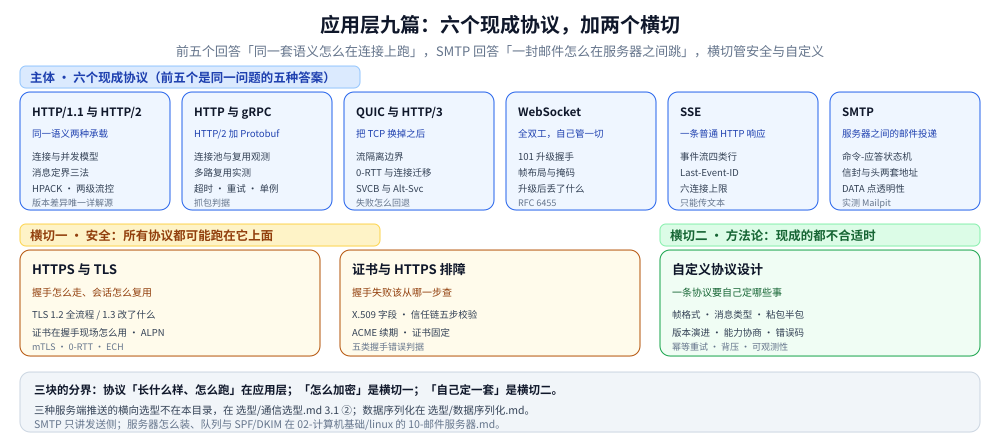

# 应用层

> 本目录回答一个问题：**应用层的报文长什么样、它怎么在连接上跑。** 九篇分三块——主体是六个现成协议
> （HTTP/1.1 与 HTTP/2、HTTP 与 gRPC、QUIC 与 HTTP/3、WebSocket、SSE，加上服务器之间投递邮件的 SMTP），另两个是横切：
> 安全（TLS 与证书）与方法论（现成的都不合适时自己定一套）。
>
> 本篇是这个目录的**总入口**，只给索引、阅读路径、篇间依赖与边界；机制细节、帧字节、命令与实测读数全部在零件篇里，
> 这里不重复。目录级的位置见 [网络/README.md](../README.md)。
>
> 内容整理自个人学习笔记，素材见 [素材清单](../../../素材清单.md)。

---

## 一、这个目录回答什么问题

应用层不是「一堆协议的清单」，而是**同一个需求在不同年代的四种答案**：怎么在一条连接上传多个请求、怎么让服务端主动推、
怎么把连接换成 UDP 保时延。九篇里五篇在回答这三件事之一；SMTP 问的是另一件事——**一封邮件怎么在服务器之间跳**；
两篇安全讲上面这些协议怎么被加密；第九篇（自定义协议设计）回答「三个答案都不合适怎么办」。

图怎么读：**上一排六篇是并列的选项，不是演进关系**——HTTP/3 不取代 HTTP/2，WebSocket 不取代 SSE；SMTP 更不是它们的
替代品，它换了一个问题：前五个讲「一次请求/推送怎么在连接上跑」，SMTP 讲「一封邮件怎么在服务器之间跳」。
选哪一个在 [通信选型.md](../选型/通信选型.md) 3.1 ②。下面一排两个横切是**叠加**而不是替代：
任何现成协议都可以跑在 TLS 上，而自定义协议设计是从零开始，所以它排在最后、独立成一块。

---

## 二、现有篇目与一句话职责

### 2.1 主体：六个现成协议

| 文件 | 一句话职责 |
|---|---|
| [HTTP1.1与HTTP2的区别.md](HTTP1.1与HTTP2的区别.md) | ⭐ **HTTP 版本差异的唯一详解源**：同一套语义的两种承载——连接与并发模型、三种消息定界、HPACK 头部压缩、两级流控、优先级与推送为何被生态放弃、队头阻塞到底在哪一层（含 60 请求的量化实测） |
| [HTTP与gRPC.md](HTTP与gRPC.md) | **gRPC 就是 HTTP/2 加 Protobuf**：本质差别、连接池与 `httptrace` 复用观测、多路复用实测，以及落地三件必做事（超时 / 重试预算 / 单例连接）与抓包判据 |
| [QUIC与HTTP3.md](QUIC与HTTP3.md) | **把 TCP 换掉之后**：流隔离边界、0-RTT 与连接迁移、两条发现路径（DNS 的 SVCB 与 `Alt-Svc`）与失败怎么回退 |
| [WebSocket.md](WebSocket.md) | **全双工，代价是自己管一切**：RFC 6455 的 101 升级握手、帧字节布局与掩码方向性、分片与控制帧、升级成功后丢掉的 HTTP 语义 |
| [SSE.md](SSE.md) | **一条普通 HTTP 响应**：事件流四类行与空行分界、`Last-Event-ID` 续传三步时序、六连接上限与代理缓冲、为什么只能传文本 |
| [SMTP.md](SMTP.md) | **服务器之间怎么把一封信交出去**：命令-应答状态机与 `EHLO` 能力协商、`STARTTLS` 原地升级后为何要重发 `EHLO`、⭐ **信封与头是两套地址**、`DATA` 段的三条硬规则（CRLF 行 / 行首点加倍 / 单点行收尾）、逐收件人状态码与 4xx 重试 / 5xx 退信、MX 查询与三个端口；⭐ 全部读数来自 Mailpit v1.32.0 与本机自建服务端 |

### 2.2 横切一：安全

| 文件 | 一句话职责 |
|---|---|
| [HTTPS与TLS.md](HTTPS与TLS.md) | **握手怎么走**：TLS 1.2 全流程、1.3 改了什么、会话复用与 0-RTT、证书在握手现场怎么用、mTLS 与 ECH；含 Go / Java 落地 |
| [证书与HTTPS排障.md](证书与HTTPS排障.md) | **握手失败该从哪一步查**：X.509 字段、信任链五步校验、ACME 续期、证书固定、五类握手错误的判据与命令、到期监控 |

### 2.3 横切二：方法论

| 文件 | 一句话职责 |
|---|---|
| [自定义协议设计.md](自定义协议设计.md) | ⭐ **只有这一篇讲「自己定一套协议」**：帧格式、消息类型、粘包半包的两段读循环、版本演进；后四节是上线才暴露的问题——错误码分级、超时与幂等重试、流控与背压、协议可观测性 |

> 📎 两篇不在本目录但常一起读：[通信选型.md](../选型/通信选型.md)（七种应用层协议的横向选型，3.1 ② 是「服务端推送三选一」的权威版）、
> [数据序列化.md](../选型/数据序列化.md)（请求体怎么编码；序列化不定义消息边界）。

---

## 三、按问题走阅读顺序

| 你想解决什么 | 读这个顺序 |
|---|---|
| **第一次搞懂「HTTP 到底怎么传」** | [HTTP1.1与HTTP2的区别.md](HTTP1.1与HTTP2的区别.md)（一~三节：语义与承载、并发模型、消息定界）→ 回到 [网络分层与数据包旅程.md](../网络分层与数据包旅程.md) 第七节看它在封装里的位置 |
| **服务端要主动推消息，选哪个** | [通信选型.md](../选型/通信选型.md) 3.1 ②（先做决策）→ [SSE.md](SSE.md)（最便宜的那条）→ [WebSocket.md](WebSocket.md)（需要双向时）→ [HTTP与gRPC.md](HTTP与gRPC.md)（已有 gRPC 栈时用流式） |
| **HTTP/2 开了怎么还是慢** | [HTTP1.1与HTTP2的区别.md](HTTP1.1与HTTP2的区别.md) 七节（队头阻塞的真实边界）→ 五节（流控）→ 四节（HPACK） |
| **要上 HTTP/3** | [QUIC与HTTP3.md](QUIC与HTTP3.md)（全篇）→ [HTTPS与TLS.md](HTTPS与TLS.md)（ALPN 与 QUIC 内嵌 TLS 1.3）→ [UDP与数据报传输.md](../传输层/udp/UDP与数据报传输.md)（底下换成了什么） |
| **HTTPS 报错 / 证书过期** | [证书与HTTPS排障.md](证书与HTTPS排障.md) 四节（五类握手错误的判据）→ 二节（信任链五步）→ 需要懂原理时再回 [HTTPS与TLS.md](HTTPS与TLS.md) |
| **想上双向认证（mTLS）** | [HTTPS与TLS.md](HTTPS与TLS.md)（握手现场与证书请求）→ [证书与HTTPS排障.md](证书与HTTPS排障.md) 六节（证书固定的取舍） |
| **现有协议都不合适，要自己定** | [自定义协议设计.md](自定义协议设计.md)（全篇）→ [消息协议族全景.md](../消息协议/消息协议族全景.md)（先看别人怎么定那四个变量）→ [数据序列化.md](../选型/数据序列化.md)（编码只解决编码） |
| **gRPC 连接数一直涨 / 复用没生效** | [HTTP与gRPC.md](HTTP与gRPC.md)（连接池与 `httptrace` 观测）→ [HTTP1.1与HTTP2的区别.md](HTTP1.1与HTTP2的区别.md) 二节（多路复用与连接模型） |
| **系统要发邮件 / 排查退信与被判垃圾** | [SMTP.md](SMTP.md)（四节信封与头、六节逐收件人状态码、七节 MX）→ [10-邮件服务器.md](../../linux/鸟哥服务器架设篇/10-邮件服务器.md)（服务器侧配置、队列重试与 SPF / DKIM / DMARC） |

---

## 四、篇间依赖（谁要前置）

| 本篇 | 建议先读 | 为什么 |
|---|---|---|
| [HTTP与gRPC.md](HTTP与gRPC.md) | [HTTPS与TLS.md](HTTPS与TLS.md)、[HTTP1.1与HTTP2的区别.md](HTTP1.1与HTTP2的区别.md) | gRPC 跑在 HTTP/2 上，而版本是 ALPN 协商出来的；不先懂 HTTP/2 就看不出 gRPC 的差别在哪 |
| [证书与HTTPS排障.md](证书与HTTPS排障.md) | [HTTPS与TLS.md](HTTPS与TLS.md) | 先懂握手，再谈证书链与错误码 |
| [QUIC与HTTP3.md](QUIC与HTTP3.md) | [HTTPS与TLS.md](HTTPS与TLS.md)、[UDP与数据报传输.md](../传输层/udp/UDP与数据报传输.md) | 要懂 1-RTT / 0-RTT 的价值，先知道 TCP + TLS 要几次往返 |
| [WebSocket.md](WebSocket.md) | [HTTP1.1与HTTP2的区别.md](HTTP1.1与HTTP2的区别.md)、[NAT与连接跟踪.md](../网络层与寻址/NAT与连接跟踪.md) | 升级前的握手是 HTTP，升级后要自己处理长连接的存活 |
| [SSE.md](SSE.md) | [HTTP1.1与HTTP2的区别.md](HTTP1.1与HTTP2的区别.md)、[WebSocket.md](WebSocket.md) | 六连接上限是 HTTP/1.1 的并发限制带来的；与 WebSocket 对照才看出取舍 |
| [自定义协议设计.md](自定义协议设计.md) | [TCP协议基础与报文结构.md](../传输层/tcp/TCP协议基础与报文结构.md)、[数据序列化.md](../选型/数据序列化.md) | 定界源于「TCP 是字节流」，序列化只管编码不管边界 |
| [SMTP.md](SMTP.md) | [TCP协议基础与报文结构.md](../传输层/tcp/TCP协议基础与报文结构.md)、[HTTPS与TLS.md](HTTPS与TLS.md) | `DATA` 段的「点加倍 + 单点行收尾」是为了在**字节流**上切出消息边界；`STARTTLS` 是同一 TCP 上的原地升级，与 HTTPS 的 443 隐式加密不是一回事 |

---

## 五、与相邻目录的边界

| 相邻目录 | 分界 |
|---|---|
| [传输层/](../传输层/) | 那边管**连接本身**（建、传、拆、可靠性与拥塞）；本目录管**连接之上装什么**。HTTP/2 的多路复用是应用层排队机制的优化，**不等于**消除 TCP 层队头阻塞 |
| [网络层与寻址/](../网络层与寻址/) | DNS **协议**那边（它是寻址环节）；本目录的 HTTPS / HTTP/3 只用到「解析结果」 |
| [消息协议/](../消息协议/) | 那边是**消息中间件与即时通信的标准协议族**（AMQP / MQTT / STOMP / XMPP + 定界方法论）；本目录面向 Web 请求、服务端推送与邮件投递。两者都在「定界」这个问题上交汇，横向对照在 [消息协议族全景.md](../消息协议/消息协议族全景.md) |
| [选型/](../选型/) | **做决策**在那边（`通信选型.md`、`数据序列化.md`）；本目录各篇只讲「这个协议怎么工作」 |
| [代理与网关/](../代理与网关/) | 反向代理、逐跳头、`Nginx` 配置语义都在那边；本目录讲协议本身，不讲谁转发它 |
| [03-…/RPC框架/gRPC/](../../../03-数据与中间件/中间件/RPC框架/gRPC/) | **HTTP/2 的字节级机制**（帧头逐字段、HPACK 编码形态、流状态机、两层限额）在 [HTTP2机制.md](../../../03-数据与中间件/中间件/RPC框架/gRPC/HTTP2机制.md)；本目录只讲版本差异的机制，不重复字节布局 |
| [06-工程实践/安全/](../../../06-工程实践/安全/) | 密码学基础在那边：[数字证书与PKI.md](../../../06-工程实践/安全/密码学与密钥/数字证书与PKI.md)（信任链与 PKI）、[加密算法.md](../../../06-工程实践/安全/密码学与密钥/加密算法.md)（套件里的算法） |
| [linux/鸟哥服务器架设篇/](../../linux/鸟哥服务器架设篇/) | **邮件服务端**在那边：[10-邮件服务器.md](../../linux/鸟哥服务器架设篇/10-邮件服务器.md) 管装 Postfix / Dovecot、队列与重试、开放中继的坑与 SPF / DKIM / DMARC 三件套；本目录的 [SMTP.md](SMTP.md) 只讲线上怎么说话（命令-应答、信封与头、逐收件人状态码、MX 查询），两边互链不重复 |

---

## 六、已知缺口与遗留问题

| 项 | 现状 | 结论 |
|---|---|---|
| ⚠️ **`自定义协议设计.md` 缺「不覆盖」导语段** | 本目录 9 篇里唯一一篇导语只写了「覆盖」、没写「不覆盖」（相邻的传输层 13 篇全部都有） | **体例遗留**，未修。它确实有该指出的邻篇（消息协议四篇、`协议设计.md`），补一段即可 |
| **GraphQL** | 全仓 10 篇提及，集中在选型与数据侧；本目录无专篇 | **暂不补**：「要不要用 GraphQL」是选型判断（[通信选型.md](../选型/通信选型.md) 有横向对比），单协议机制不足以独立成篇 |
| **HTTP/2 服务器推送的落地** | [HTTP1.1与HTTP2的区别.md](HTTP1.1与HTTP2的区别.md) 第六节只讲「协议有、生态放弃」的原因 | **不是缺口**：现状就是这个功能已被主流浏览器移除，讲清楚为什么比讲怎么用更有价值 |
| **WebDAV / CalDAV 一类企业协议** | 全仓 0 次 | **暂不补**：与本仓主线（后端服务链路）距离较远 |

---

## 关联

- **上游/总纲**：[网络/README.md](../README.md) — 网络目录整体的两篇总纲、47 篇分类地图与主读序
- **上游/总纲**：[网络分层与数据包旅程.md](../网络分层与数据包旅程.md) — 纵向总纲：应用层报文怎么被逐层包进帧里（第七节第 3、4 步）
- **对照/互补**：[通信选型.md](../选型/通信选型.md) — 七种应用层协议的横向选型与「服务端推送三选一」，本目录各篇的上游决策
- **对照/互补**：[消息协议族全景.md](../消息协议/消息协议族全景.md) — 消息协议族的同一个问题（怎么定界）在中间件侧怎么解
- **对照/互补**：[10-邮件服务器.md](../../linux/鸟哥服务器架设篇/10-邮件服务器.md) — 同一个 SMTP 的另一半：服务器怎么装、队列怎么重试、怎么不被判成垃圾邮件
- **下游机制**：[TCP协议基础与报文结构.md](../传输层/tcp/TCP协议基础与报文结构.md) — 「字节流没有边界」是应用层必须自己定界的原因
- **下游机制**：[反向代理原理.md](../代理与网关/反向代理原理.md) — 逐跳头与连接复用：协议跑在代理链上时多出来的约束
- **下游机制**：[协议设计.md](../../../04-架构与系统/系统设计/IM系统/协议设计.md) — 自定义协议的通用方法落到具体业务（投递语义、已读未读、多端同步）
