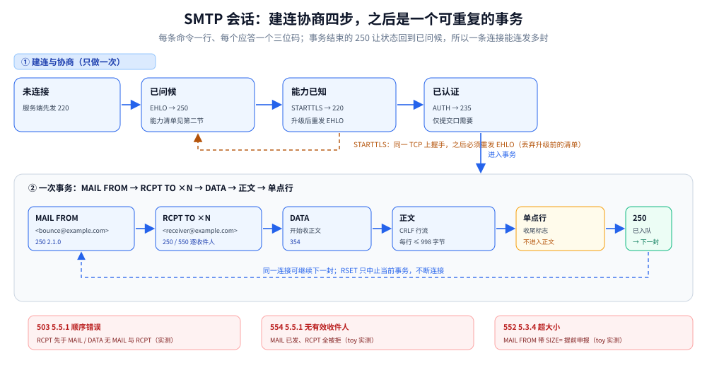
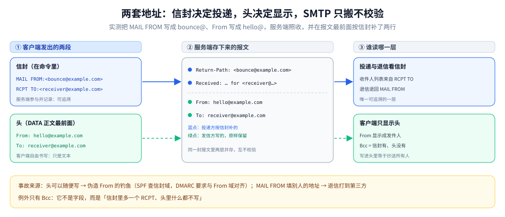
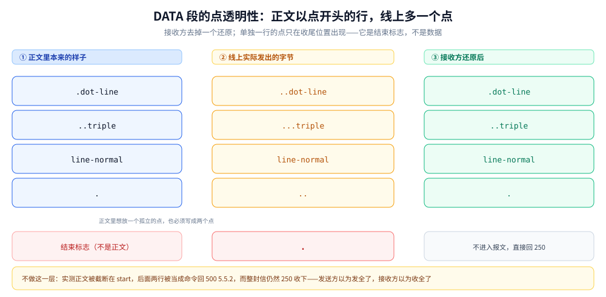

# SMTP

> 覆盖：一次 SMTP 会话在线上的具体形态——命令与应答的文本行规则、会话状态机、`EHLO` 能力协商、`STARTTLS` 原地升级与升级后为什么必须重发 `EHLO`、**信封地址与头地址为什么是两套**、`DATA` 段的三条硬规则（CRLF 行、行首点加一点、单点行收尾）、逐收件人状态码与 4xx/5xx 的分工、投递前的 MX 查询与三个端口；以及客户端怎么发（Go `net/smtp` 的显式会话与库替你补的命令）。
>
> 不覆盖：邮件服务器本身怎么装、Postfix / Dovecot 怎么配、队列与重试参数、SPF / DKIM / DMARC 与 PTR 怎么设，全部在 [10-邮件服务器.md](../../linux/鸟哥服务器架设篇/10-邮件服务器.md)；取信侧的 IMAP / POP3 也在那篇；正文内容怎么编码（MIME 的 base64 与 quoted-printable）本仓暂无专篇，本篇只讲「SMTP 只负责把字节按行走」；应用层其它协议的分工见 [README.md](README.md)。
>
> 内容整理自个人学习笔记，素材见 [素材清单](../../../素材清单.md)。
>
> 📎 **实测口径**：本篇读数来自两处——① 容器 `smtp-lab`（`axllent/mailpit`，Mailpit **v1.32.0**，宿主 `11025` → 容器 `1025`，开启 `STARTTLS` 与任意认证）上跑的 Go 原始字节探针 `.workbuddy/tmp/smtp-lab/probe.go`，逐条打印收发原文，输出存 `.workbuddy/tmp/smtp-lab/probe_out.txt`；② 同一探针里的**自建最小服务端**（`toy.local`，只实现 `EHLO / MAIL / RCPT / DATA / QUIT`），用来观察逐收件人状态码、`SIZE` 拒绝与透明性还原，它的每一条应答同样是实测。客户端代码 `.workbuddy/tmp/smtp-lab/client.go` 在 `golang:1.26-alpine` 下 `go run` 通过，输出存 `client_out.txt`；`gmail.com` 的 MX 记录是一次真实 DNS 查询。**未实测**：真实公网的 25 端口投递（本机不具备出站 SMTP）、`PIPELINING` 批量发送（Mailpit 未通告该能力）、隐式 TLS 的 465 端口（容器未开）、DKIM 验签，以及 `openssl s_client` 手敲（本机无 telnet / nc）。

---

## 一、一次 SMTP 会话长什么样？

**本节要点**：SMTP 是**一问一答的文本行协议**：客户端发一行命令，服务端回一个三位码（可能跨多行）。整个会话是一个状态机，顺序错了服务端当场用 `503` 挡住。

### 1.1 命令与应答都以 CRLF 结尾

客户端每行是 `命令 [参数] CRLF`，服务端每行是 `三位码 + 空格或连字符 + 说明 CRLF`。建连的第一行实测是：

```text
S: 220 7066a83c8475 Mailpit ESMTP Service ready
```

`220` 表示「服务就绪」。三位码的首位决定大类：`2xx` 成功、`3xx` 需要继续（`354` 就是「开始发正文」）、`4xx` 临时失败、`5xx` 永久失败。命令名本身不区分大小写。

### 1.2 多行应答靠第四列字符区分

`EHLO` 的回复不止一行，读法只有一条：**第四列是 `-` 说明还有下一行，是空格说明这是最后一行**。同一次 `EHLO` 实测到七行：

```text
S: 250-7066a83c8475 greets probe.local
S: 250-SIZE 52428800
S: 250-STARTTLS
S: 250-AUTH PLAIN LOGIN
S: 250-ENHANCEDSTATUSCODES
S: 250-8BITMIME
S: 250 SMTPUTF8
```

⚠️ 只读第一行就停，会把这七个能力全丢掉；七行的三位码必须相同，不同就是协议错误。

### 1.3 会话是一个状态机



这张图要读出的是「一封信占会话里的一小段」：左侧是建连与协商，右侧是一个可以反复进入的事务框——`DATA` 收尾的 `250` 让状态回到「已问候」，所以同一条 TCP 上可以接着发第二封、第三封；而 `503` 与 `554` 两个拒绝码分别守在两个入口上。

状态大致是：未连接 →（`220`）已问候 →（`EHLO 250`）能力已知 →（`STARTTLS`）回到 `EHLO` →（`AUTH 235`）已认证 →（`MAIL 250`）事务打开 →（`RCPT 250`，一条一个）→（`DATA 354`）收正文 →（`.` → `250`）事务结束。`QUIT` 在任何状态下都可以发，回 `221` 后关闭。

⭐ 一次连接可以发**多封**：`DATA` 收尾的 `250` 之后状态回到「已问候」，可以立刻再 `MAIL FROM`。`RSET` 只丢弃当前事务、不断连接——这也是「SMTP 连接可以复用」的全部机制，没有额外的池化协议。

### 1.4 顺序错了服务端当场拦

实测（Mailpit）：

```text
C: RCPT TO:<x@example.com>（还没发 MAIL FROM）
S: 503 5.5.1 Bad sequence of commands (MAIL required before RCPT)
C: DATA（还没有收件人）
S: 503 5.5.1 Bad sequence of commands (MAIL & RCPT required before DATA)
```

自建服务端在「已发 `MAIL`、但一个收件人都没被接受」时回的是 `554 5.5.1 Error: no valid recipients`。两个码说的是同一件事：**状态机是服务端强制的**——它要保证进队列的信一定有发件人和收件人，而不是信任客户端自觉。

## 二、EHLO 那一串 250 在说什么？

**本节要点**：`EHLO` 是能力协商：服务端把支持的扩展列出来，客户端**只能按这份清单**决定下一步能做什么。清单里没有的，发了也没人懂。

### 2.1 第一行是问候，其余是能力

第一行 `250-<主机名> greets <客户端自称的名字>` 是寒暄，参数来自 `EHLO` 后面那个域名（客户端自称，服务端只用于日志与策略）。从第二行起才是能力，每条一个关键字加可选参数。这张清单**在一条连接内只对当前阶段有效**——`STARTTLS` 之后要重来一次，理由见第三节。

### 2.2 实测到的六个能力

| 能力 | 实测值 | 客户端能据此做什么 |
|---|---|---|
| `SIZE` | `52428800`（50 MiB） | `MAIL FROM` 后可带 `SIZE=` 提前申报体积，超限被提前拒（见 5.5） |
| `STARTTLS` | 有 | 可原地升级 TLS（见第三节） |
| `AUTH` | `PLAIN LOGIN` | 加密后可认证（见 3.3） |
| `ENHANCEDSTATUSCODES` | 有 | 应答会带 `x.y.z` 三段码（见 6.3） |
| `8BITMIME` | 有 | 正文可直接含 8 位字节 |
| `SMTPUTF8` | 有 | 地址与头里可直接用非 ASCII |

⚠️ **Mailpit 没通告 `PIPELINING`**，所以对着它不能「连发几条命令再一起读回复」。这条能力的有无直接决定客户端是**一问一答**还是**批量发**，而批量发正是长距离链路上省往返的主要手段——这也是第五节「能力决定客户端敢发什么」的具体后果之一。

### 2.3 能力决定客户端敢发什么

不看清单就发，代价不是报错，而是**静默走错分支**：

- 不检查 `SIZE` 就报体积 → 白白把正文传完才被拒；
- 不看 `8BITMIME` 就发 8bit 正文 → 对端可能改写、拒收或存成乱码；
- 不看 `SMTPUTF8` 就发中文地址 → 收件人解析失败；
- 没通告 `AUTH` 就调认证 → 客户端库通常在本地直接报错，连命令都不发。

⭐ 一句话：**能力清单是「服务端愿意谈的边界」，不是「客户端可以随便试的选项」**。

### 2.4 HELO 是老版本入口

`HELO` 只回一行 `250`，没有任何扩展。实测同一条连接改用 `HELO` 后仍能完成 `MAIL / RCPT / DATA`（回显见 5.3 那段），但 `STARTTLS` 与 `AUTH` 都不可用——因为服务端根本没机会说。**要用扩展就必须 `EHLO`**。

## 三、STARTTLS 之后为什么还要再 EHLO 一次？

**本节要点**：`STARTTLS` 是**同一条 TCP 上的原地升级**，不是新连接；升级前的明文阶段可能被中间人改过，所以规范要求客户端丢掉旧能力集、在新建的 TLS 通道里重新 `EHLO`。

### 3.1 三步：一条命令、一个应答、一次握手

```text
C: STARTTLS
S: 220 2.0.0 Ready to start TLS
<同一条连接上开始 TLS 握手，之后所有 SMTP 字节都在 TLS 记录里>
```

注意应答是 `220` 而不是 `250`——和建连问候同一个码，含义是「准备就绪，可以开始下一阶段」。

### 3.2 实测升级结果

握手完成于 **TLS 1.3**，套件 `TLS_AES_128_GCM_SHA256`。升级后重发 `EHLO`，能力列表原样回来，只有 `AUTH PLAIN LOGIN` 变成了 `AUTH LOGIN PLAIN`。顺序无关紧要，但它恰好证明这份清单是**升级后重新协商的**，不是把升级前那份缓存下来的。

### 3.3 为什么必须丢弃旧清单

RFC 3207 要求客户端在 TLS 建立后丢弃升级前从服务端得到的一切知识（尤其是能力列表），然后重新 `EHLO`。原因很直接：**明文阶段的 `EHLO` 回复可以被中间人改写**。删掉 `STARTTLS` 那一行，客户端就不升级；如果客户端仍按明文阶段那份可能被篡改的清单去发 `AUTH`，密码就直接落在明文里了。

⚠️ 所以「先 `AUTH` 再升级」和「升级后不重发 `EHLO`」这两种写法，等于把整条加密链的收益让掉。Go 的 `PlainAuth` 有一道兜底：连接未加密且目标不是本机时它会直接拒绝，报 `unencrypted connection`。

### 3.4 三种加密姿势与对应端口

| 姿势 | 端口 | 谁用 | 特征 |
|---|---|---|---|
| 明文 + 可选 `STARTTLS` | 25 | 服务器之间投递 | 通常不认证；升级可选，能被中间人剥离，靠 MTA-STS / DANE 兜 |
| 明文 + 强制 `STARTTLS` + `AUTH` | 587 | 客户端提交 | 提交口的标准做法（RFC 6409） |
| 隐式 TLS | 465 | 客户端提交 | 连上就是 TLS，根本没有 `STARTTLS` 命令（RFC 8314） |

⚠️ 把端口当「加密开关」是常见误读：`587` 的加密来自「服务端强制先升级」，不是端口本身；`465` 的加密来自「握手先于任何 SMTP 字节」。

## 四、一封信为什么有两套地址？⭐

**本节要点**：SMTP 的地址分两层——**信封**（`MAIL FROM` / `RCPT TO`）决定投递，**头**（`From:` / `To:`）决定显示。服务端只信信封，头是客户端写的自由文本。

### 4.1 两套地址各自是什么

| 层 | 在哪给 | 字段 | 作用 |
|---|---|---|---|
| 信封 | `MAIL FROM` / `RCPT TO` 命令里 | reverse-path / forward-path | 决定「进谁的队列、退信退给谁」 |
| 头 | `DATA` 正文的最前面 | `From:` / `To:` / `Cc:` / `Subject:` / `Date:` | 决定客户端「显示成谁发的、谁收的」 |



这张图要读出的是「两条互不校验的路径」：左边那列命令是服务端参与过的、可追溯的；右侧那几行头只是被原样搬运。同一个收件人出现在两边时看起来一致，纯属客户端写得规矩，协议本身并不要求。

### 4.2 实测：故意写成不同的人

```text
C: MAIL FROM:<bounce@example.com>
C: RCPT TO:<receiver@example.com>
C: <DATA 正文>
   From: Header Name <hello@example.com>
   To: Receiver <receiver@example.com>
```

服务端存下来的报文（Mailpit API 读回）在**我们写的头之前**多了两行：

```text
Return-Path: <bounce@example.com>
Received: from probe.local (unknown [172.17.0.1])
        by 7066a83c8475 (Mailpit) with SMTP
        for <receiver@example.com>; Sat, 24 Oct 2026 06:06:14 +0000 (UTC)
```

⭐ 这两行的来源完全不同：`Return-Path` 抄的是信封里的 `MAIL FROM`，`Received ... for` 抄的是信封里的 `RCPT TO`；而我们写的 `From: Header Name <hello@example.com>` 一个字节都没被改。**SMTP 只搬头，不校验头。**

### 4.3 三个消费者各看哪一层

| 消费者 | 看哪一层 | 为什么 |
|---|---|---|
| 投递 / 退信 | 信封 | 只有信封是服务端参与过的，可追溯 |
| 邮件客户端 | 头 | 它拿到的就是 `DATA` 那一段（`Return-Path` 一类是投递方追加的） |
| 垃圾过滤 / 身份校验 | 两边都比 | SPF 查信封域，DKIM 查签名域，DMARC 要求二者与 `From:` 域对齐 |

### 4.4 Bcc 就是「信封有、头没有」

Bcc 不是某个特殊字段，它的实现是**信封里加一个 `RCPT TO`、头里什么都不写**。实测第二封信没写任何收件人头，服务端在存下来的报文里补了一行 `Bcc: receiver@example.com` 方便查看——这行是接收方加的，不是发信方发的。⚠️ 把 Bcc 地址写进头里，等于抄送给所有人看。

### 4.5 三类由此产生的事故

- **伪造 `From:` 的钓鱼**：头随便写，只有信封受 SPF 约束——所以校验收紧到「`From:` 域必须与信封域对齐」，也就是 DMARC，细节见 [10-邮件服务器.md](../../linux/鸟哥服务器架设篇/10-邮件服务器.md) 第六节。
- **退信打到伪造地址（backscatter）**：`MAIL FROM` 填别人的地址，退信就成了打向第三方的垃圾，所以现代 MTA 对「信封与头不一致且未认证」的信会加严。
- **显示收件人 ≠ 实际收件人**：信封里五个 `RCPT`、头里只写一个 `To:`，五个人的客户端都显示「只发给我」。

## 五、DATA 段的三条硬规则是什么？

**本节要点**：正文不是「一整块字节」，而是**以 CRLF 分行的行流**：结束靠单独一行一个点、行首点要加倍、每行有长度上限。这三条错了都不会报错，只会静默截断或丢字。

### 5.1 收尾标志是「单独一行一个点」

`DATA` 的应答是 `354`，属于中间态而不是成功：

```text
C: DATA
S: 354 Start mail input; end with <CR><LF>.<CR><LF>
```

正文以 `<CRLF>.<CRLF>` 结束，也就是**行首恰好一个点**的那一行；收尾之后服务端回 `250`。⭐ 判据是「这一行只有一个点」，不是「正文里出现了点」。

### 5.2 行首点必须再加一个点

发送方把**行首**的 `.` 写成 `..`，接收方再反过来去掉一个，这叫透明性（dot-stuffing）。实测：

| 客户端发出的行 | 服务端存下来的正文 |
|---|---|
| `line-normal` | `line-normal` |
| `..dot-line` | `.dot-line` |
| `...triple` | `..triple` |



这张图要读出「同一行在三个位置的三种写法」：左边的正文原样、中间的线上字节、右边接收方还原后的结果。只有「收尾标志」那一行例外——它在正文里必须是两个点，在线上是一个点，而它永远不会以点的形式出现在还原后的正文里。

### 5.3 不做透明性会怎样（实测）

故意在正文里直接发一行单独的点，后面再跟两行：

```text
C: Subject: 不做 dot-stuff
C: （空行）
C: start
C: .                      ← 本意是正文里的一行
C: hidden-after           ← 本意是正文
C: .
S: 250 2.0.0 Ok: queued as 7PvhVT18lZVgJ0YDVbh3Rt
S: 500 5.5.2 Syntax error, command unrecognized
S: 500 5.5.2 Syntax error, command unrecognized
```

结果：正文只剩 `start`，`hidden-after` 被当成一条命令回了 `500`，而**整封信仍然 `250` 收下**；存下来的报文里也确实只有 `start`。⭐ 这是最典型的「客户端 bug 长得像服务端 bug」：发送方以为发全了，接收方以为收全了，谁都没报错。

### 5.4 每行一个 CRLF，行长有上限

正文每行必须以 `CRLF` 结束；单行正文上限 998 字节（含 `CRLF` 是 1000），命令与应答行上限 512 字节（含 `CRLF`）。超长行服务端可以截断或拒收，而这个错通常只出现在「把整个 JSON 当一行发」的时候。8bit 正文要看 `8BITMIME`：本轮 Mailpit 通告了它，实测中文原文直接通过、未被改写；⚠️ 跨公网投递时非 ASCII 正文仍应做 MIME 编码，因为对端不一定支持。

### 5.5 SIZE：能提前拒，就别等收完

`EHLO` 通告的 `SIZE` 是上限，客户端可以在 `MAIL FROM` 后面带 `SIZE=` 提前申报。实测自建服务端通告 `SIZE 10000`，客户端报 `20000`：

```text
C: MAIL FROM:<sender@example.com> SIZE=20000
S: 552 5.3.4 Message size exceeds fixed maximum message size
```

不申报的话，服务端只能收完整个正文再发现超限，带宽已经花掉了。⚠️ `net/smtp` 不会自动带 `SIZE`（见 9.3），这条优化在 Go 默认路径上用不到，得自己拼。

## 六、状态码为什么必须逐个收件人看？

**本节要点**：`RCPT TO` 是一条命令一个收件人，每个都可能有独立结果。**有一个收件人被拒，不代表整封信失败**；4xx 与 5xx 也是按收件人分别决定重试还是退信。

### 6.1 一次事务可以有多个收件人、多个结果

实测三个 `RCPT`，中间那个地址被拒：

```text
C: RCPT TO:<ok1@toy.local>   S: 250 2.1.5 Ok
C: RCPT TO:<bad@toy.local>   S: 550 5.1.1 Recipient address rejected: User unknown
C: RCPT TO:<ok2@toy.local>   S: 250 2.1.5 Ok
C: DATA                      S: 354 End data with <CR><LF>.<CR><LF>
C: <正文，以单独的点收尾>      S: 250 2.0.0 Ok: queued as TOY1
```

被拒的那个不影响另外两个：`DATA` 照常进行，正文**只发给被接受的人**。⭐ 所以 SMTP 的「部分成功」不是「部分投递」，而是「**部分收件人被拒，其余人共收一份**」。

### 6.2 4xx 重试、5xx 退信

| 首位 | 含义 | 发信方该做什么 |
|---|---|---|
| `4xx` | 临时失败（收件方磁盘满、限流、DNS 暂时查不到） | 留在队列里按退避重试 |
| `5xx` | 永久失败（用户不存在、域不收信、超大小） | 立刻退信，别占着队列 |

⚠️ 这个判断发生在**每个收件人**上，而 `DATA` 本身只有一次：正文一旦被接受，就不能再按收件人拆分结果。队列与重试的具体参数见 [10-邮件服务器.md](../../linux/鸟哥服务器架设篇/10-邮件服务器.md) 2.4。

### 6.3 三段式增强状态码

因为服务端通告了 `ENHANCEDSTATUSCODES`，实测每条应答都带 `x.y.z`：`5.1.1`（用户不存在）、`5.3.4`（超大小）、`5.5.1`（命令顺序）。三段是 `class.subject.detail`——`class` 与三位码首位同义（`2` / `4` / `5`），`subject` 是大类（`1` 寻址、`3` 邮件系统、`5` 协议、`7` 安全策略），`detail` 才是细分。⭐ 排障时**先看首位决定重试还是放弃，再看 `subject` 定性**：三位码只能说「永久失败」，`5.7.x` 才能告诉你「是策略拒了，不是地址错」。

### 6.4 客户端侧要按「收件人」记账

发信循环要收集被接受的收件人；一个都没有就别进 `DATA`；发完把被拒的地址单独交回调用方。把整封算成功或整封算失败，都会让「五个收件人里一个写错」变成一次排障。写法见 9.1。

## 七、对方服务器是怎么找到的？

**本节要点**：SMTP 只管「连上之后怎么说」，**连到哪**要靠 DNS 的 MX 记录：先查收件域的 MX，按优先级逐个试。

### 7.1 MX 是带优先级的邮件路由

MX 记录给的是**主机名**加一个 preference（优先级），**数值越小越先试**，同优先级之间随机分摊。发信方按顺序尝试：前一台连不上或回 `4xx`，就试下一台。

### 7.2 实测 gmail.com 的五条

```text
MX pref=5   host=gmail-smtp-in.l.google.com.
MX pref=10  host=alt1.gmail-smtp-in.l.google.com.
MX pref=20  host=alt2.gmail-smtp-in.l.google.com.
MX pref=30  host=alt3.gmail-smtp-in.l.google.com.
MX pref=40  host=alt4.gmail-smtp-in.l.google.com.
```

⚠️ 同一次查询里 `gmail.com` 自己的 A / AAAA 记录也在，但那是「直接连 `gmail.com`」用的，**不是 MX 主机的地址**——MX 主机名要再解析一次。把这两件事混起来，就会写出「连 `gmail.com:25`」这种代码。

### 7.3 没有 MX 就退到 A 记录

收件域没有 MX 时，按 RFC 把该域的 A / AAAA 当成隐式 MX（相当于「自己收自己」）；显式声明 `0 .` 的 null MX 则表示「本域不收信」，是硬失败。两种情形在 [10-邮件服务器.md](../../linux/鸟哥服务器架设篇/10-邮件服务器.md) 2.3 有本机实测的退信原文。

### 7.4 三个端口的分工

见 3.4 的表：`25` 服务器之间投递、`587` 客户端提交（认证 + 强制 STARTTLS）、`465` 隐式 TLS。⚠️ 多数云厂商封 `25` 出站，所以「应用发信」几乎总是走 `587` 或服务商的 HTTP API。

## 八、应用场景

| 场景 | 走哪条路 | 为什么 |
|---|---|---|
| 注册验证码、密码重置 | 邮件服务商的 API 或 SMTP `587` | 事务类邮件，要求到达率与退信处理；不值得自建 MTA |
| 告警与运维通知 | 内网 relay 或 SMTP `587` | 收件人固定、量小；关键是别把地址写死在代码里 |
| 批量营销 / 周报 | 专营服务商 + 列表清洗 | SMTP 的 `5xx` 就是清洗信号；退信率不处理会拖垮域名信誉 |
| 系统内部报表 | 内网 relay，可无认证 | 同一网络内、无公网投递需求 |
| 工单 / 回复类「入站邮件」 | 自建 MTA + 解析 | 需要收信侧，本篇只讲发送侧；服务端搭法见 [10-邮件服务器.md](../../linux/鸟哥服务器架设篇/10-邮件服务器.md) |

⭐ 一句话判据：**「发得出去」比「发得正确」难**——所以自建只在「必须自己控制发信源」时才值得，其余场景交给服务商。真正难的是信誉（PTR、SPF / DKIM / DMARC），那部分与协议无关，全在 10-邮件服务器.md。

## 九、具体使用

### 9.1 Go：显式会话发一封（可逐收件人处理）

```go
c, err := smtp.Dial("smtp.example.com:587")
if err != nil {
	return err
}
defer c.Close()

if ok, _ := c.Extension("STARTTLS"); !ok {
	return errors.New("服务端不支持 STARTTLS，拒绝在明文上认证")
}
// serverName 用真实域名；生产不要把 InsecureSkipVerify 打开
if err := c.StartTLS(&tls.Config{ServerName: "smtp.example.com"}); err != nil {
	return err
}
if err := c.Auth(smtp.PlainAuth("", user, pass, "smtp.example.com")); err != nil {
	return err
}
if err := c.Mail("bounce@example.com"); err != nil {
	return err
}

var accepted []string
for _, r := range recipients {
	if err := c.Rcpt(r); err != nil {
		log.Printf("收件人 %s 被拒，跳过：%v", r, err)
		continue
	}
	accepted = append(accepted, r)
}
if len(accepted) == 0 {
	_ = c.Quit()
	return errors.New("所有收件人都被拒绝")
}

w, err := c.Data()
if err != nil {
	return err
}
if _, err := w.Write(msg); err != nil {
	return err
}
if err := w.Close(); err != nil {
	return err
}
return c.Quit()
```

关键点三处：`StartTLS` 之前先确认 `Extension("STARTTLS")`；`PlainAuth` 的第四个参数必须与拨号用的主机名一致；`accepted` 为空时不进 `DATA`。

### 9.2 手敲一遍，看清单与证书

```bash
# 看能力清单与证书链（Linux / macOS）
openssl s_client -starttls smtp -connect smtp.example.com:587 -crlf
# 一步发一封测试信（需另装 swaks）
swaks --to me@example.com --from me@example.com --server smtp.example.com:587 --tls
```

⚠️ 本机没有 telnet / nc，这两条**未手敲**，只给判据：`s_client` 里该看的是 `250-` 开头那几行能力与证书链；`swaks` 的 `--tls` 走 `STARTTLS`，`--tlsc` 才是 465 的隐式 TLS。

### 9.3 库替你做了什么、没做什么

对着自建服务端抓 `net/smtp` 生成的原始行，实测三组：

| 你写的 | 线上实际发出的 | 说明 |
|---|---|---|
| `c.Mail("bounce@example.com")` | `MAIL FROM:<bounce@example.com> BODY=8BITMIME SMTPUTF8` | 服务端通告这两个能力时库自动补；**没有 `SIZE=`** |
| `w.Write([]byte(".leading-dot…"))` | `..leading-dot…` | `Data()` 返回的 writer 自己补点，手工再补就变成两个点 |
| `c.Rcpt("a@b\r\nRCPT TO:<victim@x>")` | 不发出 | 本地校验直接报 `smtp: A line must not contain CR or LF` |

三个坑：

1. `smtp.SendMail` 会自动 `STARTTLS`，但**不给改 `tls.Config`**，所以自签证书环境直接失败。实测原文：`tls: failed to verify certificate: x509: certificate is not valid for any names, but wanted to match host.docker.internal`。
2. `smtp.PlainAuth` 的主机参数写错会报 `wrong host name`（实测），它要求与拨号用的主机名严格一致，不是「随便填个域名」。
3. `net/smtp` 已冻结、不再加新特性；需要连接池、批量发送、DKIM 签名时换第三方库。

## 延伸追问

- **既然有 HTTP API，为什么还留着 SMTP？** → 服务器之间要能「互不认识的域名直接投递」，这套匿名互投从 1982 年部署至今；HTTP API 需要预先约定并带凭证，取代不了 MX 这条公开寻址路径。应用发信侧确实在往 API 迁移。
- **STARTTLS 能被降级吗？** → 能。中间人删掉 `STARTTLS` 能力行，客户端若不强制就退回明文。收信侧靠 MTA-STS / DANE 声明「必须加密」，发信侧靠「不升级就断开」。
- **给 100 个人发同一封信，是一个 `RCPT` 还是 100 个？** → 协议允许一条连接里 100 个 `RCPT`，但那样 100 个地址会出现在同一次投递里（也更容易互相看到）。Bcc 与群发通常拆成多封，每人一个 `RCPT`。
- **SMTP 能确认对方「已读」吗？** → 不能。`250` 只证明「进了对方队列」，连收件人是否存在都可能被策略掩盖（很多服务器对未知用户也先收再退）。已读回执是上层自己造的。
- **`Message-ID` 能防重复投递吗？** → 不能。它由发送方生成，重投时归属不受协议约束；去重仍要靠队列与业务侧的幂等键。
- **为什么正文里不能直接出现单独一行点？** → 那是协议的结束标志，不是数据。要让点成为数据只能靠 5.2 的加倍规则——这正是「文本协议里任何一个字节都可能是控制字符」的典型代价。

## 关联

- **上游/总纲**：[README.md](README.md) — 应用层各协议的分工与本目录读序
- **上游/总纲**：[网络分层与数据包旅程.md](../网络分层与数据包旅程.md) — SMTP 报文在逐层封装里处于哪一层
- **对照/互补**：[10-邮件服务器.md](../../linux/鸟哥服务器架设篇/10-邮件服务器.md) — 同一套协议的服务端侧：MTA / MDA 分工、Postfix 与 Dovecot 配置、队列重试、SPF / DKIM / DMARC
- **对照/互补**：[HTTP1.1与HTTP2的区别.md](HTTP1.1与HTTP2的区别.md) — 另一个文本行协议：消息定界用 `Content-Length` / `chunked`，SMTP 用「单点行」
- **对照/互补**：[消息协议族全景.md](../消息协议/消息协议族全景.md) — 定界四大家族的横向对照，SMTP 落在「分隔符 + 行流」这一格
- **下游机制**：[TCP协议基础与报文结构.md](../传输层/tcp/TCP协议基础与报文结构.md) — 「字节流没有边界」是 SMTP 必须自己定界的原因
- **下游机制**：[证书与HTTPS排障.md](证书与HTTPS排障.md) — STARTTLS 证书校验失败的判据与命令
