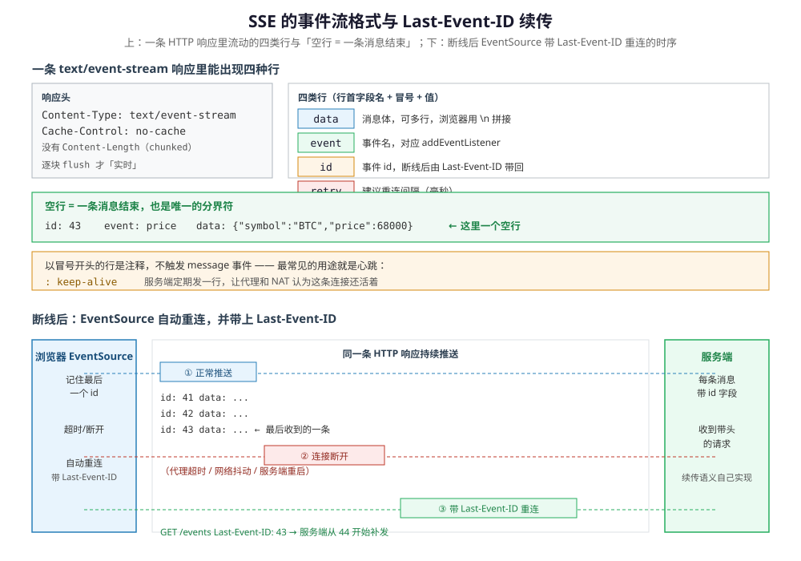

# SSE

> 覆盖：Server-Sent Events 的事件流格式（四类行与「空行分界」）、`Last-Event-ID` 续传的完整时序、HTTP/1.1 六连接上限、中间设备缓冲、心跳与重连，以及为什么它只能传文本。
>
> 不覆盖：三种推送手段的横向选型见 [通信选型.md](../选型/通信选型.md) 3.1 ②；WebSocket 的握手、帧布局与掩码见 [WebSocket.md](WebSocket.md)；HTTP/2 的多路复用见 [HTTP1.1与HTTP2的区别.md](HTTP1.1与HTTP2的区别.md)；NAT / LB 空闲超时见 [NAT与连接跟踪.md](../网络层与寻址/NAT与连接跟踪.md)。
>
> 内容整理自个人学习笔记，素材见 [素材清单](../../../素材清单.md)。
>
> ⚠️ 实测口径：本篇按 WHATWG HTML 的 `EventSource` 规范与 RFC 7230 的 chunked 传输整理，**未做抓包与断线复现实测**；文中命令与代码块是可直接运行的示意，不声称已在本机跑通。

---

## 一、定位：一条普通 HTTP 响应，便宜与限制同源

**本节要点**：SSE 的全部优势来自「它就是一条普通 HTTP 响应」——这句话同时决定了它的穿透性与它的限制。

三条服务端推送链路（WebSocket / SSE / gRPC 流式）里，它是唯一**不需要任何协议扩展**的一条：不用 `Upgrade`、不用 HTTP/2 底座，就是一个 `Content-Type: text/event-stream` 的响应一直往客户端写。横向选型的三条判据归 [通信选型.md](../选型/通信选型.md) 3.1 ②，本篇只补它自己的落点——**只有服务端推、客户端不常上行时选它**，实现成本比另外两条低一个数量级，自动重连与 `Last-Event-ID` 续传都是协议自带的（见第三节）。

代价也从同一句话来：既然是一条普通 HTTP 响应，它在 HTTP/1.1 下就要占一条同域连接（浏览器 6 条上限，见 4.1），并且只能传 UTF-8 文本（见 4.4）。

---

## 二、事件流格式：四类行与一个分界符

**本节要点**：整个协议就是一个文本流，靠**空行**分界，这是它实现便宜的根本原因。

服务端返回的响应头只有两行值得注意：

```text
Content-Type: text/event-stream
Cache-Control: no-cache
```

没有 `Content-Length`——连接不结束，长度未知，因此走 chunked 传输。响应体是一个持续追加的文本流，由四类行组成：

| 行 | 作用 | 示例 |
|---|---|---|
| `data:` | 消息体，**可写多行**，浏览器用 `\n` 拼接 | `data: {"symbol":"BTC"}` |
| `event:` | 事件名，对应 `addEventListener` | `event: price` |
| `id:` | 事件 id，断线后由 `Last-Event-ID` 带回 | `id: 43` |
| `retry:` | 建议的重连间隔（毫秒） | `retry: 3000` |

```text
id: 43
event: price
data: {"symbol":"BTC","price":68000}

: keep-alive

```



三条规则决定了 SSE 的全部行为，图的上半对应第一条、下半对应第三条：

- **空行表示一条消息结束**，这是唯一的分界符。没遇到空行，`data:` 就一直累积；
- **以冒号开头的行是注释**，不触发 `message` 事件。它最常见的用途就是心跳——见 4.3；
- `id:` 会被浏览器记住，成为下一次重连时 `Last-Event-ID` 的值（见第三节）。

⚠️ `data:` 只能是 UTF-8 文本。二进制要先 Base64，体积增加约 33%（见 4.4）。

---

## 三、Last-Event-ID 续传：谁负责什么

**本节要点**：浏览器只负责「断开后自动重连并带上最后一个 id」，**补发逻辑完全在服务端**。

时序分三步：

1. **正常推送**：服务端每条消息都带 `id:` 字段，浏览器记住最后一个；
2. **断开**：代理超时、网络抖动或服务端重启都会断开这条响应。`EventSource` 的 `onerror` 触发，连接关闭；
3. **重连**：浏览器按 `retry:` 建议的间隔（或实现默认值）自动发一个新的 `GET` 请求，并带上请求头 `Last-Event-ID: 43`。

服务端收到带头部的请求后，从 `id=44` 开始补发。**「补发哪些、怎么查历史」规范完全没规定**——它可能是内存里的环形缓冲区，也可能是数据库里按 id 查。浏览器只保证把最后一个 id 带到。

⭐ 这也是 SSE 与 WebSocket 在重连上的根本差别：WebSocket 的 `onclose` 之后**什么都不会自动发生**，重连、去重、补发全要自己写；SSE 把「重连 + 带 id」这一层做进了浏览器。

⚠️ 但补发仍然可能漏：如果断线期间的消息在服务端已被清理，客户端会**永远停在旧 id 而收不到通知**。所以补发窗口要设计得比最长断线时间更长，并配一个「落后太多就全量刷新」的兜底。

---

## 四、链路坑：免费拿到的东西与它的代价

### 4.1 HTTP/1.1 下的 6 连接上限

同域浏览器对 HTTP/1.1 通常只有 **6 条并发连接**，每条 SSE 占一条 → 多开几个标签页就互相挤（其他请求排队）。**HTTP/2 下多路复用可缓解**，但服务端要正确配置 `Content-Type: text/event-stream`、`Cache-Control: no-cache` 与关闭缓冲。

### 4.2 中间设备的缓冲

SSE 的「实时」依赖**逐块 flush**。任何一层（Nginx `proxy_buffering`、CDN、WAF）把响应缓冲住，客户端就会看到「过很久一次性收到一批」。排查时用 `curl -N` 看是否逐条到达。

### 4.3 心跳与重连

- 代理 / NAT 的空闲超时会断开长响应 → 服务端需要定期发送注释行（`: keep-alive\n\n`）或业务心跳；
- `EventSource` 自带重连，但默认间隔由浏览器实现决定；服务端可用 `retry:` 字段建议间隔；
- 配 `id:` 字段后，浏览器重连会带 `Last-Event-ID` 请求头，服务端据此续传。⚠️ 续传语义要自己实现，浏览器只负责带这个头。

⭐ 心跳用**注释行**而不是 `data:` 行，是因为注释不会触发 `message` 事件——服务端能持续「发声」而不打扰应用层。

### 4.4 只能传文本

SSE 的 `data:` 只能是 UTF-8 文本。二进制要先 Base64（体积 +33%）或改走 WebSocket / HTTP 分块下载。

---

## 五、应用场景

**本节要点**：先按「方向」筛，再按「穿透性与重连成本」定；不要为了「实时」两个字默认上 WebSocket。

| 场景 | 推荐 | 为什么 |
|---|---|---|
| 行情 / 通知 / 日志尾随 | **SSE** | 单向推送、自带重连、代理穿透好 |
| 大文件上传进度 | SSE 或普通轮询 | 上行用普通 HTTP，进度下行用 SSE 更简单 |
| 聊天 / 协同编辑 / 实时游戏 | WebSocket | 真双向、低延迟、可传二进制 |
| 弹幕 / 直播互动 | WebSocket | 高频双向、消息小、需要低延迟 |
| 服务间流式 RPC | gRPC 流式 | Protobuf、强类型、双向流 |

---

## 六、具体使用

**本节要点**：先用 `curl` 确认服务端逐条 flush，再用浏览器原生 API 验证重连。

### 6.1 用 curl 观察

```bash
# -N 关闭 curl 的缓冲，确认服务端是否逐条 flush
curl -N -H 'Accept: text/event-stream' https://example.com/events

# 看响应头：必须是 text/event-stream，且没有 Content-Length
curl -sSI -H 'Accept: text/event-stream' https://example.com/events

# 带 Last-Event-ID 模拟断线续传
curl -N -H 'Last-Event-ID: 42' https://example.com/events
```

服务端输出格式：

```text
id: 43
event: price
data: {"symbol":"BTC","price":68000}

: keep-alive

retry: 3000
```

- **空行**表示一条消息结束；
- 以 `:` 开头的是注释，常用来做心跳；
- `retry: 3000` 建议浏览器 3 秒后重连。

### 6.2 浏览器端

```javascript
const es = new EventSource('/events');
es.onmessage = (e) => console.log('message', e.data);
es.addEventListener('price', (e) => console.log('price', JSON.parse(e.data)));
es.onerror = () => console.log('disconnected, EventSource will retry');
// es.close() 才会停止重连
```

⚠️ `EventSource` **不能自定义请求头**，需要鉴权时用 Cookie 或把短期 token 放查询参数。

### 6.3 服务端最小骨架

```text
HTTP/1.1 200 OK
Content-Type: text/event-stream
Cache-Control: no-cache
Connection: keep-alive

id: 1
data: first

: keep-alive
```

关键是**每写完一条就 flush**。任何框架默认的响应缓冲都会把 SSE 变成「批量推送」。

---

## 延伸追问

- **SSE 和长轮询有什么区别？** → 长轮询是「请求挂住 → 有数据返回 → 客户端再发下一次」，每次都有完整的 HTTP 请求 / 响应开销；SSE 是**一次响应持续推送多条消息**，连接不断开，开销更小，且自带重连与 `Last-Event-ID`。
- **为什么 SSE 在 HTTP/1.1 下会「占满连接」？** → 浏览器对同域 HTTP/1.1 连接数有限制（常见 6 条），每条 SSE 独占一条。HTTP/2 的多路复用让多条流共享一条连接，问题缓解，但仍受流数上限与代理配置影响。
- **SSE 能传二进制吗？** → 不能直接传；`data:` 是 UTF-8 文本。可以 Base64，但体积增加 33%，高吞吐场景应改用 WebSocket 或 HTTP 分块。
- **SSE 的心跳为什么用注释行？** → 因为注释不会触发 `message` 事件。用 `data:` 发心跳会让应用层每几秒收到一条无意义的消息，还得自己过滤。
- **`Last-Event-ID` 能保证不丢消息吗？** → 不能。它只保证「浏览器把最后一个 id 带到」。补发范围取决于服务端保留了多少历史；断线太久仍可能漏，需要兜底的全量刷新。
- **WebSocket 握手失败一般是什么原因？** → 中间代理不支持 `Upgrade`、路径被路由到普通 HTTP handler、鉴权失败返回 401 / 403、`Origin` 校验不通过，或 TLS 证书问题，详见 [WebSocket.md](WebSocket.md) 第五节。
- **推送该选 SSE 还是消息队列？** → 两者不在同一层：消息队列解决服务端之间的异步解耦与削峰；SSE 解决「服务端到浏览器」的最后一公里推送。常见组合是「MQ → 推送服务 → SSE / WebSocket」。

---

## 关联

- **上游/总纲**：[通信选型.md](../选型/通信选型.md) — 三种推送手段的横向对照、三条判据与落点
- **对照/互补**：[WebSocket.md](WebSocket.md) — 同一条推送链路上的双向路径：握手、帧布局、掩码与关闭握手
- **对照/互补**：[HTTP1.1与HTTP2的区别.md](HTTP1.1与HTTP2的区别.md) — 六连接上限的来龙去脉与 HTTP/2 多路复用如何缓解
- **对照/互补**：[通信选型.md](../选型/通信选型.md) — 七种应用层协议的横向选型
- **下游机制**：[NAT与连接跟踪.md](../网络层与寻址/NAT与连接跟踪.md) — 长连接的空闲超时与心跳依据
- **运维/配置**：[08-WWW服务器.md](../../linux/鸟哥服务器架设篇/08-WWW服务器.md) — Nginx 的 `proxy_buffering` 与 upgrade 配置

> 反向引用（本篇被下列文档引到）：[TCP保活与连接存活.md](../传输层/tcp/TCP保活与连接存活.md)、[HTTP与gRPC.md](HTTP与gRPC.md)、[通信选型.md](../选型/通信选型.md)
