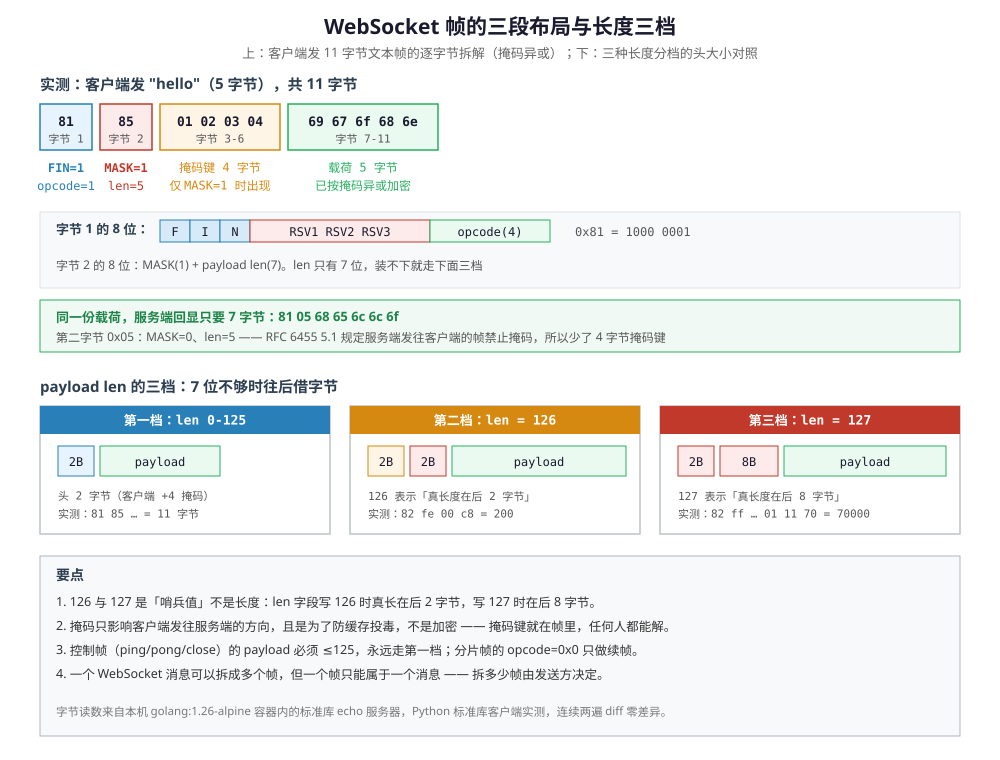

# WebSocket

> 覆盖：RFC 6455 的握手（四个请求头与 `Sec-WebSocket-Accept` 怎么算）、帧的字节布局（两个长度分档的哨兵值、掩码的方向性）、分片与控制帧、关闭握手的状态码，以及升级成功之后丢掉的 HTTP 语义与中间设备的逐跳问题。
>
> 不覆盖：三种推送手段的横向选型见 [通信选型.md](../选型/通信选型.md) 3.1 ②；SSE 的事件流格式与续传见 [SSE.md](SSE.md)；HTTP/2 的帧、流与流控见 [HTTP1.1与HTTP2的区别.md](HTTP1.1与HTTP2的区别.md)；NAT / LB 空闲超时见 [NAT与连接跟踪.md](../网络层与寻址/NAT与连接跟踪.md)。
>
> 内容整理自个人学习笔记，素材见 [素材清单](../../../素材清单.md)。
>
> ✅ 实测口径：握手、帧布局、掩码、分片、关闭握手均为**本机实测**——`golang:1.26-alpine` 容器内跑一个只用标准库的 echo 服务器（手写握手与帧，不引 `gorilla/websocket`），宿主用 Python 标准库客户端连它，连续两遍 `diff` 逐行一致（`.workbuddy/tmp/ws-lab/`）。⚠️ **未实测**：`permessage-deflate` 压缩扩展、TLS 上的 `wss://`、以及浏览器侧的重连策略。

---

## 一、定位：全双工，代价是自己管一切

**本节要点**：这一节只解决「什么时候该用它」，握手与帧这两层协议本身在第二、三节。

三条服务端推送链路（WebSocket / SSE / gRPC 流式）里，只有它在标准层面做到**真正的全双工**：握手完就脱离 HTTP 语义，收发都是独立帧，也不依赖 HTTP/2 的底座。横向选型的三条判据归 [通信选型.md](../选型/通信选型.md) 3.1 ②，本篇只补它自己的落点——**要双向、要低延迟时才选它**，单向推送场景该先用 SSE。

三条链路的共同前提是**它们都是长连接**，因此都会撞上代理 / NAT 的空闲超时，也都需要心跳或重连策略（见 [NAT与连接跟踪.md](../网络层与寻址/NAT与连接跟踪.md) 第五节）。WebSocket 这一侧还多一层麻烦：`Upgrade` 是逐跳语义，升级成功后也不再受 HTTP 语义约束，空闲超时只能靠应用层心跳顶住（见第五节）。

---

## 二、握手：从 HTTP 到 101 发生了什么？

### 2.1 四个请求头与 Accept 怎么算

升级请求就是一个普通的 HTTP GET，只多四个头：

```text
GET /ws HTTP/1.1
Host: example.com
Upgrade: websocket
Connection: Upgrade
Sec-WebSocket-Key: dGhlIHNhbXBsZSBub25jZQ==
Sec-WebSocket-Version: 13
```

服务端回 `101 Switching Protocols`，并带上 `Sec-WebSocket-Accept`。这个值的算法是**全文最容易被写错的一行**：

```python
accept = base64(sha1(Sec-WebSocket-Key + "258EAFA5-E914-47DA-95CA-C5AB0DC85B11"))
```

三个要点：

- 那个 GUID 是 RFC 6455 **写死的常量**，不是配置项，任何实现都不能改；
- 拼的是 **Key 原文 + GUID**，不是 Key 解码后的字节 + GUID——`Sec-WebSocket-Key` 本身是 base64，但**不解码**，直接当字符串拼；
- 结果是 SHA-1 的**原始 20 字节**再做 base64，不是 hex。

用 RFC 6455 §1.3 的标准 nonce `dGhlIHNhbXBsZSBub25jZQ==` 实测，三个独立来源给出同一个值：

| 来源 | 值 |
|---|---|
| Go 标准库服务器算出 | `s3pPLMBiTxaQ9kYGzzhZRbK+xOo=` |
| Python 客户端本地算出 | `s3pPLMBiTxaQ9kYGzzhZRbK+xOo=` |
| RFC 6455 §1.3 示例 | `s3pPLMBiTxaQ9kYGzzhZRbK+xOo=` |

实测握手响应共 **129 字节**（状态行 + 四个响应头 + 结尾空行）。

### 2.2 为什么是 SHA-1 而不是加密

`Sec-WebSocket-Accept` 不提供任何机密性，它只证明**服务端确实读了你的请求头**（而不是一个把请求转给别处的缓存或代理）。之所以用 SHA-1 而不是 AES，是因为这里需要的是「不可伪造的、无密钥的、确定性的承诺」——HMAC 需要双方共享密钥，而握手时还没有；随机 nonce 又无法让客户端验证。

⚠️ 也因此，**WebSocket 握手本身不是鉴权手段**。它只保证「对面是个懂 WebSocket 的服务端」，不保证「对面是你想连的那个服务端」——那是 TLS 证书和 `Origin` 校验的职责（见 5.3）。

### 2.3 子协议与扩展协商

握手还能带两类可选头：

| 头 | 方向 | 作用 |
|---|---|---|
| `Sec-WebSocket-Protocol` | 客户端列候选、服务端选一个回 | **子协议**：帧里的载荷按哪种格式解析（如 `chat.v1`） |
| `Sec-WebSocket-Extensions` | 双向协商 | **扩展**：如 `permessage-deflate` 压缩载荷 |

⚠️ 子协议是**应用层消息格式**的约定，服务端**只回一个**；客户端收到不在自己候选列表里的值必须断连。`permessage-deflate` 是唯一被广泛实现的扩展，但它改变的是载荷压缩，不改变帧结构。

---

## 三、一个帧的字节布局

**本节要点**：记住「2 字节头 + 4 字节掩码（仅客户端）+ 载荷」，以及 126/127 两个哨兵值。

一个 WebSocket 消息由一个或多个帧组成。单个帧的布局：

```text
+-----------+-----------+----------------+------------------+
| 字节 1    | 字节 2    | 扩展长度(0/2/8)| 掩码键(0 或 4)   |
| FIN+opcode| MASK+len  |                |                  |
+-----------+-----------+----------------+------------------+
| 载荷（长度由字节 2 或扩展长度决定）                        |
+----------------------------------------------------------+
```

### 3.1 三个长度分档

字节 2 的低 7 位只有 7 位，最大 127，装不下就用两个哨兵值往后借：

| 档 | 字节 2 的 len 字段 | 扩展长度 | 覆盖范围 | 实测 |
|---|---|---|---|---|
| 第一档 | `0`–`125` | 无 | 0–125 字节 | `81 85 01 02 03 04 69 67 6f 68 6e` |
| 第二档 | `126` | 后 2 字节 | 126–65535 | `82 fe 00 c8`（= 200） |
| 第三档 | `127` | 后 8 字节 | 65536–2⁶³−1 | `82 ff 00 00 00 00 00 01 11 70`（= 70000） |



⚠️ **126 和 127 不是长度**，是「真长度在后面的扩展字段里」的标记。这也是 WebSocket 与 HTTP/2 帧头设计的关键差别：HTTP/2 直接给 3 字节定长长度字段，WebSocket 用变长换小消息的头开销。

### 3.2 掩码：客户端必须、服务端禁止

字节 2 的最高位是 `MASK`。RFC 6455 §5.1 规定：

- **客户端发往服务端的帧必须掩码**，`MASK=1`，头后跟 4 字节掩码键，载荷逐字节 `payload[i] ^ mask[i % 4]`；
- **服务端发往客户端的帧禁止掩码**，`MASK=0`。

同一份 `hello`，两个方向差 4 字节：

```text
客户端 → 服务端（11 字节，含掩码）：
81 85 01 02 03 04 69 67 6f 68 6e

服务端 → 客户端（7 字节，无掩码）：
81 05 68 65 6c 6c 6f
```

解出来载荷都是 `68 65 6c 6c 6f` = `"hello"`。

⚠️ **掩码不是加密**。掩码键就在同一个帧里明文传输，任何中间人都能解开。它存在的目的是**防止缓存投毒**——早期有攻击者构造看似随机的字节污染中间代理的缓存。所以「我们的 WebSocket 有掩码，所以安全」是错的。

服务端**必须校验 `MASK` 位**：RFC 6455 §5.1 要求收到未掩码的客户端帧时立即关闭连接。实测反例：

```text
客户端发未掩码帧（第二字节 0x08，MASK=0）：
81 08 75 6e 6d 61 73 6b 65 64

服务端应答 0 字节 —— 连接被关闭
```

不校验的后果是把服务器当成**反射放大器**：攻击者伪造源 IP 发未掩码帧，服务器原样回显给「受害者」。

### 3.3 五种 opcode

字节 1 的低 4 位是 opcode：

| opcode | 含义 | 备注 |
|---|---|---|
| `0x0` | 续帧（continuation） | **不能作为首帧**，只能跟在 `FIN=0` 的帧后 |
| `0x1` | 文本 | 载荷必须是合法 UTF-8 |
| `0x2` | 二进制 | 任意字节 |
| `0x8` | 关闭 | 载荷前 2 字节是状态码，后面是原因文本 |
| `0x9` / `0xA` | ping / pong | 控制帧，载荷必须 ≤125 |

控制帧（`0x8`/`0x9`/`0xA`）有两个约束常被忽略：**payload 必须 ≤125 字节**（永远走第一档），且**可以被插在分片序列中间**——分片传一半时来一个 ping 是合法的。

---

## 四、分片与控制帧

### 4.1 分片怎么重组

发送方可以把一条消息拆成多个帧：**首帧带真正的 opcode 且 `FIN=0`，后续帧 opcode 全为 `0x0`，最后一帧 `FIN=1`**。接收方缓冲所有帧的载荷，收到 `FIN=1` 时按首帧的 opcode 交付整条消息。

实测把 `"frag-ment"` 拆成两帧：

```text
第一帧（FIN=0, opcode=0x1）：
01 85 01 02 03 04 67 70 62 63 2c        → 载荷 "frag-"

第二帧（FIN=1, opcode=0x0）：
80 84 01 02 03 04 6c 67 6d 70           → 载荷 "ment"

服务端重组后回显一条完整消息（FIN=1, opcode=0x1）：
81 0a 66 72 61 67 2d 6d 65 6e 74        → "frag-ment"
```

⭐ **首帧的 opcode 才是这条消息的类型**。续帧的 `0x0` 只是「接着上一帧」的意思，自己不带类型信息。

分片的典型用途：发送方在写入过程中才发现消息太大（如 100 MB 的日志），或要避免一条大消息饿死同连接上的控制帧。

### 4.2 ping/pong 与业务心跳的分工

协议自带 `ping`/`pong`，实测往返：

```text
客户端发 ping（8 字节）：
89 82 01 02 03 04 69 60                  → 载荷 "hb"

服务端回 pong（opcode 0xA）：
8a 02 68 62                              → 载荷 "hb"
```

⚠️ **pong 必须原样带回 ping 的载荷**，这样客户端才能把应答和发出的 ping 配对。

但很多代理不转发控制帧，或者仍然按空闲时间回收连接——所以生产环境通常**两层心跳都留**：协议层 `ping`/`pong` 保连接，业务层心跳让应用知道「对端还活着」。心跳间隔必须小于链路上最小的空闲超时（见 [NAT与连接跟踪.md](../网络层与寻址/NAT与连接跟踪.md) 第五节）。

### 4.3 关闭握手与状态码

关闭是**双向握手**，不是单方发完就走：

```text
客户端发 close（11 字节）：
88 85 01 02 03 04 02 ea 61 7d 64         → 状态码 0x03e8 + "bye"

服务端回 close（FIN=1, opcode=0x8）：
状态码 1000，原因 "bye"

此后服务端关闭 TCP，客户端再 recv 得到 0 字节
```

常用状态码：

| 码 | 含义 | 该由谁发 |
|---|---|---|
| `1000` | 正常关闭 | 双方 |
| `1001` | 端点离开（如页面导航） | 浏览器 |
| `1002` | 协议错误 | 双方 |
| `1003` | 收到了不允许的数据类型（如文本帧里塞了非 UTF-8） | 双方 |
| `1007` | 消息类型不一致 | 双方 |
| `1008` | 违反了通用策略（如 `Origin` 不通过） | 服务端 |
| `1009` | 消息太大 | 接收方 |
| `1011` | 服务端内部错误 | 服务端 |

⚠️ **收到 close 后应当回一个 close 再关 TCP**，而不是直接断。直接断在对端看来是异常中断（`onclose` 的 `wasClean=false`），会让它无谓地重连。

---

## 五、链路坑：101 之后丢了什么

### 5.1 `Upgrade` 是逐跳语义

`Connection: Upgrade` 与 `Upgrade: websocket` 是**逐跳**头——中间只要有一层代理不认、或把它剥掉，升级就失败。反向代理必须显式支持协议升级（Nginx 需要 `proxy_set_header Upgrade $http_upgrade; proxy_set_header Connection "upgrade";`，Envoy 需要 upgrade config）。


图注：WebSocket 升级：上半看「逐跳头在哪一跳被剥掉」，下半看「101 前后各自还剩哪些语义」。

**图怎么读**：上半的关键是**同一个请求在中间那一跳有两条命运**——左格那两个橙色标记的头（`Connection: Upgrade`、`Upgrade: websocket`）是逐跳头，它们**能不能原样带到下一跳，取决于这一跳的代理配置**，而不是客户端；中格上面那条绿路要求 Nginx 显式写 `proxy_set_header`，下面那条红路则把逐跳头剥掉、或把这条路径当成普通 HTTP 交给别的 handler，于是右格只能按普通 HTTP 回你，客户端侧只表现为连接被关掉。鉴权返回 401 / 403、`Origin` 校验不过也归在红格里，**所以先看握手响应码与响应头，不要从网络猜起**。下半是分界线：`101` 左边那一格写的都是「免费拿到的东西」（请求响应配对、超时、重试、重定向、压缩），右边一格是「这些东西全没了，边界和心跳要自己定」——这正是 5.2 那些后果的来由，也是抓包时过滤器必须从 `http` 切到 `websocket` 的原因。

### 5.2 升级成功后不再受 HTTP 语义约束

握手成功后，这条连接**没有请求 / 响应配对**，只剩 WebSocket 帧。后果：

- 应用层必须自己定义消息边界与心跳（`ping` / `pong` 控制帧或业务心跳）；
- HTTP 层的超时、重试、重定向、压缩等语义都不再自动生效；
- 代理的空闲超时仍然会掐断它——心跳间隔要小于链路上最小的空闲超时。

### 5.3 握手阶段的鉴权与跨域

WebSocket 握手是一个 HTTP 请求，可以带 Cookie 与 `Authorization`，但**浏览器不会替你加自定义头**（`WebSocket` 构造函数只接受 URL 与子协议）。常见做法是：

- 用 Cookie / 短期 token 放在 URL 查询参数里（⚠️ 会进日志，要短时效）；
- 先走一次普通 HTTP 鉴权换一次性 ticket，再用 ticket 升级；
- 服务端校验 `Origin`，防止跨站 WebSocket 劫持。

⚠️ 跨站 WebSocket 劫持和 CSRF 是同一类问题：浏览器会自动带 Cookie，所以**升级成功不等于身份可信**。`Sec-WebSocket-Protocol` 也不是鉴权手段——客户端填什么由客户端定。

---

## 六、应用场景

**本节要点**：WebSocket 的适用面是「真双向 + 高频 + 小消息」，单向推送应该先用 SSE。

| 场景 | 推荐 | 为什么 |
|---|---|---|
| 聊天 / 协同编辑 / 实时游戏 | **WebSocket** | 真双向、低延迟、可传二进制 |
| 弹幕 / 直播互动 | WebSocket | 高频双向、消息小、需要低延迟 |
| 行情 / 通知 / 日志尾随 | SSE | 单向推送、自带重连、代理穿透好 |
| 大文件上传进度 | SSE 或普通轮询 | 上行用普通 HTTP，进度下行用 SSE 更简单 |
| 服务间流式 RPC | gRPC 流式 | Protobuf、强类型、双向流 |

---

## 七、具体使用

**本节要点**：先用 `curl` 确认升级握手成功，再用手写帧验证协议层；不要一上来就引客户端库。

### 7.1 用 curl 观察升级

```bash
# 看 101 Switching Protocols 与 Upgrade / Sec-WebSocket-Accept 头
curl -i -N -H 'Connection: Upgrade' \
     -H 'Upgrade: websocket' \
     -H 'Sec-WebSocket-Version: 13' \
     -H 'Sec-WebSocket-Key: dGhlIHNhbXBsZSBub25jZQ==' \
     https://example.com/ws
```

⭐ 读法：`101` 之前是 HTTP，`101` 之后是 WebSocket 帧；抓包时过滤器要从 `http` 切到 `websocket`。上面这个 Key 是 RFC 6455 的标准示例值，`Accept` 应当回 `s3pPLMBiTxaQ9kYGzzhZRbK+xOo=`。

### 7.2 手写握手与帧

下面两段是本篇实测用的最小实现，**都不引任何 WebSocket 库**：Go 侧只用标准库 hijack 后手写帧，Python 侧只用 `socket` 手写掩码。

服务端（Go，核心两段）：

```go
const wsGUID = "258EAFA5-E914-47DA-95CA-C5AB0DC85B11"

func acceptKey(key string) string {
	h := sha1.New()
	h.Write([]byte(key + wsGUID))
	return base64.StdEncoding.EncodeToString(h.Sum(nil))
}

// 读一个帧：字节 1 拆 FIN/opcode，字节 2 拆 MASK/len，按 126/127 读扩展长度
func readFrame(r io.Reader) (fin bool, opcode byte, payload []byte, err error) {
	hdr := make([]byte, 2)
	if _, err = io.ReadFull(r, hdr); err != nil {
		return
	}
	fin = hdr[0]&0x80 != 0
	opcode = hdr[0] & 0x0F
	masked := hdr[1]&0x80 != 0
	if !masked {
		err = errors.New("client frame must be masked (RFC 6455 5.1)")
		return
	}
	length := uint64(hdr[1] & 0x7F)
	switch length {
	case 126:
		ext := make([]byte, 2)
		if _, err = io.ReadFull(r, ext); err != nil {
			return
		}
		length = uint64(binary.BigEndian.Uint16(ext))
	case 127:
		ext := make([]byte, 8)
		if _, err = io.ReadFull(r, ext); err != nil {
			return
		}
		length = binary.BigEndian.Uint64(ext)
	}
	mask := make([]byte, 4)
	if _, err = io.ReadFull(r, mask); err != nil {
		return
	}
	payload = make([]byte, length)
	if _, err = io.ReadFull(r, payload); err != nil {
		return
	}
	for i := range payload {
		payload[i] ^= mask[i%4]
	}
	return
}
```

客户端（Python，构造一个掩码帧）：

```python
def build_frame(opcode, payload, fin=True, mask=True):
    b = bytearray()
    b.append((0x80 if fin else 0x00) | (opcode & 0x0F))
    n = len(payload)
    if n < 126:
        b.append((0x80 if mask else 0x00) | n)
    elif n <= 0xFFFF:
        b.append((0x80 if mask else 0x00) | 126)
        b += struct.pack(">H", n)
    else:
        b.append((0x80 if mask else 0x00) | 127)
        b += struct.pack(">Q", n)
    if mask:
        mk = b"\x01\x02\x03\x04"            # 固定掩码，保证两遍输出零差异
        b += mk
        b += bytes(payload[i] ^ mk[i % 4] for i in range(n))
    else:
        b += payload
    return bytes(b)
```

实测输出（连续两遍 `diff` 零差异）：

```text
[1] 握手状态行: HTTP/1.1 101 Switching Protocols
[1] 握手总字节: 129（含结尾空行）
[1] Sec-WebSocket-Key  : dGhlIHNhbXBsZSBub25jZQ==
[1] 服务端 Accept      : s3pPLMBiTxaQ9kYGzzhZRbK+xOo=
[1] 本地算的 Accept    : s3pPLMBiTxaQ9kYGzzhZRbK+xOo=
[1] RFC 6455 1.3 期望 : s3pPLMBiTxaQ9kYGzzhZRbK+xOo=
[1] 三者一致: True
[2] 客户端发文本帧 11 字节: 81 85 01 02 03 04 69 67 6f 68 6e
[2] 服务端回显 7 字节: 81 05 68 65 6c 6c 6f
[2] 载荷一致: True
[3] 二进制帧 200 字节，客户端帧头 4 字节: 82 fe 00 c8
[3] 第二字节=0xfe（126=用 16 位扩展长度）｜扩展长度字段=200
[4] 二进制帧 70000 字节，客户端帧头 10 字节: 82 ff 00 00 00 00 00 01 11 70
[4] 第二字节=0xff（127=用 64 位扩展长度）｜扩展长度字段=70000
[5] 分片第一帧 fin=0 opcode=0x1: 01 85 01 02 03 04 67 70 62 63 2c
[5] 分片第二帧 fin=1 opcode=0x0: 80 84 01 02 03 04 6c 67 6d 70
[5] 服务端重组后回显 fin=1 opcode=0x1 载荷=b'frag-ment'
[6] 客户端发 ping 帧 8 字节: 89 82 01 02 03 04 69 60
[6] 服务端回 opcode=0xa（0xA=pong）载荷=b'hb' 一致: True
[7] 客户端发 close 帧 11 字节: 88 85 01 02 03 04 02 ea 61 7d 64
[7] 服务端回 opcode=0x8 fin=1 状态码=1000 原因=b'bye'
[7] 回 close 后再 recv 得到 0 字节（0=服务端已关 TCP）
[8] 客户端发未掩码文本帧 10 字节: 81 08 75 6e 6d 61 73 6b 65 64
[8] 服务端应答 0 字节 → 连接被关闭，掩码校验生效
```

### 7.3 浏览器端

```javascript
const ws = new WebSocket('wss://example.com/ws');
ws.onopen = () => ws.send(JSON.stringify({ type: 'subscribe', topic: 'price' }));
ws.onmessage = (e) => console.log(e.data);
ws.onclose = (e) => console.log('closed', e.code, e.reason); // 重连要自己写
```

---

## 延伸追问

- **WebSocket 需要心跳吗？** → 需要。协议本身有 `ping` / `pong` 控制帧，但很多代理不转发控制帧或仍然按空闲回收；业务层心跳更可靠，间隔要小于链路上最小的空闲超时。
- **WebSocket 握手失败一般是什么原因？** → 中间代理不支持 `Upgrade`、路径被路由到普通 HTTP handler、鉴权失败返回 401 / 403、`Origin` 校验不通过，或 TLS 证书问题。先看握手响应码与响应头。
- **掩码是加密吗？能防中间人吗？** → 不能。掩码键明文在帧里，作用是防缓存投毒。机密性靠 `wss://`。
- **`Sec-WebSocket-Accept` 能防重放吗？** → 不能。它对同一个 Key 永远返回同一个值，没有时效性。防重放要在应用层加 nonce / 时间戳。
- **一条消息一定要拆成多帧吗？** → 不要。分片是给「写到一半才发现太大」用的，默认单帧更简单，也少一次 `FIN` 判断。
- **gRPC 流式能不能直接给浏览器用？** → 不能。浏览器拿不到 HTTP/2 的帧与 trailer，需要 grpc-web / Connect + 网关做协议转换，详见 [HTTP与gRPC.md](HTTP与gRPC.md)。
- **推送该选 WebSocket 还是消息队列？** → 两者不在同一层：消息队列解决服务端之间的异步解耦与削峰；WebSocket 解决「服务端到浏览器」的最后一公里。常见组合是「MQ → 推送服务 → WebSocket / SSE」。

---

## 关联

- **上游/总纲**：[通信选型.md](../选型/通信选型.md) — 三种推送手段的横向对照、三条判据与落点
- **对照/互补**：[SSE.md](SSE.md) — 同一条推送链路上的单向路径：事件流格式与 `Last-Event-ID` 续传
- **对照/互补**：[HTTP1.1与HTTP2的区别.md](HTTP1.1与HTTP2的区别.md) — 同样是「帧」，HTTP/2 用定长 3 字节长度字段，WebSocket 用 126/127 哨兵值
- **对照/互补**：[通信选型.md](../选型/通信选型.md) — 七种应用层协议的横向选型
- **下游机制**：[NAT与连接跟踪.md](../网络层与寻址/NAT与连接跟踪.md) — 长连接的空闲超时与心跳依据
- **运维/配置**：[08-WWW服务器.md](../../linux/鸟哥服务器架设篇/08-WWW服务器.md) — Nginx 的 upgrade 与 buffering 配置
- **消息协议族**：[MQTT.md](../消息协议/MQTT.md)、[STOMP.md](../消息协议/STOMP.md) — 同样是「长连接上的消息边界」，但消息模型是发布订阅而非双向字节流

> 反向引用（本篇被下列文档引到）：[TCP保活与连接存活.md](../传输层/tcp/TCP保活与连接存活.md)、[消息协议族全景.md](../消息协议/消息协议族全景.md)
