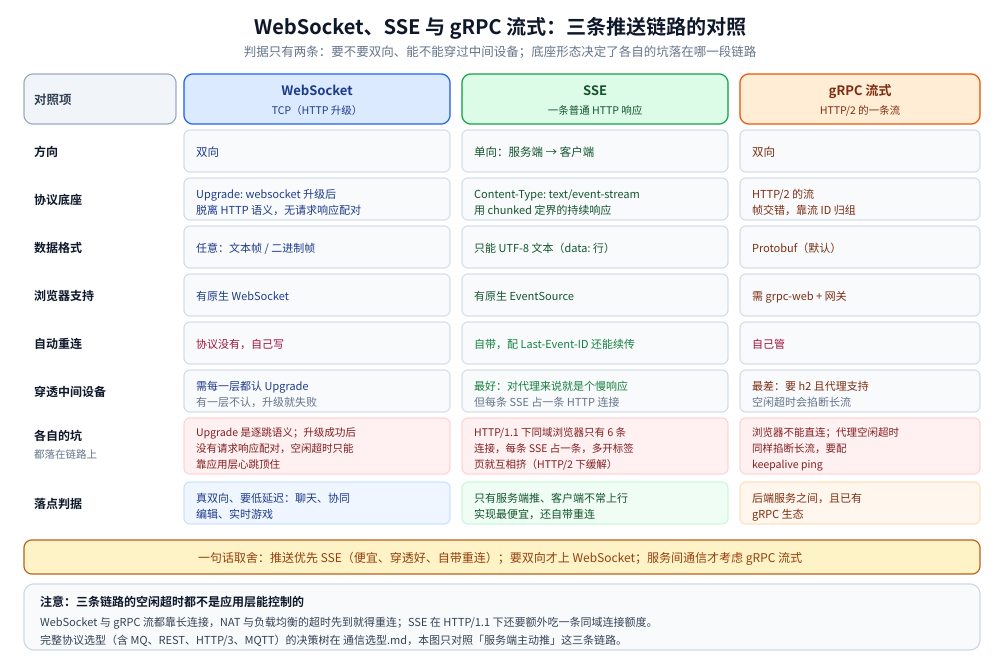
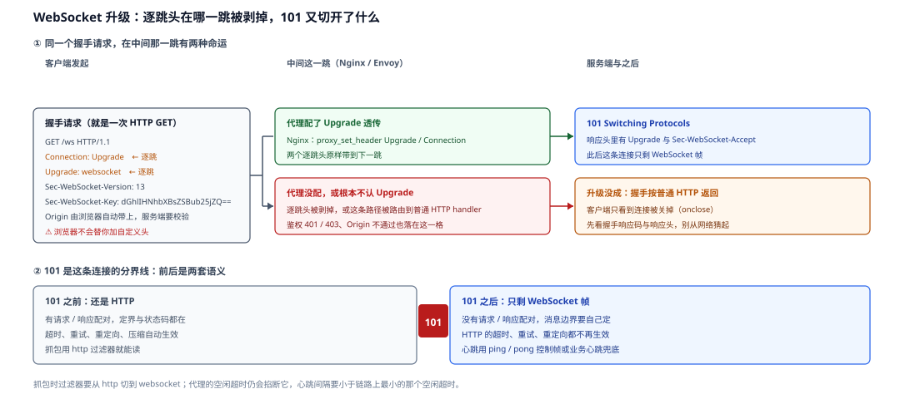

# WebSocket 与 SSE

> 覆盖：服务端主动推送的三条路径（WebSocket / SSE / gRPC 流式）在方向、协议底座、数据格式、重连与穿透性上的差别；三条选型判据；以及升级、连接数、心跳、代理超时这些链路坑。
>
> 不覆盖：gRPC 的 Protobuf、连接池与多路复用见 [HTTP与gRPC.md](HTTP与gRPC.md)；HTTP/2 的帧、流与流控见 [HTTP1.1与HTTP2的区别.md](HTTP1.1与HTTP2的区别.md)；NAT / LB 空闲超时见 [NAT与连接跟踪.md](../网络层与寻址/NAT与连接跟踪.md)。
>
> 内容整理自个人学习笔记，素材见 [素材清单](../../../素材清单.md)。
>
> ⚠️ 实测口径：协议行为按 RFC 6455（WebSocket）与 WHATWG HTML 的 `EventSource` 规范整理；**本篇未做长连接压测与断线复现实测**，代码块是可直接运行的示意，不声称已在本机跑通。

---

## 一、三种服务端推送手段的本质差别是什么？

| | **WebSocket** | **SSE** | **gRPC 流式** |
|---|---|---|---|
| 方向 | **双向** | 单向（服务端 → 客户端） | 双向 |
| 协议底座 | HTTP/1.1 用 `Upgrade: websocket` 升级后**脱离 HTTP 语义** | **就是一条 HTTP 响应**（`Content-Type: text/event-stream`，用 chunked 定界） | HTTP/2 的流 |
| 数据格式 | 任意（文本 / 二进制帧） | **只能 UTF-8 文本**（`data:` 行） | Protobuf（默认） |
| 浏览器原生支持 | ✅ `WebSocket` | ✅ `EventSource` | ❌ 需要 grpc-web + 网关 |
| 自动重连 | ❌ 自己写 | ✅ **`EventSource` 自带，配 `Last-Event-ID` 还能续传** | ❌ 自己管 |
| 穿透性 | 需中间设备认 `Upgrade` | **最好**（对代理来说就是个「慢响应」） | 最差（要 h2 + 代理支持） |



三条链路的共同前提：**它们都是长连接**，因此都会撞上代理 / NAT 的空闲超时，也都需要心跳或重连策略（见 [NAT与连接跟踪.md](../网络层与寻址/NAT与连接跟踪.md) 第五节）。

---

## 二、判据是什么？

1. **只有服务端推、客户端不常上行** → **SSE**：自带重连 + 穿透性最好 + 实现最便宜；
2. **真双向、要低延迟**（聊天、协同编辑、实时游戏） → **WebSocket**；
3. **后端服务之间**且已有 gRPC 生态 → **gRPC 流式**：吃 Protobuf 的体积与 schema 收益。

> ⭐ 一句话取舍：**推送优先 SSE（便宜、穿透好、自带重连）；要双向才上 WebSocket；服务间通信才考虑 gRPC 流式。**

### 2.1 判据背后的三个问题

| 问题 | 选 SSE | 选 WebSocket |
|---|---|---|
| 客户端需要频繁上行吗？ | 否（上行走普通 HTTP 请求即可） | 是（同一连接双向） |
| 需要二进制帧吗？ | 否（只能文本） | 是（任意字节） |
| 能接受「每个客户端占一条连接」吗？ | 能（HTTP/2 下多路复用缓解） | 能（本身就是一条长连接） |

⚠️ **「需要低延迟」不是选 WebSocket 的充分条件**：SSE 的推送同样是实时的，延迟差异主要来自重连与代理行为，而不是协议本身。

---

## 三、WebSocket 的链路坑有哪些？

### 3.1 `Upgrade` 是逐跳语义

`Connection: Upgrade` 与 `Upgrade: websocket` 是**逐跳**头——中间只要有一层代理不认、或把它剥掉，升级就失败。反向代理必须显式支持协议升级（Nginx 需要 `proxy_set_header Upgrade $http_upgrade; proxy_set_header Connection "upgrade";`，Envoy 需要 upgrade config）。



图注：WebSocket 升级：上半看「逐跳头在哪一跳被剥掉」，下半看「101 前后各自还剩哪些语义」。

**图怎么读**：上半的关键是**同一个请求在中间那一跳有两条命运**——左格那两个橙色标记的头（`Connection: Upgrade`、`Upgrade: websocket`）是逐跳头，它们**能不能原样带到下一跳，取决于这一跳的代理配置**，而不是客户端；中格上面那条绿路要求 Nginx 显式写 `proxy_set_header`，下面那条红路则把逐跳头剥掉、或把这条路径当成普通 HTTP 交给别的 handler，于是右格只能按普通 HTTP 回你，客户端侧只表现为连接被关掉。鉴权返回 401 / 403、`Origin` 校验不过也归在红格里，**所以先看握手响应码与响应头，不要从网络猜起**。下半是分界线：`101` 左边那一格写的都是「免费拿到的东西」（请求响应配对、超时、重试、重定向、压缩），右边一格是「这些东西全没了，边界和心跳要自己定」——这正是 3.2 那些后果的来由，也是抓包时过滤器必须从 `http` 切到 `websocket` 的原因。

### 3.2 升级成功后不再受 HTTP 语义约束

握手成功后，这条连接**没有请求 / 响应配对**，只剩 WebSocket 帧。后果：

- 应用层必须自己定义消息边界与心跳（`ping` / `pong` 控制帧或业务心跳）；
- HTTP 层的超时、重试、重定向、压缩等语义都不再自动生效；
- 代理的空闲超时仍然会掐断它——心跳间隔要小于链路上最小的空闲超时。

### 3.3 握手阶段的鉴权与跨域

WebSocket 握手是一个 HTTP 请求，可以带 Cookie 与 `Authorization`，但**浏览器不会替你加自定义头**（`WebSocket` 构造函数只接受 URL 与子协议）。常见做法是：

- 用 Cookie / 短期 token 放在 URL 查询参数里（⚠️ 会进日志，要短时效）；
- 先走一次普通 HTTP 鉴权换一次性 ticket，再用 ticket 升级；
- 服务端校验 `Origin`，防止跨站 WebSocket 劫持。

---

## 四、SSE 的链路坑有哪些？

### 4.1 HTTP/1.1 下的 6 连接上限

同域浏览器对 HTTP/1.1 通常只有 **6 条并发连接**，每条 SSE 占一条 → 多开几个标签页就互相挤（其他请求排队）。**HTTP/2 下多路复用可缓解**，但服务端要正确配置 `Content-Type: text/event-stream`、`Cache-Control: no-cache` 与关闭缓冲。

### 4.2 中间设备的缓冲

SSE 的「实时」依赖**逐块 flush**。任何一层（Nginx `proxy_buffering`、CDN、WAF）把响应缓冲住，客户端就会看到「过很久一次性收到一批」。排查时用 `curl -N` 看是否逐条到达。

### 4.3 心跳与重连

- 代理 / NAT 的空闲超时会断开长响应 → 服务端需要定期发送注释行（`: keep-alive\n\n`）或业务心跳；
- `EventSource` 自带重连，但默认间隔由浏览器实现决定；服务端可用 `retry:` 字段建议间隔；
- 配 `id:` 字段后，浏览器重连会带 `Last-Event-ID` 请求头，服务端据此续传。⚠️ 续传语义要自己实现，浏览器只负责带这个头。

### 4.4 只能传文本

SSE 的 `data:` 只能是 UTF-8 文本。二进制要先 Base64（体积 +33%）或改走 WebSocket / HTTP 分块下载。

---

## 五、gRPC 流式为什么浏览器直连不了？

浏览器的 `fetch` / `XHR` 不暴露 HTTP/2 的帧与 trailer，无法直接构造 gRPC 调用。要让浏览器用 gRPC 流式，需要 **grpc-web** 或 Connect 协议，并在中间加一个**协议转换网关**（把 grpc-web 的请求转成后端 gRPC）。这会多一跳，且流式语义、超时与错误码都要在网关两侧映射。

> 服务间调用没有浏览器限制，gRPC 流式可以直接用；但代理的空闲超时同样会掐断长流，要配 keepalive ping。

---

## 六、应用场景

**本节要点**：先按「方向」筛，再按「穿透性与重连成本」定；不要为了「实时」两个字默认上 WebSocket。

| 场景 | 推荐 | 为什么 |
|---|---|---|
| 行情 / 通知 / 日志尾随 | **SSE** | 单向推送、自带重连、代理穿透好 |
| 聊天 / 协同编辑 / 实时游戏 | **WebSocket** | 真双向、低延迟、可传二进制 |
| 服务间流式 RPC | **gRPC 流式** | Protobuf、强类型、双向流 |
| 大文件上传进度 | SSE 或普通轮询 | 上行用普通 HTTP，进度下行用 SSE 更简单 |
| 浏览器 + gRPC 后端 | **grpc-web + 网关** | 浏览器不能直接发 gRPC 帧 |
| 弹幕 / 直播互动 | WebSocket | 高频双向、消息小、需要低延迟 |

## 七、具体使用

**本节要点**：先用 `curl` 看清 SSE 的逐条输出，再用浏览器原生 API 验证重连；WebSocket 则先确认升级握手成功。

### 7.1 观察 SSE

```bash
# -N 关闭 curl 的缓冲，确认服务端是否逐条 flush
curl -N -H 'Accept: text/event-stream' https://example.com/events

# 看响应头：必须是 text/event-stream，且没有 Content-Length
curl -sSI -H 'Accept: text/event-stream' https://example.com/events

# 带 Last-Event-ID 模拟断线续传
curl -N -H 'Last-Event-ID: 42' https://example.com/events
```

服务端输出格式：

```text
id: 43
event: price
data: {"symbol":"BTC","price":68000}

: keep-alive

```

- **空行**表示一条消息结束；
- 以 `:` 开头的是注释，常用来做心跳；
- `retry: 3000` 建议浏览器 3 秒后重连。

### 7.2 浏览器端

```javascript
const es = new EventSource('/events');
es.onmessage = (e) => console.log('message', e.data);
es.addEventListener('price', (e) => console.log('price', JSON.parse(e.data)));
es.onerror = () => console.log('disconnected, EventSource will retry');
// es.close() 才会停止重连
```

⚠️ `EventSource` **不能自定义请求头**，需要鉴权时用 Cookie 或把短期 token 放查询参数。

### 7.3 观察 WebSocket 升级

```bash
# 看 101 Switching Protocols 与 Upgrade / Sec-WebSocket-Accept 头
curl -i -N -H 'Connection: Upgrade' \
     -H 'Upgrade: websocket' \
     -H 'Sec-WebSocket-Version: 13' \
     -H 'Sec-WebSocket-Key: dGhlIHNhbXBsZSBub25jZQ==' \
     https://example.com/ws
```

```javascript
const ws = new WebSocket('wss://example.com/ws');
ws.onopen = () => ws.send(JSON.stringify({ type: 'subscribe', topic: 'price' }));
ws.onmessage = (e) => console.log(e.data);
ws.onclose = () => console.log('closed'); // 重连要自己写
```

⭐ 读法：`101` 之前是 HTTP，`101` 之后是 WebSocket 帧；抓包时过滤器要从 `http` 切到 `websocket`。

---

## 延伸追问

- **SSE 和长轮询有什么区别？** → 长轮询是「请求挂住 → 有数据返回 → 客户端再发下一次」，每次都有完整的 HTTP 请求 / 响应开销；SSE 是**一次响应持续推送多条消息**，连接不断开，开销更小，且自带重连与 `Last-Event-ID`。
- **WebSocket 需要心跳吗？** → 需要。协议本身有 `ping` / `pong` 控制帧，但很多代理不转发控制帧或仍然按空闲回收；业务层心跳更可靠，间隔要小于链路上最小的空闲超时。
- **为什么 SSE 在 HTTP/1.1 下会「占满连接」？** → 浏览器对同域 HTTP/1.1 连接数有限制（常见 6 条），每条 SSE 独占一条。HTTP/2 的多路复用让多条流共享一条连接，问题缓解，但仍受流数上限与代理配置影响。
- **SSE 能传二进制吗？** → 不能直接传；`data:` 是 UTF-8 文本。可以 Base64，但体积增加 33%，高吞吐场景应改用 WebSocket 或 HTTP 分块。
- **WebSocket 握手失败一般是什么原因？** → 中间代理不支持 `Upgrade`、路径被路由到普通 HTTP handler、鉴权失败返回 401 / 403、`Origin` 校验不通过，或 TLS 证书问题。先看握手响应码与响应头。
- **gRPC 流式能不能直接给浏览器用？** → 不能。浏览器拿不到 HTTP/2 的帧与 trailer，需要 grpc-web / Connect + 网关做协议转换。
- **推送该选 SSE 还是消息队列？** → 两者不在同一层：消息队列解决服务端之间的异步解耦与削峰；SSE 解决「服务端到浏览器」的最后一公里推送。常见组合是「MQ → 推送服务 → SSE / WebSocket」。

---

## 关联

- **上游/总纲**：[HTTP与gRPC.md](HTTP与gRPC.md) — gRPC 与 HTTP 的关系、连接池与多路复用
- **对照/互补**：[HTTP1.1与HTTP2的区别.md](HTTP1.1与HTTP2的区别.md) — 连接模型、多路复用与流控
- **对照/互补**：[通信选型.md](../选型/通信选型.md) — 七种应用层协议的横向选型
- **下游机制**：[NAT与连接跟踪.md](../网络层与寻址/NAT与连接跟踪.md) — 长连接的空闲超时与心跳依据
- **运维/配置**：[08-WWW服务器.md](../../linux/鸟哥服务器架设篇/08-WWW服务器.md) — Nginx 的 upgrade 与 buffering 配置

> 反向引用（本篇被下列文档引到）：[TCP保活与连接存活.md](../传输层/TCP保活与连接存活.md)
