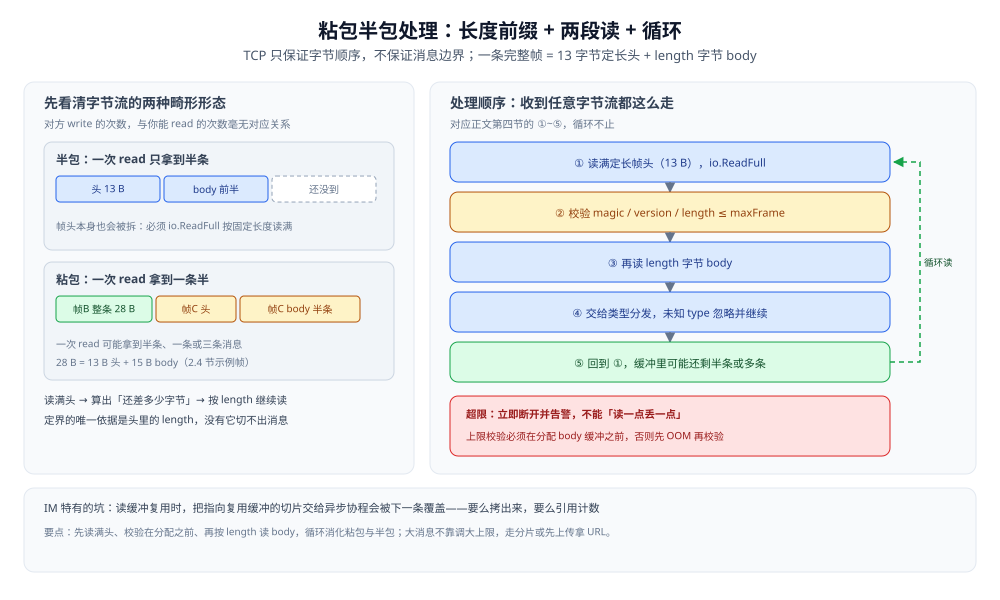
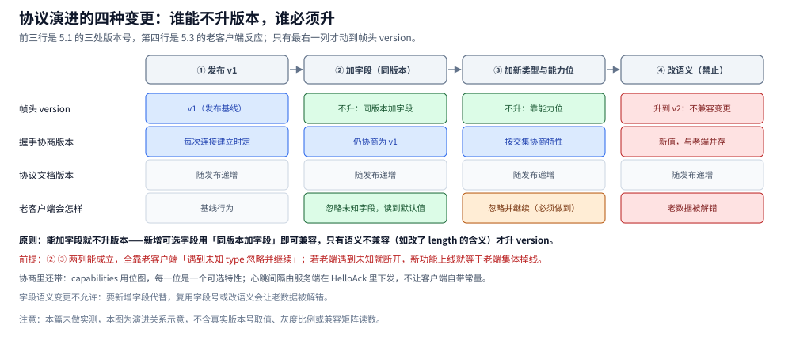
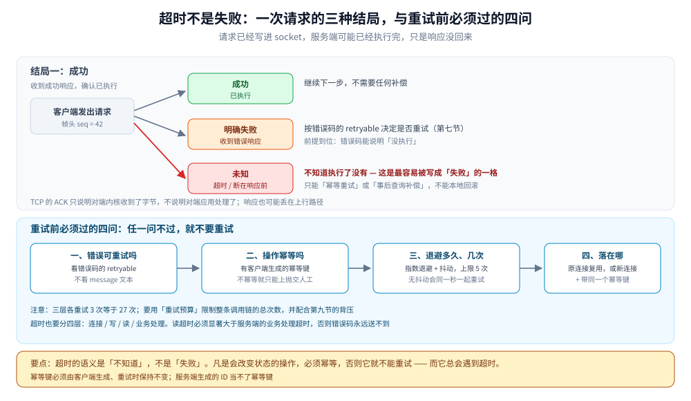
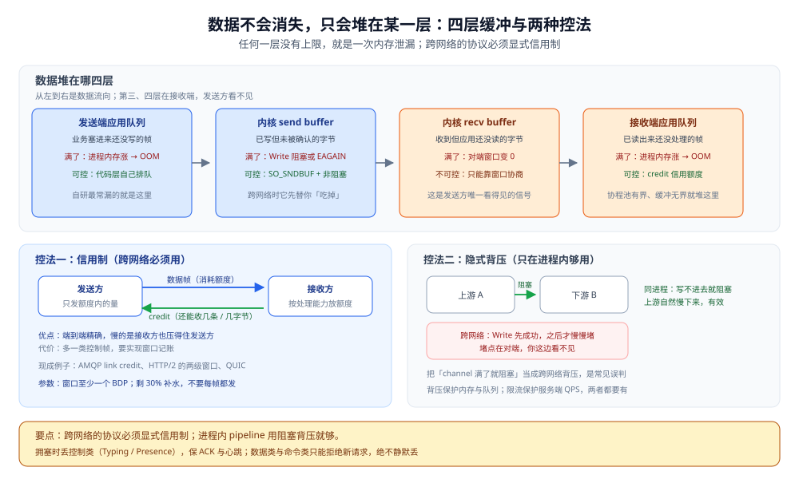
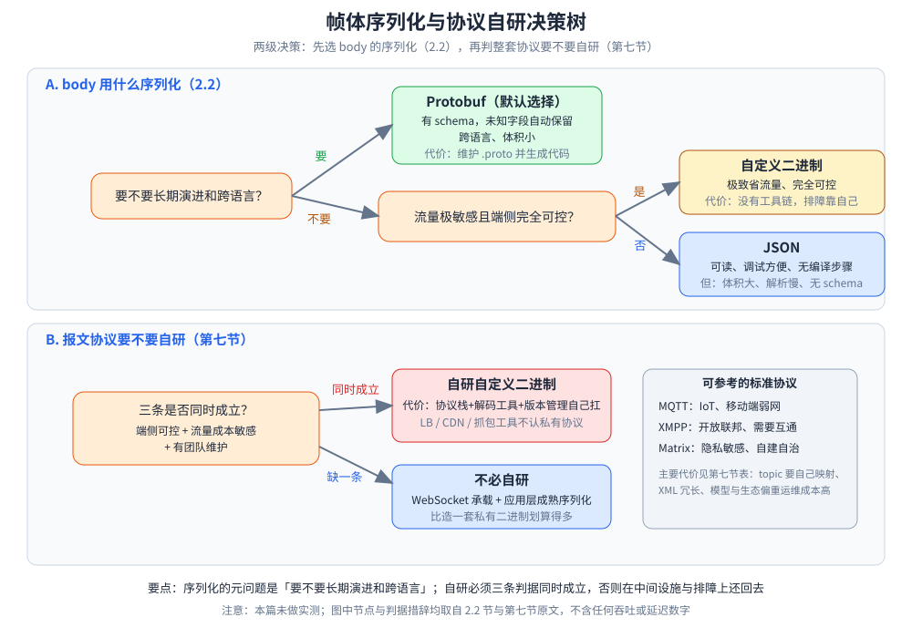

# 自定义协议设计

> 长连接上的**应用层协议**从零怎么定：帧格式（定长头 + 变长体）、报文类型分类、粘包半包处理、版本演进与能力协商、可选特性怎么落进协议，以及四件决定它能不能上线的工程向的事——**错误码与错误响应 / 超时与幂等重试 / 流量控制与背压 / 协议可观测性**。
>
> 本篇讲**通用方法**，不绑定某个业务。想直接用现成协议见 [MQTT.md](../消息协议/MQTT.md)（IoT 发布订阅）、[XMPP.md](../消息协议/XMPP.md)（IM 联邦）、[STOMP.md](../消息协议/STOMP.md)（文本帧）、[AMQP.md](../消息协议/AMQP.md)（MQ 的二进制帧与分帧重组）。业务场景里这些设计怎么落地（投递语义 / 已读与未读 / 多端同步）见 [协议设计.md](../../../04-架构与系统/系统设计/IM系统/协议设计.md)。
>
> 内容整理自个人学习笔记，并参考 MQTT / XMPP / Matrix 与 Protobuf 官方文档；素材见 [素材清单](../../../素材清单.md)。
>
> ⚠️ 实测口径（素材归属：个人学习笔记 + 官方规范）：**本篇未做容器实测**。「具体使用」节的 Go 骨架按 Go 标准库接口编写，⚠️ **尚未编译和实测验证**——跑通一个真实的帧编解码需要**两端（客户端 + 服务端）同时在线**并制造粘包 / 半包 / 超大帧等对抗场景，单进程环境测不出有意义的结果。文中不引用任何第三方吞吐或延迟数字。

---

## 一、一条自定义协议要自己定哪些事？

**本节要点**：普通 HTTP 是一问一答、由 HTTP 库帮你切好报文边界；到了长连接，**帧怎么切、类型怎么分发、版本怎么演进、对端支持什么**全都要自己定义。前六件是协议**自身的骨架**，后四件决定它能不能**上线运维**——只写前六件的协议在实验室能跑，一进生产就会在超时、拥塞和排障上连续翻车。

| # | 要解决的问题 | 不解决会怎样 | 本篇在哪 |
|---|---|---|---|
| ① | **帧定界**：一条消息到哪结束 | 读到的字节拼不成完整消息（粘包 / 半包） | 第四节 |
| ② | **类型分发**：这串字节是什么消息 | 不知道 body 该用什么结构解 | 第三节 |
| ③ | **心跳保活**：连接还活着吗 | 断线靠 TCP 超时才发现，可能几分钟 | 第三节（控制类报文） |
| ④ | **版本演进**：协议怎么加字段、加类型 | 一升级就要求全量客户端同步发版 | 第五节 |
| ⑤ | **能力协商**：对端支持哪些特性 | 新特性推给不支持的客户端 → 报错或闪退 | 第五节 |
| ⑥ | **可选特性**：已读回执 / 撤回 / 输入中怎么表达 | 每个特性各写一套私有格式，无法复用 | 第六节 |
| ⑦ | **错误表达**：失败怎么告诉对端 | 全回一个码或直接静默断开，对端分不清该断连还是该重试 | 第七节 |
| ⑧ | **超时与重试**：超时了对方到底执行了没有 | 把超时当失败去回滚或重发 → 重复下单 / 重复消息 | 第八节 |
| ⑨ | **流量控制**：发得比收得快怎么办 | 接收端队列无限涨 → 内存耗尽；或者反过来乱丢数据类报文 | 第九节 |
| ⑩ | **可观测性**：线上断了怎么归因 | 只知道「断了」，不知道谁断的、为什么断、哪一版客户端在掉 | 第十节 |

⭐ 一句话：**HTTP 把这些都藏在库里，长连接把它们全摊在你面前。** 这也是为什么「自定义协议」听起来自由，实际是接手了 HTTP 帮你干的那份活。

**这十件事在标准协议里都已经定完了**，定法各不相同——下面只列三者的差异所在，各协议的完整帧布局见对应篇目：

| 问题 | MQTT 的定法 | XMPP 的定法 | AMQP 0-9-1 的定法 |
|---|---|---|---|
| 帧定界 | 固定头 + **变长长度字段**（1~4 字节） | XML 流的标签闭合 | 7 字节帧头里的 `size` |
| 类型分发 | 固定头里的报文类型（14 种） | stanza 的元素名（3 类） | class + method 两个 16 位整数 |
| 心跳 | `PINGREQ` / `PINGRESP` 报文 | 空格心跳（`whitespace keepalive`） | 独立的 heartbeat 帧（type=8） |
| 错误表达 | CONNACK / DISCONNECT 的 **reason code** | `<stream:error>` 断流，stanza `<error>` 不断流 | `reply-code` + 两级 `close` |
| 流量控制 | 5.0 的 `Receive Maximum` | 无内建，靠 TCP | credit 制（1.0）/ `channel.flow` |
| 关闭原因 | `DISCONNECT` 的 reason code | `<stream:error>` 的 condition | `connection.close` 的 `reply-code` |

后三行分别是第七、第九、第十节要展开的维度——族总纲那张八维矩阵（编码 / 最小头 / 定界 / 多路复用 / 确认原语 / 路由模型 / 扩展机制 / 典型落地）没有覆盖它们，所以在这里给一份入口级对照，细节仍落回各节；第八节（超时、重试与幂等）不是帧形态差异，三家做法见 8.5。

---

## 二、帧格式怎么设计？

**本节要点**：用**定长头 + 变长体**。头部字段固定宽度、可随机访问；`body` 长度由头部里的 **length** 字段唯一确定 —— **长度前缀是定界的关键**，没有它就无法从字节流里切出消息。


图怎么读：头部定长 13 字节——magic 2B、version 1B、type 1B、flags 1B、seq 4B、length 4B，之后接变长 body；`length` 是切出消息边界的唯一依据。下方的例子就是 2.4 节那条帧（type = 0x11、seq = 42、body 15 B）：读到 length = 15，就知道还要再收 15 字节才凑成一条完整帧。注意帧头 seq 是连接内报文序号（配对 ACK），与会话内消息 seq 不是一回事。

### 2.1 头部的六个字段

| 字段 | 建议宽度 | 作用 | 注意 |
|---|---|---|---|
| **magic** | 2 B | 声明「这是本协议」 | 抓包时一眼识别；也可用来做协议/版本探测 |
| **version** | 1 B | 协议版本 | 与「握手时协商的会话版本」分开看，见 5.1 |
| **type** | 1 B（本例） | 报文类型 | 本例固定为 1 B；若需超过 256 种类型，应统一改为 2 B 并同步调整头长与编解码 |
| **flags** | 1 B | 位标志：压缩 / 加密 / 分片 / 是否为响应 | **按位扩展**，用满也才 1 B，别用它存枚举 |
| **seq** | 4 B | 报文序号，用于**请求-响应配对** | ⚠️ **不是会话内消息 seq**，见下方注意 |
| **length** | 4 B | **body 的字节长度** | **定界的唯一依据**；必须先校验再分配，见 2.3 |
| **body** | 变长 | 序列化后的载荷 | 序列化方式由 type / 协商结果决定，见 2.2 |

> ⚠️ **两个 seq 不是一回事**（最容易搞混的一处）：
> 帧头的 `seq` 是**传输层报文序号**，只在本条连接内有效，用来把响应配回请求（ACK 匹配）；
> [消息可靠投递.md](../../../04-架构与系统/系统设计/IM系统/消息可靠投递.md) 里的 `seq` 是**会话内消息序号**，跨连接、跨设备都有效，用来排序与断线补齐。
> 前者可以复用、可以重置；后者单调递增、永久有效。

### 2.2 body 用什么序列化

| 方式 | 优点 | 代价 | 什么时候用 |
|---|---|---|---|
| **Protobuf** | 有 schema、演进友好、跨语言、体积小 | 要维护 `.proto` 并生成代码，二进制不可读；未知字段能否保留取决于实现与处理路径 | **默认候选**，尤其中大型系统 |
| **JSON** | 可读、调试方便、无编译步骤 | 体积大、解析慢、没有 schema 约束，字段拼错不报错 | 调试期、小流量、内部工具 |
| **自定义二进制** | 极致省流量、完全可控 | **没有工具链**，演进、排障全得自己造 | 端侧完全可控且流量成本极敏感 |

> ⭐ 判据：**先问「要不要长期演进和跨语言」** —— 通常优先评估 Protobuf；JSON 也适合调试与简单内部服务。只有在性能数据证明有必要、且团队能承担工具链和兼容性成本时，再考虑自定义二进制。
> 别为了「省几字节」选自定义二进制，最后在**版本演进和抓包排障**上还回去。

### 2.3 帧大小上限

**必须有上限**，这不是优化项而是**安全项**：

- `length` 是**对端给的**。一个恶意的（或出 bug 的）对端报 `length = 2GB`，服务端若照着预分配 → 直接 OOM，这就是最廉价的 DoS。
- 正确顺序：**先校验 `length ≤ maxFrame`，再分配缓冲**；超限应当**立即断开并告警**，而不是「读一点丢一点」继续跑（后面全乱）。
- 大消息（长语音、大图片）**不要靠调大上限**解决，而是走**有明确分片元数据与重组上限的分片机制**，或**先上传拿 URL**（见 [存储选型与组合.md](../../../03-数据与中间件/数据存储/存储架构与场景/存储选型与组合.md) 的「大文件走对象存储」）。

**安全边界也要明确**：`magic` 不是认证机制，`flags` 里标记“加密”也不等于已经安全。若协议需要保密与防篡改，应使用成熟的 TLS 或经过审计的加密方案；同时定义身份认证、重放防护、解压后大小上限、读写超时和连接/请求速率限制。

### 2.4 一个具体的帧示例

设一条「上行消息」报文：魔数 `0x49 0x4D`（"IM"）、版本 `1`、类型 `0x11`、无标志位、连接内报文序号 `42`、body 长度 `15`：

```text
偏移  字节                        字段        值
0x00  49 4D                       magic       0x494D ("IM")
0x02  01                          version     1
0x03  11                          type        0x11 = 上行消息
0x04  00                          flags       无压缩 / 无加密 / 非分片 / 非响应
0x05  00 00 00 2A                 seq         42（本条连接内的报文序号）
0x09  00 00 00 0F                 length      15（body 15 字节）
0x0D  <15 字节>                   body        序列化后的消息载荷
```

**头长 = 13 字节，定长**；收到前 13 字节就能算出「还差多少字节才是一条完整消息」，这就是第四节循环读的依据。

---

## 三、报文里有哪些消息类型？

**本节要点**：报文按**方向**（上行 / 下行）与**语义**（数据 / 控制 / 命令）两个维度分类。方向决定谁处理，语义决定**要不要落库、要不要 ACK、能不能丢**。


| 报文 | 方向 | 语义类 | body 关键字段 | 落库 | 要 ACK |
|---|---|---|---|---|---|
| **心跳**（Ping / Pong） | 双向 | 控制 | 时间戳 | 否 | 否 |
| **上行消息**（Send） | 上行 | 数据 | convID、clientMsgID、内容 | 是 | 是（SendAck） |
| **上行 ACK**（SendAck） | 下行 | 控制 | clientMsgID、msgID、seq | 否 | 否 |
| **下行推送**（Push） | 下行 | 数据 | convID、msgID、seq、发送者、内容 | 是 | 是（PushAck） |
| **下行 ACK**（PushAck） | 上行 | 控制 | convID、已收位点 seq | 否 | 否 |
| **已读回执**（ReadReceipt） | 双向 | 控制 | convID、lastReadSeq | 是（可异步） | 否 |
| **会话同步**（ConvSync） | 双向 | 数据 | 游标、条数上限 | 否（读操作） | 否 |
| **在线变更**（PresenceChange） | 下行 | 数据 | userID、状态 | 否 | 否 |
| **命令**（撤回 / 删除 / 置顶） | 双向 | 命令 | 命令码、目标 msgID / convID | 是 | 是 |

### 3.1 数据类报文

**承载业务内容**：`Send` / `Push` / `ConvSync`。共同点：**必须可靠、可重放、带会话 seq**，因为丢了就是「用户看不到消息」。

- 有序：接收方按 `seq` 排序（见 [消息可靠投递.md](../../../04-架构与系统/系统设计/IM系统/消息可靠投递.md) 第一节）。
- 可补：断线后按「已收位点 + 1」拉取。
- 可去重：按 `msgID` 幂等。

### 3.2 控制类报文（心跳、ACK、能力协商）

**为数据类服务，自己不重要**：`心跳` / `SendAck` / `PushAck` / `Hello`（能力协商）。

- **高频但不落库**：ACK 每条消息都可能有一次，落库会把存储打爆（ACK 的价值在于**即时**，不在于留存）。
- **丢了就重发**：控制类靠「重发」保证最终到位，而不是靠「确认」。
- **能力协商是控制类的特殊形态**：只在握手时交换一次，见 5.2。

### 3.3 命令类报文（撤回、删除、置顶）

**不承载内容，而是改变既有消息或会话的状态**：`Recall` / `Delete` / `Pin`。

两个必须处理的点：

- **幂等**：重复收到「撤回 msgID=X」应无副作用（撤回一条已撤回的消息 = 什么都不做）。
- **⚠️ 乱序容错**：撤回报文可能**先于**被撤回的消息到达（跨节点扇出顺序不保证）。接收方若收到「撤一个还没收到的消息」，**不能报错丢弃**，而是**打一个撤回标记**，等消息本体到了立刻标记为已撤回 —— 否则会看到一条本该被撤回的消息。

### 3.4 三种报文的字段差异

| 维度 | 数据类 | 控制类 | 命令类 |
|---|---|---|---|
| 是否落库 | **是**（丢了没法补） | 否 | 是（状态变更要持久） |
| 是否需要 ACK | 是 | 否（自身就是确认） | 是 |
| 是否需要会话 seq | **是**（排序与补齐） | 否 | 否（但需幂等） |
| 能否丢弃 | 不能 | **能**（重发即可） | 不能 |
| 典型报文 | Send / Push | 心跳 / ACK / Hello | 撤回 / 删除 |

> ⭐ 一句话判据：**「丢了会不会让用户看到错的东西」** —— 会，就是数据类或命令类；不会，就是控制类。这一步决定了它要不要落库、要不要 ACK。

---

## 四、粘包半包怎么处理？

**本节要点**：TCP 是**字节流**，没有消息边界 —— 一次 `read` 可能拿到半条、一条或三条消息，与对方 `write` 的次数**毫无对应关系**。应用层协议的做法是**长度前缀 + 两段读 + 循环**。

处理顺序（收到任意字节流都这么走）：

```text
① 读固定长帧头（13 B）      ← 必须先读满，因为 length 就在头里
        ↓
② 校验 magic / version / length ≤ maxFrame   ← 校验在「分配缓冲」之前
        ↓
③ 再读 length 字节 body     ← 第二段读，长度由上一段解出
        ↓
④ 交给类型分发（第三节）     ← 解码 + 处理
        ↓
⑤ 回到 ①，继续读下一条       ← 缓冲里可能还剩半条 / 多条
```

**三个与「定界」直接相关的注意点**（通用网络编程细节不在此重复）：

1. **帧头本身也会被拆**：不能假设「一次 read 就能拿到完整头」，必须按固定长度**读满**（`io.ReadFull` 之类）。这正是「两段读」的原因。
2. **上限校验必须在分配 body 缓冲之前**：否则一个超大 `length` 就能让你先 OOM 再校验（见 2.3）。
3. **缓冲复用与并发的矛盾**：为了不每条消息都 `alloc`，通常复用读缓冲；但若把「指向复用缓冲的切片」交给异步协程处理，缓冲会被下一条消息覆盖 → 要么**拷出来**，要么用引用计数。



图怎么读：左侧是字节流的两种畸形形态——半包连帧头都会被拆，必须 `io.ReadFull` 按固定长度读满；粘包一次 read 可能拿到半条、一条或三条消息。右侧是处理循环：① 读满定长帧头（13 B）→ ② 校验 magic / version / length ≤ maxFrame（校验在分配缓冲之前）→ ③ 再读 length 字节 body → ④ 交给类型分发（可选未知 type 跳过并继续）→ ⑤ 回到 ① 循环；超限则**立即断开并告警**，不能「读一点丢一点」。

> ⚠️ 通用网络编程细节（粘包拆包的三种解法、`deadline`、socket 选项默认值）见 [net包与TCP-UDP编程.md](../../../01-编程语言/go/网络编程/net包与TCP-UDP编程.md) 第四节，本篇不复述；这里只讲「应用层协议怎么用长度前缀把帧切开」。

---

## 五、协议怎么演进？

**本节要点**：协议一旦发布就**必须能陪着老客户端走**——不可能要求全量用户同步发版。三件工具：**版本号**、**未知内容容忍**、**能力协商**。

### 5.1 版本号怎么标

版本号其实有**三处**，别混为一谈：

| 位置 | 作用 | 何时变 |
|---|---|---|
| **帧头 version** | 每一帧自描述，便于抓包定位「这是哪个版本的帧」 | 协议**不兼容**变更时 |
| **握手协商版本** | 本次连接**用哪套语义**（服务端按它决定怎么解） | 每次连接建立时确定 |
| **协议文档版本** | 对外发布、给接入方看 | 每次发布 |

⭐ 原则：**能加字段就不升版本**。绝大多数需求（新增一个可选字段）用「同版本加字段」就能兼容，只有**语义不兼容**（如改了 length 的含义）才升 version。

### 5.2 客户端能力协商

握手时交换一次，之后按协商结果走：

```text
Client → Server   Hello   { protoVersion, capabilities(位图), 压缩算法, 序列化 }
Server → Client   HelloAck{ 协商后的 protoVersion, capabilities(交集), 心跳间隔 }
```

- **capabilities 用位图**：每一位代表一个可选特性（撤回 / 输入中 / 消息编辑 / 分片…）。
- **取交集**：只有**双方都支持**才启用该特性；否则退回旧行为（如不支持撤回的客户端 → 收到撤回命令时按「删除」处理，或直接忽略）。
- **心跳间隔在协商里下发**：让服务端能统一调参，不用让每个客户端自带常量。

🔗 本节"握手时交换一次、服务端取交集"的时序形态已由一张共用图承担（IM 场景篇也在用同一张），同型不重画：[消息类型-自定义类型注册与协商时序图.svg](images/消息类型-自定义类型注册与协商时序图.svg) —— 该图画的是客户端在握手里上报自己支持的 type 集合、服务端取交集判定、对方不支持时改发文本兜底，与上面 Hello / HelloAck 交换 capabilities 位图再取交集是同一套机制的两次落地。**分工**：那张图站在**消息类型**视角（自定义类型怎么协商出来），本节站在**协议**视角（协商报文长什么样、位图怎么编码）。

### 5.3 向后兼容案例（新增字段 / 新增报文类型）

| 变更 | 怎么做 | 老客户端会怎样 |
|---|---|---|
| **新增字段** | Protobuf 使用新的字段编号并保持兼容规则 | 不认识的字段通常会被忽略；未知字段是否在解析后重新序列化时保留，取决于具体实现与处理路径 |
| **新增报文类型** | 老客户端遇到协议明确规定为**可选扩展的未知 type** 应**跳过 body 并继续** | ⚠️ 若老客户端「遇到未知 type 就断开」，则**新功能上线 = 老端集体掉线** |
| **新增可选特性** | 能力位都置位才启用 | 不置位就不启用，行为不变 ✅ |
| **字段语义变更** | ❌ **不允许**：应**新增字段**代替 | 复用字段号 / 改语义会让老数据被解错 |

> ⚠️ 最容易被忽略的一条：**「协议必须定义可选扩展类型，并允许跳过未知扩展」**。这条不做，协议就失去了向前兼容的能力 —— 任何新类型的灰度上线都会变成老客户端的掉线事故。

把 5.1 的三处版本号与 5.3 的四类变更并排放成一张对照表，就能看出「升版本」这件事有多窄：



图注：四列从左到右是四类变更（发布 v1、加可选字段、加新报文类型与能力位、改字段语义），四行自上而下是帧头 version、握手协商版本、协议文档版本与老客户端的反应。

**图怎么读**：绿色是"同版本演进、老客户端无感"，红色是"必须升 version 或禁止"。最右列（改语义）是唯一动到帧头 version 的一列，而它正文的结论是不允许做、应改为新增字段；协议文档版本这一行四列全灰，因为它按发布节奏走、与兼容性无关（5.1 表第三行）。第三列的老客户端反应标成橙色而非绿色，是因为"忽略并继续"是一条**必须落实的前提**而不是自动成立的结果——第二行下方的红字就是这条前提本身。

---

## 六、可选特性怎么落进协议？

**本节要点**：这些特性看起来各不相同，本质都是**「一个报文类型 + 几个字段」**的组合；差别只在**是否落库、是否幂等、能否丢**。

| 特性 | 报文类型 | 关键字段 | 可靠性要求 |
|---|---|---|---|
| 已读回执 | `ReadReceipt` | convID + lastReadSeq | 可合并、**单调不减**（见 [会话与未读.md](../../../04-架构与系统/系统设计/IM系统/会话与未读.md) 第四节） |
| 撤回 | `Recall` | msgID + 撤回原因 | **幂等** + 乱序容错（见 3.3） |
| 输入中 | `Typing` | convID + 状态 | **高频、可丢、绝不落库**（丢了只是「输入中…」闪一下没显示） |
| 消息编辑 | `Edit` | msgID + 新内容 | 需带**编辑时间/版本**，避免乱序时旧编辑覆盖新编辑 |

⭐ 判据：**先给特性定可靠性等级，再决定它用哪一类报文（3.4 的表）**。
比如「输入中」如果错当成数据类去落库，会在群里几百人同时打字时把存储压垮 —— 而这种消息**丢了完全无感**。

---

## 七、出错时怎么告诉对方？

**本节要点**：错误必须先**分层**再表达。四类错误的处理动作完全不同——语法错误必须断开、认证失败要终止握手、版本不兼容要拒绝且**不重试**、业务失败只回错误帧连接继续。用一个错误码糊住这四类，对端就只能猜。

| 层 | 触发条件 | 这条连接还能用吗 | 对端该做什么 | 责任在谁 |
|---|---|---|---|---|
| **帧 / 语法** | magic 不对、`length` 超限、body 解不开、压缩流损坏 | ❌ 不能：**帧边界已经不可信** | 断开重连 | 对端（或链路上有东西改字节） |
| **认证 / 授权** | 握手时凭据错、token 过期、签名不匹配 | ❌ 不能：身份没建立起来 | 关连接，换凭据后重连 | 对端 |
| **版本 / 能力** | 帧头 `version` 高于我能解、必选能力缺失 | ❌ 不能：语义对不齐 | 拒绝并告知最低支持版本，**不要重试** | 升级客户端 |
| **业务** | 参数非法、无权限、目标不存在、状态冲突 | ✅ 能：连接与协议状态都完好 | 回错误帧，连接继续用 | 对端业务代码 |

⭐ **为什么语法错误必须断连**：长度前缀一旦读错，后面每个字节的帧边界都错位——继续读只会把 body 当帧头解，然后产生一堆更莫名其妙的错误码，把真正的原因埋掉。所以这一层只能丢连接，不能试图「跳过错误帧继续」。

### 7.1 错误响应报文长什么样

```text
ErrorFrame {
  code      uint16   // 数值，程序判断的唯一依据
  category  uint8    // 0 帧 / 1 认证 / 2 版本 / 3 业务
  refSeq    uint32   // 出问题的是哪个请求（对应帧头 seq，见 2.1）
  retryable uint8    // 0 不可重试 / 1 可重试 / 2 换凭据后重试
  scope     uint8    // 0 连接级 / 1 会话级 / 2 单请求级
  message   string   // 给人看的，禁止拿来做程序判断
}
```

码段划分照抄 HTTP 与 AMQP 的分段思路——**首位数字表示层**，这样对端不用查表就能知道该断连还是该重试：

| 段 | 含义 | 例子 |
|---|---|---|
| `1xxx` | 帧层 | `1001` bad magic、`1002` frame too large、`1003` decode failed |
| `2xxx` | 认证授权 | `2001` 凭据无效、`2002` token 过期、`2003` 权限不足 |
| `3xxx` | 版本能力 | `3001` 版本过高、`3002` 必选能力缺失 |
| `4xxx` | 业务 | `4001` 参数非法、`4002` 目标不存在、`4003` 状态冲突 |

⭐ 判据：**每个错误码都要能回答三个问题——是谁的问题、要不要断连、能不能重试。** 答不出来的码就是没设计好。

### 7.2 三处最容易写错的地方

1. **拿 `message` 做程序判断**。它是自由文本，实现方会往里塞变量（队列名、建议值、堆栈摘要），换个版本就变。[AMQP.md](../消息协议/AMQP.md) 的 `reply-text` 就是这个坑的现成例子——能判的只有 `reply-code` 和 `class-id` / `method-id`。
2. **业务失败也断连**。一次参数拼错就掉线重连，会把自己的业务 bug 放大成可用性事故：重连风暴、会话恢复、重复消息全跟着来。
3. **所有失败都回一个码**。对端无法区分「重试有用」和「重试没用」，于是只能全重试（放大故障）或全不重试（丢掉本来能恢复的失败）。

### 7.3 标准协议怎么定这一层

| 协议 | 错误怎么表达 | 分级粒度 |
|---|---|---|
| **AMQP 0-9-1** | `channel.close` / `connection.close` + `reply-code` | 两级硬关闭；规范里 3xx/4xx 分段，RabbitMQ 又把 `404` / `406` 降成 channel 级 |
| **MQTT 5.0** | CONNACK / DISCONNECT / PUBACK 里的 **reason code** | 按报文类型分；reason code 本身携带「可不可重试」的语义 |
| **STOMP** | `ERROR` 帧 + `message` 头 | 收到 `ERROR` 即视为连接失效 |
| **XMPP** | `<stream:error>` / stanza 的 `<error type>` | 流错误必断流；stanza 错误原样回显且流继续（`cancel` / `continue` / `modify` / `wait` / `auth` 五档） |
| **WebSocket** | close frame 的 2 字节 code（`1000` / `1002` / `1009` / `1011`） | 只有连接级，**没有请求级**——所以请求级失败得自己在应用层补 |

⚠️ 注意最后一行：WebSocket 这类「只定传输」的协议没有请求级错误，自研时这一层是空的，必须自己补 `ErrorFrame` 与 `refSeq`。

---

## 八、超时了对方到底执行了没有？

**本节要点**：**超时不是失败，是「不知道」**。请求已经写进 socket 了，服务端可能已经执行完、只是响应没回来。把超时当失败去回滚或重试，是重复扣款、重复下单、重复消息的头号来源。

### 8.1 一次请求只有三种结局，第三种最常被写错

| 结局 | 客户端知道什么 | 能做什么 |
|---|---|---|
| **成功** | 已执行 | 继续下一步 |
| **明确失败** | 收到了错误响应，且这个错误说明没执行（或执行了也无副作用） | 按错误码决定是否重试 |
| **未知** | 超时、连接断在响应之前、本端进程崩了 | **只能「幂等重试」或「事后查询补偿」** |

**为什么「未知」消不掉**：TCP 的 ACK 只说明「对端内核收到了字节」，不说明「对端应用处理了」；就算处理了，响应也可能丢在上行路径。所以协议层面必须假设**每一个请求都可能已经被执行过**。

⭐ 结论：**凡是会改变状态的操作，必须幂等，否则它就不能重试**——而它总会遇到超时。



图怎么读：上半是同一个请求的三种结局——绿色「成功」可直接继续，橙色「明确失败」按错误码决定是否重试，红色「未知」是超时与断连所在的那一格，服务端可能已经执行，所以既不能当失败回滚、也不能不处理。下半是重试前必须依次过的四问：错误码可重试吗、操作幂等吗、退避多久试几次、落在哪条连接；某一问不通过就停在那一步，不要往下走。

### 8.2 幂等键必须由客户端生成

- 键叫 `clientMsgID`（或 `idempotency key`），**由客户端生成，重试时保持一模一样**。
- ⭐ 关键：**服务端生成的 ID 不能当幂等键**——重试时客户端拿不到上一次那个 ID，等于每次都是新请求。
- 服务端按 `(发送方, clientMsgID)` 建唯一约束或短期去重表；命中时**返回上一次的结果**（而不是回「重复请求」错误）。
- 去重窗口要有限（如 24 小时），过期后的重复按业务判断——永久去重表的成本会超过收益。
- 幂等键的粒度跟**业务操作**对齐，不跟报文对齐：一次「发消息」是一个操作，重发三次是同一个操作。

### 8.3 重试前先过四问

| # | 问什么 | 不满足时 |
|---|---|---|
| ① | 这个错误**可重试**吗？（看第七节的 `retryable`，不看 message） | 不重试，直接上抛 |
| ② | 这个操作**幂等**吗？（有幂等键或天然幂等） | 不重试，报错交人工 |
| ③ | 退避多久、试几次？ | 指数退避 + **抖动**（1s / 2s / 4s / 8s ± 随机），上限 5 次；无抖动会让所有客户端在同一秒一起重试 |
| ④ | 落在哪条连接？ | 原连接还在就复用（注意 `seq` 复用规则）；连接已断则新建连接 + 带幂等键 |

⚠️ **重试风暴**：服务端变慢 → 客户端读超时 → 重试 → 服务端更慢。所以重试必须配合背压（第九节）与服务端限流；并且用**重试预算**（整条调用链的总重试次数上限）而不是每层各重试三次——三层各 3 次等于 27 次。

### 8.4 超时要分四层，别用一个值

| 超时 | 管什么 | 典型量级 | 超时后的语义 |
|---|---|---|---|
| **连接超时** | TCP / TLS 建连 | 秒级 | 明确失败，可换节点重试 |
| **写超时** | 这一帧有没有写出去 | 秒级 | **未知**（可能写了一部分，连接已经废了） |
| **读超时** | 服务端处理完没有 | 随业务定 | **未知**，最危险的一种 |
| **业务处理超时** | 服务端内部 | 服务端定 | 服务端应主动回 `ErrorFrame`，而不是让客户端读超时 |

⭐ 判据：**读超时必须显著大于服务端的业务处理超时**。两者相等时，客户端会在服务端正要回错误码的瞬间先超时，错误码永远送不到。

### 8.5 标准协议里的现成答案

| 协议 | 重试与幂等怎么落地 |
|---|---|
| **MQTT QoS 1** | `DUP` 位 + `packet id`：重发时 `DUP=1`，broker 按 `packet id` 去重——**幂等键内建在协议里** |
| **AMQP 0-9-1** | 没有内建重试；靠 publisher confirm + 应用层幂等键 |
| **gRPC** | `deadline` 沿调用链传播；重试策略写在 service config；幂等键放 metadata |
| **HTTP** | `Idempotency-Key` 请求头（业界通行的做法） |

⚠️ 最常见的错法：**超时后在本地回滚**。服务端可能已经成功，回滚后两边状态不一致，而且没有对账依据。正确做法是「标记为未知 + 后台查询补偿」，让状态最终收敛。

---

## 九、发得比收得快怎么办？

**本节要点**：发送方比接收方快是常态。数据不会凭空消失，只会堆在某一层——发送端应用队列、内核 send buffer、接收端内核 recv buffer、接收端应用队列。**任何一层没有上限，就是一次内存泄漏**。

### 9.1 数据到底堆在哪四层

| 层 | 堆的是什么 | 满了会怎样 | 你能控制吗 |
|---|---|---|---|
| **发送端应用队列** | 业务塞进来还没写的帧 | 进程内存涨 → OOM | ✅ 协议与代码层 |
| **内核 send buffer** | 已写未确认的字节 | `Write` 阻塞或返回 `EAGAIN` | ✅ `SO_SNDBUF` / 非阻塞 + 自己排队 |
| **内核 recv buffer** | 收到但应用还没读的字节 | 对端窗口变 0，发送方被迫停 | ❌ 只能靠窗口协商 |
| **接收端应用队列** | 已读出来还没处理的帧 | 进程内存涨 → OOM | ✅ 协议层（信用额度） |

第四层是自研协议最容易漏的：你写了「读到就丢给业务协程池」，而协程池有界、缓冲区无界，慢消费时全堆在缓冲里。



图怎么读：上半从左到右是数据流向——前两层在发送端、后两层在接收端，橙色那两层是发送方看不见的部分，其中内核 recv buffer 满了才会通过窗口变 0 把压力传回去。下半是两种控法：左边信用制让接收方按处理能力放额度，跨网络有效；右边隐式背压只在同进程阻塞链里成立，跨网络时 `Write` 会先成功、堵点却在对端。

### 9.2 两种控法，别把后者当万能的

**① 信用制（credit / 窗口）**——接收方显式说「你还能发多少」

- 发送方发满额度就必须停，等对端发新的 credit。
- 优点：**端到端精确**，跨网络有效。
- 代价：多一类控制帧，要实现窗口记账。
- 现成例子：AMQP 1.0 的 link credit、HTTP/2 的 `WINDOW_UPDATE`（连接级 + 流级两级）、QUIC 同理。

**② 隐式背压（阻塞写）**——写不进去就阻塞，上游自然慢下来

- 优点：零协议成本，代码里天然就有。
- 代价：**只在同进程 / 同步调用链里有效**。跨网络时中间有内核 buffer 兜着，你的 `Write` 会先成功、再慢慢堵——堵点在对端，你看不见。

⭐ 判据：**跨网络的协议必须显式信用制；进程内 pipeline 用阻塞背压就够。** 把「channel 满了就阻塞」当成跨网络背压，是常见误判。

### 9.3 窗口参数怎么定

- **按字节还是按条数**：条数简单，但单帧大小可变的协议会失真——一个 1 MiB 的大帧能吃掉 1024 条配额。**可能有大帧就按字节**。
- **初始窗口至少一个 BDP**（带宽 × 往返时延），否则每发一小批就要等窗口更新，吞吐被 RTT 锁死。
- **高低水位**：剩到 30% 时补满到 100%，而不是每消费一帧就发一次控制帧。

### 9.4 拥塞时该丢谁

| 报文类（见第三节） | 能不能丢 | 正确做法 |
|---|---|---|
| **数据类** | ❌ 不能 | **拒绝新请求**（回第七节的业务错误码「服务繁忙」），绝不静默丢 |
| **命令类** | ❌ 不能 | 同上 |
| **控制类** | ✅ 能 | 先丢 `Typing` / `Presence`，保住 ACK 与心跳 |

⚠️ 反过来做是常见错误：先丢数据类、拼命保 `Typing`——丢掉的恰好是用户能看见的东西。

### 9.5 背压不是限流

| 手段 | 保护什么 | 判据 | 动作 |
|---|---|---|---|
| **限流** | 服务端的 QPS / CPU | 每秒多少请求 | 拒绝新连接或新请求（回 `429` 那类码） |
| **背压** | 内存 / 队列长度 | 还有多少处理能力 | 让**已经在发**的发送方慢下来 |

两者都要有，但阈值与动作不同：限流管入口，背压管在途。

### 9.6 标准协议里谁做了这件事

| 协议 | 流控机制 |
|---|---|
| **AMQP** | 1.0 是 credit 制（link credit）；0-9-1 是 `channel.flow` 的暂停 / 恢复，粒度更粗 |
| **MQTT 5.0** | `Receive Maximum`：接收方在 CONNECT / CONNACK 里通告「我最多同时处理多少条 QoS > 0 的消息」 |
| **HTTP/2** | 连接级 + 流级两级窗口，`WINDOW_UPDATE` 驱动 |
| **WebSocket** | **没有内建流控**——靠 TCP 与应用层自己限。这是自研协议必须自己补的第二块（第一块是第七节的请求级错误） |

---

## 十、线上出问题怎么定位？

**本节要点**：私有协议最大的代价不是编解码，而是**中间设施不认它**——LB 看不懂你的帧，抓包工具解不开你的 body。所以协议必须自己把可观测信息吐出来，否则线上出问题只能靠猜。

### 10.1 四类必须记的事件

| 事件 | 必带字段 | 不记会怎样 |
|---|---|---|
| **连接断开** | close code + **谁先断**（本端 / 对端）+ 连接存活时长 + 握手协商出的版本 | 只知道「断了」，分不清是网络抖动、读超时、还是被服务端主动踢 |
| **未知报文类型** | `type` 值 + 出现次数 + 来源 `version` | 新版本灰度时老端掉线，但不知道掉在哪个 type 上 |
| **解码失败** | 失败阶段（帧头 / body / 序列化）+ **字节偏移** + 前 32 字节 hex + 当时的 `type` / `version` | 只能「试着复现一下」，而线上往往复现不了 |
| **版本分布** | `protoVersion` × capabilities 位图的分布 | 不知道能不能下线老版本，也不知道某特性的实际覆盖率 |

### 10.2 关闭原因要写进协议，不能靠日志猜

- **必须有 close code**（学 WebSocket 的 close frame、AMQP 的 `connection.close`、MQTT 5.0 的 `DISCONNECT` reason code）。
- 裸关 TCP（直接 FIN / RST）等于「什么都没说」，对端只能记成 `unexpected close`，运维看到的就是一大堆无差别断连。
- ⭐ 判据：**每一条「我方主动断开」的代码路径都必须有 code；每一条「被动断开」都必须能归到四类原因之一**（网络 / 对端主动 / 超时 / 协议错误）。

### 10.3 指标标签的基数陷阱

| 可以进标签 | 绝不能进标签 |
|---|---|
| `type`、`version`、`close_code`、`error_category`、`phase` | `msgID`、`convID`、`userID`、`sessionID` |

前者是有限集合，后者的基数等于用户数或消息数——打进去就是给时序库喂垃圾，查询会慢到不可用。要定位具体某条消息，走**日志与 trace**，不走指标。

### 10.4 追踪上下文放哪

| 方案 | 做法 | 代价 |
|---|---|---|
| **握手时带一次** | 首帧交换 `traceparent`，之后整条连接绑定 | 最省；但一条长连接上的所有帧共享一个 trace，粒度粗 |
| **每帧带扩展头** | `flags` 置位表示本帧附加 trace 扩展 | 每帧多几十字节；粒度最细 |
| **按需附加** | 默认不带，排障时用控制帧开一段时间 | 灵活，但要多一套开关逻辑 |

⚠️ 一旦决定「协议里带追踪头」，它就是协议的**一部分**——必须进第五节那张兼容矩阵，按新增可选字段的方式演进，不能今天有明天没有。

### 10.5 协议自身的健康度指标

这几项比业务指标更早暴露问题，建议直接进第一块看板：

- 每秒帧数与**平均帧大小**（帧大小突变通常意味着序列化写错了）
- **解码失败率**（能直接定位到某一版客户端）
- **未知类型率**（灰度期的关键指标，见 10.1）
- **主动关闭率**与主动关闭的 code 分布
- **平均连接时长**（骤降 = 客户端在反复重连）

### 10.6 标准协议怎么表达关闭原因

| 协议 | 关闭原因的表达 |
|---|---|
| **WebSocket** | close frame 里的 2 字节 code：`1000` 正常、`1002` 协议错、`1009` 消息过大、`1011` 服务端内部错 |
| **AMQP** | `reply-code` + `reply-text`（见第七节那张表） |
| **MQTT 5.0** | `DISCONNECT` 报文的 reason code |
| **XMPP** | `<stream:error>` 里的 defined condition |

⚠️ 四个常见错法：只记「连接断开」不记原因；把 `convID` 打进指标标签；解码失败只打一行 `decode error`；版本分布只在发布时查一次——老版本客户端会长期存在（这正是第五节要兼容的原因）。

---

## 十一、应用场景

**本节要点**：**不一定要自研**。自研的代价是「协议栈 + 解码工具 + 版本管理」全得自己扛，而且中间设施（LB / CDN / 抓包工具）普遍不认你的私有协议。先看现成的标准协议能不能直接用，再决定要不要造。

| 协议 | 特点 | 适用 | 主要代价 | 详解 |
|---|---|---|---|---|
| **MQTT** | 轻量、发布订阅、有 QoS 0/1/2 三档 | IoT、移动端弱网 | 消息模型是主题（topic），做「一对一/群聊」要自己映射 | [MQTT.md](../消息协议/MQTT.md) |
| **XMPP** | 老牌 IM 标准、基于 XML、支持服务端联邦 | 开放联邦、需要互通 | XML 冗长，移动端流量与电量不友好 | [XMPP.md](../消息协议/XMPP.md) |
| **STOMP** | 文本帧、极简、浏览器可直连 | 浏览器直连 MQ、脚本与调试 | 无二进制优化，高频场景字符串开销大 | [STOMP.md](../消息协议/STOMP.md) |
| **AMQP 0-9-1** | 二进制帧、class-method 模型、语义完整 | 需要完整 MQ 语义（路由 / 确认 / 事务） | 协议重，实现复杂 | [AMQP.md](../消息协议/AMQP.md) |
| **Matrix** | 去中心化、房间 = 事件图、端到端加密 | 隐私敏感、需要自建自治 | 模型与生态偏重，运维成本高 | — |
| **自定义二进制** | 完全可控、省流量、可压到最小 | 大规模 IM（微信 / 钉钉这类） | 无标准工具链，排障与版本演进全靠自己 | 本篇 |

⭐ 判据：**「端侧可控 + 流量成本敏感 + 有团队维护」三条同时成立，才值得自研**；否则用 WebSocket 承载、应用层选一个成熟序列化，比造一套私有二进制划算得多。

**落到具体场景**：

| 场景 | 建议 | 理由 |
|---|---|---|
| IoT 设备上报 / 下发 | MQTT | 弱网省电、QoS 分档、Broker 生态成熟 |
| 大厂 IM（端侧自研 App） | 自定义二进制 | 流量与电量是核心成本，端侧能强制升级 |
| 浏览器 / 小程序长连接 | WebSocket + 应用层 JSON 或 Protobuf | 浏览器只认 WebSocket，别自己造传输 |
| 需要与外部组织互通 | XMPP 或 Matrix | 联邦是它们的立身之本 |
| 浏览器里手工调试 MQ | STOMP | 文本帧可以直接用 telnet 敲 |
| 需要完整 MQ 语义（路由 / 事务 / 确认） | AMQP 0-9-1 | class-method 把语义写进了协议 |



图怎么读：上层（A）展开 2.2 的判据——「要不要长期演进和跨语言」，要就 Protobuf（默认选择）；不要，再问「流量极敏感且端侧完全可控」，是就自定义二进制，否就 JSON（调试期、小流量、内部工具）。下层（B）展开第十一节的判据——三条同时成立才自研自定义二进制，否则 WebSocket 承载 + 应用层成熟序列化；右侧灰卡列出 MQTT / XMPP / Matrix 三个可参考标准协议及各自适用场景。两级决策的节点措辞全部是正文原句，图中不含任何吞吐或延迟数字。

---

## 十二、具体使用

### 12.1 一个最小二进制帧协议的 Go 骨架

把上面的头布局、上限校验、两段读串成一个可编译示例。**⚠️ 未实测**（需要真实两端打通）。

```go
package wire

import (
	"encoding/binary"
	"errors"
	"fmt"
	"io"
)

const (
	Magic     uint16 = 0x494D // "IM"
	HeaderLen        = 13     // magic2 + version1 + type1 + flags1 + seq4 + length4
	MaxFrame         = 1 << 20 // 1 MiB：body 上限，超过即视为异常/攻击
)

// Frame 是应用层的一帧；Seq 是「连接内报文序号」，不是会话内消息 seq。
type Frame struct {
	Version uint8
	Type    uint8
	Flags   uint8
	Seq     uint32
	Body    []byte
}

// WriteFrame 按 [头][body] 写出，length 由 body 长度自动填。
func WriteFrame(w io.Writer, f Frame) error {
	if len(f.Body) > MaxFrame {
		return fmt.Errorf("body too large: %d", len(f.Body))
	}
	buf := make([]byte, HeaderLen+len(f.Body))
	binary.BigEndian.PutUint16(buf[0:2], Magic)
	buf[2] = f.Version
	buf[3] = f.Type
	buf[4] = f.Flags
	binary.BigEndian.PutUint32(buf[5:9], f.Seq)
	binary.BigEndian.PutUint32(buf[9:13], uint32(len(f.Body)))
	copy(buf[HeaderLen:], f.Body)
	return writeFull(w, buf)
}

// writeFull 处理合法 Writer 可能出现的短写。
func writeFull(w io.Writer, buf []byte) error {
	for len(buf) > 0 {
		n, err := w.Write(buf)
		if err != nil {
			return err
		}
		if n == 0 {
			return io.ErrShortWrite
		}
		buf = buf[n:]
	}
	return nil
}

// ReadFrame 两段读：先读满定长头，校验后再读 body。粘包/半包在本函数内被消化。
func ReadFrame(r io.Reader) (Frame, error) {
	var head [HeaderLen]byte
	if _, err := io.ReadFull(r, head[:]); err != nil { // 半包：这里会阻塞到读满
		return Frame{}, err
	}
	if binary.BigEndian.Uint16(head[0:2]) != Magic {
		return Frame{}, errors.New("bad magic") // 流已不可信，调用方应断开
	}
	bodyLen := binary.BigEndian.Uint32(head[9:13])
	if bodyLen > MaxFrame { // ★ 校验在分配之前，防止超大 length 打爆内存
		return Frame{}, fmt.Errorf("frame too large: %d", bodyLen)
	}
	body := make([]byte, bodyLen)
	if _, err := io.ReadFull(r, body); err != nil {
		return Frame{}, err
	}
	return Frame{
		Version: head[2],
		Type:    head[3],
		Flags:   head[4],
		Seq:     binary.BigEndian.Uint32(head[5:9]),
		Body:    body,
	}, nil
}

// Dispatch 按类型分发；⚠️ 可选未知类型必须「跳过并继续」，不能断开（见 5.3）。
func Dispatch(f Frame, h map[uint8]func([]byte)) error {
	if fn, ok := h[f.Type]; ok {
		return fn(f.Body)
	}
	return nil // 示例仅跳过可选扩展类型；关键类型应按协议策略拒绝或断开
}
```

**这段骨架显式省略的部分**（真实系统的工程量所在）：`version` 的校验与握手降级、未知关键类型的处理策略、`flags` 的压缩 / 加密 / 分片处理、读缓冲复用与并发安全，以及把 `Dispatch` 接到第三节那张报文表上。**本篇第七～十节讲的是这些策略该怎么定，代码骨架里并没有实现**——错误分类与 `ErrorFrame`、幂等键与重放去重、credit 记账、close code 与解码失败埋点，都要在骨架之上自己补。

---

## 延伸追问

- **帧头的 seq 和消息 seq 是一回事吗？** → 不是。帧头 seq 是**连接内**的报文序号，用于请求-响应配对，可复用、可重置；消息 seq 是**会话内**单调递增序号，跨连接跨设备有效，用于排序与断线补齐（见 [消息可靠投递.md](../../../04-架构与系统/系统设计/IM系统/消息可靠投递.md) 第一节）。
- **为什么不能靠 TCP 保证消息边界？** → TCP 只保证**字节顺序**，不保证「一次 write 对应一次 read」。粘包半包是字节流的固有性质，只能靠应用层长度前缀自己切。
- **未知报文类型都必须忽略吗？** → 不是。协议必须定义哪些类型属于可选扩展；对这类未知类型，接收方可利用 length 跳过 body 并继续。若未知类型可能影响状态、安全或协议同步，应按协议约定拒绝或断开，不能一概静默忽略。
- **心跳为什么放在应用层，不用 TCP keepalive？** → keepalive 默认探测间隔极长（小时级），且只能判断「TCP 层没响应」，判不出「应用线程卡死」。业务级心跳的间隔和判定权必须在应用层，才能秒级发现断线。
- **自研二进制协议最大的代价是什么？** → 不是编解码，而是**中间设施不认它**：负载均衡、CDN、抓包工具都要额外适配，排障成本远高于报文省下的那点流量（第十节讲的就是怎么用协议自身的信息把这笔成本补回来）。
- **超时之后到底要不要重试？** → 分两步问：这个错误码说可重试吗（第七节的 `retryable`）、这个操作幂等吗（第八节）。两步都过才重试，否则只能上抛或走后台查询补偿。⭐ **超时的语义是「不知道」，不是「失败」**。
- **「背压」和「限流」不是一回事吗？** → 不是。限流保护服务端 QPS（拒绝新请求），背压保护内存与队列（让已在发的发送方慢下来）。前者管入口，后者管在途。
- **私有协议为什么排障特别难？** → 两个原因叠加：中间设施（LB / APM / 抓包工具）看不懂你的帧，以及协议自己没吐出可观测信息。前者靠桥接（解码插件、WebSocket 隧道），后者只能在上线前就把 close code、失败阶段和版本标签设计进去——事后补不回来。

## 关联

- **上游/总纲**：[消息协议族全景.md](../消息协议/消息协议族全景.md) — 先看这族的四个可变量与四种定界形态，再决定要不要自研；本篇第五～六节讲演进与可选特性，第七～十节讲错误、重试、流控与可观测，都建立在那张骨架表上
- **上游/总纲**：[README.md](../README.md) — 网络目录导读：本篇属「应用层」这一类（与 Web 栈协议并列），四种标准协议则在「消息协议」分类下
- **上游/总纲**：[网络分层与数据包旅程.md](../网络分层与数据包旅程.md) — 应用层在分层里的位置，以及「哪些事 TCP 已经替你做了」
- **对照/互补**：[AMQP.md](../消息协议/AMQP.md) — 二进制帧 + class-method 两段类型分发，与本篇「定长头 + 单字节 type」是两种定法
- **对照/互补**：[MQTT.md](../消息协议/MQTT.md) — 固定头 + 变长长度字段（1~4 字节），14 种报文类型与 QoS 状态机
- **对照/互补**：[STOMP.md](../消息协议/STOMP.md) — 用 `NUL` 结尾定界的文本帧，与长度前缀是两条相反的路线
- **对照/互补**：[XMPP.md](../消息协议/XMPP.md) — 用 XML 标签闭合定界，冗长但可读、可联邦
- **对照/互补**：[HTTP1.1与HTTP2的区别.md](HTTP1.1与HTTP2的区别.md) — HTTP/2 的两级流控窗口是「信用制」最成熟的现成形态，本篇第九节只讲自研时怎么定参数
- **对照/互补**：[WebSocket.md](WebSocket.md) — 它**只定传输不定义务**：没有请求级错误、没有内建流控、有 close code。本篇第七～十节补的正是它留白的那几块
- **下游机制**：[net包与TCP-UDP编程.md](../../../01-编程语言/go/网络编程/net包与TCP-UDP编程.md) — 粘包拆包的三种解法与 `deadline`（本篇第四节只讲协议侧的处理）
- **下游机制**：[TCP保活与连接存活.md](../传输层/TCP保活与连接存活.md) — 半开连接的判定与四层保活分工，配合本篇第三节的心跳与第十节的断开归因
- **下游机制**：[协议设计.md](../../../04-架构与系统/系统设计/IM系统/协议设计.md) — 业务场景怎么落地：投递语义、已读回执、多端同步与报文设计的对应
- **对照/互补**：[接入与推送.md](../../../04-架构与系统/系统设计/弹幕系统/接入与推送.md) — 另一套长连接报文设计，可对照「可丢」与「不可丢」两类场景的协议取舍
