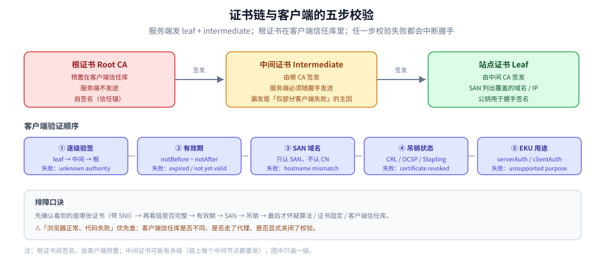

# 证书与 HTTPS 排障

> 覆盖：X.509 证书的字段、信任链与自签证书、ACME 自动签发、证书固定的取舍、五种常见握手错误的判据、Wireshark / `SSLKEYLOGFILE` / `openssl` / `keytool` 的排障命令，以及到期监控与中间设备导致的握手失败。
>
> 不覆盖：TLS 1.2 / 1.3 握手的逐步机制、会话复用与 0-RTT 见 [HTTPS与TLS.md](HTTPS与TLS.md)；证书体系的密码学基础见 [数字证书与PKI.md](../../../06-工程实践/安全/数字证书与PKI.md)；DNS 侧的 SNI / ECH 记录见 [DNS安全与加密解析.md](../网络层与寻址/DNS安全与加密解析.md)。
>
> 内容整理自个人学习笔记，素材见 [素材清单](../../../素材清单.md)。
>
> ⚠️ 实测口径：证书字段与校验流程按 RFC 5280 与主流客户端实现整理；`openssl` / `keytool` 命令为通用写法，**未在公网域名上逐条复跑**，故障文案以客户端实际输出为准。

---

## 一、证书里到底有哪些字段？

X.509 v3 证书是「**身份 + 公钥 + 上级 CA 的签名**」的组合：

| 字段 | 作用 |
| --- | --- |
| Version / Serial Number | 通常为 v3；序列号在 CA 内唯一，吊销与 CT 定位都靠它 |
| Issuer / Subject | 签发者 DN / 持有者 DN |
| Validity | `notBefore` / `notAfter`，⭐ **90 天是当前主流上限** |
| Signature Algorithm | 签发算法，如 `sha256WithRSAEncryption`、`ecdsa-with-SHA256` |
| Subject Public Key Info | 持有者公钥 + 算法 |
| **Extensions** | `SAN`（⭐ 域名校验**只认它**）、`Basic Constraints`（是否 CA）、`Key Usage` / `EKU`（serverAuth / clientAuth）、`CRL Distribution Points`、`AIA`（OCSP 地址）、`SCT`（证书透明度） |
| Signature | ⭐ **上级 CA 对本证书内容的签名**，验签就是验这一项 |

⭐ 三个读证书时最该先看的字段：**SAN**（到底覆盖哪些域名）、**Validity**（是否在有效期内）、**Basic Constraints**（这是不是一张 CA 证书）。

> ⚠️ **CN 已经不用于域名匹配**：现代浏览器与 JDK 只认 `subjectAltName`。自签证书只写 `CN=localhost` 会报 `No subject alternative names present`，必须显式加 `SAN`。

---

## 二、信任链是怎么建立的？

**信任链** = leaf（站点证书）→ intermediate（中间 CA）→ root（根 CA，预置在信任库）。服务端必须在 Certificate 消息里发出**除根以外的完整链**。



客户端验证服务器证书的五个步骤：

| 步骤 | 检查什么 | 失败时的典型报错 |
| --- | --- | --- |
| ① **逐级验签** | 用上级 CA 的公钥验下一级的签名，直到信任库里的根 | `unknown authority` / `unable to get local issuer certificate` |
| ② **有效期** | 当前时间是否落在 `notBefore` ~ `notAfter` | `certificate has expired` / `certificate is not yet valid` |
| ③ **域名** | 目标主机名是否匹配 **SAN** 中的某一项（支持单域名、通配符、IP） | `hostname mismatch` / `No subject alternative names present` |
| ④ **吊销** | CRL / OCSP 是否标记为已吊销（生产多用 Stapling） | `certificate revoked` |
| ⑤ **用途** | EKU 是否包含 `serverAuth`（客户端证书则要 `clientAuth`） | `unsupported certificate purpose` 一类 |

⭐ **任一步失败都会中断握手**，且客户端的报错只指向「最后失败的那一步」——所以排障要从**链是否完整**开始，而不是先怀疑算法。

### 2.1 自签名证书

自签名证书不在任何信任库里 → 客户端必须显式配置信任（Go 的 `RootCAs`、Java 的 `TrustStore`），否则报错。它只适用于内网与开发环境；生产环境用自签证书等于要求每个客户端都手动安装一次根证书。

### 2.2 根证书为什么不能由服务端发送？

根证书本来就在客户端信任库里，服务端再发一遍没有意义，还会增大握手报文。**服务端要发的是 leaf + 中间证书**；漏掉中间证书是最常见的「浏览器正常、命令行 / 某些客户端失败」的原因。

---

## 三、证书怎么申请与续期？

### 3.1 ACME 的三种挑战

| 挑战 | 怎么做 | 适用 |
| --- | --- | --- |
| **HTTP-01** | 把 token 放到 `/.well-known/acme-challenge/`，CA 从 80 端口取 | 有公网 80、单域名 |
| **DNS-01** | 写 `_acme-challenge` TXT 记录 | ⭐ **支持通配符证书**；无公网 80 时首选 |
| **TLS-ALPN-01** | 在 443 上用特殊 ALPN 完成挑战 | 不能占 80、但 443 可达 |

**有效期 90 天，必须自动续期**：`certbot` / `acme.sh` / K8s 的 `cert-manager`。续期不是「到期前手动跑一次」，而是要验证「自动续期真的会成功」——包括 DNS API 权限、80 端口可达性、续期后的 reload。

### 3.2 证书固定（Certificate Pinning）

把服务器的公钥 / 证书哈希硬编码进 App（Android `network-security-config`、iOS Trust Evaluation、OkHttp `CertificatePinner`、Go `VerifyPeerCertificate`），只接受这一个。

| 优点 | ⚠️ 风险 |
| --- | --- |
| 抗「恶意 / 被攻破的 CA 签发了假证书」 | **证书轮换或到期而 App 未更新 ⇒ 大面积不可用**，且用户无法自助修复 |

现代实践更推荐依赖 **CT（证书透明度）** + 受控 CA 列表，或至少配置**备用 pin**（当前 + 下一张证书的公钥），并给 pin 设置可远程更新的通道。

---

## 四、握手失败该从哪一步查？

### 4.1 六种常见现象

| 现象 | 常见原因 |
| --- | --- |
| `unknown authority` / `unable to get local issuer certificate` | ⚠️ **服务端证书链不完整（漏了中间证书）**；或客户端信任库太老（旧 JDK cacerts 缺新根） |
| `hostname mismatch` | 证书缺少对应 **SAN**（CN 已废弃）；或 IP / 泛域名没匹配上 |
| `certificate is not yet valid` | ⚠️ **系统时间不对**（时钟漂移、容器没同步 NTP 最常见） |
| `certificate has expired` | 忘了续期——生产事故 Top 1，请配自动续期 + 到期告警 |
| 拿到的证书不是自己的 | **SNI 未匹配**：同 IP 多域名，客户端没带 SNI 或服务端默认虚拟主机配错 |
| 只在部分网络下握手失败 | 中间透明代理 / 老 WAF / 负载均衡固件不支持 TLS 1.3 |

### 4.2 排障顺序

```text
① 先确认「看到的是哪张证书」：
   openssl s_client -connect host:443 -servername host -showcerts
② 看链是否完整：leaf → intermediate 是否都在？根是否由客户端信任库提供？
③ 看有效期与 SAN：-dates -ext subjectAltName
④ 看 SNI 是否带对：多域名站点必须带 -servername
⑤ 看协议 / 套件是否被中间设备拦：-tls1_2 与 -tls1_3 对比
⑥ 最后才怀疑算法、证书固定与客户端信任库
```

> ⚠️ **「浏览器能开、代码不能连」** 的第一嫌疑人通常是：代码里的信任库与系统不同（JVM cacerts、容器镜像的 CA 包）、代理环境变量没走对、或客户端显式关闭了校验。

---

## 五、怎么抓包看握手？

### 5.1 Wireshark 显示过滤器

| 显示过滤器 | 看什么 |
| --- | --- |
| `tls.handshake.type == 1` | ClientHello（版本、套件列表、SNI、ALPN） |
| `tls.handshake.type == 2` | ServerHello（最终选定的套件） |
| `tls.handshake.type == 11` | Certificate（能看到完整链） |
| `tls.handshake.type == 14` | ServerHelloDone（**仅 1.2 有**）；`== 4` 是 NewSessionTicket |
| `tls.handshake.extensions_server_name` | SNI 明文域名 |
| `tls.alert_message` | ⭐ Alert，握手失败的错误在此（如 `40 handshake_failure`、`42 bad_certificate`） |

> ⚠️ 抓 TLS 1.3 时会发现 ServerHello 之后**全是 Application Data 密文**，看不到 Certificate / Finished——没有密钥，这是正常的（见 [HTTPS与TLS.md](HTTPS与TLS.md) 4.1），不是抓包坏了。

### 5.2 用 SSLKEYLOGFILE 解密 HTTPS 流量

浏览器（Chrome / Firefox）以及 curl、Go、OpenSSL 等支持 NSS keylog 的程序，会把每个会话的密钥材料写进环境变量 `SSLKEYLOGFILE` 指向的文件；Wireshark 读该文件即可**解密本机流量**。

```bash
export SSLKEYLOGFILE=/tmp/sslkeys.log       # Linux/macOS，之后启动浏览器或 curl
$env:SSLKEYLOGFILE = 'C:\tmp\sslkeys.log'   # Windows PowerShell
curl https://example.com >/dev/null
```

然后 **Wireshark → Preferences → Protocols → TLS → (Pre)-Master-Secret log filename** 填同一路径，再过滤 `http` 就能看到明文请求。

⚠️ 只有**参与握手、能导出密钥的那一端**才能解密，截获别人的流量照样解不开；该文件泄漏等于泄密，用完即删，**不要提交到 Git**。

---

## 六、生产环境还有哪些证书相关的坑？

### 6.1 到期监控

- **到期是生产事故第一名**（Let's Encrypt 只有 90 天）：用 `certbot` / `acme.sh` 定时任务，K8s 上用 **cert-manager**。
- 监控两手抓：① Prometheus `blackbox_exporter`（`probe_ssl_earliest_cert_expiry`）或 `ssl_exporter`；② 服务启动时自打印剩余天数并在 `/health` 暴露。
- 告警阈值建议 **30 天 / 7 天两级**。⚠️ 别忘了整套链路：**CDN、负载均衡、Ingress、内网自签 CA** 都要管。

### 6.2 中间设备导致的握手失败

- 企业出口代理、老 WAF、部分负载均衡固件**解析不了 TLS 1.3 的新记录格式与扩展**，只有部分网络用户受影响；排查用 `openssl s_client -tls1_2` 与 `-tls1_3` 对比，短期可针对该来源降级。
- 带 SNI 拦截的透明代理会签发自己的证书，只能靠客户端信任库 / 证书固定发现。
- ⚠️ **HTTP/3 over QUIC 走 UDP 443**，不少防火墙直接丢 UDP，表现为「网站时而打不开」；MTU / 分片问题（DF 位 + ICMP 被禁的 PMTUD 黑洞）会让 TLS 记录变大后偶发连接挂起。

---

## 七、应用场景

**本节要点**：证书问题的落点是「客户端到底信不信这张证书」，排障顺序永远是**链 → 有效期 → SAN → 吊销 → 用途**。

| 场景 | 涉及哪一块 | 为什么值得注意 |
| --- | --- | --- |
| 全站 HTTPS | ACME + 自动续期 | 90 天有效期必须自动续，详见 本篇第三节 |
| 「浏览器能开、程序不能连」 | 信任库 + 完整链 | 客户端信任库与系统不同，详见 本篇 4.2 |
| 多域名共用 IP | SNI 与 SAN | 不带 SNI 会拿到默认站点的证书，详见 本篇 4.1 |
| 服务间 mTLS | 客户端证书与 EKU | 双向认证要校 `clientAuth`，详见 [HTTPS与TLS.md](HTTPS与TLS.md) 9.1 |
| 移动端防中间人 | 证书固定 | 轮换风险高，建议备用 pin，详见 本篇 3.2 |
| 到期告警 | 监控与链路全覆盖 | CDN / LB / Ingress / 自签 CA 都要管，详见 本篇 6.1 |
| 抓包定位握手失败 | Alert 与 Certificate 消息 | 先看 Alert 再猜原因，详见 本篇第五节 |

## 八、具体使用

**本节要点**：先用 `openssl s_client` 取链条与 SAN，再用 `keytool` 处理 Java 信任库，最后把到期监控接进告警。

```bash
# 1) 看握手全过程：证书链、协商出的协议与套件、是否走了会话复用
openssl s_client -connect example.com:443 -servername example.com -showcerts

# 2) 指定版本 / 套件探测（判断中间设备是否卡在某个版本）
openssl s_client -connect example.com:443 -tls1_2
openssl s_client -connect example.com:443 -tls1_3
openssl s_client -connect example.com:443 -cipher ECDHE-RSA-AES128-GCM-SHA256
nmap --script ssl-enum-ciphers -p 443 example.com

# 3) 只看有效期 / SAN（到期监控的基础命令）
echo | openssl s_client -connect example.com:443 -servername example.com 2>/dev/null \
     | openssl x509 -noout -dates -subject -ext subjectAltName

# 4) 看整条链与每一张证书
echo | openssl s_client -connect example.com:443 -servername example.com -showcerts 2>/dev/null \
     | openssl crl2pkcs7 -nocrl -certfile /dev/stdin | openssl pkcs7 -print_certs -noout

# 5) curl 看握手细节与最终协议版本
curl -vI https://example.com
curl --tlsv1.3 -o /dev/null -sS -w '%{http_version} %{tls_version}\n' https://example.com

# 6) 用 IP 直连时验证 SNI（HTTPDNS / 证书固定的常见问题）
openssl s_client -connect 93.184.216.34:443 -servername example.com
```

```bash
# 7) 生成自签证书（务必带 SAN，CN 已不被信任）
keytool -genkeypair -alias myapp -keyalg RSA -keysize 2048 -validity 365 \
        -storetype PKCS12 -keystore server.p12 -storepass changeit \
        -dname "CN=localhost,O=Dev" -ext "SAN=dns:localhost,ip:127.0.0.1"
# 8) 导出证书给客户端 → 客户端导入信任 → 查看证书链详情
keytool -exportcert -alias myapp -keystore server.p12 -storepass changeit -file server.crt
keytool -importcert -alias myapp -file server.crt -keystore truststore.p12 \
        -storetype PKCS12 -storepass changeit -noprompt
keytool -list -v -keystore server.p12 -storepass changeit
```

⭐ `-servername` 一定要带上，否则多域名站点会取到默认虚拟主机的证书，现象就是「域名不匹配」——这也是「代码里明明配了域名却校验失败」的常见原因。

---

## 延伸追问

- **证书是怎么验证的？** → ① **逐级验签**到本机信任库根证书；② 校验**有效期**；③ 校验 **SAN 域名**（CN 已废弃）；④ 查**吊销**（CRL / OCSP，生产用 Stapling）；⑤ 校验用途 EKU。任一步失败即中断。
- **为什么漏了中间证书浏览器却正常？** → 部分浏览器会缓存中间证书，或通过 AIA 扩展自动补齐；而命令行客户端、Go、旧 JDK 通常严格按服务端发来的链验证，于是同一站点在不同客户端表现不同。
- **自签证书怎么做才能被客户端信任？** → 把自签根证书导入客户端的信任库（Java `TrustStore`、Go `RootCAs`、系统钥匙串），并确保证书带正确的 SAN。**不要**用关闭校验的方式绕过。
- **通配符证书覆盖几级域名？** → 只覆盖**一级**，如 `*.example.com` 匹配 `api.example.com`，不匹配 `a.b.example.com`；且不同时覆盖裸域 `example.com`，需要额外加 SAN。
- **证书固定一定要做吗？** → 不是。它适合对中间人极敏感且能保证及时更新的 App；对大多数业务，CT + 受控 CA + 严格校验已足够，固定的运维风险往往更大。
- **`certificate has expired` 为什么系统时间也会导致？** → 有效期校验用的是本机时钟。容器没同步 NTP、时钟漂移会让「未到期」的证书被判为过期或尚未生效，报错文案可能是 `expired` 也可能是 `not yet valid`。
- **OCSP 与 CRL 怎么选？** → CRL 是全量列表，体积大、更新慢；OCSP 是单证书查询，实时但增加一次网络往返与隐私暴露。生产推荐 **OCSP Stapling**，由服务端代取并随握手下发。

---

## 关联

- **上游/总纲**：[HTTPS与TLS.md](HTTPS与TLS.md) — TLS 握手、会话复用与 mTLS
- **上游/总纲**：[数字证书与PKI.md](../../../06-工程实践/安全/数字证书与PKI.md) — 证书体系与信任模型的基础
- **对照/互补**：[加密算法.md](../../../06-工程实践/安全/加密算法.md) — 证书签名与握手套件里的算法
- **对照/互补**：[DNS安全与加密解析.md](../网络层与寻址/DNS安全与加密解析.md) — 解析被改时证书校验如何兜底
- **下游机制**：[抓包实战.md](../观测与排障/抓包实战.md) — 抓 TLS 握手的过滤器与假象
- **运维/配置**：[08-WWW服务器.md](../../linux/鸟哥服务器架设篇/08-WWW服务器.md) — Nginx / Apache 的证书配置
- **运维/配置**：[反向代理原理.md](../代理与网关/反向代理原理.md) — TLS 卸载点与上游证书校验
