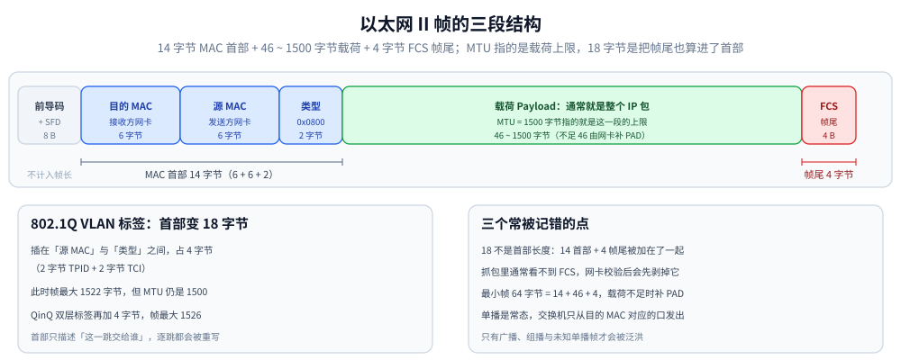
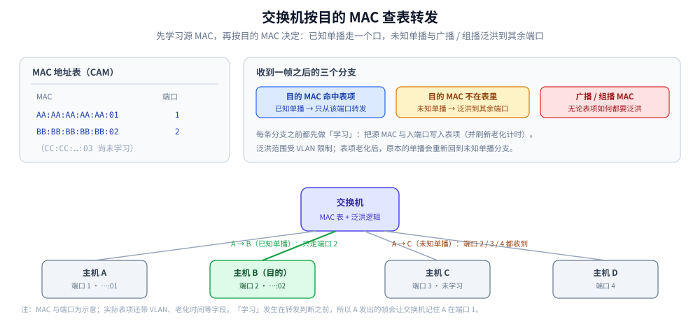

# 以太网与二层转发

> 覆盖：实体层到数据链路层的交接、以太网帧的三段结构、MAC 地址的构成与「唯一性」的真实边界、单播 / 组播 / 广播的投递语义，以及交换机如何学习 MAC 表、何时泛洪、VLAN 如何切分广播域。
>
> 不覆盖：IP 地址、路由表与 ARP / NDP 的解析细节见 [IP与路由基础.md](../网络层与寻址/IP与路由基础.md)；逐跳改写与端到端链路见 [网络通信链路详解.md](../网络通信链路详解.md)；分层总览与逐层封装见 [网络分层与数据包旅程.md](../网络分层与数据包旅程.md)；抓帧操作见 [抓包实战.md](../观测与排障/抓包实战.md)。
>
> 内容整理自个人学习笔记，素材见 [素材清单](../../../素材清单.md)。
>
> ⚠️ 实测口径：帧结构、MAC 表与泛洪行为按 IEEE 802.3 / 802.1Q 与主流交换机实现说明整理，**本机未做二层抓帧实测**；文中的 MTU 与 MAC 读数来自 [网络分层与数据包旅程.md](../网络分层与数据包旅程.md) 第十节的容器实测（只读 `/sys/class/net/*/mtu` 与 `ip neigh`，不是抓包）。

---

## 一、实体层只负责传 0 和 1 吗？

电脑组网的第一件事是先把电脑连起来：光缆、电缆、双绞线、无线电波等。

**实体层（物理层）就是把电脑连接起来的物理手段**，它规定网络的电气特性、接口形状、传输速率与编码方式，作用是**传送 0 和 1 的电信号 / 光信号**。

单纯的 0 和 1 没有任何意义——必须规定解读方式：多少个信号算一组、组的边界在哪里、每一组代表什么意思。这就是数据链路层要解决的问题。

> 分层是**概念模型**，不是实现清单：网卡（NIC）同时承担物理层成帧与链路层的一部分职责；交换机是典型的二层设备，但它也可能做三层转发（三层交换机）。

---

## 二、以太网帧长什么样？

早期每家公司都有自己的分组方式，逐渐地**以太网（Ethernet，IEEE 802.3）**占据主导。以太网把一组电信号组织成一个**帧（Frame）**，每帧分成三段：

| 部分 | 内容 | 长度 |
| --- | --- | --- |
| **MAC 首部** | 目的 MAC(6) + 源 MAC(6) + 类型 / 长度(2) | **14 字节**（无 VLAN 标签时） |
| **载荷**（Payload） | 上层交下来的数据，通常是整个 IP 包 | **46 ~ 1500 字节** |
| **FCS / 帧尾** | 32 位 CRC 校验（Frame Check Sequence） | **4 字节** |



怎么读这张图：**帧的首部和帧尾分居两端**，中间是可变的载荷。绿色那一段就是 **MTU 说的那 1500 字节上限**——上限说的是载荷，不是整帧；红色那段 FCS 只做 CRC 校验，**抓包里通常看不到它**（网卡校验后会先剥掉）。左侧 8 字节前导码与 SFD 属于物理层成帧，**不计入帧长**，所以「帧最小 64 字节」= 14 + 46 + 4。

### 2.1 三个最容易记错的点

1. **别把 FCS 混进「标头」**：常说的「以太网标头 18 字节」是把 14 字节首部和 4 字节 FCS 加在一起了。首部与帧尾是**帧的两端**，且抓包时 FCS 通常看不到——网卡与驱动会在把帧交给协议栈前先校验并剥掉它（Wireshark 只在特定抓包方式下才显示）。
2. **MTU 说的是「载荷上限」**：以太网的 **MTU = 1500 字节**指载荷上限，不是帧长上限。所以「帧最大 1518 字节」= 14 + 1500 + 4（不含前导码），「帧最小 64 字节」= 14 + 46 + 4（载荷不足 46 时由网卡补 PAD）。
3. **VLAN 标签会增加首部长度**：插入 802.1Q 标签后首部变成 18 字节（多 4 字节 TPID + TCI），此时帧最大 1522 字节；但 **MTU 仍然是 1500**，可传的载荷没变多。QinQ（双层标签）再加 4 字节。

### 2.2 类型字段决定了载荷交给谁

接收方靠首部里的 **EtherType** 判断载荷是什么协议：

| EtherType | 载荷 |
| --- | --- |
| `0x0800` | IPv4 |
| `0x86DD` | IPv6 |
| `0x0806` | ARP |
| `0x8100` | 802.1Q VLAN 标签（后面再跟真正的 EtherType） |

> 这就是「下层不知道上层在干什么」的实现方式：网卡只按 EtherType 把载荷交给对应的上层协议，不解析 IP 头，更不解析 TCP 端口。

---

## 三、MAC 地址为什么不是设备的唯一身份证？

以太网用 **MAC 地址**标识连入链路的网卡。MAC 地址长 **48 位**，通常写成 **12 个十六进制数**（如 `42:03:d3:78:7c:51`）：

```text
42:03:d3:78:7c:51
└──── OUI ────┘└─ 厂商分配 ─┘
   24 位          24 位
```

- 高 **24 位**是 **OUI**（Organizationally Unique Identifier，厂商编号），由 IEEE 分配；
- 低 24 位由厂商自行分配流水号。

⚠️ **「全世界独一无二」要加限定条件**：**由 IEEE 按 OUI 规则分配的全球管理地址**通常唯一；但设备完全可以使用**本地管理地址**（首字节的 U/L 位置 1，即首字节倒数第二位为 1，如虚拟机、容器、网桥虚拟接口）或**随机化地址**（手机的 Wi-Fi 隐私功能会按网络生成并轮换 MAC）。所以「靠 MAC 唯一标识一台设备」在今天的终端侧并不成立。

> 容器实测里，本机、对端容器与网关的三个 MAC（`d2:79:06:21:ab:1a`、`b2:af:a6:d2:5f:6d`、`4e:30:f4:8a:4d:51`）首字节最低第二位都是 1，全部是本地管理地址——见 [网络分层与数据包旅程.md](../网络分层与数据包旅程.md) 10.1。

### 3.1 特殊 MAC 地址

| 地址 | 含义 |
| --- | --- |
| `FF:FF:FF:FF:FF:FF` | 广播地址，本广播域内所有网卡都收 |
| `01:00:5E:xx:xx:xx` | IPv4 组播映射到以太网组播（低 23 位有效） |
| `33:33:xx:xx:xx:xx` | IPv6 组播映射到以太网组播（低 32 位有效） |
| `00:00:00:00:00:00` | 某些场景下的「未指定」或探测用，不是可投递地址 |

> ⚠️ 组播 MAC 的映射**不是一一对应**：IPv4 组播有 28 位组地址，但以太网只映射低 23 位，所以不同组播组可能映射到同一个 MAC，需要网卡再把帧交给 IP 层按组地址过滤。

---

## 四、帧怎么送到接收方？

有了地址还不够，还得解决两个问题：

1. **怎么知道对方的 MAC 地址？** → IPv4 用 **ARP**、IPv6 用 **NDP**，机制见 [IP与路由基础.md](../网络层与寻址/IP与路由基础.md)；
2. **帧怎么送到接收方？** → 以太网有**三种投递方式**。

| 投递方式 | 目的 MAC | 谁收下 | 常见用途 |
| --- | --- | --- | --- |
| **单播**（unicast） | 某个具体网卡 | 只有那块网卡 | ⭐ **常态**：绝大多数业务数据都是单播 |
| **广播**（broadcast） | `FF:FF:FF:FF:FF:FF` | **本广播域内所有**设备都收 | ARP 请求、DHCP Discover、早期局域网协议 |
| **组播**（multicast） | `01:00:5e:…`（IPv4）/ `33:33:…`（IPv6） | 加入该组的主机 | IPv6 的 NDP、路由协议、视频分发 |

⭐ **「以太网向本网络内所有计算机发送」只描述了广播这一种情形**，不能当成本层的一般投递机制。单播帧只有在**目的 MAC 未知**时才会被交换机特殊处理（见下一节）。

---

## 五、交换机怎么转发一个帧？

交换机不是「向所有口转发」。它维护一张 **MAC 地址表**（也叫 CAM 表 / 转发表），记录 **MAC ↔ 出端口**，并按下面的流程处理每个入站帧：

```text
收到帧
  │
  ├─ 学习：把「源 MAC ↔ 入端口」写进 MAC 表（刷新老化计时）
  │
  ├─ 目的 MAC 是广播 / 组播？
  │     └─ 是 → 从其余所有端口泛洪（flooding）
  │
  └─ 目的 MAC 是单播
        ├─ 表里有 → 只从对应端口转发（forward）
        └─ 表里没有 → 从其余所有端口泛洪（unknown unicast flooding）
```



三个必须记住的边界：

- **MAC 表是「学习」来的，不是配置的**：源 MAC 一定可信吗？不——攻击者可以伪造源 MAC 把表项指向错误端口（MAC 泛洪 / 表项污染），这正是端口安全（port security）要解决的问题；
- **表项会老化**：默认通常为 300 秒量级，设备换口或迁移后会短暂回到泛洪状态；
- **泛洪只在本 VLAN / 广播域内**：VLAN 是泛洪范围的边界（见第六节）。

> 集线器（Hub）与交换机的区别就在这里：Hub 是物理层设备，任何帧都向所有口重发；交换机是链路层设备，靠 MAC 表做**选择性转发**。现代网络里 Hub 基本绝迹。

---

## 六、VLAN 如何切分广播域？

一个纯二层网络就是一个**广播域**：广播帧会到达域内所有端口。广播域越大，广播与未知单播带来的无效流量越多，ARP 欺骗等二层攻击的影响面也越大。

**VLAN（IEEE 802.1Q）** 在以太网帧里插入 4 字节标签，把一台物理交换机切成多个逻辑广播域：

| 字段 | 长度 | 作用 |
| --- | --- | --- |
| TPID | 2 字节 | 固定 `0x8100`，标识这是 802.1Q 标签 |
| Priority（PCP） | 3 位 | 二层优先级，用于 QoS |
| DEI | 1 位 | 丢弃 eligible 指示 |
| **VID** | **12 位** | VLAN ID，**有效范围 1~4094**（0 与 4095 保留） |

两条链路类型：

| 端口类型 | 行为 |
| --- | --- |
| **Access** | 属于一个 VLAN；收帧时打上该 VLAN 标签，发帧时剥掉标签，终端无感知 |
| **Trunk** | 承载多个 VLAN；帧在链路上带标签传输（native VLAN 例外），用于交换机之间互联 |

⚠️ **VLAN 只解决二层隔离，不解决安全**：跨 VLAN 的访问控制要靠三层 ACL / 防火墙；VLAN hopping（双重标签、交换机欺骗）是配置不当时真实存在的攻击面。

---

## 七、应用场景

**本节要点**：二层是所有上层流量的物理落点——虚拟化、容器、交换机与抓包都绕不开帧与 MAC。

| 场景 | 涉及哪一块 | 为什么值得注意 |
|---|---|---|
| 容器网络（veth / bridge） | 帧结构、MAC、泛洪 | veth 对与网桥就是软件实现的二层转发，详见 [网络与存储.md](../../../06-工程实践/部署/docker/网络与存储.md) |
| 同网段直连判断 | 目的 MAC 是对方还是网关 | 跨网段时帧的目的 MAC 是网关，详见 本篇第四节与 [IP与路由基础.md](../网络层与寻址/IP与路由基础.md) |
| 抓包时看不到 FCS | 帧尾与网卡卸载 | 网卡校验后剥掉 FCS，抓包看到的是去掉帧尾的帧，详见 [抓包实战.md](../观测与排障/抓包实战.md) |
| 虚拟机的 MAC 冲突 | 本地管理地址 | 克隆虚拟机可能复制 MAC，需重新生成，详见 本篇第三节 |
| 大二层 / 多租户隔离 | VLAN 与广播域 | VLAN 只有 12 位，规模大时要用 VXLAN 等叠加方案 |
| 交换机选型与排障 | MAC 表与泛洪 | 「未知单播泛洪」会放大广播域内的流量 |

## 八、具体使用

**本节要点**：二层信息在 Linux 与 Windows 上都能直接读到；命令只做查看，不改配置。

```bash
# 1) 看接口的 MAC 与 MTU（Linux）
ip -o link show eth0
cat /sys/class/net/eth0/mtu

# 2) 看邻居表：下一跳的 IP ↔ MAC（IPv4 是 ARP，IPv6 是 NDP）
ip neigh show
ip -6 neigh show

# 3) 抓帧并显示以太网首部（-e 打印源/目的 MAC 与 EtherType）
sudo tcpdump -i eth0 -nn -e -c 10

# 4) 只看 ARP（广播请求与单播应答）
sudo tcpdump -i eth0 -nn 'arp'

# 5) 看 VLAN 标签（需要网卡与抓包点支持）
sudo tcpdump -i eth0 -nn -e 'vlan'

# 6) 桥接与 veth 拓扑（容器 / 虚拟机场景）
ip -d link show type bridge
bridge link show
```

```powershell
# Windows 对应命令
getmac /v
arp -a
Get-NetAdapter | Format-Table Name, MacAddress, LinkSpeed, MtuSize
```

⭐ 读法：`ip -o link show` 里 `link/ether` 后面就是 MAC；如果首字节的倒数第二位是 1（如 `d2`、`b2`、`4e`），说明它是本地管理地址，常见于容器与虚拟接口，**不要拿它当「物理设备唯一标识」**。

---

## 延伸追问

- **为什么帧最小是 64 字节？** → 早期共享式以太网用 CSMA/CD 检测冲突，必须保证发送方在帧发完前能听到最远端的冲突信号；64 字节是 10 Mbps 下往返传播时延对应的下限。载荷不足 46 字节时由网卡补 PAD。现代全双工交换网络已不需要 CSMA/CD，但最小帧长作为兼容规则保留了下来。
- **交换机收到未知单播会怎样？** → 泛洪到同 VLAN 的其余所有端口；等目的端回帧后，交换机学习到它的 MAC ↔ 端口，后续单播就只走一个端口。这就是「第一次通信会短暂泛洪」的原因。
- **MAC 地址能跨网段使用吗？** → 不能作为端到端标识。MAC 只在**同一链路 / 广播域**内用于下一跳投递；跨网段时发送方填的是**网关的 MAC**，每经过一个路由器就重写一次。端到端标识是 IP。
- **VLAN 标签会被终端看到吗？** → Access 端口发往终端的帧通常已剥掉标签，终端无感知；Trunk 链路上才带标签。抓包能否看到标签取决于抓包点是否在 Trunk 上，以及网卡是否把标签交给了协议栈。
- **为什么抓不到 FCS？** → 网卡在接收时先校验 CRC，确认无误后把 FCS 剥掉再交给驱动；只有支持并开启了「保留 FCS」的抓包方式（如部分网卡的 monitor 模式）才能看到。抓包里看到的最大帧长因此通常比 1518 少 4 字节。
- **二层攻击有哪些？** → 典型的有 ARP 欺骗（伪造 IP ↔ MAC 映射）、MAC 泛洪（打满转发表迫使交换机泛洪）、DHCP 仿冒、VLAN hopping。防御手段包括端口安全、DHCP Snooping、动态 ARP 检测（DAI）与静态绑定，细节见 [IP与路由基础.md](../网络层与寻址/IP与路由基础.md) 第六节。

---

## 关联

- **上游/总纲**：[网络分层与数据包旅程.md](../网络分层与数据包旅程.md) — 五层模型与逐层封装，本篇是其中「链路层」的展开
- **下游机制**：[IP与路由基础.md](../网络层与寻址/IP与路由基础.md) — 网络层寻址、ARP / NDP、MTU 与分片
- **对照/互补**：[网络通信链路详解.md](../网络通信链路详解.md) — 每一跳如何重写 MAC、TTL 与 IP
- **下游机制**：[抓包实战.md](../观测与排障/抓包实战.md) — 抓帧时的过滤器与常见假象
- **下游机制**：[网络与存储.md](../../../06-工程实践/部署/docker/网络与存储.md) — veth / bridge 的软件二层实现
- **下游机制**：[04-防火墙与NAT.md](../../linux/鸟哥服务器架设篇/04-防火墙与NAT.md) — 二层隔离与三层过滤的边界

> 反向引用（本篇被下列文档引到）：[IPv6与双栈.md](../网络层与寻址/IPv6与双栈.md)
