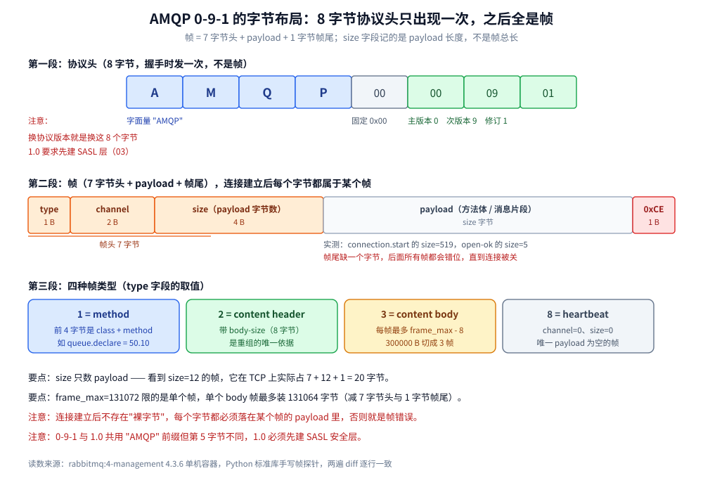
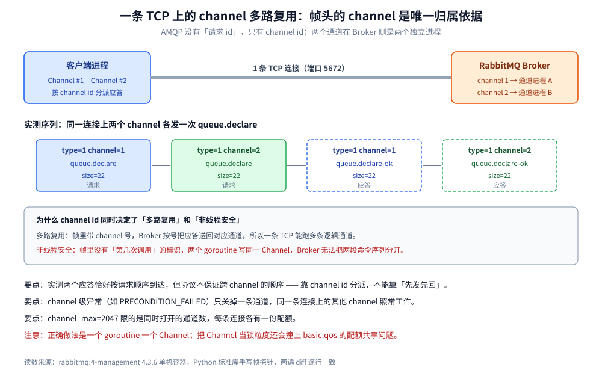
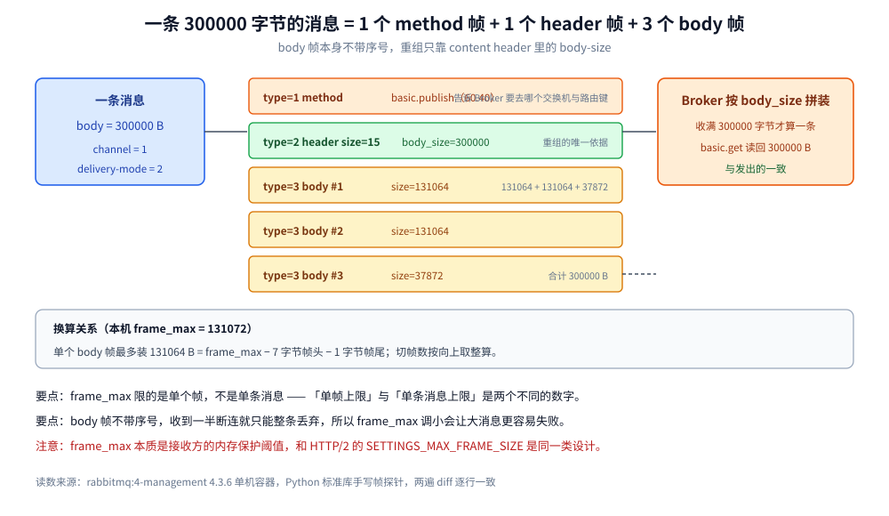

# AMQP

> 覆盖 AMQP 0-9-1 的三层结构（传输层帧 / 功能层 class-method / 内容层三段帧）、⭐ **一个帧的精确字节布局**（8 字节协议头 → 7 字节帧头 → payload → `0xCE`）、channel id 如何让一条 TCP 跑多路、大消息为什么被拆成多个 body 帧，以及 **0-9-1 与 1.0 为什么不是版本升级而是两套协议**。
>
> 不覆盖：RabbitMQ 把 Exchange/Queue/Binding 存成什么、怎么排障见 [README.md](../../../03-数据与中间件/中间件/消息队列/RabbitMQ/README.md)；六款 MQ 的模型差异见 [消息队列选型对比.md](../../../03-数据与中间件/中间件/消息队列/消息队列选型对比.md)；帧落到磁盘与投递队列的过程见 [存储与投递过程.md](../../../03-数据与中间件/中间件/消息队列/RabbitMQ/存储与投递过程.md)。
>
> 内容整理自个人学习笔记；帧布局与 class/method 编号参考 AMQP 0-9-1 规范与 RabbitMQ 官方文档（4.x）。本篇**所有字节级读数**来自本机 `rabbitmq:4-management`（**4.3.6**）单机容器 `amqp-lab`，探针用 Python 标准库手写帧（不引客户端库，见第八节），连续两遍 `diff` 逐行一致。

---

## 一、AMQP 到底规定了什么？

**本节要点**：AMQP 0-9-1 规定的是**线上字节**和**语义名词**两层：前者让任意语言的客户端能连任意实现，后者让 Exchange / Queue / Binding 成为协议概念而不是 RabbitMQ 的产品概念。这是它和 Kafka / RocketMQ 自定协议的分水岭。

| 层面 | AMQP 0-9-1 规定了什么 | 换掉实现还成立吗 |
| --- | --- | --- |
| **传输层** | 8 字节协议头、7 字节帧头、四种帧类型、`0xCE` 帧尾 | ✅ 成立，是字节级互换的基础 |
| **功能层** | class / method 编号（`connection`=10、`channel`=20、`exchange`=40、`queue`=50、`basic`=60、`confirm`=85）与参数 | ✅ 成立，客户端按编号调方法 |
| **内容层** | 一条消息 = 1 个 method 帧 + 1 个 content header 帧 + N 个 content body 帧 | ✅ 成立 |
| **语义层** | Exchange / Queue / Binding / RoutingKey / vhost 的含义与路由规则 | ⚠️ 名词是标准的，但**实现可以只支持子集** |

> ⭐ 一句话记忆：**AMQP 让「路由」成为一个有名字的协议概念，于是客户端库和 Broker 可以互不认识地各自实现。**

**这带来什么实际差别？**

- **多实现可互通**：符合 0-9-1 的客户端能连 RabbitMQ、Qpid、支持 AMQP 的 ActiveMQ。Kafka 客户端只能连 Kafka 协议兼容的 Broker。
- **协议本身带路由语义**：`exchange.declare` / `queue.bind` 是协议方法，不是产品私有 API。所以「换 Broker 不改业务代码」在 AMQP 生态里是可能的——只要不用实现扩展（如 RabbitMQ 的 `x-queue-type`、`x-delayed-message`，这些都在 `arguments` 表里，属**扩展位**，换实现就没了）。
- **协议自带背压语义**：`basic.qos` 的 prefetch 是协议参数，见 [消费者与投递语义.md](../../../03-数据与中间件/中间件/消息队列/RabbitMQ/消费者与投递语义.md) 第二节。

> ⚠️ **别把 0-9-1 当成「RabbitMQ 的协议版本号」**：RabbitMQ 4.x 在 5672 上同时认 0-9-1 和 1.0，靠首 8 字节分流，见第五节。

## 二、一个 AMQP 帧的字节是怎么排的？

**本节要点**：连接建立后的每一个字节都属于某个帧。帧 = **7 字节头**（类型 1 + 通道 2 + 长度 4）+ **payload** + **1 字节 `0xCE`**。这个 `0xCE` 不是可选的结束标记，缺了就是协议错误。



| 部分 | 字节数 | 字段 | 实测值（本机 4.3.6） |
| --- | --- | --- | --- |
| 协议头 | 8 | `"AMQP"` + `0x00` + major + minor + revision | `41 4d 51 50 00 00 09 01` |
| 帧 · type | 1 | `1`=method、`2`=content header、`3`=content body、`8`=heartbeat | 见下表 |
| 帧 · channel | 2 | 大端无符号；`0` 只用于 connection 级方法 | `0` / `1` / `2` |
| 帧 · size | 4 | **payload 字节数**，不含 7 字节头与帧尾 | `519` / `12` / `131064` |
| 帧 · payload | size | 方法体或消息片段 | — |
| 帧 · frame-end | 1 | 固定 `0xCE` | `0xCE` |

**握手阶段实测的帧序列**（探针原样输出）：

```text
--- Broker 第一帧 connection.start
    type=1(method connection.start) channel=0  size=519   end=0xCE
--- Broker 回 connection.tune
    type=1(method connection.tune) channel=0  size=12    end=0xCE
  协商值: channel-max=2047 frame-max=131072 heartbeat=60
--- connection.open-ok
    type=1(method connection.open-ok) channel=0  size=5     end=0xCE
```

三个可直接核对的点：

- **`connection.start` 的 519 字节里绝大部分是服务端属性表**（产品名、版本、capabilities），真正必需的信息只有协议版本号。这也是它比 `open-ok`（5 字节）大两个数量级的原因。
- **协商值来自代理端**：`channel-max=2047`、`frame-max=131072`、`heartbeat=60` 是 Broker 在 `connection.tune` 里给的，客户端可以调小不能调大。
- **`size` 是 payload 长度，不是帧总长**：看到 `size=12` 的帧，它在 TCP 上实际占 `7+12+1=20` 字节。

**method 帧的 payload 前 4 字节固定是 class 与 method 编号**（各 2 字节大端）。`queue.declare-ok` 的 payload 是 22 字节，由于 `queue.declare` 的回应要带回队列名、消息数、消费者数，它比 `channel.open-ok`（8 字节）长得多——**同一个帧类型里，payload 长度完全由方法决定**。

## 三、channel id 是怎么让一条 TCP 跑多路的？

**本节要点**：AMQP 没有「请求 id」这个概念，它用的是 **channel id**。一条 TCP 上所有帧都带 channel 号，Broker 按 channel 号把帧送回对应的那个逻辑通道。这也直接决定了「同一个 Channel 不能被多个线程同时用」——换个线程写帧，Broker 分不清这段命令序列属于谁。



本机实测：在**同一条 TCP** 上开 channel 1 和 2，各发一个 `queue.declare`，两个应答各自回来。

```text
== B 两个 channel 交错 ==
    type=1(method channel.open-ok) channel=1  size=8     end=0xCE
    type=1(method channel.open-ok) channel=2  size=8     end=0xCE
  交错发 queue.declare：先 ch1 再 ch2，再依次读应答
    type=1(method queue.declare-ok) channel=1  size=22    end=0xCE
    type=1(method queue.declare-ok) channel=2  size=22    end=0xCE
```

读到的是「1 的应答在前、2 的应答在后」，**但这不是保证**。协议只保证「应答会带回你发请求时的那个 channel id」，不保证跨 channel 的到达顺序——两个 channel 在 Broker 侧是两个独立进程，谁先处理完谁先回。所以：

- **客户端要靠 channel id 做分派**，不能靠「先发的先回」。这正是所有 AMQP 客户端库内部都维护「每 channel 一个等待队列」的原因。
- **业务代码感知不到这一层**：库把 `declare` 变成了带返回值的同步调用。真出问题时（如 `PRECONDITION_FAILED`）你会看到「某个 channel 被关掉，其他 channel 照常」——**channel 级异常只废掉一条通道**，connection 不断。

> ⚠️ **这就是 Channel「非线程安全」的物理原因**：帧里只有 channel id，没有「是哪次调用」的标识。两个 goroutine 往同一 Channel 写帧，等于两段命令序列被交错写进同一条通道，Broker 无法把它们分开。`amqp091-go` 因此在 `Publish`/`Ack`/`Nack`/`Reject` 上加了互斥锁，但 `Declare` 这类「发完还要等应答」的调用走另一条路径，锁不在同一个作用域——所以**正确的做法仍然是一个 goroutine 一个 Channel**，具体取舍见 [核心概念与架构.md](../../../03-数据与中间件/中间件/消息队列/RabbitMQ/核心概念与架构.md) 第二节。

**`channel-max` 是 2047 意味着什么？** 它限的是**同时打开的通道数**，不是累计值。每条 Connection 各自有一份配额；一个进程通常一条 Connection + 少量 Channel 就够，把 Channel 当锁粒度反而会撞上 `basic.qos` 的配额共享问题。

## 四、大消息为什么要拆成多个 body 帧？

**本节要点**：`frame-max` 限的是**单个帧**，不是单条消息。一条消息的内容层由 1 个 content header 帧（声明 `body-size`）+ N 个 content body 帧组成，Broker 按 `body-size` 拼装。所以「RabbitMQ 单条消息上限」和「单帧上限」是两个完全不同的数字。



本机实测：`frame-max=131072`，发一条 300000 字节的消息。

```text
== E 一条 300000 字节的消息被切成几个 body 帧 ==
  frame-max=131072，单个 body 帧最多装 131064 字节，故切成 3 帧
  已发出 1 个 method 帧 + 1 个 header 帧 + 3 个 body 帧
    type=1(method basic.ack      ) channel=1  size=13    end=0xCE
    type=1(method 60.71          ) channel=1  size=28    end=0xCE
    type=2(header                ) channel=1  size=15    end=0xCE  [class=60 body_size=300000]
    type=3(body                  ) channel=1  size=131064 end=0xCE
    type=3(body                  ) channel=1  size=131064 end=0xCE
    type=3(body                  ) channel=1  size=37872 end=0xCE
  basic.get 读回 300000 字节，与发出的一致: True
```

四个必须记住的换算：

| 量 | 值 | 怎么来的 |
| --- | --- | --- |
| 单个 body 帧最多装的字节 | **131064** | `frame_max` 131072 − 7 字节帧头 − 1 字节帧尾 |
| 300000 字节切成几帧 | **3**（131064 + 131064 + 37872） | 向上取整 |
| content header 帧的 payload | **15** 字节 | class-id 2 + weight 2 + body-size 8 + flags 2 + 1 个属性（`delivery-mode` 1 字节） |
| `basic.ack` 的 payload | **13** 字节 | class/method 4 + delivery-tag 8 + multiple 1 |

> ⭐ **`body-size` 是唯一的重组依据**：body 帧本身不带序号，Broker 和客户端都靠「已收字节数 vs `body-size`」判断这条消息收完没有。收到一半就断连，要么整条丢弃，要么按「未完成消息」处理——这也是 `frame_max` 调小会让大消息更容易失败的物理原因。

**既然要拆帧，为什么还要限制单帧大小？** 因为接收方要按 `size` 预分配缓冲。没有上限的话，一个 `size=2GB` 的恶意帧就能让对端直接 OOM。`frame_max` 本质是一个**内存保护阈值**，和 HTTP/2 的 `SETTINGS_MAX_FRAME_SIZE` 是同一类设计。

## 五、AMQP 0-9-1 和 1.0 为什么不是「版本升级」？

**本节要点**：0-9-1 和 1.0 是**两套不兼容的协议**，共用 `AMQP` 四个字母开头的协议头，但首 8 字节的第 5 位不同：0-9-1 是 `00`，1.0 要求先建 SASL 安全层（`03`）。RabbitMQ 4.x 在 5672 上**两个都认**，靠首 8 字节分流。

本机实测：分别用两种协议头打同一个端口。

```text
== D 换一个版本的协议头打进去 ==
  发出 b'AMQP\x00\x01\x00\x00' — protocol id 0（AMQP 1.0 裸协议）
    收到 8 字节，是 Broker 回显的协议头: 414d515003010000（依旧是 8 字节握手头，不是帧）
  发出 b'AMQP\x03\x01\x00\x00' — protocol id 3（AMQP 1.0 的 SASL 层）
    收到 8 字节，是 Broker 回显的协议头: 414d515003010000（依旧是 8 字节握手头，不是帧）
```

两次都回显 `41 4d 51 50 03 01 00 00`，即 Broker 在说「1.0 要先走 `03` 这一层」。Broker 日志把这条规则写得更直白：

```text
closing AMQP 1.0 connection (duration: '0ms'):
  RabbitMQ requires SASL security layer
  (expected protocol ID 3, but client sent protocol ID 0)
```

| 维度 | AMQP 0-9-1 | AMQP 1.0 |
| --- | --- | --- |
| 协议头 | `AMQP 00 00 09 01` | `AMQP 03 01 00 00`（SASL 层） |
| 数据模型 | Exchange / Queue / Binding 是**协议概念** | 只有 link / session / connection，**拓扑由客户端约定** |
| 路由 | Broker 端按绑定表匹配 | 发送端直接指定 `target` 地址，Broker 只做转发 |
| 类型系统 | field table（RabbitMQ 扩展较多） | 强类型 type system |
| 谁在用 | RabbitMQ、Qpid、老 ActiveMQ | Azure Service Bus、Qpid Proton、RabbitMQ（插件） |
| 迁移成本 | — | ⚠️ **不能靠换端口号迁移**，拓扑抽象方式不同 |

> ⚠️ **别指望「把客户端升到 1.0 就完事」**：0-9-1 的 Exchange 模型在 1.0 里没有对应物（1.0 的 `target` 是地址字符串，语义由对端解释）。从 0-9-1 迁到 1.0，等价于重写路由层。

## 六、协议层还规定了哪些「不是产品特性」的东西？

**本节要点**：`bits` 打包、field table 的类型标签、`no-wait` 语义，都是 0-9-1 的硬规定。它们看着琐碎，但决定了「为什么某个参数改一个字就报帧错误」。

**① `bit` 字段是打包进一个字节的**。`queue.declare` 的五个布尔参数共用一个字节，低位在前：

| 位 | 参数 | 置 1 的后果 |
| --- | --- | --- |
| 0 | `passive` | 只检查队列存在，不创建；不存在则 `NOT_FOUND` |
| 1 | `durable` | 持久队列 |
| 2 | `exclusive` | 独占，连接断开即删除 |
| 3 | `auto-delete` | 最后一个消费者退出后删除 |
| 4 | `no-wait` | ⭐ **Broker 不回 `declare-ok`** |

> ⚠️ 本机踩到的坑：把 `no-wait` 置成 1 后 `declare` 永不返回，探针一直阻塞到超时。协议上这叫「客户端声明不需要应答」，它**不是错误**，只是没有回包——这类静默行为是手工拼帧时最容易掉的坑。

**② `no-wait` 是逐方法独立的**。`confirm.select` 也有 `no-wait` 位，但它的参数里**必须**有这一个字节；完全不给字节会得到 `frame_error: cannot decode <<>>`——同样是本机实测（漏掉这个 bit 后连接被直接判为帧错误）。

**③ field table 的值带类型标签**。`x-dead-letter-exchange`、`x-queue-type` 这些 `arguments` 都是 table，编码是「长度 + 若干 `key + 类型字符 + 值`」，`S` 表示 long string。这就是为什么 RabbitMQ 的扩展参数在**其他 AMQP 实现上会失效**——类型对得上，但 key 是产品私有的。

**④ 心跳帧是唯一 payload 为空的帧**。`type=8`、`channel=0`、`size=0`，实测发出去之后同一条连接上的其他 channel 不受影响。

## 七、应用场景

| 场合 | 为什么必须看协议层 | 看哪一节 |
| --- | --- | --- |
| 自研或移植 AMQP 客户端（嵌入式、小众语言） | 没有现成库时只能照规范拼帧，帧头/帧尾、`bit` 打包、`no-wait` 全要自己实现 | 第二、六节 |
| 抓包定位「消息到底发出去没有」 | Wireshark 按 `amqp` 解析，能看到 method 帧与 body 帧；看不到帧就只能看应用日志 | 第二、四节 |
| 评估「换 Broker 要不要改代码」 | 用到 `x-` 开头的 `arguments` 就是产品扩展，不属协议 | 第一节 |
| 网关 / 代理层做 AMQP 健康检查 | 健康检查发的是 `connection.start` 之后的一小段握手，不理解帧头就会把「正常拒绝」当成故障 | 第二、五节 |
| 排查「大消息偶发发送失败」 | `frame_max` 与 `body-size` 的关系决定了几次写能被凑成一条消息 | 第四节 |
| 从 0-9-1 迁到 1.0（或反向） | 两套协议的路由抽象不同，不是版本升级 | 第五节 |

## 八、具体使用

### 8.1 用 Python 标准库手工发一帧（不依赖任何 AMQP 库）

拼帧只有三件事：写 7 字节头、写 payload、写 `0xCE`。

```python
import socket, struct

def shortstr(s):                    # 1 字节长度 + UTF-8
    b = s.encode()
    return struct.pack(">B", len(b)) + b

def longstr(b):
    return struct.pack(">I", len(b)) + b

def table(pairs):                   # field table：长度 + (key + 'S' + longstr) ...
    body = b""
    for k, v in pairs:
        body += shortstr(k) + b"S" + longstr(v)
    return struct.pack(">I", len(body)) + body

def frame(ftype, chan, payload):    # ⭐ 7 字节头 + payload + 0xCE
    return struct.pack(">BHI", ftype, chan, len(payload)) + payload + b"\xce"

def method(cls, mth, args=b""):     # method 帧的 payload 前 4 字节是 class + method
    return struct.pack(">HH", cls, mth) + args

s = socket.create_connection(("127.0.0.1", 5672), timeout=5)
s.sendall(b"AMQP\x00\x00\x09\x01")          # ① 8 字节协议头，只发一次
start = s.recv(65536)                        # ② Broker 回 connection.start
s.sendall(frame(1, 0, method(10, 11,         # ③ connection.start-ok：SASL PLAIN
    table([("product", b"probe")]) +
    shortstr("PLAIN") + longstr(b"\x00user\x00pass") + shortstr("en_US"))))
tune = s.recv(65536)                         # ④ connection.tune：拿到协商值
```

读帧时要严格校验帧尾，否则「上一个帧少读了 1 字节」会一路错位：

```python
def read_frame(sock, buf=b""):
    while len(buf) < 7:
        buf += sock.recv(65536)
    ftype, chan, size = struct.unpack(">BHI", buf[:7])
    while len(buf) < 7 + size + 1:
        buf += sock.recv(65536)
    assert buf[7 + size] == 0xCE, "帧尾不是 0xCE，说明读取已经错位"
    return ftype, chan, buf[7:7 + size], buf[7 + size + 1:]
```

### 8.2 用 Wireshark 看帧

```bash
# 只抓 AMQP 端口
tcpdump -i any -w amqp.pcap port 5672     # 本机无 tcpdump 时用容器内抓

# Wireshark 显示过滤：只看方法帧里的 queue.declare
amqp.method.class_id == 50 && amqp.method.method_id == 10

# 只看有 body 的消息帧
amqp.type == 3
```

> ⚠️ 抓包看到的是**分帧后的样子**：一条大消息在列表里会是「method + header + 若干 body」，靠 `amqp.header.body_size` 判断这条消息一共有多少字节，而不是数 body 帧个数。

### 8.3 用 Broker 侧读数反推协商值

```bash
# 当前连接实际协商出的 channel_max / frame_max / heartbeat
rabbitmqctl list_connections name channels frame_max channel_max timeout

# Broker 的默认值（客户端没改时就是它）
rabbitmq-diagnostics environment | grep -E "channel_max|frame_max|heartbeat"
```

后者本机实测输出 `channel_max=2047`、`frame_max=131072`、`heartbeat=60`，与第二节探针从 `connection.tune` 里读到的完全一致——**协议协商值可以从两端各自核对**，这对排查「客户端和服务端对不上」很关键。

## 延伸追问

- **AMQP 0-9-1 里的 `0xCE` 为什么用这个值？** 它是 `0xCE` = 206，选它是因为在当时的帧内容里不容易自然出现，降低「误把 payload 当帧尾」的概率。校验帧尾比校验帧头更重要：**帧头错会导致长度错，长度错会吃掉后面的帧，一路错到连接被关**。
- **`size` 能超过 `frame_max` 吗？** 不能。收到 `size > frame_max - 8` 的帧直接判 `frame_error` 关连接。这也是为什么客户端发大消息时必须自己切 body 帧，而不是发一个大帧。
- **为什么 `connection.start` 有 519 字节，而 `tune` 只有 12 字节？** `start` 带服务端属性表（产品、版本、capabilities），是为了让客户端能做特性探测；`tune` 只有三个整数（`channel-max`、`frame-max`、`heartbeat`），因为该协商的就这三个。**协议里所有「表」都比「定长字段」重**，这是解析器实现时最容易踩的性能坑。
- **`channel-max=2047` 是 2 的 11 次方减 1，为什么不是 65535？** 因为 channel id 在帧头占 2 字节，但 0 号通道被 connection 级方法独占；2047 是 RabbitMQ 选的默认值（可以调大），选小是为了让每个连接的通道数组更省内存。真正的上限由 `frame_max` 与 Broker 内存共同约束。
- **手工拼帧和用客户端库，差在哪？** 客户端库帮你做了四件事：channel 号分配与请求-应答配对、`bit` 打包、field table 的编解码、心跳与重连。**只有当你需要解释「库里为什么这么做」时，才值得下到帧这一层**——日常开发用库，排障时看这一层。

## 关联

- **上游/总纲**：[消息队列选型对比.md](../../../03-数据与中间件/中间件/消息队列/消息队列选型对比.md) — AMQP 的 Exchange 模型在六款 MQ 里的位置
- **下游机制**：[README.md](../../../03-数据与中间件/中间件/消息队列/RabbitMQ/README.md) — RabbitMQ 对 0-9-1 的实现与扩展
- **下游机制**：[核心概念与架构.md](../../../03-数据与中间件/中间件/消息队列/RabbitMQ/核心概念与架构.md) — Connection / Channel / vhost 与「Channel 为什么非线程安全」
- **下游机制**：[存储与投递过程.md](../../../03-数据与中间件/中间件/消息队列/RabbitMQ/存储与投递过程.md) — 帧收完之后：消息怎么落盘、怎么被投递
- **对照/互补**：[README.md](../../../03-数据与中间件/中间件/消息队列/Kafka/README.md) — Kafka 的自定二进制协议：请求-应答带 correlation id，不靠 channel 号
- **对照/互补**：[README.md](../../../03-数据与中间件/中间件/消息队列/RocketMQ/README.md) — RocketMQ 的 Remoting 协议与「一个事件一个 Topic」的取舍
- **对照/互补**：[Nats.md](../../../03-数据与中间件/中间件/消息队列/Nats.md) — NATS 的文本协议（`PUB` / `SUB` 单行命令）：为什么它能用一个 telnet 就调通
