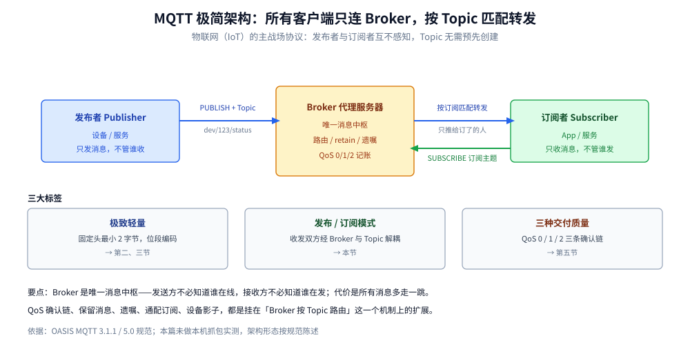
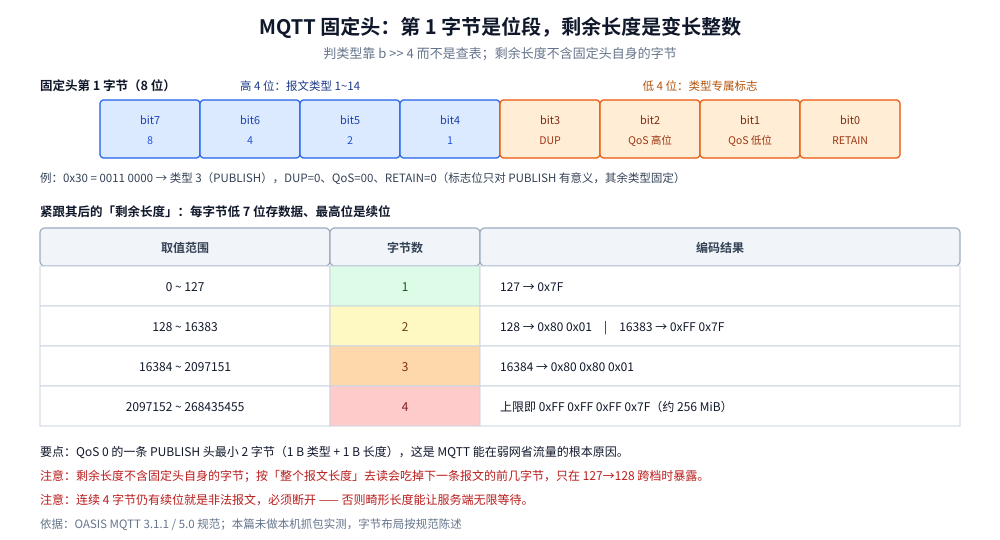
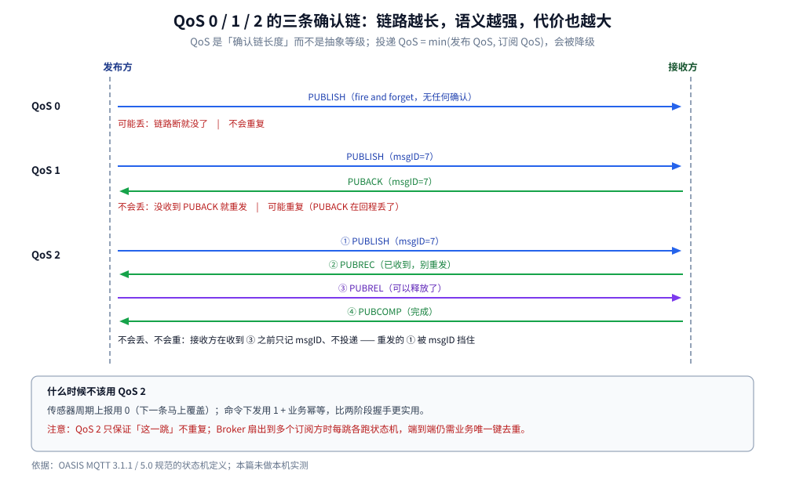
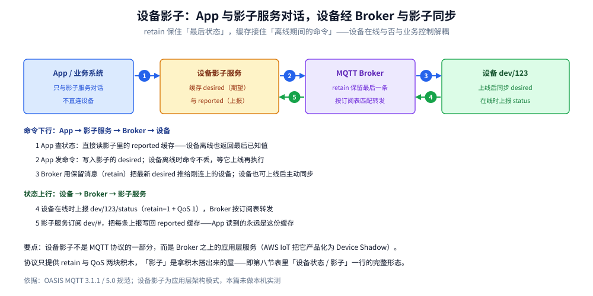

# MQTT

> 覆盖 ⭐ **MQTT 为什么能用「最小 2 字节」的固定头跑完整套语义**：Broker 与发布/订阅的宏观架构、固定头与**变长剩余长度**的编码规则、14 种报文类型的分工、QoS 0/1/2 的三条确认链与状态机、保留消息与遗嘱解决了什么、Topic 层级与通配符订阅的匹配规则、3.1.1 与 5.0 的实质差异，以及 IoT 侧最经典的架构延伸——设备影子。
>
> 不覆盖：四协议之间的横向对照（头开销 / 定界 / 多路复用 / 确认原语 / 路由 / 扩展）见 [消息协议族全景.md](消息协议族全景.md)；NATS 的纯文本协议见 [NATS协议.md](../../../03-数据与中间件/中间件/消息队列/NATS协议.md)；AMQP 的帧与 channel 多路复用见 [AMQP.md](AMQP.md)；STOMP 的文本帧见 [STOMP.md](STOMP.md)；应用层协议怎么选见 [通信选型.md](../../../02-计算机基础/网络/选型/通信选型.md)。
>
> 内容整理自个人学习笔记，帧布局与报文类型依据 OASIS MQTT 3.1.1 与 5.0 规范。⚠️ **实测口径：本篇未做本机实测**（本机无 MQTT Broker 容器，EMQX 镜像未能拉取成功），**所有字节布局按规范陈述，未逐字节抓包验证**；文中不引用任何第三方吞吐或延迟数字。「具体使用」节的命令是标准客户端用法，未在本机执行。

---

## 一、MQTT 是什么，为什么中间要隔一个 Broker？

**本节要点**：MQTT 是一个**为物联网（IoT）与弱网设备设计的发布/订阅协议**——它不是点对点协议，所有客户端都只连一个叫 **Broker（代理服务器）** 的中心节点，按**主题（Topic）**发布与订阅。先建立这张图，后面每一节都是在给它加细节。

**如果 HTTP 是「打电话查快递」，那 MQTT 就是「拉个微信群，谁有消息谁往群里喊一嗓子」。** HTTP 里请求方直接找到响应方，双方要同时在线；MQTT 里收发双方**互不认识、对方不在线也没关系**，全部只与 Broker 通信：

1. **发布者（Publisher）**：把消息发给 Broker，消息必须带一个主题，如 `dev/123/status`。它不需要知道有谁在听。
2. **订阅者（Subscriber）**：提前告诉 Broker「我关心哪些主题」，Broker 负责把匹配的消息推给它。它不需要知道消息是谁发的。



这张图要读出的核心：**Broker 是唯一的消息中枢，发布者与订阅者之间没有直连**。发送方不必关心谁在线，接收方也不必关心谁在发——这种解耦是 MQTT 能撑起百万级设备接入的前提，代价是所有消息都多走一跳转发。

三大标签，全部服务于同一个主战场——物联网（海量设备、弱网、按流量计费、随时掉线）：

| 标签 | 含义 | 本篇对应节 |
| --- | --- | --- |
| **极致轻量** | 固定头最小 2 字节，字段用位段编码掉 | 第二、三节 |
| **发布 / 订阅模式** | 收发双方经 Broker 与 Topic 解耦 | 本节 |
| **三种交付质量** | QoS 0 / 1 / 2 三条确认链 | 第五节 |

> ⭐ 后文的所有机制都挂在这张图上理解：固定头是「喊一嗓子的成本」，QoS 是「喊完怎么确认对方听见了」，保留消息与遗嘱是「Broker 代发的两种特殊消息」，通配订阅是「订阅时怎么一次圈定一类主题」，设备影子则是「在 Broker 之上再垫一层缓存」。

## 二、MQTT 为什么敢说自己「轻」？

**本节要点**：轻在**固定头只有 1 字节、整个头最小 2 字节**。一条 QoS 0 的 `PUBLISH` 带上 10 字节 topic 和 5 字节 payload，整个报文可以压在 20 字节以内——这是它能在 GPRS / NB-IoT 这类按流量计费的链路上活下来的原因。

对比同样是「消息协议」的另外几个，结论是 **MQTT 的头是四者里最小的**。头开销、定界方式、多路复用标识的完整横向矩阵（AMQP / MQTT / STOMP / XMPP / NATS 五列）已上收到族总纲，见 [消息协议族全景.md](消息协议族全景.md) 第四节——本篇只讲 MQTT 自己凭什么做到 2 字节。

> ⭐ **轻的本质是「头里没有冗余的字段名」**：STOMP / NATS 每个报文都要把 `PUB`、topic、长度这些名字和数字当字符发一遍，MQTT 用一个字节的位段把它们编码掉了。

## 三、固定头怎么编码剩余长度？

**本节要点**：固定头第 1 字节的高 4 位是**报文类型**、低 4 位是**类型专属标志**；紧接着的「剩余长度」是**变长整数**——每字节用低 7 位存数据、最高位表示「后面还有没有」。所以 127 字节以内只花 1 字节，最多 4 字节可表达 268435455（约 256 MiB）。



上图要读出的核心：**第 1 字节是一个位段而不是一个数字**——高 4 位是类型（1~14），低 4 位是标志（`PUBLISH` 用它存 QoS 与 retain，其余类型基本固定）。所以「读第一个字节判断类型」是 `b >> 4`，不是查表。

### 3.1 变长剩余长度的四档

| 剩余长度范围 | 编码字节数 | 例子 |
| --- | --- | --- |
| 0 ~ 127 | 1 | `127` → `0x7F` |
| 128 ~ 16383 | 2 | `128` → `0x80 0x01`；`16383` → `0xFF 0x7F` |
| 16384 ~ 2097151 | 3 | `16384` → `0x80 0x80 0x01` |
| 2097152 ~ 268435455 | 4 | 上限即 `0xFF 0xFF 0xFF 0x7F` |

编码规则（逐字节算）：

```text
do {
    digit = length % 128          // 取低 7 位
    length = length / 128
    if (length > 0) digit |= 0x80 // 还有后续字节，置续位
    写入 digit
} while (length > 0)
```

解码时反过来：读到续位为 0 的字节为止，每字节左移 7 位累加。

### 3.2 为什么不用定长 4 字节

因为**小报文占绝对多数**。IoT 场景里一条温度上报的 payload 常常只有 4~8 字节，定长 4 字节的长度字段会让头开销翻倍；而变长编码让 99% 的报文只多花 1 字节。代价是解码要循环——但这个循环最多 4 次，成本可以忽略。

> ⚠️ **实现上最容易错的一处**：把剩余长度当成「整个报文长度」。它**不含固定头自身的字节**（1 字节类型 + 1~4 字节长度）。按「整个长度」去读会把下一条报文的前几个字节吃掉，表现是「偶发解析错位」，而且只在剩余长度跨档（127 → 128）时出现，很难复现。

## 四、14 种报文类型各管什么？

**本节要点**：14 种类型按「连接 / 发布 / 订阅 / 确认」四类分工，**每一种都有一个明确的对端回执或不需要回执的说明**。记住四类比记住 14 个名字有用。

| # | 类型 | 方向 | 作用 | 有没有回执 |
| --- | --- | --- | --- | --- |
| 1 | `CONNECT` | C→S | 建连：ClientID、CleanSession、遗嘱、账号 | `CONNACK` |
| 2 | `CONNACK` | S→C | 接受或拒绝（返回码） | — |
| 3 | `PUBLISH` | 双向 | 发布消息（QoS 决定后续确认链） | 视 QoS |
| 4 | `PUBACK` | 双向 | QoS 1 的确认 | — |
| 5 | `PUBREC` | 双向 | QoS 2 第一步确认（已收到，别重发） | `PUBREL` |
| 6 | `PUBREL` | 双向 | QoS 2 第二步（可以释放了） | `PUBCOMP` |
| 7 | `PUBCOMP` | 双向 | QoS 2 完成 | — |
| 8 | `SUBSCRIBE` | C→S | 订阅（可带多个 topic + 各自 QoS） | `SUBACK` |
| 9 | `SUBACK` | S→C | 每个 topic 的授予 QoS（或失败码） | — |
| 10 | `UNSUBSCRIBE` | C→S | 取消订阅 | `UNSUBACK` |
| 11 | `UNSUBACK` | S→C | 取消订阅确认 | — |
| 12 | `PINGREQ` | C→S | 心跳 | `PINGRESP` |
| 13 | `PINGRESP` | S→C | 心跳应答 | — |
| 14 | `DISCONNECT` | 双向 | 正常断开 | 无（5.0 里可由服务端回原因） |
| 15 | 保留 | — | **协议禁止使用**，收到即断开 | — |

四类分工：

- **连接类**（1、2、12、13、14）：管**连接本身**，与业务无关。心跳是唯一「可以空 payload」的存在。
- **发布类**（3）：唯一承载业务数据的报文。
- **订阅类**（8~11）：管**谁关心哪些 topic**，不承载数据。
- **确认类**（4~7）：管**QoS 交付的记账**，也不承载业务数据。

> ⭐ 判据：**「这条报文会不会被落库？」** 只有 `PUBLISH`（以及开了 retain 的 `PUBLISH`）需要落库，其余 13 种都是连接与记账。这与 [协议设计.md](../../../04-架构与系统/系统设计/IM系统/协议设计.md) 第三节里「数据类 / 控制类 / 命令类」的划分是同一套思路。

## 五、QoS 0/1/2 的三条确认链

**本节要点**：QoS 不是「可靠等级」而是一个**确认链长度**：0 没有确认、1 是一次确认（可能重复）、2 是两次确认（用两阶段握手把重复也消掉）。**代价随链路长度线性上升，而 QoS 2 的收益只在「客户端会重发」这一种场景下体现。**



| QoS | 链路 | 语义 | 重复可能 | 丢失可能 |
| --- | --- | --- | --- | --- |
| **0** | `PUBLISH`（fire and forget） | 最多一次 | 不可能 | **可能**（链路断就没了） |
| **1** | `PUBLISH` → `PUBACK` | 至少一次 | **可能**（ACK 丢了就重发） | 不可能 |
| **2** | `PUBLISH` → `PUBREC` → `PUBREL` → `PUBCOMP` | 恰好一次 | 不可能 | 不可能 |

### 5.1 QoS 2 的两阶段握手在解决什么

QoS 1 的问题：发布方发完 `PUBLISH` 后等 `PUBACK`，**如果 `PUBACK` 在回程丢了**，发布方会重发 `PUBLISH`，接收方就收到两条。QoS 2 用两次握手把「我知道你收到了」和「你可以不用再发了」分开：

```text
发布方                         接收方
  PUBLISH (msgID=7)  ────────→  存下 msgID=7（标记为「已收到，未释放」）
  ←────────  PUBREC (msgID=7)
  PUBREL (msgID=7)   ────────→  可以释放了 → 投递给应用
  ←────────  PUBCOMP (msgID=7)
```

**关键点**：接收方在收到 `PUBREL` 之前**不投递**，只记录 msgID。所以即使 `PUBREC` 丢了导致发布方重发 `PUBLISH`，接收方看到 msgID=7 已在「已收到」集合里，直接再回一次 `PUBREC`，**不会重复投递**。

### 5.2 什么时候不该用 QoS 2

| 场景 | 建议 | 理由 |
| --- | --- | --- |
| 传感器周期上报（下一条马上就覆盖） | QoS 0 | 丢一条无感，省掉确认往返 |
| 命令下发（必须到，重复可被幂等吸收） | QoS 1 + 应用层幂等 | 两阶段握手换来的「协议层不重复」不如业务幂等实用 |
| 计费 / 扣款类事件 | QoS 2 + 存储去重 | 协议层保证 + 落库幂等，双保险 |

> ⚠️ **QoS 2 不等于端到端「恰好一次」**：它只保证**这一跳**（发布方 → Broker 或 Broker → 订阅方）不重复。Broker 内部转发到多个订阅方时，每一跳各自跑状态机。所以端到端去重仍然要靠业务层的唯一键。

### 5.3 订阅端的 QoS 会被「降级」

实际投递的 QoS 是 `min(发布时的 QoS, 订阅时申请的 QoS)`。发布方用 QoS 2、订阅方申请 QoS 0，这条消息到订阅方就是 QoS 0——**发布方的两阶段握手白做了**。这是排障时「为什么 QoS 设了 2 还是丢」的最常见原因。

## 六、保留消息、遗嘱与通配订阅

**本节要点**：这三件事各自解决一个**「新订阅者拿不到历史状态」**的问题——保留消息给「最新值」，遗嘱给「设备非正常掉线」这个事件，通配订阅让「一类 topic」能被一条订阅覆盖。

### 6.1 保留消息（retain）

`PUBLISH` 时置 retain 位，Broker 会**保存该 topic 的最后一条**；之后任何新订阅者订阅这个 topic，**立刻收到这条**（标志位仍是 retain=1，用于区分「历史」与「实时」）。

- **适用**：设备状态（`dev/123/status` 的最后一次上报）、配置下发（`cfg/123`）。
- **不适用**：事件流（会覆盖掉中间事件）。
- ⚠️ **清除保留消息的方法是「发一条空 payload 且 retain=1 的 PUBLISH」**，不是「不保留」。

### 6.2 遗嘱（Will）

`CONNECT` 时声明：如果连接**非正常断开**（心跳超时、TCP 断开而没有发 `DISCONNECT`），Broker 代发这条遗嘱消息。

- **适用**：设备离线通知（`dev/123/offline`）。
- ⚠️ **正常发 `DISCONNECT` 不会触发遗嘱**——这正是「正常下线」与「掉线」的区分手段。
- ⚠️ **遗嘱的延迟由 keepalive 决定**：`keepalive=60` 时，Broker 要等到 1.5 倍 keepalive（约 90 秒）没收到任何报文才判定掉线并发布遗嘱。**所以「离线通知」天生有分钟级延迟**，不能当实时告警用。

### 6.3 通配订阅的匹配规则

MQTT 的 Topic 是一个**以 `/` 分隔的层级字符串**（类似文件路径）：`dev/123/status` 分为 `dev`、`123`、`status` 三层，`home/floor1/living/temp` 分为四层。它**不需要预先创建**——发布到哪、订阅到哪都是在报文里临时声明的，Broker 手里只有一张「订阅过滤器 → 订阅者」的表，来一条消息就逐段比对。所谓「一层一层匹配」，比的就是订阅过滤器与消息 Topic 的同一层。

通配符只在订阅时使用，发布时不能带通配符：

| 通配符 | 匹配 | 例子 |
| --- | --- | --- |
| `+` | **恰好一层** | `dev/+/status` 匹配 `dev/123/status`，不匹配 `dev/123/x/status` |
| `#` | **本级及以下所有层**（必须是最后一段） | `dev/#` 匹配 `dev/123/status` 与 `dev/123` |
| 无通配 | 精确匹配 | `dev/123/status` |

> ⚠️ **`#` 必须独占最后一段**：`dev/#/status` 是非法订阅。而 `dev/+/+` 与 `dev/#` 的差别在于「是否匹配 `dev` 本身」——`#` 匹配零层，`+` 不匹配。
>
> ⚠️ **以 `$` 开头的主题是系统主题**（如 `$SYS/broker/uptime`）：规范把它们留给 Broker 自己，**通配订阅默认不匹配**——订 `#` 收不到 Broker 的运行指标，要显式订 `$SYS/#`。

## 七、3.1.1 与 5.0 差在哪？

**本节要点**：3.1.1 是「能用」的版本，5.0 加的是**可诊断性**（原因码）与**服务端可控的会话生命周期**。协议骨架（固定头、14 种类型、QoS 链）完全没变，所以两者可以共存于同一个 Broker。

| 维度 | 3.1.1 | 5.0 |
| --- | --- | --- |
| 失败原因 | `CONNACK` 一个字节返回码；`PUBACK` 无返回码 | **几乎所有确认报文都带原因码**（`PUBACK` 可以说明「无匹配订阅者」） |
| 报文体 | 纯 payload | 增加**属性（properties）**：会话过期、消息过期、订阅标识、内容类型 |
| 会话生命周期 | `CleanSession` 布尔值 | `CleanStart` + **`Session Expiry Interval`**（断开后保留多久） |
| 共享订阅 | 无 | **`$share/<group>/<topic>`** 负载均衡到组内一个订阅者 |
| 服务端主动断开 | 无专门报文 | `DISCONNECT` 可由服务端发，带原因码 |
| 请求/响应 | 要自己约定 topic | **`Response Topic` + `Correlation Data`** 属性 |

> ⭐ **升级判据**：如果排障时经常「不知道为什么没收到」，5.0 的原因码能省掉大量猜测；如果只是稳定上报，3.1.1 的生态更成熟、客户端更轻。

## 八、应用场景

| 场景 | QoS | 关键配置 |
| --- | --- | --- |
| **传感器周期上报** | 0 | 不做 retain，靠「下一条覆盖」 |
| **设备状态 / 影子** | 1 | **retain=1**，新订阅者立刻拿到当前值 |
| **设备离线通知** | 1 | 遗嘱 + 注意有 1.5 × keepalive 的延迟 |
| **命令下发** | 1 | 消费端幂等（QoS 2 也挡不住跨跳重复） |
| **多实例消费同一批任务** | 1 | 5.0 的 `$share/<group>/<topic>` 共享订阅 |
| **按主题层级的批量订阅** | — | `dev/+/status`（一层）vs `dev/#`（全部） |

### 8.1 经典架构：设备影子（Device Shadow）

IoT 工程里最常被追问的两个问题：**设备离线了，App 怎么查它的状态？命令发出去，怎么保证它上线后能收到？** 答案是：在 Broker 后端加一个「设备影子」服务。



- **App 查状态** → 读影子服务里的缓存，不直连设备。设备离线也返回最后已知状态。
- **App 发命令** → 写入影子的 `desired`（期望状态）。设备离线时命令不丢，等它上线再执行。
- **设备上线后** → 主动同步影子，或由 Broker 用**保留消息（retain）**把最新 `desired` 推给它（机制见 [6.1 节](#61-保留消息retain)）。
- **设备在线时** → 向 `dev/123/status` 上报状态（retain=1，QoS 1），影子服务订阅这些主题，把值写回 `reported`（上报状态）缓存。

这种架构把「设备在线与否」与「业务控制」解耦了，是 MQTT 应用的最核心模式——上表「设备状态 / 影子」一行的完整形态就是它。

> ⚠️ **设备影子不是 MQTT 协议的一部分**，而是 Broker 之上的应用层服务（AWS IoT 把它产品化为 Device Shadow）。协议只提供 retain 与 QoS 两块积木，「影子」是拿积木搭出来的屋。

本仓对应落地：[通信选型.md](../../../02-计算机基础/网络/选型/通信选型.md)（应用层协议怎么选）、[自定义协议设计.md](../应用层/自定义协议设计.md)（自研协议时 MQTT 提供了哪些可借鉴的定界与确认思路）。

## 九、具体使用

### 9.1 命令行验证（标准客户端，未在本机执行）

```bash
# 订阅：-v 打印 topic，-q 申请 QoS 1
mosquitto_sub -h broker.example.com -t 'dev/+/status' -q 1 -v

# 发布并设为保留消息（新订阅者会立刻收到）
mosquitto_pub -h broker.example.com -t 'dev/123/status' -m '{"online":true}' -q 1 -r

# 清除保留消息：发空 payload + retain
mosquitto_pub -h broker.example.com -t 'dev/123/status' -m '' -r -n
```

### 9.2 看剩余长度编码（手工核对规范）

```text
剩余长度 = 128 时的编码推导：
128 % 128 = 0        → digit = 0，128 / 128 = 1 > 0 → digit |= 0x80 → 0x80
1 % 128   = 1        → digit = 1，1 / 128 = 0     → 不再置位 → 0x01
结果：0x80 0x01  （2 字节）
```

> ⚠️ **解码时的边界**：连续读到 4 个字节且第 4 个仍有续位，就是非法报文，必须断开而不是继续读——否则恶意报文能让服务端无限等待。

### 9.3 排障时先看的三个数

```text
① keepalive 设了多少？  遗嘱与掉线检测都是 1.5 × keepalive，不是秒级
② 订阅端申请的 QoS？    投递 QoS = min(发布 QoS, 订阅 QoS)，可能被降级
③ CleanSession / CleanStart 是什么？
   CleanSession=true  → 断开即丢会话，离线消息不补
   CleanSession=false → 断线期间的消息在 Broker 排队，重连后补发
```

## 延伸追问

- **QoS 2 真的能做到「不重复」吗？** 在**一跳到一跳的范围内**能。Broker 转发给多个订阅者时，每一跳独立跑状态机；跨跳、跨 Broker 桥接都可能有重复。端到端去重必须靠业务唯一键。
- **为什么保留消息只保留「最后一条」？** 因为它的定位是「当前状态」而不是「事件历史」。要历史就该用消息队列（Kafka / RocketMQ），不是 MQTT。
- **没有影子服务，只用保留消息行不行？** 能覆盖「读最后状态」，但覆盖不了「离线期间的命令暂存」——retain 只保留最后一条，设备不在线时下发的命令会直接丢。要接住它，要么上影子服务，要么让订阅端 `CleanSession=false` 由 Broker 排队（代价是会话状态常驻 Broker，且只对 QoS > 0 的消息生效）。
- **遗嘱能当实时离线告警用吗？** 不能。Broker 要等 1.5 × keepalive 才判定掉线。要更快只能把 keepalive 调小，但代价是心跳流量与设备耗电上升。
- **MQTT 的 topic 和 Kafka 的 topic 是一回事吗？** 不是。MQTT 的 topic 是**订阅时的匹配路径**（含通配符，不预先创建），Kafka 的 topic 是**存储容器**（要先建，有分区）。这也是 MQTT 适合「海量设备动态主题」的原因。
- **共享订阅为什么在 5.0 才有？** 因为 3.1.1 的模型里同一 topic 的每个订阅者都能收到全量消息（fanout 语义），没法表达「组内只给一个」。`$share` 前缀用命名空间的方式把这个语义加了进来，不破坏老客户端的解析。

## 关联

- **上游/总纲**：[消息协议族全景.md](消息协议族全景.md) — 这一族的四个可变量（定界 / 确认 / 路由 / 演进）与八维横向矩阵；本篇是「变长整数定界」那一格的代表
- **上游/总纲**：[通信选型.md](../../../02-计算机基础/网络/选型/通信选型.md) — 应用层协议的七行对照，本协议在其中的定位
- **上游/总纲**：[README.md](../README.md) — 网络目录导读：消息协议这一类与 Web 栈应用层协议的分工
- **对照/互补**：[AMQP.md](AMQP.md) — 另一个二进制消息协议：AMQP 用 7 字节帧头 + channel 多路复用，MQTT 用 2 字节头 + 单连接单会话
- **对照/互补**：[STOMP.md](STOMP.md) — 文本帧协议，与 MQTT 的二进制位段是两条相反的路线
- **对照/互补**：[NATS协议.md](../../../03-数据与中间件/中间件/消息队列/NATS协议.md) — 纯文本命令 + 长度字段，最小命令 8 字节
- **对照/互补**：[XMPP.md](XMPP.md) — 同为消息协议但走 XML，可读性与开销的对照
- **下游机制**：[自定义协议设计.md](../应用层/自定义协议设计.md) — 自研协议时，MQTT 的「1 字节位段 + 变长长度」是最值得抄的定界方案
