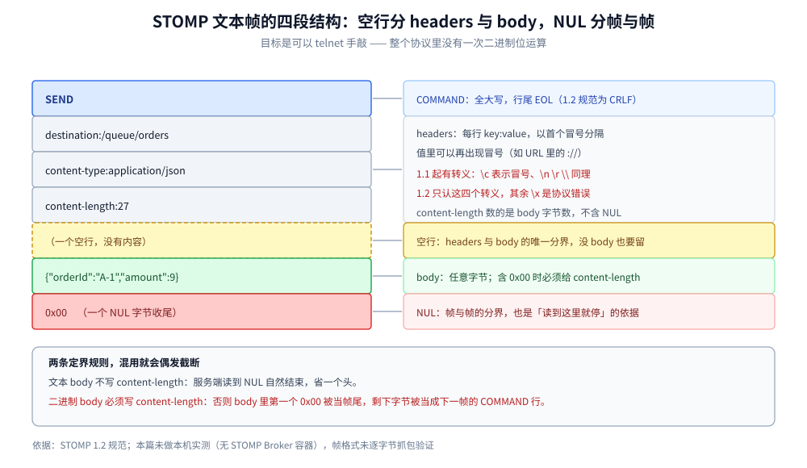

# STOMP

> 覆盖 ⭐ **STOMP 用纯文本帧怎么表达一个完整消息协议**：帧的四段结构（`COMMAND` + headers + 空行 + body + `NUL`）、13 种命令的分工、`content-length` 与 `NUL` 两种定界的取舍、事务与 `receipt` 的用法、心跳，以及 1.0 / 1.1 / 1.2 的实质差异。
>
> 不覆盖：AMQP 的二进制帧与 channel 多路复用见 [AMQP协议.md](AMQP协议.md)；MQTT 的位段式固定头见 [MQTT.md](MQTT.md)；NATS 的文本命令见 [NATS协议.md](../../../03-数据与中间件/中间件/消息队列/NATS协议.md)；ActiveMQ 的 Go（STOMP）/ Java（JMS）接入代码见 [ActiveMQ.md](../../../03-数据与中间件/中间件/消息队列/ActiveMQ.md)。
>
> 内容整理自个人学习笔记，帧结构依据 STOMP 1.2 规范。⚠️ **实测口径：本篇未做本机实测**（本机无 STOMP Broker 容器），帧格式按规范陈述、**未逐字节抓包验证**；文中不引用吞吐或延迟数字。「具体使用」节是可直接照抄的裸 TCP 交互，未在本机执行。

---

## 一、STOMP 的帧长什么样？

**本节要点**：STOMP 的帧是**四段纯文本**——第一行命令、若干行 `key:value` 头、**一个空行**、body，最后用 `NUL`（`0x00`）收尾。它的设计目标是「能用 telnet 手敲」，所以没有一条二进制位运算。



上图要读出的核心：**空行是 headers 与 body 的唯一分界**，而 `NUL` 是帧与帧的分界。这两处分界都不能省——少了空行，body 会被当成一个格式错误的 header；少了 `NUL`，服务端不知道帧到哪结束。

一个真实的 `SEND` 帧：

```text
SEND
destination:/queue/orders
content-type:application/json
content-length:27

{"orderId":"A-1","amount":9}
```

后面紧跟一个 `0x00`。注意 **`content-length` 是 27**，它数的是 body 的字节数（不含 `NUL`）。

### 1.1 三段各自的规则

| 段 | 规则 | 注意 |
| --- | --- | --- |
| **COMMAND** | 全大写命令名，行尾 `EOL` | 1.0/1.1 用 `\n`，1.2 要求 `\r\n`（但服务端应容忍 `\n`） |
| **headers** | 每行 `key:value`，**首个冒号**为分隔 | ⚠️ 值里可以再出现冒号（如 URL）；1.1+ 有转义规则 |
| **空行** | 单独一个 `EOL` | 没有 body 的帧也必须保留这个空行 |
| **body** | 任意字节（可以含 `NUL`，此时必须给 `content-length`） | 没有 `content-length` 时读到第一个 `NUL` 为止 |

### 1.2 头部转义（1.1 起）

1.1 引入了头值转义，因为「头里放 URL 或含换行的值」在 1.0 里无法表达：

| 转义 | 含义 |
| --- | --- |
| `\c` | 冒号 `:` |
| `\n` | 换行 |
| `\r` | 回车 |
| `\\` | 反斜杠 |

> ⚠️ **1.2 收紧了规则**：只有 `\c \n \r \\` 四个转义合法，其他 `\x` 序列是**协议错误**（1.1 允许原样保留）。跨版本实现时这是最常见的兼容坑。

## 二、13 种命令各管什么？

**本节要点**：STOMP 的命令分成**连接 / 消息 / 事务 / 确认**四组，与 MQTT 的 14 种类型是同一套分工思路，但 STOMP 多了一组「事务命令」（`BEGIN` / `COMMIT` / `ABORT`），这在 MQTT 里没有。

| 命令 | 方向 | 分组 | 作用 |
| --- | --- | --- | --- |
| `CONNECT` / `STOMP` | C→S | 连接 | 建连并协商版本（`accept-version`） |
| `CONNECTED` | S→C | 连接 | 建连成功，返回协商结果与会话 ID |
| `DISCONNECT` | 双向 | 连接 | 正常断开（可要求 `receipt`） |
| `SEND` | C→S | 消息 | 发一条消息到 `destination` |
| `SUBSCRIBE` | C→S | 消息 | 订阅 `destination`，必须带 `id` |
| `UNSUBSCRIBE` | C→S | 消息 | 取消订阅（按 `id`） |
| `MESSAGE` | S→C | 消息 | 投递一条消息给订阅者 |
| `ACK` / `NACK` | C→S | 确认 | 按 `ack` 头声明的模式确认 / 拒绝 |
| `BEGIN` / `COMMIT` / `ABORT` | C→S | 事务 | 开启 / 提交 / 回滚一个事务 |
| `RECEIPT` | S→C | 通用 | 服务端确认「某个客户端帧已处理」 |
| `ERROR` | S→C | 通用 | 服务端报错（带 `message` 头），通常会断开连接 |

四组的分工与 MQTT 的对应关系：

| STOMP 分组 | MQTT 的对应 | 差别 |
| --- | --- | --- |
| 连接 | `CONNECT` / `CONNACK` / `DISCONNECT` / `PING*` | STOMP 的心跳是**空行**（EOL），不是专门的报文 |
| 消息 | `PUBLISH` / `SUBSCRIBE` / `MESSAGE` | 基本一一对应 |
| 确认 | `PUBACK` / `PUBREC` / `PUBREL` / `PUBCOMP` | STOMP 只有 `ACK` / `NACK` 两个，**没有两阶段** |
| 事务 | **无** | STOMP 有真事务（`BEGIN` / `COMMIT` / `ABORT`） |

> ⭐ **STOMP 有事务而 MQTT 没有**，这是两者定位差异的直接体现：STOMP 面向「消息中间件的通用接入」，需要和服务端的事务语义对齐；MQTT 面向「海量设备上报」，事务在这个规模下没有意义。

## 三、`content-length` 与 `NUL` 定界怎么取舍？

**本节要点**：STOMP 给了两种定界方式——**声明 `content-length` 就按长度读**，**不声明就读到 `NUL` 为止**。前者的必要性只有一个：**body 里可能含 `0x00`**（二进制内容）。文本 body 一律不带 `content-length` 更省字节。

| 情况 | 做法 | 理由 |
| --- | --- | --- |
| body 是 JSON / 文本 | **不写** `content-length` | 省一个头，服务端读到 `NUL` 自然结束 |
| body 是二进制（图片、Protobuf、压缩块） | **必须写** `content-length` | 二进制里出现 `0x00` 会被当帧尾，body 被截断 |
| 空 body | 不写，直接空行后 `NUL` | 合法 |

> ⚠️ **混用会导致「偶发截断」**：一旦有一条二进制消息没带 `content-length`，服务端读到 body 里第一个 `0x00` 就认为帧结束，剩下的字节被当成下一帧的 `COMMAND` 行 → 报 `ERROR` 并断开。**症状是「发图片偶发断连」，纯文本一切正常**。

## 四、事务与 `receipt` 怎么用？

**本节要点**：这两个机制解决的是**两个不同层面**的确认——`receipt` 确认「服务端收到了我的帧」，事务确认「这一批帧要么都生效、要么都不生效」。**`receipt` 不是消息投递确认**，别把它当 ack 用。

### 4.1 `receipt`：帧级回执

```text
客户端 → SEND（receipt:r-1）
服务端 → RECEIPT（receipt-id:r-1）
```

- 用途：确认「这帧被服务端处理了」，常用于**发送端不丢**的保证。
- ⚠️ **`receipt` 与消息是否被消费无关**：它只说明「Broker 收下了」，不说明「消费者处理了」。要后者得用 `ack` 模式。

### 4.2 事务：批量生效

```text
BEGIN（transaction:tx-1）
SEND（transaction:tx-1, destination:/queue/a）
SEND（transaction:tx-1, destination:/queue/b）
COMMIT（transaction:tx-1）
```

- 所有带 `transaction:tx-1` 的帧在 `COMMIT` 之前**不生效**；`ABORT` 则全部丢弃。
- ⚠️ **事务是「生产侧」的**：它保证「这两条消息要么都进队列、要么都不进」，**不保证消费者端的两条被同一个事务处理**。消费侧的事务要另找服务端能力（ActiveMQ 的 JMS 事务是另一套，见 [ActiveMQ.md](../../../03-数据与中间件/中间件/消息队列/ActiveMQ.md)）。

### 4.3 `ack` 头的三种模式

| 模式 | 含义 | 代价 |
| --- | --- | --- |
| `auto` | 服务端发出即视为已确认 | 最省事，**客户端崩了就丢** |
| `client` | 客户端显式 `ACK`（**累积确认**：确认 id=X 表示 X 及之前都确认了） | 需要自己管未确认集合 |
| `client-individual` | 每条单独确认 | 最细，但确认帧数量翻倍 |

> ⚠️ **`client` 是累积确认**，这一点与 AMQP 的 `multiple=true` 类似，但**不是每条独立**。误以为是独立的会导致「确认了一条，把前面没处理完的也确认掉了」。

## 五、1.0 / 1.1 / 1.2 差在哪？

**本节要点**：1.1 加了**心跳与头值转义**，1.2 把**换行统一成 `CRLF`** 并收紧了转义规则。骨架（四段帧结构、命令集）从 1.0 到 1.2 没有变化。

| 维度 | 1.0 | 1.1 | 1.2 |
| --- | --- | --- | --- |
| 行尾 | `LF` | `LF` 或 `CRLF` | **`CRLF` 为规范**，服务端应容忍 `LF` |
| 版本协商 | 无 `accept-version` | `accept-version` + `CONNECTED` 的 `version` | 同 1.1 |
| 心跳 | 无 | **EOL 心跳**（两端协商 `heart-beat:cx,cy`） | 同 1.1 |
| 头值转义 | 无 | 有，但非标准转义原样保留 | **只允许四个标准转义**，其余是错误 |
| 重复头 | 未定义 | 首个优先 | **首个优先**（明确） |

> ⭐ **升级判据**：需要跨公网长连接就必须有心跳（1.1+）；需要 body 里放二进制就必须明确 `content-length` 规矩（1.2 把这条写清楚了）。**1.0 只适合内网、纯文本、短连接。**

## 六、应用场景

| 场景 | 建议 | 理由 |
| --- | --- | --- |
| **浏览器直连 MQ** | ✅ STOMP over WebSocket | 浏览器只有 WebSocket，STOMP 的文本帧可以直接用 JS 拼 |
| **脚本 / 运维手工发消息** | ✅ STOMP | `telnet` 就能敲，不用装客户端 |
| **高频消息（万级 QPS）** | ❌ 换 AMQP / 私有二进制 | 每个报文都要重复发 `destination:` 这类字符串，开销占比高 |
| **需要消息级事务（生产侧）** | ✅ STOMP 事务 | `BEGIN` / `COMMIT` / `ABORT` 是原生命令 |
| **IoT 弱网省流量** | ❌ 换 MQTT | STOMP 的文本头在按流量计费的链路上不可接受 |
| **需要完整路由语义（交换机 / 绑定）** | ❌ 换 AMQP | STOMP 只有 `destination` 一个概念，路由交给服务端解释 |

本仓对应落地：[ActiveMQ.md](../../../03-数据与中间件/中间件/消息队列/ActiveMQ.md)（Go 走 STOMP 的完整接入代码）、[通信选型.md](../../../02-计算机基础/网络/选型/通信选型.md)（应用层协议对照）。

## 七、具体使用

### 7.1 用 telnet 手敲一个完整会话

```text
$ telnet broker.example.com 61613

CONNECT
accept-version:1.2
host:/
login:admin
passcode:secret

^@                          ← 这里发一个 NUL（Ctrl-@）

CONNECTED
version:1.2
session:session-1
heart-beat:0,0

^@

SUBSCRIBE
id:sub-0
destination:/queue/orders
ack:client

^@

SEND
destination:/queue/orders
content-type:text/plain

hello

^@

MESSAGE
subscription:sub-0
message-id:m-1
destination:/queue/orders
ack:msg-1

hello

^@

ACK
id:msg-1

^@
```

> ⚠️ **`SUBSCRIBE` 必须带 `id`**（1.1+），服务端在 `MESSAGE` 里用 `subscription` 头回传这个 id。漏了 `id` 会收到 `ERROR` 并断开。

### 7.2 排障时先看的三个点

```text
① 行尾是什么？  1.2 服务端收到 LF-only 的行可能报错，尤其在某些实现上
② 空行有没有？  headers 与 body 之间少一个空行 → body 被当成畸形 header
③ NUL 有没有？  少 NUL → 服务端一直等，直到连接超时
```

## 延伸追问

- **STOMP 能替代 AMQP 吗？** 不能。STOMP 只有 `destination` 一个路由概念，交换机 / 绑定 / 路由键这些语义要服务端自己解释；AMQP 把路由写进了协议。要完整路由语义必须用 AMQP。
- **为什么 STOMP 有事务而 MQTT 没有？** 定位不同。STOMP 要对接「消息中间件的通用接入」，需要与服务端事务对齐；MQTT 面向海量设备，事务在万级连接下没有实用价值。
- **`receipt` 和 `ack` 有什么区别？** `receipt` 是**帧级**（服务端收到我的帧），`ack` 是**消息级**（消费者处理完这条消息）。前者保「不丢发送」，后者保「不丢消费」。
- **`content-length` 能不能一直写？** 能，但没必要——它会多一个头、并且一旦写错（比如按字符数而非字节数算，含中文时差 3 倍）就会截断 body。**只有二进制 body 必须写**。
- **STOMP over WebSocket 和直接用 WebSocket 有什么差别？** WebSocket 只提供帧传输，STOMP 在其上提供了「订阅 / 目的地 / 确认 / 事务」这套语义。用裸 WebSocket 就得自己定应用层协议（见 [自定义协议设计.md](自定义协议设计.md)）。

## 关联

- **上游/总纲**：[通信选型.md](../../../02-计算机基础/网络/选型/通信选型.md) — 应用层协议的七行对照，STOMP 的定位
- **上游/总纲**：[README.md](../README.md) — 网络目录导读：消息协议这一类的位置
- **对照/互补**：[AMQP协议.md](AMQP协议.md) — 同样面向 MQ，但用二进制帧 + 7 字节帧头 + `0xCE` 帧尾，与本篇的文本帧 + `NUL` 形成对照
- **对照/互补**：[MQTT.md](MQTT.md) — 二进制位段式固定头，与本篇「全文本」是两个极端
- **对照/互补**：[NATS协议.md](../../../03-数据与中间件/中间件/消息队列/NATS协议.md) — 同为文本协议，但 NATS 用「行 + 长度字段」而不是「段 + NUL」
- **下游机制**：[ActiveMQ.md](../../../03-数据与中间件/中间件/消息队列/ActiveMQ.md) — Go 侧的 STOMP 接入代码、Java 侧的 JMS 接入代码
- **下游机制**：[自定义协议设计.md](自定义协议设计.md) — 想自研文本协议时，STOMP 的「四段 + NUL」是最省事的定界模板
