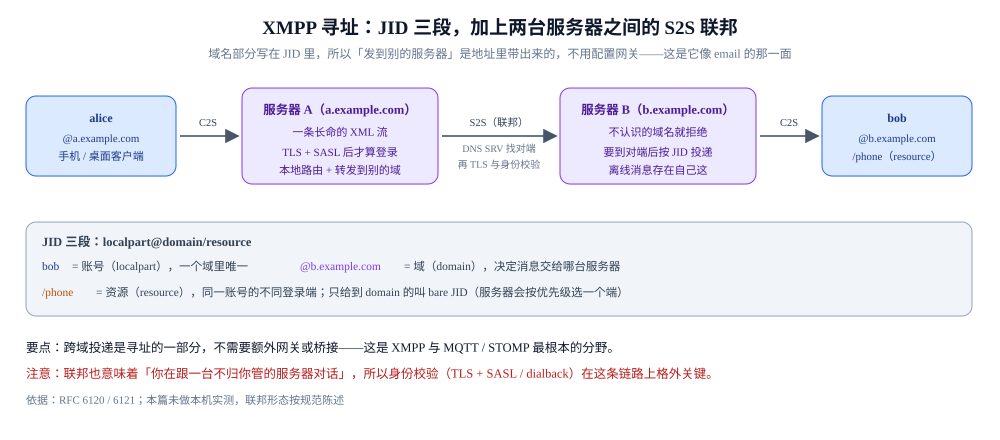
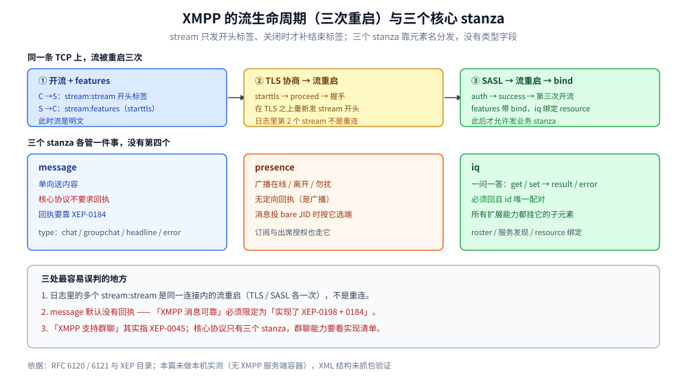

# XMPP

> 覆盖 ⭐ **XMPP 是什么、它为什么把「跨域联邦」写进了地址里**（JID 三段、C2S 与 S2S 两条链路、三个角色），以及「用一条长命的 XML 流承载所有交互」这件事的后果：流怎么打开与协商（含三次流重启）、三个核心 stanza（`message` / `presence` / `iq`）各管什么、JID 的 bare / full 区别、服务端联邦（S2S）怎么靠 DNS 找到对方、以及「冗长」这个评价的具体代价落在哪、⭐ **出错时三层错误各自关掉什么**（流错误必须断流 / stanza 错误原样回显且流继续 / 协商期失败不能在同一条流上重试）。
>
> 不覆盖：MQTT 的二进制位段头见 [MQTT.md](MQTT.md)；STOMP 的文本帧见 [STOMP.md](STOMP.md)；AMQP 的帧与 channel 见 [AMQP.md](AMQP.md)；IM 场景怎么把状态映射到报文见 [协议设计.md](../../../04-架构与系统/系统设计/IM系统/协议设计.md)。
>
> 内容整理自个人学习笔记，流与 stanza 结构依据 RFC 6120 / 6121。⚠️ **实测口径：本篇未做本机实测**（本机无 XMPP 服务端容器），XML 结构按 RFC 陈述、**未抓包验证**；文中不引用吞吐或延迟数字。「具体使用」节的 XML 是规范形态的还原，未在本机执行。

---

## 一、XMPP 是什么，它的「流」为什么不是一份 XML 文档？

**本节要点**：XMPP 是唯一把**跨域联邦寻址**写进协议的消息协议——地址里带域名，服务器之间自己去连，像 email。它用一条长命的 XML 流承载全部交互，于是既好扩展（XEP）又天生冗长。

### 1.1 XMPP 是什么：用 email 的思路做即时消息

XMPP 于 1999 年前后以 Jabber 项目起家，2004 年成为 RFC 3920 / 3921，2011 年重写为 **RFC 6120 / 6121**（现行标准）。它的设计目标只有一个：**让两个不同组织的人也能互相发消息**——也就是 email 那种联邦（federation）。所以它把「对方在哪个域」写进了地址本身。

三个角色，两条链路：

| 角色 | 干什么 |
|---|---|
| **客户端** | 连自己域的服务器（C2S 链路），开流、TLS + SASL 认证、收发 stanza |
| **本域服务器** | 认证用户、存离线消息、本地路由；跨域时主动起 S2S 连接 |
| **对端服务器** | 只认自己域的用户，没有中心节点——不知道的域就拒绝 |



这张图要读出「**寻址即路由**」：域名写在 JID 里，所以跨域投递不需要额外网关或桥接。这正是它与 MQTT / STOMP 最根本的分野——那两个协议里，跨集群投递要靠桥接或额外组件，而 XMPP 天生就是两台互不隶属的服务器在对话。

> ⚠️ **它的「重」与「能跨域」是同一件事的两面**：XML 流为扩展性付体积，联邦为寻址自由付信任成本（任何一次跨域对话都要过两台不受同一方控制的服务器，所以 TLS 与 SASL 不是可选项）。

> 本节只是把地图摊开：三个 stanza 的分工见第二节，JID 三段与 bare / full 的区别见第三节，S2S 的寻找顺序与它带来的两个后果见第四节。

### 1.2 流：一条连接里被重启三次的 XML

**本节要点**：XMPP 不是「一问一答」的协议，而是**先打开一条 XML 流，之后所有 stanza 都作为这条流的子元素被推送**。流的打开分三步：`<stream:stream>` 开头标签 → 双方各自声明 `<stream:features>` → 协商完（TLS + SASL）后才开始发业务 stanza。**流不关闭就一直开着**，这是它能做「服务端主动推送」的基础。



上图要读出两件事：**`<stream:stream>` 只发开头标签**（不是完整的 XML 文档，所以永远「不合法」于通用 XML 解析器），**关闭时才补上 `</stream:stream>`**；以及三个 stanza 都是**流的一级子元素**，靠元素名分发，不需要额外的「类型字段」。

**三步握手**：

```text
① C→S  <stream:stream to='example.com' xmlns='jabber:client' version='1.0'>
② S→C  <stream:stream ...><stream:features><starttls/></stream:features>
③ C→S  <starttls/> → S→C <proceed/> → 开始 TLS 握手（此后明文不可见）
④ 在 TLS 之上重新开流，再协商 SASL：<mechanisms/> → <auth/> → <success/>
⑤ 流重启（第三次），S→C 发 <stream:features> 带 <bind/> → 客户端 <iq> 绑定 resource
```

⭐ **注意流被重启了三次**（初始 → TLS 后 → SASL 后）。每次重启都重新发 `<stream:stream>` 开头标签，之前的流视为结束。这是 XMPP 排障时最容易被忽略的一点：**日志里会看到多个 `<stream:stream>`，那不是重连，是同一连接内的流重启。**

### 1.3 心跳为什么是「一个空格」

XMPP 的心跳（whitespace keepalive）就是**往流里发一个空格字符**。因为空格在 XML 的元素之间是合法的「可忽略空白」，接收方的解析器会直接跳过它，但 TCP 层确实有数据流动，从而让中间的 NAT / 负载均衡不把连接判定为空闲。

> ⚠️ **这也意味着「心跳」在 XMPP 里不是协议定义的报文**，而是利用 XML 语法的副作用。好处是极省字节；坏处是**很难从抓包里「看出」心跳**，只能看到零星的空格。

### 1.4 出错的时候，是哪一层在报错？

上面讲的全是「流怎么开」。但一个跑一整天不断的长连接，出错的概率远高于短连接，所以 XMPP 把错误**明确分了三层**——每层的含义不是「严重程度」，而是「**这条流还能不能继续用**」：

| 层 | 报文形态 | 流还能用吗 | 谁来发 |
| --- | --- | --- | --- |
| **流错误** | `<stream:error>` + 一个 defined condition（如 `<conflict/>`、`<host-unknown/>`、`<system-shutdown/>`） | ❌ **必须立刻关流**（发 `</stream:stream>` 收尾） | 任一方 |
| **stanza 错误** | 原 stanza 原样回显 + `type="error"` + `<error type="..."><condition/></error>` | ✅ 完全不受影响，继续收发 | 服务端（也可客户端回） |
| **协商期失败** | SASL 的 `<failure><not-authorized/></failure>`、TLS 的 `<failure/>` | ❌ 流在协商阶段就断了，**不能在同一条流上重试** | 服务端 |

三层里最需要理解的是中间那层。它正是 2.1 里 `iq` 第四种 `type`（`error`）的来源，机制叫**原样回显**：`<iq>` 出错时，服务端不是新造一条错误消息，而是把请求的 `from` / `to` 对调、`type` 改成 `error`、再塞一个 `<error>` 子元素回来——**`id` 属性原封不动**。所以客户端拿 `id` 就能把「这条错误是哪个请求引起的」对上号，这与 AMQP 的 `channel.close` 带 `class-id` / `method-id` 是同一个思路（见 [AMQP.md](AMQP.md) 第六节第 ⑤ 条）。

真正能做程序判断的是 `<error type="...">` 后面那个**五选一**，它回答的是「我该不该重试、怎么重试」：

| `type` | 谁的问题 | 该怎么办 |
| --- | --- | --- |
| `auth` | 认证/授权没通过 | 重新认证，重试同样请求没用 |
| `cancel` | 对方不会做、也没有权限做 | **不要重试**（如 `service-unavailable`、`feature-not-implemented`） |
| `continue` | 只是这个接收方不行，别处可能行 | 换一个目标继续（同一条请求不该原地重试） |
| `modify` | 请求本身写得不对 | **改了再发**（如 `bad-request`、`jid-malformed`） |
| `wait` | 临时状态，稍后可能好 | 等一会儿再试（如 `resource-constraint`、`remote-server-timeout`） |

注意它把「等一下再试」和「改一下再试」拆成了 `wait` 与 `modify` 两个值——这是 HTTP 只有「4xx 别重试 / 5xx 可重试」一个维度做不到的粒度。

> ⚠️ 这三层的报文形态取自 RFC 6120 §4.9（stream error）、§8.3（stanza error）与 RFC 4422（SASL）的结构，**本篇未做本机抓包验证**（本机没有可用的 XMPP 服务端，见篇首说明）。`<stream:error>` 的具体 condition 名单较长，排障时以 `<defined-condition/>` 里的元素名去查规范，不要凭印象判断。

## 二、三个 stanza 各管什么？

**本节要点**：XMPP 只有三个核心 stanza，分工是「**传内容 / 报状态 / 要答案**」——`message` 送消息、`presence` 广播在线状态、`iq` 做一问一答的请求。**没有第四个**，所有扩展能力都靠 `iq` 携带自定义命名空间的子元素。

| stanza | 语义 | 有回执吗 | 典型用途 |
| --- | --- | --- | --- |
| **`<message>`** | 单向送内容 | ❌ **协议本身不要求回执** | 聊天消息、通知、pubsub 事件推送 |
| **`<presence>`** | 广播状态（在线 / 离开 / 勿扰） | ❌ 广播，无定向回执 | 上线通知、状态订阅、出席授权 |
| **`<iq>`** | 一问一答（get / set → result / error） | ✅ **必须回一个** | 花名册（roster）、服务发现、绑定 resource、任何扩展能力 |

> ⚠️ **`<message>` 默认没有投递回执**——这是 XMPP 最常被误解的地方。要回执必须加 XEP-0184（Message Delivery Receipts）的 `<request/>` 子元素，对方回一个 `<received/>`。**核心协议不保证消息到达。**

### 2.1 `<iq>` 的四种 type

| type | 方向 | 含义 |
| --- | --- | --- |
| `get` | 请求 | 要一份数据（如「我的花名册」） |
| `set` | 请求 | 改一份数据（如「加一个好友」） |
| `result` | 应答 | 成功，可带 payload |
| `error` | 应答 | 失败，带 `<error type='...'>` 与条件元素 |

⭐ **`iq` 必须一问一答且 `id` 唯一**：`get` / `set` 必须对应一个 `result` / `error`，`id` 用来配对。**超时没回就该当失败处理**，不能无限等。

### 2.2 五个公共属性

每个 stanza 都可以带这五个属性，语义统一：

| 属性 | 作用 |
| --- | --- |
| `to` | 收件人 JID（缺省表示「发给我自己」的服务端） |
| `from` | 发件人 JID（**由服务端填写**，客户端伪造会被覆盖） |
| `id` |  stanza 标识，`iq` 靠它配对 |
| `type` | stanza 的子类型（`message` 的 `chat`/`groupchat`、`iq` 的 `get`/`set`…） |
| `xml:lang` | 内容语言 |

## 三、JID 三段是什么？

**本节要点**：JID 是 `localpart@domainpart/resourcepart` 三段，**每一段都可能缺省**。关键区别是 **bare JID（前两段）** 与 **full JID（三段全有）**：前者标识「这个人」，后者标识「这个人在这台设备上的这一个连接」。

| 形态 | 例子 | 标识什么 | 什么时候用 |
| --- | --- | --- | --- |
| **bare JID** | `alice@example.com` | 账号（人） | 花名册、好友关系、消息发到「所有端」 |
| **full JID** | `alice@example.com/phone` | 账号 + 具体连接（设备） | 定向推送到某一台设备、`iq` 应答 |
| 只有 domain | `example.com` | 服务端本身 | 服务发现、发往服务器 |
| 只有 domain + resource | `example.com/news` | 服务上的一个资源（如 MUC 房间） | 群聊房间 JID |

**为什么这个区分重要**：

- 消息发到 **bare JID** 时，服务端按「优先级最高的在线端」或「全部在线端」投递（具体策略由服务端的 `presence` 优先级决定）。
- 消息发到 **full JID** 时，只投给那一个连接。
- 多端同步（XEP-0280 Message Carbons）就是让「发到 bare JID 的消息」被复制给所有在线端。

> ⚠️ **`resource` 是客户端自己挑的**，服务端只保证「同一 bare JID 下 resource 唯一」。所以 `phone` / `desktop` 这类名字是约定，不是协议保证——用它对设备做路由前，先确认你的服务端是否稳定保留 resource。

## 四、联邦怎么工作？

**本节要点**：XMPP 的联邦（server-to-server，S2S）是**用 DNS 找到对方服务端，然后两个服务端直接开一条 TCP 互信连接**。所以 `alice@a.example` 给 `bob@b.example` 发消息，**不经过任何中心节点**，`a.example` 会直接连 `b.example`。

### 4.1 找对方的顺序

```text
① 查 SRV 记录：_xmpp-server._tcp.<对方域名>  → 拿到主机名与端口（通常是 5269）
② 没有 SRV 就退回到 A/AAAA 记录（对方域名本身，端口 5269）
③ 开 TCP → STARTTLS → 双向 SASL 验证（用 dialback 或证书互信）
④ 验证通过后才转发 stanza
```

### 4.2 联邦带来的两个后果

- ⭐ **好处**：任何人都能和任何人通信，不需要中心服务器——这是 XMPP 与微信这类封闭 IM 的根本差别。
- ⚠️ **代价**：**垃圾消息无法在中心点拦截**（没有中心点），且**你的服务端要接受陌生域名的入站连接**。所以在企业内部部署 XMPP 时，通常会把 S2S 关掉或只允许白名单域名。

> ⚠️ **联邦不是默认开箱可用的**：需要正确的 DNS SRV 记录、有效的证书、以及对方服务端愿意接受你的连接。三者缺一，`alice` 发的消息就停在本地服务端。

## 五、为什么说它「冗长」？代价具体在哪？

**本节要点**：冗长的代价不在「字符多」，而在 **XML 让每个 stanza 都重复一遍命名空间与标签名**，而这个开销是**每帧固定**的——所以消息越短，开销占比越高。

同一个动作的三种协议写法对照（语义都是「给某个地址发一条 5 字节的消息」）：

| 协议 | 报文形态 | 头部固定开销 |
| --- | --- | --- |
| **MQTT** | 2 字节固定头 + topic + payload | **2 字节** |
| **NATS** | `PUB subj 5\r\n` + payload | 约 12 字节（取决于 subject 长度） |
| **XMPP** | `<message to='...' type='chat'><body>hello</body></message>` | **50 字节以上**（不含 `from` / `id` / 命名空间声明） |

**冗长的三个具体来源**：

- **标签名重复**：`<message>` 与 `</message>`、`<body>` 与 `</body>`，每层都要写两遍。
- **命名空间重复**：扩展元素的 `xmlns` 每次都要带（除非用流级别的默认命名空间）。
- **可读性带来的冗余**：属性名是完整单词（`to` / `from` / `type`），不是位段。

> ⭐ **反过来说，冗长换来的是「可读 + 可扩展」**：抓包后直接能读懂、新能力只要加一个新命名空间的子元素、不需要改协议版本。这是 XMPP 用「流量」换「演进能力」的取舍。

## 六、扩展（XEP）为什么是它的强项？

**本节要点**：XMPP 的核心只定「流 + 三个 stanza」，**其余能力全部靠 XEP（XMPP Extension Protocols）**。所以它的能力边界不是由协议版本决定，而是由「双方实现了哪些 XEP」决定——这带来了极强的可扩展性，也带来了**互操作性问题**（双方 XEP 集合不一致）。

| XEP | 能力 | 为什么重要 |
| --- | --- | --- |
| **XEP-0045** | 多用户聊天（MUC，群聊） | 群聊不是核心协议能力，必须靠它 |
| **XEP-0198** | 流管理（断线重连 + 未确认 stanza 重发） | ⭐ **IM 必备**，否则断线就丢消息 |
| **XEP-0280** | Message Carbons（多端同步） | 一条消息复制给所有在线端 |
| **XEP-0163** | PEP（个人事件协议，基于 pubsub） | 头像、昵称、状态广播 |
| **XEP-0184** | 消息送达回执 | 补上 `<message>` 没有回执的缺口 |
| **XEP-0313** | 消息归档（MAM，历史消息拉取） | 换设备后拉历史 |

> ⚠️ **「XMPP 支持群聊」这句话必须加限定**：核心协议不支持群聊，是 XEP-0045 支持。判断一个 XMPP 服务端能不能做群聊，要看它实现了哪些 XEP，不是看它「是不是 XMPP」。

## 七、应用场景

| 场景 | 适合吗 | 理由 |
| --- | --- | --- |
| **跨组织即时通信**（需要与外部互通） | ✅ 最适合 | 联邦是它的立身之本，别的协议做不到 |
| **企业内部 IM** | ⚠️ 可用但偏重 | 要关掉 S2S、要挑实现齐全的 XEP（0198 / 0280 / 0313） |
| **IoT 设备上报** | ❌ 不适合 | XML 冗长，流量与电量都不可接受，用 MQTT |
| **高频消息推送（万级 QPS）** | ❌ 不适合 | 每帧固定开销 50 字节以上，带宽成本高 |
| **需要「标准协议」避免自研** | ✅ 适合 | 协议与扩展都有 RFC / XEP 编号，不用自己定 |
| **端侧完全可控 + 流量敏感** | ❌ 换自定义二进制 | 见 [自定义协议设计.md](自定义协议设计.md) |

本仓对应落地：[协议设计.md](../../../04-架构与系统/系统设计/IM系统/协议设计.md)（自研 IM 协议时的对照）、[通信选型.md](../../../02-计算机基础/网络/选型/通信选型.md)（应用层协议对照）。

## 八、具体使用

### 8.1 一个完整的消息往返（规范形态）

```text
<!-- ① 打开流 -->
<stream:stream to='example.com' xmlns='jabber:client'
               xmlns:stream='http://etherx.jabber.org/streams' version='1.0'>

<!-- ② 服务端回应并给 features（此处假设 TLS 与 SASL 已完成） -->
<stream:stream from='example.com' id='c2s-1' xmlns='jabber:client'
               xmlns:stream='http://etherx.jabber.org/streams' version='1.0'>
  <stream:features>
    <bind xmlns='urn:ietf:params:xml:ns:xmpp-bind'/>
    <sm xmlns='urn:xmpp:sm:3'/>
  </stream:features>

<!-- ③ 绑定 resource（iq 必须一问一答） -->
<iq type='set' id='b1'>
  <bind xmlns='urn:ietf:params:xml:ns:xmpp-bind'>
    <resource>phone</resource>
  </bind>
</iq>
<iq type='result' id='b1'>
  <bind xmlns='urn:ietf:params:xml:ns:xmpp-bind'>
    <jid>alice@example.com/phone</jid>
  </bind>
</iq>

<!-- ④ 上线广播（presence 无定向回执） -->
<presence/>

<!-- ⑤ 发一条消息（核心协议不要求回执） -->
<message to='bob@example.com' type='chat' id='m1'>
  <body>hello</body>
</message>

<!-- ⑥ 关闭流 -->
</stream:stream>
```

### 8.2 排障时先看的四个点

```text
① 日志里有几次 <stream:stream>？
   三次是正常的（初始 → TLS 后 → SASL 后），不是重连
② 有没有 XEP-0198 的 <sm/>？
   没有就不支持断线重连，断线期间的 stanza 直接丢
③ <message> 有没有 XEP-0184 的 <request/>？
   没有就永远不知道对方收没收到
④ S2S 的 DNS 对不对？
   _xmpp-server._tcp.<域名> 的 SRV 记录缺失 → 跨域消息发不出去
```

## 延伸追问

- **XMPP 为什么不用「一问一答」而要开一条长命的流？** 因为它要支持**服务端主动推送**（对方发消息、好友上线）。一问一答的模型下，服务端没有办法把事件推给客户端，只能靠轮询。
- **`<message>` 真的不回执吗？** 核心协议（RFC 6121）不要求。回执要靠 XEP-0184。所以「XMPP 消息可靠」这个说法必须限定为「在实现了 0198 + 0184 的前提下」。
- **为什么流被重启三次而不是一次做完？** 因为 TLS 与 SASL 都要在**明文的流**上协商，协商完之后的流量必须走新的一层，所以只能「关旧流、在新层上开新流」。这是 XMPP 分层设计的直接结果。
- **联邦会不会带来安全问题？** 会。任何人都能连你的 S2S 端口，所以企业部署通常关闭 S2S 或做域名白名单。这也是「XMPP 适合开放互通、不适合封闭内网」的原因。
- **XMPP 和 Matrix 该怎么选？** XMPP 是「消息协议 + 联邦」，Matrix 是「事件图 + 联邦」，后者的房间模型更适合「多人协作状态同步」，前者的生态与客户端更成熟。两者都解决了「不依赖中心节点」这件事。
- **`<error type>` 的五个值为什么不能简化成「重试 / 不重试」两档？** 因为要重试的还得再分「改参数再发」与「等一会儿再发」，要不要重试的还得分「换个目标」与「干脆放弃」——这四条代码路径完全不同（改参、退避、重投、终止）。少一个维度，客户端就只能把所有失败塞进同一个重试循环，最后变成重试风暴；这跟 HTTP 只有「4xx 别试 / 5xx 可试」的粗粒度是同一个短板。

## 关联

- **上游/总纲**：[消息协议族全景.md](消息协议族全景.md) — 这一族的四个可变量与八维横向矩阵；本篇是「结构解析器定界」那一格的代表
- **上游/总纲**：[通信选型.md](../../../02-计算机基础/网络/选型/通信选型.md) — 应用层协议七行对照，XMPP 的定位
- **上游/总纲**：[README.md](../README.md) — 网络目录导读：消息协议这一类的位置
- **对照/互补**：[MQTT.md](MQTT.md) — 同为消息协议，2 字节头 vs 50 字节 XML 头，是最直接的「省流量 vs 可演进」对照
- **对照/互补**：[STOMP.md](STOMP.md) — 同为文本协议，但 STOMP 是「段 + NUL」，XMPP 是「XML 流 + 标签闭合」
- **对照/互补**：[AMQP.md](AMQP.md) — 同为「多帧内容」的协议：AMQP 靠 content header + body 帧分段，XMPP 靠 XML 元素嵌套
- **下游机制**：[协议设计.md](../../../04-架构与系统/系统设计/IM系统/协议设计.md) — 自研 IM 协议时，XMPP 的哪些设计值得抄（流 + stanza 分发）与哪些不该抄（XML 冗长）
