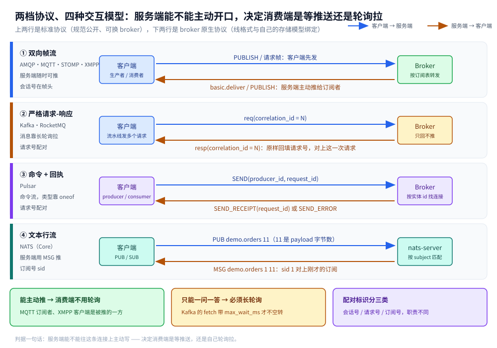
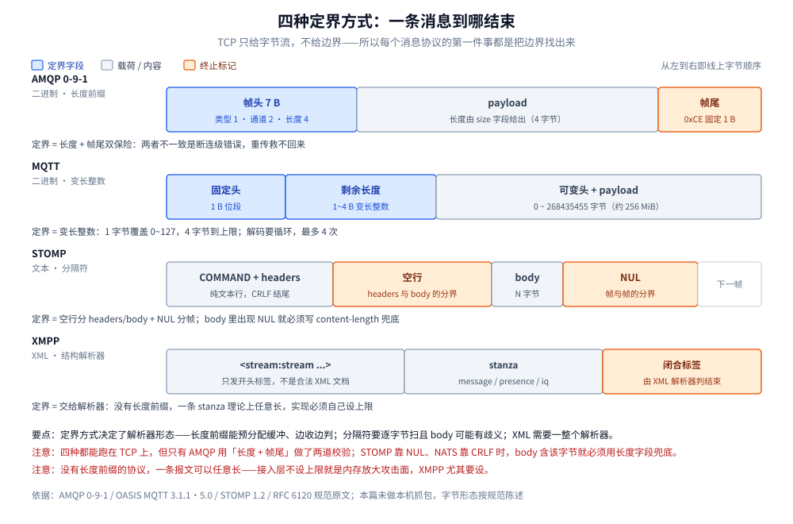
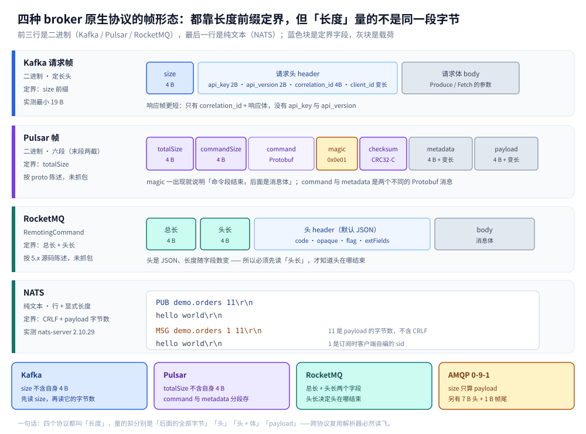

# 消息协议族全景

> 覆盖：这一族协议共同要定的四个变量（定界 / 确认 / 路由 / 演进）、四种定界家族与各自的字节代价、**标准协议（AMQP / MQTT / STOMP / XMPP）与 broker 原生协议（Kafka / Pulsar / RocketMQ / NATS）两档的分野**、两档各自的八维横向矩阵、一条 TCP 上并发多条逻辑流的三种标识、**建连各要几个往返**（等于重连成本）、以及「协议 → 产品」的反查和**浏览器里怎么走 WebSocket 隧道**。
>
> 不覆盖：标准四协议逐字段的线上布局见 [AMQP.md](AMQP.md)、[MQTT.md](MQTT.md)、[STOMP.md](STOMP.md)、[XMPP.md](XMPP.md)；broker 原生四协议的细节在各产品册——Kafka 见 [Kafka协议.md](../../../03-数据与中间件/中间件/消息队列/Kafka/Kafka协议.md)、Pulsar 见 [Pulsar协议.md](../../../03-数据与中间件/中间件/消息队列/Pulsar/Pulsar协议.md)、NATS 见 [NATS协议.md](../../../03-数据与中间件/中间件/消息队列/NATS/NATS协议.md)、RocketMQ 的 `RemotingCommand` 见 [核心概念与架构.md](../../../03-数据与中间件/中间件/消息队列/RocketMQ/核心概念与架构.md) 第六节；自己造协议怎么写见 [自定义协议设计.md](../应用层/自定义协议设计.md)；什么场景选哪个协议（决策判据）见 [通信选型.md](../选型/通信选型.md) 第三节；产品怎么选、怎么部署见 [消息队列选型对比.md](../../../03-数据与中间件/中间件/消息队列/消息队列选型对比.md)。
>
> 内容整理自个人学习笔记，素材见 [素材清单](../../../素材清单.md)。
>
> ⚠️ 实测口径：本篇只做形态归纳，**字节读数一律沿用各篇已标注的口径**。AMQP 的帧结构与 `channel_max=2047` / `frame_max=131072` 来自 RabbitMQ 4.3.6 容器实测；Kafka 的 19 字节最小请求帧与 `ApiVersions` 读数来自 `apache/kafka:3.9.0`（KRaft 单节点）；NATS 的 `INFO` 416 字节与各命令回执来自 `nats:2.10-alpine`（nats-server 2.10.29）；**Pulsar 按 `PulsarApi.proto` 陈述、RocketMQ 按 5.x 源码陈述，两者的帧布局均未抓包验证**；MQTT / STOMP / XMPP 三篇未做本机抓包，字节形态按规范原文陈述。本篇不引用任何吞吐或延迟数字。

---

## 一、这一族协议共同要定的是哪四件事？

**本节要点**：协议之间的差别，九成落在四个变量的取值上——**定界怎么划、确认谁发、路由谁来解、扩展往哪加**。把这四个变量填满，一个协议的形态就定了。

| # | 变量 | 不解决会怎样 | 必须由协议解决吗 | 本篇 | 细节在哪篇 |
|---|---|---|---|---|---|
| ① | **定界** | 读到的字节拼不成完整消息（粘包 / 半包） | ✅ **必须**：TCP 只给字节流 | 第二节 | 各篇各自讲「一条消息长什么样」的那一节 |
| ② | **确认** | 不知道对方收没收到，重发与去重全乱 | ❌ 可以只定语法、语义交给 broker | 6.1 | MQTT §五、AMQP §六、STOMP §四、Kafka §四 |
| ③ | **路由** | 消息到了 broker 不知道该给谁 | ❌ 同上，多数协议只定「怎么写地址」 | 6.2 | AMQP §一、MQTT §六、XMPP §三、Pulsar §四 |
| ④ | **演进** | 加一个字段就得升大版本，老客户端全崩 | ✅ 必须：得留扩展位 | 6.3 | 自定义协议设计 §五、Kafka 协议 §五 |

⭐ **这张表就是这一族的「骨架」**：四个变量里只有①和④是协议本身逃不掉的，②③在多数协议里是「语法在协议、语义在 broker」。看懂这条，再看下面八个协议就不会觉得它们各说各的——它们只是在这四个格子里填了不同的值。

### 1.1 这一族其实分成两档

上来先分档，是因为「消息协议」这个词同时指着两类东西：一类是**公开标准**，谁来都能实现；另一类是**各产品自己的线上协议**，客户端库与服务端源码一起演进。它们的定界手段几乎是两个时代的产物。

| 对比项 | 标准协议 | broker 原生协议 |
| --- | --- | --- |
| **规范来源** | RFC / OASIS / XSF 等公开标准 | 各产品自己的源码与文档 |
| **谁能实现** | 多个 broker、多套客户端，可互换 | 基本只有自家客户端配自家 broker |
| **定界手段** | 四大家族各占一种 | **三家长度前缀**（NATS 是文本行 + 显式长度） |
| **语义可移植性** | AMQP 最好，STOMP 最差（见 6.2） | 换产品即换协议，没有移植一说 |
| **代表** | AMQP、MQTT、STOMP、XMPP | Kafka、Pulsar、RocketMQ、NATS |
| **本篇在哪讲** | 3.1 ~ 3.4、4.1 | 3.5 ~ 3.8、4.2 |

⭐ **判据一句话：「把 broker 换掉，客户端代码还能不能跑」**——能，就是标准协议；不能，就是原生协议。这条判据比「是不是开源」有用得多，它直接决定你被单一产品绑住的程度。

### 1.2 表外还有一维：服务端能不能主动开口

四个变量决定「协议能表达什么」；还有一维决定「接入层长什么样」——**谁可以先写**。它不在四格里，却直接决定消费端是等推送还是自己轮询：

| 交互模型 | 代表 | 服务端能主动写吗 | 消费端怎么拿消息 | 配对标识 |
| --- | --- | --- | --- | --- |
| **双向帧流** | AMQP / MQTT / STOMP / XMPP | ✅ 随时可写 | 服务端推（`basic.deliver` / `PUBLISH` / `MSG`） | 会话号 / 订阅号 |
| **请求-响应** | Kafka / RocketMQ | ⚠️ 只回请求，不推消息 | `fetch` / `PullMessage` 长轮询 | `correlation_id` / `opaque` |
| **命令 + 回执** | Pulsar | ✅ 双向都能发命令 | `MESSAGE` 命令推给消费者 | `request_id` / 实体 id |
| **文本行流** | NATS | ✅ 随时可写 | 服务端 `MSG` 推 | `sid` |

> ⚠️ **RocketMQ 这一行有个容易看错的地方**：它的 remoting 层是**对称的**——broker 也会主动向客户端发请求（例如通知消费者列表变更），靠 `opaque` 配对。但**消息投递仍然是客户端拉**（`PullMessage` 长轮询）。所以判断「要不要轮询」看的不是「broker 能不能发请求」，而是「broker 会不会主动推消息」。

图注：四行分别对应一种交互模型，左右两个方框代表客户端与 broker，蓝箭头是客户端先发、橙箭头是服务端回写。读这张图要抓住一件事——**服务端能不能往这条连接上主动写，决定了消费端是等推送还是长轮询拉**：能推的协议，消费者的阻塞点在「服务端什么时候发」；不能推的，阻塞点在「下一次 fetch 什么时候回来」。

> 还有一条不在表里、但绕不开的维度：**建连要几个往返**。它不决定协议能表达什么，只决定断线重连的代价，但对 IoT 与 IM 这两类长连接场景来说，往往比上面四格更能决定选谁——见 6.4。

## 二、定界：一条消息到哪结束？

**本节要点**：TCP 是字节流，没有消息边界。所以「定界」是每个消息协议的第一行代码，也决定了接入层的写法。

### 2.1 四种定界家族

| 家族 | 怎么知道结束了 | 代表 | 能否预分配缓冲 | 出错时的表现 |
|---|---|---|---|---|
| **长度前缀**（定长字段） | 先读固定 N 字节解出长度，再读 N 字节 | AMQP（`size` 4 字节）、Kafka（`size`）、Pulsar（`totalSize`）、RocketMQ（总长 + 头长） | ✅ 能，先 `make([]byte, n)` | 长度写错 → 读飞，要么卡住要么串包 |
| **变长整数** | 先读 1~4 字节解出长度（每字节低 7 位存数据） | MQTT（剩余长度） | ✅ 能，但要先循环解出长度 | 跨档（127→128）时最容易错位 |
| **分隔符** | 扫到终止字节 / 行尾 | STOMP（`NUL`）、NATS（CRLF + 显式长度）、HTTP/1.1 chunked | ❌ 不能，得边读边扫 | body 里出现终止字节 → 提前截断 |
| **结构解析器** | 交给 XML / JSON 解析器判断「这个对象完整了吗」 | XMPP（XML 流） | ❌ 不能 | 解析器状态机出错 → 整条连接语义崩 |

⭐ **纯种很少，混血才是常态**：NATS 是「CRLF 分隔命令行 + 显式长度字段」，STOMP 是「空行分隔 headers/body + `NUL` 分帧 + 可选 `content-length` 兜底」。**混合的动机只有一个**：分隔符在载荷里出现时不产生歧义。

### 2.2 四种方式的字节形态

图注：四行的蓝色块是「定界字段」、灰块是载荷、橙色块是终止标记；从左到右就是线上字节顺序。读这张图要抓住一件事——**归谁管边界**：AMQP 与 MQTT 让长度字段自己说，STOMP 让终止字节说，XMPP 干脆让解析器说。

### 2.3 定界方式决定了后面所有事

选定界方式不只是「省几个字节」，它把接入层的形态一起定死了：

| 定界方式 | 能不能零拷贝 | 能不能边收边处理 | 解析器复杂度 | 能不能 telnet 手工敲 | 单报文上限 |
|---|---|---|---|---|---|
| 长度前缀 | ✅ 缓冲凑齐后整块处理 | ✅ 一帧到齐就分发 | 低 | ❌ 二进制 | 由长度字段宽度定（AMQP `frame_max` 实测 131072） |
| 变长整数 | ✅ 同上 | ✅ 同上 | 低（多一个解码循环） | ❌ 二进制 | 268435455（MQTT 4 字节上限） |
| 分隔符 | ⚠️ 要扫，通常得复制 | ✅ 逐行 | 中（要处理歧义） | ✅ 这是它最大的优点 | 无，靠 `content-length` 或实现限制 |
| 结构解析器 | ❌ 解析器内部有状态 | ⚠️ 只能到「完整对象」粒度 | 高（引一个 XML 库） | ✅ 人能读 | **无上限 = 风险**，必须自己设 |

⚠️ **只比功能表会漏掉这一节**：同样叫「支持发布订阅」，长度前缀的协议与 XML 流的协议，接入层代码量差一个数量级。选型时把「我的网关 / 客户端要写多复杂」这一列加上，答案常常会变。

> ⚠️ **同样是「长度前缀」，四个 broker 原生协议量的不是同一段字节**：Kafka 的 `size` 与 Pulsar 的 `totalSize` 都不含自身那 4 字节，RocketMQ 给两个长度（总长 + 头长），AMQP 的 `size` 只算 payload、另有 7 字节头与 1 字节帧尾。跨协议抄解析器必踩这一条，展开在 3.5 ~ 3.8 与那张帧形态图。

## 三、八个协议各选了哪一种？⭐

**本节要点**：两档八个协议把四种定界家族都覆盖了，但分布极不均匀——**标准协议四家各占一种；broker 原生四家里三家落在长度前缀，只有 NATS 走文本行**。这不是巧合：前者服务的场景决定了哪种代价可以接受，后者要把消息「一条一条」落盘建索引，必须先知道边界。

### 3.1 AMQP：长度 + 帧尾，双保险

帧 = **7 字节头**（类型 1 + 通道 2 + 长度 4）+ payload + **1 字节帧尾 `0xCE`**，最小 8 字节。长度字段说了算，但帧尾再做一次校验：**两者对不上就是协议级错误，直接断连**——不是重传能救的。

代价：固定 8 字节开销，小消息上很不划算；换来的是解析器极简（读头 → 读 `size` → 读 1 字节验帧尾）。细节见 [AMQP.md](AMQP.md) 第二节。

### 3.2 MQTT：变长整数，省到极致

**1 字节固定头**（高 4 位类型、低 4 位标志）+ **1~4 字节剩余长度**，最小报文 2 字节。剩余长度用每字节的低 7 位存数据、最高位做续位：127 以内只花 1 字节，4 字节到上限 268435455。

代价：解码要循环（最多 4 次），且**剩余长度不含固定头自身**——这里写错只在 127→128 跨档时暴露。细节见 [MQTT.md](MQTT.md) 第三节。

### 3.3 STOMP：空行 + NUL，人能读

`COMMAND` 行 + 若干 `key:value` 头 + **一个空行** + body + **`NUL`**。空行分 headers 与 body，`NUL` 分帧与帧。没有长度前缀，所以 body 里出现 `NUL` 就必须写 `content-length`。

代价：文本解析、每帧都要重复发字段名，体积最大；换来的是**可以直接 telnet 敲**，调试成本最低。细节见 [STOMP.md](STOMP.md) 第一、三节。

### 3.4 XMPP：没有长度前缀，交给 XML

先发 `<stream:stream ...>` 打开一条流（**只发开头标签，所以永远不是一份合法 XML 文档**），之后每个 stanza 作为流的子元素出现，边界由 XML 解析器判。流在 TLS 升级与 SASL 认证时还要**重启**。

代价：解析器重、体积大、一条 stanza 理论上可以任意长（所以实现必须自己设上限）。换来的是扩展性——任何 XEP 都是往 XML 里加一个命名空间。细节见 [XMPP.md](XMPP.md) 第一、五节。

> 下面四个是 **broker 原生协议**。它们的字节布局在 03 侧各有一篇，这里只讲「定界怎么做、和上面四家差在哪」。

### 3.5 Kafka：长度前缀 + 版本协商，一问一答

请求帧 = `size(int32)` + 请求头 + 请求体。请求头只有四个字段：`api_key`（调哪个 API）、`api_version`（用第几版）、`correlation_id`（配对）、`client_id`（日志里认人）。**实测最小请求帧 19 字节**；响应帧更短——只有 `correlation_id` + 响应体，没有 `api_key` 与 `api_version`。

⚠️ **它比另外三家多一道「版本协商」**：客户端连上后第一枪必须是 `ApiVersions`（key=18），拿到每个 API 的 `min~max` 范围再决定用哪一版。实测 `apache/kafka:3.9.0` 回了 **61 个条目**，而它认识的 key 最大值是 **81**（编号不连续）。**版本不匹配或 key 不存在时，Broker 直接断连、不回错误帧**——排障时只找「错误响应」会什么都找不到。细节见 [Kafka协议.md](../../../03-数据与中间件/中间件/消息队列/Kafka/Kafka协议.md) 第一至三节。

### 3.6 Pulsar：长度前缀 + Protobuf，一帧六段

一帧是**六段**：`totalSize(4)` / `commandSize(4)` / `command` / `magicNumber=0x0e01(2)` / `checksum CRC32-C(4)` / `metadata + payload`。`totalSize` **不含自身这 4 字节**。`command` 与 `metadata` 是**两个不同的 Protobuf 消息**（`BaseCommand` 与 `MessageMetadata`）；`magic` 一出现就说明「命令段结束，后面是消息体」，所以纯命令帧（`PING`、`ACK`）没有后三段。

代价：不能按固定偏移读、每条命令都背 Protobuf 的 tag 开销；换来的是加字段只加 tag、40 多种命令共用一个 `BaseCommand` 入口（`type` + `oneof` 分发）。另外 producer 的第一步也不是发消息，而是 `LOOKUP` 问「这个 topic 归哪个 broker」，拿重定向后再连（见 6.2）。⚠️ **本篇按 `PulsarApi.proto` 陈述，未抓包**。细节见 [Pulsar协议.md](../../../03-数据与中间件/中间件/消息队列/Pulsar/Pulsar协议.md) 第二至四节。

### 3.7 RocketMQ：长度前缀 + JSON 头，要给两个长度

`RemotingCommand` = **总长(int32) + 头长(int32) + 头 + body**。头默认是 **JSON**，里面是 `code`（命令码）、`language`、`version`、`opaque`（请求号）、`flag`、`remark` 与 `extFields`（自定义 KV）。两个长度分工不同：总长告诉你整帧到哪结束，头长告诉你 JSON 头在哪结束、body 从哪开始。

⭐ **为什么要多给一个头长**：Kafka 的请求头是定长字段，读完四个字段自然知道头到哪结束；RocketMQ 的头是 JSON，**长度随字段数变**，只能再给一个长度字段——**用 4 字节换「头可以随便加字段」**。⚠️ **本篇按 RocketMQ 5.x 源码陈述，未抓包**；03 侧对它的讨论在读路径上（为什么要回用户态套这一层帧），见 [核心概念与架构.md](../../../03-数据与中间件/中间件/消息队列/RocketMQ/核心概念与架构.md) 第六节。

### 3.8 NATS：不是长度前缀，是文本行 + 显式长度

`PUB <subject> [reply-to] <#bytes>\r\n<payload>\r\n`。三条硬规则：长度是 **payload 的字节数**（不含命令行与结尾 CRLF）、是**字节数不是字符数**（中文一个字 3 字节）、**写错不报错**——实测发 `PUB demo.orders 99\r\nhello world\r\n`（实为 11 字节），服务端返回 **0 字节**，静静等剩下的 88 字节。

还有一个与另外三家的根本差别：**服务端先开口**。TCP 建连后服务端立刻推 `INFO`（实测 **416 字节**），客户端据此决定 `CONNECT` 带哪些选项。细节见 [NATS协议.md](../../../03-数据与中间件/中间件/消息队列/NATS/NATS协议.md) 第一至三节。

### 3.9 八个协议落在四格里的分布

| 定界家族 | 落在这一格的协议 | 这一格里彼此的差异 |
| --- | --- | --- |
| **长度前缀** | AMQP、Kafka、Pulsar、RocketMQ | 长度口径全不同：AMQP 只算 payload、Kafka / Pulsar 不含自身 4 字节、RocketMQ 头与体分开给 |
| **变长整数** | MQTT | 独一份，为弱网把 1 字节省到底 |
| **分隔符** | STOMP、NATS | STOMP 靠 `NUL` 收尾、NATS 靠 CRLF + 显式长度兜底 |
| **结构解析器** | XMPP | 独一份，边界交给 XML 解析器判 |

⭐ **八个里四个是长度前缀，broker 原生四家里占了三个**（NATS 是唯一走分隔符的 broker 协议）。原因不在「长度前缀更先进」，而在 broker 的存储模型：它要把消息落成「一条一条」的记录并建索引，必须先知道边界，才能预分配缓冲、才能把一条消息当成一个可寻址单元。反过来，标准协议里选分隔符的（STOMP、NATS）都把「人能 telnet 敲」当卖点——这点代价能接受，是因为它们的接入层不背存储索引。

图注：四行都按线上字节顺序从左往右排，蓝色块是定界字段、紫块是 Pulsar 的 Protobuf 命令、灰块是载荷或变长的头体；底部四张卡把「长度」在四个协议里各自量的是哪一段钉在一起。读这张图要抓住一件事——**都叫长度前缀，量的却不是同一段字节**：Kafka 与 Pulsar 的长度不含自身，RocketMQ 还得靠头长把 JSON 头切开，NATS 的长度只是 payload 的字节数。

## 四、两档协议并排看，差在哪？

**本节要点**：上面是「逐个看」，这里是「并排看」。八维里真正决定选型的是**前三行**（编码 / 最小头 / 定界），后五行决定的是**接入层要写多少代码**。两档分开列——因为它们之间几乎不存在「同一份客户端代码换个 broker 还能跑」的情况。

### 4.1 标准四协议

| 维度 | AMQP 0-9-1 | MQTT | STOMP | XMPP |
|---|---|---|---|---|
| **编码** | 二进制 | 二进制 | 纯文本 | XML |
| **最小头** | 8 字节（7 + 帧尾 1） | 2 字节（1 + 1） | 1 行命令 + 空行 + `NUL` | 一个最小 stanza 十几字节起 |
| **定界** | `size` + `0xCE` | 变长整数 | 空行 + `NUL` | XML 解析器 |
| **多路复用** | ⭐ `channel id`（帧头 2 字节） | `packet id`（16 位） | `subscription id` 头 | stanza 的 `id` 属性 |
| **确认原语** | `basic.ack` / `tx` 类 / publisher confirm（RabbitMQ 扩展） | ⭐ QoS 0/1/2 四条确认报文 | `ack` 三模式 + `receipt` | 协议内无（XEP-0198 / 0184） |
| **路由模型** | ⭐ exchange + binding + routing key（规范定义四种 exchange 类型） | topic 通配 `+` / `#` | destination 字符串，语义由 broker 定 | ⭐ JID + 服务器路由 + 联邦（DNS SRV） |
| **扩展机制** | field table 自定义头 | 5.0 的 user properties | 任意自定义头 | ⭐ XEP（命名空间） |
| **典型落地** | RabbitMQ | EMQX / HiveMQ / Mosquitto | ActiveMQ / RabbitMQ 插件 | ejabberd / Openfire |

⚠️ **读表注意**：「最小头」是规范允许的最小值，不是实际报文大小。一条带 topic、带属性、带应答地址的真实报文，四个协议都能轻松超过 100 字节——拿「2 字节 vs 8 字节」做选型依据是错的，它只在弱网按流量计费的场景才成为主因。

### 4.2 broker 原生四协议

| 维度 | Kafka | Pulsar | RocketMQ | NATS（Core） |
|---|---|---|---|---|
| **编码** | 二进制（手写 + 版本号） | 二进制（Protobuf） | 二进制 + JSON 头 | 纯文本 |
| **最小头** | 请求帧 19 字节（实测，空 body） | 8 字节 + Protobuf 命令 | 8 字节 + JSON 头 | 1 行命令 + CRLF |
| **定界** | `size` | `totalSize` + `commandSize` | 总长 + 头长 | CRLF + payload 字节数 |
| **多路复用** | ❌ 只有请求号 `correlation_id` | ⚠️ 实体号 `producer_id` / `consumer_id` 让一条连接挂多个实体，但不是通道隔离 | ❌ 只有请求号 `opaque` | ❌ 只有订阅号 `sid` |
| **确认原语** | `acks=0/1/all`；幂等 producer（`producerId` + `producerEpoch` + `baseSequence`） | `SEND_RECEIPT` / `SEND_ERROR`；消费侧累积 ack | 同步 / 异步 / 单向发送；消费位点上报 | Core 无 ack，JetStream 才有 |
| **路由模型** | topic → partition，分区数建 topic 时定，按 key 哈希选分区 | ⭐ topic → partition + 订阅（四种订阅类型） | topic → 队列（可动态增加）+ tag 过滤 | subject 精确 + 通配 `*` / `>` |
| **扩展机制** | API 版本号 + Flexible 的 `tagged_fields` | Protobuf 加字段只加 tag | `extFields` 自定义 KV + `version` | `CONNECT` 的 JSON 选项 / `HPUB` 头 |
| **典型落地** | Kafka、Redpanda、AutoMQ | Apache Pulsar | Apache RocketMQ | nats-server |

⚠️ **这四列的「最小头」尤其不能横比**：Kafka 的 19 字节是实测的 `ApiVersions` 空 body 请求帧，Pulsar 与 RocketMQ 的 8 字节后面还得跟命令与 JSON 头，NATS 的一行命令也要带上 subject。它们真正的差异在**编码与多路复用**：Protobuf 让 Pulsar 的扩展最省事，纯文本让 NATS 的接入层最薄，而 Kafka 与 RocketMQ 把「批量 + 顺序」压进了帧里。另外，Kafka 的幂等三字段属于 Record Batch v2 的字段布局，**03 侧按规范陈述、未做本机逐字节验证**（见 [Kafka协议.md](../../../03-数据与中间件/中间件/消息队列/Kafka/Kafka协议.md) 第四节）。

## 五、一条 TCP 上怎么跑多条逻辑流？

**本节要点**：八个协议都要解决「一条连接上多条逻辑流」的问题，但标识分三种角色——**会话号（真通道，只有 AMQP 有）、请求号（配对一问一答）、订阅号 / 实体号（把投递对回本地回调）**。把后两者当成多路复用，是这个主题最常踩的坑。

| 角色 | 谁在用 | 标识字段 | 谁负责分派 | 拿它当通道号会错在哪 |
|---|---|---|---|---|
| **会话号**（并发通道） | AMQP | ⭐ 帧头 `channel id`（2 字节，0 号预留给连接级） | **客户端库**维护 channel → 回调的映射 | 同通道的帧必须串行，这正是 Channel「非线程安全」的物理原因 |
| **请求号**（一问一答配对） | Kafka / RocketMQ / Pulsar / MQTT | `correlation_id` / `opaque` / `request_id` / `packet id` | 客户端把响应配给未完成的请求 | 它只保证「问与答」对得上，**不隔离逻辑流**：一条连接上的所有请求仍共用一条发送队列 |
| **订阅号 / 实体号**（投递归属） | NATS / STOMP / XMPP / Pulsar | `sid` / `subscription` 头 / stanza `id` / `consumer_id` | 客户端维护订阅 → 回调表 | 它只回答「这条投递给哪个回调」，**不保证投递之间互不阻塞** |

⚠️ **上限也值得记一笔**：AMQP 的通道数由建连时协商的 `channel_max` 决定（RabbitMQ 实测 2047）；MQTT 的 `packet id` 只有 16 位（1~65535，0 不可用），所以 QoS 1/2 的在途消息上限就是 65535 条；STOMP 与 XMPP 的标识由实现自己定，规范不给上限。

⭐ **这三处分野各自解释一件事**：

- **只有 AMQP 是「头里有通道号」**——所以帧上只带一个数字，没有任何冗余字段名；也正因为如此，同一条 channel 上的帧不能乱序，这就是 Channel「非线程安全」的物理原因（帧里只有通道号，没有「这是第几次调用」）。
- **请求号只解决配对，不解决并发**：Kafka 在同一条连接上**按请求顺序回响应**，所以流水线化并不能让后面的快请求绕过前面的慢请求；RocketMQ 的 `opaque` 配合本地 response table 才允许异步乱序回。
- **订阅号是「归属」不是「隔离」**：一条连接上 100 个订阅共用一个 TCP，慢消费者照样能把后面的投递往后拖。真隔离要么开多条连接，要么在上层做流控——Pulsar 的 `FLOW` 命令就是给 broker 发 permits，让它在额度内才推。

## 六、确认与路由：协议管到哪，broker 管到哪？

**本节要点**：第一节点出「②确认 / ③路由」多数协议只定语法，这一节就是把「语法归协议、语义归 broker」这条界线画在八个协议各自的哪一格上——顺带解释为什么 STOMP 最好学也最容易换 broker 就踩坑。

### 6.1 确认：八个协议给了八种不同粗细的原语

| 协议 | 确认原语 | 语义到底谁保证 | 缺什么 |
|---|---|---|---|
| **MQTT** | QoS 0 / 1 / 2（`PUBACK` / `PUBREC` / `PUBREL` / `PUBCOMP`） | ⭐ **协议自己**：三条确认链写进规范 | 只在「客户端 ↔ broker」这一跳；broker 之间怎么同步不管 |
| **AMQP 0-9-1** | 消费者 `basic.ack`、`tx` 事务类；生产者侧 `confirm` 是 **RabbitMQ 的扩展**，不在 0-9-1 规范里 | 协议定语法，重投与拒收的细节部分由 broker 定 | 规范没写死「重投什么时候发生」 |
| **STOMP** | `ack` 三模式（`auto` / `client` / `client-individual`）+ `receipt` + 事务 | ⚠️ **几乎全靠 broker**：协议只说 `ack` 这个头怎么写 | 没有 QoS 分级，语义不可移植 |
| **XMPP** | 协议内**没有** ack | 靠扩展：XEP-0198 流管理（断线重发）、XEP-0184 送达回执 | 最弱，所以 XMPP 系产品通常自己做应用层回执 |
| **Kafka** | `acks=0/1/all`；幂等 producer（`producerId` + `producerEpoch` + `baseSequence`）+ 事务 | Broker 按 `(producerId, producerEpoch)` 去重；「不丢」靠 `acks=all` + `min.insync.replicas` | 确认只到「写入 Leader」，跨副本靠 ISR 追 |
| **Pulsar** | `SEND_RECEIPT` / `SEND_ERROR`；消费侧累积 ack（`ACK` 带 `MessageIdData`） | 协议定命令，持久化靠 BookKeeper | 单条 ack 与累积 ack 是两套语义，混用会重复消费 |
| **RocketMQ** | 同步 / 异步 / 单向（oneway）发送；消费位点由客户端上报 | 发送结果由 Broker 回；消费侧是「拉取 + 上报位点」 | oneway 不保证任何确认；位点上报失败会重复消费 |
| **NATS** | Core **没有** ack；JetStream 才有 `+ACK` / `-ACK` / `NAK` | 全靠 broker 实现（Core 就是 at-most-once） | 掉线即丢，没有重投 |

⚠️ **「有确认」不等于「不丢」**：八个协议的确认都只覆盖「本跳」——`PUBACK` 只证明 broker 收到了，`acks=all` 也只证明「ISR 里的副本都写入了」，都不证明消费端处理完了。要「不丢」得看 broker 侧的持久化与副本配置，那是 [消息队列选型对比.md](../../../03-数据与中间件/中间件/消息队列/消息队列选型对比.md) 里的事。

### 6.2 路由：只有两个把路由模型写进了规范

| 协议 | 路由模型 | 谁解释「这条消息该给谁」 |
|---|---|---|
| **AMQP** | ⭐ exchange + binding + routing key，规范定义了四种 exchange 类型（direct / fanout / topic / headers） | 协议 + broker 共同定义，所以跨 broker 可移植 |
| **XMPP** | ⭐ JID（`localpart@domain/resource`）+ 服务器路由 + 联邦（靠 DNS SRV 找对端服务器） | RFC 6120 / 6121 定义 |
| **MQTT** | 只有 topic 通配（`+` 单层、`#` 多层），**没有「路由规则」这一层** | broker 按订阅表匹配 |
| **STOMP** | `destination` 只是一个字符串 | ⚠️ **完全由 broker 定**：同一个 `destination` 在 ActiveMQ 与 RabbitMQ 上含义可以不同 |
| **Kafka** | topic → partition；分区数建 topic 时定死，按 key 哈希或轮询选分区 | 客户端先拉 `Metadata` 拿到分区表，**自己算**落哪个分区 |
| **Pulsar** | topic → partition + 订阅（exclusive / failover / shared / key_shared） | 客户端按分区路由选分区；Broker 定「这个分区归谁」，producer 先 `LOOKUP` 问路、被重定向 |
| **RocketMQ** | topic → 队列（队列数可动态增加）+ tag 过滤 | 客户端按 NameServer 给的路由表选队列；Broker 侧再按 tag 过滤一次 |
| **NATS** | subject 精确匹配 + 通配（`*` 单层、`>` 多层） | nats-server 按订阅树匹配 |

⭐ 这一行解释了两件事：**为什么 STOMP 学起来最快**（它几乎不定语义），**以及为什么 STOMP 最容易踩坑**（语义靠约定，换 broker 就得重新理解）。这也是 [JMS规范.md](../../../03-数据与中间件/中间件/消息队列/JMS规范.md) 那个结论的协议侧对照——**语法可移植，语义不可移植**。

⚠️ **两个文本协议的通配写法不一样**：MQTT 是 `+`（单层）与 `#`（多层），NATS 是 `*`（单层）与 `>`（多层）。从 MQTT 迁到 NATS 时这条最容易照抄错，而写错的通配不报错，只是收不到消息。

另外，broker 原生三家**都是客户端自己选分区 / 队列**：Kafka 从 `Metadata` 拿分区表直接算，RocketMQ 从 NameServer 拿队列列表再选，Pulsar 先用分区路由选完分区、还得 `LOOKUP` 问「这个分区归哪个 broker」——多出来的这一次往返就是 6.4 里 Pulsar 比 Kafka 多一个往返的原因。

### 6.3 演进：扩展位留没留

标准四协议在「加字段」这件事上的答案完全不同：AMQP 有 field table（自定义头随便加）、MQTT 5.0 才补了 user properties（3.1.1 几乎没有扩展位）、STOMP 头本来就任意、XMPP 走 XEP 命名空间（最彻底，也最重）。这条差异直接决定了**协议能活多久**——XMPP 靠 XEP 活了二十多年还在加功能，MQTT 3.1.1 卡在扩展位不足上，才有了 5.0 这次大改。自研协议要抄的正是这一节：见 [自定义协议设计.md](../应用层/自定义协议设计.md) 第五节。

**broker 原生四家把答案换了个形式**：Kafka 给每个 API 独立升 `api_version`，并用 Flexible 版本的 `tagged_fields` 做「不升版本的扩展」；Pulsar 靠 Protobuf 的 tag；RocketMQ 靠 `extFields` 自定义 KV + `version`；NATS 靠 `CONNECT` 的 JSON 选项与 `HPUB` 头。共同点是**加字段不必升大版本**，代价各不相同：Kafka 要维护一张 61 个 API 的版本矩阵（客户端必须逐 API 协商，见 3.5），Protobuf 什么都不用管但客户端得带运行时，JSON 头最自由也最没约束，纯文本最自由但连类型都没有。

### 6.4 建连：各自要几个往返？

上面三条讲的都是「连上之后怎么发消息」。但「连上」这一步各家的代价差了一个数量级，而它直接等于**重连成本**：

| 协议 | 建连往返 | 这一步在交换什么 | 重连代价 |
| --- | --- | --- | --- |
| **MQTT** | **1**（`CONNECT` → `CONNACK`） | keepalive、clean session、遗嘱消息——全部由客户端**单向声明** | 最低 |
| **STOMP** | **1**（`CONNECT` → `CONNECTED`） | `login` / `passcode`、`accept-version`、1.1+ 的 `heart-beat` | 低 |
| **AMQP 0-9-1** | **3**（`Start` → `Tune` → `Open`），开信道再 1 次 | `frame-max` / `channel-max` / `heartbeat`——**双向协商** | 中 |
| **AMQP 1.0** | **2~3**（SASL 层 1~2 次往返 + 双方各发一个 `open` 帧） | SASL 机制、`max-frame-size`、`idle-time-out` | 中 |
| **XMPP** | **6~7**，且中间**重启流 3 次** | TLS、SASL、`resource` 绑定、`session`——逐层协商 | 最高 |
| **Kafka** | **1**（`ApiVersions` 一问一答；开 SASL 另加 1~2） | 版本矩阵、SASL 机制 | 中 |
| **Pulsar** | **2**（`CONNECT` → `CONNECTED`，再 `LOOKUP` → `LOOKUP_RESPONSE`） | 能力声明、topic 归哪个 broker | 中 |
| **RocketMQ** | **0**（没有握手帧，第一条报文直接查路由） | 无协商，靠 `version` 字段声明 | 低 |
| **NATS** | **1**（服务端先推 `INFO`，客户端 `CONNECT` → `+OK`） | `INFO` 带回的能力位、`CONNECT` 的选项 | 最低 |

这张表里藏着三个结论。

**① 「往返多」不一定是设计差，而是「协商」与「声明」的区别。** AMQP 0-9-1 的 3 个往返换来的是真协商：`frame-max` 谈不拢就谈小一点，双方都同意的上限才生效——这也解释了为什么第三节里 AMQP 的帧长度分档、以及大消息为什么要拆帧，上限来自建连时的协商值而不是写死在规范里。MQTT 把同样的信息压缩进 `CONNECT` 的可变头一次说完，代价是**只能声明、不能谈**：客户端说能收多大就是多大，服务端不同意只能拒连。

**② 「重连代价」这一维解释了为什么设备协议与 IM 协议的形态差那么远。** IoT 设备在弱网下一天可能重连几十次，每次多 5 个往返就是实打实的电量与流量；而 IM 用户的连接一天只建一两次，多几次往返可以忽略。这也正是 XMPP 后来要补 XEP-0198（流管理，允许会话在断线后**不重走握手**直接续上）的原因——它的握手实在太贵了。

**③ broker 原生四家的建连都便宜，但便宜换的是「客户端必须跟得上服务端」。** Kafka 用一次 `ApiVersions` 把 61 个 API 的版本一次问清，NATS 让服务端先推 `INFO` 把能力亮出来，RocketMQ 干脆没有握手帧；代价是**对不上时往往直接断连而不是给错误码**（Kafka 实测如此，见 3.5）。标准协议的逐层协商贵在往返，稳在「谈不拢可以降级」；原生协议便宜在往返，脆在「只有匹配与不匹配两种结果」。

> ⚠️ 表中往返数是按各规范定义的**必经步骤**数出来的（AMQP 0-9-1 的 `start` / `tune` / `open`，XMPP 的 TLS → SASL → bind → session 各一次，每次协商后重启流各算一次；broker 原生四行按各客户端的第一枪数——Kafka 的 `ApiVersions`、Pulsar 的 `CONNECT` + `LOOKUP`、NATS 的 `CONNECT`，RocketMQ 无握手帧），**不含** DNS、SRV 查询、roster 拉取、metadata 拉取这类业务请求，也**未做本机抓包计数**。
>
> 表中 AMQP **1.0 的往返数并不比 0-9-1 少**，这点常被误解：1.0 简化的是**模型**（没有 channel、没有 exchange 类型体系），不是握手。RabbitMQ 甚至强制要求先建 SASL 层——协议头的第 5 字节必须是 `03`，发 `00` 会被直接拒掉并要求重来，这条读数来自 [AMQP.md](AMQP.md) 第五节的容器实测。

## 七、应用场景

| 场景 | 这族里最合适的 | 用四个变量解释为什么 | 落地产品 |
|---|---|---|---|
| IoT 海量弱网设备上报 | **MQTT** | 最小头 2 字节（流量就是成本）、QoS 分级（网络质量自己选）、遗嘱与保留消息正好对上「设备掉线要通知」 | [EMQX / HiveMQ / Mosquitto](https://mqtt.org/software/) |
| 业务消息、要多语言互通 | **AMQP 0-9-1** | exchange + binding 把路由写进规范（换 broker 语义不变）、客户端生态最成熟 | [README.md](../../../03-数据与中间件/中间件/消息队列/RabbitMQ/README.md)（RabbitMQ 篇总纲） |
| 已有 broker，只想加个简单入口 / 浏览器直连 | **STOMP** | 文本帧可 telnet 调、`destination` 复用 broker 现有路由、配 SockJS 能过浏览器 | [README.md](../../../03-数据与中间件/中间件/消息队列/ActiveMQ/README.md) 的 STOMP、RabbitMQ 的 STOMP 插件 |
| 跨域 IM、要现成的扩展生态 | **XMPP** | JID + 联邦 = 天生跨域寻址，XEP 把已读、输入中、多端同步都标准化了 | [ejabberd](https://www.ejabberd.im/) / Openfire |
| 高吞吐日志 / 事件流、要成熟生态 | **Kafka**（原生） | 分区内顺序 + 批量 + 零拷贝把吞吐推到最高；代价是分区数受限、消费靠长轮询 | [README.md](../../../03-数据与中间件/中间件/消息队列/Kafka/README.md)（Kafka 篇总纲） |
| 多租户、队列数量多、要存算分离 | **Pulsar**（原生） | topic / 订阅两级模型 + BookKeeper 存算分离，可再挂分层存储；协议用 Protobuf，客户端生态较薄 | [README.md](../../../03-数据与中间件/中间件/消息队列/Pulsar/README.md) |
| 交易 / 订单类，要事务消息与顺序 | **RocketMQ**（原生） | 队列数可动态增加、tag 过滤在 Broker 侧、事务消息内建 | [README.md](../../../03-数据与中间件/中间件/消息队列/RocketMQ/README.md)（RocketMQ 篇总纲） |
| 超低延迟、轻量文本、不需要持久化栈 | **NATS**（原生） | CRLF 定界 + 极小头部，接入层最薄 | 见 [NATS协议.md](../../../03-数据与中间件/中间件/消息队列/NATS/NATS协议.md) |
| 以上都不合适 | **自定义协议** | 四个变量都要按自己的流量形态重填 | 见 [自定义协议设计.md](../应用层/自定义协议设计.md) |

> 这一列只回答「这族里谁更合适」。要不要用消息中间件、用同步还是异步，判据在 [通信选型.md](../选型/通信选型.md) 第一、三节。

## 八、具体使用

### 8.1 协议 → 产品反查

「我要用某个协议」时，能直接照着这张表找 broker 与客户端（按各家官方文档整理，未逐个实测）：

| 协议 | Broker / 服务端 | Go 客户端 | Java 客户端 |
|---|---|---|---|
| **AMQP 0-9-1** | RabbitMQ | `github.com/rabbitmq/amqp091-go` | `com.rabbitmq:amqp-client`、`spring-amqp` |
| **AMQP 1.0** | ActiveMQ Artemis、Qpid、RabbitMQ（插件） | `github.com/Azure/go-amqp` | `qpid-jms` |
| **MQTT** | EMQX、HiveMQ、Mosquitto、ActiveMQ、RabbitMQ（插件） | `github.com/eclipse/paho.mqtt.golang` | `paho.mqtt.java`、`spring-integration-mqtt` |
| **STOMP** | ActiveMQ、RabbitMQ（插件）、任何支持 SockJS 的网关 | `github.com/go-stomp/stomp` | `spring-websocket`（STOMP over WebSocket） |
| **XMPP** | ejabberd、Openfire、Tigase | `mellium.im/xmpp` | Smack（`org.igniterealtime.smack`） |
| **Kafka** | Kafka、Redpanda、AutoMQ | `github.com/segmentio/kafka-go`（另有 `github.com/IBM/sarama`） | `org.apache.kafka:kafka-clients` |
| **Pulsar** | Apache Pulsar | `github.com/apache/pulsar-client-go` | `org.apache.pulsar:pulsar-client` |
| **RocketMQ** | Apache RocketMQ | `github.com/apache/rocketmq-client-go/v2` | `org.apache.rocketmq:rocketmq-client` |
| **NATS** | nats-server | `github.com/nats-io/nats.go` | `io.nats:jnats` |

⚠️ **「支持某协议」要看是原生还是插件**：插件版通常只实现子集（比如 RabbitMQ 的 MQTT 插件对 5.0 特性的覆盖就不完整）。产品侧的「支持协议」维度见 [消息队列选型对比.md](../../../03-数据与中间件/中间件/消息队列/消息队列选型对比.md)。

### 8.2 三步判断一个陌生协议属于哪一型

拿到一个没见过的协议（或自己设计时），按这三步问，能落进第二节那四格里：

1. **抓一个最小报文，数「长度」在哪**。头里有固定宽度长度字段 → 长度前缀；长度是变长的（逐字节带续位）→ 变长整数；根本没有长度 → 往下走；
2. **看 body 里能不能合法出现终止字节**。如果协议用 `NUL` / CRLF 收尾，且 body 允许传任意二进制，那它一定还有 `content-length` 类的兜底字段——否则这个协议是坏的；
3. **看连接上的标识属于哪一类**。会话号在帧头（AMQP 的 `channel id`）→ 帧容器式解析，同通道必须串行；请求号（Kafka `correlation_id`、RocketMQ `opaque`、Pulsar `request_id`、MQTT `packet id`）→ 只配对一问一答，不隔离逻辑流；订阅号 / 实体号（NATS `sid`、STOMP `subscription`、XMPP stanza `id`、Pulsar `consumer_id`）→ 只把投递对回回调。**分错类的后果是误以为「不同逻辑流互不阻塞」**。

> 三步都能落地成代码：第一步决定读循环怎么写，第二步决定要不要复制 body，第三步决定回调表与并发模型怎么建。

### 8.3 浏览器里怎么用？哪些协议能直接走隧道

前端 JS 没有裸 TCP socket，只有 `WebSocket` / `EventSource` / `fetch` 流三种长期通道（此外还有 WebTransport 与 WebRTC data channel，但下面这些协议都没有为它们定义映射）。所以任何「自己定帧、跑在 TCP 上」的协议要进浏览器，只能借 WebSocket 这条隧道，再用 **subprotocol 名**声明「这条隧道里跑的是谁」。**但前提是厂商为它定义了 WS 映射**——标准协议基本都有，broker 原生协议大多没有：

| 协议 | 隧道路径 | subprotocol 名 | 备注 |
| --- | --- | --- | --- |
| **MQTT** | MQTT over WebSocket | `mqtt` | MQTT 3.1.1 规范就把 WS 列为合法传输，且**必须走二进制帧** |
| **STOMP** | STOMP over WebSocket | `STOMP` / `v12.stomp` | Spring 系前端的默认通道；更老的浏览器回退到 SockJS（用长轮询模拟） |
| **AMQP 1.0** | AMQP over WebSocket | `amqp` | OASIS 定义了映射规则 |
| **XMPP** | XMPP over WebSocket（RFC 7395） | `xmpp` | 帧结构被迫改造，见下 |
| **Kafka** | 无官方映射 | — | 只能由后端代收再转发给前端（BFF 模式） |
| **Pulsar** | Pulsar WebSocket API | 无 subprotocol | ⚠️ 它不是「二进制协议跑在 WS 上」，而是另一套基于 WS 的 producer / consumer 接口 |
| **RocketMQ** | 无官方映射 | — | 同 Kafka，只能后端中转 |
| **NATS** | NATS over WebSocket | `nats` | 官方 `nats.ws` 客户端；服务端要显式开 `websocket` 监听 |

⭐ 两档的差别在这里又出现一次：**标准协议把 WS 映射写进了规范或官方文档，原生协议的前提是「我的客户端连我的 broker」**。所以浏览器要消费 Kafka 的消息，现实做法是后端做一层转发——这就是「Kafka 不适合直接服务浏览器」这句经验的技术原因，而不是什么性能问题。

> ⚠️ **一个高频误解**：RabbitMQ 给浏览器用的**不是**「AMQP over WebSocket」，而是 **Web-STOMP 插件**——把 STOMP 的文本帧塞进 WS。浏览器直连 AMQP 0-9-1 是做不到的（0-9-1 没有 WS 映射）；能在 WS 上跑的是 AMQP **1.0**。

⭐ **隧道化不只是换传输，它还会反过来改定界方式**，XMPP 是最干净的例证：RFC 7395 把开头那个「永远不闭合」的 `<stream:stream>` 换成了 `<open xmlns="urn:ietf:params:xml:ns:xmpp-framing" .../>` 与 `<close/>`，**每一个 WebSocket 帧里装一个完整、良构的 XML 元素**。因为 WebSocket 自己就提供了消息边界，那条「靠 XML 流式解析器边读边判」的重型路线在 WS 上反而用不着了。

这正好闭合第二节那条主线：**定界问题的解法取决于传输层有没有给你边界**。裸 TCP 没有，所以 XMPP 只能让解析器判；WS 有，于是同一套协议换条隧道就退化成「一次解析一个元素」。STOMP 在 WS 上仍然保留 `NUL`，那不是必需，只是为了同一份实现能同时吃 TCP 与 WS 两种传输。

## 延伸追问

- **为什么 AMQP 要在长度之外再加一个 `0xCE` 帧尾？** → 让「长度字段被写错」这个错误在解析时就被发现。只有长度字段时，写错的表现是「读到下一条报文里去了」，错误会一路传染到业务层；有帧尾就能在读完 payload 的那一刻判定「这一帧不合法」，直接断连。代价是每帧多 1 字节与一次比较。
- **MQTT 为什么不直接学 AMQP 用定长长度字段？** → 因为它的主战场是按流量计费的弱网。定长 4 字节会让「4~8 字节 payload 的上报」头开销翻倍；变长编码让 99% 的报文只多花 1 字节，解码那个最多循环 4 次的代价可以忽略。这是「场景决定形态」最干净的一个例子。
- **STOMP 语义靠 broker，那它凭什么还活着？** → 因为它把「文本 + 可 telnet」的价值做到了极致：浏览器端配 SockJS、运维拿个 telnet 就能发消息、出问题肉眼能看。它服务的是「简单接入」，不是「语义可移植」。真要可移植，得往上走 AMQP 或 JMS。
- **XMPP 为什么没有内建 ack，却仍然能被拿来做 IM？** → 因为 IM 需要的可靠性粒度比「协议帧收到」细得多：要的是「消息在对方设备上落库了」。这层只能应用层做，XEP-0198 解决的只是「断线期间丢的那几条」。协议内建 ack 也解决不了端到端，所以它干脆不做。
- **「标识」放在协议头里和放在消息里，差在哪？** → 头里（AMQP 的 channel）意味着分派是**帧级**的、开销只有 2 字节，但同通道必须串行；放在消息里则分派是**报文级**的，但每条报文都要带标识与地址。更关键的是分清它是请求号还是订阅号（第五节）：请求号只配一问一答，订阅号只定投递归属，**两者都不提供 AMQP 那种「通道之间互不阻塞」**。
- **自研协议该抄这八家的哪一部分？** → 抄定界（长度前缀 + 一个校验位最省事）、抄 MQTT 的 QoS 分级思路（把「要不要确认」交给调用方选，而不是全协议统一一个档）、抄 AMQP 的扩展位（留一个 field table 类的自定义头）、抄 NATS 的长度自描述（把 payload 字节数写在命令行里，别让接收方数）；路由与语义别抄，那是业务自己的事。
- **Kafka 和 RocketMQ 都是一问一答，为什么 RocketMQ 要多一个「头长」？** → Kafka 的请求头是定长字段，读完四个字段自然知道头到哪结束；RocketMQ 的头是 JSON，长度随字段数变，只能再给一个长度字段——**用 4 字节换「头可以随便加字段」**。代价是解析时多一次整数读取与一次 JSON 解析。
- **Pulsar 为什么不学 Kafka 手写二进制，要引 Protobuf？** → 加字段只加 tag、40 多种命令共用一个 `BaseCommand` 入口；代价是每条命令都背 tag 开销、不能按固定偏移读、客户端必须先有一个 Protobuf 运行时——这也是 Pulsar 的客户端生态比 Kafka 薄的原因之一。
- **NATS 长度写错为什么不报错？** → 它把「凑够 N 字节」当成唯一判据：声明 99、实发 11，服务端认为还差 88，于是一直等。没有校验和也没有帧尾，这类错误只能靠心跳超时暴露（见 [NATS协议.md](../../../03-数据与中间件/中间件/消息队列/NATS/NATS协议.md) 第三节）。
- **为什么 broker 原生协议几乎全用长度前缀？** → Broker 要把消息落成「一条一条」的记录并建索引，必须先知道边界，才能预分配缓冲、才能把一条消息当成一个可寻址单元；分隔符方案要扫全流，还会被 payload 里的终止字节打断（见 3.9）。
- **XMPP 的握手那么贵，为什么不砍成一次？** → 它的分层是「一步步把底层加密掉」的顺序结果，砍不动；这一条在 [XMPP.md](XMPP.md) 的延伸追问题里已单独展开，本篇只把它折算成 6.4 的往返数。
- **浏览器里除了 WebSocket 还有别的路吗？`EventSource` 不行？** → 不行，它天生只做「服务端 → 客户端」单向、只吃文本、也不能自定义帧。需要双向或需要传二进制，就只剩 WebSocket——这也是 8.3 里标准协议都能找到隧道、而 Kafka 与 RocketMQ 只能靠后端中转的原因。

## 关联

- **上游/总纲**：[TCP报文结构.md](../传输层/tcp/TCP报文结构.md) — 定界问题的来源：TCP 是字节流，只在字节层面保证有序，不保留任何应用边界
- **上游/总纲**：[网络分层与数据包旅程.md](../网络分层与数据包旅程.md) — 这一族协议在五层模型里落在应用层，但它们的字节形态与「应用层 = HTTP 那一套」的印象完全不同
- **对照/互补**：[AMQP.md](AMQP.md) — 长度前缀家族的完整样本：三层结构、channel 多路复用、0-9-1 与 1.0 的关系
- **对照/互补**：[MQTT.md](MQTT.md) — 变长整数家族：剩余长度四档编码、14 种报文类型、QoS 三条确认链
- **对照/互补**：[STOMP.md](STOMP.md) — 分隔符家族：文本帧四段、`content-length` 与 `NUL` 的取舍、`ack` 三模式
- **对照/互补**：[XMPP.md](XMPP.md) — 结构解析器家族：流的三次重启、三个 stanza、JID 与联邦
- **对照/互补**：[Kafka协议.md](../../../03-数据与中间件/中间件/消息队列/Kafka/Kafka协议.md) — broker 原生协议的第一份完整样本：请求帧四字段、`ApiVersions` 协商、Record Batch v2
- **对照/互补**：[Pulsar协议.md](../../../03-数据与中间件/中间件/消息队列/Pulsar/Pulsar协议.md) — 六段帧与 `BaseCommand` 的 oneof 分发、`lookup` 重定向、`FLOW` 流控
- **对照/互补**：[NATS协议.md](../../../03-数据与中间件/中间件/消息队列/NATS/NATS协议.md) — 文本行流：五条核心命令的实测回执、长度写错不报错的三条硬规则
- **对照/互补**：[核心概念与架构.md](../../../03-数据与中间件/中间件/消息队列/RocketMQ/核心概念与架构.md) — RocketMQ `RemotingCommand` 与读路径为什么必须回用户态套帧（第六节）
- **对照/互补**：[通信选型.md](../选型/通信选型.md) — 本篇只写「它们长成什么样」，决策判据（什么场景选哪个协议）在那一篇第三节
- **下游机制**：[自定义协议设计.md](../应用层/自定义协议设计.md) — 八个协议都不合适时，四个变量怎么按自己的流量形态重填
- **下游机制**：[消息队列选型对比.md](../../../03-数据与中间件/中间件/消息队列/消息队列选型对比.md) — 产品层选型：谁实现了这些协议、各自的持久化与可靠性差异
- **下游机制**：[WebSocket.md](../应用层/WebSocket.md) — 8.3 那条隧道的载体：WS 帧自带长度与 FIN 位，正是「换条隧道就能省掉流式解析器」的原因
