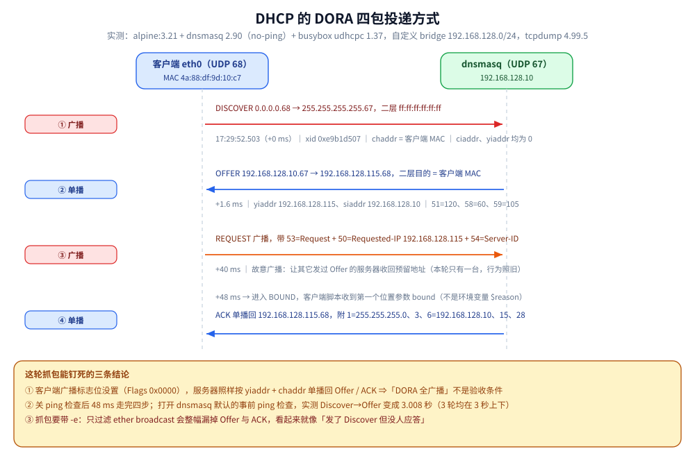
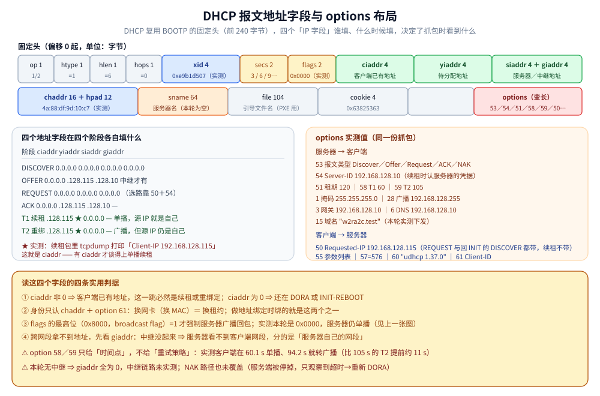
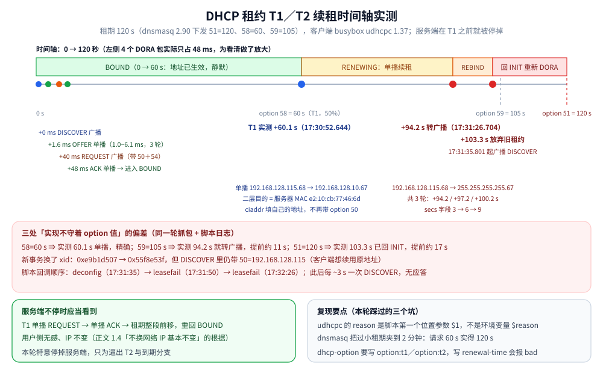
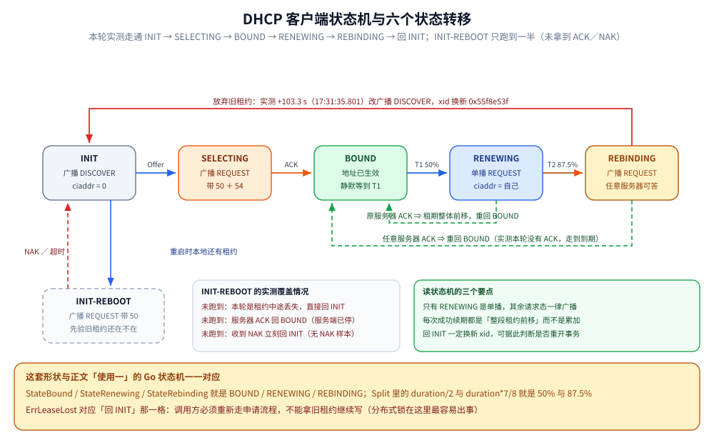

# DHCP

> 覆盖：DHCP 的四个阶段（DORA）与 T1 / T2 两个续租时间点、这套「租约」形状在别处的复用，以及 IPv6 侧完全不同的地址配置机制（RA / SLAAC / DHCPv6 / DAD）。
>
> 不覆盖：四个网络参数（IP / 掩码 / 网关 / DNS）怎么被使用、NDP 的机制见 [IP与路由基础.md](IP与路由基础.md)；DHCP 报文是怎么被广播送达的见 [网络分层与数据包旅程.md](../网络分层与数据包旅程.md)；服务端部署见 [06-DHCP与NTP.md](../../linux/鸟哥服务器架设篇/06-DHCP与NTP.md)。
>
> 内容整理自个人学习笔记，素材见 [素材清单](../../../素材清单.md)。
>
> ✅ 实测口径：「具体使用」一节的 DORA 四包投递方式与 120 秒租约时间轴来自 **Docker Desktop on Windows** 的同一轮抓包；**IPv6 / DHCPv6 未实测**（本机无可用 IPv6 链路），第二节为机制说明。

---

## 一、DHCP 的具体流程是怎样的？什么时候续租？

**本节要点**：三个递进问题——**DHCP 的作用、工作流程、何时续租**。
"续租"是大多数人答不上来的部分。

### 1.1 DHCP 的作用与适用场景

**作用：动态分配 IP 地址。**

**为什么需要动态分配？** 典型场景：

| 场景 | 说明 |
|---|---|
| **虚拟机** | 大量实例动态创建/销毁，逐个手工配 IP 不现实 |
| **企业内网** | 所有机器接入内网，通过内网访问公网 |
| **手机 / 笔记本连 WiFi** | 设备作为客户端，只需能访问公网服务 |

**共同特征**：这些设备都是**客户端**，只需要**主动访问服务端**，
**不需要被公网上的其他设备访问**。既然如此，就**不需要一个固定的公网唯一 IP**。

> 所以：动态 IP 适用于"**客户端接入网络去访问服务端资源**"的场景。
> 反过来，如果自己的机器要**作为服务器对外发布**，就不适合用动态分配。

### 1.2 动态分配带来的三个好处

1. **不需要显式管理地址** → 只要池子够，**不会出现 IP 冲突**；
2. **避免手工配置网络参数**（网关、DNS 等），配置本身也可能填错；
3. **地址租约管理由 DHCP 自动完成**（含续期），不用自己操心。

### 1.3 四个阶段的工作流程（DORA）

角色说明：**路由器**通常就充当 DHCP 服务器；**手机/电脑**是客户端设备。
前提：客户端**已经接入网络**（网线插好 / WiFi 连上），只是**还没有 IP 地址**。

> ⚠️ 关键前提带来的约束：**客户端还没有可用 IP，所以无法用「目的 IP」点对点通信**——
> 这正是 Discover 与选择阶段的 Request **通常用广播**的原因。
> 但要注意：**客户端是有 MAC 地址的**（报文里的 `chaddr` 字段），
> 所以服务器完全可以按「待分配 IP + 客户端 MAC」做**单播**回复，并不存在「服务器只能用广播」的硬约束。

| 阶段 | 方向 | 说明 |
|---|---|---|
| **① Discover（发现）** | 客户端 → **广播** | 客户端向 `255.255.255.255`（受限广播）发送发现请求，源 IP 填 `0.0.0.0`、UDP 68→67。网内所有设备（含 DHCP 服务器）都能收到。客户端在报文里带上自己的 **MAC（`chaddr`）**作为唯一标识。 |
| **② Offer（提供）** | DHCP 服务器 → **单播或广播** | 服务器提供可用 IP、**租期**、网关等参数。⚠️ **投递方式取决于客户端状态与报文里的「广播标志」**：若客户端声明需要广播（标志位置 1，例如它还不能接收单播）、或服务器无法按 `yiaddr + chaddr` 直接投递时走广播；否则通常**单播**到「待分配 IP / 客户端 MAC」。客户端可能收到**多个** Offer，通常选**第一个到达**的。 |
| **③ Request（请求）** | 客户端 → **通常广播** | 客户端声明「我想用哪个 IP」。这一步通常广播是**有意的**——让所有发过 Offer 的服务器都听到「客户端已经选定别人」，从而释放各自预留的地址。 |
| **④ Ack（确认）** | DHCP 服务器 → **单播或广播** | 服务器确认同意使用该地址，规则同 ②（受广播标志与投递能力影响）。至此客户端才真正获得 IP，可以接入网络通信。 |

> ⚠️ **不要用「DORA 全广播」当验收条件**：**Discover 与选择阶段的 Request 通常是广播**，而 **Offer / ACK 是单播还是广播要看客户端状态与广播标志**。而且这套口径只针对「初次获取地址」，**续租与重绑定是另一套**（见 1.4）。抓包时如果只过滤 `broadcast`，很可能漏掉 Offer/ACK 或误判流程。

### 1.4 何时续租（`T1` / `T2` 两个时间点）

现实观察：**只要不换网络，IP 基本不会变**——这正是**续租**的效果。

以**租期 24 小时**为例：

| 时间点 | 触发动作 | 投递方式 |
|---|---|---|
| **50%（T1，12 小时）** | 客户端向**原 DHCP 服务器**请求续租 | ⭐ **单播**（客户端已有 IP 与 ARP 信息，可以直接点到点请求） |
| **87.5%（T2，21 小时）** | 若上一次续租未成功，再次发起续租请求 | ⭐ **广播**（Rebinding：此时原服务器可能已不可达，改为向任意服务器广播求助） |
| 租期到期 | 仍未成功则释放地址，重新走 DORA 流程 | 回到广播 |

> **关键区别**：**T1 续租是单播，T2 重绑定是广播**——
> 因为 T1 时客户端有 IP 且假定原服务器可达；到 T2 时这个假定已经不成立，只能广播。
> ⚠️ 常见错误是把「续租」与「DORA」笼统地分成「单播 / 广播」两类——**DORA 内部本身就同时存在单播与广播**。

### 1.5 三点判据

1. **DHCP 的作用与落地场景**（虚拟机、企业内网、手机连 WiFi）；
2. **DORA 四步流程**，以及哪些步骤一定广播、哪些取决于广播标志（Discover 与选择阶段的 Request 通常广播，Offer/ACK 可为单播）；
3. **续租的两个时间点（T1 = 50% 单播、T2 = 87.5% 广播）**，并注意它与 DORA 的投递方式不是一回事。

---

## 二、IPv6 的地址是怎么配置的？

**本节要点**：IPv6 把「拿地址」和「拿默认路由」合并进了**路由通告（RA）**，所以它的自动配置形态和 DHCPv4 完全不同：**DHCPv6 通常只用来补 DNS 等信息，而不是发地址**。

| 组合 | 地址从哪来 | DNS 从哪来 |
|---|---|---|
| **纯 SLAAC** | RA 的前缀 + 主机自算（接口标识） | RA 的 RDNSS 选项 |
| **SLAAC + 无状态 DHCPv6** | RA 的前缀 + 主机自算 | **DHCPv6 下发** |
| **有状态 DHCPv6** | **DHCPv6 分配**（RA 的 `M` 标志置 1） | DHCPv6 |

> ⭐ **RA 里的两个标志位决定用哪种**：`M`（Managed）置 1 → 用有状态 DHCPv6 要地址；`O`（Other）置 1 → 地址自己配、但其他信息（DNS 等）去问 DHCPv6。

⚠️ 两个最容易踩的点：**DAD**（地址冲突检测）需要约 1 秒级时间，接口刚上线短暂不可用是正常的；如果链路不支持组播，DAD 会失败、地址无法启用。

> RA / SLAAC / DHCPv6 / DAD 的完整机制、有状态 DHCPv6 的四步、NDP 与 ARP 的对照、以及双栈排查顺序，见 [IPv6与双栈.md](IPv6与双栈.md) 第三、四、六节。

---

## 三、应用场景

**本节要点**：DHCP 的落点是「新机器怎么拿到四个参数」，以及「租约」这个形状在别处的复用。

| 场景 | 用到 DHCP 的哪一块 | 为什么值得注意 |
|---|---|---|
| 新机器 / 新容器接入网络 | DORA 四阶段 | 没有地址时只能广播求助，详见 本篇 1.3 |
| IP 地址池耗尽 | 租约与续租 | 租约过长会让地址回收变慢，详见 本篇 1.4 |
| 云主机地址漂移 | 租约式刷新的形状 | 与 etcd 租约、K8s `Lease` 同形，详见 [Raft协议.md](../../../04-架构与系统/分布式/共识协议/Raft协议.md) |
| 容器网络地址分配 | DHCP 与容器网络插件的分工 | 容器通常由 CNI 分配，详见 [网络与存储.md](../../../06-工程实践/部署/docker/网络与存储.md) |
| 解析不到 DNS | DHCP 下发的四个参数 | 参数里就有 DNS 服务器，详见 [DNS解析.md](DNS解析.md) |
| 服务端部署与排错 | 地址池与租约文件 | 详见 [06-DHCP与NTP.md](../../linux/鸟哥服务器架设篇/06-DHCP与NTP.md) |

## 四、具体使用

**本节要点**：两节语言代码写的是同一个形状 ——「租约 + T1/T2 定时刷新」；使用三给出抓包实测与命令口径。

### 4.1 Go（租约状态机：T1/T2 的形状在别处还会用到三次）

正文「50% 续租、87.5% 再续、到期重来」之所以取 50% 而不是 95%，
是因为**要留出足够长的失败重试窗口**。这个形状对下面这些东西完全通用：

| 场景 | Renew（=T1） | Rebind（=T2） | 到期（100%） |
|---|---|---|---|
| **DHCP** | 单播问原服务器续 | 广播问任意服务器 | 释放地址，重新 DORA |
| **OAuth access token** | 用 refresh token 换新 | 重新走授权 | 强制用户登录 |
| **Redis 分布式锁** | watchdog 提前续期 | 续期失败要停写 | TTL 到 → 可能被别人抢到 |
| **K8s ServiceAccount token** | 提前 20%~30% 刷新 | 重建 client | 请求 401 |

```go
package leasedemo

import (
	"context"
	"errors"
	"math/rand"
	"sync"
	"time"
)

var ErrLeaseLost = errors.New("leasedemo: lease lost, must re-acquire")

type State int

const (
	StateBound State = iota
	StateRenewing
	StateRebinding
)

func (s State) String() string {
	switch s {
	case StateRenewing:
		return "RENEWING"
	case StateRebinding:
		return "REBINDING"
	default:
		return "BOUND"
	}
}

// Renewal 是一份新的有效期。三个时间点是正文那张表的直接翻译。
type Renewal struct {
	RenewAt  time.Time // T1 = 50%
	RebindAt time.Time // T2 = 87.5%
	ExpireAt time.Time // 100%
}

// Split 按正文比例切分租期。
// 为什么是 87.5% 而不是 90%？——因为 24h 的 87.5% 正好是 21h，
// 而 50%→87.5% 之间那 37.5%（9 小时）就是"续租失败后还能重试多久"的预算。
func Split(start time.Time, duration time.Duration) Renewal {
	return Renewal{
		RenewAt:  start.Add(duration / 2),
		RebindAt: start.Add(duration * 7 / 8),
		ExpireAt: start.Add(duration),
	}
}
```

状态机与 50%/87.5% 的租期切分只是地基；下面是真正驱动这三个时间点的 `Lease`，以及一个正常情况永不返回的续租守护循环。

```go
// Lease 是"带自动续期的授权"。
// ⚠️ Renew / Rebind 两个回调必须是**并发安全且幂等**的：
// 一次网络抖动可能让它们被重复触发（DHCP 里对应"发了 REQUEST 没收到 ACK 又发一次"）。
type Lease struct {
	mu     sync.Mutex
	cur    Renewal
	state  State
	Renew  func(context.Context) (Renewal, error) // 单播给原服务端
	Rebind func(context.Context) (Renewal, error) // 广播/问任意服务端
	// Jitter 给续期时刻加随机偏移：一万个客户端在同一个 12 小时点齐刷刷续租，
	// 就是正文没提但一定会遇到的"DHCP 服务器被自己打挂"
	Jitter time.Duration
	Now    func() time.Time
}

func New(r Renewal, renew, rebind func(context.Context) (Renewal, error)) *Lease {
	return &Lease{cur: r, Renew: renew, Rebind: rebind, Now: time.Now}
}

func (l *Lease) State() State {
	l.mu.Lock()
	defer l.mu.Unlock()
	return l.state
}

// Wait 阻塞直到租约彻底失效或 ctx 取消；正常情况它永不返回（相当于一个续租守护协程）。
func (l *Lease) Wait(ctx context.Context) error {
	for {
		now := l.Now()
		r := l.snapshot()

		var (
			target time.Time
			useReb bool
		)
		switch {
		case now.Before(r.RenewAt):
			target, useReb = r.RenewAt, false
		case now.Before(r.RebindAt):
			target, useReb = r.RenewAt, false // 已过 T1：立刻补做续租
		case now.Before(r.ExpireAt):
			target, useReb = r.RebindAt, true // 已过 T2：换广播路径
		default:
			return ErrLeaseLost // 100%：调用方要重新走"申请"流程（DHCP 的 DISCOVER）
		}

		if !useReb {
			// 只有 T1 这一档加抖动：T2 是兜底，不能再往后推
			target = target.Add(-time.Duration(rand.Int63n(int64(max(l.Jitter, time.Millisecond)))))
		}

		if d := time.Until(target); d > 0 {
			select {
			case <-ctx.Done():
				return ctx.Err()
			case <-time.After(d):
			}
		}

		if err := l.attempt(ctx, useReb); err != nil {
			if errors.Is(err, ErrLeaseLost) {
				return err
			}
			// 续期失败不退出：短退避后进入下一轮判断，
			// 时间自然会把它推向 T2 → 到期，行为与 DHCP 客户端一致
			select {
			case <-ctx.Done():
				return ctx.Err()
			case <-time.After(time.Second):
			}
		}
	}
}
```

`Wait` 只负责决定「什么时候动手」；下面的 `attempt` 负责真正发起续租或重绑，并把状态机推到下一档。

```go
func (l *Lease) attempt(ctx context.Context, rebind bool) error {
	fn := l.Renew
	l.mu.Lock()
	l.state = StateRenewing
	if rebind {
		fn = l.Rebind
		l.state = StateRebinding
	}
	l.mu.Unlock()

	if fn == nil {
		return ErrLeaseLost
	}
	next, err := fn(ctx)
	if err != nil {
		return err
	}

	l.mu.Lock()
	l.cur, l.state = next, StateBound // 逐字段赋值：Renewal 是值类型，不会把外层的 mutex 一起复制
	l.mu.Unlock()
	return nil
}

func (l *Lease) snapshot() Renewal {
	l.mu.Lock()
	defer l.mu.Unlock()
	return l.cur
}
```

> **为什么这套值得单独写一遍**：绝大多数"token 过期突然全线 401"「锁 TTL 到点被抢」的事故，
> 根因都是**在到期那一刻才去处理**——也就是只有 100% 一档、没有 T1/T2。
> 用 50% 提前量，就是把"失败重试的时间"显式买下来。

---
### 4.2 Java（租约式刷新：同一个形状）

```java
package notes.appproto;

import java.time.Duration;
import java.time.Instant;
import java.util.concurrent.Executors;
import java.util.concurrent.ScheduledExecutorService;
import java.util.concurrent.TimeUnit;
import java.util.function.Supplier;

// 对应 Go 的 Lease：OAuth token、Kerberos ticket、Redis 锁续期都是这个形状。
public final class LeaseKeeper<T> implements AutoCloseable {

    private final ScheduledExecutorService exec = Executors.newSingleThreadScheduledExecutor(r -> {
        Thread t = new Thread(r, "lease-renew");
        t.setDaemon(true);
        return t;
    });

    private final Supplier<Renewed<T>> acquire;
    private volatile Renewed<T> current;

    public record Renewed<T>(T value, Instant expireAt) {
        public Duration lifetime() {
            return Duration.between(Instant.now(), expireAt);
        }
    }

    public LeaseKeeper(Supplier<Renewed<T>> acquire) {
        this.acquire = acquire;
        this.current = acquire.get();
        schedule();
    }

    private void schedule() {
        // ⚠️ 关键：在 50% 处续期而不是到期时（正文 DHCP T1 的教训）
        long delayMs = Math.max(current.lifetime().toMillis() / 2, 1000);
        exec.schedule(this::renew, delayMs, TimeUnit.MILLISECONDS);
    }

    private void renew() {
        try {
            current = acquire.get();
        } catch (RuntimeException e) {
            // 失败不取消守护：缩短间隔重试，留出 T2 的语义
            exec.schedule(this::renew, 1, TimeUnit.SECONDS);
            return;
        }
        schedule();
    }

    public T get() {
        return current.value();
    }

    @Override
    public void close() {
        exec.shutdownNow();
    }
}
```

---
### 4.3 抓包与命令实操（DORA 与续租）

#### DHCP：看 DORA 与续租

```bash
# 抓 DHCP 全流程：端口 67/68；-e 打印以太网首部，才能看清「二层是广播还是单播」
sudo tcpdump -i eth0 -nn -e 'port 67 or port 68'

# 只看广播帧（Discover 与选择阶段的 Request 会在这里；⚠️ Offer/ACK 不一定出现）
sudo tcpdump -i eth0 -nn -e 'port 67 or port 68 and ether broadcast'

# 只看单播帧：续租 T1 的 Request/ACK「应该」在这里；如果一次初始获取的 Offer/ACK 也是单播，
# 它们同样会落在这里 —— 这正是「不能把全广播当验收条件」的原因
sudo tcpdump -i eth0 -nn -e 'port 67 or port 68 and not ether broadcast'
```

⚠️ **判读纪律**：**别用「四个包都是广播」来判断流程是否正常**。正确做法是按 **报文类型** 看（Discover / Offer / Request / ACK 是否齐全），投递方式（广播 / 单播）只作为参考；能否看到单播还取决于你的**抓包点是否在客户端与服务器之间的路径上**。

租约字段与正文的对应关系：

> 客户端侧：租约文件里能直接读到 T1(renew) / T2(rebind) / expiry 三个值 →
> `cat /var/lib/dhcpd/dhclient.*.leases`（systemd-networkd 则看 `resolvectl status` / `networkctl status`）。

| `dhclient` 租约里的字段 | 正文概念 |
|---|---|
| `renew 1769...;` | **T1 = 50%** → **单播** `REQUEST` 给原服务器 |
| `rebind 1769...;` | **T2 = 87.5%** → **广播** `REQUEST` 给任意服务器 |
| `expire ...;` | 100% → 释放地址，重新走 DORA |
| `interface "eth0";` + `uid`/`hw-address` | 正文「靠 MAC（`chaddr`）作为唯一标识」 |

```bash
# 快速验证「续租走单播」：过掉那些源地址为 0.0.0.0 的初始请求，剩下的基本就是续租/重绑定
sudo tcpdump -i eth0 -nn 'port 67 and not src 0.0.0.0'

# 容器/虚机里排查「IP 拿不到」：先看有没有收到 Offer，再看有没有发出 Request
sudo tcpdump -i eth0 -nn -c 20 'port 67 or port 68' -vv
```

#### 实测：一次完整 DORA 的字段、options 与 120 秒租约的续租时间轴

**本节要点**：把 1.3 表格里「通常广播 / 通常单播」换成**看得见的字段与时间戳**，并给出短租约下 T1、T2 的真实触发时刻——以及实现**没有严格等 T2** 这个偏差。

##### 实验环境（Docker Desktop on Windows，全部读数来自同一轮抓包）

| 项 | 值 |
|---|---|
| 服务器 | `alpine:3.21` + `dnsmasq 2.90-r3`，`dhcp-range=192.168.128.50,192.168.128.200,120s`，`no-ping` |
| 显式下发的续租参数 | `dhcp-option=option:t1,60`、`dhcp-option=option:t2,105` |
| 客户端 | `alpine:3.21` + `busybox udhcpc 1.37.0`，接口 `eth0`，MAC `4a:88:df:9d:10:c7`，**广播标志位 `Flags [none] (0x0000)`** |
| 网络 | 自定义 bridge `w2ra2c-net2`（192.168.128.0/24），保证二层广播帧可见 |
| 抓包 | `tcpdump 4.99.5 -i eth0 -nn -e -vv 'port 67 or port 68'`（`-e` 才能看到二层目的 MAC） |

⚠️ 两处口径说明：① **dnsmasq 会把过小的租期钳到 2 分钟**（实测请求 60s 时服务端下发的是 `Lease-Time (51) = 120`），所以下面全部秒数以 120s 为分母；② `no-ping` 是为了去掉服务端的事前探测时延——**默认带 ping 检查时，实测 Discover→Offer 是 3.008 秒**（连跑 3 次均在 3 秒上下），关掉后才是下面的毫秒级。

##### 四包的真实投递方式（`-e` 逐帧读数）

| 报文 | 二层目的 | 三层源 → 目的 | 该报文里的关键字段（实测值） |
|---|---|---|---|
| **Discover** | `ff:ff:ff:ff:ff:ff`（广播） | `0.0.0.0.68 → 255.255.255.255.67` | `xid 0xe9b1d507`、`53=Discover`、`61=ether 4a:88:df:9d:10:c7`、`57=576`、`55=1,3,6,12,15,28,42`、`60="udhcp 1.37.0"` |
| **Offer** | `4a:88:df:9d:10:c7`（**单播到客户端 MAC**） | `192.168.128.10.67 → 192.168.128.115.68` | `Your-IP (yiaddr) = 192.168.128.115`、`Server-IP (siaddr) = 192.168.128.10`、`54=192.168.128.10`、`51=120`、`58=60`、`59=105` |
| **Request** | `ff:ff:ff:ff:ff:ff`（广播） | `0.0.0.0.68 → 255.255.255.255.67` | `53=Request`、`50=Requested-IP 192.168.128.115`、`54=192.168.128.10`（**广播是故意的**：让其他发过 Offer 的服务器收回地址） |
| **ACK** | `4a:88:df:9d:10:c7`（**单播**） | `192.168.128.10.67 → 192.168.128.115.68` | 同 Offer，外加 `1=255.255.255.0`、`28=192.168.128.255`、`3=192.168.128.10`、`6=192.168.128.10`、`15="w2ra2c.test"` |



⭐ **这一轮把 1.3 的那句结论钉死了**：客户端**没有**置广播标志位（`Flags [none] 0x0000`），服务器**照样**用 `yiaddr + chaddr` **单播**回了 Offer 和 ACK。所以「DORA 全广播」既不是协议要求，也不是抓包验收条件。

**四个地址字段谁在什么时候填**（`giaddr` 本轮未实测——环境里没有中继，见 2.5）：

| 字段 | 谁填 | 本轮实测 |
|---|---|---|
| `ciaddr`（Client-IP） | 客户端**已有地址**时填（续租、INIT-REBOOT 探测） | 续租包 `Client-IP 192.168.128.115`，初次 DORA 里为空 |
| `yiaddr`（Your-IP） | 服务器填「要给你的地址」 | `192.168.128.115` |
| `siaddr`（Server-IP） | 服务器填自己的地址（PXE/引导链路上还会指向 TFTP） | `192.168.128.10` |
| `giaddr`（Relay-IP） | **中继代理**填自己的地址，服务器据此知道往哪个网段分地址 | 未实测 |
| `chaddr`（Client-HW-Addr） | 客户端填自己的 MAC，是全流程唯一的身份 | `4a:88:df:9d:10:c7` |



图注：DHCP 报文的字段与 options 布局：240 字节固定头里的四个地址字段加 chaddr，以及 options 里 53、50、54、51、58、59、1、3、6、15 的本轮实测值。

##### 120 秒租约的完整时间轴（同一轮抓包，UTC 时间戳取自 tcpdump）

| 相对时刻 | 绝对时间 | 发生了什么 | 投递方式 |
|---|---|---|---|
| +0 ms | 17:29:52.503 | DISCOVER | 广播 |
| +1.6 ms | 17:29:52.504 | OFFER（`no-ping` 时实测 1.0~6.1 ms，共 3 轮） | 单播 |
| +40 ms | 17:29:52.543 | REQUEST（带 option 50 + 54） | 广播 |
| +48 ms | 17:29:52.551 | ACK → 进入 **BOUND** | 单播 |
| **+60.1 s（50% = T1）** | 17:30:52.644 | REQUEST 续租，**`ciaddr` 填自己的地址、不再带 option 50** | ⭐ **单播**到 `192.168.128.10`（二层目的 = 服务器 MAC `e2:10:cb:77:46:6d`） |
| **+94.2 s（78.5%）** | 17:31:26.704 | 单播续租无应答后转**广播** REQUEST，`secs` 字段 3 → 6 → 9，每约 3 秒一轮 | ⭐ 广播到 `255.255.255.255.67`，共 3 轮（17:31:26.7 / 29.7 / 32.7） |
| **+103.3 s（86.1%）** | 17:31:35.801 | 放弃旧租约回到 **INIT**：改广播 **DISCOVER**，`xid` 换新值 `0x55f8e53f`，但仍带 `50=Requested-IP 192.168.128.115`（想续用原来那个地址） | 广播，之后每 ~3 s 一轮（17:32:11 起改成约 3 s 但退避更长） |
| 脚本回调 | 17:31:35 / 17:31:50 / 17:32:26 | 依次 `deconfig`（地址被冲掉）→ `leasefail` → `leasefail` | — |



⚠️ **两个「实现不守着 option 值」的实测偏差**（都以抓包为准，别拿百分比反推）：

| option 里写的 | 客户端实际做的 | 偏差 |
|---|---|---|
| `58 = 60s`（T1，50%） | 60.1 s 发单播 REQUEST | ✅ 基本精确 |
| `59 = 105s`（T2，87.5%） | **94.2 s** 就转成广播 REQUEST | 提前约 11 s |
| `51 = 120s`（到期） | **103.3 s** 已放弃租约、回 INIT 广播 DISCOVER | 提前约 17 s |

原因是 `busybox udhcpc` 在单播续租**超时**后按自己的重试节奏推进，重试耗尽就宣布 lease lost，而不是死等 option 里给的时间点。

##### 客户端侧的状态与脚本回调（`udhcpc` 的 `$1`）

`busybox udhcpc` 把状态作为**脚本的第一个位置参数**传入（不是环境变量 `$reason`，写脚本时最容易踩），本轮实测到的取值序列：

```text
deconfig → bound(ip=192.168.128.115 lease=120 srv=192.168.128.10)
        → [单播 renew 无应答 → 广播 renew 3 轮] → deconfig → leasefail ×2
```

对应正文 1.4 与「使用一」的状态机：



图注：DHCP 客户端状态机：INIT、SELECTING、BOUND、RENEWING、REBINDING、INIT-REBOOT 六个状态与各自的触发条件、投递方式，以及进入 INIT-REBOOT 后收 NAK 回 INIT 的分支。

| 状态 | 进入条件 | 发包形态 | 本轮是否跑到 |
|---|---|---|---|
| INIT | 上电 / 租约丢失 / 收到 NAK | 广播 DISCOVER | ✅ |
| SELECTING | 收到一个或多个 Offer | 广播 REQUEST（带 50 + 54） | ✅ |
| BOUND | 收到 ACK | 静默，等到 T1 | ✅ |
| RENEWING | 50%（实测 60.1s） | **单播** REQUEST（`ciaddr` 填自己的地址） | ✅ |
| REBINDING | 87.5% 或单播重试耗尽（实测 94.2s） | **广播** REQUEST | ✅ |
| INIT-REBOOT | 有本地租约、重启后先验一下 | 广播 REQUEST（带 50），无应答则到期后 `leasefail` | ❌ 未跑到（本轮是租约中途丢失后直接回 INIT，没经历重启验证路径） |

##### 本轮**没有**覆盖的东西（别照着这些结论去写代码）

- **`giaddr` 与中继链路**：需要真实/软件中继（如 `dhcp-relay`），本轮环境没有，抓包里 `giaddr` 恒为 0，**中继场景未实测**；
- **收到 NAK 后立刻回 INIT**：服务端是被停掉的，本轮只观察到**超时**路径，没拿到任何 NAK 样本；
- **INIT-REBOOT**：本轮是租约中途丢失后直接回 INIT（广播 DISCOVER），没有经历「重启后先验旧租约」这条路径；
- **多服务器竞争选优**：只起了一台 `dnsmasq`，正文「客户端通常取第一个到达的 Offer」**没有被验证**；
- **IPv6 / DHCPv6**：本机 Windows 侧无可用 IPv6 链路，第二节是机制说明，**非实测**。

---

---

## 延伸追问

- **为什么 DISCOVER 要用广播？** → 客户端此刻**还没有可用 IP**，只能用二层广播寻址；而且它不知道服务器在哪。到了 **T1 续租**时客户端已经有地址、也知道原服务器在哪，就改成单播（**T2 重绑定**才回到广播）。
- **DORA 四个阶段都是广播吗？** → ⚠️ 不是。**Discover 与选择阶段的 Request 通常广播**（前者无地址、后者要让所有服务器都听到选择结果）；**Offer / ACK 是单播还是广播取决于客户端的广播标志与服务器能否按 `yiaddr + chaddr` 直接投递**。所以抓包时**不能把「全广播」当验收条件**。
- **DHCP 和静态 IP 怎么选？** → 服务器/网关用静态或 DHCP 保留地址，终端用动态。K8s 里则是 IPAM / CNI 分配，**和 DHCP 是两套机制**，别混为一谈。
- **租期到了但没续上会怎样？** → T1 单播续租、T2 广播重绑，都失败就放弃地址、重新走 DORA；用户侧表现为「网络突然断一下」。
- **为什么会有 DHCP 欺骗？** → 协议本身**无认证**，伪造的 DHCP 能下发恶意网关/DNS 做中间人；防护靠 DHCP snooping 或 802.1X。
- **容器里的 IP 是 DHCP 拿的吗？** → 不是。Docker 由 daemon 的 IPAM 分配、K8s 由 CNI 插件分配；只有裸机/虚机网卡才走 DHCP。
- **DHCP 报文走哪个端口？** → 服务端 67、客户端 68。⚠️ 地址形态要分阶段：**Discover 与选择阶段的 Request** 源地址是 `0.0.0.0`、目的 `255.255.255.255`；而 **T1 续租是单播**，源/目的都是双方已有地址。
- **IPv6 也用 DHCP 吗？** → 大多数情况下**地址不靠 DHCP**：IPv6 主机的地址与默认路由都从 **RA** 来（SLAAC 自己算地址），**DHCPv6 更多用来下发 DNS 之类的信息**；只有在 RA 里把 `M` 标志置位时才用有状态 DHCPv6 分配地址。详见第二节。

## 关联

- **上游/总纲**：[网络分层与数据包旅程.md](../网络分层与数据包旅程.md) — 四个网络参数从哪来，以及 DHCP 为何必须广播
- **对照/互补**：[IP与路由基础.md](IP与路由基础.md) — 这四个参数怎么用；ARP 与 ICMP
- **下游机制**：[IPv6与双栈.md](IPv6与双栈.md) — RA / SLAAC / DHCPv6 / DAD 的完整机制与双栈排查
- **对照/互补**：[DNS解析.md](DNS解析.md) — 同为网络配置类问题的对照（TTL 与缓存）
- **对照/互补**：[HTTP与gRPC.md](../应用层/HTTP与gRPC.md) — 连接池与连接复用（另一种「租约」视角）
- **对照/互补**：[Raft协议.md](../../../04-架构与系统/分布式/共识协议/Raft协议.md) — etcd 租约（Lease）、Election 与 KeepAlive
- **运维/配置**：[06-DHCP与NTP.md](../../linux/鸟哥服务器架设篇/06-DHCP与NTP.md) — 服务端部署与排错
- **运维/配置**：[网络与存储.md](../../../06-工程实践/部署/docker/网络与存储.md) — 容器网络的地址分配

> 反向引用（本篇被下列文档引到）：[UDP与数据报传输.md](../传输层/UDP与数据报传输.md)
