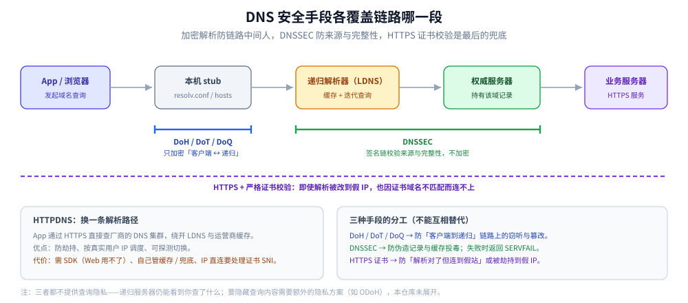

# DNS 安全与加密解析

> 覆盖：DNS 劫持与缓存投毒的区别、多 DNS 结果不一致时怎么排除正常调度、HTTPDNS 的适用边界、DoH / DoT / DoQ 各保护哪一段、DNSSEC 的签名链与「不提供隐私」、以及 `NXDOMAIN` / NODATA / `SERVFAIL` / 超时四种失败语义与负缓存。
>
> 不覆盖：域名层级、递归 / 迭代查询、记录类型与 TTL 缓存见 [DNS解析.md](DNS解析.md)；TLS 与证书校验见 [HTTPS与TLS.md](../应用层/HTTPS与TLS.md)；证书链排障见 [证书与HTTPS排障.md](../应用层/证书与HTTPS排障.md)。
>
> 内容整理自个人学习笔记，素材见 [素材清单](../../../素材清单.md)。
>
> ⚠️ 实测口径：本篇是机制与判据说明，**未在本机复现劫持 / 污染，也未搭建 DNSSEC 验证链**；命令为通用口径，实际输出取决于网络环境与递归服务器。

---

## 一、DNS 有哪些攻击面？

DNS 的安全问题不能笼统说成「被劫持」——攻击发生在链路的哪一段，决定了该用哪种手段：

| 攻击面 | 典型手法 | 有效手段 |
| --- | --- | --- |
| **本机 / 路由器配置** | 改 DNS 服务器地址、改 hosts | 检查配置、锁定设备、使用可信 DNS |
| **客户端 ↔ 递归** | 窃听、篡改、抢答伪造 | DoH / DoT / DoQ、HTTPS 严格校验 |
| **递归缓存** | 缓存投毒（Kaminsky 类） | 源端口随机化、DNSSEC、可信递归 |
| **递归 ↔ 权威** | 伪造权威应答 | DNSSEC、TSIG（区域传送） |
| **权威 / 注册商** | 改 NS、域名劫持、过期未续 | 注册商锁定、MFA、DNSSEC、到期监控 |
| **应用层** | 用 IP 直连绕过域名校验 | 全站 HTTPS + 严格证书校验 |

⭐ 一句话：**加密解析防的是链路中间人；DNSSEC 防的是数据来源与完整性；HTTPS 证书校验是最后一道「即使解析被改也连不上假站」的兜底。** 三者不互相替代。

---

## 二、劫持与污染怎么区分？

| | **DNS 劫持** | **DNS 污染（缓存投毒）** |
| --- | --- | --- |
| 位置 | 运营商 LDNS / 本机 / 路由器被改 | 递归服务器**缓存里被塞进伪造记录** |
| 原理 | 直接篡改应答或改 DNS 配置，返回广告页 / 钓鱼 IP | 抢在真响应前伪造应答（早期靠猜 UDP 源端口 + 事务 ID，即 Kaminsky 漏洞） |
| 表现 | 访问正常网站弹广告、解析到明显错误 IP | 部分地区解析异常，换个 DNS 就正常 |
| 影响范围 | 跟配置走，通常是一台设备或一个网络 | 跟递归缓存走，可能影响一个运营商 / 地区 |
| 处置 | 改回配置、换可信 DNS、查路由器 | 换递归、清缓存、启用 DNSSEC / 加密解析 |

**验证手段**：

1. `dig @8.8.8.8 域名` 与 `dig @223.5.5.5 域名` 对比；
2. `dig +trace 域名` 看链路中哪一级返回异常；
3. 检查 `/etc/resolv.conf` 和路由器 DNS 设置是否被改；
4. `whois <ip>` 看返回的 IP 是否属于知名 CDN / 云厂商段。

> ⚠️ 第 1 条只能作为**线索**，不能单独作为结论——见下一节。

---

## 三、不同 DNS 结果不一致就是被污染吗？

**不是。** 下面这些**都会**造成正常差异：

| 造成差异的正常原因 | 说明 |
| --- | --- |
| **GeoDNS / 分视图解析** | 权威服务器按**解析器的来源位置**返回不同的就近节点，两地结果本就不同 |
| **CDN / Anycast** | 同一域名的 A 记录可能是一组就近节点，甚至返回顺序随机 |
| **ECS（EDNS Client Subnet）** | 递归服务器把用户网段带给权威，不同递归带的前缀不同 → 返回不同 |
| **缓存时点不同** | 记录在这台递归上已过期、在那台还没过期，或 TTL 内轮换了地址 |
| **CDN 供应商的 IP 池本来就多** | 同一个域名的解析结果随时间变化属于正常 |

⭐ **要下「被污染」的结论，需要的是「结构化的矛盾」**：

- 解析结果**落在与业务无关的网段**（例如明显的内网 / 保留地址、与 CDN 无关的 IDC 段）；
- **返回的地址无法完成 TLS 握手**（证书域名不匹配）——这比「IP 不一样」有力得多；
- **`dig +trace` 在权威那一步返回的答案与本地递归缓存里的答案不一致**；
- 多个独立网络、多个递归在同一时间窗内都返回同一个错误答案，而权威侧正常。

单看「两台 DNS 结果不同」就下结论，是把正常调度误判成故障。

---

## 四、HTTPDNS 解决什么？

**原理**：App 不走 UDP 53 问 LDNS，而是**通过 HTTP(S) 接口直接查厂商的 DNS 集群**，携带域名（通常还有客户端 IP），服务端返回 IP 列表。

```text
App ──HTTPS──▶ HTTPDNS 服务（阿里云 / 腾讯云 DNSPod 等）──▶ 返回 IP 列表 ──▶ App 用 IP + 正确的 Host/SNI 直连业务服务器
```

| 优点 | 缺点 / 代价 |
| --- | --- |
| **绕开运营商 LDNS**，缓解劫持与污染 | 需接 SDK，Web 端用不了 |
| **精准调度**：服务端拿到真实用户 IP，比 ECS 更准 | 需自己实现**缓存、TTL、容灾** |
| 可自定义：多 IP 返回、**故障探测 + 快速切换**、按业务分流 | HTTPDNS 服务本身不可用时要有**本地兜底**（系统 DNS / 内置 IP） |
| 时延可控（可预热、可批量预解析） | ⚠️ HTTPS 下用 IP 直连有**证书 / SNI 校验**问题，需配置 `ServerName`（Go）/ `HostnameVerifier`（Java） |

⚠️ HTTPDNS 解决的是「**解析入口不经过 LDNS**」，不是「加密 DNS」。它通常走 HTTPS，所以客户端到 HTTPDNS 服务这一段是加密的；但它仍然是一个**知道你在查什么的第三方服务**。

---

## 五、DoH / DoT / DoQ 保护哪一段？

| | DoT | DoH | DoQ |
| --- | --- | --- | --- |
| 全称 | DNS over TLS | DNS over HTTPS | DNS over QUIC |
| 承载 | TLS，**853 端口** | **HTTPS**（TLS + HTTP），**443 端口** | QUIC（内建 TLS 1.3），**UDP 853 端口** |
| 协议依赖 | 专用端口 | ⚠️ **协议版本取决于部署**：RFC 8484 定义的是「用 HTTPS 承载」，**具体走 HTTP/2 还是 HTTP/1.1 由实现与协商决定**，不能一概说成「必须 HTTP/2」 | 依赖 UDP 可用；QUIC 不可用时无法回退到 TCP |
| 解决什么 | 加密 DNS 报文，**防链路上的窃听与篡改** | 同上，且流量**混在 443 里**更难被识别与封锁 | 同上，且**没有 TCP 队头阻塞**，连接建立更快 |
| 代价 | 专用端口容易被识别并封禁 | 需额外 HTTP 栈；部分网络仍会拦截知名 DoH 端点 | UDP 被限速 / 封禁时不可用；实现与生态比 DoH / DoT 少 |
| 规范 | RFC 7858 | RFC 8484 | RFC 9250 |



> ⚠️ 三者都**只加密「客户端 ↔ 递归解析器」这一段**：权威侧、以及递归服务器本身，仍然能看到你查了什么——**防的是链路上的中间人，不是防 DNS 服务商**。

---

## 六、DNSSEC 解决什么、不解决什么？

DNSSEC 用**签名链**保证「这条应答确实来自该域的权威服务器，且没有被改动过」：

```text
根区（信任锚）→ 签发 .com 的 DS → .com 签发 example.com 的 DS → example.com 用自己的 DNSKEY 签发记录（RRSIG）
验证方：从信任锚开始逐级校验 DS / DNSKEY / RRSIG，任一级断掉都验不过
```

| 它做什么 | ⚠️ 它**不**做什么 |
| --- | --- |
| **来源认证**：应答确实来自该域的权威链 | ❌ **不加密查询**（谁都能看到你查了什么） |
| **完整性**：记录未被篡改 | ❌ **不防劫持到伪造的 IP**（如果攻击者在**传输层**改包，DNSSEC 会验签失败并让解析直接失败——**变成 SERVFAIL，而不是返回正确答案**） |
| **防缓存投毒**：伪造记录验不过签名 | ❌ 不解决「DNS 服务商记录并分析你的查询」 |

⭐ **两个实践要点**：

1. DNSSEC 的保护是「**全有或全无**」——链上一级没签，整条链就验不了；
2. 它把「静默地被篡改」换成「**显式地解析失败**」，所以**开启校验后可能出现「以前能上网、现在解析直接失败」**，排障时要先确认是不是某一级 DNSSEC 配置有问题。

> 与 DoH / DoT 的分工：**DoH / DoT 保护传输**（不被窃听 / 篡改），**DNSSEC 保护数据来源与完整性**（应答确实来自该域的权威链），**两者都不提供查询隐私**（递归服务器仍然看得到你查了什么）。

---

## 七、解析失败的四种语义怎么区分、负缓存怎么生效？

⚠️ **「DNS 解析失败」是一句太笼统的话**——四种情况的原因和处置完全不同：

| 应答码 / 现象 | 含义 | 通常说明什么 |
| --- | --- | --- |
| **`NXDOMAIN`** | 这个名字**不存在** | 域名拼错、记录没配、或子域未委派 —— **权威明确说「没这个名」** |
| **`NOERROR` + 无答案（NODATA）** | 名字存在，但**没有你要的这种记录类型** | 例如域名只有 A 没有 AAAA（常见于 AAAA 查询）、或只有 MX 没有 A |
| **`SERVFAIL`** | 服务器**处理不了** | 权威不可达、DNSSEC 验签失败、上游超时被汇总 —— ⭐ **最容易被误当成「域名不存在」的一种** |
| **超时 / 无响应** | 报文没回来 | 网络阻断、防火墙丢 UDP 53、服务器过载 —— ⚠️ 与上三种**在报文层面就不同** |

**负缓存**：`NXDOMAIN` 与 NODATA 的结果**也会被缓存**，缓存时长由 SOA 记录里的 **minimum TTL** 决定（规范口径见 [RFC 9520](https://www.rfc-editor.org/rfc/rfc9520.html)）。

| 后果 | 说明 |
| --- | --- |
| 「刚配好记录却仍然解析不到」 | 之前查询命中了**负缓存**，得等它过期（或刷新递归的缓存） |
| 「偶发故障后持续不可用」 | 一次抖动导致的失败被负缓存，短时间内一直失败 |
| 排障要点 | 用 `dig` 时看 **`status:`** 与 **`AUTHORITY` 段是否带 SOA**（带 SOA 的否定应答说明是**权威给的**否定，而不是中间设备伪造） |

---

## 八、应用场景

**本节要点**：DNS 安全手段按「攻击发生在哪一段」选，不要用一个手段去覆盖所有问题。

| 场景 | 涉及哪一块 | 为什么值得注意 |
| --- | --- | --- |
| 访问正常网站被弹广告 | 本机 / 路由器 DNS 被改 | 先查配置，再换可信 DNS，详见 本篇第二节 |
| 部分地区解析异常 | 递归缓存 / 污染 | 用「结构化矛盾」判定，不要只看结果不同，详见 本篇第三节 |
| 移动端防劫持 | HTTPDNS | 绕开 LDNS，但要处理证书 SNI 与本地兜底，详见 本篇第四节 |
| 公共 Wi-Fi 下防窃听 | DoH / DoT | 只保护客户端到递归这一段，详见 本篇第五节 |
| 金融 / 政务域名的完整性 | DNSSEC | 验签失败会变成 `SERVFAIL`，要监控，详见 本篇第六节 |
| 「刚配好却解析不到」 | 负缓存 | 等 SOA minimum TTL 过期，详见 本篇第七节 |
| 解析被改也连不上假站 | HTTPS 严格证书校验 | 证书校验是最后兜底，详见 [证书与HTTPS排障.md](../应用层/证书与HTTPS排障.md) |

## 九、具体使用

**本节要点**：先用 `dig` 的 `status:` 与 `AUTHORITY` 段定性，再看是否还有 53 端口明文流量。

```bash
# 1) 对比不同递归的答案（只是线索，不是结论）
dig @8.8.8.8 example.com +short
dig @223.5.5.5 example.com +short

# 2) 从根逐级跟踪：看权威那一步与本地缓存是否矛盾
dig +trace example.com

# 3) 看应答码与是否带 SOA（区分 NXDOMAIN / NODATA / SERVFAIL）
dig example.com A
dig example.com AAAA
dig example.com +noall +comments +authority

# 4) 查 DNSSEC 链（需要递归支持并开启验证）
dig +dnssec example.com DS
dig +dnssec example.com RRSIG
delv @8.8.8.8 example.com

# 5) 检查本机 DNS 配置是否被改
cat /etc/resolv.conf
ipconfig /all

# 6) 看是否还有明文 53 流量（DoH / DoT 抓不到域名）
sudo tcpdump -i any -nn 'port 53'

# 7) 验证返回的 IP 是否能完成 TLS 握手（证书域名是否匹配）
openssl s_client -connect <返回的IP>:443 -servername example.com
```

```powershell
# Windows：清缓存与查看缓存
ipconfig /flushdns
ipconfig /displaydns
Resolve-DnsName example.com -Type A -Server 8.8.8.8
```

⭐ 判断口径：**`status: NXDOMAIN` 且 `AUTHORITY` 带 SOA** → 权威明确否认，查记录 / 委派；**`status: SERVFAIL`** → 查 DNSSEC 链或权威可达性；**超时且没有应答** → 查网络与防火墙；**答案与权威不一致且落在无关网段** → 才考虑污染。

---

## 延伸追问

- **DoH 能防 DNS 劫持吗？** → 能防「客户端到递归」这一段被窃听或篡改；但它防不了递归本身作恶、也防不了权威 / 注册商被改。要覆盖后者，需要 DNSSEC 与域名侧的安全措施。
- **DNSSEC 开启后为什么网站反而打不开了？** → 因为验签失败会返回 `SERVFAIL`，而不是回退到未验证答案。常见原因是某一级缺 DS / DNSKEY、签名过期、或权威不支持 DNSSEC 但上层签了 DS。
- **`SERVFAIL` 和 `NXDOMAIN` 有什么本质区别？** → `NXDOMAIN` 是「这个名字不存在」的明确否定；`SERVFAIL` 是「我处理不了」。把 `SERVFAIL` 当 `NXDOMAIN` 会去改记录，而真正的问题可能在 DNSSEC 或权威可达性。
- **负缓存会缓存多久？** → 由否定应答的 SOA 的 minimum TTL 决定（还会受 RFC 2308 / 9520 的上限约束）。所以「刚配好记录却解析不到」可能不是没生效，而是之前的失败还在缓存里。
- **HTTPDNS 与 DoH 能一起用吗？** → 可以，但职责不同：HTTPDNS 绕开 LDNS 并做精准调度，DoH 保护「客户端到递归」的传输。App 里通常只选一条解析路径，不要把两者混成一条链。
- **为什么说「HTTPS 是 DNS 劫持的兜底」？** → 即使解析被改到攻击者 IP，客户端仍会校验证书域名；攻击者拿不到该域名的有效证书，TLS 握手就失败。前提是**严格校验**，不能关闭证书校验或忽略主机名。
- **企业内网该怎么选？** → 优先可信递归 + DNSSEC 验证 + 内部域名分区；对外解析可用 DoH / DoT；移动端再叠加 HTTPDNS。不要用「改 hosts」当长期方案。

---

## 关联

- **上游/总纲**：[DNS解析.md](DNS解析.md) — 域名层级、递归 / 迭代、记录类型、TTL 与缓存
- **对照/互补**：[HTTPS与TLS.md](../应用层/HTTPS与TLS.md) — 证书校验如何兜底被篡改的解析
- **下游机制**：[证书与HTTPS排障.md](../应用层/证书与HTTPS排障.md) — 证书链、SAN 与握手失败排查
- **下游机制**：[IPv6与双栈.md](IPv6与双栈.md) — AAAA 查询与双栈解析
- **运维/配置**：[06-DHCP与NTP.md](../../linux/鸟哥服务器架设篇/06-DHCP与NTP.md) — 内网 DNS 与 DHCP 的配套
- **安全**：[Web攻击与防御.md](../../../06-工程实践/安全/应用与数据安全/Web攻击与防御.md) — 应用层攻击面
