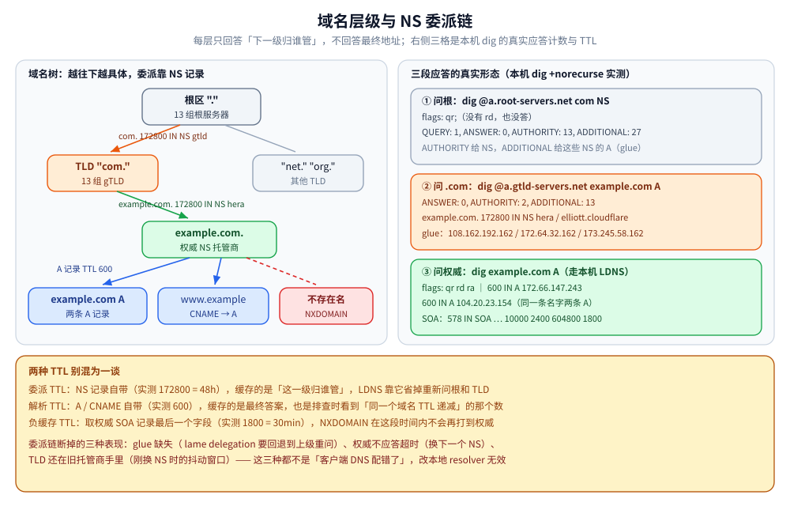
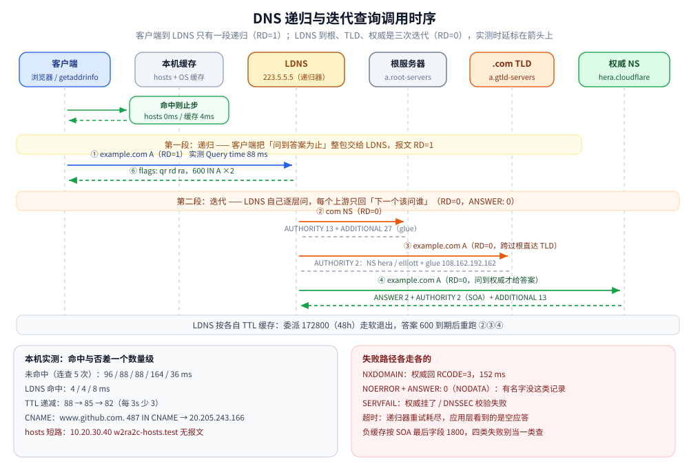
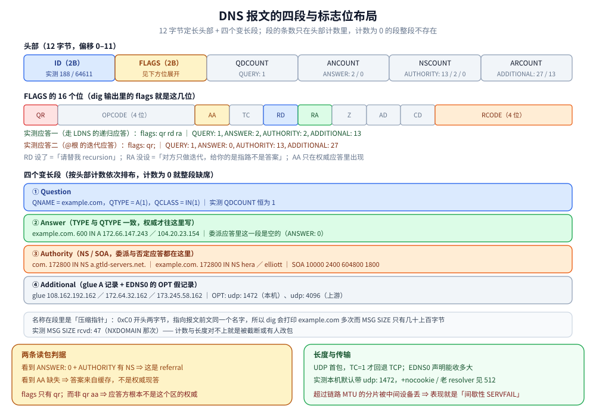
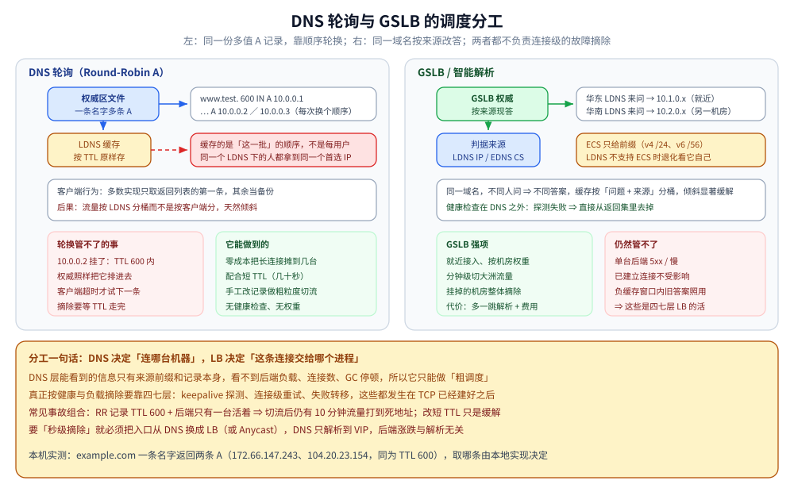

# DNS 解析

> 覆盖：域名 → IP 的分布式命名系统 —— 层级结构、递归 / 迭代查询、资源记录、负载均衡与安全（DNSSEC、DoH / DoT / DoQ、负缓存），以及 Go / Java 两版使用示例。
>
> 不覆盖：DNS 为什么默认走 UDP、截断后怎么回落见 [UDP与数据报传输.md](../传输层/UDP与数据报传输.md)；劫持 / 污染、HTTPDNS、DoH / DoT / DoQ、DNSSEC 与负缓存的展开见 [DNS安全与加密解析.md](DNS安全与加密解析.md)；解析出来的地址怎么被路由见 [IP与路由基础.md](IP与路由基础.md)；BIND 部署与 zone 文件见 [07-DNS服务器.md](../../linux/鸟哥服务器架设篇/07-DNS服务器.md)。
>
> 内容整理自个人学习笔记，素材见 [素材清单](../../../素材清单.md)。
>
> ✅ 实测口径：本机 `dig`（DiG 9.18.50 / `alpine:3.21` 容器）跑过委派链、TTL 递减与缓存命中；**未实测** DNSSEC 验签、DoH / DoT / DoQ 的实际部署。

---

## 一、DNS 解决什么问题？

> **DNS（Domain Name System）是一个「域名 → IP」的分布式命名系统**，把人类可读的 `www.example.com` 翻译成机器可路由的 `93.184.216.34`。

**为什么不直接用 hosts 文件？**

| 维度 | hosts 文件 | DNS |
| 规模 | 单机一份，全球域名放不下 | 分布式、分层，理论上无上限 |
| 更新 | 改一台机器只影响一台，靠人工同步 | 改权威记录即可全网生效（受 TTL 约束） |
| IP 变更 | 服务端换 IP，所有客户端要手动改 | 只需改一处权威记录 |
| 组织方式 | 扁平 | 树形分层 + 委派，各域自治 |

**协议与端口**：DNS 是**应用层协议**，默认 **UDP 53**（报文小、一次往返、无连接开销）；**区域传送（AXFR/IXFR**）和**超过 UDP 上限的大响应**（尤其带 DNSSEC）走 **TCP 53**（EDNS0 把 UDP 上限抬到 4096 字节，超了仍会置 TC 位截断并回退 TCP）。加密变体：**DoT 853（TLS）/ DoH 443（HTTPS，协议版本取决于部署）/ DoQ 853（QUIC）**。

---

## 二、域名层级与服务器类型是怎么组织的？

### 2.1 域名树

```text
.                            ← 根域（root），日常书写省略
├── com. / cn.               ← 顶级域 TLD（gTLD：.com/.net / ccTLD：.cn）
└── example.com.             ← 二级域（注册域）
    └── www.example.com.     ← 子域 / 主机名
```

- 每一级用 `.` 分隔，**从左到右层级递减**（`www` 是 `example.com` 的子域）；
- **FQDN（完全限定域名）** 以根域的 `.` 结尾，如 `www.example.com.` —— 那个尾点表示「**到此为止，不再往上拼搜索域**」；
  ⚠️ 不加尾点会被当作相对名，解析器会套用 `/etc/resolv.conf` 里的 `search` 域，K8s 里 `nslookup svc` 先试 `svc.ns.svc.cluster.local` 就是这个机制。

### 2.2 四类服务器

| 类型 | 职责 | 关键事实 |
| **根域名服务器** | 不解析具体域名，只告诉「`.com` 该问谁」 | 全球 **13 组**（`a`~`m`.root-servers.net），实为**任播**部署的数百个物理实例 |
| **顶级域名服务器（TLD）** | 管辖 `.com`/`.cn` 等，返回该 TLD 下域名的权威服务器 | 由对应注册局运营（Verisign 管 `.com`） |
| **权威域名服务器** | 真正持有并回答某域名的资源记录 | 域名持有者自己配置（如 `ns1.dnsprovider.com`），⚠️ **不做递归** |
| **本地/递归 DNS（LDNS）** | 替客户端跑完全过程并返回最终结果 | 运营商分配 / `8.8.8.8`、`114.114.114.114`、`223.5.5.5` |

> ⭐ 易混点：从根到 TLD 到权威，全都是**权威服务器，但只给"下一级线索"**；真正「替你跑腿」的只有**递归服务器（LDNS）**。

### 2.3 实测：委派链上的真实应答

**本节要点**：「权威只给下一级线索」这句话在报文里是看得见的 —— **`ANSWER` 段是空的，名字全在 `AUTHORITY` 段**，能直接用的地址在 `ADDITIONAL`（glue）段。

容器内 `dig` 实测（DiG 9.18.50 / `alpine:3.21`，同一轮次取得，命令与读数一一对应）：

| 命令 | 关键读数 |
|---|---|
| `dig @a.root-servers.net com NS +norecurse` | `flags: qr;`（**只有 `qr`，没有 `ra`** —— 根服务器不做递归）、`QUERY: 1, ANSWER: 0, AUTHORITY: 13, ADDITIONAL: 27`；`com. 172800 IN NS a.gtld-servers.net.` |
| `dig @a.gtld-servers.net example.com A +norecurse` | `flags: qr;`、`QUERY: 1, ANSWER: 0, AUTHORITY: 2, ADDITIONAL: 13`；`example.com. 172800 IN NS hera.ns.cloudflare.com.` / `example.com. 172800 IN NS elliott.ns.cloudflare.com.`，glue `hera.ns.cloudflare.com. 172800 IN A 108.162.192.162` |
| `dig example.com SOA +noall +answer` | `example.com. 578 IN SOA elliott.ns.cloudflare.com. dns.cloudflare.com. 2416374680 10000 2400 604800 1800`（刷新 10000 / 重试 2400 / 过期 604800 / **末位 1800**） |
| `dig example.com A` | `flags: qr rd ra;`（**有 `rd`、无 `aa`** = 递归代查、非权威应答）、`QUERY: 1, ANSWER: 2`；`example.com. 600 IN A 172.66.147.243`、`example.com. 600 IN A 104.20.23.154` |

⭐ 两个可对照的量级：**委派记录（NS）的 TTL 实测 172800（48 小时）**，**业务记录（A）的 TTL 实测 600（10 分钟）** —— 递归服务器把「该问谁」记得比「答案是什么」久得多。这也是换 IP 时不需要重新收敛委派链的原因。

⚠️ `SOA` 的最后一个字段 **1800** 就是第六节说的**负缓存时长**（negative TTL）；正文表格里的「`minimum`」在报文里就是这个位置。



图注：域名层级与 NS 委派链：根、.com TLD、example.com 权威、主机名四级，每级持有哪条 NS、委派 TTL 172800 与记录 TTL 600 的对照。

---

## 三、一次解析的完整流程是怎么走的？⭐

### 3.1 递归查询 vs 迭代查询

| | 递归查询（Recursive） | 迭代查询（Iterative） |
| 语义 | 「你帮我查完，给我**最终答案**」 | 「你**知道的告诉我**，不知道就给下一家地址」 |
| 请求方负担 | 零，只等结果 | 自己一次次去问 |
| 标志位 | `RD=1`（期望递归） | `RD=0` |
| 谁对谁 | **客户端 → LDNS** | **LDNS → 根 / TLD / 权威** |

> ⭐ **一句话记法**：**客户端到 LDNS 是递归，LDNS 到各级服务器是迭代**。让千万客户端都去问根服务器不可接受，把「跑腿」集中到少数递归服务器，再用**缓存**摊薄成本。

### 3.2 完整流程（一次浏览器访问）

1. **浏览器缓存**（Chrome 独立维护，约 60s）→ 命中即返回；
2. **操作系统缓存** → 再查 **`hosts` 文件**（`/etc/hosts` / `C:\Windows\System32\drivers\etc\hosts`）→ 命中即返回；
3. **LDNS（递归服务器）** 先查自己的缓存，未过期直接返回（非权威应答 `aa=0`）；
4. 缓存没有 → LDNS **迭代**发问：

```text
LDNS ──1──▶ 根服务器   : "www.example.com 的 IP？"
根    ──2──▶ LDNS      : "不知道，去问 .com 的 TLD：a.gtld-servers.net"
LDNS ──3──▶ .com TLD   : "www.example.com 的 IP？"
TLD   ──4──▶ LDNS      : "去问 example.com 的权威：ns1.dnsprovider.com"
LDNS ──5──▶ 权威服务器  : "www.example.com 的 IP？"
权威  ──6──▶ LDNS      : "A = 93.184.216.34，TTL=300"（权威应答 aa=1）
LDNS ──7──▶ 客户端     : 返回 IP，并把结果按 TTL 缓存
```

5. 客户端拿到 IP 才开始建 TCP 连接（本篇不展开，见 [TCP三次握手.md](../传输层/tcp/TCP三次握手.md)）；
6. ⚠️ **CNAME 会重启一轮**：第 6 步若返回 CNAME，LDNS 要**对别名再解析一次**，直到拿到 A/AAAA。

### 3.3 实测：时延、TTL 递减与缓存命中

**本节要点**：上面 7 步的成本几乎全部落在「LDNS 有没有缓存」这一件事上 —— 缓存命中时**一次 UDP 都不发**，未命中时才走那三级迭代。

容器内 `dig` 实测（DiG 9.18.50 / `alpine:3.21`；**本节读数出自另一轮执行**，与第二节表格里的委派读数不同轮，不要互推）：

| 场景 | 命令 | 实测读数 |
| 递归应答（非权威） | `dig example.com A` | `flags: qr rd ra`（无 `aa`）、TTL **600** |
| 未命中缓存的往返时延 | `dig @223.5.5.5 example.com A` ×5 | `Query time` = **96 / 88 / 88 / 164 / 36 msec**（波动 36~164ms，只断言量级） |
| 命中缓存 | `dig github.com A` 连查 ×3 | `Query time` = **4 / 4 / 8 msec** —— 比上一行低一个数量级 |
| TTL 递减计时 | `dig example.com A` 间隔 3s ×3 | TTL **88 → 85 → 82**，每查一次正好少 3 秒 |
| CNAME 重启一轮 | `dig www.github.com A` | `www.github.com. 487 IN CNAME github.com.` → `github.com. 487 IN A 20.205.243.166` |
| hosts 短路（不发 DNS 包） | 写入 `/etc/hosts` 后 `getent hosts` | 返回 `10.20.30.40 w2ra2c-hosts.test` |
| 名字不存在 | `dig nosuchname-w2ra2c.example.com A` | `status: NXDOMAIN`、`ANSWER: 0, AUTHORITY: 0`、`Query time 152 msec` |
| 有名字无该类型记录 | `dig github.com AAAA` | `status: NOERROR`、`ANSWER: 0`（**不是 NXDOMAIN**） |

⚠️ 这一轮里 `NXDOMAIN` 的应答 `AUTHORITY: 0`，说明**本机这一跳递归没有把 SOA 一起带回来**（负缓存时长仍然由权威侧 SOA 的末位 1800 决定，见第二节）。排障时如果只盯 `AUTHORITY` 段有没有 SOA 来判断「是不是权威给的否定应答」，**要先确认中间那跳递归会不会改写应答段**。



图注：DNS 递归与迭代查询调用时序：客户端到 LDNS 一段递归，LDNS 到根、.com TLD、权威三级迭代，含浏览器/OS/hosts/LDNS 四处缓存命中分支与实测时延。

### 3.4 TTL 与缓存（⚠️ 高频故障）

| 环节 | TTL 来源 | 说明 |
| 权威服务器 | 域名持有者配置（如 600 / 3600） | **决定全网缓存时长** |
| LDNS | 权威返回的 TTL，**递减计时** | 归零后回源重取 |
| OS / 浏览器 | 系统实现，通常尊重 TTL 但有上下限 | Linux `systemd-resolved`/`nscd`、Windows DNS Client 服务 |

**⚠️「改了解析不生效」的标准解释**：① 旧 TTL 是 3600 就最长要等 3600 秒，**不可能立即生效**；② 各地 LDNS 过期时刻不同，导致**各地生效时间不一致**；③ 部分运营商/企业网关**无视 TTL 超期缓存**，可能几天不生效；④ 浏览器还有独立一层，`ipconfig /flushdns` 只清 OS 层。

> **正确姿势**：变更前**先把 TTL 调小**（3600 → 60），**等一个旧 TTL 周期**，再改 IP，观察稳定后再把 TTL 调回去。

---

## 四、资源记录类型有哪些？⭐

| 类型 | 作用 | 示例值 | 典型用途 |
|---|---|---|---|
| **A** | 域名 → IPv4 | `www  A  93.184.216.34` | 最基础的解析 |
| **AAAA** | 域名 → IPv6 | `www  AAAA  2606:2800::2` | IPv6 接入 |
| **CNAME** | 域名 → 另一个域名（别名） | `cdn  CNAME  xxx.cdnprovider.com` | 接 CDN、接 SaaS、域名收敛 |
| **MX** | 邮件服务器 + 优先级（数字小者优先） | `@  MX 10 mail.example.com` | 收邮件路由，`@` 表示域名本身 |
| **NS** | 指定该域的权威服务器 | `example.com  NS  ns1.dnsprovider.com` | 域名委派、子域授权 |
| **TXT** | 任意文本 | `v=spf1 include:_spf.google.com ~all` | **域名所有权校验**（ACME DNS-01 等）、**SPF/DKIM/DMARC** 反垃圾 |
| **PTR** | IP → 域名（反向解析） | `34.216.184.93.in-addr.arpa  PTR  www.example.com` | 邮件反查、日志可读化 |
| **SRV** | 服务发现：主机 + 端口 + 优先级/权重 | `_sip._tcp  SRV 0 5 5060 sipserver` | K8s、SIP、部分 RPC 服务发现 |
| **SOA** | 区文件起始记录：主服务器、序列号、刷新/重试/过期时间 | 每个 zone 有且仅有一条 | 主从同步依据（序列号变大触发 AXFR） |
| **CAA** | 指定允许哪家 CA 签发证书 | `example.com  CAA 0 issue "letsencrypt.org"` | 防误签，合规要求 |

### 4.1 ⚠️ CNAME 的三个坑

| 坑 | 说明 |
|---|---|
| **CNAME 与 A 不能共存** | RFC 规定：**一个名字上一旦有 CNAME，就不能再有 A/AAAA/MX/TXT 等任何其他记录**（NS/SOA 除外）。`www` 做了 CNAME 就不能再给它加 A |
| **不能用在根域名（zone apex）** | `example.com.` 本身已有 NS/SOA，再加 CNAME 会冲突 → 根域要指向 CDN 只能用 **ALIAS / ANAME / Flattening**（各云厂商私有实现，本质是把 CNAME 解析成 A 后返回） |
| **CNAME 链过长** | `a → b → c → A` 每多一跳就多一轮查询，时延与失败面都增加 → **控制在 1~2 跳**，不要指向跨服务商的深层域名 |

### 4.2 报文结构：四段与三个计数

上面这些记录类型，是**装在同一个报文的四个段里**的。头部固定 12 字节：

| 字段 | 长度 | 作用 | 本机实测对应值 |
|---|---|---|---|
| `ID` | 2 字节 | 事务标识，应答原样带回 | `dig` 尾行 `id: 188` / `id: 64611` |
| `FLAGS` | 2 字节 | 位段：`QR` `OPCODE` `AA` `TC` `RD` `RA` `Z` `AD` `CD` `RCODE` | `qr rd ra`（递归代查、**无 `aa`**）／`qr;`（权威，**连 `ra` 都没有**） |
| `QDCOUNT` | 2 字节 | Question 段条数 | `QUERY: 1` |
| `ANCOUNT` | 2 字节 | Answer 段条数 | `ANSWER: 2`（两条 A）／`ANSWER: 0`（referral） |
| `NSCOUNT` | 2 字节 | Authority 段条数 | `AUTHORITY: 13`（根给的 `.com` NS）／`AUTHORITY: 2`（TLD 给的 `example.com` NS）／`AUTHORITY: 0` |
| `ARCOUNT` | 2 字节 | Additional 段条数 | `ADDITIONAL: 27`（根的 glue）／`ADDITIONAL: 13`（TLD 的 glue） |

其后依次是 **Question → Answer → Authority → Additional** 四段，每段都是若干条 `RR`（`NAME / TYPE / CLASS / TTL / RDLENGTH / RDATA`）。

⭐ **读报文的两条实用判据**（都由上面那三个计数直接得出）：

1. **`ANSWER: 0` 而 `AUTHORITY` 有 NS** = 这是一条**委派/引荐（referral）**，不是答案 —— 对应第二节里「权威只给下一级线索」；
2. **`ANSWER` 有值但 `AA` 位没置** = 应答来自**缓存**而非权威，正是第三节说的 `aa=0`。

⚠️ **`TC` 位与 EDNS0**：UDP 单包载荷超过上限时置 `TC=1`，客户端改用 **TCP 53** 重发一次。本机 `dig` 默认在 OPT 记录里申报的 UDP 载荷上限实测为 `udp: 1472`（问根时）与 `udp: 4096`（问 `.com` 时）—— 这就是第一节说的「EDNS0 把 UDP 上限抬到 4096」。

⚠️ 一个**最小应答**的量级参考：另一轮实测里，`NXDOMAIN` 的应答 `MSG SIZE rcvd: 47` 字节（整个报文，含 12 字节头部与问题名）—— 与「DNS 报文小、一次往返就够，所以默认走 UDP」互相印证。



图注：DNS 报文布局：12 字节头部的十个标志位与三个计数，以及 Question、Answer、Authority、Additional 四段与本机实测计数对照。

---

## 五、DNS 也能做负载均衡吗？

### 5.1 DNS 轮询（Round-Robin）

同一个名字配**多条 A 记录**，权威服务器每次应答**打乱顺序**返回，客户端通常取第一条：

```text
www  A  1.1.1.1
www  A  1.1.1.2
www  A  1.1.1.3     ← 应答顺序随机轮换
```

**缺点（⭐ 常考）**：① **缓存导致不均衡**——LDNS 缓存期内经它解析的用户全拿到同一个 IP，而各运营商用户量差异巨大，流量严重倾斜；② **无法感知故障**——后端挂了 DNS 仍会把它返回给用户；③ **TTL 两难**——短则查询量大、长则切换慢；④ **没有健康检查、权重、连接数/延迟感知**。

### 5.2 GSLB / 智能 DNS

按**来源 IP → 运营商 / 地域 / 国家**返回**不同 IP**，把用户调度到最近机房；进阶可结合健康检查做**故障切换**、按权重灰度、按运营商做多线调度。

> ⚠️ **EDNS Client Subnet（ECS）**：让权威服务器看到「真实用户 IP 段」而非 LDNS 的 IP，否则会按 LDNS 位置误判；代价是缓存 key 多了 IP 段，**命中率下降**。

### 5.3 与 LB 的分工

| 层次 | 手段 | 解决什么 |
| **DNS / GSLB** | 轮询、智能 DNS | **跨地域、跨机房**的粗粒度调度；第一跳就近接入 |
| **四层 LB**（LVS、云 CLB 四层） | VIP + DR/NAT/TUNNEL | 机房内**高并发流量分发** |
| **七层 LB**（Nginx、云 CLB 七层、Ingress） | 按 Host/Path/Header 路由 | **按业务规则**分发、健康检查、熔断、灰度 |

> ⭐ **DNS 决定"去哪个机房"，LB 决定"去机房里的哪台机器"。** DNS 只做粗筛与兜底，真正的故障摘除交给 LB 的健康检查。



图注：DNS 轮询与 GSLB 的差别：同一份多值 A 记录被各级缓存放大成流量倾斜，GSLB 改按来源返回不同地址，故障摘除仍要交给四七层 LB。

---

## 六、DNS 有哪些常见问题与安全风险？

**本节要点**：先分清「攻击发生在哪一段」，再选手段——加密解析、DNSSEC、HTTPS 证书校验与 HTTPDNS 各自只覆盖一段。

| 问题 | 一句话判据 | 对应手段 |
|---|---|---|
| **本机 / 路由器被改** | 换公共 DNS 就正常，配置里是陌生地址 | 改回配置、可信 DNS |
| **劫持 / 污染** | 结果是「结构化矛盾」而非单纯不同 | DoH / DoT、DNSSEC、HTTPDNS |
| **结果不同但不一定是污染** | GeoDNS / CDN / ECS / 缓存时点都会造成差异 | 先 `dig +trace` 定位 |
| **`SERVFAIL` / NODATA / `NXDOMAIN` / 超时** | 四种语义，处置完全不同 | 看 `status:` 与 SOA |
| **刚配好却解析不到** | 命中了负缓存 | 等 SOA minimum TTL 过期 |

⚠️ 「两台公共 DNS 返回不一致」只是调查线索；要下「被污染」的结论，需要「返回地址落在无关网段」「证书域名不匹配」「`dig +trace` 与递归缓存矛盾」这类结构化证据。

> 劫持与污染的逐项对照、HTTPDNS、DoH / DoT / DoQ 横向对比、DNSSEC 签名链、四种失败语义与负缓存、安全导向的排查命令，全部在 [DNS安全与加密解析.md](DNS安全与加密解析.md)。本节只保留「排查时先问哪一句」。

---

## 七、DNS 排障该看哪些东西？⭐

| 命令 | 作用 |
|---|---|
| `dig example.com` | 默认查 A 记录，输出完整应答（含 TTL、`aa` 标志、各段） |
| `dig example.com +short` | 只输出最终结果，脚本友好 |
| `dig example.com AAAA +short` | 指定记录类型（`A`/`AAAA`/`CNAME`/`MX`/`TXT`/`NS`/`SOA`/`CAA`/`SRV`） |
| `dig @8.8.8.8 example.com` | ⭐ **指定 DNS 服务器**，绕过本地 LDNS（对比排障首选） |
| `dig +trace example.com` | ⭐ **从根开始逐级跟踪**，看迭代全过程 |
| `dig +norecurse @a.gtld-servers.net example.com` | 模拟迭代查询（`RD=0`） |
| `dig -x 8.8.8.8 +short` | 反向解析（PTR） |
| `nslookup example.com 223.5.5.5` | Windows / Linux 通用，也支持交互模式 |
| `host -a example.com` | 列出该域名所有记录（`ANY` 查询，很多服务器已限制） |
| `whois example.com` / `whois 93.184.216.34` | 注册商、NS、到期时间；后者反查 IP 归属（判断劫持很有用） |
| `ipconfig /flushdns` | **Windows** 清 DNS 缓存（配套 `/displaydns` 查看） |
| `systemd-resolve --flush-caches` | **Linux**（systemd-resolved），新版等价 `resolvectl flush-caches`；**macOS** 用 `sudo killall -HUP mDNSResponder`（`dscacheutil -flushcache` 已失效） |
| `cat /etc/resolv.conf` | 查看本机 DNS 服务器、`search` 域、`ndots` |
| `tcpdump -i any port 53 -nn` | 抓 DNS 明文报文（DoH/DoT 抓不到） |

---

## 八、应用场景

**本节要点**：DNS 同时是「访问入口」「流量调度手段」和「一类安全攻击面」。

| 场景 | 用到 DNS 的哪一块 | 为什么值得注意 |
| 服务发现 / 负载均衡 | A / AAAA 记录与 TTL | 轮询 / GSLB 与服务发现的边界，详见 [服务发现与负载均衡.md](../../../04-架构与系统/分布式/服务治理/服务发现与负载均衡.md) |
| 容器里的域名解析 | `/etc/resolv.conf` 与上游递归 | 容器解析走的服务器与宿主不同，详见 [Docker网络与镜像源.md](../../../06-工程实践/部署/docker/Docker网络与镜像源.md) |
| 「改了解析为什么不生效」 | TTL 与负缓存 | 旧记录还在各级缓存里，详见 本篇 3.4 |
| 客户端长连接的域名漂移 | JVM / Go 的 DNS 缓存 | 缓存策略决定故障切换快慢，详见 本篇 9.2 |
| HTTPS 与证书校验 | SNI 与域名 | 证书校验的目标名来自域名，详见 [HTTPS与TLS.md](../应用层/HTTPS与TLS.md) |
| DNS 劫持 / 污染 | 解析链路的安全 | HTTPDNS / DoH / DNSSEC 各解决一段，详见 本篇第六节 |

## 九、具体使用

**本节要点**：两节代码覆盖同一件事的两种做法 —— 直接用标准库解析，以及自带解析器 / 自建缓存的落地写法。

### 9.1 Go（⭐）

#### 标准库基本用法

```go
package main

import (
	"context"
	"fmt"
	"net"
	"time"
)

func main() {
	ctx, cancel := context.WithTimeout(context.Background(), 3*time.Second)
	defer cancel()

	// 1) 最常用：IP 列表（v4/v6 都返回）
	ips, err := net.DefaultResolver.LookupIPAddr(ctx, "www.example.com")
	fmt.Println(ips, err)

	// 2)~5) 包级便捷函数（内部即 DefaultResolver，无 ctx 版本）
	hosts, _ := net.LookupHost("www.example.com") // 字符串形式地址列表
	cname, _ := net.LookupCNAME("www.github.com") // 跟随 CNAME 链的最终规范名
	mxs, _ := net.LookupMX("gmail.com")           // 邮件交换记录，按 Pref 升序
	txts, _ := net.LookupTXT("example.com")       // 另有 LookupNS / LookupAddr（反向 PTR）

	fmt.Println(ips, err, hosts, cname, mxs, txts)
}
```

> 需要超时/取消控制时用 `Resolver` 上的 `LookupXXX(ctx, ...)` 方法版本；`net.Dialer` 也有 `Resolver` 字段，可给拨号器单独挂解析器。

#### 自定义解析器：`net.Resolver`（⭐ 指定 DNS 服务器）

```go
// 忽略 resolv.conf 里的服务器，改为自己指定的 DNS（如 223.5.5.5:53）
func newResolver(dnsServer string) *net.Resolver {
	return &net.Resolver{
		PreferGo: true, // 强制纯 Go 解析器，否则可能回退 cgo
		Dial: func(ctx context.Context, network, address string) (net.Conn, error) {
			// ⚠️ address 是解析器从 resolv.conf 取出的服务器，这里刻意忽略
			d := net.Dialer{Timeout: 2 * time.Second}
			return d.DialContext(ctx, "udp", dnsServer)
		},
	}
}

func demo() {
	r := newResolver("223.5.5.5:53")
	ips, err := r.LookupIPAddr(context.Background(), "www.example.com")
	fmt.Println(ips, err)
}
```

#### HTTPDNS 风格：自查询 + 自缓存 + `DialContext` 落地

```go
type HTTPDNS struct {
	endpoint string // "https://dns.example.com/resolve?name="
	client   *http.Client
	mu       sync.RWMutex
	cache    map[string]cacheItem // host -> {ip, expireAt}
}

type cacheItem struct {
	ip       string
	expireAt time.Time
}

// ⭐ Go 解析器默认无缓存，这一层必须自己补
func (h *HTTPDNS) Lookup(host string) (string, error) {
	h.mu.RLock()
	if it, ok := h.cache[host]; ok && time.Now().Before(it.expireAt) {
		h.mu.RUnlock()
		return it.ip, nil
	}
	h.mu.RUnlock()

	resp, err := h.client.Get(h.endpoint + url.QueryEscape(host))
	if err != nil {
		return "", err
	}
	defer resp.Body.Close()
	var out struct {
		IPs []string `json:"ips"`
		TTL int      `json:"ttl"`
	}
	if err := json.NewDecoder(resp.Body).Decode(&out); err != nil || len(out.IPs) == 0 {
		return "", fmt.Errorf("httpdns: resolve %s failed", host)
	}
	ttl := time.Duration(out.TTL) * time.Second
	if ttl <= 0 {
		ttl = 60 * time.Second
	} // 服务端没给 TTL 就兜底 60s
	h.mu.Lock()
	h.cache[host] = cacheItem{ip: out.IPs[0], expireAt: time.Now().Add(ttl)}
	h.mu.Unlock()
	return out.IPs[0], nil
}

// 接到 http.Transport 上：建连前把域名换成 IP
func transportWithHTTPDNS(h *HTTPDNS, sni string) *http.Transport {
	dialer := &net.Dialer{Timeout: 3 * time.Second, KeepAlive: 30 * time.Second}
	return &http.Transport{
		DialContext: func(ctx context.Context, network, addr string) (net.Conn, error) {
			host, port, err := net.SplitHostPort(addr)
			if err != nil {
				return dialer.DialContext(ctx, network, addr)
			}
			target := addr // 兜底：HTTPDNS 失败就用系统 DNS 解析
			if ip, err := h.Lookup(host); err == nil {
				target = net.JoinHostPort(ip, port)
			}
			return dialer.DialContext(ctx, network, target)
		},
		// ⚠️ HTTPS 下用 IP 直连必须显式设 ServerName，否则证书校验失败
		TLSClientConfig: &tls.Config{ServerName: sni},
	}
}
```

#### ⚠️ Go 解析器的两个坑

| 坑 | 说明 | 应对 |
| **cgo 解析器 vs 纯 Go 解析器** | 默认**两者混用**：简单情况走纯 Go，遇到 `/etc/resolv.conf` 复杂、`nsswitch`、特殊域名时**回退 cgo**（调 glibc `getaddrinfo`）。两者行为不同（超时、搜索域、缓存），且 **cgo 解析占用一个 OS 线程**，高并发下线程数暴涨 | `PreferGo: true`；或 `GODEBUG=netdns=go`（/`cgo`）全局指定；容器里常用 `netdns=go` 规避 musl/glibc 差异 |
| **默认无缓存** | ⭐ Go 解析器**不做任何缓存**，`LookupHost` 每调一次就发一次 UDP 查询。高频调用（如每次 RPC 前解析一次）会放大 DNS 压力与时延 | 自己做缓存（`sync.Map` + TTL，配 `singleflight` 防击穿）；HTTP/gRPC 客户端靠**连接池**避免重复 resolve，但换域名/重连时仍会触发 |

---
### 9.2 Java（⭐）

#### 基本用法

```java
import java.net.InetAddress;
import java.util.Arrays;

public class DnsDemo {
    public static void main(String[] args) throws Exception {
        // 1) 解析域名（走 JVM 缓存）
        InetAddress addr = InetAddress.getByName("www.example.com");
        System.out.println(addr.getHostAddress());   // 93.184.216.34

        // 2) 一个域名的全部 A/AAAA 记录
        InetAddress[] all = InetAddress.getAllByName("www.example.com");
        System.out.println(Arrays.toString(all));

        // ⚠️ getByAddress(byte[]) 不做查询只按字面量构造；getHostName() 可能触发反向 PTR；
        //    isReachable(2000) 会真的发包，别拿它当健康检查
    }
}
```

#### ⚠️ JVM DNS 缓存（高频坑）

| 属性 | 含义 | 默认值 |
| `networkaddress.cache.ttl`（旧名 `sun.net.inetaddr.ttl`） | **成功解析结果**缓存秒数 | 未配置且**无 SecurityManager**：**30 秒**；有 SecurityManager：**`-1` 永久缓存** |
| `networkaddress.cache.negative.ttl`（旧名 `sun.net.inetaddr.negative.ttl`） | **解析失败**结果缓存秒数 | 未配置且无 SecurityManager：**10 秒**；有 SecurityManager：**`-1` 永久** |

> 取值含义：**`-1` 永不过期；`0` 不缓存；正数 = 缓存秒数**。三处可配：启动参数 > `Security.setProperty` > `$JAVA_HOME/conf/security/java.security`，且**必须在任何解析发生前设置**。

```bash
java -Dsun.net.inetaddr.ttl=60 -Dsun.net.inetaddr.negative.ttl=10 -jar app.jar
```

**常见坑**：① ⚠️ **缓存永不过期** → 后端 IP 迁移 / 故障切换后 JVM 仍连旧 IP，**重启才恢复**；容器化场景 Pod IP 随时变，建议 TTL 设 5~30s 或干脆设 `0`；② ⚠️ **负缓存更隐蔽**：一次抖动导致解析失败后，10 秒（或永久）内一直失败，表现为"偶发故障后持续不可用"；③ **客户端还有一层**：HTTP 连接池会长期持有旧 IP，需配合**连接最大存活时间**（OkHttp `ConnectionPool`、HttpClient `validateAfterInactivity`、Netty `ChannelPool` maxLifeTime）才能真正切换；④ 这层缓存与 OS 缓存、LDNS 缓存**各自独立**，排障要分开看。

#### 自定义 DNS 解析

```java
// Netty DnsNameResolver：指定 DNS 服务器 + 自带 TTL 缓存
DnsNameResolver resolver = new DnsNameResolverBuilder()
        .channelType(NioDatagramChannel.class)
        .nameServerProvider(new SequentialDnsServerAddressStreamProvider(
                new InetSocketAddress("223.5.5.5", 53)))  // 自定义 DNS 服务器
        .resolvedAddressTypes(ResolvedAddressTypes.IPV4_PREFERRED)
        .queryTimeoutMillis(2000)
        .ttl(5, 30)      // 缓存 TTL 下限 / 上限（秒），Netty 自己维护
        .negativeTtl(5)  // 负缓存 TTL
        .build();
try {
    List<InetAddress> addrs = resolver.resolveAll("www.example.com").get();
    System.out.println(addrs);
} finally {
    resolver.close();
}
```

```java
// OkHttp：实现 Dns 接口即可接入 HTTPDNS / 固定 hosts
OkHttpClient client = new OkHttpClient.Builder()
        .dns(hostname -> {
            if ("api.example.com".equals(hostname)) {
                return List.of(InetAddress.getByName("1.2.3.4")); // HTTPDNS 结果
            }
            return Dns.SYSTEM.lookup(hostname);
        })
        .build();
```

> **JDK 原生 SPI**：JDK 8 可用 `sun.net.spi.nameservice.NameService` + `NameServiceDescriptor` 替换全局解析器；JDK 9+ 因模块化封装受限（`jdk.naming.dns.JdkDnsProvider` 是官方可用实现之一），⚠️ 工程上更推荐 **Netty `DnsNameResolver`** 或 **OkHttp `Dns`**，侵入性更低。

---

## 延伸追问

- **DNS 解析的完整过程？** → 浏览器缓存 → OS 缓存 → `hosts` → LDNS（含缓存）→ LDNS 迭代问根 → TLD → 权威 → 返回 + 按 TTL 层层缓存；命中 CNAME 要再解析一轮
- **递归查询和迭代查询的区别？** → 递归 = 你替我查完给最终答案（`RD=1`）；迭代 = 知道多少说多少，给下一家地址（`RD=0`）。**客户端→LDNS 递归，LDNS→各级迭代**；这样设计是为减少根服务器压力并用缓存摊薄成本
- **DNS 用什么协议、什么端口？** → 应用层，**UDP 53**；**区域传送 AXFR/IXFR 和大响应走 TCP 53**（EDNS0 上限 4096，超了置 TC 回退）；加密变体 DoT 853 / DoH 443
- **CNAME 和 A 记录的区别？** → A 直接给 IP，CNAME 给**别名**（要二次解析）；同一名字上 **CNAME 不能与其他记录共存**；**不能用在根域（zone apex）**，根域只能用 ALIAS/ANAME；链过长会拖慢解析
- **DNS 轮询做负载均衡有什么问题？** → 缓存导致**粒度粗、不均衡**（运营商用户量不同）；**无健康检查**，后端挂了仍返回；TTL 长短两难；无权重、无延迟/连接数感知 → 只适合跨机房粗调度，机房内交给 LVS/Nginx
- **两台公共 DNS 解析结果不一样，是被污染了吗？** → ⚠️ **不能这么下结论**。GeoDNS / 分视图、CDN / Anycast、ECS、缓存时点、TTL 轮换**都会**造成正常差异。要判污染得看「结构化矛盾」：解析结果落在无关网段、地址无法完成 TLS 握手、或 `+trace` 与递归缓存答案结构性不一致。
- **HTTPDNS 解决什么问题？** → 绕过运营商 LDNS，**根治劫持/污染**；服务端拿真实用户 IP 做**精准调度**（比 ECS 准）；可返回多 IP + 故障切换。代价：要自己做缓存/容灾兜底，HTTPS 直连需处理 SNI 与证书校验
- **为什么改了解析不立即生效？** → **各级缓存按 TTL 过期才回源**：浏览器 → OS → LDNS → 权威。旧 TTL 多大就最多等多久；各地 LDNS 过期时刻不同；部分运营商超期缓存；OS 层可用 `ipconfig /flushdns`、`systemd-resolve --flush-caches` 清。**变更前先调小 TTL**
- **DoH / DoT / DoQ 是什么？** → DoT = DNS over TLS（853）；DoH = DNS over HTTPS（443，**协议版本按部署与协商**）；DoQ = DNS over QUIC（UDP 853，无 TCP 队头阻塞）。三者都解决**链路上的窃听与篡改**，但**只保护「客户端 ↔ 递归」这一段**，不等于匿名
- **DNSSEC 解决什么？和 DoH 是一回事吗？** → 不是。**DNSSEC = 来源认证 + 完整性**（签名链验到信任锚），**DoH/DoT = 传输加密**。DNSSEC **不加密查询、不提供隐私**；而且它会**把静默篡改变成显式解析失败**（验签不过就是 `SERVFAIL`），所以开启后出现「解析直接失败」要先查链路某一级的签名配置。
- **`NXDOMAIN`、`NOERROR` 但无答案、`SERVFAIL`、超时有什么区别？** → 四件事：**名字不存在** / **名字存在但没有该类型记录（NODATA）** / **服务器处理失败（权威不可达、DNSSEC 验签失败等）** / **报文根本没回来**。把 `SERVFAIL` 当「域名不存在」是最常见的误判。
- **什么是负缓存，为什么会「配好了却还解析不到」？** → `NXDOMAIN` 与 NODATA 的结果**也会被缓存**，时长由 SOA 的 minimum TTL 决定（[RFC 9520](https://www.rfc-editor.org/rfc/rfc9520.html)）。所以刚配好记录时可能仍命中**负缓存**；一次抖动导致的失败也会被缓存，表现为「偶发故障后持续不可用」。
- **LDNS 和权威服务器有什么区别？** → LDNS 做**递归 + 缓存**，服务客户端；权威服务器**只回答自己管辖的域**，不递归。授权链是根 → TLD → 权威，靠 NS 记录一级级委派

## 关联

- **上游/总纲**：[网络分层与数据包旅程.md](../网络分层与数据包旅程.md) — DNS 在整条链路里的位置（应用层第一步）
- **对照/互补**：[UDP与数据报传输.md](../传输层/UDP与数据报传输.md) — DNS 为什么默认走 UDP、截断后如何回落
- **对照/互补**：[DHCP.md](DHCP.md) — 同为网络配置类问题的对照（TTL 与缓存）
- **对照/互补**：[IP与路由基础.md](IP与路由基础.md) — 解析出来的地址如何被路由、双栈与 Happy Eyeballs
- **下游机制**：[IPv6与双栈.md](IPv6与双栈.md) — AAAA 记录与双栈解析
- **下游机制**：[DNS安全与加密解析.md](DNS安全与加密解析.md) — 劫持 / 污染、DoH / DNSSEC 与失败语义
- **下游机制**：[TCP三次握手.md](../传输层/tcp/TCP三次握手.md) — 拿到 IP 之后才建连
- **下游机制**：[HTTPS与TLS.md](../应用层/HTTPS与TLS.md) — SNI 与证书校验里的域名
- **下游机制**：[HTTP与gRPC.md](../应用层/HTTP与gRPC.md) — 连接复用与 DNS 缓存的关系
- **运维/配置**：[服务发现与负载均衡.md](../../../04-架构与系统/分布式/服务治理/服务发现与负载均衡.md) — DNS 轮询 / GSLB 与服务发现的边界
- **运维/配置**：[07-DNS服务器.md](../../linux/鸟哥服务器架设篇/07-DNS服务器.md) — 实操侧：BIND 部署、zone 文件与排错
- **运维/配置**：[Docker网络与镜像源.md](../../../06-工程实践/部署/docker/Docker网络与镜像源.md) — 容器内的解析配置

> 反向引用（本篇被下列文档引到）：[HTTP客户端与连接池.md](../../../01-编程语言/go/网络编程/HTTP客户端与连接池.md)、[06-网络配置与nmcli.md](../../linux/鸟哥基础学习篇/06-网络配置与nmcli.md)、[QUIC与HTTP3.md](../应用层/QUIC与HTTP3.md)、[客户端真实IP与可信代理.md](../代理与网关/客户端真实IP与可信代理.md)、[网络通信链路详解.md](../网络通信链路详解.md)
