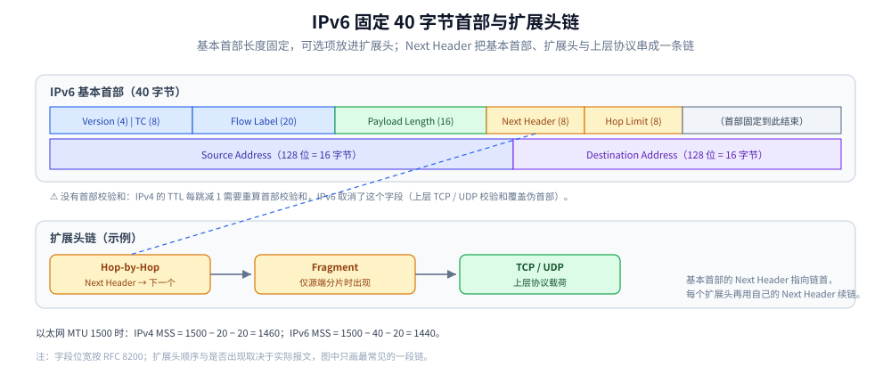
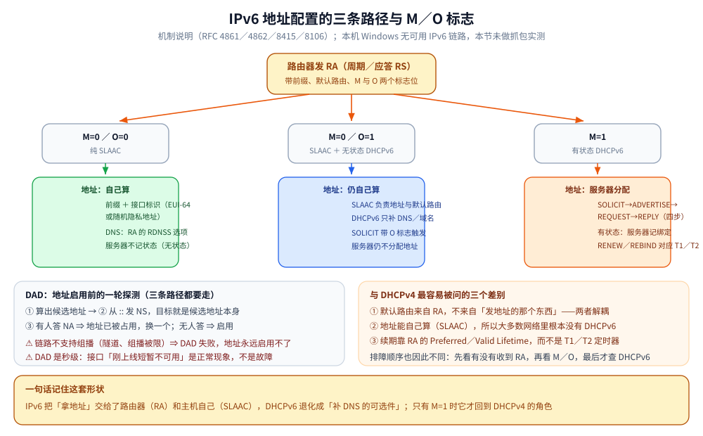

# IPv6 与双栈

> 覆盖：IPv6 的首部与地址模型、全球单播 / 链路本地 / 唯一本地 / 组播的划分、RA / SLAAC / DHCPv6 / DAD 四种地址配置机制、NDP 如何替代 ARP、链路视角下的四处差异，以及双栈主机如何选地址。
>
> 不覆盖：IPv4 的 CIDR、路由表与 ARP 细节见 [IP与路由基础.md](IP与路由基础.md)；DHCPv4 的 DORA 与租约见 [DHCP.md](DHCP.md)；NAT 与 conntrack 见 [NAT与连接跟踪.md](NAT与连接跟踪.md)；IPv6 抓包读数见 [抓包实战.md](../观测与排障/抓包实战.md)。
>
> 内容整理自个人学习笔记，素材见 [素材清单](../../../素材清单.md)。
>
> ⚠️ 实测口径：地址段、首部与自动配置机制按 RFC 8200 / 4861 / 4862 / 8415 整理，**本机未做 IPv6 抓包实测**；文中 `mss 1440` 与 IPv6 链路的目的 MAC 读数来自 [抓包实战.md](../观测与排障/抓包实战.md) 4.2 的本机抓包。

---

## 一、IPv6 与 IPv4 的对应关系是什么？

IPv6 不是「地址变长了」那么简单——它**改了首部模型、取消了首部校验和与中间路由器分片，并把地址解析换成了 NDP**。

| 维度 | IPv4 | IPv6 |
| --- | --- | --- |
| 地址长度 | 32 位，点分十进制 | **128 位**，冒号十六进制（`2001:db8::1`，`::` 表示一段连续 0） |
| 首部 | 20 字节（带选项最长 60） | **固定 40 字节**，可选项放进**扩展头** |
| **首部校验和** | 有，**每跳都要重算**（因为 TTL 变） | **没有**（交由上层校验和覆盖；地址也不会被中间设备正常改写） |
| 生存期字段 | **TTL** | **Hop Limit**（语义相同，名字不同） |
| 分片 | 源端与**中间路由器**都可分片（`DF=0` 时） | **只有源端可分片**，路由器只丢包并回 ICMPv6 |
| 地址解析 | **ARP**（广播请求） | **NDP**（走 ICMPv6，用组播） |
| 地址配置 | DHCP / 手工 | **SLAAC**（路由通告自动配）与 DHCPv6 都可能 |
| NAT | 普遍存在 | 设计上不需要（地址足够），但防火墙依旧存在 |

### 1.1 固定 40 字节首部与扩展头



IPv6 把「可选功能」从基本首部挪进了**扩展头**，基本首部因此固定 40 字节，路由器转发时只需处理固定字段：

| 字段 | 长度 | 作用 |
| --- | --- | --- |
| Version | 4 位 | 固定为 6 |
| Traffic Class | 8 位 | 类似 IPv4 的 DSCP / ECN |
| Flow Label | 20 位 | 流标签，供中间设备识别同一流 |
| Payload Length | 16 位 | **扩展头 + 上层数据**的总长（不含基本首部） |
| **Next Header** | 8 位 | 下一个首部的类型（TCP=6、UDP=17、ICMPv6=58，或某个扩展头） |
| **Hop Limit** | 8 位 | 每跳减 1，等价于 IPv4 的 TTL |
| Source / Destination Address | 各 128 位 | 源 / 目的地址 |

⭐ 读法：**扩展头是一条链**——基本首部的 `Next Header` 指向第一个扩展头，该扩展头自己的 `Next Header` 再指向下一个，直到指向 TCP / UDP。常见扩展头有 Hop-by-Hop Options、Routing、Fragment、Destination Options。

---

## 二、IPv6 地址长什么样、分几类？

### 2.1 书写与压缩

```text
2001:0db8:0000:0000:0000:0000:0000:0001
→ 2001:db8::1                  （:: 只能出现一次，代表一段连续的 0）
```

| 规则 | 说明 |
| --- | --- |
| 每组 16 位，用冒号分隔 | 共 8 组 |
| 前导 0 可省略 | `0db8` → `db8` |
| `::` 压缩连续 0 | **一个地址里只能用一次**，否则无法还原 |
| IPv4 映射地址 | `::ffff:192.0.2.1`，双栈场景常见，日志归一化时要处理 |

### 2.2 地址分类

| 段 | 用途 |
| --- | --- |
| `2000::/3` | **全球单播**（可路由的公网地址） |
| `fe80::/10` | **链路本地**（每个接口都有，NDP 与路由协议靠它工作） |
| `fc00::/7` | **唯一本地**（类似 IPv4 私网，常用于内网） |
| `::1` | 环回 |
| `::` | 未指定地址（DAD 与 DHCPv6 初始阶段使用） |
| `2001:db8::/32` | **文档专用**（RFC 3849），写示例时只用它 |
| `ff00::/8` | **组播**（IPv6 没有广播，广播角色由组播承担） |

> ⚠️ `fe80::/10` 的链路本地地址**必须带 Zone ID**（如 `fe80::1%eth0`）才能区分接口；同一个 `fe80::1` 可能出现在每台机器的每个接口上，这并不冲突。

---

## 三、地址是怎么自动配置的？

**本节要点**：IPv6 把「拿地址」和「拿默认路由」合并进了**路由通告（RA）**，所以它的自动配置形态和 DHCPv4 完全不同：**DHCPv6 通常只用来补 DNS 等信息，而不是发地址**。

### 3.1 四个机制各管什么

| 机制 | 全称 | 负责什么 | 对应 IPv4 的谁 |
| --- | --- | --- | --- |
| **RA** | Router Advertisement | 路由器**周期性**（或应答 RS）通告：本链路的**前缀**、默认路由、以及「用哪种方式配地址」的标志位 | 无直接对应（IPv4 靠 DHCP 发网关） |
| **SLAAC** | Stateless Address Autoconfiguration | 主机拿 RA 里的前缀 + 自己的接口标识，**自己算出地址**（不需要服务器记状态） | 无（DHCPv4 是有状态的） |
| **DHCPv6** | — | 有状态分配地址，或**只下发 DNS / 域名等信息**（无状态模式） | DHCPv4 |
| **DAD** | Duplicate Address Detection | 地址正式使用前，用 NS / NA 探测「这个地址是不是已经有人用」 | ARP 探测（IPv4 的免费 ARP） |

### 3.2 常见的三种组合

| 组合 | 地址从哪来 | DNS 从哪来 | 出现在哪 |
| --- | --- | --- | --- |
| **纯 SLAAC** | RA 的前缀 + 主机自算 | 从 RA 的 RDNSS 选项（RFC 8106） | 家用路由器、简单企业网 |
| **SLAAC + 无状态 DHCPv6** | RA 的前缀 + 主机自算 | **DHCPv6 下发** | 需要集中管理域名 / DNS 的网络 |
| **有状态 DHCPv6** | **DHCPv6 分配**（RA 里把 M 标志置位） | DHCPv6 | 需要像 DHCPv4 一样集中管理地址的网络 |

> ⭐ **RA 里的两个标志位决定用哪种**：`M`（Managed）置 1 → 用有状态 DHCPv6 要地址；`O`（Other）置 1 → 地址自己配、但**其他信息（DNS 等）去问 DHCPv6**。



### 3.3 「主机自算」具体怎么算

`接口标识（后 64 位）` 拼上 RA 通告的 `前缀（前 64 位）`。接口标识有三种来源：

| 来源 | 怎么来 | 特点 |
| --- | --- | --- |
| **EUI-64** | 由 MAC 派生（插入 `ff:fe` 并翻转 U/L 位） | 可被跨网络追踪 |
| **隐私临时地址**（RFC 4941） | 随机生成、定期更换 | 保护隐私；出站连接优先使用 |
| **稳定隐私地址**（RFC 7217） | 按密钥哈希生成 | 换前缀地址会变，同一网络内稳定 |

⭐ 所以同一台机器在同一前缀下**同时有多个地址**是正常的，不是异常。排查时先确认「连不上」的是哪个地址、哪个接口。

### 3.4 有状态 DHCPv6 的四步

与 DHCPv4 的 DORA 一一对应，但报文名字不同：

| DHCPv6 | 对应 DHCPv4 | 说明 |
| --- | --- | --- |
| `SOLICIT` | Discover | 组播到 `ff02::1:2`（不是广播，IPv6 没有广播） |
| `ADVERTISE` | Offer | 服务器应答，可有多家 |
| `REQUEST` | Request | 客户端选定 |
| `REPLY` | ACK | 服务器确认绑定 |
| `RENEW` / `REBIND` | T1 / T2 续租 | **同一个租约形状**，也是「提前一半续、失败再广求助」 |

### 3.5 DAD：地址冲突检测

```text
① 主机算出候选地址（链路本地地址一定先做一次 DAD）
② 从「未指定地址 ::」发 NS，目标是被探测的地址 → 若有人应答 NA，说明地址已被占用
③ 无人应答 → 地址可用；同时这个 NS 也起到了「宣告」的作用（类似免费 ARP）
```

⚠️ **两个实际影响**：① DAD 需要时间（默认约 1 秒级），所以 IPv6 接口「刚上线时短暂不可用」是正常现象；② **如果链路不支持组播（例如某些隧道、或组播被限制的环境），DAD 会失败，地址无法启用**——这是 IPv6「配置看着对、就是不通」的典型原因之一。

### 3.6 与 DHCPv4 的关键差异

| 维度 | DHCPv4 | IPv6 自动配置 |
| --- | --- | --- |
| 默认路由怎么来 | 由 DHCP 一起下发 | **由 RA 下发**（与地址来源解耦） |
| 地址能自己算吗 | 不能（必须由服务器分配） | **能**（SLAAC：前缀 + 接口标识） |
| 有状态吗 | 服务器维护租约 | SLAAC 无状态；DHCPv6 才是有状态 |
| 「续租」形状 | T1 / T2（见 [DHCP.md](DHCP.md) 第一节） | RA 的**生命周期**（Preferred / Valid Lifetime）自动续期；DHCPv6 也有自己的续期 |
| 冲突检测 | ARP 探测 / 免费 ARP | **DAD** |

---

## 四、NDP 如何替代 ARP？

NDP（Neighbor Discovery Protocol）是 ICMPv6 的一组消息，**一对多地替代了 ARP 的职责**：

| 消息 | 作用 | 相当于 IPv4 的 |
| --- | --- | --- |
| **NS**（Neighbor Solicitation） | 「这个地址的 MAC 是谁？」发往**请求节点组播**（`ff02::1:ff00:0/104`）而非广播 | ARP 请求 |
| **NA**（Neighbor Advertisement） | 「是我，我的 MAC 是…」单播回复 | ARP 应答 |
| **RS / RA**（Router Solicitation / Advertisement） | 主机问路、路由器周期性通告前缀与默认路由 | 无直接对应（RA 还承担了 SLAAC） |
| **Redirect** | 路由器告诉主机「有更优的下一跳」 | ICMP Redirect |

⭐ 两个 IPv6 特有的点：

1. **没有广播，改用组播**（更省电、更少打扰）；
2. **RA 同时告诉主机「用哪个前缀」和「用哪个默认网关」**，所以 IPv6 主机的地址与网关是**一起**拿到的。

> ⚠️ 与 ARP 一样，**NDP 本身没有认证**：邻居通告可以伪造（NDP 欺骗）。防护依赖 RA Guard、SEND 或交换机侧的邻居发现监控。

---

## 五、链路视角下与 IPv4 有哪四处差异？

**本节要点**：这四处差异会**直接影响排查思路**——没有 NAT、IP 头固定 40 字节、路由器不分片、首跳用 NDP 而不是 ARP。

### 5.1 通常没有 NAT：源地址不会被改写

IPv6 的端到端直连是设计目标（地址空间足够），所以纯 v6 链路上：

- 服务端看到的源地址**就是客户端的**（没有 SNAT 这一步改写）；
- ⚠️ 但**公网进内网一样会过防火墙 / 负载均衡**，所以「能不能拿到真实 IP」要按实际拓扑判断，不能因为「是 v6」就默认一定拿得到。

> 本机实测（见 [抓包实战.md](../观测与排障/抓包实战.md) 4.2）：一条 IPv6 的 HTTPS 连接里，**链路层的目的 MAC 依然是网关**（跨网段只交接下一跳），但 **IP 层没有任何改写**——这跟 v4 出了 NAT 之后的样子完全不同。

### 5.2 报文头固定 40 字节：MSS 因此少 20

| | IPv4 | IPv6 |
| --- | --- | --- |
| IP 头 | 20 字节（带选项最长 60） | **固定 40 字节**（扩展头另算） |
| 以太网 MTU 1500 时的 TCP MSS | **1460** | **1440** |

⭐ **这是抓包里一眼分辨 v4 / v6 的方法**：看客户端 SYN 的 `options [mss ...]`。本机实测的 v6 SYN 就是 `mss 1440`（[抓包实战.md](../观测与排障/抓包实战.md) 4.2 有完整报文）。

### 5.3 路由器不分片：PMTUD 从「优化」变成「必须工作」

- IPv4：中间路由器在 `DF=0` 时**可以**分片；
- **IPv6：路由器一律不分片**——超了就丢，并回 `ICMPv6 Packet Too Big`；
- ⚠️ 所以 **IPv6 的 PMTUD 不是可选优化，而是链路的必要条件**：一旦 `ICMPv6 Packet Too Big` 被中间设备拦掉，故障就是 PMTU 黑洞，**而且比 v4 更容易撞上**（v4 至少还能靠路由器分片兜一下）。

### 5.4 没有 ARP，首跳靠 NDP

| 功能 | IPv4 | IPv6 |
| --- | --- | --- |
| 地址解析 | ARP（`arp -a`） | **NDP**（`netsh int ipv6 show neighbors` / `ip -6 neigh`） |
| 地址自动配置 | DHCP / 静态 | **SLAAC**（路由通告自动配）与 DHCPv6 都可能 |
| 首跳发现 | 默认网关 | 默认路由（由路由通告 RA 下发） |

---

## 六、双栈主机的地址如何选择？

双栈主机同时有 A 与 AAAA 记录时，**先按 RFC 6724 的规则给候选地址排序**（优先可达的、避免已废弃地址等），浏览器再用 **Happy Eyeballs** 让两族并行尝试、谁快用谁。

> ⚠️ 于是「IPv6 有问题」的典型表现是**慢一点**而不是**打不开**——因为 v6 试失败后 v4 会补上。排查时用 `ping -6` / `ping -4` 分别确认哪一族通，而不是笼统地说「网络有问题」。

**双栈排查顺序**：

```text
① 接口有没有 v6 地址（含链路本地）？      ip -6 addr
② 有没有默认路由（RA 是否收到）？          ip -6 route
③ 邻居表能不能解析到网关？                 ip -6 neigh
④ 能不能 ping 通网关 / 外部地址？           ping -6 -c 3 2606:4700:4700::1111
⑤ DNS 是否返回 AAAA？ 返回的地址是否可达？  dig AAAA example.com
⑥ 只有 v6 慢：看 RFC 6724 排序与 Happy Eyeballs 行为
```

---

## 七、应用场景

**本节要点**：IPv6 的落点不在「地址更长」，而在**地址配置、首跳解析与分片模型**三处同时换了机制。

| 场景 | 涉及哪一块 | 为什么值得注意 |
|---|---|---|
| 新网络规划 | 地址分类与子网 | 通常按 /64 划分链路，SLAAC 依赖 64 位前缀，详见 本篇第二节 |
| 家用 / 企业自动配置 | RA + SLAAC + DHCPv6 | M / O 标志决定地址与 DNS 从哪来，详见 本篇第三节 |
| 容器与云主机 | 双栈与地址选择 | 同一业务可能 v4 / v6 两条路径，日志要归一化 |
| 「IPv6 配置对但就是不通」 | DAD 与组播 | 组播被限制时 DAD 失败，地址无法启用，详见 本篇 3.5 |
| 大包卡住 | IPv6 PMTUD | 路由器不分片，ICMPv6 被拦就是黑洞，详见 本篇 5.3 |
| 抓包分辨 v4 / v6 | MSS 与首部 | v6 SYN 的 MSS 是 1440，首部固定 40 字节，详见 本篇 5.2 |

## 八、具体使用

**本节要点**：先确认「有没有 v6 地址与默认路由」，再确认「首跳能不能解析」，最后才查 PMTU。

```bash
# 1) 看 IPv6 地址（含链路本地）与接口状态
ip -6 addr show
ip -o link show

# 2) 看 IPv6 路由表：默认路由是否由 RA 下发
ip -6 route show
ip -6 route get 2606:4700:4700::1111

# 3) 看邻居表（NDP 的 NS / NA 结果）
ip -6 neigh show

# 4) 看 RA 内容（需要 rdisc6 或 tcpdump 抓 ICMPv6 134）
sudo rdisc6 eth0
sudo tcpdump -i eth0 -nn 'icmp6 and ip6[40] == 134'

# 5) 分族探测连通性
ping -6 -c 3 2606:4700:4700::1111
ping -4 -c 3 1.1.1.1

# 6) 查 IPv6 的 PMTU 与分片（v6 路由器不分片）
ping -6 -M do -s 1232 2606:4700:4700::1111

# 7) 看 DNS 的 AAAA 与 HTTPS / SVCB 记录
dig AAAA example.com +short
dig HTTPS example.com +short
```

```powershell
# Windows 对应命令
Get-NetIPAddress -AddressFamily IPv6
Get-NetRoute -AddressFamily IPv6
netsh interface ipv6 show neighbors
ping -6 2606:4700:4700::1111
```

⭐ 读法：如果 `ip -6 addr` 只有 `fe80::` 而没有全球单播地址，说明 **RA 没收到或前缀没下发**——先查二层 / 交换机的 RA 过滤，而不是查 DNS。

---

## 延伸追问

- **IPv6 真的不需要 NAT 吗？** → 协议设计上不需要，地址空间足够让每台设备拥有全球地址；但**防火墙、安全组、代理**仍然存在，所以「服务端能否看到真实客户端地址」依旧取决于拓扑。NPTv6 只做前缀转换，不是 NAT44 的等价物。
- **为什么 IPv6 的 MSS 是 1440？** → `MSS = MTU − IP 头 − TCP 头 = 1500 − 40 − 20 = 1440`。IPv4 的 IP 头是 20 字节，所以是 1460。
- **SLAAC 安全吗？** → 它依赖 RA 与 NDP，而这两者默认没有认证；恶意 RA 可以给主机下发错误前缀或网关。企业网络通常配合 RA Guard、DHCPv6 Guard 与 NDP 监控。
- **为什么同一台机器有多个 IPv6 地址？** → 链路本地地址、稳定隐私地址、临时隐私地址、以及可能的多个前缀会同时存在。出站连接通常优先用临时地址，服务端看到的源地址会定期变化，按 IP 做会话粘滞时要注意。
- **IPv6 的 `::` 能出现两次吗？** → 不能。`::` 表示「一段连续的 0」，出现两次就无法确定各自代表多少组 0，地址将无法唯一还原。
- **IPv6 组播地址如何映射到以太网 MAC？** → `33:33:` 加上组播地址的低 32 位。例如 `ff02::1` 映射为 `33:33:00:00:00:01`。详见 [以太网与二层转发.md](../数据链路层/以太网与二层转发.md) 第三节。
- **双栈会不会让排障更复杂？** → 会。最常见的是「v6 路径有问题但 v4 正常」，表现为偶发变慢而不是完全失败。先分族 `ping`，再分别看路由、NDP 与 PMTU。

---

## 关联

- **上游/总纲**：[IP与路由基础.md](IP与路由基础.md) — IPv4 地址、CIDR、路由表与 ARP
- **对照/互补**：[DHCP.md](DHCP.md) — DHCPv4 的 DORA、T1 / T2 与租约
- **对照/互补**：[NAT与连接跟踪.md](NAT与连接跟踪.md) — v4 的地址改写与 conntrack
- **下游机制**：[以太网与二层转发.md](../数据链路层/以太网与二层转发.md) — 组播 MAC 映射与二层转发
- **下游机制**：[抓包实战.md](../观测与排障/抓包实战.md) — IPv6 的过滤表达式与实测报文
- **下游机制**：[DNS解析.md](DNS解析.md) — AAAA 记录与双栈解析

> 反向引用（本篇被下列文档引到）：[DNS安全与加密解析.md](DNS安全与加密解析.md)
