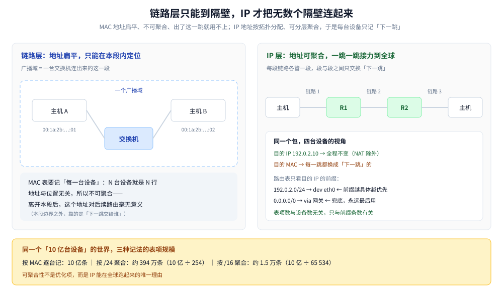
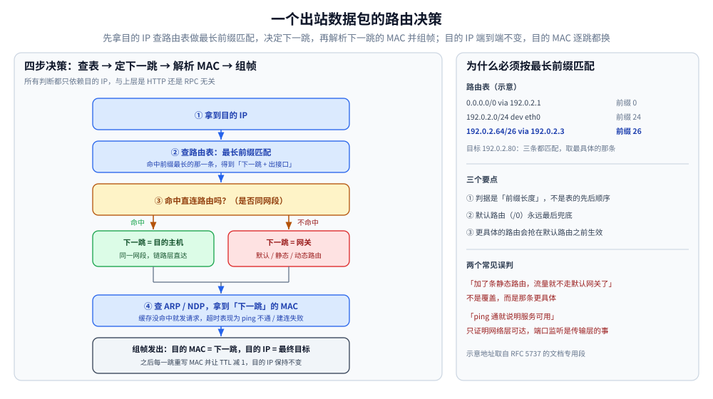
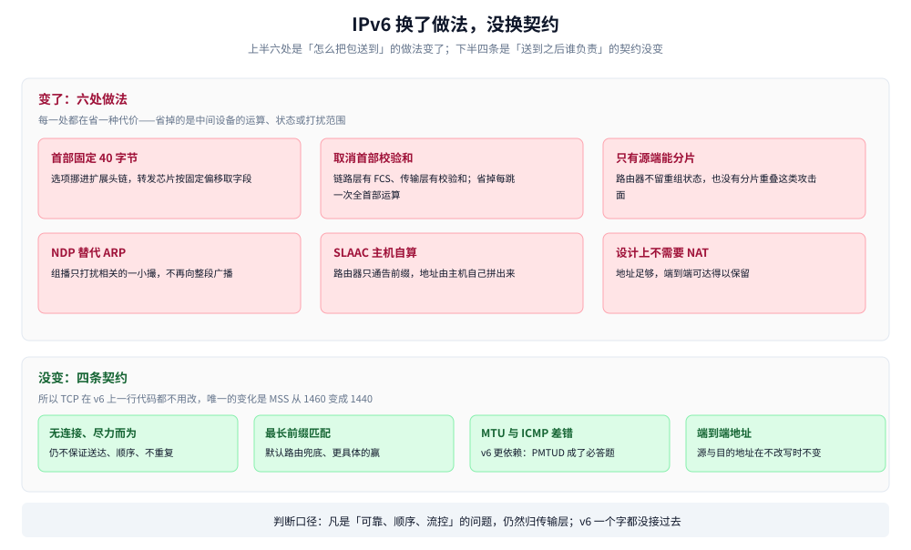
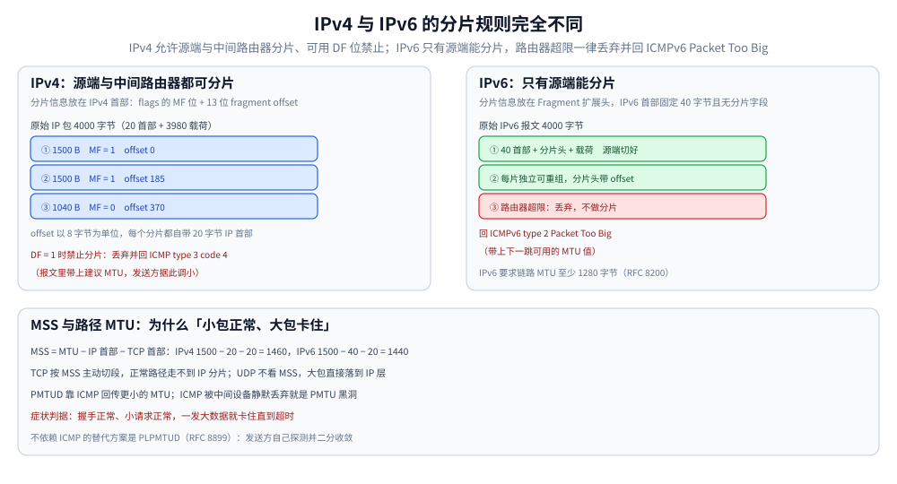

# IP 与路由基础

> 覆盖：IP **是什么**（一个端到端地址 + 一个极简首部 + 一套只决定下一跳的转发规则）、**为什么需要**（MAC 扁平不可聚合，只能在本链路内定位）、**它解决的哪五件事**与**它不保证什么**；IPv4 地址与 CIDR、路由表与最长前缀匹配、ARP/NDP、ICMP、TTL/Hop Limit、**IPv4 与 IPv6 的六处改动和四条没变的地基**（含容器实测），以及 MTU 与分片（含排障）。
>
> 不覆盖：「一个包在本机怎么被逐层造出来」的分层概览见 [网络分层与数据包旅程.md](../网络分层与数据包旅程.md)；以太网帧、MAC 表与交换机转发见 [以太网与二层转发.md](../数据链路层/以太网与二层转发.md)；IPv6 地址模型、RA/SLAAC/DHCPv6/DAD 与双栈选地址见 [IPv6与双栈.md](IPv6与双栈.md)；SNAT/DNAT 与 conntrack 见 [NAT与连接跟踪.md](NAT与连接跟踪.md)；运营商 AS/BGP、CDN、负载均衡与回程路径等端到端链路问题见 [网络通信链路详解.md](../网络通信链路详解.md)；TCP 的重传与拥塞控制见 [TCP拥塞控制算法.md](../传输层/tcp/TCP拥塞控制算法.md)；UDP 的数据报语义见 [UDP与数据报传输.md](../传输层/udp/UDP与数据报传输.md)。
>
> 内容整理自个人学习笔记，机制口径依据 RFC 791 / RFC 8200 / RFC 1191 / RFC 8201 / RFC 4861，素材见 [素材清单](../../../素材清单.md)。⭐ v4 与 v6 的完整对照以**本篇第五节为权威宿主**，[IPv6与双栈.md](IPv6与双栈.md) 第一节只留结论与指针，不重复那张表。
>
> ⚠️ 实测口径：第五节为本机实测（`alpine:3.21` 容器 + Docker 29.7.2，读数取自 `ip` 与 `tcpdump`）；第一节是机制说明，不含读数；第六至八节的命令为 Linux 侧，**本机为 Windows，未实测**。

---

## 一、IP 是什么，为什么需要，它负责什么？

**本节要点**：IP 是一种**把「异构链路上任意两台主机」抽象成「两个地址之间的一次投递」的约定**，由三件东西组成——一个**端到端地址**、一个**极简首部**、一套**只决定下一跳的转发规则**。它存在的理由只有一条：**链路层地址（MAC）是扁平的，只在一条链路内有效**，而互联网要跨过无数条互不兼容的链路。它提供的是**无连接、尽力而为**的投递，刻意**不保证**可靠性、顺序与不重复，把这些留给上层。

### 1.1 是什么：一个地址、一个首部、一套转发规则

| 组成 | 具体形态 | 少了它会怎样 |
|---|---|---|
| ① 端到端地址 | IPv4 32 位、IPv6 128 位；**可分层聚合**——前缀说「大概在哪一片」，主机位说「这一片里的哪一个」 | 只能靠链路层广播找目标，跨链路就断 |
| ② 极简首部 | IPv4 20 字节（带选项最长 60）、IPv6 固定 40 字节；装源地址、目的地址、协议号、TTL / Hop Limit、长度 | 接收方不知道包是谁发的、该交给 TCP 还是 UDP、还能走几跳 |
| ③ 转发规则 | 每台中间设备只做一件事：**看目的地址 → 查表 → 从某个口交给某个邻居** | 每台主机都得知道全球拓扑，不可能 |

⭐ **IP 不是一条链路，也不是一个服务，而是一层约定**：双方都实现这套约定，中间跑的是以太网、Wi-Fi、光纤、4G 还是卫星链路，都不影响。这正是它能当「互联网的公共语言」的原因。

三件东西里最容易混淆的是**两个地址的作用域**：

| | IP 地址 | MAC 地址 |
|---|---|---|
| 会不会变 | **全程不变**（NAT / 隧道除外） | **每一跳都换**成下一跳的 |
| 谁在用它做决策 | 主机与每一台路由器（查路由表） | 只有发出这一帧的那台设备（组帧时填） |

一句话记法：**IP 决定「最终去哪」，MAC 只负责「这一跳交给谁」**。完整的四步决策见第四节。

### 1.2 为什么需要：MAC 是扁平的，只在一条链路内有效

既然链路层已经把帧送到对面了，为什么还要一层地址？因为**MAC 地址里没有拓扑信息**：`00:1a:2b:3c:4d:5e` 只能告诉你「这是某厂商烧的一块网卡」，说不出它在哪个城市、接在哪个交换机上。交换机只能靠「学到的 MAC 在哪个口」来转发，而这条信息的作用域**只有本广播域**。

| 维度 | MAC（链路层） | IP（网络层） |
|---|---|---|
| 位数与分配 | 48 位，厂商烧在网卡里，**与位置无关** | 32 / 128 位，**按拓扑分配**，换网络就换地址 |
| 有没有拓扑含义 | 没有，**不可聚合** | 有，前缀长度就是聚合的单位 |
| 作用范围 | 一条链路（一个广播域） | 全球 |
| 转发表规模 | 交换机要记住**每一台设备** | 路由器只记**前缀**，其余交给默认路由 |
| 能不能用来跨网互联 | 不能 | 能 |

这个差别落到数量级上非常直观。假设全球有 10 亿台在线设备：

| 寻址方式 | 需要多少条转发表项 | 怎么算的 |
|---|---|---|
| 按 MAC 逐台记 | **10 亿条** | 一台一条，别无可省 |
| 按 `/24` 前缀聚合 | 约 **394 万条** | `10 亿 ÷ 254`，向上取整 3 937 008 |
| 按 `/16` 前缀聚合 | 约 **1.5 万条** | `10 亿 ÷ 65 534`，向上取整 15 260 |

真实互联网的表项数落在后两行之间——取决于地址分配的碎片程度（分配越零散，前缀越难合并，见 [子网掩码与IP网段划分.md](子网掩码与IP网段划分.md) 第四节）。但无论怎么算，**它都比「按设备逐条记」小了好几个数量级**。



左面板的关键是那圈虚线——**广播域就是 MAC 地址能力的全部边界**，出了这圈，交换机就不知道任何事了。右面板把同一批主机用两跳串起来，每一跳都只回答「下一步交给谁」，没有任何一台设备需要知道全网。底部把 10 亿台设备在三种记法下的表项规模摆在一起，规模差就是「可聚合」这三个字的具体价值。

⭐ 所以 IP 的本质是一次**换维**：地址不再标识「你是谁」，而是标识「你在拓扑的哪一格」。可聚合性就是这么来的，IPv4 能扩展到全球也是这么来的。代价同样明确——**换一格就得换一个地址**（这正是 IPv6 的 SLAAC 想缓解的问题，见 [IPv6与双栈.md](IPv6与双栈.md) 第三节）。

> 📎 这条判断的另一半「既然 IP 可路由，为什么还留着 MAC」放在文末追问，本节只回答「为什么需要 IP」。

### 1.3 作用：它到底解决了哪五件事

| 作用 | 机制 | 没有它会怎样 |
|---|---|---|
| ① 给全球每台主机一个**可聚合**的地址 | 前缀分层，路由器只记前缀 | 路由表按设备数增长，收敛不了 |
| ② **屏蔽链路层差异**，让异构网络互联 | 上层只看到 IP 包，不关心底下是以太网、PPP、4G 还是卫星 | 一个应用要为每种链路各写一套 |
| ③ 把「全球寻路」降级成「**选下一跳**」 | 主机只配一个网关；路由器只认邻居 | 每台主机都得持有全球拓扑 |
| ④ 用 **TTL / Hop Limit** 兜底防环 | 每跳减 1，减到 0 丢弃并回 ICMP Time Exceeded | 路由环路里的包永远转下去，链路被打满 |
| ⑤ 用**分片**适配沿途不同的 MTU | v4 可中途分片；v6 只源端分片 + `Packet Too Big` 回传 | 大包在窄链路上直接过不去 |

对照本篇结构：① 是第二节（前缀与聚合），③ 是第四节（出站四步决策），⑤ 是第八节（MTU 与分片），④ 的可见证据是第七节的 `Time Exceeded`（`traceroute` 就是靠它画路径）；② 是本篇与 [以太网与二层转发.md](../数据链路层/以太网与二层转发.md) 的分界线。

> ⚠️ **这五件事里没有「可靠」**：没有确认、没有重传、没有顺序、没有流控。这是设计选择而不是缺陷——把可靠性放进 TCP，才能让不需要可靠的场景（语音、游戏、DNS 查询）不为它付代价。下一小节展开的正是这条边界。

### 1.4 它提供的服务：无连接、尽力而为

IP 提供的是**无连接、尽力而为**（best-effort）的投递：

| 它做 | 它不做 |
|---|---|
| 全局唯一的寻址（可分层聚合） | ❌ 不保证送达（可能丢） |
| 逐跳转发（按目的地址选下一跳） | ❌ 不保证顺序（可能乱序） |
| 必要时分片与重组（IPv4） | ❌ 不保证不重复（可能重复） |
| 一个 TTL / Hop Limit 存活期机制 | ❌ 没有流控、没有拥塞控制、没有确认 |

⭐ **「尽力而为」不等于「不可靠的传输层」**：可靠性是**上层**的责任——TCP 用序号 + 累计确认 + 重传把它补上；UDP 干脆不补，由应用自己决定要多少。

### 1.5 与上下层的分工

```text
应用层数据
  ↓  TCP 按 MSS 切成段 / UDP 封成数据报
网络层（IP）：加 IP 首部 → 选下一跳 → 交给链路层      ← 本篇范围
  ↓  链路层加 MAC 首部，把帧交给「下一跳」
```

- **它不关心载荷是什么**：IPv4 首部里的「协议号」只告诉接收方交给 TCP(6)、UDP(17) 还是 ICMP(1)，**它自己不解析传输层内容**；
- **它不知道上层有没有收到**：没有任何 ACK 机制，回执靠 ICMP 或上层协议；
- **它的地址是端到端的**：正常转发过程中源/目的 IP 不变（NAT、隧道、LB DNAT 是例外，见 [网络通信链路详解.md](../网络通信链路详解.md) 第三节）。

> ⚠️ 一个常见误判：**`ping` 通不等于「服务可用」**。IP 层可达只说明地址能到，端口有没有进程监听是传输层的事（见第七节 `port unreachable`）。

---

## 二、IPv4 地址与 CIDR：怎么判断「在不在同一个网络」？

**本节要点**：IPv4 地址 = **网络前缀 + 主机位**，边界由**前缀长度**（CIDR）决定；判断两台主机是否同网段，就是把地址与前缀掩码做 AND 再比较。

### 2.1 地址的写法与分段

- IPv4 是 **32 位**，写成四段十进制（`192.0.2.10`）；
- 早期按「类」（A/B/C 类）固定前缀长度，**现在一律用 CIDR 表示**：`地址/前缀长度`，如 `192.0.2.0/24`；
- `/24` 表示**前 24 位是网络前缀**，后 8 位是主机位。

| 写法 | 网络地址 | 广播地址 | 可用主机数 | 说明 |
|---|---|---|---|---|
| `192.0.2.0/24` | `192.0.2.0` | `192.0.2.255` | 254 | 主机位 8 位 → 256 个地址，去掉网络地址与广播地址 |
| `192.0.2.0/25` | `192.0.2.0` | `192.0.2.127` | 126 | 掩码 `255.255.255.128` |
| `10.0.0.0/8` | `10.0.0.0` | `10.255.255.255` | 16,777,214 | 私网 A 类段 |
| `192.0.2.16/28` | `192.0.2.16` | `192.0.2.31` | 14 | 前缀不是 8 的倍数时，网络地址要按位对齐 |

> ⚠️ **算例**：`192.0.2.16/28` —— 掩码是 `255.255.255.240`，把 `192.0.2.16` 与掩码 AND 得 `192.0.2.16`（.16 是 16 的整数倍，恰好对齐）；广播地址是 `192.0.2.31`。如果写成 `192.0.2.20/28`，网络地址仍是 `192.0.2.16`，可用范围 `192.0.2.17 ~ .30`——**主机位部分全 0 是全网络地址、全 1 是广播地址，都不能分给主机**。

### 2.2 几类必须认识的地址段

| 段 | 用途 | 典型表现 |
|---|---|---|
| `10.0.0.0/8`、`172.16.0.0/12`、`192.168.0.0/16` | **私有地址**（RFC 1918） | 内网地址，出公网必须 NAT |
| `127.0.0.0/8` | **环回** | `127.0.0.1` 不出网卡 |
| `169.254.0.0/16` | **链路本地**（APIPA） | ⭐ **看到它基本等于「DHCP 没拿到地址」** |
| `192.0.2.0/24`、`198.51.100.0/24`、`203.0.113.0/24` | **文档专用**（RFC 5737） | 只能用于文档与示例，不该出现在真实网络里 |
| `224.0.0.0/4` | **组播** | 路由协议、NDP 用 |
| `0.0.0.0/0` | **默认路由** | 「其余全部」，只出现在路由表里 |
| `255.255.255.255` | **受限广播** | DHCP Discover 的目的地址 |

⭐ **写文档、截图、举例一律用文档专用段**（`192.0.2.x` / `198.51.100.x` / `203.0.113.x`），IPv6 用 `2001:db8::/32`——这样别人一眼就知道是示意值，也不会误连到真实主机。

### 2.3 为什么需要子网与掩码

- **同一个前缀 = 同一个广播域**：同网段内可以直接用链路层送达（ARP/NDP 找 MAC）；跨网段必须交给网关（见第四节）；
- **前缀越长，网络越小**：`/24` 有 254 个可用地址，`/30` 只有 2 个（点对点链路常用）；
- **前缀是「可聚合」的关键**：路由器不需要知道每一台主机，只需要知道「`192.0.2.0/24` 走这个口」。这正是 IP 能扩展到全球的原因，也是 [网络分层与数据包旅程.md](../网络分层与数据包旅程.md) 说的「MAC 扁平、IP 可分层」的具体含义。

> 📎 这三条是结论。掩码这个字段本身是怎么来的（有类地址为什么只有三档、改不了，RFC 950 与 CIDR 各自解决了什么）、它在出站决策与切分聚合里到底决定什么，见 [子网掩码与IP网段划分.md](子网掩码与IP网段划分.md) 第一节。

---

## 三、路由表怎么选下一跳？

**本节要点**：路由表里存的是**前缀 → 下一跳/出接口**的映射；选路规则只有一条主线——**最长前缀匹配**。

### 3.1 路由表的两种条目

| 类型 | 怎么来 | 例子 |
|---|---|---|
| **直连路由** | 接口配了地址与掩码，内核自动生成 | `192.0.2.0/24 dev eth0` |
| **默认路由** | 手工配或由 DHCP / RA 下发 | `default via 192.0.2.1` |
| **静态路由** | 管理员手写 | `198.51.100.0/24 via 192.0.2.2` |
| **动态路由** | 由路由协议（OSPF / IS-IS / BGP）学习 | 运营商与数据中心内部大量使用 |

> 这张表只回答「转发表从哪来」。动态路由**怎么算出来**是图论问题：OSPF / IS-IS 每台路由器都持有全网拓扑，各自跑一遍 [Dijkstra.md](../../算法/图论算法/最短路/Dijkstra.md) 得到最短路径树；RIP 只知道邻居告诉它的距离，对应的就是 [Bellman-Ford.md](../../算法/图论算法/最短路/Bellman-Ford.md)。本篇只管转发表怎么用，不管它怎么算。

### 3.2 最长前缀匹配（Longest Prefix Match）

一台主机可能同时匹配多条路由，**选前缀最长（最具体）的那一条**：

```text
目标 IP: 192.0.2.80

候选路由：
  0.0.0.0/0         → 默认网关 192.0.2.1        （前缀长度 0）   ← 也能匹配
  192.0.2.0/24      → 直连，dev eth0            （前缀长度 24）  ← ⭐ 选它
  192.0.2.64/26     → via 192.0.2.3             （前缀长度 26）  ← ⭐ 更具体时选它
```

⭐ **判据是「前缀长度」，不是「顺序」也不是「掩码大小」**：`/26` 比 `/24` 具体，命中就赢。所以同一条路由表里**默认路由永远是最后兜底的**——只在没有任何更具体的前缀匹配时才用它。

> ⚠️ 常见误解：**「路由表是逐行走的，谁先写谁先生效」**。不对，标准行为是按**最长前缀**匹配（同长度时再按度量值/优先级比较，各系统细节不同）。这也解释了为什么「加了一条更具体的静态路由后，流量突然不走默认网关了」——不是覆盖，而是**它更具体**。

> 实现形态：路由器不会逐条线性比对，而是把前缀集合建成 Trie 的压缩形态 Radix（Linux 内核的 FIB 用 LC-trie，比较次数 = **路径段数**而非字符数），边下探边记住**最后一次命中**的路由，走完即得最长前缀。结构与代价见 [Trie.md](../../数据结构/树/空间与字符串树/Trie.md) 第「网关与 IP 路由表」一节。

### 3.3 下一跳与出接口

一条路由最终要回答两个问题：**交给谁（next hop）**、**从哪个口出去（interface）**。

- 直连路由的「下一跳」就是目标主机自己；
- 其余路由的下一跳是**一个 IP 地址**——但真正发帧时用的是**那个 IP 对应的 MAC**，这就引出第四节与第六节。

---

## 四、一个出站数据包要经过哪几步决策？

**本节要点**：**先拿目的 IP 查路由表 → 决定下一跳 IP → 再解析下一跳的 MAC → 组帧发出**。分清「目的 IP」与「下一跳 MAC」是这一步最容易被绕晕的地方。



这张图的关键是**两个地址走的是两条完全不同的判断链**：左边的蓝色框处理「最终去哪」（目的 IP，端到端不变），中间的黄色判定决定「这一跳交给谁」（直连主机还是网关），最后一步才把「交给谁」翻译成 MAC。右侧面板用一张示意路由表说明为什么**判据是前缀长度而不是表的先后顺序**。

流程只有四步：

1. **查路由表**：用**目的 IP**做最长前缀匹配，得到「下一跳 IP + 出接口」；
2. **判断下一跳类型**：
   - 命中**直连路由** → 下一跳就是目的主机本身（同一网段）；
   - 命中**默认/静态/动态路由** → 下一跳是**网关**（或上一跳路由器）；
3. **解析下一跳的 MAC**：查 ARP/NDP 缓存，没有就发请求（第六节）；
4. **组帧发出**：以太网首部的**目的 MAC 填下一跳的**，IP 首部的**目的 IP 填最终的**。

⭐ 一句话：**IP 决定「最终去哪」，路由表决定「下一跳是谁」，ARP/NDP 把「下一跳是谁」翻译成 MAC。**

> ⚠️ 这就是「接上网关就能访问全网」的全部原理：本机**只负责把帧交给下一跳**，剩下的由网关继续转发。所以同一个包在链路上每一跳的**目的 MAC 都在变**，而**目的 IP 始终不变**（NAT 除外）。

---

## 五、IPv4 与 IPv6 到底差在哪？

**本节要点**：差的不只是地址长度。IPv6 借「地址变长」这个机会，把首部从「可变长 + 每跳重算校验和 + 允许中间路由器分片」改成「固定长 + 不校验 + 只源端分片」，把地址解析从广播换成组播，把地址配置从「服务器发」变成「主机自算 + 路由器通告」。但**核心语义一条都没改**：仍是无连接尽力而为，仍按目的地址做最长前缀匹配，仍要靠 MTU 与 ICMP 差错。

### 5.1 为什么要换：43 亿个地址撑不住「每个设备一个」

IPv4 的 32 位一共 **4 294 967 296** 个地址（约 43 亿）。这个数字在 1980 年代看着很宽裕，因为它假设的是「一台计算机一个地址」。后来的现实是：

- 一个人有多台设备，且每台都长期在线；
- 每个容器、每个 Pod、每个虚机都想有自己的地址；
- 家庭宽带的每台设备都要能直接收发（否则 P2P、语音、游戏联机都要绕）。

顶层地址池在 2011 年前后就已经分配完毕（公开记录，非本机实测），此后新增需求只能靠**回收、转让与 NAT 周转**。而 **NAT 是续命，不是解决**：

| NAT 换来了什么 | NAT 付出了什么 |
|---|---|
| 一个公网地址后面能放大批设备 | **入方向不再可达**，必须先由内向外打洞或经中继 |
| 地址规划与迁移方便 | 中间设备要**长期持有连接状态**，表项耗尽就是故障（见 [NAT与连接跟踪.md](NAT与连接跟踪.md)） |
| 内网结构对外不可见 | 日志里只剩一个公网地址，**定位到具体终端要靠端口与时间戳反查** |

IPv6 的 128 位是 **340 282 366 920 938 463 463 374 607 431 768 211 456** 个地址（约 `3.40 × 10^38`），比 IPv4 大 **`7.92 × 10^28`** 倍。这个量级的意思是：不必再精打细算到「一个地址后面藏多少台设备」，可以回到「每个接口一个全球地址」的原始模型。

> ⚠️ 但「地址够用」只解释了**为什么改得动**，解释不了**为什么改得慢**：v4 与 v6 在协议层**不互通**，同一台机器要同时说两种话（双栈），或者由中间设备做翻译。存量设备越多，这层改造成本越大于「继续用 NAT 顶着」的收益——这才是 v6 推了二十多年仍未全面替代的真原因。

### 5.2 表面上的差别：写法与前缀表示

| 维度 | IPv4 | IPv6 | 为什么这么改 |
|---|---|---|---|
| 写法 | 点分十进制 `192.0.2.10` | 冒号十六进制 `2001:db8::1`，`::` 表示一段连续 0 | 128 位写成十进制太长，一眼数不出边界在哪 |
| 前缀表示 | 掩码 `255.255.255.0` 与 `/24` 两种都行 | **只有前缀长度** `/64`，没有「掩码」这个字段 | 掩码是为 32 位设计的切割工具；v6 只需记住切口在第几位 |

⭐ 第二行是工程上最容易踩的一处：v4 里「掩码」和「前缀长度」是同一件事的两种记法（见 [子网掩码与IP网段划分.md](子网掩码与IP网段划分.md) 1.4），但 v6 **只保留前缀长度**。把 `255.255.255.0` 硬套到 v6 上不会报错，会得到一个语义完全不同的结果——5.5 有实测。

地址的压缩规则、地址分类（全球单播 / 链路本地 / 唯一本地 / 组播）见 [IPv6与双栈.md](IPv6与双栈.md) 第二节，本节不重复。

### 5.3 设计上的差别：六处改动，每处都有代价



图的分法就是本节的结构：**上半栏那六处是「换了做法」，下半栏那四条是「没换契约」**。左右对照着看，能避免把「v6 是新协议」误当成「v6 要重学一遍网络」。每张卡片下面那行小字就是「为什么这么改」，读的时候问一句：它省掉的到底是什么代价。

| 维度 | IPv4 | IPv6 | 为什么这么改 |
|---|---|---|---|
| 地址长度 | 32 位 | **128 位** | 摆脱按设备精打细算 |
| 首部 | 20 字节，带选项最长 60，**可变长** | **固定 40 字节**，选项挪进**扩展头链** | 转发芯片按固定偏移取字段，不必逐包解析长度 |
| 首部校验和 | **有**，每跳都要重算（因为 TTL 减了） | **没有** | 链路层有 FCS、传输层有校验和，重复校验；去掉它省下每跳一次全首部运算 |
| 生存期字段 | TTL | **Hop Limit** | 语义相同，名字更准确（它数的是跳数不是秒数） |
| 分片 | 源端与**中间路由器**都可分片（`DF=0` 时） | **只有源端**可分片 | 路由器不必留重组状态，也没有分片重叠这类攻击面 |
| 地址解析 | **ARP**，广播问「谁是这个 IP」 | **NDP**，ICMPv6 组播问 | 广播会惊动同段所有主机；组播只打扰相关的一小撮 |
| 地址配置 | DHCP / 手工 | **SLAAC**（主机自算）/ DHCPv6 | 路由器只通告前缀，主机自己拼出地址，服务器压力归零 |
| 与 NAT 的关系 | 普遍存在 | 设计上**不需要** | 地址足够，端到端可达得以保留 |

这六处不是六个彼此独立的选择，其中三组是咬合的：

- 取消首部校验和 → 中间设备可以放心改写 Hop Limit（不用重算），也才可以做流标签这类「逐跳可读字段」的扩展；
- 固定 40 字节首部 → 分片信息必须挪出基本首部，于是有了 Fragment 扩展头；
- 取消中间分片 → 路径 MTU 从「优化项」变成「必须工作」，PMTUD 失败就是黑洞（见第八节）。

> 首部的逐字段说明、扩展头链怎么串、NDP 的 NS / NA / RS / RA 消息表，全在 [IPv6与双栈.md](IPv6与双栈.md) 1.1 与第四节。

### 5.4 没变的：四条地基

| 没变 | 说明 |
|---|---|
| 仍是无连接、**尽力而为** | v6 同样不保证送达、顺序、不重复；可靠性仍在 TCP |
| 仍按目的地址做**最长前缀匹配** | 路由表结构、默认路由兜底、「更具体的赢」这套规则完全一致 |
| 仍受 **MTU** 约束、仍靠 ICMP 差错 | v6 更依赖它：路由器不分片，`Packet Too Big` 是唯一的反馈通道 |
| 仍是**端到端**地址 | 正常转发中源 / 目的地址不变（NAT、隧道除外） |

⭐ 一句话：**IPv6 改的是「怎么把包送到」，没改「送到之后谁负责」。** 所以 TCP 在 v6 上不用改一行代码，唯一的变化是 MSS 从 1460 变成 1440（少 20 字节首部差，见第八节）。反过来，任何「v6 来了要重写传输层」的说法都是误解。

### 5.5 实测：v6 只认前缀长度，首部确实多 20 字节

取材：`alpine:3.21` 容器，Docker 29.7.2，自定义网络 `--ipv6 --subnet 172.28.0.0/24 --subnet fd00:dead::/64`，`iproute2-6.11.0`。以下全部为容器内 `ip` 与 `tcpdump` 的真实回显。

**① 一个接口同时挂三种地址（双栈的最小样本）**

```text
lo               UNKNOWN        127.0.0.1/8 ::1/128
eth0@if83        UP             172.28.0.2/24 fd00:dead::2/64 fe80::44e:acff:febc:bbbf/64
```

⭐ 注意 `fe80::` 开头那条：**IPv6 接口一启用就自动有链路本地地址**，不需要任何服务器下发。这条地址只在本链路有效，是 NDP 与 RA 的基础（见 [IPv6与双栈.md](IPv6与双栈.md) 2.2）。

**② 前缀长度写法：正常，且带 `tentative` 状态**

```bash
$ ip -6 addr add 2001:db8:1::1/64 dev eth0
$ ip -6 addr show dev eth0
    inet6 2001:db8:1::1/64 scope global tentative
```

`tentative` = 地址还在做重复地址检测（DAD），没检测完不能用于通信。这正好是 v4 没有的一步：v4 手工配地址**不检查冲突**，冲突了只能靠现象猜。

**③ 点分掩码套到 v6 上：不报错，但结果是错的**

```bash
$ ip addr add 2001:db8:1::2/255.255.255.0 dev eth0     # rc=0
$ ip -6 route show
2001:d00::/24 dev eth0 proto kernel metric 256 pref medium
```

⚠️ 这条最能说明「掩码不是 v6 的概念」。iproute2 把 `255.255.255.0` 宽容地当成「24 位前缀」，于是 `2001:db8:1::2` 被放进 `2001:0d00::/24`。而在 v4 里 `255.255.255.0` 的直觉是「前三段是网络」——**同一个数字，在 v6 里换算出的是完全不同的边界**。一个 v6 的 `/24` 覆盖 `2^104` 个地址，跟「一个 C 类网段」没有任何关系。

**④ 十六进制掩码：直接拒收**

```bash
$ ip addr add 2001:db8:1::3/ffff:ffff:ffff:ffff:: dev eth0
Error: any valid prefix is expected rather than "2001:db8:1::3/ffff:ffff:ffff:ffff::".   # rc=1
```

**⑤ 对照组：v4 依然两种写法都吃**

```bash
$ ip addr add 172.28.0.50/255.255.255.0 dev eth0       # rc=0
    inet 172.28.0.50/24 scope global secondary eth0
```

回显被归一成 `/24`，并顺带给出 `brd 172.28.0.255`。**v4 有广播地址概念，v6 没有**，这也是两者的一处结构差异（v6 用组播代替广播，见第七节的类型对照表）。

**⑥ 首部长度：同一份 ICMP 载荷，v6 的帧多 20 字节**

```text
ethertype IPv4 (0x0800), length 98: 127.0.0.1 > 127.0.0.1: ICMP echo request, length 64
ethertype IPv6 (0x86dd), length 118: ::1 > ::1: ICMP6, echo request, length 64
```

两个包的 ICMP 载荷都是 `length 64`，`lo` 上 tcpdump 给出的伪以太网头都是 14 字节，所以 `98 − 64 − 14 = 20`、`118 − 64 − 14 = 40`——**IPv4 首部 20 字节、IPv6 首部 40 字节，差 20**。这条 20 字节的差就是第八节 `MSS 1460 → 1440` 的来源。

✅ **实测口径**：以上六组读数为容器内真跑，命令与回显逐字取自 `iproute2-6.11.0` 与 `tcpdump`。⚠️ **未实测**：v6 的转发性能、PMTUD 在 v6 路径上的行为、NAT64 / 464XLAT 等过渡技术；物理网络下的 RA 周期与本实验的 Docker 网桥不同。

---

## 六、ARP 与 NDP：IP 是怎么变成 MAC 的？

**本节要点**：两者的职责完全相同——**「这个 IP 对应哪个 MAC」**；差别在**广播 vs 组播、RFC 定义的位置、以及有没有内建的安全机制**（都没有）。

### 6.1 ARP 的工作方式（IPv4）

```text
① 查 ARP 缓存没有命中
② 发 ARP 请求：链路层目的 MAC = FF:FF:FF:FF:FF:FF（广播），载荷里写「谁有 192.0.2.1？告诉 192.0.2.10」
③ 目标主机单播回复：「192.0.2.1 的 MAC 是 42:03:…」
④ 双方把结果写进 ARP 缓存（有老化时间，Linux 默认约 30 秒~几分钟，随实现变化）
```

| 要点 | 说明 |
|---|---|
| **作用域只有一条链路** | ARP 请求不会穿过路由器——它就是「同链路内问路」 |
| **请求广播、应答单播** | 只有同广播域的设备会看到请求，但只有匹配的那台会应答 |
| **缓存会老化** | 老化后重新解析；**免费 ARP**（gratuitous ARP）用于宣告自己换了 MAC |
| **无认证** | ⭐ 谁来应答都行 → **ARP 欺骗**可以冒充网关做中间人。防御靠静态绑定、DHCP Snooping、动态 ARP 检测（DAI） |

### 6.2 NDP 的工作方式（IPv6）

IPv6 没有 ARP，用 **NDP（ICMPv6）**完成同一件事：**NS**（Neighbor Solicitation）发往请求节点组播问「这个地址的 MAC 是谁」，**NA**（Neighbor Advertisement）单播回复。没有广播、改用组播；**RS / RA** 同时通告前缀与默认路由，所以 IPv6 的地址与网关是一起拿到的。

> NS / NA / RS / RA 的完整消息表、与 ARP 的逐项对照、以及 NDP 欺骗的防护，见 [IPv6与双栈.md](IPv6与双栈.md) 第四节。

### 6.3 常见故障表现

| 现象 | 常见原因 |
|---|---|
| 同网段 ping 不通、跨网段正常 | 掩码配错（本机以为是跨网段，实际同网段）或 ARP 被拦截 |
| **`169.254.x.x`** | DHCP 没拿到地址，回落到链路本地自动配置 |
| 网关 MAC 突然变了一个陌生的 | ⚠️ 可能是 ARP 欺骗，也可能是设备换了/主备切换 |
| IPv6 能解析地址但连不上 | 通常是地址配置或路由通告（RA）的问题，而不是 DNS |

---

## 七、ICMP 与 ICMPv6：ping / traceroute 能证明什么、不能证明什么？

**本节要点**：ICMP 是**网络层的错误与控制消息**；`ping` 与 `traceroute` 都建立在它之上——所以**它被拦，工具就失灵，但网络可能完全正常**。

### 7.1 常用类型对照

| IPv4 类型 | IPv6 类型 | 含义 |
|---|---|---|
| 0 / 8 | 129 / 128 | Echo Reply / Echo Request（`ping` 用的就是这一对） |
| **3（Destination Unreachable）** | 1 | 目的不可达。code 0 网络不可达、1 主机不可达、**3 端口不可达**、**4 需要分片但 DF=1** |
| **11（Time Exceeded）** | 3 | TTL / Hop Limit 耗尽（`traceroute` 靠它画路径） |
| 5（Redirect） | 137 | 告诉主机「下次直接找那个网关」 |
| — | **2（Packet Too Big）** | ⭐ **IPv6 专用**：包超过路径 MTU，报文里带上可用的 MTU 值 |

⭐ **第 3 类 code 3（port unreachable）特别有用**：它是「IP 通了、但那个端口没有进程监听」的证据——`ping` 通而 `nc -z` 不通时，看到它就能断定问题在传输层以上，而不是网络层。

### 7.2 ping / traceroute 能证明与不能证明的

| 它能证明 | 它不能证明 |
|---|---|
| 目的地址**在网络层可达**、往返 RTT 大致多少 | 应用端口有监听（要 `port unreachable` 或真正发请求才知道） |
| 路径上**前 N 跳**的大致拓扑（`traceroute`） | **回程**路径（去回程常常不对称） |
| 链路是否有**明显**丢包与抖动 | 具体哪个中间设备在丢包（中间设备可能不回 ICMP） |

> ⚠️ **`traceroute` 里出现 `*` 不代表丢包**：很多骨干设备被配置为不回或限速回 ICMP。同理 **`ping` 不通也不能立刻判定网络故障**——ICMP 可能被策略丢弃，而 TCP 443 完全正常。

---

## 八、MTU、MSS、分片与 PMTUD：为什么「小包正常、大包卡住」？

**本节要点**：**MTU 是路径上最小的那段**，包超了要么分片、要么被丢回来；而**丢了回来还看不到，就是 PMTU 黑洞**。

### 8.1 三个概念先分清

| 概念 | 属于哪一层 | 含义 |
|---|---|---|
| **MTU** | 链路层 | 一个帧能承载的**载荷上限**（以太网 1500） |
| **MSS** | 传输层（TCP 选项） | 一个 TCP 段能携带的**数据上限**：IPv4 `MTU − 20 − 20 = 1460`；IPv6 `MTU − 40 − 20 = 1440` |
| **IP 分片** | 网络层 | 一个 IP 包被切成多个包，各自带 IP 首部与分片偏移 |

⭐ **TCP 分段 ≠ IP 分片**：TCP 按 MSS 主动切，**正常路径上根本不会走到 IP 分片**；IP 分片只在「应用直接发 UDP 大包」或「发送 `DF=0` 的 IP 报文」时才出现。

### 8.2 分片：IPv4 与 IPv6 的规则完全不同



左、右两个面板的差别就是「**谁有资格分片**」：IPv4 允许中间路由器代劳，代价是要给路由器留状态、也留下了分片重叠攻击面；IPv6 把它收回到源端，路由器只回报一个 `Packet Too Big` 让源端自己切。底部面板把 `MSS = MTU − 40` 的换算与 PMTU 黑洞的症状判据放在一起，方便对照排查。

具体规则对照如下：

| | IPv4 | IPv6 |
|---|---|---|
| 谁能分片 | **源端与中间路由器**（`DF=0` 时） | ⭐ **只有源端** |
| 禁止分片 | `DF=1`，路由器丢弃并回 **ICMP type 3 code 4**（带上建议 MTU） | 不存在 DF 位；路由器**一律**丢弃并回 **ICMPv6 type 2 Packet Too Big**（带上 MTU） |
| 最小 MTU 要求 | 各链路至少 68 字节 | **1280 字节**（RFC 8200），低于此必须做分片与重组 |
| 分片信息位置 | IPv4 首部的 flags + fragment offset | **分片扩展头**（Fragment Header） |

### 8.3 PMTUD 与 PMTU 黑洞

**PMTUD**（Path MTU Discovery）的思路是：发送方**先把 `DF=1` 打开**，撞上小 MTU 的链路时靠 ICMP 得知更小的 MTU，然后调小 MSS / 包长。

```text
发送方（MTU 1500，DF=1）→ 某段链路 MTU 1400 → 路由器丢弃并回 ICMP Fragmentation Needed (MTU=1400)
                                                              ↓
                                        发送方调小 MSS 并设置该路径的 PMTU 缓存
```

⚠️ **前提是 ICMP 能回来**。一旦中间设备（防火墙、安全组、某些云网关）**把类型 3 或 ICMPv6 类型 2 静默丢弃**，就形成 **PMTU 黑洞**：

| 症状 | 说明 |
|---|---|
| 三次握手正常、小请求正常 | 小包没超 MTU |
| **一发大数据就卡住**（直到超时） | 大包被丢、发送方永远收不到「要调小」的通知，一直重试 |
| TLS 握手偶发挂起 | 证书链较大、正好越过 MTU 边界 |

**不依赖 ICMP 的替代方案是 PLPMTUD**（RFC 8899）：发送方自己探测并二分收敛，代价是探测期间的少量丢包。此外还有一条工程手段：**在网关/入口做 MSS clamping**，把协商出去的 MSS 钳到保守值。

> 排查口径：**「小包正常、大包卡住」优先看 MTU**；两端同时抓包，看有没有发出/收到 `ICMP Fragmentation Needed` 或 `ICMPv6 Packet Too Big`。抓包侧的对应线索见 [抓包实战.md](../观测与排障/抓包实战.md) 的「三条最常用的抓包套路」。隧道场景（VXLAN / WireGuard）会让可用 MTU 变小，开销表见 [网络通信链路详解.md](../网络通信链路详解.md) 4.1。

---

## 九、应用场景

**本节要点**：网络层的每个知识点，都对应一条排障动线或一处系统配置。

| 场景 | 用到网络层的哪一块 | 为什么值得注意 |
|---|---|---|
| 容器网络（veth / bridge / DNAT） | 地址分配 + 路由 + NAT | 容器地址与路由由宿主侧代管，详见 [网络与存储.md](../../../06-工程实践/部署/docker/网络与存储.md) |
| 网关 / 负载均衡 | 最长前缀匹配 + DNAT | 选中哪条路由、DNAT 改了什么，详见 [网络通信链路详解.md](../网络通信链路详解.md) 第三节 |
| 「小包正常、大包卡住」 | MTU / 分片 / PMTUD | 典型 PMTUD 黑洞，详见 本篇第八节与 [抓包实战.md](../观测与排障/抓包实战.md) 3.3 |
| 云主机绑定不上 / 偶发丢地址 | ARP / NDP 与链路层可达性 | 邻居表 `INCOMPLETE` / `FAILED` 就是地址解析没成，详见 本篇第六节 |
| 防火墙放行规则 | 五元组（IP + 端口 + 协议） | 规则匹配的正是网络层与传输层字段，详见 [04-防火墙与NAT.md](../../linux/鸟哥服务器架设篇/04-防火墙与NAT.md) |
| 双栈环境访问异常 | IPv4 / IPv6 地址选择 | 解析出 AAAA 却无 IPv6 路由会先卡住，详见 本篇 5.3 |

## 十、具体使用

**本节要点**：网络层排查的顺序是「先看本机地址与路由 → 再验证连通性与路径 → 最后抓包看 ICMP」，三步能定位大部分「不通」与「半通」。

### 10.1 网络层排查的固定套路

#### 先看本机地址、路由与邻居表

```bash
# ① 地址与掩码：确认「我在哪个网段」
ip -4 addr show
ip -6 addr show

# ② 路由表：确认「默认网关是谁、有没有更具体的路由抢在前面」
ip route show
ip -6 route show

# ③ 邻居表（ARP / NDP）：确认「下一跳的 MAC 解析出来了吗」
ip neigh show                 # IPv4 + IPv6 邻居都在这里
ip -6 neigh show              # 只看 IPv6

# ④ Windows 对应命令（本机实测用的就是这几条）
route print -4
arp -a
netsh interface ipv6 show neighbors
```

⭐ **三张表要连起来读**：先看地址判断同网段/跨网段 → 再看路由表确认下一跳 → 最后看邻居表确认 MAC 有没有解析出来。**邻居表里那条是 `INCOMPLETE`/`FAILED`，就卡在第六节说的地址解析上。**

#### 再验证连通性与路径

```bash
# 分层确认：哪一族通
ping -4 -c 3 192.0.2.80
ping -6 -c 3 2001:db8::80

# 路径与在哪一跳开始变慢（连续跑看抖动）
mtr -rwzc 20 --tcp --port 443 192.0.2.80
traceroute -n 192.0.2.80

# 单独验证「是不是 MTU 问题」：逐步增大且不允许分片
ping -M do -s 1472 192.0.2.80     # IPv4：1472 + 20 + 8 = 1500
ping -M do -s 1452 2001:db8::80   # IPv6：1452 + 40 + 8 = 1500

# Windows 侧等价物：-f 置 DF 位，-l 指定载荷长度
ping -f -l 1472 192.0.2.80
```

#### 抓包看 ICMP（先定位再抓包）

```bash
# 只看 ICMP / ICMPv6：确认「有没有人告诉我包太大了」
tcpdump -ni any icmp
tcpdump -ni any icmp6

# 只看 IPv4 的分片（MF 标志位置位）
tcpdump -ni any 'ip[6] & 0x20 != 0'
```

#### 三条常见故障的判据

| 症状 | 第一步查什么 | 结论 |
|---|---|---|
| **同网段能通、外网不通** | `ip route` 有没有默认路由；`ip neigh` 网关那一条是否 REACHABLE | 缺默认路由 / 网关 MAC 没解析出来 |
| **小请求正常、大响应卡住** | 两端抓 `icmp` / `icmp6`；用 `ping -M do` 二分 MTU | PMTU 黑洞（ICMP 被拦）或路径 MTU 没同步 |
| **IPv6 能解析但连不上** | `ip -6 addr`（有没有拿到全局地址）、`ip -6 route`（有没有默认路由）、`ip -6 neigh` | 地址配置或 RA 问题，通常与 DNS 无关 |

---

## 延伸追问

- **既然 IP 已经可路由，为什么组帧时还要填 MAC，不能直接用 IP？** → 因为 **IP 地址标识「位置」，不标识「哪块网卡」**：同一张网卡换网络就换 IP，一个接口还能同时挂多个 IP（v4 + v6 + 别名地址），收帧时无法用它唯一定位硬件。MAC 是硬件标识，能直接写进帧头；IP 是位置标识，能聚合、能跨网。分工是「身份」与「位置」，缺一个都不行——1.2 讲的是「为什么需要 IP」，这一条讲的是「为什么还需要 MAC」。
- **最长前缀匹配为什么这样设计？** → 为了让**路由表可以很小**：默认路由兜底 + 少量具体前缀覆盖例外，路由器不必知道每台主机。`/0` 永远是最不具体的那个，只在没有更具体前缀命中时才用。
- **`169.254.x.x` 说明什么？** → DHCP 没拿到地址，主机回落到链路本地自动配置（APIPA）。同网段内的几台这样的机器可能互通，但**基本没有默认路由，出不了网**。
- **ARP 请求经过路由器吗？** → 不经过。ARP 的作用域只有一条链路，所以跨网段时解析的是**网关**的 MAC，而不是最终主机的——这也是「一个包每一跳 MAC 都变、IP 不变」的原因。
- **为什么 IPv6 取消了首部校验和？** → 一是**链路层与传输层已有校验**（以太网有 FCS、TCP/UDP 校验和覆盖伪首部），二是 IPv6 允许中间设备改写 Hop Limit 却**不重算校验和**（取消它就避免了每跳重算的开销）。
- **IPv6 的路由器为什么不分片？** → 分片交给中间设备会放大开销、且分片本身是攻击面（分片重叠攻击）。改为**源端分片 + ICMPv6 Packet Too Big 回传 MTU**，让发送方自己按路径 MTU 切好再发。
- **MTU 设小了会怎样、设大了会怎样？** → 设小（如隧道场景 1450）会牺牲一点效率但安全；**设大而路径实际更小**则会导致大包被丢或分片，表现为「小包正常、大包卡住」或吞吐骤降。K8s 里常见 1450、WireGuard 常见 1420，都是 `1500 − 封装开销` 算出来的。
- **`ping` 不通但服务正常，怎么解释？** → ICMP 常被安全策略丢弃，或者目标主机禁 ping。判据是**用真正的业务协议验证**（`curl -v` / `nc -z --tcp`），而不是把 `ping` 当唯一标准。
- **NAT 算不算网络层的功能？** → 它工作在网络层（改 IP）也常涉及传输层（改端口），但**不是 IP 规范的一部分**，是中间设备的附加功能。原理与逐跳改写见 [网络通信链路详解.md](../网络通信链路详解.md) 第三节。

---

## 关联

- **上游/总纲**：[网络分层与数据包旅程.md](../网络分层与数据包旅程.md) — 五层模型与本机封装过程
- **对照/互补**：[网络通信链路详解.md](../网络通信链路详解.md) — NAT / AS / BGP / CDN 与回程路径
- **下游机制**：[Trie.md](../../数据结构/树/空间与字符串树/Trie.md) — 3.2 最长前缀匹配的落地结构：Radix / LC-trie 与 Go 网关路由匹配
- **对照/互补**：[Dijkstra.md](../../算法/图论算法/最短路/Dijkstra.md) — 3.1 动态路由的算法本体：OSPF / IS-IS 链路状态选路
- **对照/互补**：[Bellman-Ford.md](../../算法/图论算法/最短路/Bellman-Ford.md) — 距离向量一侧，RIP 的 count-to-infinity
- **下游机制**：[IPv6与双栈.md](IPv6与双栈.md) — IPv6 地址、NDP、SLAAC 与双栈选择
- **下游机制**：[NAT与连接跟踪.md](NAT与连接跟踪.md) — SNAT / DNAT 与 conntrack 表项
- **对照/互补**：[UDP与数据报传输.md](../传输层/udp/UDP与数据报传输.md) — 传输层的数据报语义
- **下游机制**：[抓包实战.md](../观测与排障/抓包实战.md) — 在报文里看 ICMP 与分片
- **下游机制**：[网络与存储.md](../../../06-工程实践/部署/docker/网络与存储.md) — 容器网络里的地址与 NAT
- **对照/互补**：[04-防火墙与NAT.md](../../linux/鸟哥服务器架设篇/04-防火墙与NAT.md) — NAT 与过滤规则
- **对照/互补**：[03-网络基础与规划.md](../../linux/鸟哥服务器架设篇/03-网络基础与规划.md) — 网段划分与地址规划

> 反向引用（本篇被下列文档引到）：[06-网络配置与nmcli.md](../../linux/鸟哥基础学习篇/06-网络配置与nmcli.md)、[TCP滑动窗口.md](../传输层/tcp/TCP滑动窗口.md)、[以太网与二层转发.md](../数据链路层/以太网与二层转发.md)、[DHCP.md](DHCP.md)、[DNS解析.md](DNS解析.md)
