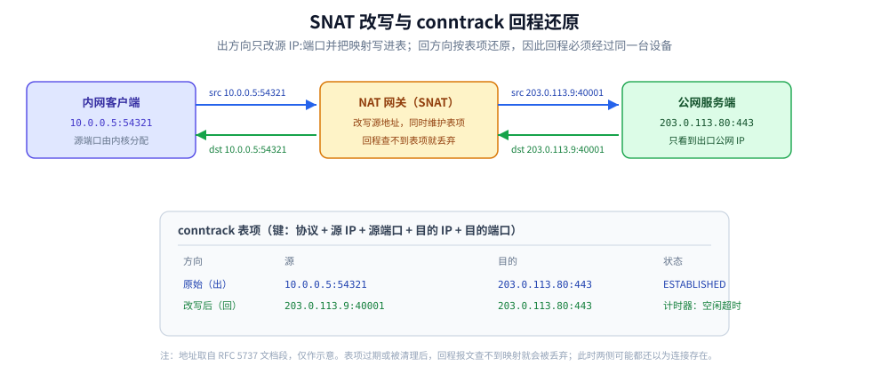
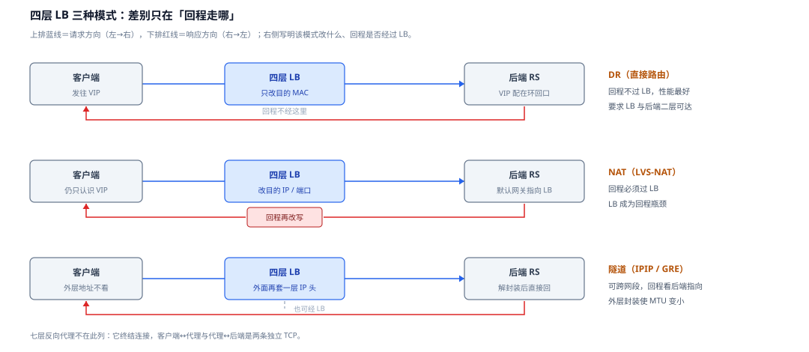
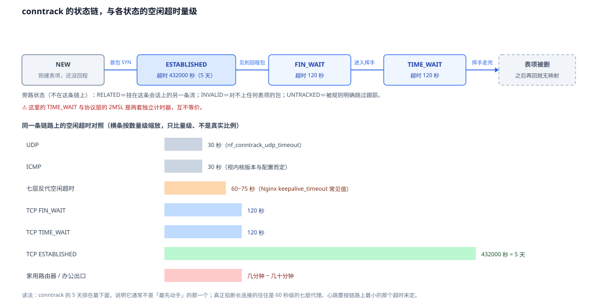

# NAT 与连接跟踪

> 覆盖：SNAT / DNAT 各自改什么、conntrack 如何用四元组做回程还原、NAT 表项被耗尽或超时后各有什么表现、链路各段空闲超时的量级，以及心跳周期到底该按什么定。
>
> 不覆盖：逐跳 MAC / TTL 改写与完整链路见 [网络通信链路详解.md](../网络通信链路详解.md) 第三节；客户端真实 IP 的解析与可信代理链见 [客户端真实IP与可信代理.md](../代理与网关/客户端真实IP与可信代理.md)；TCP 保活细节见 [TCP保活与连接存活.md](../传输层/TCP保活与连接存活.md)。
>
> 内容整理自个人学习笔记，素材见 [素材清单](../../../素材清单.md)。
>
> ⚠️ 实测口径：本篇的超时数值按 Linux 内核与主流云产品文档整理，**未在本机逐项修改并计时**；四元组与 conntrack 的观测命令为 Linux / Windows 通用口径，Windows 侧没有与 `conntrack -L` 完全对等的用户态命令。

---

## 一、NAT 在链路的哪一跳发生？

NAT（Network Address Translation）不是某一层协议的固定环节，而是**转发路径上的设备在做地址改写**。最常见的两处：

| 位置 | 做什么 | 谁在改 |
| --- | --- | --- |
| 家庭 / 办公出口、云 NAT 网关 | **SNAT**：把内网 `源 IP:端口` 换成出口公网 `IP:端口` | 路由器 / NAT 网关 |
| 四层负载均衡（LVS、云 SLB） | **DNAT**：把 VIP `目的 IP:端口` 换成某台后端 `IP:端口` | LB |
| Kubernetes `kube-proxy` | **DNAT**：Service ClusterIP → Pod IP | iptables / IPVS |
| 容器出网 | **SNAT**：容器地址 → 宿主机或节点地址 | iptables / nftables |

⭐ 共同点：**改写后必须记住「改之前是什么」**，否则回程报文无法还原。这张「记忆表」就是 **conntrack（连接跟踪表）**。

```text
出方向：10.0.0.5:54321  ──SNAT──▶  203.0.113.9:40001  ──▶  服务端 203.0.113.80:443
回方向：服务端 ──▶ 203.0.113.9:40001  ──查 conntrack──▶  10.0.0.5:54321
```



图注：SNAT 改写与 conntrack 回程还原：出方向换源地址并写下表项，回方向按五元组查表把目的地址换回去。

**图怎么读**：两根箭头是**同一张表的两次查写**——去程那根先把 `10.0.0.5:54321` 改写成出口公网的 `203.0.113.9:40001`，并**立刻把改写前的值写进表项**；回程那根不做决策，只是拿收到的五元组去查这张表，把目的地址还原成内网的 `10.0.0.5:54321`。所以「回程必须经过同一台 NAT 设备」不是规定，而是**表项只在那台设备上**——绕开它就没有还原依据，这也解释了第三节为什么键是五元组而不是 IP。

---

## 二、SNAT 与 DNAT 各自改什么？

| | **SNAT** | **DNAT** |
| --- | --- | --- |
| 改哪个字段 | **源 IP / 源端口** | **目的 IP / 目的端口** |
| 谁发起 | 内网主机发起、出口设备改写 | 客户端发起、LB 改写 |
| 解决什么 | 内网地址不出公网、多个内网主机共享一个公网 IP | 一个 VIP 后面挂多台后端、端口映射 |
| 回程怎么走 | **回程必须经过同一台 NAT 设备**（否则表项对不上） | 取决于转发模式：NAT 模式回程也过 LB；DR 模式不过 |
| 典型位置 | 家庭路由器、云 NAT 网关、容器出网 | LVS-NAT、云 SLB、K8s Service |

> ⚠️ **SNAT 与 DNAT 可以同时发生**（双向 NAT）：例如 LB 把目的地址改成后端，同时把源地址改成自己的地址，让后端把响应直接回给 LB。

### 2.1 四层 LB 的三种转发模式

三种模式的区别，核心在**回程走哪**：

| 模式 | 改什么 | 回程是否过 LB | 特点 |
| --- | --- | --- | --- |
| **DR（直接路由）** | 只改**目的 MAC**（IP 不动），后端把 VIP 配在环回口上 | ❌ 不过 | 性能最好；要求 LB 与后端二层可达 |
| **NAT（LVS-NAT）** | 改**目的 IP / 端口**，后端网关指向 LB | ✅ 必须过 | 配置简单；LB 成为回程瓶颈 |
| **隧道（IPIP / GRE）** | 在原始报文外再套一层 IP 头 | 取决于后端是否直接回 | 可跨网段；**会使 MTU 变小**（见 [网络通信链路详解.md](../网络通信链路详解.md) 4.1） |



图注：四层 LB 三种模式的回程拓扑：去程三行几乎一样，差别全在下排那根回程红线要不要穿过 LB。

**图怎么读**：先看**上排蓝线**——三行都是「客户端 → LB → 后端」，所以去程不能用来区分模式；再看**下排红线**。DR 行的红线从后端直接回到客户端，中间**刻意没有节点**，这就是「回程不过 LB、性能最好」的几何说法，代价写在右侧：LB 与后端必须二层可达，且 VIP 要配在后端的环回口上，否则后端收到目的地址是 VIP 的包会直接丢掉。NAT 行的红线中间多了一个「回程再改写」的小格子，回程必须穿回 LB，于是同一台 LB 承担去程与回程两个方向的量，成为瓶颈。隧道行的红线画得和 DR 一样直接（虚线表示也可以经 LB，取决于后端的网关指向），区别在 LB 那一格写的是「外面再套一层 IP 头」——封装本身的副作用就是可用 MTU 变小。

**七层反向代理**（Nginx / Envoy）不做 IP 层的 NAT，它是**连接终结者**：客户端 ↔ 代理一条 TCP，代理 ↔ 后端**另一条 TCP**。所以后端看到的对端是代理，且两条连接的 TCP 语义互不相通——详见 [反向代理原理.md](../代理与网关/反向代理原理.md)。

---

## 三、conntrack 用什么做键？

conntrack 的键是**五元组**（很多文档口语化叫四元组，加上协议就是五元组）：

```text
(协议, 源 IP, 源端口, 目的 IP, 目的端口)
```

一条表项包含两个方向的描述：

| 字段 | 出方向 | 回方向 |
| --- | --- | --- |
| 原始五元组 | `10.0.0.5:54321 → 203.0.113.80:443` | `203.0.113.80:443 → 10.0.0.5:54321` |
| 改写后五元组 | `203.0.113.9:40001 → 203.0.113.80:443` | `203.0.113.80:443 → 203.0.113.9:40001` |
| 状态 | `ESTABLISHED` / `TIME_WAIT` / … | 由内核状态机维护 |
| 计时器 | 空闲超时 | 同上 |

⭐ **端口不够用是 NAT 的固有限制**：多个内网主机映射到同一个公网 IP 时，只能靠**源端口**区分。可用的端口范围由 `net.ipv4.ip_local_port_range` 限制（常见 `32768~60999`），所以最坏情况下一台 NAT 设备对**同一个目的 IP:端口**最多只能维持约 2.8 万条并发连接——端口耗尽就表现为新连接失败。

---

## 四、NAT 带来哪些必知后果？

| 现象 | 原因 | 应对 |
| --- | --- | --- |
| 服务端看到的是**网关公网 IP** | 源 IP 被改写 | 真实 IP 只能靠应用层头（`X-Forwarded-For` / `Forwarded` / `PROXY protocol`），见 [客户端真实IP与可信代理.md](../代理与网关/客户端真实IP与可信代理.md) |
| **长连接被「静默断开」** | NAT 会话有**空闲超时**，超时后表项被删，两侧还以为连着 | 心跳间隔 < 链路上最小空闲超时 |
| **NAT 表被打满** → 新连接失败 | 每个会话占一行；短连接风暴或扫描会耗尽 | 扩大表容量、缩短超时、限流；Linux 报 `nf_conntrack: table full, dropping packet` |
| **端口耗尽** | 同一目的地址下源端口空间有限 | 连接复用、增加出口 IP、扩大端口范围 |
| 外部无法主动连入 | 没有表项就没有回程映射 | 做端口映射（DNAT）或走内网穿透 |
| UDP 打洞失败 | 不同 NAT 的映射 / 过滤行为不同 | 用 STUN / TURN / ICE，或走中继 |

### 4.1 五种状态与两种超时

Linux conntrack 对 TCP 维护一组状态（`NEW`、`ESTABLISHED`、`RELATED`、`INVALID`、`UNTRACKED`），每类状态有自己的超时：

| 状态 / 协议 | 默认空闲超时 | 说明 |
| --- | --- | --- |
| TCP `ESTABLISHED` | **5 天**（`nf_conntrack_tcp_timeout_established`，432000 秒） | 只是内核默认值，实际链路往往先被别的设备掐断 |
| TCP `FIN_WAIT` | 120 秒 | 挥手阶段 |
| TCP `TIME_WAIT` | 120 秒 | 与协议层的 2MSL 是两套计时器 |
| UDP | **30 秒**（`nf_conntrack_udp_timeout`） | 无连接协议只能靠超时回收 |
| ICMP | 30 秒 | 视内核版本与配置而定 |

> ⚠️ 这些是**内核默认值**，容器、云主机与各发行版都可能改过；以 `sysctl` 读数为准，不要背数字。

**这几个状态是怎么串起来的**：首包（SYN）建出一条新表项进 `NEW`，只有看到回程包才转成 `ESTABLISHED`；进入挥手后依次走 `FIN_WAIT`、`TIME_WAIT`，各自计时器到点就把表项删掉——此后再回来的包对不上任何表项，就归入 `INVALID`。另外两个旁路状态：`RELATED` 是「挂在这条会话上的另一条流」（例如 ICMP 差错报文），`UNTRACKED` 是被规则明确跳过跟踪的流量。



图注：conntrack 状态链与空闲超时量级：上半讲「状态各自计时」，下半把内核默认值放到整条链路的超时里比量级。

**图怎么读**：上半的关键是**每个状态有自己的一套计时器**，而不是「一条连接一个超时」——同一条连接在 `ESTABLISHED` 上可以待 5 天，进了 `TIME_WAIT` 只剩 120 秒。注意 `TIME_WAIT` 这一格和协议层的 2MSL 是**两套独立计时**（协议层那套见 [TCP四次挥手.md](../传输层/tcp/TCP四次挥手.md) 第二节），别把 120 秒和 2MSL 混成一个数。下半把上面的数放进整条链路里排一遍：横条按数量级缩放（只比大小、不是真实比例），`ESTABLISHED` 的 5 天那根最长，可恰恰是**最不该指望它**的一个——真正掐断长连接的通常是 60~75 秒级的七层代理，所以心跳要按链路上**最小**的那个超时来定（判据见第五节）。

### 4.2 NAT 不等于防火墙

NAT 设备通常顺带做过滤，但 **NAT 与防火墙是两件事**：NAT 负责「改写 + 记住映射」，防火墙负责「允许 / 拒绝」。一台只做 NAT 不做策略的设备，内网主机仍然可以主动访问任何外部地址；「内网安全」来自过滤策略，而不是地址转换本身。

---

## 五、链路上到底哪一段先超时？

长连接被断时，**第一个嫌疑人不是服务端，而是中间设备的空闲回收**。按常见量级从短到长排：

| 环节 | 典型空闲超时 | 备注 |
| --- | --- | --- |
| **七层反向代理 / API 网关** | **60 秒级**（Nginx `keepalive_timeout` 常配 60~75s） | 最常见的「第一嫌疑人」 |
| **云 SLB / NAT 网关** | **几十秒 ~ 几分钟** | 各家默认不同，必须查产品文档 |
| **家用路由器 / 办公出口** | **几分钟 ~ 几十分钟** | 「莫名其妙断连」的高发区 |
| **Linux conntrack** | TCP established **5 天**、UDP 30 秒 | 通常不是最短的那一个（UDP 除外） |
| **服务端应用空闲超时** | 由框架配置决定 | 例如 Go `http.Server.IdleTimeout` |
| **客户端连接池** | 由客户端配置决定 | 池里取出旧连接前应先探活 |

⭐ **心跳周期的唯一判据**：**小于链路上所有空闲超时里最小的那个**，并留出重试余量。常见做法是取最小超时的 1/2 ~ 1/3。心跳的目的不是「探测服务端还活着」，而是**让中间设备的会话表项保持新鲜**。

---

## 六、IPv6 下还有 NAT 吗？

IPv6 的设计目标是端到端直连，纯 v6 链路通常**不做 NAT**：服务端看到的源地址就是客户端的。但要注意：

- **防火墙仍然存在**：公网进内网照样要过安全组 / 防火墙，能不能拿到真实 IP 要按拓扑判断；
- **NPTv6** 只做前缀转换（不改端口），用于多归属场景，不等同于 NAT44；
- **双栈环境下**，同一条业务可能 v4 走 NAT、v6 直连，客户端 IP 的形态会不一致，日志与限流要统一归一化。

---

## 七、应用场景

**本节要点**：凡是「地址在途中被改写」的地方，都能用 conntrack 的视角解释；凡是「长连接莫名断开」的问题，都先查空闲超时。

| 场景 | 涉及哪一块 | 为什么值得注意 |
|---|---|---|
| 内网主机访问公网 | SNAT + conntrack | 服务端看到的是出口 IP，真实 IP 要靠应用层头，详见 本篇第四节 |
| 负载均衡与 K8s Service | DNAT | 回程是否过 LB 决定拓扑与故障域，详见 本篇 2.1 |
| 长连接 / WebSocket / gRPC 流 | 空闲超时 | 代理通常比 NAT 更早回收，详见 本篇第五节 |
| 连接池频繁重建 | 端口耗尽 / 表项超时 | 「取出来先探活」是连接池的必备动作 |
| UDP 打洞与实时音视频 | NAT 映射 / 过滤行为 | 对称 NAT 下打洞容易失败，需要中继 |
| 限流按 IP 误伤 | SNAT 后源 IP 坍缩 | 大量客户端看起来是同一个 IP，详见 [客户端真实IP与可信代理.md](../代理与网关/客户端真实IP与可信代理.md) |

## 八、具体使用

**本节要点**：先看表项在不在，再看计数器有没有满，最后才对超时下手；改内核参数前先读当前值。

```bash
# 1) 看当前 conntrack 表项（需要 conntrack-tools；也可直接读 /proc）
sudo conntrack -L
sudo conntrack -L -p tcp --dport 443
cat /proc/net/nf_conntrack | head

# 2) 看表容量与使用量
sysctl net.netfilter.nf_conntrack_count net.netfilter.nf_conntrack_max
cat /proc/sys/net/netfilter/nf_conntrack_count

# 3) 看各状态的超时（不同内核版本字段名可能不同）
sysctl -a | grep nf_conntrack_.*timeout

# 4) 看丢包与错误计数
sudo conntrack -S
nstat -az | grep -i conntrack

# 5) 看本机端口范围（NAT 端口耗尽的边界）
sysctl net.ipv4.ip_local_port_range

# 6) 看 NAT 规则（iptables 或 nftables 二选一）
sudo iptables -t nat -L -n -v
sudo nft list ruleset
```

```powershell
# Windows：看连接与监听（没有 conntrack 对等命令）
netstat -ano
Get-NetTCPConnection -State Established | Select-Object LocalAddress,LocalPort,RemoteAddress,RemotePort,OwningProcess
```

⭐ 判断口径：

- **表项在、连接仍断** → 断点不在 NAT，去看代理 / 服务端的空闲超时；
- **表项消失、重连即恢复** → 典型 NAT 会话过期；
- **`nf_conntrack_count` 贴近 `max`** → 已经在丢新连接，先扩容或查短连接风暴；
- **端口范围很小且连接数高** → 优先做连接复用，而不是盲目扩端口。

---

## 延伸追问

- **为什么回程必须经过同一台 NAT 设备？** → 因为回程报文的目的地址是 NAT 改写后的公网地址，只有持有该表项的设备才知道它对应哪个内网 `IP:端口`。多出口场景如果回程走了另一条链路，就会因为查不到表项而被丢弃（策略路由 / 会话保持要解决的就是这件事）。
- **conntrack 是四元组还是五元组？** → 严格说是**五元组**（协议 + 源 IP + 源端口 + 目的 IP + 目的端口）。口语里说「四元组」时通常指同一协议下的 `(源 IP, 源端口, 目的 IP, 目的端口)`，两者不要混着写。
- **NAT 表满了会发生什么？** → 新连接无法建立表项，内核按策略丢弃并计数（`nf_conntrack: table full, dropping packet`）。已有连接通常不受影响。表现为「新请求超时、老连接正常」。
- **TCP 的 keepalive 能防 NAT 超时吗？** → 能，但要注意方向与默认值：Linux `tcp_keepalive_time` 默认 7200 秒，远大于多数 NAT 超时，**默认值基本等于没开**。应用层心跳更可控，见 [TCP保活与连接存活.md](../传输层/TCP保活与连接存活.md)。
- **UDP 没有连接，conntrack 怎么记？** → 按五元组建「伪连接」表项，靠较短的 UDP 超时（常见 30 秒）回收。所以 UDP 打洞必须周期性地发保活包，否则映射会先过期。
- **IPv6 没有 NAT，是不是就没有这个问题？** → 地址不再被改写，但**防火墙会话表**仍然可能做状态化回收；长连接的空闲超时问题依然存在，只是发生的位置从 NAT 变成了防火墙 / 代理。
- **为什么云上「同一个客户端」的 IP 会变？** → 可能经过了多台 NAT 网关、出口 IP 池轮换，或客户端本身在移动网络下切换。按 IP 做会话粘滞时要考虑这一点。

---

## 关联

- **上游/总纲**：[网络通信链路详解.md](../网络通信链路详解.md) — 逐跳改写、四个隐形陷阱与分层观测点
- **对照/互补**：[客户端真实IP与可信代理.md](../代理与网关/客户端真实IP与可信代理.md) — SNAT 之后如何还原真实客户端
- **下游机制**：[TCP保活与连接存活.md](../传输层/TCP保活与连接存活.md) — 心跳与 keepalive 的落地
- **下游机制**：[反向代理原理.md](../代理与网关/反向代理原理.md) — 七层代理的空闲超时与连接模型
- **上游/总纲**：[IP与路由基础.md](IP与路由基础.md) — 地址、路由与转发的基础
- **下游机制**：[IPv6与双栈.md](IPv6与双栈.md) — 无 NAT 的地址模型与双栈差异

> 反向引用（本篇被下列文档引到）：[WebSocket与SSE.md](../应用层/WebSocket与SSE.md)
