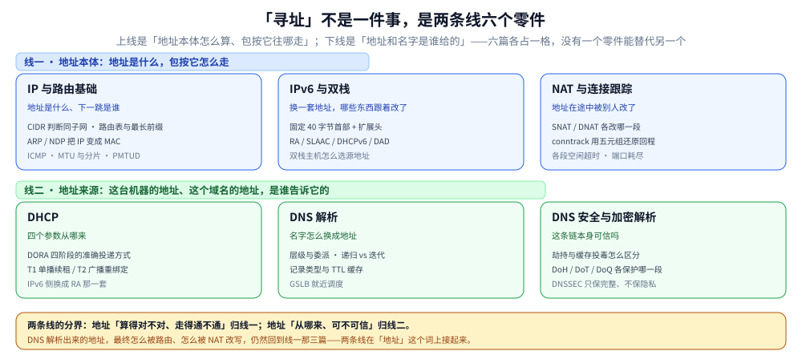

# 网络层与寻址

> 本目录回答一个问题：**一台机器凭什么知道自己叫什么地址、以及把这个包交给谁。** 六篇分两条线——
> 线一讲「地址是什么、包按它怎么走」（地址本体、地址换代、地址被改写），
> 线二讲「地址和名字是谁给的」（配置、解析、解析可信性）。
>
> 本篇是这个目录的**总入口**，只给索引、阅读路径、篇间依赖与边界；机制细节、命令与实测读数全部在零件篇里，
> 这里不重复。目录级的位置（这一层在整个网络体系里排第几）见 [网络/README.md](../README.md)。
>
> 内容整理自个人学习笔记，素材见 [素材清单](../../../素材清单.md)。

---

## 一、这个目录回答什么问题

「寻址」听起来是一件事，其实是**两个可以独立失败的问题**：地址算错了包直接发不出去；名字解析错了包会发到别人那儿去，
而且不报错。六篇按这两条线归位，没有一篇能替代另一篇。

图怎么读：**同一行是三篇能在同一层并列的东西，上下两行才是先后关系**——线二的 DHCP 和 DNS 都发生在「连出去之前」，
它们拿到的结果（本机地址、目标地址）交给线一的三篇去用；而线一里 NAT 又把「地址是身份」这件事推翻一次，
所以它虽在地址本体这一行，回答的却是「地址被改了之后怎么对上」。
底部那条是本目录的分界句：**地址算得对不对、走得通不通归线一，地址从哪来、可不可信归线二**。

---

## 二、现有篇目与一句话职责

### 2.1 线一：地址本体（3 篇）

| 文件 | 一句话职责 |
|---|---|
| [IP与路由基础.md](IP与路由基础.md) | **本目录的地基**：IP 层负责什么、CIDR 怎么判断同子网、路由表怎么选下一跳（最长前缀）、ARP/NDP 怎么把 IP 变成 MAC、ICMP 能证明什么、MTU 与分片的排障口径 |
| [IPv6与双栈.md](IPv6与双栈.md) | **地址换代**：固定 40 字节首部与扩展头、地址分类、RA / SLAAC / DHCPv6 / DAD 四种配置机制、NDP 如何替代 ARP、双栈主机怎么选源地址 |
| [NAT与连接跟踪.md](NAT与连接跟踪.md) | **地址被改写之后**：SNAT 与 DNAT 各改哪一段、conntrack 用五元组怎么还原回程、表项耗尽与各段空闲超时、心跳周期按什么定 |

### 2.2 线二：地址来源（3 篇）

| 文件 | 一句话职责 |
|---|---|
| [DHCP.md](DHCP.md) | **四个参数从哪来**：DORA 四阶段的准确投递口径（哪些是广播、哪些看标志位）、T1 单播续租与 T2 广播重绑定、租约形状怎么被别处复用；第二节收 IPv6 侧的 RA 组合 |
| [DNS解析.md](DNS解析.md) | **名字怎么换成地址**：域名层级与服务器类型、一次解析的完整流程与递归/迭代之别、资源记录类型、TTL 与缓存、GSLB 就近调度、排障该看什么 |
| [DNS安全与加密解析.md](DNS安全与加密解析.md) | **这条链可信吗**：攻击面、劫持与缓存投毒怎么区分、多 DNS 结果不一致先排除正常调度、HTTPDNS 的边界、DoH / DoT / DoQ 各保护哪一段、DNSSEC 保完整不保隐私、四种失败语义与负缓存 |

> ⚠️ 这两条线的分界不是绝对的：`DHCP.md` 第二节和 `IPv6与双栈.md` 第三节都讲 IPv6 的地址配置，前者只留「三种组合怎么选」，
> 后者才是完整机制——**遇到重复段落，以 `IPv6与双栈.md` 为准**（见第六节）。

---

## 三、按问题走阅读顺序

不要从头读到尾，按手上的问题挑一条：

| 你想解决什么 | 读这个顺序 |
|---|---|
| **第一次建立「网络层在干什么」** | [IP与路由基础.md](IP与路由基础.md)（一~四节：职责 → CIDR → 路由表 → 出站决策）→ [IPv6与双栈.md](IPv6与双栈.md)（一、只读对照表）→ 回到 [网络分层与数据包旅程.md](../网络分层与数据包旅程.md) 第七节看这一步在封装里的位置 |
| **包发不出去 / 通不到对端** | [IP与路由基础.md](IP与路由基础.md)（三、四节查下一跳，六节查 ARP/NDP，七节用 ICMP 判「断在哪一跳」）→ [NAT与连接跟踪.md](NAT与连接跟踪.md)（若是跨 NAT 或回程丢） |
| **「小包正常、大包卡住」** | [IP与路由基础.md](IP与路由基础.md) 第八节（MTU / MSS / 分片 / PMTUD 与黑洞）→ [UDP与数据报传输.md](../传输层/UDP与数据报传输.md)（应用直接发大包才会走到 IP 分片） |
| **机器拿不到地址 / 地址变了** | [DHCP.md](DHCP.md)（一、DORA 与 T1/T2）→ [IPv6与双栈.md](IPv6与双栈.md)（三、RA 与 SLAAC 四种机制） |
| **域名解析不对 / 解析慢** | [DNS解析.md](DNS解析.md)（三、解析流程；七、排障清单）→ [DNS安全与加密解析.md](DNS安全与加密解析.md)（二、劫持与污染怎么区分；三、多结果不一致先排除调度） |
| **长连接隔一阵就断** | [NAT与连接跟踪.md](NAT与连接跟踪.md) 第五节（各段空闲超时量级）→ [TCP保活与连接存活.md](../传输层/TCP保活与连接存活.md)（四层保活怎么分工、心跳定多少） |
| **要上 IPv6（双栈过渡）** | [IPv6与双栈.md](IPv6与双栈.md)（全篇）→ [DHCP.md](DHCP.md) 第二节（v6 侧地址从哪来）→ [NAT与连接跟踪.md](NAT与连接跟踪.md) 第六节（v6 下还需不需要 NAT） |
| **只想搞懂 DNS 为什么会被劫持** | [DNS解析.md](DNS解析.md)（二、层级与委派；六、常见风险）→ [DNS安全与加密解析.md](DNS安全与加密解析.md)（全篇） |

---

## 四、篇间依赖（谁要前置）

| 本篇 | 建议先读 | 为什么 |
|---|---|---|
| [IPv6与双栈.md](IPv6与双栈.md) | [IP与路由基础.md](IP与路由基础.md)、[DHCP.md](DHCP.md) | 地址与自动配置要和 v4 对照着看，否则「改了什么」没有基准 |
| [NAT与连接跟踪.md](NAT与连接跟踪.md) | [IP与路由基础.md](IP与路由基础.md) | 先懂地址与端口，才懂五元组改写；先懂首部字段，才懂哪些字段会被动 |
| [DNS安全与加密解析.md](DNS安全与加密解析.md) | [DNS解析.md](DNS解析.md) | 劫持与污染的判据建立在「递归、缓存、TTL」这套机制上 |
| [DHCP.md](DHCP.md) | 无（但建议先看 [网络分层与数据包旅程.md](../网络分层与数据包旅程.md) 第八节） | 它讲的是「连出去之前」的准备动作，不依赖本目录其他篇 |
| [IP与路由基础.md](IP与路由基础.md) | [网络分层与数据包旅程.md](../网络分层与数据包旅程.md) | 先有「为什么需要两套地址」，再谈寻址与选路 |

---

## 五、与相邻目录的边界

| 相邻目录 | 分界 |
|---|---|
| [数据链路层/](../数据链路层/以太网与二层转发.md) | 那边管**同一链路内**怎么把帧送到下一跳网卡（帧结构、MAC 表、泛洪、VLAN）；本目录只管**「下一跳是谁」这个地址是怎么算出来的**。ARP/NDP 在这里，帧怎么发出去在那里 |
| [传输层/](../传输层/) | 本目录到「主机到主机」为止；端口以上的连接管理、可靠性、拥塞控制归传输层。本目录讲 IP 分片，传输层讲 TCP 按 MSS 分段 |
| [应用层/](../应用层/) | DNS **协议本身**在本目录（它是「名字 → 地址」的寻址环节）；HTTP / TLS / WebSocket 这些面向请求的协议在应用层 |
| [代理与网关/](../代理与网关/) | NAT 是网络层改写，反代是应用层改写；「客户端真实 IP 该信哪个头」在 [客户端真实IP与可信代理.md](../代理与网关/客户端真实IP与可信代理.md)，本目录只讲地址怎么被改 |
| [网络通信链路详解.md](../网络通信链路详解.md) | 那边是**逐跳视角**（一个包跨过哪些节点、每跳改了哪些字段）；本目录是**单个机制视角**。两边读同一个 ARP / NAT，看到的粒度不同 |
| [06-工程实践/部署/docker/](../../../06-工程实践/部署/docker/网络与存储.md) | 容器网络是同一套机制的软件实现（veth / bridge / DNAT），机制口径仍以本目录为准 |
| [linux/鸟哥服务器架设篇/](../../linux/鸟哥服务器架设篇/) | 那边是**服务端部署**（BIND 的 zone 文件、DHCP 服务的配置文件），本目录是**协议机制** |

---

## 六、已知缺口与遗留问题

| 项 | 现状 | 结论 |
|---|---|---|
| **IPv6 过渡技术**（NAT64 / 464XLAT / DS-Lite） | 全仓 `464XLAT` / `DS-Lite` 各 0 次，`NAT64` 只在 Docker 镜像源篇出现一次；[IPv6与双栈.md](IPv6与双栈.md) 只讲双栈共存，不讲单栈过渡 | **确认为缺口**，未定优先级。真要做纯 v6 环境落地时才会撞上 |
| **组播的完整机制**（IGMP / MLD、组播路由） | 散在 4 篇里各一段：[以太网与二层转发.md](../数据链路层/以太网与二层转发.md)、[IPv6与双栈.md](IPv6与双栈.md)、[UDP与数据报传输.md](../传输层/UDP与数据报传输.md)、[DNS解析.md](DNS解析.md) | **暂不补**：本仓主线是应用侧链路，组播路由属运营商与专网领域 |
| **BGP 与运营商路由** | 只在 [网络通信链路详解.md](../网络通信链路详解.md)「公网那一跳」点到 | **暂不补**，理由同上（目录级记录见 [网络/README.md](../README.md) 第五节） |
| ⚠️ **两处段落重复** | `IP与路由基础.md` 第五节与 `IPv6与双栈.md` 第一节是**同一张 IPv4/IPv6 对照表**（后者多一行 NAT）；`DHCP.md` 第二节与 `IPv6与双栈.md` 第三节是**同一张三种组合表**（后者多一列「出现在哪」）。两处的「本节要点」首句完全相同 | **未修**。简版保留了原表，会随 IPv6 篇继续漂移；按「一处讲透」应把简版压成「结论 + 指针」，待定 |

---

## 关联

- **上游/总纲**：[网络/README.md](../README.md) — 网络目录整体的两篇总纲、36 篇分类地图与主读序
- **上游/总纲**：[网络分层与数据包旅程.md](../网络分层与数据包旅程.md) — 纵向总纲：五层模型与一个包在本机怎么被造出来，本目录六篇是它第四、八节的展开
- **对照/互补**：[网络通信链路详解.md](../网络通信链路详解.md) — 横向总纲：逐跳视角看同样的地址与 NAT，在每一跳被改了什么
- **下游机制**：[UDP与数据报传输.md](../传输层/UDP与数据报传输.md) — 大包与分片的代价，本目录讲机制、那边讲应用该怎么躲
- **下游机制**：[TCP保活与连接存活.md](../传输层/TCP保活与连接存活.md) — NAT 空闲超时的下游：心跳要按链路最短超时来定
- **对照/互补**：[客户端真实IP与可信代理.md](../代理与网关/客户端真实IP与可信代理.md) — 地址在代理这一跳被写进头部之后，「哪个才是客户端」的判断
