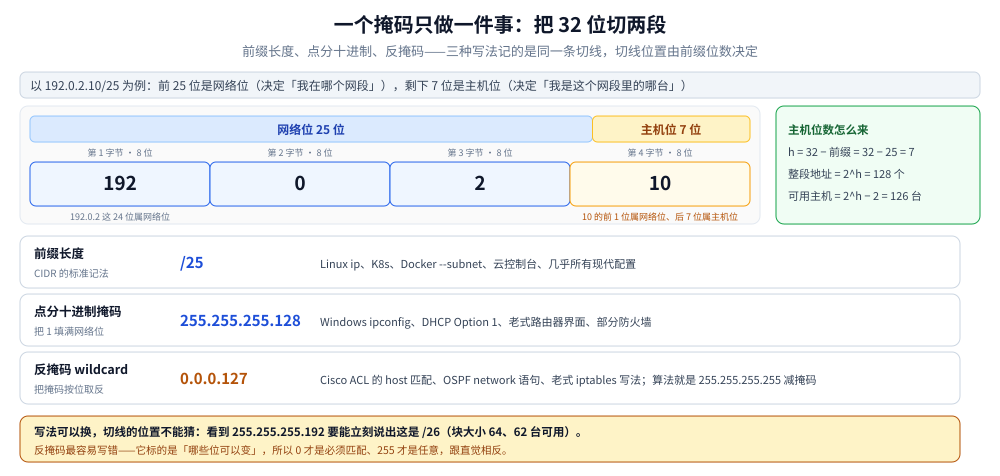
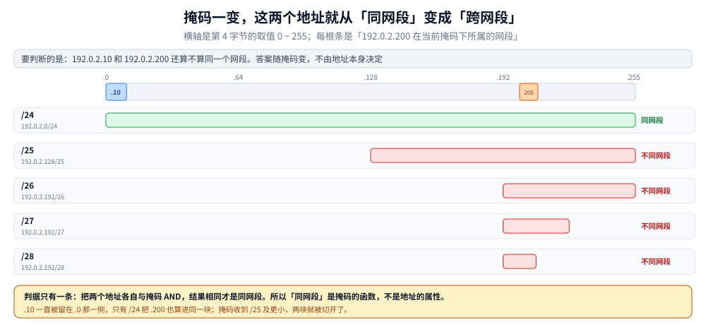
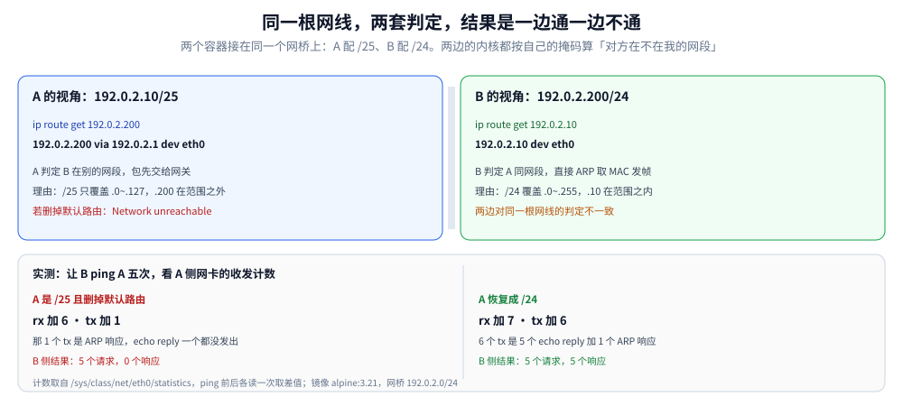

# 子网掩码与 IP 网段划分

> 覆盖：子网掩码**是什么**（32 位、前 N 位为 1、逐位与得网络地址、三个不变量）、**为什么需要**（有类地址只有三档、改不了，以及 RFC 950 与 CIDR 各自解决了什么）、**它到底在决定什么**（出站第一跳、子网切分、路由聚合、广播域、策略规则）、掩码的三种写法与反掩码怎么换算、块大小速算法（给定任意地址与掩码，口算网络地址 / 广播地址 / 可用范围）、可用主机数的两个例外（`/31` 与 `/32`）、把一个地址块切给多个子网（FLSM 与 VLSM 的差别）、多条细前缀聚合成一条（超网）及其代价、掩码配错时「一边通、一边不通」的成因与判据，以及云与容器环境的网段规划。
>
> 不覆盖：「两台主机在不在同一个网段」的基础判定与 CIDR 写法见 [IP与路由基础.md](IP与路由基础.md) 第二节（本篇只引结论，不重复那张对照表）；该篇 2.3 已用三句话给出「为什么需要子网与掩码」的结论，本篇 1.2 补的是这三句话的来由与代价，两处不重复；路由表怎么选下一跳（最长前缀匹配）见同篇第三节；IPv6 没有掩码这个概念、只说前缀长度（把点分掩码套上去不报错，但会算出完全不同的边界），实测见 [IP与路由基础.md](IP与路由基础.md) 5.5；地址在途中怎么被改写见 [NAT与连接跟踪.md](NAT与连接跟踪.md)；地址怎么自动获取见 [DHCP.md](DHCP.md)。
>
> 内容整理自个人学习笔记，素材见 [素材清单](../../../素材清单.md)。本篇第五节为本机实测（`alpine:3.21` 容器 + Docker 网桥，读数取自 `ip` 命令与 `/proc/net/snmp`），第二至四节的全部算例用 Python `ipaddress` 逐条交叉验证；未实测的部分在第五节末尾与各节内标明。

---

## 一、子网掩码是什么，为什么需要，它到底在决定什么？

**本节要点**：掩码不是地址的一部分，而是**跟着地址一起下发的尺子**——同样 32 位，前 N 位写 1，用来声明地址从哪一位切开。它存在的理由只有一条：32 位地址自己不含「边界在哪」的信息，而边界必须能按需配置、并且被每一处配置记住。它决定的也只有一件事——哪些地址算同段、哪些算异段。掩码的全部语义就是**一条切线**，三种写法是同一条切线的三种记法；反掩码是这条切线按位取反的结果，标的是「哪些位可变」，所以 0 与 255 的含义跟直觉相反。

### 1.1 是什么：一把量在地址上的尺子

子网掩码（subnet mask）是一个与 IPv4 地址等长的 32 位数：**前 N 位全是 1，剩下 32 − N 位全是 0**。那 N 个 1 的位置就是切口，左边的位属于网络、右边的位属于主机。把地址和掩码逐位做按位与（AND），留下的就是网络地址：

```text
地址   11000000.00000000.00000010.01000110   192.0.2.70
掩码   11111111.11111111.11111111.11000000   255.255.255.192
──────────────────────────────────────────   逐位与
网络   11000000.00000000.00000010.01000000   192.0.2.64
```

主机位是最后 6 位（`.70` 的低 6 位是 `000110`，即十进制的 6），所以它落在这块的第一个 64 地址里：网络地址 `.64`、广播地址 `.127`、可用 `.65`~`.126`。**同一串地址换一个掩码，网络地址、广播地址、可用范围全部重算**：

| 同一个地址 `192.0.2.70` | 掩码 | 网络地址 | 广播地址 | 可用范围 |
|---|---|---|---|---|
| 配 `/24` | `255.255.255.0` | `192.0.2.0` | `192.0.2.255` | `.1` ~ `.254` |
| 配 `/25` | `255.255.255.128` | `192.0.2.0` | `192.0.2.127` | `.1` ~ `.126` |
| 配 `/26` | `255.255.255.192` | `192.0.2.64` | `192.0.2.127` | `.65` ~ `.126` |
| 配 `/27` | `255.255.255.224` | `192.0.2.64` | `192.0.2.95` | `.65` ~ `.94` |

对比 `/25` 与 `/26` 两行：**`.70` 在 `/25` 下属于 `192.0.2.0` 段，在 `/26` 下却属于 `192.0.2.64` 段**。地址一个字节都没动，所属网段变了。所以完整的地址表述永远是「地址 + 掩码」，只说一个 IP 回答不了任何拓扑问题。

⭐ 掩码要同时满足三个不变量，缺一条就不是合法掩码：

| 不变量 | 含义 | 不成立的后果 |
|---|---|---|
| 与地址等长 32 位 | 只有逐位对齐才能做按位与 | 无法计算，配置直接被拒 |
| 前 N 位全 1、后 32−N 位全 0 | 切口只能是一个连续的开头，中间不能夹 0 | 内核拒收，而且报错很有误导性（见 1.5） |
| 与地址成对出现在每一处 | 接口配置、DHCP Option 1、路由表项、ACL、容器 `--subnet` | 两端各算各的（见第五节） |

第三条最容易被忽略：**掩码不随数据包传输**。IPv4 头部里没有掩码字段，对端怎么算完全靠它自己那份配置。这一条就是后面「同一对主机，一个通一个不通」的根，第五节整节都在展开。

### 1.2 为什么需要：32 位地址自己说不清边界

既然掩码只是「声明边界」，那能不能从地址本身推出来？不能，因为 32 位里没有任何一位标记「我是边界」。早期只能靠首位模式硬编码：

| 类别 | 首位模式 | 固定前缀 | 每块地址数 | 可用主机 | 块数 |
|---|---|---|---|---|---|
| A 类 | `0` 开头 | `/8` | 16 777 216 | 16 777 214 | 126 |
| B 类 | `10` 开头 | `/16` | 65 536 | 65 534 | 16 384 |
| C 类 | `110` 开头 | `/24` | 256 | 254 | 2 097 152 |
| D 类 | `1110` 开头 | 无前缀概念 | — | — | 组播 |
| E 类 | `1111` 开头 | 无前缀概念 | — | — | 保留 |

问题不在「分得粗」，而在**块大小只有三档，且改不了**。一个 500 台机器的组织：

- 给一个 B 类：65 534 个地址只用掉 500 个，**浪费 99.24%**，剩下 6 万多个地址在这块里谁也拿不到
- 给两个 C 类：地址够用，但它们是两个不相邻的网络号，之间必须过路由器，路由表凭空多一条

[RFC 1519](https://www.rfc-editor.org/rfc/rfc1519.html) 第一节把这个困境写得很直白：

> class C, with a maximum of 254 host addresses, is too small, while class B, which allows up to 65534 addresses, is too large for most organizations.
>
> （C 类最多 254 个主机地址，太小；B 类可容 65 534 个，对多数组织又太大。）

这正是 B 类地址空间在 1990 年代初被快速耗尽、同时路由表膨胀的原因。解决分两步走：

1. **1985 年 [RFC 950](https://www.rfc-editor.org/rfc/rfc950.html)**：把边界从「首位模式」里拆出来，另写成一个 32 位字段——子网掩码。同一块 A/B/C 类地址可以在内部按需切成任意长度的小块，对外仍是一个网络号。
2. **1993 年 [RFC 1519](https://www.rfc-editor.org/rfc/rfc1519.html)（CIDR，现行版本 [RFC 4632](https://www.rfc-editor.org/rfc/rfc4632.html) / 2006）**：干脆取消「类」，任何前缀长度都合法。同样 500 台机器，直接给 `192.0.2.0/23`（510 个可用地址）即可，不必再套 65 534，也不必拼两个 C 类。

⭐ 一句话：**掩码把「边界」从地址数值里解放出来，变成一项可以按需配置、随地址一起下发的元数据。** 没有这层元数据，第四节的「几条前缀能不能合成一条」根本无从判断——聚合的前提就是前缀长度。

> 附带一句：IPv6 取消了掩码这个概念，只保留前缀长度写法——`ip addr add 2001:db8:1::2/255.255.255.0` 不会报错，但算出的是 v6 语境下的 24 位前缀（实测见 [IP与路由基础.md](IP与路由基础.md) 5.5）。点分掩码与反掩码是 IPv4 时代的两种记法，不是网络层的必需品。

### 1.3 作用：它到底在决定什么

掩码自己不转发、不拦截、也不出现在数据包里，但下游有五件事全靠它：

| 作用 | 机制 | 没有它会怎样 |
|---|---|---|
| ① 决定出站第一跳：直连还是交网关 | 目的地址先与本接口掩码比对，同段就直接 ARP 找 MAC 发出，异段才查路由表交给网关 | 每个包都只能盲交网关，或者根本判断不出能不能直连 |
| ② 把一个地址块切成多个子网 | 前缀越长块越小，实质是借主机位当网络位 | 一块地址只能整体使用，退回有类时代 |
| ③ 把多条前缀合并成一条（路由聚合） | 前缀越短覆盖越多；前提是前缀长度相同且地址对齐 | 路由表条数随子网数线性增长 |
| ④ 划定广播域：网络地址与广播地址由它算出 | 主机位全 0 是网络地址、全 1 是广播地址；ARP 广播只在本段泛洪 | 广播跨段扩散，二层网络被拖垮 |
| ⑤ 表达策略规则（ACL / 防火墙 / 路由过滤） | 规则作用对象是「网段」而不是单台主机，反掩码就是这个语境的记法 | 一个网段要写 N 条主机规则 |

②③ 是本篇第三、四节的主题；①的完整决策流程在 [IP与路由基础.md](IP与路由基础.md) 第四节；④的二层侧在 [以太网与二层转发.md](../数据链路层/以太网与二层转发.md)；⑤的记法见 1.4。

> ⚠️ **掩码不是访问控制**。它不检查、不阻断任何流量，也不在数据包里留痕——它只改变**本机对「谁跟我同段」的判断**。所以两端掩码不一致时，不是「被谁拦住了」，而是双方对同一件事有两种认知：一端认为对端直连，另一端认为对端在网关后面。这就是第五节那个「一边通、一边不通」的全部成因。

### 1.4 三种写法记的是同一个模式

同一条切线有三种记法，工程上会同时遇到。仍以 `192.0.2.10/25` 为例，掩码是「前 25 个 1，后 7 个 0」：

```text
11111111.11111111.11111111.10000000
└────── 网络位 25 位 ──────┘└ 主机位 7 位 ┘
```

| 写法 | 值 | 谁在用 | 换算 |
|---|---|---|---|
| 前缀长度 | `/25` | Linux `ip`、K8s、Docker `--subnet`、云控制台，现代配置几乎都用这个 | 直接数 1 的个数 |
| 点分十进制掩码 | `255.255.255.128` | Windows `ipconfig`、DHCP Option 1、老式路由器与防火墙界面 | 把 25 个 1 按 8 位一组转十进制 |
| 反掩码（wildcard） | `0.0.0.127` | Cisco ACL 的 host 匹配、OSPF `network` 语句、老式 iptables 写法 | `255.255.255.255` 按位减掩码 |



图的上半是那条切线：第 4 字节里只有最高 1 位归网络位，剩下 7 位归主机位，所以 `10`（二进制 `00001010`）的最高位属于网络、低 7 位 `0001010` 才是主机。下半是三行写法对照，右侧面板给出主机位数 `h = 32 − 前缀` 的换算式——**这个 `h` 是后面所有算法的入口**。

点分掩码与前缀的等价性可以直接验：`ip addr add 192.0.2.10/255.255.255.128 dev d0`，内核回显的是 `/25`：

```text
inet 192.0.2.10/25 scope global d0
192.0.2.0/25 dev d0 scope link  src 192.0.2.10
```

> ⚠️ **反掩码别按掩码去读**：反掩码里 `0` 表示「这一位必须精确匹配」，`255` 表示「这一位随便」。所以 `0.0.0.127` 的意思是「前三段必须一模一样，第四段任意」——它等价于 `192.0.2.0/24` 这个网段，而不是 `/25`。Cisco ACL 里 `host 192.0.2.10` 就是 `192.0.2.10 0.0.0.0`，而 `any` 是 `0.0.0.0 255.255.255.255`，正好是反掩码的两个极端。

### 1.5 掩码必须是连续的 1

「前 N 位 1、后 32−N 位 0」这个约束不是风格问题，是硬件与内核都依赖的：选路时只需比较前 N 位，一旦掩码中间夹 0，这层优化就不成立。非连续掩码会被内核直接拒掉：

```bash
$ ip addr add 192.0.2.10/255.255.0.255 dev d0
ip: an inet prefix is expected rather than "192.0.2.10"
```

这句报错很误导——它说的是「你给的不是一个合法的 inet prefix」，读起来像地址写错，其实是掩码不连续。**看到这条报错先回头检查掩码有没有夹 0**（历史上 `255.255.0.255`、`255.0.255.0` 这类输入并不罕见，多来自手工抄错或旧系统迁移）。

---

## 二、给定一个网段，边界和可用地址怎么算出来？

**本节要点**：不用转换成二进制也能算，只要记住**块大小 = 256 − 该字节的掩码值**，然后「向下取整到块大小的整数倍」就是网络地址。这一个公式覆盖所有非 8 倍前缀。

### 2.1 块大小：唯一需要背的一张表

前缀落在第 4 字节（`/25`~`/32`）时，`/24` 的块大小是 256（整段），往后每加一位就砍一半：

| 前缀 | 第 4 字节掩码 | 块大小 | 整段地址数 | 可用主机 |
|---|---|---|---|---|
| `/24` | 0 | 256 | 256 | 254 |
| `/25` | 128 | 128 | 128 | 126 |
| `/26` | 192 | 64 | 64 | 62 |
| `/27` | 224 | 32 | 32 | 30 |
| `/28` | 240 | 16 | 16 | 14 |
| `/29` | 248 | 8 | 8 | 6 |
| `/30` | 252 | 4 | 4 | 2 |
| `/31` | 254 | 2 | 2 | **2**（例外，见 2.3） |
| `/32` | 255 | 1 | 1 | **1**（例外，见 2.3） |

前缀落在第 3 字节时（`/17`~`/24`），同一套规则作用在第 3 字节上，块大小的单位变成「多少个 `/24`」：`/23` 块大小 2、`/22` 块大小 4、`/20` 块大小 16、`/17` 块大小 128。第 2、第 1 字节同理。

### 2.2 三步算出边界

```text
① 找块大小 = 256 − 掩码在该字节的值
② 网络地址 = 把地址的那个字节向下取整到块大小的整数倍，其余字节照抄
③ 广播地址 = 网络地址 + 块大小 − 1；可用范围 = 网络地址 + 1 ~ 广播地址 − 1
```

以 `192.0.2.200/27` 为例：块大小 256 − 224 = 32；`200` 向下取整到 32 的倍数得 `192`；广播 `192 + 32 − 1 = 223`。

| 输入 | 块大小 | 网络地址 | 广播地址 | 可用范围 |
|---|---|---|---|---|
| `192.0.2.200/27` | 32 | `192.0.2.192` | `192.0.2.223` | `.193` ~ `.222` |
| `192.0.2.70/26` | 64 | `192.0.2.64` | `192.0.2.127` | `.65` ~ `.126` |
| `192.0.2.130/25` | 128 | `192.0.2.128` | `192.0.2.255` | `.129` ~ `.254` |
| `192.0.2.20/28` | 16 | `192.0.2.16` | `192.0.2.31` | `.17` ~ `.30` |
| `172.20.33.7/20` | 16（第 3 字节） | `172.20.32.0` | `172.20.47.255` | `.32.1` ~ `.47.254` |

⭐ **地址带主机位是合法的**：配置里写 `192.0.2.20/28`（`.20` 不是网络地址），内核照收，地址保持 `.20`，但直连路由自动对齐成 `192.0.2.16/28`：

```text
inet 192.0.2.20/28 scope global d0
192.0.2.16/28 dev d0 scope link  src 192.0.2.20
```

这说明「网段」是算出来的，不是配出来的——**你只需保证掩码对，网络地址对错不了**。真正会配错的是掩码本身，以及把 `.0` 或全 1 的地址分给主机。

### 2.3 可用主机数不是恒等于 2^h − 2

`2^h − 2` 里的「−2」是扣掉网络地址与广播地址，这个扣法只在 `h ≥ 2` 时成立。两个前缀是例外：

| 前缀 | `h` | `2^h − 2` | 实际可用 | 为什么 |
|---|---|---|---|---|
| `/31` | 1 | 0 | **2** | RFC 3021：点对点链路上两个地址都是主机地址，不保留网络地址与广播地址 |
| `/32` | 0 | −2 | **1** | 单主机：只有一个地址，它就是主机地址本身 |

`/31` 的用途是**点对点链路省一半地址**：一个 `/30` 只能放 2 台主机却占 4 个地址，`/31` 用 2 个地址放 2 台主机。`/32` 的用途是**单主机路由**：VIP、负载均衡后端、K8s 的 `ClusterIP`、云的浮动 IP，都按 `/32` 通告。

内核的行为可以直接验（同一块 dummy 网卡上换掩码）：

```text
# /24 下查广播地址 .255
broadcast 192.0.2.255 dev d0  src 192.0.2.10
# /24 下查普通地址 .200
192.0.2.200 dev d0  src 192.0.2.10
# /31 下查对端 .11 —— 注意是普通主机路由，不是 broadcast
192.0.2.11 dev d0  src 192.0.2.10
# /31 下查 .9（不在本段）
ip: RTNETLINK answers: Network unreachable
```

判据很干净：**`/31` 下同一个网段里的另一个地址走的是普通主机路由，没有 `broadcast` 关键字**。`/32` 同理，它只产生一条 `local` 条目：`local 192.0.2.99 dev lo`。

⚠️ 一个容易忽略的后果：`/31` 与 `/32` 在**不支持 RFC 3021 的老设备**上会被当成非法掩码。跨厂商做点对点互联时，先确认对端接受 `/31`，否则退回 `/30`。

---

## 三、一块地址要分给多个子网，从哪一步开始？

**本节要点**：顺序只能是**先算每个子网要多少台 → 定前缀 → 从大到小依次分配**。反过来（先切再塞）必然出现「大的放不下、小的剩一堆」。

### 3.1 先定需求，再定前缀

给定「这个子网要放 `n` 台主机」，求最小够用的前缀：

```text
需要 2^h − 2 ≥ n  →  h = ceil(log2(n + 2))  →  前缀 = 32 − h
```

| 要放的主机数 | 最小 `h` | 前缀 | 整段 | 可用 | 富余 |
|---|---|---|---|---|---|
| 2 | 2 | `/30` | 4 | 2 | 0 |
| 6 | 3 | `/29` | 8 | 6 | 0 |
| 14 | 4 | `/28` | 16 | 14 | 0 |
| 30 | 5 | `/27` | 32 | 30 | 0 |
| 50 | 6 | `/26` | 64 | 62 | 12 |
| 250 | 8 | `/24` | 256 | 254 | 4 |

⭐ **不要用「余量」当唯一标准**：`50` 台用 `/26` 会富余 12 个地址，看起来浪费，但再往下就是 `/27` 的 30 台——放不下。**前缀只能整位跳，富余是必然的**，留量应该靠「这个子网将来会扩到多少」判断，而不是靠抠位。

### 3.2 FLSM 与 VLSM 的分水岭是「路由协议带不带掩码」

| | FLSM（定长） | VLSM（变长） |
|---|---|---|
| 同一主网内 | 所有子网用同一个掩码 | 各子网掩码可以不同 |
| 前提 | 路由协议**不携带**掩码，收到路由只能按「本接口自己的掩码」去还原 | 路由协议**携带**掩码，每条路由自带前缀长度 |
| 典型协议 | RIPv1、IGRP | RIPv2、OSPF、EIGRP、IS-IS、BGP |
| 代价 | 只有一个子网要 200 台，整块都得按 200 台切，其余子网全部浪费 | 分配要按大小排序，配错顺序就会出现地址洞 |

⭐ 所以「借位划分子网」那套说法属于 FLSM 时代：`/24` 借 3 位得 8 个 `/27`，位是「借」来的、必须整块统一。**现代网络直接说前缀长度、按需混合**，不必再提借位——这是表述习惯的差异，不是技术差异。

### 3.3 一个 `/24` 的完整分配算例

需求：`192.0.2.0/24` 要分给 A（50 台）、B（50 台）、C（25 台）、D（10 台）、E（一条点对点链路）。

按 3.1 的表定前缀：A/B 各 `/26`、C `/27`、D `/28`、E `/30`。**从大到小**依次往后排：

| 子网 | 前缀 | 网络地址 | 广播地址 | 可用范围 | 可用数 |
|---|---|---|---|---|---|
| A | `/26` | `192.0.2.0` | `192.0.2.63` | `.1` ~ `.62` | 62 |
| B | `/26` | `192.0.2.64` | `192.0.2.127` | `.65` ~ `.126` | 62 |
| C | `/27` | `192.0.2.128` | `192.0.2.159` | `.129` ~ `.158` | 30 |
| D | `/28` | `192.0.2.160` | `192.0.2.175` | `.161` ~ `.174` | 14 |
| E | `/30` | `192.0.2.176` | `192.0.2.179` | `.177` ~ `.178` | 2 |

剩余 `192.0.2.180` ~ `192.0.2.255`，共 76 个地址。**剩余空间不是一段连续前缀**，用 `summarize_address_range` 会拆成三条：`192.0.2.180/30` + `192.0.2.184/29` + `192.0.2.192/26`（4 + 8 + 64 = 76，对得上）。

> ⚠️ **顺序反过来就会失败**：如果先把 C（`/27`）放在 `192.0.2.0/27`，再放 A（`/26`），A 需要一块 64 对齐的连续空间——`.32`~`.95` 里塞着 C，只能往后找。**VLSM 的「从大到小」不是习惯，是约束**：小的先占会把大的空间打碎，而碎片凑不出对齐的大块。

---

## 四、多条细前缀能不能压成一条？

**本节要点**：能压的条件只有两条——**条数是 2 的幂**、**起始地址按合并后的块大小对齐**。少一条就只能拆着通告；强行合并会把不属于自己的地址也吞进去，形成黑洞。

### 4.1 聚合的两条判据

合并两个相邻的 `/25` 得到 `/24`，前提是它们的网络地址一个在块的前半、一个在后半。放到一般情形：

```text
把 2^k 条同前缀的网段合成一条（前缀减 k 位），要求：
① 条数正好是 2^k（多一条少一条都不行）
② 第一条的网络地址能被「合并后的块大小」整除
```

用 `ipaddress` 验几组，结果很直接：

| 输入 | 结果 | 说明 |
|---|---|---|
| `192.0.2.0/25` + `192.0.2.128/25` | `192.0.2.0/24` | 同 `/24` 的两半，合并 |
| `192.0.2.0/24` + `192.0.3.0/24` | `192.0.2.0/23` | `/23` 起点是偶数的第 3 字节，`.2` 是偶数，对齐 |
| `192.0.2.0/24` + `192.0.3.0/24` + `192.0.4.0/24` + `192.0.5.0/24` | `192.0.2.0/23` + `192.0.4.0/23` | 四条连续也合不成一条 `/22`：`.2` 不是 4 的倍数 |
| `192.0.2.0/24` + `192.0.4.0/24` | 原样两条 | 中间缺 `192.0.3.0/24`，不连续 |

第三行最容易看错：**四段连续不等于能合成一条**。`/22` 的起点必须是 `4` 的整数倍（`192.0.0.0` 或 `192.0.4.0`），`192.0.2.0` 不是，所以只能两两合成两条 `/23`。

反过来看，写 `192.0.3.0/23` 这种「起点不对齐」的前缀，严格解析会直接报错 `192.0.3.0/23 has host bits set`——它真正的网段是 `192.0.2.0/23`。

### 4.2 聚合的代价：把别人的地址也吞进来

聚合是「用精度换条目数」。一旦上游把 `192.0.2.0/23` 整条发出去，落在这条范围内的**任何**地址都会被吸引过来——包括你并不拥有的 `192.0.3.0/24`。如果那一段没在你手上，包会进来然后被丢掉，形成黑洞。

| 场景 | 做法 | 后果 |
|---|---|---|
| 你能收到全部子网（如自己的机房） | 聚合成一条通告 | 路由表变小，正确 |
| 中间有别人在用（如多租户 VPC） | 只通告自己那段，宁可多条 | 条目多，但不会吞别人的流量 |
| 上游强制聚合 | 必须配明细路由或黑洞路由兜底 | 否则出问题时表现为「部分地址不通、traceroute 停在边界」 |

⭐ 判断「某条聚合是否安全」的办法：把聚合后的前缀展开，看里面有没有你不拥有的段。有 → 不安全。这个检查在云环境尤其必要，因为 VPC 对等连接、专线的地址段经常是多团队拼起来的。

### 4.3 私网三段的真实边界

三段私有地址（RFC 1918）的边界不是「看起来那样」，`/12` 尤其容易记错：

| 段 | 起点 | 终点 | 地址总数 | 常见误记 |
|---|---|---|---|---|
| `10.0.0.0/8` | `10.0.0.0` | `10.255.255.255` | 16 777 216 | 无 |
| `172.16.0.0/12` | `172.16.0.0` | `172.31.255.255` | 1 048 576 | 误记成 `172.16.0.0/16`（那只用了 1/16） |
| `192.168.0.0/16` | `192.168.0.0` | `192.168.255.255` | 65 536 | 误记成 `192.168.1.x` 才算 |

`172.16.0.0/12` 的第 3 字节块大小是 16，所以范围是 `16`~`31`。**很多人把公司网配成 `172.16.0.0/16`，然后在 `172.17`、`172.20` 上撞车**——后者恰好是 Docker 默认要用的段（见 5.1）。

---

## 五、掩码配错为什么会「一边通、一边不通」？

**本节要点**：掩码只影响**本机**的判定。两端配成不同掩码时，各自按自己的掩码决定「对方是不是同网段」，于是同一根网线上出现两套结论：一侧走网关、一侧直接 ARP。**ping 通不能证明掩码对，只有看本机的选路结果才能证明。**

### 5.1 一个地址块在不同掩码下的归属



横轴是第 4 字节的 0~255，每根彩色条是「`192.0.2.200` 在当前掩码下所属的网段」。`/24` 时这条覆盖整段、把 `.10` 也框在里面；`/25` 起网段起点跳到 `.128`，`.10` 落在另一侧。**同一个地址、同一根网线，判定结果只随掩码变**——这就是「掩码配错」全部后果的来源。

### 5.2 单向不通的完整成因

实验环境：两个容器接在同一个 Docker 网桥 `192.0.2.0/24` 上，A 是 `192.0.2.10`、B 是 `192.0.2.200`，把 A 的掩码改成 `/25`：



左右两块是两端各自的选路结果，同一根网线得出两个不同结论：A 的 `ip route get 192.0.2.200` 返回 `via 192.0.2.1`（判定跨网段，交给网关），B 的 `ip route get 192.0.2.10` 返回 `dev eth0`（判定同网段，直接 ARP）。底部是 `B ping A` 五次时 A 侧网卡的收发计数差。

具体到这条链路上，四种组合的行为是：

| A 的掩码 | A 有默认路由 | A 到 B | B 到 A | 现象 |
|---|---|---|---|---|
| `/25` | 有（网关在 `/25` 内） | 通 | 通 | **看起来完全正常**，只是 A→B 多绕一跳 |
| `/25` | 无 | `Network unreachable` | **不通** | 单向不通 |
| `/25` | 有（网关在 `/25` 外） | 配置阶段就被拒 | 不通 | 默认路由加不进去 |
| `/24` | 有 | 通 | 通 | 正确 |

第二行是最难查的一种：B 认为 A 同网段，请求直接经 ARP 送到 A；A 收到了，但回包要发给 `192.0.2.200`，而它的 `/25` 认为对方在别的网段、又没有默认路由 → `Network unreachable`，**回包在 A 内部就被丢掉，一个都没发出去**。B 侧看到的只是 100% 丢包，看起来像「A 挂了」，实际 A 活着、还回了 ARP。

### 5.3 三条判据，按顺序用

**第一条：看本机怎么选路，不看 ping。**

```bash
ip route get 192.0.2.200
```

| 输出 | 含义 |
|---|---|
| `192.0.2.200 dev eth0  src ...` | 判定同网段，直接发帧 |
| `192.0.2.200 via 192.0.2.1 dev eth0` | 判定跨网段，交给网关 |
| `ip: RTNETLINK answers: Network unreachable` | 既不在本网段，也没有可用的默认路由 |

**第二条：两端各查一次。**单向不通必然是两边判定不一致，只在一端查会得出错误结论。判据是「一侧是 `dev`、另一侧是 `via`」或「一侧是 `via`、另一侧是 `unreachable`」。

**第三条：卡在配置阶段就回头查掩码。** 把默认网关配到本子网之外，内核会拒绝：

```bash
# A 是 /25（.0~.127），想用 .254 当网关
$ ip route add default via 192.0.2.254
ip: RTNETLINK answers: Network unreachable
# 换成 /25 范围内的 .1
$ ip route add default via 192.0.2.1
（成功）
```

> ⚠️ **`ping` 通不代表掩码对**：同一广播域内，A 把「跨网段」的包交给网关，网桥按目的 MAC 直接转发给 B，TTL 不变、延迟不变——**实测 TTL 仍是 64，和掩码正确时一模一样**。所以「能 ping 通」只能证明链路通，证明不了配置对；这也解释了为什么这类故障常在换设备、加节点、扩容网段之后才突然暴露。

### 5.4 本节的实测口径

| 项 | 值 |
|---|---|
| 镜像 | `alpine:3.21`（busybox `ip`） |
| 网络 | `docker network create --subnet 192.0.2.0/24 --gateway 192.0.2.1` |
| 容器 | A `192.0.2.10`、B `192.0.2.200`，均 `--cap-add NET_ADMIN` |
| B ping A 五次（A 为 `/25` 且无默认路由） | A 侧 `rx` 加 6、`tx` 加 1；B 侧 5 个请求 0 个响应；A 邻居表里 B 仍是 `REACHABLE` |
| B ping A 五次（A 恢复 `/24`） | A 侧 `rx` 加 7、`tx` 加 6；B 侧 5/5 通 |
| 计数来源 | `/sys/class/net/eth0/statistics/{rx_packets,tx_packets}`，ping 前后各读一次取差值 |

⚠️ 未实测：真实交换机 / 三层网关环境下的同类故障（本实验的「网关」是 Docker 网桥，转发行为与物理交换机不完全一致）；`/31` 在非 Linux 设备上的接受度；云厂商对子网最小尺寸的限制。

---

## 六、应用场景

| 场景 | 网段怎么划 | 关键判据 |
|---|---|---|
| **云 VPC** | VPC 一个 `/16`，每个可用区 / 业务一个 `/24` | 子网不能重叠；`/24` 便于按业务做安全组与路由策略 |
| **K8s** | 集群 Pod CIDR 一个 `/16`，每节点分一个 `/24`（约 250 个 Pod） | 节点数与 Pod 密度决定 `/16` 够不够；Service CIDR 必须与 Pod CIDR 不重叠 |
| **Docker** | 默认 bridge 是 `172.17.0.0/16`，自定义网络从 `172.18` 起依次递增（本机实测 `172.18` / `172.19` / `172.20` 三段） | 自定义网络务必显式 `--subnet`，否则会与办公网或 VPN 段撞车 |
| **办公网 / 机房** | 总部一个 `/16`，每栋楼 `/20`，每层 `/24`，每 VLAN 一个前缀 | 楼层约 200 人 → `/24` 刚好；预留 20% 余量给无线与会议室 |
| **点对点互联** | `/31`（省一半地址），老设备退 `/30` | 对端设备是否支持 RFC 3021 |
| **VIP / 单主机路由** | `/32` | 负载均衡、云浮动 IP、K8s `ClusterIP` 都按 `/32` 通告 |

⭐ **私网地址重叠是这个话题最高频的事故**：VPN 客户端默认下发 `192.168.0.0/24`，而办公室内网也是 `192.168.0.0/24`，员工连上 VPN 后访问内网服务器会打到自己的家用路由器。同类问题还有：`172.17.0.0/16`（Docker 默认）与 `172.16.0.0/12` 内网段重叠、多个 VPC 对等时两边都用了 `10.0.0.0/16`。**规划时的第一步是列一张「已占用网段表」**，而不是从「常用模板」里挑一个。

在本仓的部署篇目里，容器网络的地址规划见 [网络与存储.md](../../../06-工程实践/部署/docker/网络与存储.md)，那篇讲 Docker 网络怎么建，本篇讲地址怎么算。

---

## 七、具体使用

### 7.1 算一个网段（Python，无需装包）

```python
import ipaddress as ip

n = ip.ip_network("192.0.2.200/27", strict=False)
print(n.network_address, n.broadcast_address, n.prefixlen, n.num_addresses)
# 192.0.2.192 192.0.2.223 27 32
print([str(h) for h in n.hosts()][0], [str(h) for h in n.hosts()][-1])
# 192.0.2.193 192.0.2.222
print(n.subnet_of(ip.ip_network("192.0.2.0/24")))   # True：判断是否落在某个大段里
print(ip.ip_network("192.0.2.20/28", strict=False).network_address)   # 192.0.2.16，自动对齐
```

`strict=True`（默认）会在地址带主机位时抛 `has host bits set`；做「这个地址属于哪个网段」的推算时必须用 `strict=False`。

### 7.2 规划一块地址（切分与聚合）

```python
import ipaddress as ip

# 按需求从大到小分配：50/50/25/10/2
need = [("A", 26), ("B", 26), ("C", 27), ("D", 28), ("E", 30)]
cursor = 0
for name, plen in need:
    net = ip.ip_network(f"192.0.2.{cursor}/{plen}")
    hosts = list(net.hosts())
    print(f"{name} {net} 可用 {hosts[0]}~{hosts[-1]} 共 {len(hosts)}")
    cursor += net.num_addresses

# 剩余空间拆成尽量少的前缀
left = list(ip.summarize_address_range(ip.ip_address(f"192.0.2.{cursor}"), ip.ip_address("192.0.2.255")))
# [192.0.2.180/30, 192.0.2.184/29, 192.0.2.192/26]

# 能否聚合
print([str(x) for x in ip.collapse_addresses([ip.ip_network("192.0.2.0/24"), ip.ip_network("192.0.3.0/24")])])
# ['192.0.2.0/23']
```

### 7.3 在机器上查与验

| 目的 | Linux | Windows |
|---|---|---|
| 看本机地址与掩码 | `ip -4 addr show` | `ipconfig` |
| 查某个目标怎么走 | `ip route get 192.0.2.200` | `route print 192.0.2.200` |
| 看直连路由（网段对齐结果） | `ip route show dev eth0` | `route print` 的「网络目标」列 |
| 看广播地址判定 | `ip route get 192.0.2.255` | 无直接等价物 |
| 改掩码（容器内临时验） | `ip addr flush dev eth0 && ip addr add 192.0.2.10/25 dev eth0` | `netsh interface ip set address` |

`ip addr replace` **不会**替换同 IP 的旧掩码，它会在同一接口上叠加出两个地址（`inet .../24` 与 `inet .../25` 并存），旧前缀的直连路由仍然生效——**验证掩码实验必须先 `flush` 再 `add`**，否则实验根本没生效。

### 7.4 一段可直接复用的实验

```bash
docker network create --subnet 192.0.2.0/24 --gateway 192.0.2.1 masknet
docker run -d --name mask-a --network masknet --ip 192.0.2.10  --cap-add NET_ADMIN alpine:3.21 sleep 3600
docker run -d --name mask-b --network masknet --ip 192.0.2.200 --cap-add NET_ADMIN alpine:3.21 sleep 3600

# 把 A 换成 /25，看它怎么判定 B
docker exec mask-a ip addr flush dev eth0
docker exec mask-a ip addr add 192.0.2.10/25 dev eth0
docker exec mask-a ip route replace default via 192.0.2.1
docker exec mask-a ip route get 192.0.2.200     # via 192.0.2.1（判定跨网段）

# 删掉默认路由，变成单向不通
docker exec mask-a ip route del default
docker exec mask-b ping -c 5 192.0.2.10         # 100% 丢包
```

---

## 延伸追问

- **为什么 `192.0.2.200/27` 的网络地址是 `.192` 而不是 `.200`？** → 掩码规定了「主机位必须为 0 才是网段起点」。`/27` 的主机位是 5 位，网络地址必须是 32 的整数倍；`200` 向下取整到 `192`。地址本身保留 `.200`，只有网段标识按对齐规则算。
- **同一个交换机下，两台机器掩码不同会怎样？** → 各算各的。掩码只影响本机「这个包是直接发还是交给网关」，不影响对端怎么算。所以会出现单向通、或「看起来通但多绕一跳」——见第五节。
- **`/31` 为什么能省地址？** → `/30` 有 4 个地址，扣掉网络地址与广播地址只剩 2 个可用；点对点链路两端各一个，正好用完。RFC 3021 直接取消这两个保留地址，所以 `/31` 用 2 个地址放 2 台主机，等于省了一半。
- **`/32` 只有一个地址，凭什么能配在网卡上？** → 它不需要「网段」，只是一个主机路由。VIP、负载均衡后端、K8s `Service` 都靠它：内核只记住「这个地址是本机的」，不产生直连网段。
- **聚合是不是越多越好？** → 不是。聚合把精度换成条目数，代价是把范围内的「空洞」也通告出去。有别人的地址夹在中间时必须拆开通告，否则出问题时表现为部分地址静默不通。
- **为什么 Docker 默认用 `172.17.0.0/16`？** → 它在 RFC 1918 的 `172.16.0.0/12` 里，且 `172.17` 这一段在企业内网里被占用的概率相对低。但它仍然是**约定的第一选择**，办公网一旦用了 `172.17`，Docker 起来就撞车——所以自定义网络一定要显式指定 `--subnet`。

## 关联

- **上游/总纲**：[README.md](README.md) — 本目录七篇的分线与阅读路径，本篇属「地址本体」这一线
- **上游/总纲**：[README.md](../README.md) — 网络目录整体：两篇总纲、八个分类地图与主读序
- **上游/总纲**：[IP与路由基础.md](IP与路由基础.md) — 同网段的基础判定、CIDR 写法、地址段分类；本篇是它 2.3 那句「前缀越长网络越小」的展开
- **上游/总纲**：[网络分层与数据包旅程.md](../网络分层与数据包旅程.md) — 一个包在本机被造出来时，源/目的地址与掩码在哪一步参与决策
- **对照/互补**：[IPv6与双栈.md](IPv6与双栈.md) — IPv6 没有掩码，只有前缀长度；`/64` 是 SLAAC 的硬约束，划分子网的规则完全不同
- **下游机制**：[NAT与连接跟踪.md](NAT与连接跟踪.md) — 私网段要出公网就得 NAT，网段规划直接影响 NAT 池与 conntrack 规模
- **下游机制**：[DHCP.md](DHCP.md) — 掩码是 DHCP 下发的四个参数之一（Option 1），地址池与掩码必须匹配
- **运维/配置**：[网络与存储.md](../../../06-工程实践/部署/docker/网络与存储.md) — 容器网络怎么建、`--subnet` 怎么选，本篇讲地址怎么算
