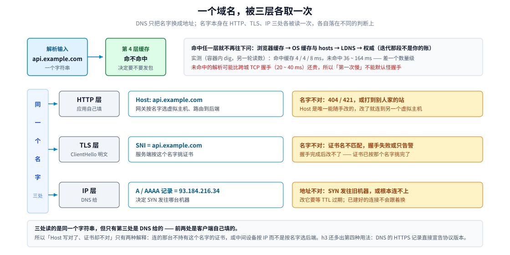
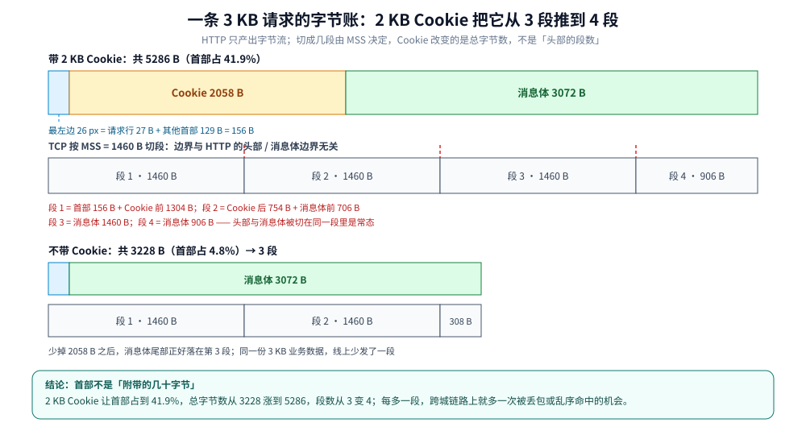
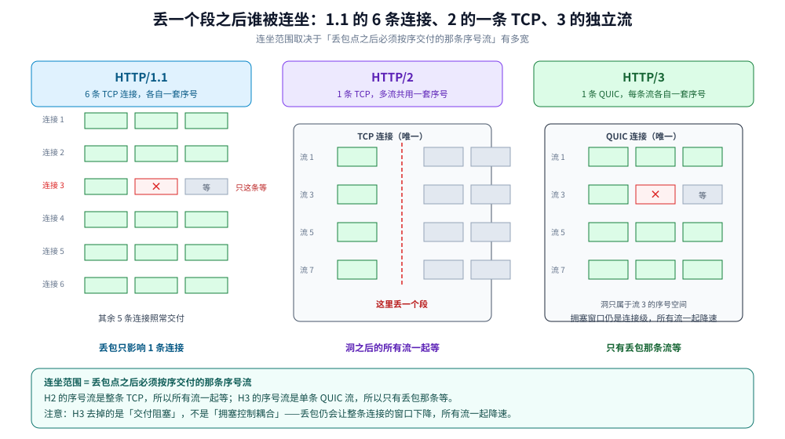
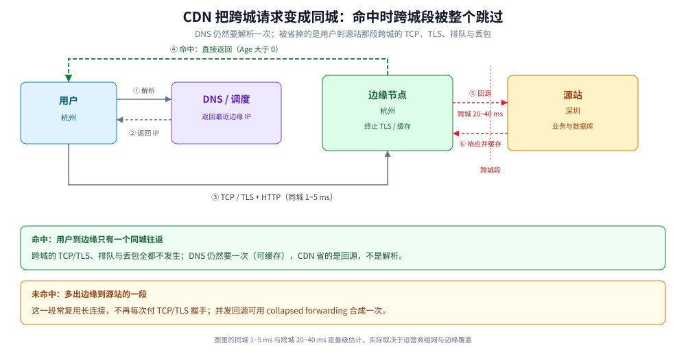
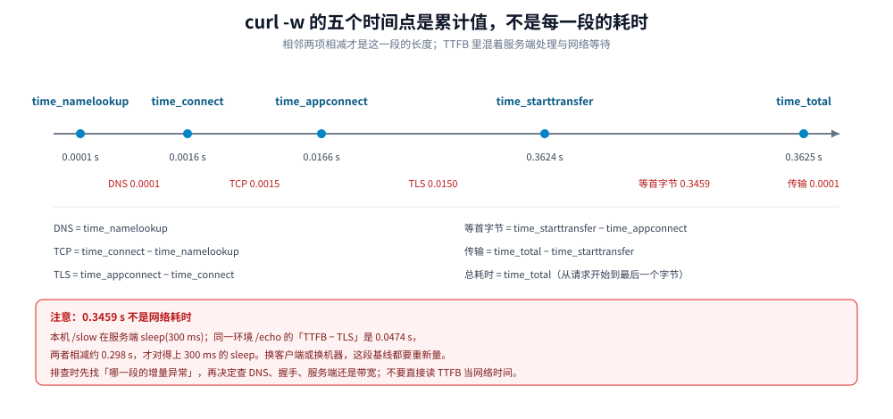

# 跨城传输全链路 HTTP 篇

> 覆盖：**先补上链路真正的一站——`Host` 里的域名怎么变成一个 IP，以及同一个名字怎么被 `Host` / SNI / A 记录三层各自取用一次**；再把 3 KB 业务数据装进一条 HTTP 消息之后，应用层多出了哪些字节、这些字节怎么被 TCP 或 QUIC 搬过跨城链路——报文四段的字节账与 `Content-Length` / `chunked` 定界、2 KB Cookie 如何把 3 段变成 4 段、短连接与 Keep-Alive 的 RTT 账、浏览器 6 条连接的上限、L7 代理把连接拆成两段、HTTPS 插在 HTTP 与 TCP 之间的位置与 TLS 1.3 / 1.2 的握手账、对称与非对称加密的 CPU 账、HTTP/1.1 / 2 / 3 在丢包面前的连坐范围、CDN 命中与回源分别省掉哪几段，以及 `curl -w`、502 / 504、缓存头与 304 的排查口径。
>
> 不覆盖：HTTP 报文字段、状态码与方法的基础定义散在现有篇目里——版本差异与消息定界见 [HTTP1.1与HTTP2的区别.md](应用层/HTTP1.1与HTTP2的区别.md)；H2 帧与 HPACK 的字节级机制见 [HTTP2机制.md](../../03-数据与中间件/中间件/RPC框架/gRPC/HTTP2机制.md)；QUIC 的握手、连接迁移与 h3 发现见 [QUIC与HTTP3.md](应用层/QUIC与HTTP3.md)；TLS 握手逐报文与证书见 [HTTPS与TLS.md](应用层/HTTPS与TLS.md)、[证书与HTTPS排障.md](应用层/证书与HTTPS排障.md)。本篇只讲「HTTP 怎么和下面的 TCP / UDP 联动」，不重写这些机制。
>
> 内容整理自个人学习笔记，素材见 [素材清单](../../素材清单.md)。⚠️ **实测口径**：第 2 节的字节账是**按字面量逐行相加**，不是抓包；第 4 节的加密开销与第 8 节的 `curl -w` / 304 / 431 / chunked 读数是**本机实测**（服务端 `golang:1.26-alpine`，客户端 Windows 11 的 `curl 8.6.0` + Schannel，经 Docker Desktop 端口映射走回环）；第 5 节的 HTTP/2 / HTTP/3 丢包对照是**机制推导**，本机 curl 不支持 h2 / h3，也没有链路丢包注入手段；浏览器 6 连接上限与 CDN 命中率是**公开行为 / 量级**，未在本机复现。第 1 节的 DNS 时延读数**引自 [DNS解析.md](网络层与寻址/DNS解析.md) 3.3 那一轮的容器内 `dig` 实测**，不是本篇新跑，两轮读数不可互推。

---

## 一、`Host` 里的域名怎么变成一个 IP？

**本节要点**：HTTP 只说「发往 `Host` 里的这个名字」，**把名字换成 IP 发生在 HTTP 之外**，通常走 UDP 53 单独一次查询。这一站有四个可以命中的缓存，命中就接近 0 往返；更重要的是，**同一个名字会被 HTTP 的 `Host`、TLS 的 SNI、IP 的 A 记录三层各自取用一次**——三者读的是同一个名字，但各自落到不同的判断上。

### 1.1 这一站的账单：四个缓存挡在前面

一次冷启动访问要依次问过前三个缓存，都没命中才走第四步：

| 顺序 | 位置 | 命中后要付的往返 | 谁清得掉 |
|---|---|---|---|
| 1 | 浏览器自己的 DNS 缓存 | 0（不发包） | 浏览器内部的 `chrome://net-internals/#dns` |
| 2 | OS 缓存 → `hosts` 文件 | 0（不发包） | `ipconfig /flushdns`、`resolvectl flush-caches` |
| 3 | LDNS（递归服务器）有缓存 | 1 个往返，通常 ms 级 | 等 TTL 过期，或厂商侧刷 |
| 4 | LDNS 也没有 → 迭代问根 / TLD / 权威 | 多个往返，**这段是别人的账** | — |

⭐ [DNS解析.md](网络层与寻址/DNS解析.md) 3.3 那一轮的容器内 `dig` 实测，把「有缓存」和「没缓存」的差距量得很干净：**命中缓存 4 / 4 / 8 ms，未命中 88 / 96 / 164 / 88 / 36 ms**，差一个数量级。放到本篇的账本里，它的含义是——

- **首屏与后续请求不是同一笔账**：只有冷启动那一次要付 DNS，之后连接复用，连解析都不再发生；
- **DNS 这一站可能比 TCP 建连还贵**：未命中时上到 88~164 ms，而跨城 TCP 一次握手只有 20~40 ms。所以「第一次打开慢」里，DNS 不是可以忽略的小项。

⚠️ 上面那组读数是**另一轮执行**（`alpine:3.21` + DiG 9.18.50，递归服务器 `223.5.5.5`），与本篇第 8 节的 `curl -w` 不是同一次运行，不能把一个的 DNS 段和另一个的总时长拼在一起算。

### 1.2 一个名字，三层各取一次

这是 HTTP 篇最容易讲错的一处：直觉上「域名解析一次就变成 IP 了」，实际同一个名字在三个层各被读一次，而且**读的是同一个字符串、落在三个不同的判断上**：

| 层 | 取用的字段 | 拿它干什么 | 错了会怎样 |
|---|---|---|---|
| HTTP | `Host` 首部 | 反代 / 网关按它选虚拟主机、路由到后端 | 404、421、打到别人的站 |
| TLS | **SNI**（ClientHello 里的明文扩展） | 服务端按它挑证书 | 证书名不匹配、握手失败或报警告 |
| IP | 解析得到的 **A / AAAA 记录** | 决定 SYN 发往哪台机器 | 连到旧机器、连到拒绝服务的端口 |

⭐ 三层读的是**同一个名字**，所以「`Host` 写对了但证书不对」几乎只有两种解释：要么你连的那台机器不持有这个名字的证书，要么中间有个设备按 IP 而不是按名字选的后端。反过来，**`Host` 是应用层可以随手改的，SNI 改不了**——一旦连接建立，TLS 已经按 ClientHello 里的那个名字选完证书了。证书侧的排查口径见 [证书与HTTPS排障.md](应用层/证书与HTTPS排障.md)。

⭐ 还有一处只在 h3 上出现的第四种用法：**DNS 的 `HTTPS` / `SVCB` 记录**可以直接宣告「这个域名支持 h3、去哪个端口」，客户端不必先走一遍 h2 再靠 `Alt-Svc` 升级。也就是说 DNS 这一站除了给 IP，还可能顺手把**协议版本**决定了。发现路径与回退见 [QUIC与HTTP3.md](应用层/QUIC与HTTP3.md) 第三节，本篇 5.5 讲选型时的三条前置条件。



图怎么读：左边竖条是那个唯一的字符串，右边三行是它被取用的三个位置与各自的失败后果。**只有第三行是 DNS 给的**，前两行由客户端自己填——所以 Host 能改、SNI 改不了、A 记录要等 TTL。顶部两格是解析本身的成本：四个缓存挡在前面，缓存命不命中差一个数量级。

### 1.3 解析结果决定「这趟到底跨不跨城」

本篇后面所有节的账，都建立在一个前提上：**你连的是深圳那台源站**。而这个前提是 DNS 给的：

- 解析返回**边缘节点 IP**（GSLB 按解析器位置、`EDNS Client Subnet`、节点健康与容量算出来的）→ 用户到边缘通常同城 1~5 ms，**跨城那一段根本不发生**，本篇的跨城账只剩下边缘回源那一截；
- 解析返回**源站 IP** → 才是本篇第 2~5 节算的那笔账。

⭐ 一个容易反过来的直觉：**解析这一站本身通常不跨城**——查询打到的是本地运营商或公共递归，同城就是毫秒级；真正跨城的是「解析结果指向了哪台机器」。所以「把 DNS 换成 Anycast 的公共解析」能改善的是**查询的可靠性**，不是这条连接的距离。CDN 怎么用 DNS 做调度，见本篇 6.1；DNS 层做负载均衡的两种方式（轮询与 GSLB）见 [DNS解析.md](网络层与寻址/DNS解析.md) 第五节。

### 1.4 解析改了，为什么流量还没切过去

线上最典型的困惑：运维把域名指向了新机器，`dig` 也返回新 IP 了，但监控里旧机器的流量迟迟不掉。三个独立原因叠在一起：

| 现象 | 真实原因 | 判据 |
|---|---|---|
| 各地生效时间不一致 | 各地 LDNS 的 TTL 到期时刻不同，**旧 TTL 是 3600 就最长等 3600 秒** | `dig` 看到的 TTL 是**递减后**的剩余值，不是配置值 |
| 客户端还在用旧 IP | 连接池 / 长连接仍握在旧 IP 上，**连接活得比 TTL 长** | 看客户端到旧 IP 的 `ESTABLISHED` 连接数与年龄 |
| 某些网关无视 TTL | 部分运营商与公司出口**超期缓存**，可能几天不生效 | 从不同出口 `dig` 对比应答 |

⭐ 第二条是本篇独有的：**HTTP 长连接的存在让「DNS 生效」与「流量切换」彻底解耦**。TTL 只约束「下次解析要不要回源问」，管不了「已经建好的连接要不要断开」。要真的切，得让旧连接自己退场——滚动重启客户端、调小 `keepalive_timeout`、或在网关侧主动 drain。连接复用的 RTT 账见本篇 3.2。

### 1.5 这一站在时间轴上占哪一格

第 8 节的 `curl -w` 把一次请求拆成五段，第一段就是它：

```text
DNS（time_namelookup） → TCP（time_connect） → TLS（time_appconnect）
                      → 等首字节（time_starttransfer） → 传输（time_total）
```

⭐ 读这一格的三条口径：

- **`num_connects=1` 时 DNS 才有意义**：连接被复用时 `time_namelookup` 常常接近 0，因为压根没查；
- **DNS 与 TLS 是两个独立怀疑对象**：HTTPS 的「第一次慢」里，DNS 未命中可以贡献上百毫秒，TLS 1.3 握手 1 个 RTT，两者相加才是首字节之前的固定开销；
- **DNS 慢不等于网络慢**：一次查询没回来时的重试间隔是秒级的（见 [跨城传输全链路-UDP篇.md](跨城传输全链路-UDP篇.md) 第一节），它会直接顶满客户端的解析超时，而不是表现为「带宽不够」。

> 📎 这一节只回答「这一步在本篇的账本里占什么」。解析本身怎么走（递归与迭代、四类服务器、资源记录类型、TTL 与负缓存、排障命令与 Go / Java 两侧的解析器行为）见 [DNS解析.md](网络层与寻址/DNS解析.md)；加密解析（DoH / DoT）与 DNS 侧的攻击面见 [DNS安全与加密解析.md](网络层与寻址/DNS安全与加密解析.md)。本篇不重复这些机制。

## 二、这 3 KB 在 HTTP 里到底长什么样？

**本节要点**：HTTP 消息 = **请求行 + 首部 + 空行 + 消息体**；业务数据只是最后那段。把 3 KB 放进一条真实请求，线上要发的是 **5286 B**，其中首部占 **41.9%**——这个比例直接决定了 TCP 要切 3 段还是 4 段。

### 2.1 一条请求的四个部分

```http
POST /api/orders HTTP/1.1
Host: api.example.com
User-Agent: curl/8.6.0
Accept: application/json
Content-Type: application/json
Cookie: ssssssss...（2048 字节）
Content-Length: 3072

{... 3072 字节 JSON ...}
```

⚠️ 规范要求每行以 **CRLF**（`\r\n`）结尾，最后一行首部之后还要有一个**只有 CRLF 的空行**，它才是「首部结束、消息体开始」的分界。上面为了可读性省略了 CR，算账时不能省。

| 部分 | 字节 | 怎么算出来的 |
|---|---|---|
| 请求行 | 27 | `POST /api/orders HTTP/1.1` 25 B + CRLF 2 B |
| 首部（不含 Cookie） | 129 | Host 23 + User-Agent 24 + Accept 26 + Content-Type 32 + Content-Length 22 + 空行 2 |
| Cookie 行 | 2058 | `Cookie:` 7 个字符 + 1 个空格 + 2048 B 值 + CRLF 2 B |
| 消息体 | 3072 | 业务 JSON |
| **合计** | **5286** | 27 + 129 + 2058 + 3072 |

⭐ 三个容易算错的点：

- **`Cookie:` 后面还有一个空格**：名字 7 个字符，加空格是 8 B，再加 2048 B 值与 2 B CRLF，整行 2058 B；
- **空行也是字节**：那 2 个 CRLF 属于首部块，不属于消息体；
- **`Content-Length` 只数消息体**：它写 3072，不写 5286——首部长度由空行之前的字节流自身定界，不需要另一个字段。

| 口径 | 总字节 | 相对 3 KB 业务数据 | 首部占比 |
|---|---|---|---|
| 不带 Cookie | 3228 | 1.05× | 4.8% |
| 带 2 KB Cookie | 5286 | 1.72× | 41.9% |

⭐ 同一句「传 3 KB」，在 TCP 篇里 3 KB 是**整个应用数据**；在 HTTP 篇里 3 KB 只是**消息体**。到了网线上，后者是 5286 B——**首部把账放大了 72%**。这就是「应用层协议的开销」最具体的样子。



图怎么读：上半条按字节比例画出 5286 B 的构成，下半条是同一段字节流按 MSS 切出的 4 段。**切点与 HTTP 的「首部 / 消息体」边界无关**——段 1 里同时装着请求行、首部和 Cookie 的前 1304 B，段 2 还横跨 Cookie 与消息体。

### 2.2 2 KB Cookie 为什么改变了段数？

**本节要点**：TCP 只按 **MSS = 1460** 切字节流，不认 HTTP 边界；Cookie 让总字节从 3228 涨到 5286，跨过 1460 的整数倍，段数就从 3 变 4。

| 口径 | 总字节 | 切法（MSS 1460） | 段数 |
|---|---|---|---|
| 不带 Cookie | 3228 | 1460 + 1460 + 308 | 3 |
| 带 2 KB Cookie | 5286 | 1460 + 1460 + 1460 + 906 | 4 |
| 带 Cookie + TLS 1.3 单记录 | 5308 | 1460 + 1460 + 1460 + 928 | 4 |

⭐ 三条结论：

- **Cookie 不是「头部的段数」**：它不是单独占一段，而是把整条字节流往后推，让消息体的尾部多出一段；
- **TLS 只改末段大小**：一条 TLS 1.3 记录多 22 B（5 B 记录头 + 1 B 内容类型 + 16 B AEAD tag），5286 → 5308，仍在第 4 段内；只有跨过 1460 的边界才会多一段。逐字节的 TLS 账见 [跨城传输全链路-TCP篇.md](跨城传输全链路-TCP篇.md) 2.2；
- **几百字节也可能改变段数**：3228 离 2920（2 × 1460）只差 308 B，Cookie 只要再加 300 B 左右就会从 3 段变 4 段——不要用「才多几百字节」判断影响。

⭐ 更重要的是**重复**：HTTP/1.1 没有头部压缩，同一域名下每个请求（包括静态资源）都会把这段 Cookie 原样再发一遍。一个页面 30 个资源，就是 30 × 2058 B ≈ 60 KB 的首部，跨城链路上全部要传。

HTTP/2 的 HPACK 能把**重复的首部名与不变的值**压成索引；但 Cookie 的值如果每次都在变（会话、埋点、灰度标记），动态表命不中，只能做 Huffman 编码，省下的通常只有两三成。实践上的解法不是「换 h2」，而是**把静态资源放到不带 Cookie 的域名**（cookie-less domain），从源头去掉这 2058 B。HPACK 的机制见 [HTTP1.1与HTTP2的区别.md](应用层/HTTP1.1与HTTP2的区别.md) 第四节。

### 2.3 对端怎么知道 3 KB 读完了？

**本节要点**：HTTP 的边界不靠 TCP 的段，而靠**首部里的长度约定**；接收端先读到空行，再按约定读够字节，`read()` 一次返回多少都正常。

| 方式 | 边界在哪 | 典型场景 | 代价 |
|---|---|---|---|
| `Content-Length` | 首部给出消息体的精确字节数 | 绝大多数请求与响应 | 发送前必须知道长度，不能边算边发 |
| `Transfer-Encoding: chunked` | 每块前缀十六进制长度，`0` 块收尾 | 长度未知的流式响应 | 每块多几个字节；HTTP/2 起不再使用 |
| 连接关闭 | EOF 即消息结束 | HTTP/1.0、无长度的响应 | 连接不能复用，无法区分「正常结束」与「被中断」 |

⭐ 接收端的循环是「**先读到 CRLFCRLF，再读够 N 字节**」：`read()` 可能一次只返回 1 KB，也可能一次返回 3 段；应用层必须按字节数凑够，不能按「一次 read 一条消息」写。`read()` 的语义与「三层确认」见 [跨城传输全链路-TCP篇.md](跨城传输全链路-TCP篇.md) 11.4。

⚠️ `Content-Length` 与 `Transfer-Encoding` **不允许同时出现**；同时出现时前后两跳对「信哪个」的判断不一致，就是请求走私的原料。机制见 [HTTP1.1与HTTP2的区别.md](应用层/HTTP1.1与HTTP2的区别.md) 3.1 与 [反向代理原理.md](代理与网关/反向代理原理.md) 第四节。

本机实测（Go 服务端，同一段 3072 B 响应）：

```text
响应 A（处理器一次写入 3072 B，框架缓冲先满、长度未知）
  HTTP/1.1 200 OK
  Transfer-Encoding: chunked

响应 B（显式设置 Content-Length: 3072）
  HTTP/1.1 200 OK
  Content-Length: 3072
```

⭐ 这说明 **`Content-Length` 不是自动的**：写响应时如果先 flush、或超过框架的缓冲，长度就变成「未知」，框架退回 chunked。想让长连接上的客户端尽早知道总长度，就显式设置它；流式场景则本来就不该设。

### 2.4 首部有没有上限？

**本节要点**：有，而且**首部上限比消息体上限更早撞上**：2 KB Cookie 还没到 4 KB 的单 Cookie 上限，但多个 Cookie / 自定义头叠加后，很容易撞到 8 KB 的网关缓冲。

| 限制 | 常见默认 | 超了会怎样 | 谁在管 |
|---|---|---|---|
| 单个 Cookie | 至少 4096 B（RFC 6265） | 浏览器可能截断或不发送 | 浏览器 |
| 请求头总大小 | nginx 4 × 8 KB；Go `MaxHeaderBytes` 1 MB；Node 16 KB | nginx 常回 400，Go 回 431 | 服务端 / 网关 |
| 请求行 / URI | nginx 8 KB | 414 URI Too Long | 服务端 / 网关 |
| 请求体 | nginx `client_max_body_size` 默认 1 MB | 413 Content Too Large | 服务端 / 网关 |

本机实测（Go，`MaxHeaderBytes` 设为 1024）：

```text
curl -H 'X-Big: aaaa...（8000 字节）' http://127.0.0.1:18080/ok
→ HTTP/1.1 431 Request Header Fields Too Large
```

⚠️ 两个容易误判的点：

- **Go 的 `MaxHeaderBytes` 之外还有约 4 KB 的余量**：设 1024 时，2000 B 的头仍能通过，8000 B 才触发 431；不要按「设多少就卡多少」估；
- **不同实现的超限状态码不统一**：nginx 历史上回 `400 Request Header Or Cookie Too Large`，Go 回 431；排障时先看**响应是谁发的**（`Server` 头 / 网关日志），再谈状态码含义。nginx 的缓冲与 `client_max_body_size` 见 [01-编译安装与配置.md](../linux/深入理解Nginx/01-编译安装与配置.md) 与 [04-HTTP框架执行流程.md](../linux/深入理解Nginx/04-HTTP框架执行流程.md)。

### 2.5 这 5286 字节从哪来、又怎么写出去？

**本节要点**：前面四节把 5286 字节当成一个既成事实在算账。它不是凭空出现的——从业务对象到网线上的字节还要过**两层缓冲**，其中框架那层默认 4 KB，它直接决定「一次 `Write` 变成几次系统调用」。

服务端拼一条响应的完整形状：

```text
业务对象（struct / map）
   ↓ 序列化（json.Marshal）：一次堆分配 + 一次遍历
[]byte（用户态，3072 字节）
   ↓ w.Write(...)：拷进框架缓冲，此时还没换态
框架缓冲（bufio，默认 4096 字节）
   ↓ 装满 或 handler 返回：这才是真正的系统调用
内核 socket 发送缓冲（SO_SNDBUF，按字节记账）
   ↓ TCP 输出：按 MSS 切段（2.1 的账）
网卡
```

⭐ **关键在第三层：框架的 4 KB 缓冲**。`http.ResponseWriter` 不是 socket，它包了一层 `bufio.Writer`。于是「写 3072」和「写 8192」的系统调用次数不一样：

| 响应体 | 响应头 | 总计 | `strace -e trace=write` 看到的 |
|---|---|---|---|
| 3072 | 137 | 3209 | **1 次** `write(5, "HTTP/1.1 200 OK…", 3209)` |
| 8192 | 137 | 8329 | **2 次**：`write(..., 4096)` + `write(..., 4233)` |

第一行：3209 < 4096，整个响应留在框架缓冲里，等 handler 返回才一次写出。
第二行：8329 > 4096，缓冲第一次写满就 flush 掉 4096，剩下 4233 等 handler 返回再写。

⭐ 这解释两件常被误解的事：

- **`Write` 返回 nil 不代表发出去了**，甚至不代表进了内核——它只代表「进了那 4 KB」；
- **响应不是一次写出去的**：大响应先被 4 KB 切成若干次系统调用，再被 MSS 切成若干段。2.1 算的是后一层。

**响应方向还有一条捷径：`sendfile`。** 发静态文件时数据不必进用户态，两条常见写法都命中了它：

```text
/file  http.ServeContent              →  write(5, ..., 720)  +  sendfile × 3
/copy  io.Copy(w, *os.File)           →  write(5, ..., 652)  +  sendfile × 2 + sendfile(...,0)
```

⚠️ 反直觉的是**两条路都走了 `sendfile`**：Go 1.22 起 `*os.File` 有了 `WriteTo`、`*http.response` 有了 `ReadFrom`，所以 `io.Copy` 到 `ResponseWriter` 也会自动落到 `sendfile` 上，不必非得用 `ServeFile`。四条零拷贝路径各去掉哪一趟，见 [零拷贝.md](../linux/零拷贝.md) 第三节。

⚠️ **口径**：上面三组读数（3209 一次、8329 切两次、两条路都走 `sendfile`）是本机实测——`golang:1.26-alpine` 服务端，`strace -f -e trace=write,sendfile`，响应体分别是 3 KB 与 8 KB 的零字节，静态文件 4 MB；响应头 137 与 720 字节由「总量 − 体长」算出。**数据从用户态到网卡那几段的机制不在本篇**：结构见 [用户态内核态与一次IO的内存路径.md](../操作系统/用户态内核态与一次IO的内存路径.md) 2.3，每段耗时见 [跨城传输全链路-TCP篇.md](跨城传输全链路-TCP篇.md) 3.1。

## 三、HTTP 是怎么驱动 TCP 建连的？

**本节要点**：HTTP 自己不建连，它**复用或新建**一条 TCP（HTTP/3 是 QUIC）连接。短连接每个请求付一次握手；Keep-Alive 省掉后续握手，但 **HTTP/1.1 的一条连接同一时刻只跑一个请求**，所以浏览器用 6 条连接换并发。

### 3.1 短连接：每个请求先付 1 个 RTT

**本节要点**：HTTP/1.0 默认短连接，一个请求 = TCP 握手 1 RTT + HTTP 请求/响应 1 RTT；HTTPS 再叠 TLS 1.3 的 1 RTT 或 1.2 的 2 RTT。

| 组合 | 到首字节的往返（不含 DNS） | 30 ms RTT 下的理论下限 |
|---|---|---|
| HTTP 明文 + 新 TCP | TCP 1 + 请求/响应 1 = 2 | 60 ms |
| HTTPS + TLS 1.3 | TCP 1 + TLS 1 + 请求/响应 1 = 3 | 90 ms |
| HTTPS + TLS 1.2 | TCP 1 + TLS 2 + 请求/响应 1 = 4 | 120 ms |
| HTTP/3 首次 | QUIC 1 + 请求/响应 1 = 2 | 60 ms |
| HTTP/3 恢复（0-RTT） | 0 + 请求/响应 1 = 1 | 30 ms |

⭐ 口径要注意：这里的「1 个请求/响应往返」是**首个字节**的账，不含服务端处理、排队与消息体传输；QUIC 的「1 / 0」指握手，不是整个请求。与 [QUIC与HTTP3.md](应用层/QUIC与HTTP3.md) 2.5 的 3 / 2 / 1 / 0 表对齐时，要记得那边只算「到能发出第一个请求」，这边多算了一个请求/响应往返。

⭐ 短连接的代价不只是 RTT：每条新连接还要**重新慢启动**，拥塞窗口从 10 个 MSS 左右开始爬；消息体越大，慢启动的影响越明显。3 KB 的小请求主要付的是握手 RTT，大文件才是慢启动的账。

### 3.2 长连接：省掉的是握手，不是排队

**本节要点**：`Connection: keep-alive` 让同一条连接跑多个请求；它省掉后续的 TCP / TLS 握手，但**不改变 HTTP/1.1 的串行语义**——前一个响应没回来，后一个请求只能等。

```http
HTTP/1.1 200 OK
Connection: keep-alive
Keep-Alive: timeout=75
```

- **HTTP/1.0** 要显式发 `Connection: keep-alive` 才复用；**HTTP/1.1 默认复用**，要关才发 `Connection: close`；
- 空闲超时有三层：服务端 `keepalive_timeout`（nginx 默认 75 s）、LB 的空闲超时（常见 50~60 s）、NAT / conntrack 的 TCP 表项老化。**最短的那层决定连接能闲多久**，详见 [跨城传输全链路-TCP篇.md](跨城传输全链路-TCP篇.md) 1.5 与 [NAT与连接跟踪.md](网络层与寻址/NAT与连接跟踪.md)；
- 服务端还会限制**一条连接最多跑多少个请求**（nginx `keepalive_requests` 默认 1000），到数后主动关闭，客户端要能重连。

⭐ 本机实测（同一次 curl 调用请求两个 URL）：

```text
第一个 URL：conns=1  tcp=0.001488  tls=0.013420
第二个 URL：conns=0  tcp=0.000000  tls=0.000000
```

`num_connects=0` 且 `tcp` / `tls` 为 0，说明第二条请求**复用了同一条连接**，没有再付握手。这就是 Keep-Alive 省下的东西。

### 3.3 浏览器为什么是 6 条连接？

**本节要点**：6 不是 RFC 规定，是浏览器的**经验上限**；它用「多开连接」缓解 HTTP/1.1 的串行，但也带来队头阻塞与重复握手。

- Chrome、Firefox 等对**每个源**（scheme + host + port）通常开 **6 条** HTTP/1.1 连接，部分实现到 6~8 条；这是实现策略，不是协议字段；
- 一个页面 30 个资源，6 条连接意味着每条连接上约 5 个请求**串行**；第 7 个并发请求要排队；
- 早期优化手段 **domain sharding**（把静态资源拆到多个域名）就是绕这个上限，代价是更多 DNS、TCP、TLS 握手；
- HTTP/2 用**一条连接 + 多条流**取代多连接，浏览器通常对每个源只开一条；HTTP/3 同理。版本差异的完整对照见 [HTTP1.1与HTTP2的区别.md](应用层/HTTP1.1与HTTP2的区别.md) 2.1。

⚠️ 「6 条」是浏览器行为，本篇未在本机复现；它影响的是**页面级并发**，单个 API 请求不受这个数字约束。

### 3.4 链路上有 LB 时，连接被拆成两段

**本节要点**：L7 代理**终结**客户端的 TCP / TLS，再向后端另建一条连接；客户端量到的 RTT、TLS 握手、Keep-Alive 都只到 LB，跨城那一段是**另一条连接**。

| 部署形态 | 客户端连到 | 跨城段是哪一段 | 客户端能看到吗 |
|---|---|---|---|
| L4 转发（LVS NAT / DR / TUN） | 后端 | 端到端一条 TCP | 能看到端到端 RTT |
| L7 代理（Nginx / Envoy / HAProxy） | LB | LB → 后端 | 只能看到客户端 → LB |
| CDN 边缘 | 边缘节点 | 边缘 → 源站（仅回源时） | 看不到回源段 |

⭐ 三个直接后果：

- **TLS 在 LB 终结**：客户端到 LB 是 TLS 1.3，LB 到后端可能是明文 HTTP 或另一套 TLS；「HTTPS 端到端」要额外配置，不是默认；
- **协议版本逐段协商**：客户端 ↔ LB 可以是 h2，LB ↔ 后端可能被降成 HTTP/1.1（nginx 要显式 `proxy_http_version 1.1` 才用 1.1），于是**跨城段的队头阻塞仍在**，客户端侧的多路复用救不了后端那一段；
- **Keep-Alive 也是逐段的**：客户端连接闲着，不代表 LB → 后端的连接闲着；两段的空闲超时、最大请求数各管各的。

机制与头部治理见 [反向代理原理.md](代理与网关/反向代理原理.md)；真实客户端 IP 的传递见 [客户端真实IP与可信代理.md](代理与网关/客户端真实IP与可信代理.md)；L7 两段 TCP 的 RTT 账见 [跨城传输全链路-TCP篇.md](跨城传输全链路-TCP篇.md) 1.5。

## 四、HTTPS 把加密插在哪一层？

**本节要点**：HTTPS 不是「另一个协议」，而是 **HTTP 报文交给 TLS，TLS 再交给 TCP**；握手用非对称密码学（毫秒级、每连接一次），之后每个字节用对称加密（GB/s 级），所以「首包慢、后续快」的根因在握手，不在加密数据。

### 4.1 位置：HTTP → TLS → TCP → IP

```text
HTTP      请求行 / 首部 / 消息体
  ↓
TLS       加密、完整性校验、身份认证（证书）
  ↓
TCP       可靠、有序的字节流
  ↓
IP        寻址与路由
```

- TLS 是**夹在 HTTP 与 TCP 之间**的一层，HTTP 自己不知道 TLS 的存在；它只把字节交给一个「可靠的字节流」；
- **TLS 加密的是整条 HTTP 消息**：请求行、首部、消息体全在密文里；链路中间能看到的只有 IP、端口、TLS 记录头，以及（未启用 ECH 时的）SNI；
- **HTTP/3 不一样**：QUIC 把 TLS 1.3 内嵌进传输层，不再是「TLS over TCP」，但加密的仍是 HTTP 帧。分层图见 [HTTPS与TLS.md](应用层/HTTPS与TLS.md) 与 [HTTPS的分层封装结构.svg](应用层/images/HTTPS的分层封装结构.svg)。

### 4.2 每条 TLS 记录多出多少字节？

**本节要点**：TLS 1.3 每条记录固定多 **22 B**（5 B 记录头 + 1 B 内容类型 + 16 B AEAD tag）；TLS 1.2 的 AES-GCM 多 **29 B**（5 + 8 B 显式 nonce + 16）。记录上限 16 KB，**记录边界既不是 TCP 段边界，也不是 HTTP 消息边界**。

| 层 | 多出的字节 | 说明 |
|---|---|---|
| TLS 1.3 记录 | 22 | 5（头）+ 1（内层内容类型）+ 16（AEAD tag） |
| TLS 1.2 AES-GCM 记录 | 29 | 5 + 8（显式 nonce）+ 16 |
| TLS 记录上限 | 16384 B 明文 | 超过要拆多条记录 |

⭐ 对 5286 B 的 HTTP 消息：

- 如果应用一次写出整条消息 → **1 条 TLS 记录**，线上 5308 B，仍是 4 段；
- 如果先写首部、再写消息体 → **2 条记录**，多 44 B，仍是 4 段；
- TLS 不改变「5286 B 被切成 4 段」这个结论，只改变每段里可用于 HTTP 的净荷。逐字节的 TLS 账与 TCP 段对齐见 [跨城传输全链路-TCP篇.md](跨城传输全链路-TCP篇.md) 2.2，本篇不重复。

⚠️ 一个常见误解：「HTTPS 会把包变小/变大到影响 MTU」。TLS 记录头是**应用数据的一部分**，由 TCP 按 MSS 切；它不会让 IP 包超过 MTU，也不会触发分片。真正压小 MTU 的是隧道 / VPN，见 [跨城传输全链路-TCP篇.md](跨城传输全链路-TCP篇.md) 2.4。

### 4.3 握手账：TLS 1.3 的 1 RTT 与 1.2 的 2 RTT

**本节要点**：TLS 1.3 在**第一次往返**里就完成密钥协商，客户端拿到 ServerHello 后即可发应用数据；TLS 1.2 要两次往返。会话复用时 1.3 可以 0-RTT，但有重放风险。

| 场景 | TLS 握手往返 | 到首字节总往返（含 TCP 与 HTTP） |
|---|---|---|
| TLS 1.2 完整握手 | 2 | 4 |
| TLS 1.3 完整握手 | 1 | 3 |
| TLS 1.3 会话复用（PSK） | 1（可 0-RTT） | 2（0-RTT 时） |
| QUIC 首次 | 1（内嵌 TLS 1.3） | 2 |
| QUIC 恢复（0-RTT） | 0 | 1 |

⭐ 三个细节：

- **1.3 的 1 RTT 不是「零成本」**：客户端要在 ClientHello 里**猜**一组密钥交换参数（`key_share`）；服务端不支持这条曲线时回 `HelloRetryRequest`，握手退化成 2 RTT。服务端应同时支持 X25519 与 P-256；
- **0-RTT 的数据可被重放**：攻击者可以把 early data 原样再发一次，所以只应承载幂等请求（GET / 查询），不要用它发「下单」「支付」；
- **会话复用省的是非对称运算**，不是全部握手：PSK 恢复仍然要 1 个往返（0-RTT 除外），但不再做证书签名与密钥交换。逐报文时序见 [HTTPS与TLS.md](应用层/HTTPS与TLS.md) 第三、四、五节。

### 4.4 CPU 账：非对称在握手，对称在每一个字节

**本节要点**：握手阶段做的是**非对称运算**（证书签名 / 验签、密钥交换），每次连接一次，毫秒级；数据传输阶段做的是**对称加密**（AES-GCM / ChaCha20-Poly1305），每字节都做，但吞吐是 GB/s 级。所以「HTTPS 慢」通常慢在握手次数，不慢在加密带宽。

本机实测（Windows 11，OpenSSL 3.2.1，`openssl speed -seconds 1`，单核，只量算法本身）：

| 运算 | 本机读数 | 量级 |
|---|---|---|
| RSA-2048 签名 | 0.000377 s/次（约 2656 次/秒） | 毫秒级 |
| RSA-2048 验签 | 0.000008 s/次（约 122850 次/秒） | 微秒级 |
| ECDSA P-256 签名 | 约 0.0000177 s/次（56567 次/秒） | 十微秒级 |
| ECDSA P-256 验签 | 约 0.0000425 s/次（23544 次/秒） | 十微秒级 |
| AES-128-GCM（16 KB 块） | 约 11.5 GB/s | GB/s 级 |
| AES-128-GCM（1 KB 块） | 约 8.9 GB/s | GB/s 级 |
| AES-128-GCM（64 B 块） | 约 1.45 GB/s | GB/s 级 |

⭐ 三条结论：

- **RSA 签名比 ECDSA 慢约 20 倍**：2656 vs 56567 次/秒；服务端每握手签一次，证书换 ECDSA 能直接降握手 CPU。代价是部分老旧客户端不信任 ECDSA 证书；
- **对称加密的吞吐随块大小下降**：16 KB 块 11.5 GB/s，64 B 块只有 1.45 GB/s——**小记录更贵**，因为每条记录的头与 AEAD tag 摊到更少的字节上。这也是「尽量让 TLS 记录大一点」的原因；
- **加密不是跨城慢的主因**：3 KB 数据在 8.9 GB/s 下不到 1 微秒；跨城 30 ms 的 RTT 比它大四个数量级。先查握手次数与 RTT，再谈 CPU。

⚠️ 口径：以上是**算法本身**的单核实测，不含 TLS 记录封装、系统调用、网卡与容器开销；不同 CPU 与是否启用 AES-NI 会差一个量级。生产上更该看的是「每秒新建多少条 TLS 连接」而不是「每字节加密多快」。

## 五、三个版本在丢包面前差在哪？⭐

**本节要点**：差距不在「快不快」，而在**丢一个包之后，谁被迫一起等**。HTTP/1.1 等一条连接；HTTP/2 等整条 TCP 上的所有流；HTTP/3 只等丢包那条流。版本越高，连坐范围越小，但部署门槛也越高。

### 5.1 HTTP/1.1：应用层队头阻塞 + 6 条连接的缓解

**本节要点**：一条连接同一时刻只处理一个请求，前一个响应慢，后面的请求**在应用层就排队**；浏览器用 6 条连接把「一个队列」变成「六个队列」，但没有根治。

- **应用层 HOL**：请求 B 的响应必须等请求 A 的响应发完，即使 B 已经准备好。管线化（pipelining）理论上能发多个请求，但响应仍须按序返回，且中间设备兼容性差，浏览器实际禁用；
- **传输层 HOL**：这条连接丢一个 TCP 段，后续字节全部等重传；同一条连接上的其他响应也一起等；
- **6 条连接的作用**：把并发从 1 提到 6，丢包只影响其中一条；代价是 6 次握手、6 份慢启动、6 份头部重复。

⭐ 对 3 KB 请求：单条连接上就是「握手 + 一个请求/响应」，应用层 HOL 不明显；页面级几十个资源时，6 条连接的串行排队才是主矛盾。

### 5.2 HTTP/2：应用层 HOL 消失，TCP HOL 放大

**本节要点**：HTTP/2 在一条 TCP 连接上交错多条流，**应用层不再按请求排队**；但所有流共用一套 TCP 序号，**丢一个段，全部流一起等**——连坐范围反而比 1.1 的 6 条连接更大。

- **多路复用**：请求/响应被切成帧，按流交错；一个慢响应不阻塞其他流（应用层）；
- **HPACK**：首部按连接维护索引表，重复的首部名与值只发索引；但**变化的 Cookie 值压不动**（见 2.2）；
- **TCP HOL 仍在**：TCP 只承诺「按序号连续交付」，洞之后的字节一律缓住；HTTP/2 的帧装在这条字节流里，无法告诉内核「这段属于流 5，可以先跳过」；
- **连坐放大**：1.1 开 6 条连接，丢包只影响 1/6；2 把所有流放进 1 条连接，丢一个包让**全部流**一起等。丢包链路上，2 未必比 1.1 快。

⭐ 拥塞窗口也被集中：1.1 的 6 条连接各有自己的 `cwnd`，丢包只砍其中一条；2 只有一条连接，丢包砍一次，**所有流一起降速**。这是「多路复用」在弱网下的代价。

⚠️ 两个容易被宣传误导的点：服务端推送（Push）已被浏览器移除；优先级依赖树已被弃用，改成 RFC 9218 的紧急度。不要把这两项当成选型理由。完整机制与实测见 [HTTP1.1与HTTP2的区别.md](应用层/HTTP1.1与HTTP2的区别.md) 第五、六、七节，帧与 HPACK 的字节级细节见 [HTTP2机制.md](../../03-数据与中间件/中间件/RPC框架/gRPC/HTTP2机制.md)。

### 5.3 HTTP/3：把「按序交付」收缩到单条流

**本节要点**：QUIC 在 UDP 之上给**每条流**独立的序号空间；丢一个包只阻塞它所属的流，其他流照常交付。它去掉的是**交付阻塞**，不是**拥塞控制耦合**。

- **流级重传**：每个 QUIC 流有自己的偏移量；丢包只在该流的序号空间里留洞，其他流不等待；
- **连接迁移**：QUIC 用 Connection ID 识别连接，不靠五元组；NAT 映射重建、手机切换 Wi-Fi / 蜂窝时，连接可以不断。机制见 [跨城传输全链路-UDP篇.md](跨城传输全链路-UDP篇.md) 10.4 与 [QUIC与HTTP3.md](应用层/QUIC与HTTP3.md) 2.4；
- **握手更短**：TLS 1.3 内嵌，首次 1 RTT，恢复 0-RTT；到首字节约 2 / 1 个往返（见 4.3）；
- **QPACK**：头部压缩改成「静态表 + 动态表 + 阻塞流上限」，避免 HPACK 在丢包时的全局阻塞；但配置不当仍会出现头部阻塞。

⭐ 一个必须说清的边界：**QUIC 的拥塞控制仍是连接级的**。丢包会让整条连接的 `cwnd` 下降，所有流一起降速；QUIC 保证的是「其他流的数据可以继续交付」，不是「其他流不受丢包影响」。所以「H3 完全免疫丢包」是错的，它只是把「等」从所有流缩小到丢包那条流。

### 5.4 同一趟 3 KB 在三个版本下的账

| 维度 | HTTP/1.1 | HTTP/2 | HTTP/3 |
|---|---|---|---|
| 承载 | TCP | TCP | QUIC（UDP） |
| 并发单位 | 连接（浏览器 6 条/源） | 流（一条连接） | 流（一条连接） |
| 应用层 HOL | 有（同连接串行） | 无 | 无 |
| 传输层 HOL | 有（本连接） | 有（全部流连坐） | 无（只影响丢包那条流） |
| 丢一个段的代价 | 该连接上当前请求 | 该连接上所有流 | 丢包那条流 |
| 头部压缩 | 无，每次重发 | HPACK | QPACK |
| 到首字节（新连接） | 明文 2 RTT / TLS 1.3 3 RTT | 同 1.1 | 2 RTT（0-RTT 时 1） |
| 中间设备友好度 | 最好 | 好 | UDP 可能被策略拦 |
| 观测成熟度 | 最成熟 | 成熟 | 工具较少 |

⭐ 对**单个 3 KB 请求**，三个版本的差距主要是**握手与头部压缩**；多路复用的收益要等到「一条连接上有很多请求」才显现。不要用「H2/H3 更快」解释一个单请求接口的耗时。

⭐ 对**页面级几十个资源**，差距才落在队头阻塞：1.1 的 6 条连接串行排队；2 的应用层不排队但丢包连坐；3 的丢包只影响一条流。跨城链路的随机丢包越高，这个差别越明显。



图怎么读：三列从上到下是三种承载的「连坐范围」。**看红色虚线落在哪一层**：1.1 落在一条连接的序号流上，另外 5 条照常；2 落在唯一的 TCP 序号流上，洞之后所有流一起缓住；3 落在单条 QUIC 流上，其他流照常交付。

### 5.5 怎么选：不是越新越好

**本节要点**：版本选择先看**用户网络**与**中间设备**，再看收益；跨城公网优先 h2 + 按需 h3，内网 RPC 用 h2 / gRPC，老客户端保留 1.1 回退。

| 场景 | 建议 | 理由 |
|---|---|---|
| 公网 Web，用户网络复杂 | HTTP/2 为主，HTTP/3 灰度 | h2 兼容性好；h3 在弱网 / 移动网络收益大，但 UDP 可能被拦 |
| 内网服务间 RPC | HTTP/2（gRPC） | 长连接、多路复用、Protobuf；见 [HTTP与gRPC.md](应用层/HTTP与gRPC.md) |
| 老旧客户端 / 中间设备多 | HTTP/1.1 | 兼容性最好；用多连接与 CDN 缓解 |
| 大量小请求、跨城 | h2 + 连接复用 + CDN | 省握手与头部；单请求的带宽不是瓶颈 |
| 弱网、移动端、实时 | HTTP/3 | 流级恢复 + 连接迁移；需准备 h2 回退 |

⚠️ 启用 h3 前先确认三件事：DNS 的 HTTPS / SVCB 记录或 `Alt-Svc` 是否宣告、UDP 443 是否放行、失败能否回退到 h2。发现路径与回退见 [QUIC与HTTP3.md](应用层/QUIC与HTTP3.md) 第三节。

## 六、CDN 为什么能把跨城请求变成同城？

**本节要点**：CDN 做两件事——**调度**把用户指到最近边缘，**缓存**让请求在边缘结束。命中时跨城的 TCP / TLS、排队与丢包全都不发生；未命中时仍要回源，但回源段常走优化链路与长连接。

### 6.1 调度：DNS 把用户指到最近的边缘

**本节要点**：用户解析域名时，权威 DNS / GSLB 按解析器位置、EDNS Client Subnet、节点健康与容量返回一个**边缘 IP**；用户之后连的是边缘，不是源站。

- **DNS 调度**：按地理与运营商返回最近节点；`EDNS Client Subnet` 让递归解析器把用户网段带上来，避免「按 DNS 服务器位置调度」的偏差；
- **Anycast**：同一 IP 宣告在多个机房，路由把用户带到最近的一个；不需要改 DNS 应答；
- **HTTP 重定向**：少数场景用 302 跳到最近节点，代价是多一个 RTT；
- **TTL 与切换**：DNS TTL 决定调度变更的生效时间；故障切换要把 TTL 提前调小。

⭐ 这一段仍然要付 DNS 的 RTT（可缓存），CDN 省的不是解析，而是**解析之后到源站的那一段**。

### 6.2 命中：跨城段被整个跳过

**本节要点**：边缘有未过期的副本时，请求在边缘结束；用户只付「同城到边缘」的一个往返，跨城的 TCP / TLS、源站排队与丢包都不发生。

命中时依次省掉：

- **源站的 TCP / TLS 握手**：边缘已经持有证书并终结 TLS；回源连接是边缘与源站之间的事，与用户无关；
- **跨城 RTT**：用户到边缘通常 1~5 ms，跨城 20~40 ms；一个请求 / 响应就省两个单程；
- **源站排队与丢包**：跨城段的拥塞、队列、随机丢包都不进入用户的关键路径；
- **源站计算**：静态资源根本不打到源站。

本机无法复现 CDN 命中（没有边缘节点），但响应头能确认命中：`Age` 大于 0 表示副本已在共享缓存里存活了一段时间；`X-Cache: HIT`、`CF-Cache-Status: HIT` 是各厂商的写法。见 8.3。

### 6.3 未命中：多出边缘到源站的一段

**本节要点**：未命中时，边缘代替用户回源；回源段仍是跨城，但通常**复用长连接**、走优化骨干，并可用 **collapsed forwarding** 把并发回源合成一次。

```text
用户 → 边缘（同城） → 源站（跨城） → 边缘缓存 → 用户
```

- **连接复用**：边缘与源站之间维持长连接 / 连接池，回源不再每次付 TCP + TLS 握手；这能把「跨城 3 个 RTT」压到「跨城 1 个请求 / 响应」；
- **请求合并**（collapsed forwarding / request coalescing）：100 个用户同时 miss 同一个对象，边缘只向源站发 1 个请求，其余等这个结果；
- **stale-while-revalidate / stale-if-error**：副本过期后先返回旧副本、后台刷新；源站故障时用旧副本兜底，用户不直接看到 5xx；
- **优化骨干**：大型 CDN 的 edge → origin 常走专线 / 自建骨干，丢包与绕路比公网好；但**源站计算时间不会被消掉**。

⭐ 所以「上了 CDN 为什么接口还慢」的答案通常是：接口不可缓存，CDN 只省了用户到边缘的一段，回源与源站处理照旧。

### 6.4 缓存键与 `Vary`：命中率为什么上不去

**本节要点**：缓存键决定「哪些请求算同一个对象」；键里多了会变的头（Cookie、Authorization），命中率就崩；键里少了区分内容所必需的头，就会把 A 的内容发给 B。

| 因素 | 对命中的影响 | 怎么做 |
|---|---|---|
| 缓存键 | 默认 host + path + query；有的 CDN 可加选指定头 | 只把**影响响应内容**的因素放进键 |
| `Vary` | `Vary: Accept-Encoding` 正常；`Vary: Cookie` / `Vary: *` 几乎不命中 | 不要把 Cookie 放进 `Vary`；个性化内容改用 `private` |
| `Cache-Control` | `max-age` / `s-maxage` 决定新鲜期 | 静态资源长缓存 + 文件名带 hash；HTML 短缓存 |
| `Set-Cookie` | 带 `Set-Cookie` 的响应常被 CDN 拒绝缓存 | 登录态接口显式 `private` / `no-store` |
| 查询串 | 无关参数（`utm_*`、时间戳）会打散缓存 | 归一化查询串，或让 CDN 忽略无关参数 |

⭐ `s-maxage` 只对共享缓存（CDN）生效，会覆盖 `max-age`；`private` 只允许浏览器缓存，CDN 不存；`no-store` 谁都不存。三者的区别见 8.3。

### 6.5 边界：CDN 不能解决什么

**本节要点**：CDN 优化的是**距离与缓存**，不是**源站计算**；不能缓存的内容，CDN 只能帮你缩短握手与走更好的路。

- **不能缓存**：登录后个性化页面、带 `Set-Cookie` 的响应、`Cache-Control: private/no-store`、POST、实时流、频繁变化的数据；
- **不能消除源站时间**：回源请求仍要源站处理；数据库慢、锁等待、下游超时，CDN 一点都帮不上；
- **缓存一致性**：发布新版本要 purge 或改文件名；purge 有延迟，可能短时间新旧混用；
- **缓存投毒**：未纳入缓存键的头（如 `X-Forwarded-Host`）被恶意利用，可能把错误内容缓存给所有人；网关要统一改写与校验这类头；
- **HTTPS 证书**：边缘要持有该域名的证书；证书过期或 SNI 不匹配，CDN 也救不了，见 [证书与HTTPS排障.md](应用层/证书与HTTPS排障.md)。



图怎么读：先看 DNS 仍然存在（① ②），再看两条分叉——绿色虚线是命中，请求在边缘返回，跨城段整段不发生；红色虚线是未命中，边缘替用户回源，多出「边缘 → 源站」一段，但这段常是长连接。

## 七、应用场景

**本节要点**：HTTP 的账最终落在三类线上问题——**首包慢、页面级并发、缓存命中**；先分清是哪一类，再决定查握手、查队头阻塞还是查缓存键。

| 现象 | 应用层多出来的账 | 先看 |
|---|---|---|
| 首次访问慢，二次正常 | DNS + TCP + TLS + HTTP 四段 RTT | 2.1 / 3.3 / 7.1 |
| 二次访问仍慢 | 缓存未命中、连接未复用 | 5.4 / 2.2 / 7.3 |
| 页面资源多时卡 | 1.1 的 6 连接串行、2 的 TCP HOL | 2.3 / 4.1 / 4.2 |
| 弱网 / 移动端卡 | 丢包 + 队头阻塞 | 4.2 / 4.3 |
| 接口 P99 高 | 服务端处理、队列、上游 | 7.2 / 7.4 |
| 网关大量 502 / 504 | 上游健康、超时、连接池 | 7.2 |
| 静态资源拖慢首屏 | Cookie 重复、无长缓存 | 1.2 / 5.4 |
| 跨境访问慢 | 物理 RTT、CDN 覆盖 | 5.1 / 5.2 |

⭐ 一句话判据：**「第一次慢、第二次快」先查握手与 DNS；「每次都慢」先查服务端与缓存；「资源越多越慢」先查并发模型与队头阻塞；「时快时慢」先查丢包与上游**。与 TCP / UDP 篇的分锅表可以并排看：[跨城传输全链路-TCP篇.md](跨城传输全链路-TCP篇.md) 13.4。

## 八、具体使用

**本节要点**：先用 `curl -w` 把一次请求拆成五段，再用状态码判断「谁发的错」，最后用缓存头与 `Age` 确认「到底有没有命中」。

### 8.1 `curl -w`：把一次请求拆成五个时间点

**本节要点**：`-w` 里的时间是**从请求开始计的累计值**；相邻两项相减才是每一段，`time_starttransfer`（TTFB）里还混着服务端处理时间。

```bash
curl -k -sS -o /dev/null \
  -w 'dns=%{time_namelookup} tcp=%{time_connect} tls=%{time_appconnect} ttfb=%{time_starttransfer} total=%{time_total} code=%{http_code} ver=%{http_version} conns=%{num_connects}\n' \
  https://127.0.0.1:18443/slow
```

本机实测（服务端 `sleep(300ms)`，Windows 11 + curl 8.6.0 + Schannel，Docker 端口映射回环，连跑 3 次）：

```text
run1 dns=0.000091 tcp=0.001568 tls=0.016570 ttfb=0.362437 total=0.362534
run2 dns=0.000077 tcp=0.001695 tls=0.016644 ttfb=0.362999 total=0.363063
run3 dns=0.000090 tcp=0.002070 tls=0.019697 ttfb=0.361085 total=0.361142
```

以 run1 为例拆开：

| 段 | 算法 | 读数 |
|---|---|---|
| DNS | `time_namelookup` | 0.000091 s |
| TCP | `time_connect − time_namelookup` | 0.001477 s |
| TLS | `time_appconnect − time_connect` | 0.015002 s |
| 等首字节 | `time_starttransfer − time_appconnect` | 0.345867 s |
| 传输 | `time_total − time_starttransfer` | 0.000097 s |

⚠️ **0.3459 s 不是网络时间**：服务端 `sleep(300 ms)` 占了绝大部分；同一环境 `/echo` 的「TTFB − TLS」是 0.0474 s（Windows Schannel + 回环 + 框架的基线），两者相减约 0.298 s，才对得上 300 ms。**线上排查要拿一次正常请求做基线**，不能直接把 TTFB 当网络耗时。

⭐ 常用判读：

- `time_connect − time_namelookup` 大 → DNS 慢或解析结果多；跨城 DNS 通常不在关键路径，但首次访问要算；
- `time_appconnect − time_connect` 大 → TLS 握手慢；查证书链、密钥交换、是否每次都新建连接；
- `time_starttransfer − time_appconnect` 大 → 服务端处理或回源慢；结合服务端日志（8.4）看；
- `time_total − time_starttransfer` 大 → 响应体大或客户端下行慢；查压缩、分块、带宽；
- `num_connects=0` → 复用了连接；`1` → 新建了连接。



图怎么读：时间轴上五个圆点是 `curl -w` 打印的累计值，下面一行红色数字是相邻两项相减得到的每段耗时。**TTFB 那一段最大，不代表网络最慢**——本机 `/slow` 的 0.3459 s 里主要是服务端 sleep(300 ms)，要用正常请求做基线才能分离。

### 8.2 502 / 504 / 499：状态码不是 HTTP 协议的错

**本节要点**：502、504、499 通常是**代理 / 网关**生成的，不是源站按 HTTP 语义返回的；看到它们要先问「谁发的」，再查上游与超时。

| 状态码 | 谁发的 | 含义 | 先查什么 |
|---|---|---|---|
| 502 Bad Gateway | 网关 / LB | 上游返回了无效响应，或连接失败 / 被重置 | 上游进程、端口、协议版本、响应头是否合法、TLS 是否握手成功 |
| 504 Gateway Timeout | 网关 / LB | 等上游响应超时 | 上游处理时间、网关 `proxy_read_timeout`、连接池排队 |
| 499 | nginx（非标准） | 客户端在响应前关闭了连接 | 客户端超时、用户取消、服务端太慢 |
| 503 Service Unavailable | 服务端 / 网关 | 过载、维护、限流 | 容量、限流配置、`Retry-After` |
| 421 Misdirected Request | 服务端 | H2 连接被复用到错误的主机（证书 / SNI 不匹配） | 连接合并、证书 SAN |
| 431 Request Header Fields Too Large | 服务端 | 请求头超过上限 | Cookie 膨胀、头部缓冲配置 |
| 413 Content Too Large | 服务端 / 网关 | 请求体超过上限 | `client_max_body_size`、客户端分片 |
| 414 URI Too Long | 服务端 / 网关 | 请求行 / URI 超过缓冲 | 查询串、路径参数 |

⭐ 两个关键区别：

- **502 不一定是「后端挂了」**：上游返回了非法响应、提前关闭连接、TLS 握手失败，都会让网关记 502；要看网关错误日志里的上游地址与原因；
- **504 不代表上游没执行**：网关只是没等到响应；源站可能已经完成下单 / 扣款。**重试前先确认接口是否幂等**，否则一次超时会变成两次扣款。

⚠️ `499` 是 nginx 的扩展，不是 RFC 状态码；其他网关可能用日志字段而不是状态码记录「客户端提前断开」。

### 8.3 缓存确认：`Age`、`ETag` 与 304

**本节要点**：`Age` 大于 0 说明响应来自共享缓存；`304` 只省消息体，不省请求往返；要省往返，靠 `max-age` 让客户端根本不发请求。

```bash
# 看缓存相关响应头
curl -sSI https://example.com/static/app.js \
  | grep -iE 'cache-control|etag|age|x-cache|vary|expires'

# 带 ETag 做条件请求：命中应返回 304，消息体为 0
curl -sS -o /dev/null -w 'code=%{http_code} size=%{size_download}\n' \
  -H 'If-None-Match: "v1"' https://example.com/static/app.js
```

本机实测（Go 服务端返回 `ETag: "v1"`）：

```text
首次请求：code=200 size=3072
带 If-None-Match: "v1"：code=304 size=0
```

| 头 / 状态 | 含义 | 省了什么 |
|---|---|---|
| `Cache-Control: max-age=60` | 60 秒内直接用本地副本 | 整个请求（含往返） |
| `Cache-Control: s-maxage=600` | 共享缓存（CDN）600 秒 | 回源请求 |
| `Cache-Control: private` | 只允许浏览器缓存 | CDN 不存，保护个性化内容 |
| `Cache-Control: no-store` | 谁都不许存 | 不省，但避免敏感数据落盘 |
| `ETag` + `If-None-Match` → 304 | 内容没变，只回响应头 | 消息体字节，**不省往返** |
| `Last-Modified` + `If-Modified-Since` → 304 | 同上，时间粒度 1 秒 | 消息体字节 |
| `Age: 42` | 副本已在共享缓存里 42 秒 | 说明命中了 CDN |
| `Vary: Accept-Encoding` | 按编码区分副本 | 正常；`Vary: Cookie` 会打散缓存 |

⭐ 一句话：**304 是「省字节」，`max-age` 是「省往返」**。跨城链路上往返比字节贵，能长缓存的静态资源优先用 `max-age` + 文件名 hash，而不是靠 304。

### 8.4 服务端日志：`$request_time` 与 `$upstream_response_time`

**本节要点**：`$request_time` 是从收到请求第一个字节到发出响应最后一个字节；`$upstream_response_time` 是从连上游到收完上游响应。两者一减，才能分清「慢在客户端 / 网关」还是「慢在源站」。

```nginx
log_format timing '$remote_addr "$request" $status '
                  'rt=$request_time urt=$upstream_response_time '
                  'uct=$upstream_connect_time uht=$upstream_header_time '
                  'up=$upstream_addr';
```

| 字段 | 起止 | 变大说明什么 |
|---|---|---|
| `$request_time` | 收到请求首字节 → 发出响应末字节 | 客户端上传慢、网关排队、上游慢、响应大 |
| `$upstream_connect_time` | 连上游开始 → 连接建立 | 上游不可达、握手慢、连接池空 |
| `$upstream_header_time` | 连上游开始 → 收到上游首字节 | 上游处理慢（TTFB） |
| `$upstream_response_time` | 连上游开始 → 收完上游响应 | 上游处理 + 上游响应传输 |
| `$upstream_addr` | 实际转发的上游地址 | 有多个值说明发生了重试 |

⭐ 判读：

- `rt ≈ urt` 且两者都大 → 源站慢；查上游日志、数据库、下游依赖；
- `rt` 远大于 `urt` → 网关到客户端这一段慢：客户端上传慢、响应体大、网关缓冲 / 压缩耗时；
- `urt` 大但 `uht` 不大 → 上游响应体传输慢；查上游出口带宽与消息体大小；
- `$upstream_addr` 出现多个地址 → 网关重试过；结合 7.2 判断是否幂等。

⚠️ 不同网关的字段名不同：Envoy 看 `upstream_service_time` / `duration`，Go 的 `httputil.ReverseProxy` 要在 `ModifyResponse` 或中间件里自己记；口径一致即可。反向代理的头部与超时治理见 [反向代理原理.md](代理与网关/反向代理原理.md) 第六节。

## 延伸追问

- **DNS 慢会被算进「HTTP 慢」吗？** → 会，但它发生在 HTTP 之前：`curl -w` 的 `time_namelookup` 单独占一格，服务端日志里一个字都不会有，所以「服务端很快但用户很慢」要先看这一段。
- **`Host` 和 SNI 不一致会怎样？** → 网关按 `Host` 路由、服务端按 SNI 选证书，两者可能落到不同后端：证书不匹配与 404 都能由此解释。`Host` 可改，SNI 在 ClientHello 里定死后改不了。
- **3 KB 数据在 HTTP 里是几个包？** → HTTP 没有「包」，只有消息；5286 B 的报文按 MSS 1460 切成 4 个 TCP 段（或 QUIC 的若干个包）。
- **一个 TCP 段里会不会同时有首部和消息体？** → 会。TCP 按字节切，不认 HTTP 边界；段 1 常常同时装着首部和消息体的开头。
- **`Content-Length` 和 `Transfer-Encoding: chunked` 能同时出现吗？** → 不应出现；同时出现时前后两跳对「信哪个」判断不一致，就是请求走私的原料。接收方应拒绝或统一改写。
- **为什么 2 KB Cookie 会让请求从 3 段变 4 段？** → 它把总字节从 3228 推到 5286，跨过 3 × 1460 = 4380，需要第 4 段装剩下的 906 B。
- **Keep-Alive 省的是哪一段？** → 后续请求的 TCP 握手与 TLS 握手；不省服务端处理、不省排队、也不改变 1.1 的串行语义。
- **浏览器为什么是 6 条连接？** → 实现的经验上限，不是 RFC；HTTP/2 用一条连接多流取代它，HTTP/3 同理。
- **HTTP/2 解决了队头阻塞吗？** → 只解决了应用层的；传输层的 TCP HOL 还在，而且因为所有流共用一条连接，丢包时连坐范围更大。
- **HTTP/3 为什么能只等一条流？** → QUIC 给每条流独立的序号空间，丢包只在所属流里留洞；其他流可以继续交付。
- **QUIC 丢包后其他流完全不受影响吗？** → 不是。交付不受阻塞，但拥塞窗口是连接级的，所有流会一起降速。
- **0-RTT 为什么不能发下单请求？** → early data 可被重放；只应承载幂等请求，否则攻击者重放一次就可能重复下单。
- **TLS 1.3 一定比 1.2 快吗？** → 通常少 1 个 RTT；但如果触发 HelloRetryRequest 会退化成 2 RTT，服务端要支持常见曲线。
- **HTTPS 的加密会让包变大到分片吗？** → 不会。TLS 记录头是应用数据的一部分，TCP 仍按 MSS 切；压小 MTU 的是隧道 / VPN。
- **CDN 命中时省了哪些 RTT？** → 源站的 TCP / TLS 握手与跨城请求 / 响应；DNS 到边缘的解析仍在（可缓存）。
- **CDN 未命中时为什么还可能快？** → 边缘到源站常复用长连接、走优化骨干，并可用请求合并把并发回源合成一次。
- **304 省了什么？** → 消息体字节，不省请求往返；要省往返用 `max-age`。
- **504 可以直接重试吗？** → 不一定。源站可能已经执行完，只是网关没等到响应；按接口幂等性决定。
- **502 一定是后端挂了吗？** → 不一定。上游返回非法响应、提前断开、TLS 失败都会记 502；要看网关的上游错误原因。
- **为什么静态资源要放到无 Cookie 的域名？** → 避免每个请求重复 2 KB Cookie，改变段数、浪费跨城带宽，也可能让 CDN 不缓存。
- **HTTP/2 的 HPACK 为什么压不动 Cookie？** → 值每次都在变时动态表命不中，只能 Huffman 编码；重复的首部名与不变的值才能压成索引。
- **`curl -w` 的 TTFB 能直接当网络延迟吗？** → 不能。它含服务端处理、排队与客户端基线；要用一次正常请求相减，或结合服务端日志。

## 关联

- **上游/总纲**：[网络分层与数据包旅程.md](网络分层与数据包旅程.md) — 五层模型与逐层封装，本篇的「纵向」前提
- **上游/总纲**：[网络通信链路详解.md](网络通信链路详解.md) — 13 步端到端时序与逐跳改写，本篇的「横向」前提
- **上游/总纲**：[DNS解析.md](网络层与寻址/DNS解析.md) — 解析的完整流程、四类服务器与缓存分层；本篇第一节只算它在链路账里占什么，不重复机制
- **对照/互补**：[跨城传输全链路-TCP篇.md](跨城传输全链路-TCP篇.md) — 同一趟 3 KB 的 TCP 版：握手、MSS、重传、发送路径与三层确认
- **对照/互补**：[跨城传输全链路-UDP篇.md](跨城传输全链路-UDP篇.md) — 同一趟换成 UDP：数据报、分片、NAT 会话与丢包路径
- **下游机制**：[HTTP1.1与HTTP2的区别.md](应用层/HTTP1.1与HTTP2的区别.md) — 版本差异、消息定界、HPACK、流控与队头阻塞的详解源
- **下游机制**：[HTTP2机制.md](../../03-数据与中间件/中间件/RPC框架/gRPC/HTTP2机制.md) — H2 帧头、HPACK 编码与流状态机的字节级细节
- **下游机制**：[QUIC与HTTP3.md](应用层/QUIC与HTTP3.md) — QUIC 的流级恢复、0-RTT、连接迁移与 h3 发现
- **下游机制**：[HTTPS与TLS.md](应用层/HTTPS与TLS.md) — TLS 握手逐报文、证书与 ALPN
- **运维/配置**：[反向代理原理.md](代理与网关/反向代理原理.md) — L7 代理的两段连接、头部治理与 Transport 参数
- **运维/配置**：[Nginx配置语义.md](代理与网关/Nginx配置语义.md) — location、`proxy_pass` 与代理配置的落地
- **运维/配置**：[证书与HTTPS排障.md](应用层/证书与HTTPS排障.md) — 证书链、握手失败与到期监控
- **运维/配置**：[抓包实战.md](观测与排障/抓包实战.md) — 在哪抓、怎么读 TLS 与 HTTP 字节
