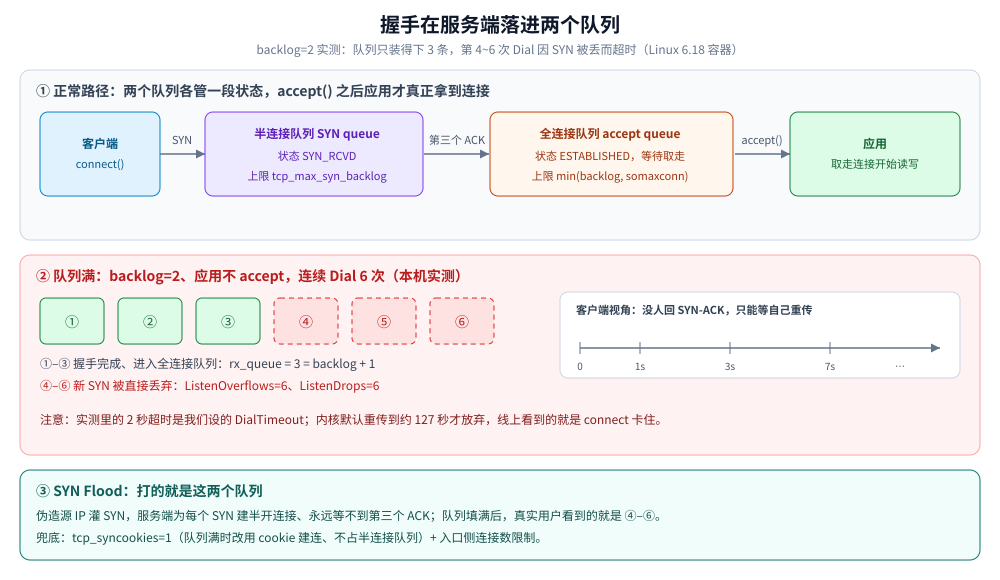
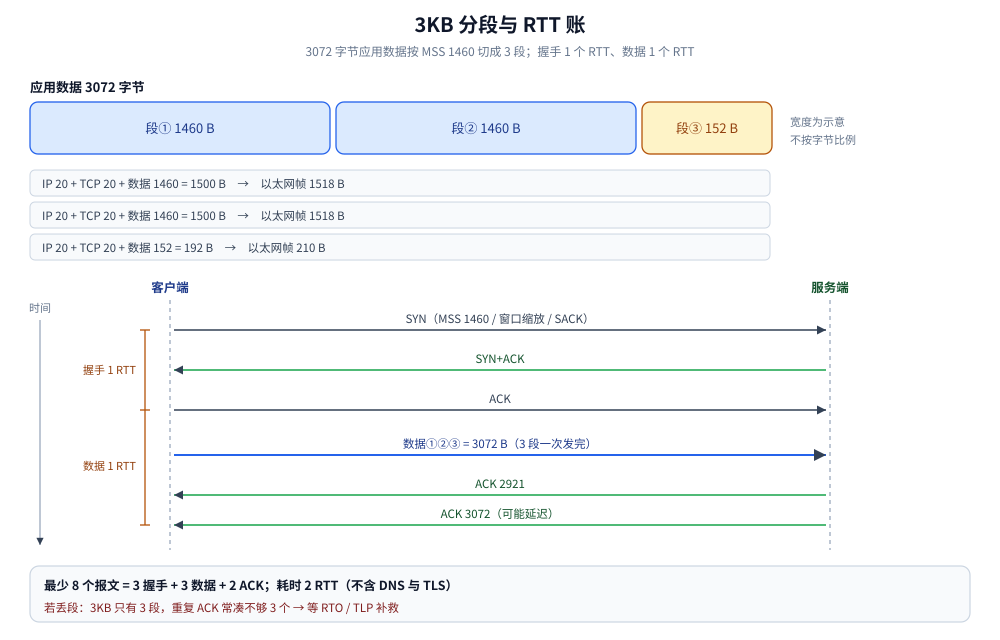
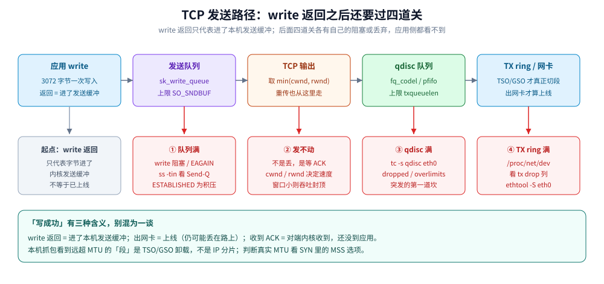
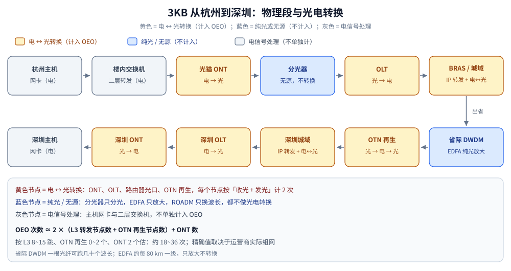
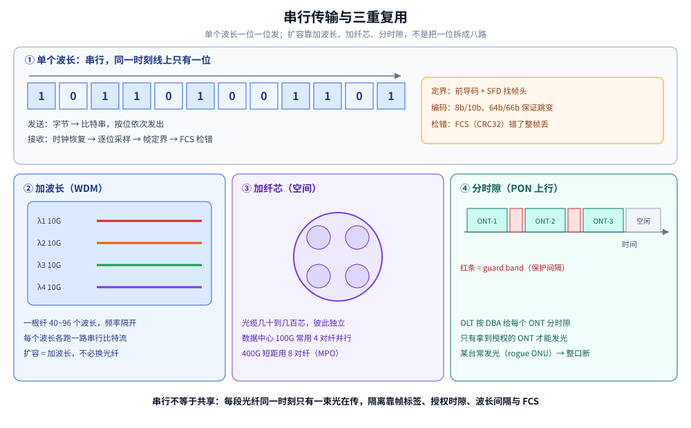
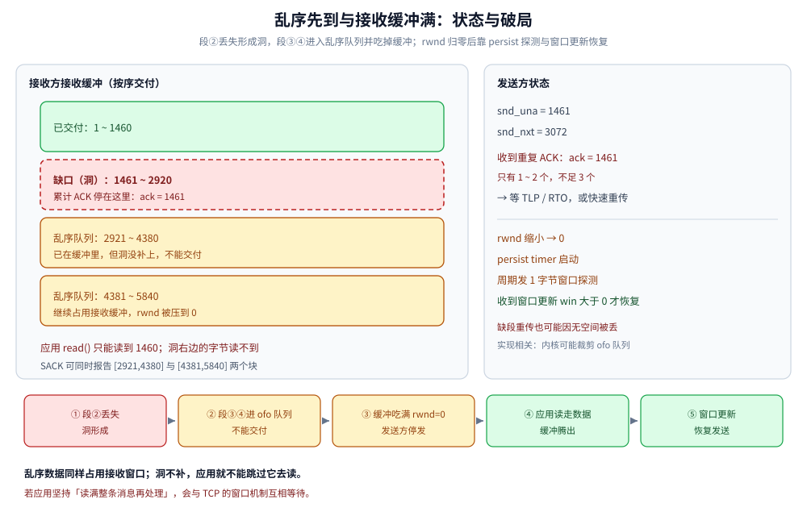

# 跨城传输全链路 TCP 篇

> 覆盖：把「3 KB 应用数据从杭州发到深圳」算成一笔完整的账——DNS 与 TCP 何时建立、LB 是否把连接拆成两段、服务端的两个握手队列与 SYN Flood、握手谈定的 MSS 怎么把 3 KB 切成 3 段、隧道与 VPN 压小 MTU 后的黑洞、光纤里的比特是串行还是并行、串行为什么不会串包、每个物理段发生什么光电转换、光猫与路由器各管什么、IP 与 MAC 各在哪一跳使用、TCP 解决了什么又付出了什么代价、长肥管道上 CUBIC 与 BBR 的差别、乱序与接收缓冲满时如何处理、`write` 返回之后到真正上线的四道关、HTTPS 下 TLS 记录层多出的字节、整趟发了多少个包与几个 RTT、最后一跳怎么落地，以及「ACK / 应用读到 / 业务处理成功」三层确认的差别与「同样的卡 / 慢」怎么在两篇之间分锅。
>
> 不覆盖：五层模型的通用定义与逐层封装见 [网络分层与数据包旅程.md](网络分层与数据包旅程.md)；13 步端到端时序与逐跳改写见 [网络通信链路详解.md](网络通信链路详解.md)；以太网帧与交换机转发见 [以太网与二层转发.md](数据链路层/以太网与二层转发.md)；路由决策、ARP/NDP、MTU 与分片见 [IP与路由基础.md](网络层与寻址/IP与路由基础.md)；NAT 与 conntrack 见 [NAT与连接跟踪.md](网络层与寻址/NAT与连接跟踪.md)；TCP 机制细节见 [TCP报文结构.md](传输层/tcp/TCP报文结构.md)、[TCP三次握手.md](传输层/tcp/TCP三次握手.md)、[TCP滑动窗口.md](传输层/tcp/TCP滑动窗口.md)、[TCP拥塞控制算法.md](传输层/tcp/TCP拥塞控制算法.md)；同一趟 3 KB 换成 UDP 的版本见 [跨城传输全链路-UDP篇.md](跨城传输全链路-UDP篇.md)。
>
> 内容整理自个人学习笔记。⚠️ **测算口径**：本篇的数字都是**按协议标准与公开拓扑做的推导**，不是本机实测——杭州到深圳的 RTT、光缆长度、光放大器数量、路由器跳数、光电转换次数都随运营商实际组网变化。文中给的是**模型公式 + 量级区间 + 怎么自己测**，不写「路上一共 N 次」这类伪精确值。例外是 1.6 的队列读数与 6.4 的公式算账：队列读数来自本机容器实测（Linux 6.18，`golang:1.26-alpine`），已在节内标明；6.4 的表是 Mathis 公式的算术结果，不是压测读数，且本机内核未加载 BBR 模块（`tcp_available_congestion_control` 只有 `reno cubic`），BBR 部分只讲原理。

---

## 一、出发前：TCP 是在哪一刻建立的？

**本节要点**：TCP 在**应用数据发出之前**建立，占 **1 个 RTT**；它建立在两台主机的 socket 之间，中间路由器**不维护 TCP 状态**，但链路上的 **LB 可能把一条连接拆成两段**，服务端则会为握手**排两个队列**。建连时双方还顺带谈定了 **MSS**，这直接决定后面 3 KB 切成几段。

### 1.1 时间顺序：先找路，再建连，最后才发数据

```text
① DNS 解析：example.com → IP（缓存命中则 0 RTT）
② TCP 三次握手：SYN → SYN+ACK → ACK（1 RTT）
③ TLS 握手（如果是 HTTPS）：TLS 1.3 为 1 RTT，TLS 1.2 为 2 RTT
④ 应用数据：按谈定的 MSS 切段发出（切法见第二节）
```

- **DNS 不属于这条连接**：它通常走 UDP 53 单独查一次，拿到 IP 之后才有 ②。命中本机或运营商缓存时接近 0 RTT，未命中要 1 次以上往返。
- **TLS 也不是 TCP 的一部分**：它跑在 TCP 之上。HTTPS 的「第一次请求慢」里，DNS、TCP、TLS 是三个独立的怀疑对象，别只盯带宽。查询过程见 [DNS解析.md](网络层与寻址/DNS解析.md)，握手细节见 [HTTPS与TLS.md](应用层/HTTPS与TLS.md)。

### 1.2 三次握手到底在确认什么

| 报文 | 发送方 | 关键字段 | 确认了什么 |
|---|---|---|---|
| SYN | 客户端 | `seq=x`，MSS / 窗口缩放 / SACK 选项 | 我想连，我的初始序号是 x |
| SYN+ACK | 服务端 | `seq=y`，`ack=x+1` | 我收到了，我的初始序号是 y |
| ACK | 客户端 | `ack=y+1` | 我收到了你的序号 |

⭐ **1 RTT 的来历**：客户端发 SYN 到收到 SYN+ACK 是一个往返；第三个 ACK 发完即可带数据，不必再等一个 RTT。所以「建连」本身是 **1 RTT**，不是 1.5 或 2 个。

⭐ **这 1 RTT 就是代价**：跨城 RTT 按 20~40 ms 算，新建一条连接就先付 20~40 ms，还没算 DNS 与 TLS。所以短连接密集的场景（每个请求都新建连接）会被这 1 个 RTT 拖住，复用连接省下的正是它。

### 1.3 握手顺带谈定了 MSS

MSS 不是应用层参数，而是在 **SYN / SYN+ACK 的选项里交换**的：双方各报「我能收多大的 TCP 段」，实际取较小值。

| 概念 | 数值（IPv4 以太网典型） | 说明 |
|---|---|---|
| MTU | 1500 字节 | 链路层载荷上限，即一个 IP 包最大 1500 字节 |
| IP 首部 | 20 字节 | 不含选项 |
| TCP 首部 | 20 字节 | 不含选项；带时间戳等选项时是 32 字节 |
| **MSS** | **1460 字节** | 1500 − 20 − 20，TCP 一次最多携带的应用数据 |

⭐ MSS 不是「链路的 MTU」：MTU 是链路层的载荷上限，MSS 是 TCP 能携带的应用数据上限，两者差的就是 40 字节首部。带 TCP 时间戳时 MSS 常见是 **1448**，本篇按无选项的 1460 演算。MTU/MSS 与分片的完整关系见 [IP与路由基础.md](网络层与寻址/IP与路由基础.md) 的 MTU 一节。

### 1.4 谁在维护这条连接

- **两端主机**：各自维护 TCB（源 IP、目的 IP、源端口、目的端口、序号、窗口等）。
- **中间路由器**：只看 IP 首部，**不维护 TCP 状态**；连接断开它们也不知道。
- **NAT 网关**：维护 **conntrack 表**（五元组映射），这不是 TCP 状态，但**长连接被静默断开**往往就发生在这里——表项超时了。详见 [NAT与连接跟踪.md](网络层与寻址/NAT与连接跟踪.md)。

> ⚠️ 如果用了 **TCP Fast Open**，数据可以塞进 SYN 里，省掉一个 RTT；但它需要两端支持，且受 Cookie 与中间设备影响，不能默认假设。见 [TCP三次握手.md](传输层/tcp/TCP三次握手.md)。

### 1.5 你握手的另一端，可能不是目标服务

**本节要点**：链路上有 **L7 负载均衡**时，客户端建的是「客户端 ↔ LB」这条连接，LB 再建「LB ↔ 后端」另一条——**一条链路两段 TCP**，`ping` 出来的 RTT 只到 LB。

| LB 形态 | 是否终结 TCP | 客户端看到的 RTT 是什么 |
|---|---|---|
| **L4 转发**（LVS/IPVS 的 NAT、DR、TUN） | 不终结，只改地址与端口 | 端到端 RTT，一段 TCP |
| **L7 代理**（Nginx、Envoy、HAProxy、F5 全代理） | ⭐ 终结：各建各的连接 | **只到 LB 的 RTT**，后端那一段看不见 |

⭐ 对全链路账本的影响有三条：

- **RTT 与 `cwnd` 只描述第一段**：客户端 `ss -ti` 的 RTT、拥塞窗口都是到 LB 的，后端再慢也反映不到这里；
- **超时会叠加**：LB 自己的空闲超时（常见 50~60 秒）与后端连接的空闲超时是两套，长连接被断往往断在 LB 那一套；
- **抓包位置决定你看到几条握手**：在客户端抓只能看到与 LB 的一次握手，后端的握手要去 LB 上抓或看 LB 日志。

> 真实客户端 IP 在 L7 终结后就丢了，要靠 `X-Forwarded-For` 或 PROXY protocol 传递，且**只应信任自己这一层的头**。机制见 [反向代理原理.md](代理与网关/反向代理原理.md) 与 [客户端真实IP与可信代理.md](代理与网关/客户端真实IP与可信代理.md)；13 步链路里 LB 的位置见 [网络通信链路详解.md](网络通信链路详解.md)。

### 1.6 服务端在握手时排两个队，队列满了会拖慢建连

**本节要点**：服务端为握手维护 **半连接队列（SYN queue）** 与 **全连接队列（accept queue）**；后者满了会**丢新 SYN**，客户端只能等 SYN 重传，**30 ms 的建连变成秒级**。

| 队列 | 什么时候进 | 什么时候出 | 上限受谁管 |
|---|---|---|---|
| 半连接队列 | 收到 SYN、回完 SYN+ACK | 收到第三次 ACK | `net.ipv4.tcp_max_syn_backlog`（与 `tcp_syncookies` 联动） |
| 全连接队列 | 握手完成、变成 `ESTABLISHED` | 应用调用 `accept()` | `min(listen 的 backlog, net.core.somaxconn)` |

⭐ **本机实测**（容器内核 6.18，`somaxconn=4096`、`tcp_max_syn_backlog=512`、`tcp_syncookies=1`、`tcp_abort_on_overflow=0`）：

```text
listen(backlog=2)，应用不 accept；客户端连续 Dial 6 次
  Dial #4 失败：dial tcp 127.0.0.1:19051: i/o timeout
  Dial #5 失败：dial tcp 127.0.0.1:19051: i/o timeout
  Dial #6 失败：dial tcp 127.0.0.1:19051: i/o timeout
  客户端 Dial 返回成功：3 次
  内核 accept 队列长度 rx_queue = 3（ss -lnt 的 Recv-Q）
  TcpExt ListenOverflows=6  ListenDrops=6
  应用 accept() 取走：3 条
  取走之后 rx_queue = 0
```

三条读数对应三件事：

- **队列上限不是 `backlog`，是 `backlog + 1`**：`backlog=2` 时队列停在 3；
- **队列满时新 SYN 被直接丢弃**（`ListenOverflows` 与 `ListenDrops` 各 +6），客户端收不到 SYN-ACK，只能等自己重传——**6 次不是 6 条连接**：3 条被拒的连接各在 1 秒后重传了一次 SYN，计的是被丢的 SYN 个数；
- **`ss -lnt` 的 `Recv-Q` 就是当前排队数、`Send-Q` 是上限**，不必猜。

⭐ **时间账**：Linux 默认 `tcp_syn_retries=6`，第 1 次重传在 **1 秒**后，之后 3、7、15、31、63 秒，总计约 **127 秒**才放弃。所以队列一满，跨城本来 30 ms 的建连直接进入「秒级超时」，而**客户端日志里只有一句 `i/o timeout`**，看不出是队列问题。

> ⚠️ 另一条路径不要漏：如果 SYN-ACK 已经发出、队列在第三次 ACK 到达时才满，走的是「丢 ACK」而不是「丢掉 SYN」——那种情况客户端可能**以为连上了**，服务端却从没进入应用。两种路径的机制与 `tcp_abort_on_overflow` 开关见 [TCP三次握手.md](传输层/tcp/TCP三次握手.md) 第二节。

⭐ **SYN Flood 打的就是这两个队列**：攻击者用**伪造的源 IP** 灌 SYN，服务端为每个 SYN 回 SYN-ACK 并挂进半连接队列，永远等不到第三个 ACK，队列被填满后**真实用户的 SYN 开始被丢**——表现与本机上面那组读数一样：用户连不上、服务端 CPU 不高、带宽也不高。兜底手段是 `tcp_syncookies=1`（队列满时改用 cookie 建连、不为半开连接分配状态）和入口侧的连接数限制，防护分层见 [Web攻击与防御.md](../../06-工程实践/安全/应用与数据安全/Web攻击与防御.md) 第八节。



图怎么读：上半部分是正常路径，两个队列各管一段状态；下半部分是本节实测的溢出路径——`backlog=2` 时全连接队列只装得下 3 条，第 4~6 次 Dial 因 SYN 被丢而在 2 秒后超时。**「握手成功」与「应用拿到连接」不是同一件事**，中间隔着一个 `accept()`。

## 二、3 KB 到底是几个包？

**本节要点**：上一步谈定的 **MSS = 1460** 决定了切法——3 KB 在 TCP 眼里是 **3 个段**，不是 1 个包，也不是 3000 个包。

### 2.1 先把「3K」定死

3 KB = 3 × 1024 = **3072 字节**。这 3072 字节是**应用数据**，不含任何首部；如果按十进制 3000 字节算，只影响最后一段的长度，不影响分段个数。下面统一按 3072 字节推演。

### 2.2 3072 字节怎么切

```text
3072 = 1460 + 1460 + 152
       段①      段②      段③
```

| 段 | 序号范围（相对） | 应用数据 | TCP 首部 | IP 首部 | IP 包总长 | 以太网帧长 |
|---|---|---|---|---|---|---|
| ① | 1 ~ 1460 | 1460 | 20 | 20 | **1500** | 1518 |
| ② | 1461 ~ 2920 | 1460 | 20 | 20 | **1500** | 1518 |
| ③ | 2921 ~ 3072 | **152** | 20 | 20 | **192** | 210 |

> ⚠️ 最后一段只有 152 字节，是**正常的分段**而不是浪费：TCP 是字节流，应用写多少、内核按 MSS 切多少，最后一段短是必然的。



图怎么读：三段之和正好 3072 字节；前两段各自撑满 1500 字节的 IP 包，第三段只有 192 字节。**1518 是帧长（14 首部 + 1500 + 4 FCS），不是 MTU**——MTU 只算 IP 包。

⭐ **走 HTTPS 时，这 3 段会变长**：TLS 记录层要在应用数据外包一层，段数仍是 3，但字节数与末段长度都变了（按单条记录推导）：

| 层次 | 额外字节 | 加密后的总字节 | 切段结果 |
|---|---|---|---|
| 明文（上面的账） | 0 | 3072 | 1460 + 1460 + **152** |
| TLS 1.3 | 5（记录头）+ 1（内容类型）+ 16（AEAD tag）= **22** | 3094 | 1460 + 1460 + **174** |
| TLS 1.2 AES-GCM | 5 + 8（显式 nonce）+ 16 = **29** | 3101 | 1460 + 1460 + **181** |

HTTP 请求头同样占字节，会挤进第一段；TLS 记录本身的上限是 16 KB。所以「3 KB = 3 段」这个结论不变，但**「末段 152 字节」只在明文口径下成立**——抓包里数字节时别拿它当基准。

### 2.3 会不会被 IP 分片？

**不会**。每个 IP 包都 ≤ MTU 1500，链路层直接装得下。只有「IP 包 > MTU」才需要分片，而 TCP 已经按 MSS 把数据切到 MTU 以内了。IP 分片与 TCP 分段是两件事，区别见 [网络分层与数据包旅程.md](网络分层与数据包旅程.md) 第七节。

### 2.4 隧道与 VPN 把 MTU 压小之后

**本节要点**：走 IPsec / GRE / VXLAN 时**外层封装要另占字节**，可用 MTU 从 1500 掉到 1400 上下；而 MSS 协商发生在两端、看不见隧道，于是**大包在隧道口被丢，小请求却一切正常**。

| 封装 | 额外开销（IPv4 外层） | 典型可用 MTU |
|---|---|---|
| PPPoE（家庭宽带常见） | 8 | 1492 |
| GRE | 20 + 4 | 1476 |
| VXLAN | 14 + 20 + 8 + 8 | **1450** |
| IPsec ESP（隧道模式） | 约 50~80（含 IV、填充、ICV） | **1400 左右**，工程上常按这个值配 |
| WireGuard | 约 60 | 1440 |

⭐ **IPv6 的口径不同**：IPv6 首部是 40 字节（IPv4 是 20），同一条 1500 的链路下 MSS 上限是 **1440** 而不是 1460；而且 **IPv6 路由器不做分片**，PMTUD 是强制的——ICMPv6「Packet Too Big」被拦之后不是「退化成分片」，而是直接卡死。链路最小 MTU 1280 时 MSS 只有 **1220**，隧道叠隧道还要逐层再扣。

⭐ **PMTUD 黑洞是这条链路上最典型的「只卡大包」故障**：

```text
两端谈定 MSS=1460（它们都看到 1500 的本地 MTU）
  → 1460 字节的 TCP 段装进 IP 包是 1500
  → 进隧道要加 50~60 字节封装，超了
  → 隧道口按 DF 丢弃，并回 ICMP「需要分片」
  → 这个 ICMP 被防火墙拦掉
  → 发送方不知道，按 RTO 一直重传这个 1500 字节的包
```

表现就是「能连上、小请求正常、**一发大文件就卡死在某一刻**」，`ss -ti` 里 `retrans` 持续增长而 `cwnd` 掉下去。这与随机丢包不同：**同一条连接上，大包必丢、小包必通**。

⭐ 三道检查：

- **量**：`ping -M do -s 1472 <目标>`（1500 字节 IP 包）逐步下调到 1400 再试，找出实际能过的最大包；`tracepath <目标>` 会直接报出路径上的 PMTU；
- **看**：`ss -ti` 的 `retrans` 与 `mss`；`mss` 仍是 1460 而链路 PMTU 是 1400，就是没做调整；
- **改**：隧道两端做 **MSS clamp**（`iptables -t mangle -A FORWARD -p tcp --tcp-flags SYN,RST SYN -j TCPMSS --clamp-mss-to-pmtu`），让 SYN/SYN-ACK 里的 MSS 主动降到隧道能过的值，而不是等 ICMP。

> 隧道环境里用 UDP 的协议（QUIC、WireGuard 自己）更依赖这条：它们不会等 ICMP 报信，只能靠 DPLPMTUD 主动探测。UDP 侧的对应写法见 [跨城传输全链路-UDP篇.md](跨城传输全链路-UDP篇.md) 第二节；MTU 与 PMTUD 的完整机制见 [IP与路由基础.md](网络层与寻址/IP与路由基础.md) 第八节。

### 2.5 发出之后：write 返回就等于对方收到了吗？

**本节要点**：不等于。`write` 返回只说明字节进了**本机发送缓冲**，后面还要过发送队列、`cwnd` / `rwnd`、qdisc、TX ring 四道关，任何一道都可能让数据停下或消失，而应用侧看不到。

```text
应用 write / Write
  → 发送队列（sk_write_queue，按 SO_SNDBUF 记账）
  → TCP 输出（按 min(cwnd, rwnd) 取段，重传也走这里）
  → qdisc 队列（txqueuelen 限制）
  → 驱动 TX ring（ethtool -G tx 调大小）
  → 网卡（TSO/GSO 在这一步才真正按 MTU 切段）
  → 线缆
```

⭐ **「发成功」有三种含义，别混**：

| 说法 | 真正含义 | 怎么确认 |
|---|---|---|
| `write` / `send` 返回 | 字节进了本机发送缓冲 | 返回的是拷贝字节数，仅此而已 |
| 出了网卡 | 已上线，但可能丢在路径上 | 抓包看到该段离开本机 |
| 收到 ACK | 对端**内核**收下（不等于应用读到） | `ss -ti` 的 `unacked` 归零 |

四道关各自的读数：

| 关口 | 满了会怎样 | 怎么看 |
|---|---|---|
| 发送队列 | `write` 阻塞（带 deadline 则超时）、非阻塞返回 `EAGAIN` | `ss -tin` 的 `Send-Q`；`SO_SNDBUF` 与 `net.ipv4.tcp_wmem` |
| `cwnd` / `rwnd` | 不是丢，是发不动，等对端 ACK 或窗口更新 | `ss -ti` 的 `cwnd`、`rwnd` |
| qdisc | 直接丢，TCP 只能等重传补 | `tc -s qdisc show dev eth0` 的 `dropped` / `overlimits` |
| TX ring | 直接丢，计入网卡 `tx_dropped` | `/proc/net/dev` 的 tx drop 列、`ethtool -S eth0` |

⭐ **同一个 `Send-Q` 有两种含义**：`ss -lnt` 里它是 accept 队列的**上限**（见 1.6），`ss -tin` 的 `ESTABLISHED` 连接里它是**发送队列的积压字节数**。看错列会把「发不出去」误读成「没人连进来」。

> ⚠️ 抓包看到远超 MTU 的「TCP 段」不是 IP 分片，是 **TSO / GSO 卸载**：分段被推迟到网卡。判断真实 MTU 要看 SYN 里的 MSS 选项，或 `ethtool -K eth0 tso off gso off` 之后再抓。判读规则见 [抓包实战.md](观测与排障/抓包实战.md) 3.5；`Write` 返回值的代码侧验证见 [TCP报文结构.md](传输层/tcp/TCP报文结构.md)。



图怎么读：「写成功」只走到第一格；后面四格任何一个满或慢，应用都不会收到通知。**`Send-Q`、`cwnd`、qdisc 的 `dropped`、网卡的 `tx_dropped` 是四个不同位置的读数，排障时不要互相代替。**

> ⚠️ 本节 qdisc 与 TX ring 的读数**未在本机实测**（容器内没有 `ethtool`，也没有制造环满丢包），命令为 Linux 口径；`write` 语义与发送缓冲的代码侧表现见上述链接。

## 三、出杭州：信号在物理段经历了什么？

**本节要点**：从网卡到省际骨干，信号要经过多次「电 → 光 → 电」转换；**转换只发生在有源设备上，纯光放大的地方不转换**。

### 3.1 一条典型的宽带路径

```text
杭州主机网卡（电）
  → 楼内交换机（电）
  → 光猫 ONT（电 → 光）              ← 第 1 次转换
  → 入户光纤
  → 分光器（无源，不转换）
  → OLT（光 → 电）                   ← 第 2 次转换
  → BRAS / 城域网汇聚（IP 转发，光口进出各一次转换）
  → 省际骨干（DWDM / OTN：光放大不转换，再生才转换）
  → 广东侧骨干 → 深圳城域网 → BRAS → OLT → 分光器
  → 深圳侧 ONT（光 → 电）
  → 目标主机网卡（电）
```



图怎么读：黄色节点是发生**电光转换**的地方（ONT、OLT、路由器光口、OTN 再生），蓝色是**纯光或无源**设备（分光器、EDFA、ROADM），它们只分光或放大，不把信号变回电。**数转换次数时只数黄色，不数蓝色。**

### 3.2 光纤里是串行还是并行？串行怎么保证不串包？

**本节要点**：比特层是**串行**——一位接一位；扩容靠「加波长、加纤芯、加通道」并行。**不串包不是因为线粗，而是因为每段光纤点到点独占，且每一层都有自己的定界与标签。**

| 层次 | 形态 | 说明 |
|---|---|---|
| 单根光纤、单个波长 | **串行** | 一位接一位；10G 就是每秒 100 亿个符号，收端靠时钟恢复逐位采样 |
| 一根光纤里的多个波长 | 并行（WDM） | DWDM 一根纤跑 **40~96 个波长**，彼此频率隔开，每个波长各是一路独立的串行流 |
| 多根纤芯 / 多对光纤 | 并行（空间） | 光缆几十到几百芯；数据中心 100G 常用 4 对纤、400G 短距用 8 对纤（MPO 接头）同时收发 |
| 光模块内部 | 并行 → 串行 | 电侧是并行总线，进激光器前由 SerDes 串化，收端再解串 |

所以「3 KB 变成 0101 发出去」只描述第一行。骨干扩容靠的是加波长、加纤芯，而不是把一位拆成八路发。

**为什么串行不会把别人的包拼进来？** 因为从来没有多路数据混在同一根线的同一时刻，隔离靠四类机制，它们都落在物理层与链路层：

| 隔离手段 | 在哪一层 | 解决什么 |
|---|---|---|
| 介质独占 + 帧标签 | 物理 / 链路 | 主机到 OLT 的光纤是点到点的；PON 下行虽是广播，但每帧带 **PON ID / GEM Port**，ONT 只收自己的，其余丢弃 |
| 上行时隙（TDMA + DBA） | 链路 | 只有拿到 OLT 授权的 ONT 才能发光，时隙之间留 guard band；这是 PON 上行「不串」的核心 |
| 帧定界 | 链路 | 收端得先知道从哪一位算一帧：以太网靠前导码 + SFD，OTN 靠 OTUk 的 FAS（6 字节固定图样） |
| 编码 + 扰码 + FEC + FCS | 物理 / 链路 | 编码保证足够跳变供时钟恢复，扰码打散长串 0/1，FEC 纠随机误码，FCS 错了整帧丢、交给上层重传 |

> ⚠️ 真正会「串」的故障只有一类：某个 ONT 的激光器失控常发光（业内叫 rogue ONU），会占满整个上行时隙，同一 PON 口下其他用户全部受影响——这正是上表第二行机制被破坏的后果。



图怎么读：最上面一排 12 个格子是 12 个比特时隙，同一时刻只有一位在线上；右侧注释给出定界（前导码 + SFD）、编码（8b/10b、64b/66b）与检错（FCS）三道关。下面三格是扩容与共享的三种手段——加波长、加纤芯是并行扩容，分时隙是让多个 ONT 错开时间共用一根纤，**都不是把一位拆开发**。

### 3.3 每一段具体在做什么

| 段 | 介质 | 有源 / 无源 | 发生什么 |
|---|---|---|---|
| 主机 → 楼内交换机 | 双绞线 / 光纤 | 有源 | 电信号转发，二层交换 |
| 交换机 → ONT | 双绞线 / 光纤 | 有源 | 电信号交给 ONT |
| **ONT** | — | **有源** | **电 → 光**，把以太网帧调制到 PON 的上行波长；同时做注册认证（SN / LOID）与带宽上报（DBA） |
| 入户光纤 → 分光器 | 单模光纤 | **无源** | 一路光分成多路，**不转换、不放大**；常见分光比 **1:32 / 1:64** |
| **OLT** | — | **有源** | **光 → 电**，终结 PON，并按 DBA 给各 ONT 分配上行时隙 |
| BRAS / 城域网 | 光纤 | 有源 | **IP 转发**；每个光口收 = 光→电，发 = 电→光 |
| 省际 DWDM | 单模光纤 | 有源 | 一根光纤里跑几十个波长；**EDFA 只放大光，不转换** |
| OTN 再生 / 交接 | 光纤 | 有源 | **光 → 电 → 光**，重新整形、定时、再生 |
| 对端 OLT / ONT | 光纤 | 有源 | 与杭州侧镜像：OLT 电→光，ONT 光→电 |

**光猫和路由器不是一回事**

| | 光猫（ONT） | 路由器 |
|---|---|---|
| 解决什么 | **介质转换**：光纤里的光 ↔ 网线里的电 | **寻址转发**：这个 IP 包下一步发给谁 |
| 关键动作 | PON 协议终结、注册认证、DBA 上报、二层桥接；一体机再加 NAT 与 Wi-Fi | 查路由表、TTL 减 1、重写二层头、NAT、ACL、DHCP、防火墙 |
| 工作层次 | 物理层 + 链路层（PON 是二层技术） | 网络层（三层） |
| 不做 | 不做跨网段路由决策 | 不做光电转换 |

⭐ **两者不是一一对应**，而是一条 N:1 的链：

```text
家庭路由器 ── 以太网 ── 光猫 ONT ── PON 光纤 ── 分光器 1:32 / 1:64 ── OLT ── BRAS
```

- 一个 OLT 的 PON 口经分光器带 **32~64 个 ONT**；一台 BRAS 带几千到几万条宽带。
- 一台光猫通常只接一个家庭路由器；企业多 WAN 可以一台路由器接多个光猫。
- 家用「光猫路由一体机」是**物理合一、逻辑分离**：切到桥接模式后，光猫只做光电转换，拨号与 NAT 交给后面的路由器。

### 3.4 为什么中间要放光放大器

光在光纤里会衰减（典型 0.2 dB/km 量级），跑几十公里就要补一次。**EDFA（掺铒光纤放大器）直接在光域放大**，不需要光电转换——这是长距离传输能把成本压下来的关键。只有信号劣化到光放大也救不回来（色散、噪声累积）时，才需要 **OTN 再生**，那一步才是 OEO。

> ⚠️ 别把「经过一个放大器」当成「经过一个路由器」：**EDFA 不做 IP 转发、不改 MAC、不查路由表**，它连一个「跳」都不算。

## 四、跨省骨干：路由器跳数为什么和光电转换次数对不上？

**本节要点**：两者统计的是不同东西——**跳数数的是「谁做了 IP 转发」，转换次数数的是「信号几次变回电」**；纯光设备两边都不算，OTN 再生只算转换不算跳。

### 4.1 三个数字不要混

| 指标 | 数的是什么 | 杭州→深圳的量级（估算） | 怎么测 |
|---|---|---|---|
| **IP 跳数**（L3 hops） | 做了 IP 转发的设备数 | 常见 **8 ~ 15 跳** | `tracert` / `traceroute` / `mtr`，但只显示**愿意回 ICMP 的**设备 |
| **光放大器数** | EDFA / 光放站 | 约 **15 ~ 20 个**（按 80 km 一站、1200~1600 km 估） | 运营商网管，用户侧测不到 |
| **光电转换次数**（OEO） | 光→电 + 电→光 的次数 | 约 **18 ~ 36 次**（按下面公式） | 需要完整拓扑，用户侧**无法精确测** |

### 4.2 一个可以自洽的估算公式

把路径上的设备分成三类，只数会做光电转换的：

```text
OEO 次数 ≈ 2 × (L3 转发节点数 + OTN 再生节点数) + ONT 数
           ↑ 每个 L3/OTN 节点：收光 1 次 + 发光 1 次    ↑ 两端 ONT 各 1 次
```

代入区间：L3 = 8~15，OTN 再生 = 0~2，ONT = 2：

```text
下限：2 × (8  + 0) + 2 = 18 次
上限：2 × (15 + 2) + 2 = 36 次
```

所以答案只能是「**十几到三十几次这个量级**」（按上面公式约 18~36 次），而不是一个确定值。原因有三：

1. **实际路径取决于运营商组网**：同样的杭州→深圳，走浙江—江西—广东和走浙江—福建—广东，节点数就不一样；
2. **OTN 再生点按距离与光纤质量规划**，不是固定每 N 公里一个；
3. **OLT 算不算 L3 节点**取决于它做不做 IP 转发——有的 OLT 只做二层汇聚，这时它仍会发生一次光→电转换，但不在「跳数」里。

> ⭐ 被问「路上多少次光电转换」时，正确答法是**先说公式与三类设备，再给量级区间，最后说「精确值要拓扑」**；直接报一个数字反而是错的。

### 4.3 为什么 traceroute 的跳数偏少

`traceroute` 靠中间设备回 `ICMP Time Exceeded` 才画得出一跳；骨干设备常被配置成**不回 ICMP 或限速回**。所以看到 10 跳，实际 L3 节点可能更多；看到一堆 `*`，也不代表丢包。这一点在 [网络通信链路详解.md](网络通信链路详解.md) 1.3 有本机实测。

## 五、什么时候用 IP、什么时候用 MAC？

**本节要点**：**IP 决定「往哪儿去」，MAC 决定「这一跳交给谁」**；IP 端到端基本不变（NAT 除外），MAC 每一跳都换。

### 5.1 两套地址的分工

| 地址 | 谁分配 | 作用范围 | 会不会变 |
|---|---|---|---|
| **IP** | 管理员 / DHCP / 自动配置 | 端到端，标识「在哪个网络」 | 正常转发不变；**NAT / DNAT 会改** |
| **MAC** | 网卡出厂 / 系统生成 | 逐跳，标识「同一链路内的下一跳网卡」 | **每一跳都换** |

### 5.2 一个包从杭州到深圳，地址怎么变

| 位置 | 源 IP | 目的 IP | 源 MAC | 目的 MAC |
|---|---|---|---|---|
| 杭州主机出网卡 | 杭州内网 IP | 深圳服务端 IP | 主机网卡 | **默认网关** |
| 出口网关 SNAT 后 | **网关公网 IP** | 深圳服务端 IP | 网关外网口 | 下一跳路由器 |
| 途中每个 L3 路由器 | 不变 | 不变 | 出接口 | **下一跳** |
| 服务端网段最后一跳 | 不变 | 不变 | 路由器出接口 | **服务端网卡** |
| 服务端收到 | 网关公网 IP | 服务端 IP | — | — |

⭐ 一句话：**IP 是信封上的收件地址，MAC 是每一站邮车之间交接的司机工牌**——收件地址一路不变，工牌每站换。除了 MAC，**每一跳还会改 TTL（减 1）并重算 IPv4 首部校验和**，这两项在 [网络通信链路详解.md](网络通信链路详解.md) 第三节有逐跳表。

### 5.3 每一跳怎么知道下一跳的 MAC

路由器查路由表得到下一跳 IP，再用 **ARP（IPv4）/ NDP（IPv6）** 把下一跳 IP 解析成 MAC，然后组帧发出。这个「查表 → 定下一跳 → 解析 MAC → 组帧」的四步在 [IP与路由基础.md](网络层与寻址/IP与路由基础.md) 里有完整展开。

> ⚠️ 主机只对**同网段**的目的地址直接 ARP；跨网段时 ARP 的是**默认网关**，不是深圳服务器的 IP。

### 5.4 什么时候不经过路由器

**本节要点**：判据只有一条——**目的 IP 与本机是否同子网**。同子网走二层交换，跨子网才交给网关（三层路由器）。

```text
目的IP & 子网掩码 == 本机IP & 子网掩码 ?
  ├─ 是 → 直接 ARP 拿对端 MAC，组帧发出（经过交换机，不经过路由器）
  └─ 否 → ARP 默认网关，把包交给网关（经过三层路由器）
```

| 场景 | 经过三层路由器吗 | 为什么 |
|---|---|---|
| 家里手机访问同网段 NAS | **逻辑上不经过** | 物理上过了路由器那台盒子，但走的是它的桥接 / 交换功能，没做三层转发 |
| 同一 VLAN / 同一子网内互访 | 不经过 | 二层可达，交换机按 MAC 表转发 |
| 本机 `127.0.0.1`、同宿主机容器经 docker bridge | 不经过 | 连物理网卡都不出 |
| 同一 PON 口下的两台 ONT 互访 | 不经过 L3，但要绕到 OLT | PON 是星型，ONT 之间不直连，必须上行到 OLT 再下发 |
| 二层延伸：VXLAN/EVPN 大二层、OTN 波长直达、专线二层透传 | **可能不经过** | 两端看起来在同一广播域，跨城也能绕开三层转发 |
| 杭州主机访问深圳服务端 | **一定经过** | IP 前缀不同，必须经两端网关与多台骨干路由器 |

> ⚠️ 「不经过路由器」不等于「没有转发设备」：中间仍有交换机、OLT、OTN 或 EDFA，它们只是不查 IP 路由表。二层转发细节见 [以太网与二层转发.md](数据链路层/以太网与二层转发.md)，路由决策见 [IP与路由基础.md](网络层与寻址/IP与路由基础.md) 第四节。

## 六、TCP 解决了什么，又带来了什么代价？

**本节要点**：TCP 用「序号 + 确认 + 重传 + 窗口」把不可靠的 IP 变成可靠字节流；代价是**至少一个 RTT 的建连、确认与重传开销、队头阻塞、状态与缓冲内存**。

### 6.1 它解决的问题

| 问题 | TCP 的手段 | 一句话 |
|---|---|---|
| 丢包 | 序号 + ACK + 重传（快速重传 / RTO） | 丢了就补 |
| 乱序 | 序号 + 接收端重组 | 到了先排队，等缺口 |
| 重复 | 序号去重 | 同一个序号只交一次 |
| 发太快压垮接收方 | 接收窗口 `rwnd` | 接收方说「我还能收多少」 |
| 发太快压垮网络 | 拥塞窗口 `cwnd` | 发送方自己试探网络容量 |
| 多进程共用一台主机 | 端口号 | 用四元组区分连接 |
| 字节流没有边界 | 应用层自己定界 | TCP 只保证字节顺序，不保证消息边界 |

### 6.2 它带来的代价

| 代价 | 具体表现 | 量级 / 判据 |
|---|---|---|
| **建连 RTT** | 每次新建连接至少 1 RTT | 跨城 30 ms RTT → 建连 30 ms |
| **确认开销** | 每个方向都要回 ACK | 3 KB 也要 1~3 个 ACK（延迟确认） |
| **队头阻塞** | 前一个字节没到，后面的字节不能交给应用 | 一个段丢失，整条连接等它 |
| **窗口限制吞吐** | 吞吐 ≤ 窗口 / RTT | 64 KB 窗口 + 30 ms RTT → 约 17.5 Mbps |
| **拥塞控制降速** | 丢包就减窗，吞吐呈锯齿 | 跨城长肥管道尤其明显 |
| **连接状态内存** | 每条连接一份 TCB + 收发缓冲 | 十万连接就是十万份 |
| **`TIME_WAIT`** | 主动关闭方要等 2MSL | 常见约 60 秒，本仓库实测约 121 秒 |
| **Nagle / 延迟确认** | 小包可能被攒住，延迟可达几十到几百毫秒 | 实现相关 |

### 6.3 3 KB 这个尺寸，代价主要在哪

⭐ **不在带宽，在 RTT 和建连次数**：

- 3 KB 在 100 Mbps 链路上**单跳串行化**只需 `3072 × 8 / 100000000 ≈ 0.25 ms`；
- 但杭州→深圳一个 RTT 就是 **20~40 ms** 量级；
- 所以这趟传输的耗时 ≈ **DNS + TCP 握手 1 RTT + TLS 1 RTT + 数据 1 RTT**，**绝大部分是等待，不是传输**。

这也解释了为什么「小文件慢」通常不是带宽问题，而是**往返次数**问题：合并请求、复用连接、启用 TLS 1.3 / QUIC，省的都是 RTT。

> 带宽时延积：`BDP = 带宽 × RTT`。100 Mbps × 30 ms = 3 Mbit ≈ 375 KB。窗口小于 BDP，链路就吃不饱——这就是「长肥管道」问题，详见 [TCP滑动窗口.md](传输层/tcp/TCP滑动窗口.md) 第一节与 [TCP拥塞控制算法.md](传输层/tcp/TCP拥塞控制算法.md)。

### 6.4 跨城长肥管道上，CUBIC 为什么打不过 BBR？

**本节要点**：CUBIC 把**丢包**当拥塞信号，一丢就把窗口砍半；跨城链路「带宽大、RTT 大」，窗口本来就大，**一次与拥塞无关的随机丢包就能让吞吐断崖**。BBR 不看丢包，直接测**交付速率与最小 RTT**。

**先说清楚适用范围**：3 KB 这种小传输**不受影响**——发送窗口远小于 BDP，整个传输都在慢启动初段（`IW10` 就够发完），还没进入拥塞避免。这一节讲的是**大文件、大流量跨城传输**。

⭐ **先排除「窗口本身不够大」**：BDP 再大，窗口开不上去也白搭。未开窗口缩放时 `win` 字段最大 65535 字节，40 ms RTT 下吞吐上限只有 `65535 / 0.04 ≈ 1.6 MB/s`，约 **13 Mbps**——这时换什么拥塞算法都没用。按顺序确认三项：`ss -ti` 里的 `wscale` 是否非零、`net.ipv4.tcp_rmem` 的最大值是否够大、中间设备有没有剥离窗口缩放选项（机制见 [TCP滑动窗口.md](传输层/tcp/TCP滑动窗口.md)）。

⭐ **为什么一次丢包代价这么大**：窗口砍半后要重新爬回来，而爬升速度受 RTT 限制。用 Mathis 公式估一下固定丢包率下的稳态吞吐（MSS 1460、RTT 40 ms、常数 1.22）：

```text
吞吐 ≈ (MSS / RTT) × (1.22 / √p)
     = (1460 / 0.04) × (1.22 / √p)
     = 36500 × (1.22 / √p)  字节/秒
```

| 丢包率 `p` | 稳态吞吐（推导值） | 折算 |
|---|---|---|
| 1% | ≈ 445 KB/s | **≈ 3.6 Mbps** |
| 0.1% | ≈ 1.41 MB/s | ≈ 11.3 Mbps |
| 0.01% | ≈ 4.45 MB/s | ≈ 35.6 Mbps |

对照一条 **200 Mbps、RTT 40 ms** 的跨城链路：BDP = 200 Mbps × 40 ms = **1 MB**，而 1% 丢包下 CUBIC 只能跑到 **3.6 Mbps**——**不到链路的 2%**。这就是「带宽明明够、大文件就是慢」的一种成因：丢包不是拥塞造成的（光纤误码、队列微突发都会丢），但 CUBIC 一律按拥塞处理。

⭐ **BBR 的做法**：

- 持续测量**交付速率**（发出去多少、对端确认了多少）与**最小 RTT**，两者相乘估出 BDP，据此决定发送速率并**按速率打散（pacing）**；
- **丢包不直接触发减窗**——它认为丢包可能是随机噪声，只把「带宽估计下降」当信号；
- 结果是在高 RTT、有随机丢包的链路上吞吐稳定得多，不会因为一次误码就锯齿式掉一半。

⚠️ BBR 不是无代价：它与 CUBIC 共享瓶颈时**更激进**（BBR v1 在高丢包或浅缓冲链路上会被指为不公平），也可能把队列堆得更满。选型要按「你的流量是否占主导、链路是否有随机丢包」判断，不是无条件更好。

```bash
sysctl net.ipv4.tcp_congestion_control          # 当前算法
sysctl net.ipv4.tcp_available_congestion_control
ss -ti dst <目标IP> | grep -o 'bbr\|cubic'      # 单条连接实际用的算法
```

> ⚠️ 本机容器内核 6.18 的 `tcp_available_congestion_control` 只有 `reno cubic`，**BBR 模块未加载，未实测**；上表是按公式推导，不是压测结果。开启需要内核带 `tcp_bbr` 模块并 `sysctl -w net.ipv4.tcp_congestion_control=bbr`，算法细节见 [TCP拥塞控制算法.md](传输层/tcp/TCP拥塞控制算法.md)。

## 七、乱序的包先到，接收方怎么处理？

**本节要点**：接收方把乱序段放进**乱序队列（ofo queue）**，只对**连续到达的最后一个字节**回 ACK；缺口没补上之前，**应用读不到缺口之后的数据**。

### 7.1 用 3 段的具体序号走一遍

假设段①（1~1460）正常到达，段②（1461~2920）在途中丢了，段③（2921~3072）先到：

```text
接收方视角：
  [1 ................ 1460] ✓ 已交付
  [1461 ............. 2920] ✗ 缺口（洞）
  [2921 ............. 3072] ✓ 已收到，但只能放进乱序队列

回给发送方的 ACK：ack = 1461（重复 ACK），SACK 块 = [2921, 3072]
应用 read()：只能读到 1460，读不到 2921 之后的 152 字节
```



图怎么读：**洞**是累计确认停住的位置；洞右边的数据即使到了也只能排队，**应用层不能跳过洞去读**。图下半部分是缓冲被乱序数据占满后，`rwnd` 归零、发送方转入窗口探测的过程。

### 7.2 发送方怎么知道该重传哪一段

| 信号 | 含义 | 发送方动作 |
|---|---|---|
| **重复 ACK** | 接收方反复说「我还在等 1461」 | 收到 3 个重复 ACK → **快速重传** |
| **SACK** | 「我额外收到了 2921~3072」 | 只重传缺口，不重传已收到的 |
| **RTO 超时** | 一段时间没有任何进展 | 重传最早的未确认段，并进入慢启动 |

⭐ **3 KB 这个尺寸有个坑**：如果丢的是段①，后面只有 2 个段能产生重复 ACK，**凑不够 3 个**，经典的「3 个重复 ACK 触发快速重传」就不会发生；这时要么等 **RTO**，要么靠 **TLP（Tail Loss Probe）/ RACK** 这类更现代的机制补救。**小传输的尾包丢失，往往比大传输更慢**——这是「3 个重复 ACK」这条口诀的边界。

### 7.3 乱序不等于丢包

如果只是**路径不同导致到达顺序变了**（没有丢），接收方照样先排队；发送方可能误判为丢包而**伪重传**，接收方用 **DSACK** 告诉它「这段我早收到了」。RACK 则用「到达时间」而不是「重复 ACK 计数」来判断丢失。抓包里看到重复 ACK，不能直接断言丢包——见 [抓包实战.md](观测与排障/抓包实战.md)。

## 八、接收缓冲满了怎么办？满了又乱序呢？

**本节要点**：缓冲满 → 通告窗口缩到 0 → 发送方停发并启动**持久计时器**；**乱序数据同样占缓冲**，所以「满 + 乱序」会同时卡住窗口和重组。

### 8.1 只有「满」：零窗口与窗口探测

```text
接收方：应用不读 → 接收缓冲满 → ACK 里 win = 0
发送方：停止发送，启动 persist timer
       每隔一段时间发 1 字节窗口探测（zero window probe）
接收方：应用 read() → 缓冲腾出 → 回窗口更新（win > 0）
发送方：恢复发送
```

| 状态 | 谁在等 | 怎么破 |
|---|---|---|
| `win = 0` | 发送方等窗口更新 | 接收方应用必须**读**；否则连接看起来「活着但不动」 |
| 探测无响应 | 发送方反复探测 | 对端可能已经死了；keepalive / 业务超时要能兜底 |
| 窗口长期很小 | 吞吐被压死 | 查应用读取速度与 `SO_RCVBUF`，不是盲目调大 |

### 8.2 「满 + 乱序」：两个机制叠在一起

乱序段进入 ofo 队列后，**占的是同一块接收缓冲**。于是可能出现：

1. 洞还没补上，洞右边的段已经把缓冲吃掉大半；
2. `rwnd` 一路缩到 0，发送方停发；
3. 缺的那一段即使重传到，也可能因为**没有缓冲空间**而被丢弃；
4. 接收方应用又在等「整条消息到齐才处理」，于是不读 → 缓冲不释放 → 窗口不开 → 缺口补不上。

⭐ **这是应用层与传输层互相等待的僵局**：TCP 要应用读才能腾空间，应用要等数据齐才读，而数据齐又依赖缺口段进缓冲。它不是协议 bug，是**用法问题**。

### 8.3 实现相关：内核会怎么处理

不同内核在内存压力下的策略不一样（**实现相关，下面是 Linux 的常见行为，未在本机实测**）：

- 乱序段过多时，可能**裁剪 ofo 队列**（丢掉一部分已到的乱序段），让发送方之后重传；
- 段到达但缓冲不够时，可能**直接丢**，发送方靠重传补；
- 应用一直不读时，接收窗口长期为 0，连接进入「活着但不推进」的状态。

所以「满了又乱序」没有唯一的报文序列答案，**能确定的是：窗口会缩、重传会变多、应用读得慢会让一切更糟**。

### 8.4 工程上的解法

| 做法 | 解决哪一半 | 注意 |
|---|---|---|
| 应用**流式读**，不要等整条消息再读 | 缓冲不释放 | 配合长度前缀 / 帧解析，读到多少处理多少 |
| 合理设置 `SO_RCVBUF` | 缓冲太小 | Linux 上显式设置会**关掉自动调优**，非必要不设 |
| 限制单条消息大小 | 大消息吃满缓冲 | 大消息分片 / 流式上传 |
| 多连接或 QUIC 多流 | TCP 队头阻塞 | 每条流独立，但总带宽仍共享 |
| 监控 `win 0` 与 ofo 计数 | 定位谁慢 | `ss -ti` + `nstat`，见「具体使用」 |

> 更完整的窗口机制（窗口缩放、SACK、persist timer）见 [TCP滑动窗口.md](传输层/tcp/TCP滑动窗口.md)，那一篇专门演算了「乱序 + 缓冲满」的组合。

## 九、这一趟到底发了多少个包、花了几个往返？

**本节要点**：应用数据 3 个段；加上握手与 ACK，**最少的线上报文是 8 个**；时间账是 **2 个 RTT（不含 DNS 与 TLS）**。

### 9.1 报文清单（无丢包、无 TLS）

| # | 报文 | 方向 | 说明 |
|---|---|---|---|
| 1 | SYN | 客户端 → 服务端 | 带 MSS / 窗口缩放 / SACK 选项 |
| 2 | SYN+ACK | 服务端 → 客户端 | 带服务端选项 |
| 3 | ACK | 客户端 → 服务端 | 握手完成 |
| 4 | 数据段① 1460 B | 客户端 → 服务端 | |
| 5 | 数据段② 1460 B | 客户端 → 服务端 | |
| 6 | 数据段③ 152 B | 客户端 → 服务端 | |
| 7 | ACK 2921 | 服务端 → 客户端 | 延迟确认：收到第 2 段后回 |
| 8 | ACK 3072 | 服务端 → 客户端 | 收到第 3 段后回（可能延迟） |

⭐ **8 个报文 = 3 个握手 + 3 个数据 + 2 个 ACK**。ACK 的个数取决于延迟确认策略，可能是 1~3 个；**3 个数据段是确定的**。

### 9.2 往返账

| 阶段 | RTT 数 | 说明 |
|---|---|---|
| DNS | 0 ~ 1+ | 缓存命中为 0；未命中要递归查询 |
| TCP 握手 | **1** | SYN → SYN+ACK |
| TLS 1.3 | **1** | 完整握手；会话复用可做到 0-RTT |
| TLS 1.2 | **2** | 比 1.3 多一个往返 |
| 应用数据 | **1** | 3 段在初始窗口内一次发完，等 ACK；延迟确认可能再叠加几十 ms |

按杭州→深圳 **RTT ≈ 30 ms** 估：

```text
TCP + TLS 1.3 + 数据 ≈ 3 RTT ≈ 90 ms
再加 DNS（未缓存）≈ 30 ms → 约 120 ms
服务端处理时间另算
```

> ⚠️ 这是**纯网络等待的估算**，不含服务端排队、证书验证与浏览器调度。真实值要用 `curl -w` 或浏览器 DevTools 拆阶段看。

### 9.3 如果丢了一个段

| 丢的位置 | 后果 | 额外代价 |
|---|---|---|
| 段① 丢 | 只有 2 个后续段 → 重复 ACK 不足 3 个 | 等 RTO / TLP，可能多几十到几百 ms |
| 段② 丢 | 段③ 产生 1 个重复 ACK | 同样不一定触发快速重传 |
| 段③ 丢（尾包） | 没有后续段 | 只能靠 RTO / TLP |
| 任意段丢 + 缓冲满 | 重传也可能被丢 | 等窗口更新，时间不可控 |

⭐ 结论：**3 KB 太小，快速重传的「3 个重复 ACK」条件经常凑不齐**；短传输的可靠性没问题，但**尾包丢失的恢复时间可能比大传输更长**。

## 十、到达深圳之后：最后一跳和解封装

**本节要点**：最后一跳路由器用 ARP/NDP 拿到服务端网卡 MAC，帧送到网卡后逐层剥头，TCP 按序号重组；应用要按协议定界**读满** 3072 字节才算拿到完整消息——`read()` 一次不保证返回全部。

### 10.1 最后一跳

```text
深圳城域网最后一跳路由器
  → 查路由表：目的 IP 在本网段
  → ARP / NDP：问「谁是 <服务端 IP>」→ 服务端回自己的 MAC
  → 组帧：目的 MAC = 服务端网卡，源 MAC = 路由器出接口
  → 发出
```

> ⚠️ 如果服务端前面还有 L4/L7 负载均衡，最后一跳的「服务端」其实是 LB：L4 做 DNAT，L7 会**终结这条 TCP 再新开一条**，后端看到的源 IP 是 LB 的。

### 10.2 服务端逐层解封装

| 层 | 动作 | 检查什么 |
|---|---|---|
| 网卡 | 收帧、校验 FCS | 帧是否损坏；目的 MAC 是否是自己 |
| 链路层 | 剥以太网头 | 类型字段 = IPv4 / IPv6 |
| 网络层 | 剥 IP 头 | 目的 IP 是否是自己；IPv4 首部校验和；是否分片 |
| 传输层 | 剥 TCP 头 | 校验和；序号；端口；按序号重组 |
| Socket | 放入接收缓冲，唤醒 `read()` | 窗口是否足够；应用是否在读 |
| 应用 | `read()` 可能分多次返回，凑够 3072 字节才算完整 | 长度前缀 / `Content-Length` / 关闭连接 |

### 10.3 回程

响应沿相反方向走，但**不保证走同一条 AS 路径**；到客户端出口网关后，靠 conntrack 把「公网 IP:端口」还原成「内网 IP:端口」。回程的路径不对称、NAT 还原与抓包点选择见 [网络通信链路详解.md](网络通信链路详解.md) 第四节。

### 10.4 发送方怎么知道「真的收全了」？

**本节要点**：TCP 的 ACK 只到对端**内核**，不代表应用读到、更不代表业务处理成功。三层要分开看，否则会出现「客户端显示成功、数据却没了」。

| 层 | 谁确认 | 能证明什么 | 不能证明什么 |
|---|---|---|---|
| **TCP ACK** | 对端内核 | 字节进了接收缓冲、序号连续 | 应用是否 `read()`、进程是否还活着 |
| **应用读取** | 对端进程 | 数据被应用取走 | 业务是否处理成功 |
| **业务 ACK** | 对端业务逻辑 | 处理完成（带幂等键，可安全重试） | 落库 / 落盘是否真的完成，要靠对账 |

⭐ 典型事故：服务端已把数据 ACK 掉，进程在 `read()` 之前被 OOM 杀掉；客户端收到 ACK 就删了本地待发数据——**两端都认为成功，数据却没了**。反方向的坑是「一次 `read` 就是一条消息」：TCP 是字节流，3072 字节可能分两次返回，必须按长度前缀 / `Content-Length` / 关闭连接判断收齐。

> UDP 侧同一件事更直接：`recvfrom` 一次就是一个完整数据报，但「收到」不等于「处理成功」，应用层确认要自己设计，见 [跨城传输全链路-UDP篇.md](跨城传输全链路-UDP篇.md) 4.3 与 6.2。

## 十一、应用场景

**本节要点**：这笔账主要用在三处——容量规划、排障定位、协议选型。

| 场景 | 这笔账里对应的量 | 结论 |
|---|---|---|
| 跨城 API 首包慢 | RTT × 往返次数 | 先减往返（连接复用、TLS 1.3、QUIC），再谈带宽 |
| 大文件吞吐上不去 | BDP = 带宽 × RTT | 窗口小于 BDP 时，加带宽没用，要开窗口缩放 |
| 小文件偶发超时 | 尾包丢失 + RTO | 短传输凑不齐 3 个重复 ACK，超时设置要留余量 |
| 服务端连接堆积 | 每连接 TCB + 缓冲 | 十万连接先算内存，再算 fd |
| 长连接被静默断开 | NAT conntrack 超时 | 心跳周期要小于中间设备空闲超时 |
| 移动弱网乱序多 | ofo 队列 + 伪重传 | 别把重复 ACK 直接当丢包；看 SACK / DSACK |

## 十二、具体使用

**本节要点**：先量 RTT 与跳数，再看 TCP 状态，最后用抓包确认；命令以 Linux 为准，Windows 用 `tracert` / `pktmon` 替代。末尾的「卡 / 慢」分锅表是两篇共用的排障入口。

### 12.1 量 RTT 与路径

```bash
ping -c 5 <目标IP>                 # RTT 均值 / 抖动 / 丢包
mtr -rw -c 20 <目标IP>             # 逐跳 RTT 与丢包，比 traceroute 更适合判断
traceroute -n <目标IP>             # 只看路径，注意中间设备可能不回 ICMP
```

### 12.2 看 TCP 连接状态

```bash
ss -ti dst <目标IP>                # cwnd / rwnd / retrans / rtt
nstat -az | grep -i 'TcpExtTCPOFO\|TcpExtTCPZeroWindow\|TcpExtTCPWantZeroWindowAdv'
```

| 字段 / 计数 | 说明 |
|---|---|
| `snd_cwnd` | 拥塞窗口；小 → 网络侧受限 |
| `rcv_space` / `rcv_ssthresh` | 接收缓冲与窗口；小 → 接收侧受限 |
| `retrans` | 重传次数；持续增长 → 丢包或伪重传 |
| `TCPOFOQueue` | 乱序段入队次数（实现相关） |
| `TCPZeroWindowDrop` | 零窗口期间被丢的段（实现相关） |

### 12.3 抓包确认分段与 ACK

```bash
sudo tcpdump -i any -nn -s0 'tcp port 443 and host <目标IP>'
sudo tcpdump -i any -nn -s0 -v 'tcp port 443' | grep -E 'Flags|length'
```

> ⚠️ 本机没有 `tcpdump` / `tshark`，以上为 Linux 口径命令，**未实测**；Windows 可用 `pktmon`，见 [抓包实战.md](观测与排障/抓包实战.md)。

### 12.4 同样的「卡 / 慢」，怎么分锅？

**本节要点**：**症状一样，协议不同，第一嫌疑就不同**——这张表是两篇共用的入口，TCP 侧细节在本篇各节，UDP 侧在 [跨城传输全链路-UDP篇.md](跨城传输全链路-UDP篇.md) 第四、五、九节。

| 现象 | TCP 侧先查什么 | UDP 侧先查什么 |
|---|---|---|
| **首包特别慢，但连上后正常** | 建连 RTT（本篇 1.2）、DNS 解析、TLS 版本（1.3 vs 1.2）；服务端 accept 队列是否溢出（1.6） | 防火墙是否放行该 UDP 端口、DNS 响应时间；服务端端口是否真的在监听 |
| **传大文件断崖卡死，小请求正常** | MTU 黑洞 / PMTUD 被 ICMP 拦截（2.4）、随机丢包触发减窗（6.4） | IP 分片被中间设备丢弃（UDP 篇 2.2）、应用接收缓冲不足（UDP 篇 5.1） |
| **偶发超时，重试一次就好** | 尾包丢失（快速重传凑不够重复 ACK）、RTO 偏大、队列瞬时溢出（1.6） | 应用没写重试或没写幂等、NAT / LB 会话老化（UDP 篇 1.3） |
| **CPU 很高但流量不大** | **SYN Flood**：半连接队列被填满（1.6），`ListenOverflows` 持续增长 | 高频小包引发**中断风暴**：网卡多队列没开、Ring Buffer 太小（UDP 篇 5.4） |

> ⭐ 还有一层不在两端：**路径上的队列**。路由器出接口队列满了会尾部丢弃（tail drop），队列长期偏长则是 bufferbloat——表现是「时好时坏、抖动大」，与协议无关。用 `mtr` 逐跳看抖动是否只在某一跳放大；自己设备的队列看 `tc -s qdisc`，运营商设备上的计数拿不到。

> ⭐ 判据一句话：**「连不上」先看握手与队列，「连上了但传不动」先看 MTU 与丢包，「时好时坏」先看超时与会话老化，「流量不大但机器很忙」先看攻击与中断**。协议换了，这四句不变。

---

## 延伸追问

- **3 KB 为什么不是 1 个包？** → MSS 1460 是单个 TCP 段的数据上限，3072 超过它，内核必须切；切出来的段数由「总字节数 / MSS」向上取整。
- **单波长串行，一根纤怎么跑到几十 Tbps？** → 不是把一位拆开发，而是加波长与加纤芯：单波 400G 或 800G × 40~96 个波长，再乘光缆里的纤芯数。
- **一个 IP 包在链路上会被改几次？** → MAC 每跳重写、TTL 每跳减 1、IPv4 首部校验和随之重算；IP 与端口只在 NAT / DNAT 处改。
- **TCP 握手为什么是 1 RTT 而不是 2 RTT？** → 第三个 ACK 不必单独等一个往返，发完就可以带数据；「1 RTT」指从发 SYN 到收到 SYN+ACK 的等待。
- **3KB 传输的瓶颈是带宽还是延迟？** → 延迟。0.25 ms 的串行化时间对比 20~40 ms 的 RTT，差两个数量级；小传输优化的是往返次数。
- **乱序段占不占接收窗口？** → 占。ofo 队列与已交付数据共用接收缓冲，所以乱序会压缩 `rwnd`，极端情况下把窗口压到 0。
- **接收缓冲满了，发送方会不会一直等？** → 不会干等：它启动持久计时器，周期性发窗口探测；但只有接收方应用读走数据、窗口更新后，发送才真正恢复。
- **「满了又乱序」会不会死锁？** → 协议层面不会永久死锁（有探测与超时），但应用层若坚持「读满整条消息再处理」，会形成长时间互相等待；流式读 + 限制消息大小是根治办法。
- **为什么说短传输的尾包丢失更慢？** → 快速重传需要 3 个重复 ACK，短传输丢包后往往凑不够，只能等 RTO 或依赖 TLP / RACK。
- **链路上有 LB 时，客户端量到的 RTT 是谁的？** → L7 代理终结连接时，只是「客户端 ↔ LB」这一段；后端那一段的 RTT、丢包、窗口对客户端完全不可见。
- **accept 队列满了，客户端为什么是超时而不是被拒绝？** → 默认 `tcp_abort_on_overflow=0`，新 SYN 直接被丢弃、不回 RST，客户端只能按 `tcp_syn_retries` 的间隔重传（首次 1 秒），看起来就是 `i/o timeout`。
- **服务端负载不高，为什么会连接超时？** → 优先查两个队列：`ss -lnt` 的 `Recv-Q` 是否贴近 `Send-Q`、`ListenOverflows` 是否在涨；队列问题与 CPU、带宽都无关。
- **隧道里为什么「能连上、小请求正常、大文件卡死」？** → 外层封装把可用 MTU 压到 1400 上下，大包在隧道口按 DF 丢弃，而回传的 ICMP 被防火墙拦掉，发送方只能反复重传。
- **BBR 为什么不看丢包？** → 它把丢包当「可能的随机噪声」，用交付速率与最小 RTT 估 BDP；代价是在与 CUBIC 共享瓶颈时更激进，也不是无条件更快。
- **为什么跨城传输更该关心随机丢包？** → RTT 越大，窗口砍半后爬回来越慢；1% 随机丢包在 200 Mbps / 40 ms 的链路上能把 CUBIC 压到 3.6 Mbps 量级。
- **`write` 返回成功，是不是就发出去了？** → 不是。返回只表示字节进了本机发送缓冲；还要过发送队列、`cwnd` / `rwnd`、qdisc、TX ring 四道关，任何一道都可能让它停下或消失，应用侧看不到。
- **抓包里看到 64 KB 的 TCP「段」是分片吗？** → 不是，是 TSO / GSO 卸载把分段推迟到了网卡；判断真实 MTU 要看 SYN 里的 MSS 选项。
- **走 HTTPS，3 KB 还是 3 段吗？** → 段数不变，但每条 TLS 记录会多出 22 字节（TLS 1.3），末段从 152 变成 174，算字节数时不能按明文口径。
- **收到 ACK 了，数据就不会丢吗？** → 会。ACK 只证明对端内核收下；进程在 `read()` 前崩溃或 OOM，数据同样没了，端到端要靠业务 ACK 与幂等。
- **窗口只有 64 KB 时，换 BBR 有用吗？** → 没用。40 ms RTT 下窗口上限把吞吐封在约 13 Mbps，先确认 `wscale` 与 `tcp_rmem`，再谈拥塞算法。
- **IPv6 下 MSS 为什么是 1440 而不是 1460？** → IPv6 首部 40 字节（IPv4 20），且 IPv6 路由器不分片、PMTUD 强制；链路 MTU 1280 时 MSS 只有 1220。

## 关联

- **上游/总纲**：[网络分层与数据包旅程.md](网络分层与数据包旅程.md) — 五层模型与逐层封装，本篇的「纵向」前提
- **上游/总纲**：[网络通信链路详解.md](网络通信链路详解.md) — 13 步端到端时序与逐跳改写，本篇的「横向」前提
- **对照/互补**：[跨城传输全链路-UDP篇.md](跨城传输全链路-UDP篇.md) — 同一趟 3 KB 换成 UDP：没有握手、没有重传，谁在补可靠性
- **对照/互补**：[代理与网关/反向代理原理.md](代理与网关/反向代理原理.md) — L7 代理终结连接，一条链路两段 TCP 的机制
- **对照/互补**：[代理与网关/客户端真实IP与可信代理.md](代理与网关/客户端真实IP与可信代理.md) — LB 终结后真实客户端 IP 怎么传
- **下游机制**：[传输层/tcp/TCP三次握手.md](传输层/tcp/TCP三次握手.md) — 半连接 / 全连接队列的机制与内核参数
- **下游机制**：[传输层/tcp/TCP拥塞控制算法.md](传输层/tcp/TCP拥塞控制算法.md) — CUBIC 与 BBR 的窗口演化
- **安全/防护**：[Web攻击与防御.md](../../06-工程实践/安全/应用与数据安全/Web攻击与防御.md) — SYN Flood、DDoS 的分层防护
- **对照/互补**：[数据链路层/以太网与二层转发.md](数据链路层/以太网与二层转发.md) — 帧、MAC 表与交换机转发，本篇第三节的下一层细节
- **对照/互补**：[网络层与寻址/IP与路由基础.md](网络层与寻址/IP与路由基础.md) — 路由决策、ARP/NDP、MTU/MSS 与 PMTUD
- **对照/互补**：[网络层与寻址/NAT与连接跟踪.md](网络层与寻址/NAT与连接跟踪.md) — SNAT/DNAT 与 conntrack，回程还原的机制
- **下游机制**：[传输层/tcp/TCP滑动窗口.md](传输层/tcp/TCP滑动窗口.md) — 窗口、SACK、零窗口与「乱序 + 缓冲满」的演算
- **下游机制**：[传输层/tcp/TCP报文结构.md](传输层/tcp/TCP报文结构.md) — 序号、确认号、SACK 与标志位
- **下游机制**：[传输层/tcp/TCP拥塞控制算法.md](传输层/tcp/TCP拥塞控制算法.md) — `cwnd` 的增减与丢包恢复
- **运维/观测**：[观测与排障/抓包实战.md](观测与排障/抓包实战.md) — 在哪抓、怎么读、三类假象
