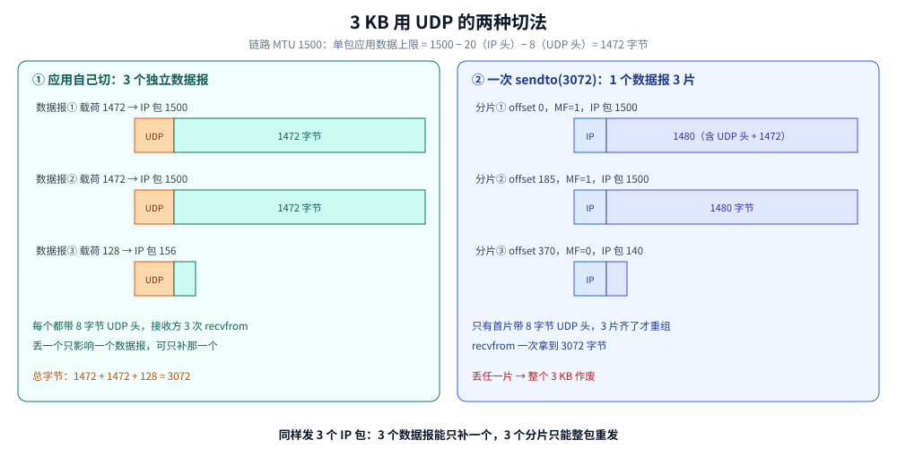
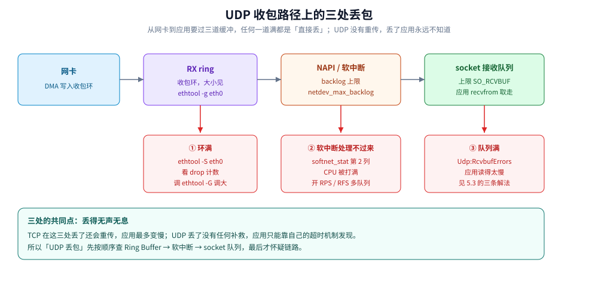
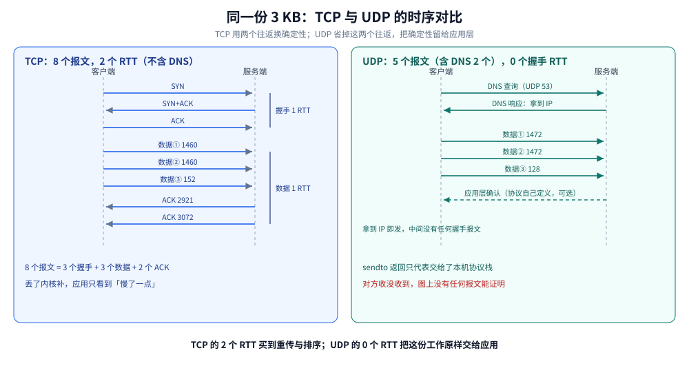

# 跨城传输全链路 UDP 篇

> 覆盖：把「3 KB 应用数据用 UDP 从杭州发到深圳」算成另一笔账——要不要握手、3 KB 是 3 个数据报还是 3 个 IP 分片、哪些环节和 TCP 篇完全一样、丢包乱序重复谁负责、NAT 与 LB 的会话各多久老化、源地址为什么能伪造与反射放大、没有窗口时缓冲满了怎么办（socket 队列、网卡 Ring Buffer 与发送侧的 qdisc / TX ring）、UDP 为什么也能 `connect()`、本地端口怎么被耗尽、NAT 映射重建后 connected socket 为什么收不到、一共几个包几个往返、什么场景才该选 UDP。
>
> 不覆盖：UDP 首部字段、校验和、三级长度上限与队列丢包的机制和实测见 [UDP与数据报传输.md](传输层/UDP与数据报传输.md)；同一趟账的 TCP 版本见 [跨城传输全链路-TCP篇.md](跨城传输全链路-TCP篇.md)；物理段与 OEO 估算、IP/MAC 逐跳改写、最后一跳解封装在 TCP 篇第三、五、十节；QUIC 如何在 UDP 上重造可靠性见 [QUIC与HTTP3.md](应用层/QUIC与HTTP3.md)。
>
> 内容整理自个人学习笔记。⚠️ **测算口径**：本篇的跨城数字（RTT、跳数、OEO 次数、丢包概率）按协议标准与公开拓扑推导，不是本机实测；分片数与计数器读数可自行复现，方法见 [UDP与数据报传输.md](传输层/UDP与数据报传输.md) 第五、六节。**例外是 9.4**：`connect()` 与端口耗尽的读数是容器实测（Linux 6.18、`golang:1.26-alpine`，端口范围用 `--sysctl` 压到 3 个），输出已在节内原样贴出。

---

## 一、出发前：UDP 需要先握手吗？

**本节要点**：不需要。UDP 没有握手，`socket()` 之后就能 `sendto`；但「对端 IP 怎么来」仍要先解析，除非你直接写死 IP。**无连接也不等于没状态**：NAT / LB 会为它记会话并各自超时，源地址也因此极易伪造。

### 1.1 时间顺序

```text
① DNS 解析：example.com → IP（走 UDP 53；缓存命中则 0 RTT）
② socket() + sendto()：直接发数据（建连 0 RTT）
③ 应用层确认（如果需要）：自己发请求 / 确认（至少 1 RTT）
```

⭐ 与 [跨城传输全链路-TCP篇.md](跨城传输全链路-TCP篇.md) 的第一处差别：这里**没有 SYN / SYN+ACK / ACK**，也**没有 MSS 协商**。第一个字节发出之前，网络里什么都没建立。

### 1.2 没有握手，也就没有「谈参数」

TCP 在 SYN 选项里谈 MSS、窗口缩放、SACK；UDP 一个都不谈。于是：

- 单个数据报能装多少，只能自己算：`路径 MTU − IP 首部 − 8`，链路 MTU 1500 时是 **1472**；
- 算错或懒得算，超出部分交给 **IP 分片**（见第二节）；
- 没有窗口通告，也就没有「对方能收多快」的概念。

### 1.3 无连接，但中间设备有状态

- 两端 socket 不维护序号、窗口、重传定时器；`sendto` 返回成功只代表**交给了本机协议栈**。
- **NAT 仍要为它建 conntrack 表项**（五元组），`conntrack -L -p udp` 看得见。超时比 TCP 短得多，且**链路上可能有多级设备各自计时**：

| 设备 | UDP 空闲超时（常见值） | 超时后的表现 |
|---|---|---|
| Linux conntrack（NAT 网关） | **30 秒**；有双向流量时约 **120 秒** | 回程包找不到映射，被丢弃 |
| 云厂商 LB / NAT 网关 | **10~30 秒**（各家不同，按控制台配置为准） | 映射表被删，回程包直接被丢 |
| 防火墙会话表 | 常见 30~120 秒 | 新包被当「非会话首包」丢弃或重放行 |

⭐ **心跳间隔要小于链路上最短的那个超时**，而不是你只在文档里看到的某一个值。一个 15 秒的 UDP 心跳在「NAT 30 秒 + LB 10 秒」的链路上照样断，而且**断的时候两端都收不到任何错误**——下一包发出去正常，回包却永远不来。

- NAT 侧的机制与观测见 [NAT与连接跟踪.md](网络层与寻址/NAT与连接跟踪.md)。

### 1.4 无连接的另一面：源地址可以伪造

**本节要点**：UDP 没有握手，**路由器不需要验证来源**就能转发——这是它便宜的原因，也是**反射放大攻击**的前提。

| 维度 | TCP（SYN Flood） | UDP（反射放大） |
|---|---|---|
| 伪造源 IP 的门槛 | 低：SYN 不需要完成握手 | 更低：**一个包就够**，连回程都不用管 |
| 攻击怎么放大 | 靠量：半开连接占满队列 | 靠**反射**：源 IP 写成受害者，查询发给第三方，**响应全砸向受害者** |
| 典型放大倍数 | 约 1:1（每个 SYN 换一个 SYN-ACK） | DNS 约 50 倍、NTP `monlist` 约 500 倍、开放 memcached 可达数万倍 |
| 受害者看到什么 | 建连超时、`ListenOverflows` 涨 | 带宽被打满；**自己从没发过这些查询** |

⭐ 这也解释了一条工程惯例：**机房防火墙对 UDP 限速极严，甚至直接封禁非标端口**。不是不信任你的业务，而是任何一个能对外发 UDP 的端口，都可能被拿去做放大器。

三道防线（原理与分层防护见 [Web攻击与防御.md](../../06-工程实践/安全/应用与数据安全/Web攻击与防御.md) 第八节）：

- **源头**：ISP 侧做反向路径过滤（BCP 38），伪造源地址出不了网；
- **反射器**：别开开放递归 DNS、关掉 NTP `monlist`、memcached 不暴露公网；
- **靶子**：Anycast + 清洗中心 + 按目的端口限速，应用层限流只能兜住最后一段。

## 二、3 KB 用 UDP 是几个包？

**本节要点**：看**谁切的**——应用自己切成 **3 个数据报**；一次 `sendto(3072)` 则是 **1 个数据报被 IP 分成 3 片**。两者都产生 3 个 IP 包，但失败代价完全不同。

### 2.1 应用自己切：3 个独立数据报

每条不超过 1472 字节：

```text
3072 = 1472 + 1472 + 128
       报①     报②    报③
```

| 数据报 | 载荷 | UDP 长度（含 8 字节头） | IP 包总长 | 以太网帧长 |
|---|---|---|---|---|
| ① | 1472 | 1480 | **1500** | 1518 |
| ② | 1472 | 1480 | **1500** | 1518 |
| ③ | 128 | 136 | 156 | 174 |

- 每个都有自己的 8 字节 UDP 首部，接收方 **3 次 `recvfrom`**，消息边界天然保留。
- 丢一个只影响那一个数据报，应用可以只补它。

### 2.2 一次 sendto(3072)：1 个数据报 3 片

UDP 长度 = 8 + 3072 = **3080** 字节，IP 层按 1480 字节一片切：

| 分片 | IP 载荷 | 片偏移 | MF | IP 包总长 | 以太网帧长 |
|---|---|---|---|---|---|
| ① | 1480（含 8 字节 UDP 头） | 0 | 1 | **1500** | 1518 |
| ② | 1480 | 185 | 1 | **1500** | 1518 |
| ③ | 120 | 370 | 0 | 140 | 158 |

- 只有第一片带 UDP 首部；接收方要等 3 片齐了才重组，`recvfrom` **一次**拿到 3072 字节。
- 丢任一片 → 整个数据报作废，应用只知道「没收到」，不知道丢在哪一片。

### 2.3 为什么工程上选第一种

- **丢包代价**：3 片里任一片丢失整包失败；3 个数据报丢一个只损失三分之一，还能只补那一个。
- **中间设备**：ACL、NAT、隧道对分片常有不友好行为，片数越多越容易踩坑。
- **协议设计**：QUIC 把初始数据报压在 1200 字节附近，就是为了避开分片，见 [QUIC与HTTP3.md](应用层/QUIC与HTTP3.md)。
- **隧道环境还要更低**：VXLAN 外封装吃掉 50 字节、IPsec 约 50~80 字节，路径 MTU 只剩 **1400 上下**；按 1500 算出来的 1472 到了隧道口照样超。TCP 侧同一件事（MSS 协商看不见隧道、PMTUD 黑洞）见 [跨城传输全链路-TCP篇.md](跨城传输全链路-TCP篇.md) 2.4。
- **别依赖 ICMP**：DPLPMTUD 是自己发探测包找出路径能过的最大尺寸，不指望中间设备回 `Packet Too Big`——防火墙一拦 ICMP，靠 PMTUD 的实现在隧道里就会被黑洞吞掉。
- 路径 MTU 怎么探（PMTUD / DPLPMTUD）见 [IP与路由基础.md](网络层与寻址/IP与路由基础.md) 第八节。



图怎么读：左边 3 个数据报各自带 8 字节 UDP 头，失败互不牵连；右边 1 个数据报被 IP 切成 3 片，只有首片带 UDP 头，任何一片丢失都会让整个 3 KB 作废。**同样发 3 个 IP 包，失败语义完全不同。**

## 三、同一条路上，哪些环节和 TCP 篇完全一样？

**本节要点**：从 IP 层往下没有区别——同样的 IP 寻址、逐跳 MAC 改写、光电转换次数、最后一跳解封装。**换掉的只有传输层那 20 字节首部，以及它背后的整套状态机。**

### 3.1 两个版本逐项对照

| 环节 | TCP 篇 | UDP 篇 |
|---|---|---|
| 传输层首部 | 20 字节（无选项） | **8 字节** |
| 单包应用数据上限 | MSS 1460 | 1472（不分片时） |
| 3 KB 怎么切 | 传输层切 3 段 | 应用切 3 个数据报，或 IP 切 3 片 |
| 建连 | 1 RTT | **0** |
| 有序 / 去重 / 重传 | 有 | 无 |
| 流控 / 拥塞控制 | 有 | 无 |
| 连接状态 | 两端 TCB + NAT conntrack | **只有 NAT conntrack** |
| 物理段 / OEO / IP 与 MAC | 相同 | 相同 |

### 3.2 相同的部分不重复

- 物理段、ONT/OLT/BRAS/OTN 与 OEO 估算：见 [跨城传输全链路-TCP篇.md](跨城传输全链路-TCP篇.md) 第三节；
- IP 与 MAC 的分工、逐跳改写、ARP/NDP：见 TCP 篇第五节；
- 最后一跳与逐层解封装：见 TCP 篇第十节。

### 3.3 传输层换掉之后，路上多了什么、少了什么

- **少了**：路由器与 NAT 不再需要理解序号和窗口，设备看到的只是「一个 UDP 五元组」。
- **少了**：没有握手报文，路径上的第一个包就是数据——**源地址伪造也因此更容易**，这是 UDP 反射放大攻击的前提。
- **多了**：没有拥塞控制，多条 UDP 流同时打满链路时，路由器队列先满先丢，可能挤掉同一链路上的 TCP 流。

## 四、丢了、乱了、重复了，谁负责？

**本节要点**：UDP 一概不管。要么应用自己补，要么换成 QUIC 这类「在 UDP 上重建可靠性」的协议。

### 4.1 三件事的归属

| 事件 | UDP 的行为 | 后果 | 谁来补 |
|---|---|---|---|
| 丢包 | 不确认、不重传 | 应用收不到，且不知道丢了哪个 | 应用超时重试 / QUIC |
| 乱序 | 不排序 | `recvfrom` 的顺序就是到达顺序 | 应用带序号自行重排 |
| 重复 | 不去重 | 同一份数据可能读到两次 | 应用幂等或按 ID 去重 |
| 损坏 | 16 位校验和 | 大概率检出并丢弃，检出不了的静默通过 | 应用层哈希 / 更强校验 |

### 4.2 3 KB 这个尺寸的丢包账

按单包丢失率 **1%** 估：

- 3 个独立数据报全部到达：`0.99³ ≈ 97.0%`；
- 1 个数据报分 3 片全部到达：同样约 **97.0%**，但失败时是整个 3 KB 作废，而不是少三分之一；
- UDP 不重传，应用层只能超时后**重发整份数据**。

⭐ 与 TCP 篇的区别：TCP 丢了会自己补（快速重传 / RTO），代价是多等至少一个往返；UDP 不补，代价是把这件事整个推给应用。

### 4.3 应用层补的三条纪律

- 重试必须**幂等**（带幂等键），否则超时重发可能扣两次款；
- 重试要**指数退避 + 抖动 + 上限**，避免下游过载时雪崩；
- 需要顺序就自己带**序号**，需要去重就自己带**唯一 ID**。

> ⚠️ 这三条在 [UDP与数据报传输.md](传输层/UDP与数据报传输.md) 第四节有完整展开。

## 五、没有窗口，接收缓冲满了怎么办？

**本节要点**：UDP 没有零窗口、没有窗口探测、没有背压——**队列满了直接丢，而且不通知发送方**。

### 5.1 与 TCP 的对照

| 情况 | TCP | UDP |
|---|---|---|
| 接收缓冲满 | 通告 `win = 0`，发送方停发并探测 | 直接丢弃，发送方继续发 |
| 发送方怎么知道 | 窗口更新 | 不知道，只能等应用层超时 |
| 乱序数据 | 进 ofo 队列，占用窗口 | 没有重组队列，一个数据报要么完整要么丢 |
| 重传 | 有 | 无 |

### 5.2 丢在哪、怎么看

- 接收队列受 `SO_RCVBUF` 限制，满了就丢，计数器是 `Udp:RcvbufErrors`；
- 发送侧缓冲满了是 `Udp:SndbufErrors`（`sendto` 可能阻塞或返回 `ENOBUFS`）；
- 3 KB 很小，单条流几乎不会撑满；但高并发下每个 socket 一个队列，聚合起来就会。

### 5.3 工程解法

- 增大接收缓冲（受 `net.core.rmem_max` 限制）；
- 应用读得足够快，或用多线程 / 多队列收；
- 协议层做限速与整形（令牌桶），别指望内核替你压住发送方；
- 监控 `RcvbufErrors`，它通常比「端到端丢包率」更早暴露问题。

### 5.4 更早的一层丢弃：网卡 Ring Buffer 与中断

**本节要点**：`RcvbufErrors` 只统计「到了 socket 却没被读走」。在这之前，包还可能死在**网卡的收包环（RX ring）**和**内核软中断队列**里——UDP 没有重传兜底，这些位置的丢包同样只有一个结果：**应用永远收不到**。

```text
网卡收到 → DMA 写入 RX ring ── 环满：丢（rx_dropped）
        → 硬中断 → NAPI 轮询 → 软中断 backlog ── 超 netdev_max_backlog：丢
        → 协议栈校验 → socket 接收队列 ── 超 SO_RCVBUF：丢（Udp:RcvbufErrors）
        → 应用 recvfrom
```

| 丢在哪 | 计数器 | 常见原因 | 先做什么 |
|---|---|---|---|
| RX ring | `ethtool -S eth0` 的 drop 项；`/proc/net/dev` 的 drop 列 | 环太小、突发流量、只有单队列 | `ethtool -G eth0 rx 4096` 调大；开 RSS 多队列 |
| 软中断 backlog | `/proc/net/softnet_stat` 第 2 列 | CPU 被打满，一个核处理不过来 | 开 RPS / RFS，把中断分散到多核 |
| socket 队列 | `Udp:RcvbufErrors` | 应用读得慢 | 见 5.3 |



这条路径解释了为什么「链路没丢包、应用却收不到」：三处缓冲各有自己的计数器，排查要按 RX ring → 软中断 → socket 队列的顺序走，最后才怀疑网络本身。

```bash
ethtool -g eth0                          # 看 RX/TX ring 当前值与上限
ethtool -S eth0 | grep -i drop           # 网卡侧丢弃
cat /proc/net/softnet_stat               # 第 2 列是 backlog 丢弃计数
```

> ⚠️ **未实测**：本机容器内没有 `ethtool`（`command -v ethtool` 为空），也无法稳定制造环满丢包；以上为 Linux 口径的排查命令。判据是**「CPU 高、流量不大、包在网卡就没了」——这时先查 Ring Buffer 与中断，而不是先怀疑网络**（对应 TCP 篇 12.4 分锅表的最后一行）。

### 5.5 发送侧同样会丢：qdisc 与 TX ring

**本节要点**：`sendto` 返回成功只代表字节进了本机发送缓冲。UDP 没有拥塞控制与 pacing，突发流量会直接撞上 qdisc 与 TX ring，**两处都是静默丢弃**，应用连 `RcvbufErrors` 那样的计数提示都拿不到。

发送路径与 TCP 完全同一条（见 [跨城传输全链路-TCP篇.md](跨城传输全链路-TCP篇.md) 2.5 的路径图），差别只在少了 `cwnd` / `rwnd` 两道闸门——TCP 会自己把速率压到链路能承受的水平，UDP 发多快全由应用决定。

| 关口 | UDP 侧的特有表现 | 计数器 / 命令 |
|---|---|---|
| socket 发送缓冲 | `sendto` 阻塞或返回 `ENOBUFS`（5.2） | `Udp:SndbufErrors`；`SO_SNDBUF` |
| qdisc | 突发被丢，应用无感 | `tc -s qdisc show dev eth0` 的 `dropped` / `overlimits` |
| TX ring | 网卡来不及发，直接丢 | `/proc/net/dev` 的 tx drop 列、`ethtool -S eth0` |

⭐ 为什么 UDP 更容易撞上：TCP 有 `cwnd` 与 pacing 帮你把发送速率压住；UDP 的「应用以为发了」与「网卡真的发了」之间没有任何反馈。做限速（令牌桶）不是优化项，而是防住这一类静默丢包的必要手段。

> ⚠️ 本节与 5.4 的计数器均**未在本机实测**（容器内没有 `ethtool`，也没有制造 qdisc / 环满），命令为 Linux 口径。

## 六、这一趟发了几个包、花了几个往返？

**本节要点**：不算 DNS 是 **3 个数据报**、**0 个握手 RTT**；但要确认「对方收到了」，得靠应用层，至少再 **1 个 RTT**。

### 6.1 报文清单（应用自己切、且要求确认）

| # | 报文 | 方向 | 说明 |
|---|---|---|---|
| 1 | DNS 查询 | 客户端 → DNS | UDP 53，结果可缓存 |
| 2 | DNS 响应 | DNS → 客户端 | 拿到 IP |
| 3 | 数据报① | 客户端 → 服务端 | 1472 字节 |
| 4 | 数据报② | 客户端 → 服务端 | 1472 字节 |
| 5 | 数据报③ | 客户端 → 服务端 | 128 字节 |
| 6 | 应用层确认（可选） | 服务端 → 客户端 | UDP 自己不发，协议要就得自己定义 |

### 6.2 往返账

| 阶段 | RTT | 说明 |
|---|---|---|
| DNS | 0~1 | 缓存命中为 0 |
| 建连 | **0** | 没有握手 |
| 发送 | 0 | `sendto` 返回即交给协议栈 |
| 确认 | 1（如果应用要） | 只有应用层知道到没到 |

⭐ 应用层确认要确认到**处理成功**，而不是「收到数据报」：`recvfrom` 成功只说明这个数据报完整到了；要证明业务处理完成，确认里得带请求 ID 与处理结果。这与 TCP 篇 10.4 的三层确认是同一件事（TCP 的 ACK 也只到对端内核）。

### 6.3 与 TCP 篇的数字对照

| 指标 | TCP 篇 | UDP 篇 |
|---|---|---|
| 最少报文 | 8 | **5**（含 DNS 2 个） |
| 握手 RTT | 1 | **0** |
| 数据 RTT | 1 | 0（发完即走） |
| 完成确认 | TCP ACK | 应用层自定义 |
| 丢包恢复 | 内核重传 | 应用重传 |



图怎么读：左边 TCP 先花一个往返建连、再花一个往返等确认；右边 UDP 拿到 IP 就直接发，三个数据报之间没有等待，但「对方到底收没收到」图上没有任何报文能证明——这正是它把可靠性推给应用的意思。

## 七、什么时候该用 UDP 而不是 TCP？

**本节要点**：判据不是「UDP 更快」，而是**能不能接受丢包、愿不愿意自己管可靠性**。

### 7.1 决策表

| 你的需求 | 选择 | 理由 |
|---|---|---|
| 一条都不能丢、顺序敏感、想少写代码 | **TCP** | 重传、排序、流控都是现成的 |
| 丢一点没关系、延迟优先 | **UDP** | 省掉握手，也没有队头阻塞 |
| 既要低延迟又要可靠 | **QUIC**（跑在 UDP 上） | 在用户态重建可靠性，绕开 TCP 的队头阻塞 |
| 局域网 / 回环、丢包率极低 | UDP 也常够用 | 但协议仍要能容忍偶发丢包 |
| 跨城大流量、长时间传输 | **TCP** | 裸 UDP 没有拥塞控制，会挤爆链路 |

### 7.2 三个常见误区

- **「UDP 比 TCP 快」** → 省的是握手与重传等待，不是带宽；跨城大流量用裸 UDP，反而会把链路和中间设备打崩。
- **「UDP 不会粘包」** → 对，消息边界天然存在；但一次 `recvfrom` 的缓冲小于数据报时会被**截断**（`MSG_TRUNC`），读到的不是完整消息。
- **「无连接所以 NAT 不管」** → 错，conntrack 有表项且超时短，长间隔的 UDP 心跳照样会被 NAT 静默丢弃。

## 八、应用场景

**本节要点**：选 UDP 的场合几乎都满足两条——**迟到比丢失更糟**，且**应用已经准备好自己兜底**。

| 场景 | 为什么用 UDP | 可靠性谁来补 |
|---|---|---|
| DNS / DHCP / NTP | 一问一答、包小、重发便宜 | 应用自己超时重试 |
| 音视频（RTP / WebRTC） | 迟到的包没用，宁可丢 | 编码器容错 + FEC + NACK |
| HTTP/3（QUIC） | 避免 TCP 队头阻塞、支持 0-RTT | QUIC 自己实现重传与拥塞控制 |
| 游戏状态同步 | 高频小包，旧状态可直接覆盖 | 应用层快照覆盖 |
| VXLAN / Geneve / WireGuard | 隧道封装，不想再套一层可靠传输 | 由内层协议负责 |
| mDNS / 局域网服务发现 | 广播 / 组播 | 周期重发 |

## 九、具体使用

**本节要点**：先看队列与计数器，再抓包确认；UDP 的问题大多不是「网络丢」，而是「应用没读」。

### 9.1 看 UDP socket 与队列

```bash
ss -uanp                          # 所有 UDP socket 与进程
ss -uanp sport = :53              # 只看 53 端口
```

### 9.2 看丢包计数

```bash
nstat -az | grep -i '^Udp'
cat /proc/net/snmp | grep -i '^Udp'
```

| 计数器 | 含义 |
|---|---|
| `UdpInDatagrams` | 成功交付给应用的数据报数 |
| `UdpNoPorts` | 目的端口没有监听（会回 ICMP 端口不可达） |
| `UdpInErrors` | 收包错误总数 |
| `UdpRcvbufErrors` | 接收队列满导致的丢弃 |
| `UdpSndbufErrors` | 发送缓冲满导致的丢弃 |
| `UdpInCsumErrors` | 校验和错误 |

### 9.3 抓包与压测

```bash
sudo tcpdump -i any -nn 'udp port 53'
iperf3 -u -b 100M -t 10 -c <目标IP>
```

> ⚠️ 本机没有 `tcpdump` / `iperf3`，以上为 Linux 口径命令，**未实测**；Windows 可用 `pktmon`，见 [抓包实战.md](观测与排障/抓包实战.md)。

### 9.4 UDP 也可以 connect()：不握手，但绑定了对端

**本节要点**：UDP 的 `connect()` **不发任何报文**，只在内核里记下对端地址；换来两件事——可以用 `send` / `recv`，以及**能收到 ICMP 端口不可达**。

| 用法 | 每条消息要带目的地址 | 收到 ICMP 端口不可达时 |
|---|---|---|
| 未 connect（`sendto`） | 要 | ⭐ **内核不知道该通知哪个 socket，直接丢弃** |
| connect 后（`send`） | 不用 | 回传给这个 socket，读操作报 `connection refused` |

- 代价是**只能收这个对端的包**；要收任意来源，必须用未连接的 socket。
- Go 里 `net.DialUDP` 就是 connect，`net.ListenUDP` + `WriteToUDP` 是未连接；C 里是 `connect()` + `send()`。

```go
package main

import (
	"fmt"
	"net"
	"time"
)

func main() {
	dst := &net.UDPAddr{IP: net.IPv4(127, 0, 0, 1), Port: 19999} // 无监听
	buf := make([]byte, 64)

	u, _ := net.ListenUDP("udp", &net.UDPAddr{IP: net.IPv4(127, 0, 0, 1)})
	u.WriteToUDP([]byte("ping"), dst)
	u.SetReadDeadline(time.Now().Add(300 * time.Millisecond))
	_, _, err := u.ReadFromUDP(buf)
	fmt.Println("未 connect：", err)

	c, _ := net.DialUDP("udp", nil, dst)
	c.Write([]byte("ping"))
	c.SetReadDeadline(time.Now().Add(300 * time.Millisecond))
	_, err = c.Read(buf)
	fmt.Println("connect 后：", err)
}
```

实测输出（`golang:1.26-alpine`，内核 6.18，读超时设 300 ms）：

```text
未 connect： read udp 127.0.0.1:32770: i/o timeout
connect 后： read udp 127.0.0.1:32768->127.0.0.1:19999: read: connection refused
```

⭐ 两条结论：`sendto` / `send` 返回成功只代表**本机协议栈收下了**；**只有 connect 过的 socket 才能把对端的 ICMP 错误交回应用**，未连接的 socket 只会一直等到超时。

⭐ **端口耗尽**：每个 connected socket 占一个本地临时端口，向大量不同目标发包时会被耗光。把 `net.ipv4.ip_local_port_range` 压到 `32768 32770`（3 个端口）后实测：

```text
成功建立 connected UDP socket：3 个
第 4 个 connected socket 失败：dial udp 127.0.0.5:53: connect: resource temporarily unavailable
```

⚠️ `resource temporarily unavailable` 是 **EAGAIN**；不同内核与连接方式也可能报 `EADDRNOTAVAIL`。处置：复用 socket、复用目的地址、调大 `net.ipv4.ip_local_port_range`，或改回「一个未连接 socket + `WriteTo`」（不额外占端口）。

⭐ **NAT 映射会重建**：UDP 的 conntrack 表项超时后，同一个应用再发包可能被分配**新的源端口**。服务端若用 connected socket，它只接受原来那个五元组，新源端口的包会被内核按「非对端」直接丢弃——**两端都收不到任何错误**。QUIC 因此不靠五元组、而靠 **Connection ID** 识别连接。实践上：心跳要短于最短超时（本篇 1.3），服务端尽量用未连接 socket，或按五元组重建会话状态。

### 9.5 两篇之间怎么分锅

同一句「卡 / 慢」，TCP 与 UDP 的第一嫌疑不同。这张表放在 TCP 篇的末尾，两篇共用：[跨城传输全链路-TCP篇.md](跨城传输全链路-TCP篇.md) 12.4。UDP 侧对应的细节分别是本篇 1.3（会话老化）、2.2（分片被丢）、5.1 / 5.4 / 5.5（接收缓冲、Ring Buffer 与发送侧）。

## 延伸追问

- **UDP 会不会粘包？** → 不会，一个数据报就是一条消息；但 `recvfrom` 的缓冲区小于数据报时会截断，需要设 `MSG_TRUNC` 判断。
- **一次 sendto(3072) 是几个包？** → IP 层切成 3 片，仍是 **1 个数据报**；应用自己切则是 3 个数据报。
- **没有握手，怎么知道对方端口开着？** → 发出去时不知道；对端没监听通常回 ICMP 端口不可达（计入 `UdpNoPorts`），但 ICMP 常被防火墙拦。
- **UDP 校验和能保证数据正确吗？** → 只能发现错误，不能恢复；IPv4 允许填 0 关闭校验，IPv6 强制计算。
- **为什么 QUIC 要在 UDP 上重造可靠性，不直接用 TCP？** → TCP 的队头阻塞在内核里，且中间设备对 TCP 选项僵化；用户态实现能快速演进并避开这两点。
- **UDP 会不会把网络打崩？** → 会。它没有拥塞控制，多流并发送时只能靠应用层限速，否则丢包与重传会互相放大。
- **长连接心跳为什么要小于 NAT 超时？** → conntrack 的 UDP 表项常见 30 秒（双向流量下约 120 秒），超时后回包被丢，两边都以为连接还在。
- **链路上有 LB，UDP 也会断吗？** → 会。云 LB 的 UDP 空闲超时常见 10~30 秒，比 NAT 更短，而且要按**链路上最短的那个超时**设心跳。
- **为什么机房封 UDP 非标端口？** → 无连接意味着源 IP 可伪造，任何能对外发 UDP 的端口都可能被拿去做反射放大（DNS 约 50 倍、NTP 约 500 倍）。
- **UDP connect 之后还能收到别的来源的包吗？** → 不能，内核只交付来自该对端的包；要收任意来源必须用未连接的 socket。
- **为什么未连接的 UDP 收不到「端口不可达」？** → 内核不知道把 ICMP 错误归给哪个 socket，只能丢弃；connect 之后五元组确定，错误才有归属。
- **本地端口耗尽报什么错？** → 实测是 `connect: resource temporarily unavailable`（EAGAIN），不同内核也可能报 `EADDRNOTAVAIL`；每个 connected socket 占一个临时端口。
- **UDP 丢包一定是网络问题吗？** → 不一定。接收路径上有三处会丢：RX ring、软中断 backlog、socket 队列；后两处的排查命令见 5.4。
- **`sendto` 返回成功，数据就发出去了吗？** → 不是。只进了本机发送缓冲；qdisc 与 TX ring 还会静默丢弃，UDP 没有任何提示，只能靠 `Udp:SndbufErrors` 与 `tx_dropped` 排查。
- **NAT 映射重建后，connected socket 还收得到吗？** → 服务端收不到：客户端源端口变了，内核按「非对端」丢弃；QUIC 用 Connection ID 而不是五元组识别连接。
- **UDP 的发送队列满了看什么？** → `Udp:SndbufErrors`；再往下是 qdisc 的 `dropped` / `overlimits` 与网卡的 `tx_dropped`，见 5.5。

## 关联

- **上游/总纲**：[网络分层与数据包旅程.md](网络分层与数据包旅程.md) — 五层模型与逐层封装，本篇的「纵向」前提
- **上游/总纲**：[网络通信链路详解.md](网络通信链路详解.md) — 13 步端到端时序与逐跳改写，本篇的「横向」前提
- **对照/互补**：[跨城传输全链路-TCP篇.md](跨城传输全链路-TCP篇.md) — 同一趟 3 KB 的 TCP 版本：握手、MSS、重传与窗口
- **对照/互补**：[传输层/UDP与数据报传输.md](传输层/UDP与数据报传输.md) — 首部字段、校验和、三级长度上限与队列丢包的机制和实测
- **对照/互补**：[传输层/tcp/TCP报文结构.md](传输层/tcp/TCP报文结构.md) — 对照 20 字节首部里的序号与确认号
- **下游机制**：[应用层/QUIC与HTTP3.md](应用层/QUIC与HTTP3.md) — 在 UDP 之上重建可靠性与拥塞控制
- **下游机制**：[网络层与寻址/IP与路由基础.md](网络层与寻址/IP与路由基础.md) — MTU、IP 分片与 PMTUD
- **对照/互补**：[网络层与寻址/NAT与连接跟踪.md](网络层与寻址/NAT与连接跟踪.md) — UDP 的 conntrack 表项与超时
- **安全/防护**：[Web攻击与防御.md](../../06-工程实践/安全/应用与数据安全/Web攻击与防御.md) — DDoS 与反射放大的分层防护
- **运维/观测**：[观测与排障/抓包实战.md](观测与排障/抓包实战.md) — 在哪抓、怎么读、三类假象
