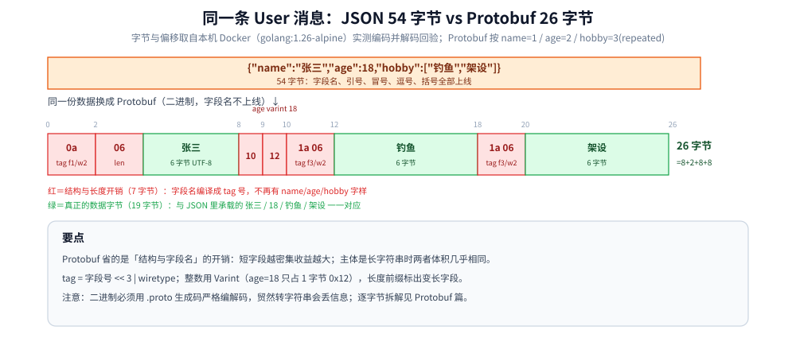

# 数据序列化

> 覆盖：JSON 与 Protobuf 的横向对比与格式选型 —— 四个维度、性能实测怎么读、「零安装」不等于「零成本」，以及一条判据决定这条数据该用谁。
>
> 不覆盖：Protobuf 的本体（逐字节拆解、字段标识与 `reserved`、schema 演进兼容矩阵、`buf` 门禁、Go / Java 对照代码）见 [Protobuf.md](../../../03-数据与中间件/中间件/RPC框架/gRPC/Protobuf.md)；协议层选型见 [通信选型.md](通信选型.md)；字节流边界见 [TCP协议基础与报文结构.md](../传输层/tcp/TCP协议基础与报文结构.md)。
>
> 内容整理自个人学习笔记，素材见 [素材清单](../../../素材清单.md)。
>
> ⚠️ 实测口径：1.3 的体积与速度对照为**本机 Go 实测**（`encoding/json` 与 `google.golang.org/protobuf`）；⚠️ **未实测** Java 侧与 `protoc` 代码生成（本机未装 `protoc`）。

---

## 一、JSON 与 Protobuf 有什么区别？

**本节要点**：多数人"知道有区别但说不清"。**四个维度答全 + 能给出实测数据**就足够出彩。

### 1.1 四个必答维度

| # | 维度 | **JSON** | **Protobuf** |
|---|---|---|---|
| **①** | **数据格式** | 基于键值对的**文本格式**，**肉眼可读** | **二进制格式**，**肉眼读不出来** |
| **②** | **是否需要预定义消息** | **不需要**，直接用 struct + tag | **必须先定义消息协议**（`.proto` 文件），再生成代码 |
| **③** | **工具与生态** | **无需额外安装**，几乎所有语言都有内置或第三方 JSON 库 | **必须安装 protoc 编译器**，某些语言还需**额外安装插件**（Go 要装 go 插件），并配置 PATH 环境变量 |
| **④** | **应用场景** | 性能要求**不高**的场景，如 **Web API 的请求响应** | 性能要求**高**的场景，如**微服务之间通讯**；也适合**弱网环境**（体积小） |

### 1.2 数据格式：文本 vs 二进制

**JSON 序列化后的样子**（无损，反而增加大量辅助符号）：

```json
{"name":"张三","age":18,"hobby":["钓鱼","架设"]}
```

规则：字段之间用**逗号**分隔，字段名用**双引号**包裹，字段名与值之间用**冒号**，
字符串值用**双引号**，数组用**中括号**。
→ **JSON 对数据是无损的**：它不做任何压缩，反而添加了很多组织格式的辅助符号。

**Protobuf 是二进制的**，从字节流里**很难看出任何内容**。

把上面这条 `User` 消息按 `.proto` 里的字段号（`name = 1`、`age = 2`、`hobby = 3`，repeated）真的编码一遍：
每条字段先写一个 **key 字节**（`tag = 字段号 << 3 | wire type`），定界类型（wire type 2）再补一个**长度 varint**，
整数（wire type 0）直接用 **varint** 让小值只占一字节。本机 Docker（`golang:1.26-alpine`）用官方
`protowire` 编码并原样解码回验，与纯标准库手工 varint 编码逐字节一致，共 26 字节：

| 偏移 | 字节 | 含义 |
|---|---|---|
| 0–1 | `0a 06` | 字段 1（`name`），wire 2 定界，载荷长度 6 |
| 2–7 | `e5 bc a0 e4 b8 89` | `张三`（UTF-8 各 3 字节，Protobuf 不压缩字符本身）|
| 8–9 | `10 12` | 字段 2（`age`），wire 0 varint，值 18 只占 1 字节 `0x12` |
| 10–17 | `1a 06 e9 92 93 e9 b1 bc` | 字段 3（`hobby`）第 1 条：`钓鱼` |
| 18–25 | `1a 06 e6 9e b6 e8 ae be` | 字段 3 第 2 条：`架设`——`repeated string` 每个元素一条 key，数组本身零开销 |

按字节数拆开就是 `8 + 2 + 8 + 8 = 26`：其中**结构与长度开销只有 7 字节**（`0a 06`、`10`、两个 `1a 06`），
**数据本身 19 字节**（`张三` / `18` / `钓鱼` / `架设`），与 JSON 里承载的内容一一对应——
JSON 那 54 字节里多出来的，正是字段名、引号、冒号、逗号和中括号。



（本块只做横向体积对照；varint 的逐位拆法、wire type 全表与迷你 `decode_raw` 见
[Protobuf.md](../../../03-数据与中间件/中间件/RPC框架/gRPC/Protobuf.md) 第二节。）

⚠️ **一个重要的坑**：**贸然把 Protobuf 的序列化结果直接转成字符串会丢信息** ——
演示中出现了莫名的空行、`age` 字段不见了（被转成了换行符等空白字符）。
**原因**：Protobuf 的序列化和反序列化**必须通过 `.proto` 生成的代码（如 `user.pb.go`）严格进行**，
绕过它自己转字符串，结果不可预期。逐字节拆解与正规的排障手段见
[Protobuf.md](../../../03-数据与中间件/中间件/RPC框架/gRPC/Protobuf.md) 使用一、使用三「排障」。

### 1.3 性能实测：体积约一半、速度 2.5~3.5 倍

**测试方式**：同一份 `User` 消息，分别用 JSON 和 Protobuf 做一次**序列化 + 一次反序列化**，
用 Go 的 `go test -bench` 对比。

| 指标 | **JSON** | **Protobuf** | 差异 |
|---|---|---|---|
| **序列化后体积** | **54 字节** | **26 字节** | Protobuf **不到 JSON 的一半** |
| **序列化+反序列化耗时** | **1278 ns/op** | **373.1 ns/op** | **Protobuf 约为 JSON 的 3 倍性能** |

本机按同一份消息重跑一遍（`-benchtime 2s -count 5`，一次「序列化 + 反序列化」算 1 op）：

| 指标 | 上面那组 | **本机复现** | 该怎么记 |
|---|---|---|---|
| 序列化体积 | 26 / 54 | **26 / 54** | 完全一致：**不到一半** |
| 耗时（Protobuf / JSON） | 373.1 / 1278 ns | **≈922–1164 / ≈2778–2821 ns** | 比值 **2.4~3.0 倍**，上面那组是 3.4 倍 |
| B/op | 未给 | **296 / 496** | JSON 多分配 ~68% |
| allocs/op | 未给 | **8 / 14** | JSON 近两倍分配次数 |

**结论（两条一起说才完整）**：
1. **体积小** → 同样的信息量**传输的数据更少、更快**，这就是弱网环境也能用的原因；
2. **性能高** → 序列化/反序列化快约 3 倍，所以适合高性能场景（微服务通讯）。

> ⚠️ **绝对值不要背** —— ns 跟 CPU 型号、Go 版本、消息大小强相关（同一台机器两次跑就差 20%）。
> **要背的是三条关系**：① 体积约一半；② 速度 2.5~3.5 倍；③ JSON 分配次数明显更多（反射 + 中间结构）。
>
> 两个容易被追问打穿的边界：
> - **消息里只有一个 `int32`** → Protobuf 2 字节，JSON `{"n":1}` 7 字节，差距**比 54/26 更大**；
> - **消息主体是很长的字符串** → 两者体积**几乎相同**（字符串本身占大头）。
>   所以准确说法是：**Protobuf 省的是"结构与字段名"的开销，短字段越多、字段越密集，收益越大。**

### 1.4 四个维度的速记

```text
① 数据格式：JSON 文本可读 / Protobuf 二进制不可读
② 工具支持：JSON 零安装 / Protobuf 需装 protoc + 插件 + 配环境变量
③ 是否需预定义：JSON 不需要 / Protobuf 必须先写 .proto 再生成代码
④ 应用场景：JSON 用于 Web API 等普通场景 / Protobuf 用于微服务等高性能场景
⑤ 补充实测：体积约 1/2，性能约 2.5~3.5 倍
```

### 1.5 边界实测：省下来的是一个常数，不是一个比例

**本节要点**：把上面那两个边界真的编一遍，得到的结论比"约一半"更可用——**Protobuf 省下的字节数几乎恒定（8~9 字节量级），省不掉的是载荷本身**。

本机把同一份数据按八种形态各编码一次（`encoding/json` 与官方 `protowire`，字段号沿用 `name = 1`、`age = 2`、`hobby = 3`，与前面那张偏移表同源；字节数是确定性编码，与时序无关，不存在波动）：

| 消息形态 | JSON | Protobuf | 差值 | 该怎么读 |
|---|---|---|---|---|
| 单个 `int32`，值 1 | **7 字节** `{"n":1}` | **2 字节** `08 01` | **−5** | 全是结构与符号开销 |
| 同一字段，值 127 / 128 / 300 | **9 / 9 / 9** | **2 / 3 / 3**（`08 7f` / `08 80 01` / `08 ac 02`） | −7 / −6 / −6 | JSON 随十进制位数增长，varint 每 7 位进一位 |
| 一个字符串，字段名 1 字符 | **14** `{"n":"张三"}` | **8** `0a 06 …` | −6 | 值不变，只把字段名换成 4 字符 ↓ |
| 同一个值，字段名 4 字符 | **17** `{"name":"张三"}` | **8** | −9 | JSON **多出 3 字节**，Protobuf **一动不动** |
| 8 个短字段（`a`~`h` 全为 1） | **49** | **16** `08 01 10 01 18 01 20 01 28 01 30 01 38 01 40 01` | **−33** | 字段越密、名越短，收益越大 |
| 一条 `User`（前面那条基线） | **54** | **26** | −28 | 54/26 只是这一行的比值，不是普遍规律 |
| 载荷 200 字节的长字符串 | **211** | **203** | **−8** | 差距已经很小 |
| 载荷 1000 字节的长字符串 | **1011** | **1003** | **−8** | 比值 **0.9921**，几乎相同 |
| `age = 0` 且 `hobby` 为空数组 | **36** `{"name":"张三","age":0,"hobby":[]}` | **8** `0a 06 e5 bc a0 e4 b8 89` | −28 | proto3 的零值标量与空数组**整条不上线** |

同一份载荷取五个长度（0 / 10 / 100 / 200 / 1000 字节）时，两者的比值随载荷迅速衰减：
**0.1818 → 0.5714 → 0.9189 → 0.9621 → 0.9921**，而差值始终是 **9、9、9、8、8 字节**
（长度 varint 在 128 那里多占一字节，所以差值从 9 变成 8）。


怎么读这张图：**八组柱用同一个比例尺（每字节等比）**，所以柱长可以直接比；
柱端的数字就是实测字节数，未做任何换算。上半区（单个整数、短字段密集、零值省略）JSON 明显更长，
下半区（载荷 200 / 1000 字节的长字符串）两根柱几乎一样长——
**"体积不到一半"只在字段名与符号占大头的短消息上成立**，载荷一长，省的只是那点固定开销。
读数出处：本机 Docker 容器里用 `encoding/json`（标准库）与
`google.golang.org/protobuf` 的 `protowire` 各编码一次，取输出的长度列；
字节数为确定性编码，未涉及时序波动。

> 口径补齐：上面这些是**同一份数据换形态**的对照；varint 逐位拆法、wire type 全表、
> 字段号 1~15 用 1 字节 key（16 起 2 字节、2048 起 3 字节）这类**编码规则本身**，
> 仍以 [Protobuf.md](../../../03-数据与中间件/中间件/RPC框架/gRPC/Protobuf.md) 第二节为准，本篇不重复。

---

## 二、什么时候选 JSON、什么时候选 Protobuf？

**本节要点**：两者的成本**不在同一处** —— 选型不是比谁快，是比哪种成本你更付得起。

### 2.1 成本落在不同地方

| | JSON | Protobuf |
|---|---|---|
| **成本落在哪** | **运行期与精度**：多一倍分配、int64 给前端丢精度、`NaN` 传不了 | **工程与纪律**：工具链、schema 演进、`reserved` 与 CI 门禁 |
| **省下来的是什么** | 省**工具链与心智**：零安装，任何人 curl / DevTools 都能读能改 | 省**带宽与 CPU**：不传字段名、整数 varint、生成码无反射 |
| **出错的样子** | **运行期**才报（精度悄悄丢、字段莫名没了） | **编译期**就报（字段对不上、复用 reserved 号直接编不过） |

JSON 侧那五个坑（int64 精度 / 非导出字段被静默跳过 / 零值分不出"没填" /
反解到 `any` 全是 `float64` / `NaN` 编码报错）连同正解，都在
[Protobuf.md](../../../03-数据与中间件/中间件/RPC框架/gRPC/Protobuf.md) 使用一「JSON 侧的五个坑」，
那里还有一张「五坑 ↔ Protobuf 怎么办」的对照表。

### 2.2 什么时候**不要**用 Protobuf

| 场景 | 选择 | 原因 |
|---|---|---|
| 对外开放 API、第三方要长期存报文 | **JSON** | 对方不该为了读你的数据而拿到并维护 `.proto` |
| 浏览器直连、前端自己拼 / 看 | **JSON** | 原生 `fetch` + DevTools 直接可读；Protobuf 要 `protojson` 或 JS 生成码 |
| 结构运行时才知道（`map[string]any`、动态表单） | **JSON** | Protobuf 必须有 schema；`google.protobuf.Struct` 能绕但体积 / 性能优势就没了 |
| 需要人工在日志 / DB 里直接读报文 | **JSON**（或二进制 + 文本双写） | 转字符串丢字段那个坑就是代价 |
| 微服务之间高频调用、gRPC、弱网 / 移动端 | **Protobuf** | 上面两个实测结论：体积小一半、快 3 倍 |
| 事件溯源 / 消息队列里要存很久的历史 | **Protobuf（带 schema registry）** | `reserved` + 兼容性检查正好治"字段漂移"，但纪律要落到 CI |

⭐ **一条判据（两者都适用）**：**这条数据的读端，是否愿意也持有一份 schema。**
愿意 → Protobuf 的收益（体积、速度、编译期校验）能兑现；
不愿意（第三方开发者、浏览器直连、结构运行时才知道）→ 老老实实 JSON。

> **诚实的补一句**：Protobuf 只解决"格式与类型"，它**不解决语义** ——
> 字段删了不加 `reserved` 会**静默错乱**、proto3 默认标量有零值语义、
> JSON 兼容层（`protojson`）反而比 `encoding/json` 更啰嗦。
> 所以"用 Protobuf 就安全了"是错的，**"schema 有纪律 + 变更有门禁"才安全**。

---

## 三、应用场景

**本节要点**：序列化格式的选择落在「接口边界」上 —— 对外还是对内、可读还是紧凑。

| 场景 | 用哪个 | 为什么值得注意 |
|---|---|---|
| 对外 Web API | JSON | 通用、零安装、可读，详见 本篇 2.1 |
| 服务间 RPC | Protobuf | 体积与速度更优、`.proto` 即契约，详见 [HTTP与gRPC.md](../应用层/HTTP与gRPC.md) |
| 日志 / 埋点 | JSON（行式） | 可读性优先，下游解析成本低 |
| 浏览器直连 | JSON | 浏览器不原生支持 Protobuf，详见 [通信选型.md](通信选型.md) |
| 大 payload 传输 | 先序列化再压缩 | 压缩是下一步，详见 [压缩算法.md](../../算法/压缩算法.md) |
| 编解码缓冲复用 | 切片共享 / `bytes.Buffer` | 编解码里的拷贝，详见 [切片.md](../../../01-编程语言/go/类型与语法/切片.md) |

## 四、具体使用

**本节要点**：选型的落地动作只有两件 —— 看清两边的编解码代价，再按「零安装 vs 强类型」分场景。

| 维度 | JSON | Protobuf |
|---|---|---|
| 生成代码 | 不需要，直接用 | 需要 `protoc` + 语言插件 |
| 可读性 | 文本，人可读 | 二进制，需工具解码 |
| 体积 / 速度 | 基线 | 约 1/2 体积、2.5~3.5 倍速度（本机实测，见 1.3） |
| 契约 | 靠文档约定 | `.proto` 即契约 |

```bash
# Protobuf 侧的最小流程（需要 protoc 与语言插件；⚠️ 本机未装 protoc，未实测）
protoc --go_out=. --go_opt=paths=source_relative demo.proto
protoc --java_out=src/main/java demo.proto
```

```go
// JSON 侧零安装：标准库直接编解码
data, _ := json.Marshal(v)
_ = json.Unmarshal(data, &v)
```

⭐ 判据：**对外接口用 JSON、内部 RPC 用 Protobuf**；真换了格式，传输层与连接模型都不用动（可复现的做法见 [不使用protoc的gRPC.md](../../../01-编程语言/go/网络编程/不使用protoc的gRPC.md)）。

## 延伸追问

- **Protobuf 为什么体积小？** → **字段只传编号不传字段名**（`name`/`age` 这些名字在编译期就固定为 tag 号），
  且用 **Varint 变长编码**压缩整数，没有 JSON 那些引号、冒号、逗号。逐字节拆解见
  [Protobuf.md](../../../03-数据与中间件/中间件/RPC框架/gRPC/Protobuf.md) 使用一。
- **Protobuf 的缺点？** → **可读性差**（排障要额外工具）、
  **schema 变更需谨慎**（字段号不能随意复用）、前端直接处理的生态不如 JSON。
- **为什么说 Protobuf 适合弱网？** → 报文小 → 同样的带宽能传更多数据、
  更不容易被分片，**在丢包和低带宽环境下优势明显**。
- **gRPC 和 Protobuf 的关系？** → Protobuf 是**序列化格式**（也可用于定义服务），
  gRPC 是**基于 HTTP/2 的 RPC 框架**，默认用 Protobuf 做序列化，两者经常一起出现但不是一回事。
- **Protobuf 相比 JSON 的额外成本有哪些？** → 需装 protoc + 插件、需维护 `.proto`、
  可读性差、字段标识管理需要纪律（`reserved`）；纪律怎么落到 CI 见
  [Protobuf.md](../../../03-数据与中间件/中间件/RPC框架/gRPC/Protobuf.md) 使用三。
- **改字段名算不算不兼容变更？** → 二进制层无感，但 `protojson` 输出、反射代码、
  调用方源码都会受影响 —— 所以 `buf breaking` 的 `FILE` 档连改名都拦。
  完整矩阵见 [Protobuf.md](../../../03-数据与中间件/中间件/RPC框架/gRPC/Protobuf.md) 第三节。

## 关联

- **上游/总纲**：[通信选型.md](通信选型.md) — 序列化格式的横向选型（Protobuf / Thrift / MessagePack / Avro / FlatBuffers）
- **对照/互补**：[HTTP与gRPC.md](../应用层/HTTP与gRPC.md) — gRPC 默认用 Protobuf 作为载荷
- **对照/互补**：[TCP协议基础与报文结构.md](../传输层/tcp/TCP协议基础与报文结构.md) — 字节流没有边界，长度前缀是解法之一
- **下游机制**：[Protobuf.md](../../../03-数据与中间件/中间件/RPC框架/gRPC/Protobuf.md) — Protobuf 本体：逐字节编码、`reserved` 纪律、`buf` 门禁与排障
- **下游机制**：[压缩算法.md](../../算法/压缩算法.md) — 序列化之后的下一步：要不要压缩
- **对照/互补**：[切片.md](../../../01-编程语言/go/类型与语法/切片.md) — 编解码里的缓冲复用与拷贝
- **实验**：[不使用protoc的gRPC.md](../../../01-编程语言/go/网络编程/不使用protoc的gRPC.md) — 把「换个 codec」当成一次真实验：JSON 走 gRPC，传输层完全不变

> 反向引用（本篇被下列文档引到）：[net包与TCP-UDP编程.md](../../../01-编程语言/go/网络编程/net包与TCP-UDP编程.md)、[从零实现网关.md](../../../01-编程语言/go/网络编程/从零实现网关.md)、[接入gRPC.md](../../../01-编程语言/java/工程实践/接入gRPC.md)、[TCP的Nagle与延迟确认.md](../传输层/tcp/TCP的Nagle与延迟确认.md)、[HTTP1.1与HTTP2的区别.md](../应用层/HTTP1.1与HTTP2的区别.md)、[RPC框架选型对比.md](../../../03-数据与中间件/中间件/RPC框架/RPC框架选型对比.md)、[gRPC-Web与Connect.md](../../../03-数据与中间件/中间件/RPC框架/gRPC/gRPC-Web与Connect.md)、[基础概念.md](../../../03-数据与中间件/中间件/RPC框架/gRPC/基础概念.md)、[性能与调优.md](../../../03-数据与中间件/中间件/RPC框架/gRPC/性能与调优.md)、[拦截器与元数据.md](../../../03-数据与中间件/中间件/RPC框架/gRPC/拦截器与元数据.md)
