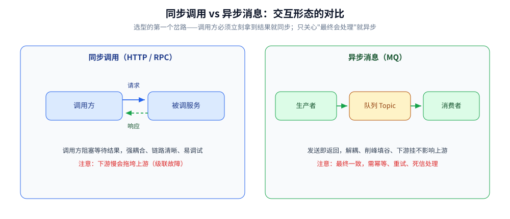
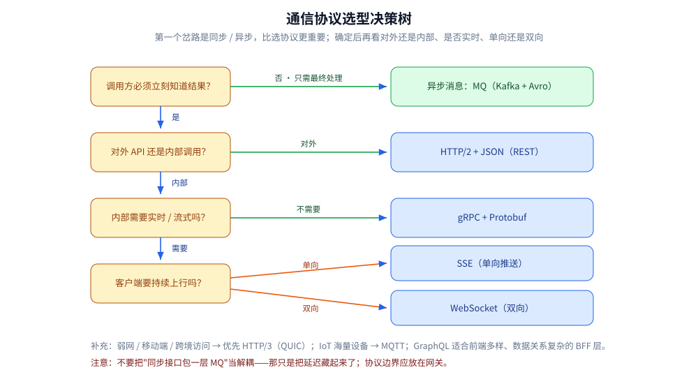
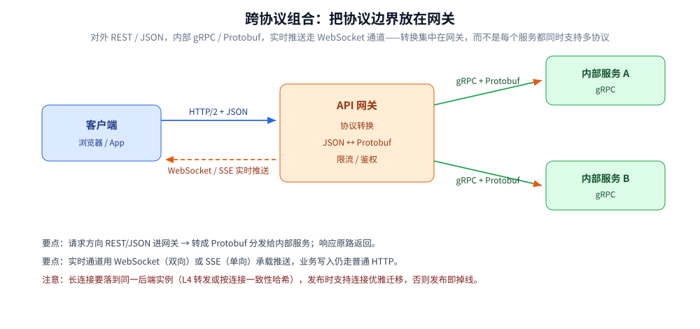

# 通信协议与序列化选型

> 覆盖：传输层（TCP / UDP）的选择、同步 RPC 与异步消息的分工、应用层协议（HTTP/1.1 / HTTP/2 / HTTP/3 / gRPC / WebSocket / SSE / MQTT）与序列化格式（JSON / Protobuf / Thrift / MessagePack / Avro / FlatBuffers）的横向选型，以及四套可直接照搬的组合方案。
>
> 不覆盖：各单技术的机制见 [HTTP1.1与HTTP2的区别.md](应用层/HTTP1.1与HTTP2的区别.md)（HTTP/1.1 与 HTTP/2 的差异机制，本仓该主题的唯一详解源）、[HTTP与gRPC.md](应用层/HTTP与gRPC.md)、[数据序列化.md](数据序列化.md)、[Protobuf.md](../../03-数据与中间件/中间件/RPC框架/gRPC/Protobuf.md)、[传输层/tcp/](传输层/tcp/)；异步消息选型见 [消息队列选型对比.md](../../03-数据与中间件/中间件/消息队列/消息队列选型对比.md)。
>
> 内容整理自个人学习笔记，素材见 [素材清单](../../素材清单.md)。
>
> ⚠️ 实测口径：本篇只做横向选型，**不含本机实测**；文中量级仅作定性对照。

---

## 一、先决定同步还是异步？

这是通信选型的第一个岔路，比选协议更重要。

| 维度 | **同步调用**（HTTP / RPC） | **异步消息**（MQ） |
| --- | --- | --- |
| 交互形态 | 请求 — 响应，调用方等待结果 | 发送即返回，消费方异步处理 |
| 耦合度 | ⭐ 强耦合（要知道对方地址与接口） | ⭐ 解耦（只依赖消息格式与 Topic） |
| 一致性 | 易保证（调用结果立即知晓） | 最终一致（需幂等、重试、死信处理） |
| 故障传播 | ⚠️ **级联故障**：下游慢会拖垮上游（需超时 + 熔断） | 削峰填谷、下游挂了消息堆积不影响上游 |
| 调试难度 | 低（链路清晰、可直接 curl） | 高（异步、时序不确定、难以复现） |
| 适用 | 查询、需要立即拿到结果、强一致操作 | 通知、削峰、解耦、最终一致的流程编排 |



⭐ **判断口诀**：调用方**必须立刻知道结果**才继续 → 同步；**只关心「最终会处理」** → 异步。⚠️ 不要把「同步接口包一层 MQ」当解耦——那只是把延迟藏起来了。

---

## 二、传输层怎么选？TCP 还是 UDP？

**本节要点**：应用层协议大多已经替你选好了传输层（如 HTTP 走 TCP），但涉及自研协议、音视频或 IoT 时，必须自己选。判据只有一条：**能不能容忍丢包与乱序，以及愿不愿意自己造可靠性机制**。

| 维度 | **TCP** | **UDP** |
|---|---|---|
| 连接状态 | 面向连接（三次握手、四次挥手） | 无连接（发完即忘） |
| 可靠性 / 顺序 | ⭐ **保证可靠与有序**（重传、滑动窗口、拥塞控制） | ⚠️ **不保证**（丢了就丢了，可能乱序、重复） |
| 消息边界 | 字节流（没有边界，应用要自己划界） | ⭐ 数据报（保留边界，一次发对应一次收） |
| 首部开销 | 20 字节起 | 8 字节 |
| 适用场景 | 网页（HTTP）、RPC、文件传输、需要绝对可靠的数据 | 音视频（丢帧可忍受）、游戏、DNS、IoT 广播、**QUIC/HTTP3** |

### 2.1 选型判据

| 场景 | 选它 | 理由 |
|---|---|---|
| 数据绝对不能丢、不能乱（转账、配置下发） | **TCP**（通常套 HTTP/gRPC） | 应用层直接写阻塞式 `Read/Write`，可靠性由内核兜底 |
| 实时音视频、游戏状态同步 | **UDP** | 过期数据毫无价值，重传反而导致延迟雪崩；丢包由应用层做 FEC 或插值掩盖 |
| 极简的一问一答（DNS、DHCP） | **UDP** | 省掉握手 RTT；请求/响应本身带事务 ID，丢了自己重试 |
| 局域网广播、多播 | **UDP** | TCP 不支持广播/多播 |
| 弱网/移动端且不想自己造轮子 | **UDP**（但应用层用 **QUIC/HTTP3**） | 直接在 UDP 上重建可靠传输、拥塞控制与 TLS，避开 TCP 队头阻塞 |

⭐ **判据浓缩**：**要可靠且不想自己写重传 → TCP；要极低延迟且能容忍丢包 → UDP；要绕过 TCP 队头阻塞但要可靠 → HTTP/3（QUIC，底层是 UDP）。**

> 📎 机制细节不在本篇：
> - TCP 怎么保证可靠、三次握手/四次挥手的开销、窗口与拥塞控制 → [传输层/tcp/](传输层/tcp/) 五篇；
> - UDP 的首部、为什么「没有保证」不等于「必然丢包」、队列溢出丢包怎么观测 → [UDP与数据报传输.md](传输层/UDP与数据报传输.md)；
> - QUIC 如何在 UDP 上重建可靠传输 → [QUIC与HTTP3.md](应用层/QUIC与HTTP3.md)。

---

## 三、应用层协议怎么选？

| 协议 | 承载 | 优点 | 缺点 | 适用场景 |
| --- | --- | --- | --- | --- |
| **HTTP/1.1** | TCP | 生态最广、中间件与工具链最全、调试最方便（curl / 抓包） | ⚠️ **队头阻塞**（同连接串行）；头部冗余（每次重发 Cookie 等）；文本开销大 | 对外 API、兼容性优先、低频调用 |
| **HTTP/2** | TCP | ⭐ 单连接**多路复用**（并发流）、头部压缩（HPACK）、服务端推送、二进制分帧 | TCP 层仍有队头阻塞（丢包会阻塞所有流） | 内部服务、移动端（减少连接数）、gRPC 的底座 |
| **HTTP/3（QUIC）** | **UDP** | ⭐ 0-RTT / 1-RTT 建连、**连接迁移**（换网不重连）、彻底消除 TCP 层队头阻塞 | 中间设备与部分企业网关兼容性差；UDP 可能被限速；排障工具不成熟 | 弱网 / 移动端 / 跨境访问 |
| **gRPC** | HTTP/2 | ⭐ Protobuf 强类型 + 代码生成；**四种流式**（一元 / 服务端流 / 客户端流 / 双向流）；跨语言一致；头部压缩 | 浏览器直连需 grpc-web 代理；消息不可读、调试不如 JSON 直观；依赖 HTTP/2 | **内部微服务**、跨语言调用、流式场景 |
| **WebSocket** | TCP（HTTP 升级） | ⭐ **全双工**长连接，帧开销极小（2~10 字节） | 需自己处理重连 / 心跳 / 背压；网关与 LB 必须支持 upgrade；连接数受内存限制 | 实时双向：IM、协作编辑、弹幕、行情推送 |
| **SSE**（Server-Sent Events） | HTTP | ⭐ 就是普通 HTTP 长连接，**自动重连 + 断点续传（`Last-Event-ID`）**；实现极简 | 单向（仅服务端 → 客户端）；文本传输；每个连接占一个 HTTP 连接 | 单向推送：进度推送、通知、**大模型流式输出** |
| **MQTT** | TCP | 极轻量、低带宽、**QoS 分级**（0/1/2）、海量设备连接 | 需要 Broker；不适合请求-响应语义 | IoT、设备端、弱网传感器 |

### 3.1 三个高频选择

**① 内部服务用 gRPC 还是 REST？**

| 维度 | gRPC | REST（JSON） |
| --- | --- | --- |
| 契约 | `.proto` 强类型，编译期校验 | OpenAPI 文档 + 运行时校验 |
| 性能 | ⭐ 更高（二进制 + 多路复用 + 头部压缩） | 较低（文本 + 头部冗余） |
| 流式 | ⭐ 原生四种流 | 需 SSE / WebSocket / chunked |
| 调试 | 需 grpcurl / BloomRPC | ⭐ curl 即可 |
| 浏览器 | 需 grpc-web | ⭐ 原生支持 |

⭐ **默认内部 gRPC、对外 REST**；网关做协议转换（外部 JSON ↔ 内部 Protobuf）。团队没有 gRPC 经验、QPS 不高时，REST 完全够用——**别为了「性能」引入一个调试链路的成本**。

**② 实时推送用 WebSocket 还是 SSE？**

| 场景 | 选它 | 理由 |
| --- | --- | --- |
| 客户端也要持续发消息（IM、协作、游戏） | **WebSocket** | 需要真正的双向通道 |
| 只有服务端推、客户端只是接收（通知、进度、AI 流式输出） | ⭐ **SSE** | 实现简单一个数量级：就是 HTTP 响应持续写；自动重连与断点续传是协议自带的 |

⚠️ **别默认上 WebSocket**：它引入连接管理、心跳、重连、背压、网关支持等一整套成本；单向推送场景 SSE 往往更合适（ChatGPT 类产品的流式输出就是 SSE）。

**③ GraphQL 要不要用？**

| 优点 | 缺点 |
| --- | --- |
| 客户端按需取字段，**避免过度获取与多次请求**；单一端点、Schema 自描述 | ⚠️ **N+1 查询**（需 DataLoader 批处理）；HTTP 层缓存困难（多为 POST）；**限流与复杂度攻击防护难**（单个查询可能极重）；错误处理语义复杂 |

⭐ 适用「**前端多样、数据关系复杂、BFF 层**」；不适合「接口简单、强缓存、对外开放」的场景。

把第一节与第三节的判断路径串起来，就是这棵决策树——从同步 / 异步的岔路出发，依次过对外还是内部、要不要实时流式、单向还是双向：



图注：通信协议选型决策树：先问调用方是否必须立刻知道结果，再依次按对外或内部、是否实时流式、客户端是否持续上行，走到 MQ、REST、gRPC、SSE、WebSocket 五个落点。

---

## 四、序列化怎么选？

序列化决定的不是「对不对」，而是**体积、速度、可读性、Schema 演进能力**四者的取舍。

| 格式 | 可读性 | 体积 | 编解码速度 | Schema 演进 | 典型用途 |
| --- | --- | --- | --- | --- | --- |
| **JSON** | ⭐ 最好（人可读、浏览器原生） | 大（文本 + 字段名重复） | 中 | 无强约束，字段随意增删 | 对外 API、配置、日志、调试 |
| **Protobuf** | 差（需工具解析） | ⭐ 小（字段编号 + varint） | ⭐ 快 | ⭐ **规则明确**：新增可选字段安全；**字段编号永不复用** | gRPC、内部服务、持久化存储 |
| **Thrift** | 差 | 小 | 快 | 有 IDL，兼容规则不如 Protobuf 严格 | 存量跨语言 RPC（HBase / Cassandra 生态） |
| **MessagePack** | 差 | 较小（结构同 JSON） | 快 | 无 | 缓存 value、内部传输 |
| **Avro** | 差 | 小 | 快 | ⭐ **Schema 与数据分离**，靠 Schema Registry 管理版本 | 大数据管道（Kafka + Schema Registry） |
| **FlatBuffers / Cap'n Proto** | 差 | 小 | ⭐ **零拷贝读取**（无需反序列化整个对象） | 有 | 游戏、超低延迟、移动端 |

⭐ **关键认知**：JSON 的短板不是「慢」，而是**体积与类型安全**。文本协议每次传输都重复字段名，且数字/时间类型全靠约定（`"1"` 是字符串还是数字？时间戳是秒还是毫秒？）——这类歧义在多团队协作时才暴露。实测数据与 Protobuf 的两个坑（字段编号复用、`omitempty` 语义）见 [数据序列化.md](数据序列化.md)，编码与 `reserved` 的完整机制见 [Protobuf.md](../../03-数据与中间件/中间件/RPC框架/gRPC/Protobuf.md)。

⚠️ **Schema 演进是 Protobuf 最容易被忽视的价值**：它把「兼容性」变成可推理的规则——①只增字段不删不改编号 ②`repeated` 与标量之间不能随意互换 ③删除字段要用 `reserved` 标记，防止后人复用编号导致数据错乱。

---

## 五、连接层怎么选？

| 选择 | 优点 | 缺点 | 适用 |
| --- | --- | --- | --- |
| **短连接 + 连接池** | 实现简单、故障隔离好 | 建连开销（TCP 三次握手 + TLS）；池参数需调优 | 常规 HTTP 服务（连接池是标配） |
| **长连接（Keep-Alive / HTTP/2 单连接）** | 省去建连开销、天然多路复用 | 连接状态与负载均衡耦合（需 L4 或连接感知 LB）；空闲连接占用资源 | 内部高频调用、gRPC |
| **长轮询（long polling）** | 兼容性无敌，任何环境都能跑 | 服务器需挂住请求（占用连接与线程）；实时性受轮询间隔限制 | 老浏览器 / 老网关环境下的推送降级方案 |

⚠️ 长连接的隐藏成本：**连接必须经过同一个后端实例**（否则状态丢失），因此负载均衡要按连接（L4）而非按请求（L7）分发——这是 WebSocket 部署比普通 HTTP 麻烦的根本原因。

---

## 六、有四套可以直接照搬的组合吗？

| 场景 | 组合 | 说明 |
| --- | --- | --- |
| **对外 API** | HTTP/2 + JSON（网关做限流 / 鉴权 / 协议转换） | 兼容性优先，调试友好；AWS / 移动端可开 HTTP/3 |
| **内部微服务** | gRPC + Protobuf（流式用于推送与批量） | 强类型 + 代码生成 + 二进制体积；配合服务发现与负载均衡 |
| **实时推送** | WebSocket（双向）或 SSE（单向） | 双向交互选 WS，单向推送选 SSE；都要实现心跳 + 重连退避 + 背压 |
| **大数据管道** | Kafka + Avro / Protobuf + Schema Registry | Schema 集中管理 + 兼容性检查，避免上下游版本漂移 |

⭐ **跨协议组合也是常态**：对外 REST/JSON → 网关转换 → 内部 gRPC/Protobuf；实时通道 WebSocket 承担推送，业务写入仍走 HTTP。**关键是把「协议边界」放在网关，而不是让每个服务都同时支持多种协议。**



图注：跨协议组合的网关架构：客户端经 HTTP/2 加 JSON 到 API 网关，网关做协议转换、限流与鉴权后以 gRPC 加 Protobuf 分发给内部服务，实时推送另走 WebSocket 或 SSE 通道。

---

## 七、应用场景

**本节要点**：这套选型直接落到「系统设计」阶段的接口与链路设计上。

| 场景 | 选型落点 | 为什么值得注意 |
|---|---|---|
| 服务间调用 | gRPC + Protobuf | 强类型、体积小，详见 [HTTP与gRPC.md](应用层/HTTP与gRPC.md) |
| 对外 API | HTTP + JSON | 通用、易调试，详见 [数据序列化.md](数据序列化.md) |
| 服务端推送 | WebSocket / SSE | 两者适用面不同，详见 [HTTP与gRPC.md](应用层/HTTP与gRPC.md) 第三节 |
| 异步解耦与削峰 | 消息队列 | 选型见 [消息队列选型对比.md](../../03-数据与中间件/中间件/消息队列/消息队列选型对比.md) |
| 弱网 / 移动端 | HTTP/3（QUIC） | 详见 [QUIC与HTTP3.md](应用层/QUIC与HTTP3.md) |
| 协议之上再选一层 | gRPC / Dubbo / Thrift | 详见 [RPC框架选型对比.md](../../03-数据与中间件/中间件/RPC框架/RPC框架选型对比.md) |

## 八、具体使用

**本节要点**：把选型压成一条决策链 —— 先问「要不要等结果」，再问「调用方是谁」。

```text
① 调用要不要等结果？
     要  → 同步（RPC / HTTP）
     不要 → 异步（消息队列）
② 同步再问：谁在调？
     服务间      → gRPC（Protobuf + HTTP/2）
     浏览器/第三方 → HTTP + JSON
③ 需要服务端主动推？
     浏览器   → WebSocket / SSE
     服务间流 → gRPC stream
④ 连接层：长连接还是短连接？
     高并发服务 → 长连接 + 连接池（省握手）
     低频/无状态 → 短连接
```

⭐ 判据：**「同步 / 异步」与「调用方是谁」两问问完，协议与格式基本就定了**，剩下的才是性能调优。

## 延伸追问

- **HTTP/2 有多路复用，为什么还会有队头阻塞？** → HTTP/2 解决了**应用层**的队头阻塞（同一 connection 上多个 stream 并发），但底层仍是 TCP：**一个 TCP 段丢包会阻塞该连接上所有 stream**（TCP 保证有序交付）。真正的解法是 **HTTP/3 换 QUIC（UDP）**，各 stream 独立重传。⚠️ 完整的层次划分见 [HTTP1.1与HTTP2的区别.md](应用层/HTTP1.1与HTTP2的区别.md) 第七节。
- **gRPC 为什么比 REST 快？** → 三个叠加因素：**Protobuf 二进制编码**（体积小、编解码快）、**HTTP/2 多路复用**（避免 HTTP/1.1 的连接数竞争）、**HPACK 头部压缩**（重复的 header 只传索引）；再加代码生成省去运行时的序列化反射。⚠️ 但在「低频、小 payload」的场景里，差距常常被网络往返掩盖。
- **Protobuf 的字段编号为什么不能复用？** → 编码后字段名不出现，**只有编号**。旧版本写入的数据（如编号 3 = `user_id`）被新版本按复用后的含义（编号 3 = `age`）解析，就会得到**类型对不上甚至数据错乱**。废弃字段应 `reserved 3;` 显式禁止复用。
- **WebSocket 怎么保活和重连？** → ①**心跳**：`ping` / `pong` 帧（协议原生）或应用层心跳，超时判定死连接；②**重连退避**：指数退避 + 抖动，避免服务恢复瞬间被重连风暴打死；③**状态恢复**：重连后按游标（`last_msg_id`）补拉，而不是依赖服务端重推全部。
- **SSE 和 WebSocket 怎么选？** → 看是否需要**客户端持续上行**：需要 → WebSocket；只是服务端推 → SSE（实现成本低一个数量级，且自带重连与 `Last-Event-ID` 断点续传）。⚠️ SSE 在 HTTP/1.1 下每个连接占一个 TCP 连接（受浏览器 6 连接/域名限制），HTTP/2 下才无此问题。
- **为什么 Kafka 的消息体不推荐 JSON？** → 体积与解析开销在高吞吐下被放大（每秒百万条时 CPU 成为瓶颈），且无 Schema 约束、上下游易漂移。常见做法是 **Avro / Protobuf + Schema Registry**，兼顾性能与兼容性检查。⚠️ 代价是消息不再可读，排障需工具支持。
- **长连接与负载均衡怎么配合？** → 长连接有状态，必须保证同一连接落到同一后端（L4 四层转发，或 L7 按连接 ID 做一致性哈希）；滚动发布时要支持**连接优雅迁移**（先停止接受新连接，等旧连接自然结束或主动通知客户端重连），否则发布即掉线。
- **超时、重试、幂等三者的关系？** → 超时是前提（没有超时就没有重试的机会，也没有级联故障的保护）；重试必须**只对幂等操作**，且要带**指数退避 + 抖动 + 上限**；⚠️ 重试会**放大流量**（下游已经过载时叠加重试会雪崩），所以必须配合熔断与限流一起使用。

---

## 关联

- **上游/总纲**：[网络分层与数据包旅程.md](网络分层与数据包旅程.md) — 协议分层的整体结构
- **对照/互补**：[HTTP1.1与HTTP2的区别.md](应用层/HTTP1.1与HTTP2的区别.md) — HTTP/1.1 与 HTTP/2 那两行的机制展开：连接与并发模型、消息定界、头部压缩、两级流控、队头阻塞的边界
- **对照/互补**：[HTTP与gRPC.md](应用层/HTTP与gRPC.md) — HTTP 与 gRPC 的机制对比、Go / Java 双端实现、抓包实操
- **对照/互补**：[数据序列化.md](数据序列化.md) — JSON 与 Protobuf 的横向对比与性能实测
- **对照/互补**：[QUIC与HTTP3.md](应用层/QUIC与HTTP3.md) — 弱网与移动端的传输层选择
- **下游机制**：[tcp/TCP三次握手.md](传输层/tcp/TCP三次握手.md) — 建连成本：为什么连接池与长连接有价值
- **下游机制**：[tcp/TCP滑动窗口.md](传输层/tcp/TCP滑动窗口.md) — 传输层：窗口、吞吐上限与 socket 参数落地
- **下游机制**：[IO多路复用.md](传输层/IO多路复用.md) — 支撑高并发长连接的底层机制（epoll / kqueue）
- **运维/配置**：[消息队列选型对比.md](../../03-数据与中间件/中间件/消息队列/消息队列选型对比.md) — 异步消息的横向选型
- **运维/配置**：[RPC框架选型对比.md](../../03-数据与中间件/中间件/RPC框架/RPC框架选型对比.md) — 协议之上再上一层：gRPC / Dubbo / Thrift / Spring Cloud
- **运维/配置**：[中间件选型.md](../../03-数据与中间件/中间件/中间件选型.md) — 中间件的族与子类级选型

> 反向引用（本篇被下列文档引到）：[net包与TCP-UDP编程.md](../../01-编程语言/go/网络编程/net包与TCP-UDP编程.md)、[从零实现网关.md](../../01-编程语言/go/网络编程/从零实现网关.md)、[UDP与数据报传输.md](传输层/UDP与数据报传输.md)、[Protobuf.md](../../03-数据与中间件/中间件/RPC框架/gRPC/Protobuf.md)、[网关选型对比.md](../../03-数据与中间件/中间件/网关与代理/网关选型对比.md)、[分布式与微服务.md](../../04-架构与系统/分布式/分布式与微服务.md)
