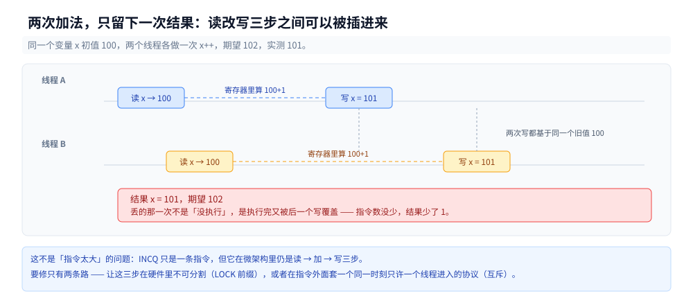
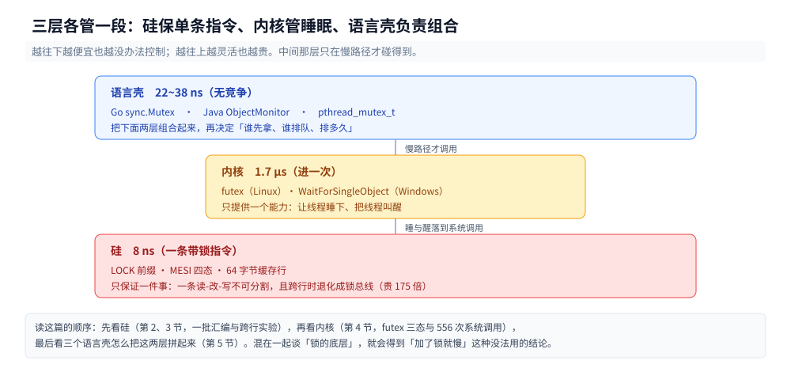
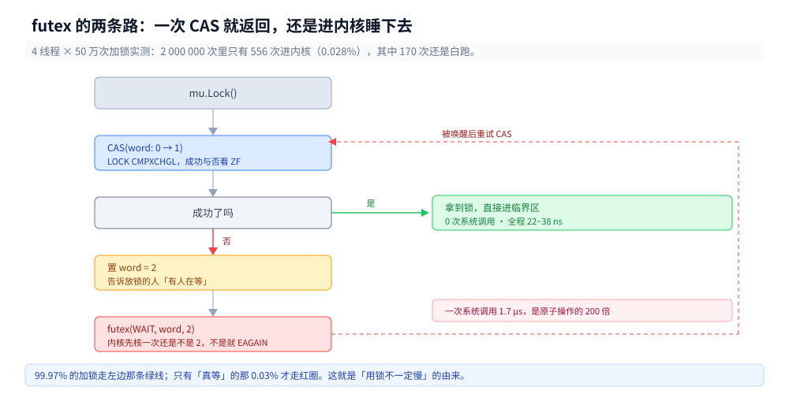

# 原子操作与互斥的实现

> 覆盖：`lock` 前缀到底锁了什么、为什么 `xchg` 不带前缀也原子、跨缓存行的 `LOCK` 贵 175 倍、CAS 失败靠什么知道、无竞争时互斥为什么不进内核（futex 三态协议 + 200 万次加锁只 556 次系统调用）、三语言的壳各包了什么、x86 上内存序为什么大部分是白送的。
>
> 不覆盖：Go 的 `atomic` API 与对齐坑见 [atomic操作.md](../../01-编程语言/go/并发编程/atomic操作.md)；Java 原子类的字节码链、`LongAdder` 分片、ABA、`@Contended` 见 [原子类与无锁.md](../../01-编程语言/java/并发编程/原子类与无锁.md)；AQS 队列与 `ReentrantLock` 用法见 [锁与AQS.md](../../01-编程语言/java/并发编程/锁与AQS.md)；Go `sync.Mutex` 的位域与饥饿模式见 [并发同步原语.md](../../01-编程语言/go/并发编程/并发同步原语.md)。
>
> 内容整理自个人学习笔记，素材见 [素材清单](../../素材清单.md)。Go 读数在 `Intel Core i7-6700HQ @ 2.60GHz`（4 核 8 线程）+ `go1.26.5 windows/amd64` 上实测；C 与 Java 读数在 WSL2 容器里实测（`gcc 12.2.0` / `glibc 2.36` / `Temurin 24.0.2`，`nproc=4`）。源码在 `.workbuddy/tmp/exp/atomic-mutex/`。
> 
> ⚠️ 本篇定位：虽然实验代码大量使用 Go，但探讨的 MESI 协议、LOCK 指令、futex 系统调用属于操作系统与硬件底座。Go 仅作为验证工具，原理同样适用于 C/C++/Java/Rust。

---

## 一、从零：三个线程各加一百万次，为什么少了四成？

**本节要点**：`i++` 编译出来只是一条指令，但它在硬件上仍是「读 → 改 → 写」三步，三步之间可以被别人插进来。三语言同一负载的丢失率都在 30%~70%，而且**每轮都不一样**。

### 1.1 同一份逻辑，三种语言

Go 版最短，先看它：

```go
var plainC int64

func work(iters int, wg *sync.WaitGroup) {
	defer wg.Done()
	for i := 0; i < iters; i++ {
		plainC++
	}
}
```

C 版把 `plainC++` 换成 `counter++`，Java 版换成 `plain++`，其余结构一致：起 n 个线程、各加 `iters` 次、汇合后比对期望值。

| 语言 | 线程 | 期望 | 实得（三轮） | 丢失率 |
|---|---|---|---|---|
| Go（8 逻辑核） | 2 | 2 000 000 | 1 025 752 / 1 302 003 / 1 044 180 | 34.9%~48.7% |
| Go | 4 | 4 000 000 | 1 123 360 / 2 289 984 / 1 536 250 | 42.8%~71.9% |
| Go | 8 | 8 000 000 | 3 024 625 / 3 178 346 / 3 451 350 | 56.9%~62.2% |
| C（`volatile`，4 CPU） | 2 | 20 000 000 | 11 635 161 / 12 554 166 / 13 941 607 | 30.3%~41.8% |
| C | 4 | 40 000 000 | 22 140 580 / 19 358 983 / 17 350 059 | 44.6%~56.6% |
| Java（4 CPU） | 2 | 20 000 000 | 10 057 804 / 10 216 613 / 10 255 894 | 48.7%~49.7% |
| Java | 4 | 40 000 000 | 29 064 592 / 21 418 220 / **40 000 000** | 0%~46.5% |

最后一行加粗的那个数字是本节最重要的一个读数：同一份 Java 代码、同一个负载、同一个容器，**第三轮一次都没丢**。

### 1.2 丢失率不是一个常数

三轮之间能差 20 个百分点，是数据竞争的正常表现：谁丢、丢多少，取决于两条指令的交错序列，而交错由操作系统的调度决定，你控制不了。

所以「我跑了一次，结果是对的」这句话**不能作为正确性证据**。判据只能来自两处：

- 工具：Go 的 `-race`、C 的 `-fsanitize=thread`、Java 的 `jcstress`；
- 指令层面：确认生成的是带 `LOCK` 前缀的读-改-写，而不是 `INCQ` / `addq`。

### 1.3 `INCQ` 为什么还是丢

`plainC++` 在 Go 里编成这样一条：

```asm
INCQ    asmlab.x(SB)
```

一条指令，看起来不可分割。但它不是：`INC` 对内存操作数在微架构上展开成「读缓存行 → 加法器 → 写回」三步，中间没有任何机制阻止另一个核同时读同一行。



上图是留一帧就够解释的事：两次加法，一次结果被覆盖。第 2 节开始，我们要么给这条指令加个前缀让三步变成不可分割，要么在指令外面套一个「同一时刻只许一个线程进」的协议。

### 1.4 但在测之前，编译器会先把你骗掉

这是本轮实验里最花时间的一课：**同一份 C 代码，加不加 `volatile`，结论完全相反。**

`long counter; counter++;` 在 `-O2` 下被 GCC 整体提出循环：

| `iters` | 总耗时 | 折算 |
|---|---|---|
| 500 000 | 0.3~0.8 ms | — |
| 5 000 000 | 0.2~0.5 ms | — |
| 50 000 000 | 0.2~0.5 ms | — |

迭代量涨 100 倍、耗时纹丝不动 —— 说明循环根本没跑，编译器把它变成了循环外的一次 `counter += iters`。这一版测出来「4 线程 2 亿次一次不丢」，纯属假象：每个线程只写了一次，写窗口短到撞不上。

加上 `volatile` 之后（1.1 表的 C 行），丢失率立刻回到 30%~57%，且耗时随 `iters` 线性增长 —— 这才是真在跑。

三个自查判据，缺一不可：

| 判据 | 含义 |
|---|---|
| 耗时随 `iters` 线性增长 | 循环没被外提 |
| 单线程结果等于期望值 | 基准本身没写错 |
| 多线程结果**小于**期望值 | 竞争真的发生了（若是「大于」说明统计逻辑有 bug） |

同类的坑 Java 也有：1.1 表第三轮 `t=4` 一次不丢，同时耗时只有 18.6 ms（另两轮 94.7 / 19.9 ms），C2 已经把 `plain++` 的循环收缩了。**看到「一次不丢」先怀疑测量，再怀疑结论。**

### 1.5 三层各管一段

后面几节按「谁在保证原子性」分成三层，边界清楚，混在一起就说不明白：



| 层 | 提供什么 | 你直接接触到的 |
|---|---|---|
| 硅（`LOCK` 前缀、MESI） | 让**一条**读-改-写不可分割 | `atomic.AddInt64`、`x++` 加不加前缀 |
| 内核（futex / sema） | 让**线程**睡下与醒来 | 只有慢路径才碰得到，代码里看不见 |
| 语言壳（`sync.Mutex`、`ObjectMonitor`、`pthread_mutex_t`） | 把上面两层组合起来 + 排队策略 | `mu.Lock()` |

本篇的主线就是这张图从上往下走一遍：先看硅（第 2、3 节），再看内核（第 4 节），最后看三个语言壳的差别（第 5 节）。

---

## 二、`lock` 前缀到底锁了什么？

**本节要点**：它锁的不是「总线」，也不是「变量」，而是**缓存行**。行内操作靠 MESI 拿到独占（7~8 ns），跨界操作锁不住一条行，代价跳到 1.4 µs（175 倍）。

### 2.1 三条指令的对照

同一台机器、同一份 Go 源码，三种写法编出来的东西：

```asm
; atomic.AddInt64(&x, 1)
LEAQ    asmlab.x(SB), CX
LOCK
XADDQ   AX, (CX)          ; f0 48 0f c1 01

; atomic.CompareAndSwapInt64(&x, old, new)
LEAQ    asmlab.x(SB), CX
LOCK
CMPXCHGQ BX, (CX)         ; f0 48 0f b1 19
SETEQ   AL

; x++（无同步）
INCQ    asmlab.x(SB)      ; 48 ff 05 ...
```

三条都是「读-改-写」，差别只有 `f0` 这一个字节。`XADD` 是「交换并相加」，它把旧值留在寄存器里，所以一条指令同时完成「读旧值」和「写新值」；`CMPXCHG` 是「比较并交换」，成功与否由 `ZF` 回报（`SETEQ` 把它搬进 `AL`）。

⚠️ 这里要小心一个常见误解：`LOCK` 不是「锁住这条指令」，它是给**这条指令要访问的那块内存**加一个执行期间的总线/缓存锁定语义。指令结束了锁就没了，剩下的一致性由 MESI 维持（见 [CPU缓存与缓存行.md](CPU缓存与缓存行.md) 第四节）。

### 2.2 缓存锁与总线锁：一个能测出来的分界

Intel 的文档说得很清楚：`LOCK` 对**可缓存**内存用 cache locking，只有当操作数跨缓存行、或落在不可缓存区域时，才退化成锁总线。这句话能不能测？能 —— 把同一个 8 字节变量挪到「跨 64 字节边界」的位置。

```c
static char buf[256] __attribute__((aligned(64)));
p_inside = (long *)(buf + 64 + 56);  /* 占 56..63，整条行内 */
p_cross  = (long *)(buf + 64 + 60);  /* 占 60..67，跨 64 边界 */
```

同一条 `lock add`，只改地址：

| 布局 | 三轮读数 |
|---|---|
| 行内（偏移 56） | 7.64 / 7.93 / 8.06 ns |
| 跨行（偏移 60） | **1395.23 / 1554.03 / 1368.86 ns** |
| 全局变量（对照） | 8.58 / 8.01 / 7.87 ns |


**175 倍。** 这个倍数就是「缓存锁 vs 总线锁」的价差，不需要看任何文档就能确认：如果 `LOCK` 一律锁总线，那么跨不跨行应该一样慢。

普通（不带 `LOCK`）的非对齐访问没有这个惩罚，x86 允许任意对齐的 `mov`。惩罚是 `LOCK` 语义独有的 —— 因为一条缓存行的所有权转移无法表达「半条行归你、半条归我」。

工程上的推论只有一条：**被多个线程读写的原子变量，必须保证不跨缓存行**。编译器与运行时会替你保证这一点（8 字节对齐的 `atomic.Int64` 不会跨行，因为 64 是 8 的倍数），但你自己拼的 `unsafe.Pointer` 偏移、`[]byte` 里手工切的 8 字节，就可能踩进去。

### 2.3 为什么 `xchg` 不带前缀也原子

再看另外两条：

```asm
; Go: atomic.StoreInt64(&x, v)
LEAQ    asmlab.x(SB), CX
XCHGQ   AX, (CX)          ; 48 87 01 —— 注意没有 f0

; GCC: __atomic_store_n(&x, v, __ATOMIC_SEQ_CST)
xchgq   x(%rip), %rdi
```

都是普通 store，但生成的不是 `mov` 而是 `xchg`，而且**都没有 `LOCK` 前缀**。

原因在 x86 的指令语义里：`XCHG` 只要操作数涉及内存，硬件就**自动施加锁定**，不需要 `f0`。所以「只有带 `LOCK` 前缀才原子」是错的，准确的说法是「`XCHG` 隐式带锁」。

为什么 seq_cst 的 store 非要编译成 `xchg`？因为 x86 的 `mov` store 只保证 StoreStore 顺序，不保证 StoreLoad；而 `xchg` 隐式带锁，锁语义天然包含「排空写缓冲」，正好补上 StoreLoad。这一点第 6 节还会回来算账。

### 2.4 对齐义务是从哪来的

三语言对原子变量的对齐要求，本质上是同一条：**别跨行**。

| 语言 | 保证方式 | 踩坑点 |
|---|---|---|
| Go | `atomic.Int64` 作为结构体首字段时 8 字节对齐；`sync/atomic` 的函数要求地址对齐 | 64 位原子操作在 32 位平台需 8 字节对齐，`go vet` 会查 |
| C11 | `_Atomic long` 由编译器按 `_Alignof` 对齐 | `packed` 结构体里的原子成员会失去对齐保证 |
| Java | JVM 字段布局保证 `long` / `double` 8 字节对齐（可能插 padding） | 32 位 JVM 上 `AtomicLong` 退化成加锁实现（`VM_SUPPORTS_LONG_CAS=false`） |

Java 那条 32 位的注释值得单独说一句：在 32 位 JVM 上，一个 `volatile long` 的读或写要拆成两条 32 位指令，硬件给不了 64 位原子性，JVM 只能用锁补。这是「原子性不是语言给的，是硬件给的」最直白的例子。

---

## 三、CAS 失败了怎么办？

**本节要点**：`lock cmpxchg` 一条指令完成「比较 + 交换」，成败由 `ZF` 一位回报。失败后重试的代价随竞争度非线性上升（Go 8 goroutine 时 96 ns vs 单线程 15 ns），因为每次重试都要重新抢一次缓存行独占。

### 3.1 成败怎么回报

两条汇编并排看，回报方式完全一样：

```asm
; Go
LOCK
CMPXCHGQ BX, (CX)
SETEQ   AL              ; ZF=1 → AL=1（交换成功）

; GCC 12（__atomic_compare_exchange_n）
lock cmpxchgq  %rsi, x(%rip)
sete           %al
```

`CMPXCHG` 的语义是：比较 `AX/EAX/RAX` 与目标内存，相等则写入源操作数并置 `ZF=1`，不等则把内存值装回 `AX` 并清 `ZF=0`。**失败时它会顺手把当前值带回来**，所以下一次重试不用重新读 —— 这是 CAS 循环能写得这么短的原因。

Go 的 `for { if atomic.CompareAndSwapInt64(&x, old, old+1) { break } }` 编出来是「读一次旧值 + CAS 循环」，每轮失败后 `old` 由 `CMPXCHG` 直接更新，不额外发 `mov`。

### 3.2 重试的代价

同一个「加一」负载，四种实现，瓶颈只在争抢方式：

| 实现 | Go t=1 | t=2 | t=4 | t=8 |
|---|---|---|---|---|
| `atomic.Add` | 10.22 | 22.12 | 24.09 | 25.33 |
| CAS 循环 | 15.44 | 40.59 | 70.59 | **96.48** |
| `sync.Mutex` | 27.66 | 24.81 | 43.87 | 70.68 |
| `plain++` | 2.20 | 2.13 | 0.96 | 1.27 |

（单位 ns/op，Go 侧单轮读数，各档独立进程。）

C 侧（4 CPU，线程数不超过核数）同一张表：

| 实现 | t=1 | t=2 | t=4 |
|---|---|---|---|
| `__atomic_fetch_add` | 9.69 / 10.59 / 16.73 | 14.85 / 15.23 / 9.19 | 21.04 / 24.38 / 14.59 |
| CAS 循环 | 16.95 / 15.13 / 21.84 | 20.75 / 25.90 / 31.26 | 22.55 / 27.46 / 36.68 |
| `pthread_mutex` | 26.81 / 34.96 / 37.86 | 54.96 / 42.30 / 36.59 | 56.62 / 60.79 / 60.78 |

两条判据：

- **CAS 循环在超订时崩得最快。** Go 的 8 goroutine 挤 4 物理核，CAS 从 15.44 涨到 96.48（6.2 倍），而 `xadd` 只从 10.22 涨到 25.33（2.5 倍）。差别在于 `xadd` 无论成败都只走一次「抢行 → 改 → 放行」，CAS 失败要再来一遍。
- **C 侧看不到这个崩溃**，因为 4 线程正好等于 4 核，没有超订。这提醒一件事：**测竞争必须让线程数超过核数**，否则测的是「排队」而不是「争抢」。

### 3.3 忙等与退避的分界

CAS 失败后有三条路：立刻重试、让出 CPU、睡进内核。分界线是**一次重试的成本 vs 一次让出的成本**：

| 动作 | 本机实测代价 | 什么时候划算 |
|---|---|---|
| 重试一次 CAS（`lock cmpxchg`） | 8~15 ns | 临界区极短、冲突概率低 |
| `runtime.Gosched()` / `sched_yield()` | 微秒级（一次调度器往返） | 持有者还需要几微秒才放锁 |
| `futex` 睡下去 | 1.7 µs（本机 WSL2） | 持有者要等毫秒级（IO、另一把锁） |

数量和直觉相反：**自旋的预算上限只有几百纳秒**，一旦估计「还要等更久」，睡比转便宜。这也是为什么 `sync.Mutex` 的自旋上限是固定的 4 次（`active_spin = 4`），而不是「转到拿到为止」。

还有一条硬约束：**单核上根本不值得自旋**。CPU 只有一个，持有者没有机会跑，转到时间片用完也等不到。Go 的 `runtime_canSpin` 第一个条件就是 `ncpu > 1`。

### 3.4 CAS 的三种失败模式

CAS 循环看着简单，出问题的地方都在「失败之后」：

| 模式 | 表现 | 归属 |
|---|---|---|
| ABA | 值改了又改回来，CAS 认为没变过 | 见 [原子类与无锁.md](../../01-编程语言/java/并发编程/原子类与无锁.md) 第 4 节的确定性复现 |
| 活锁 | 两个线程同步重试，永远撞车 | 需要随机退避或换排队结构 |
| 缓存行抖动 | CAS 的地址是热点，重试次数与核数平方相关 | 本篇 3.2 的 96.48 ns 就是它的读数 |

活锁在小规模下测不出来，因为它需要「两个线程的重试周期完全同相」，实际系统里靠随机化躲过去；一旦躲不过，表现是 CPU 100% 而吞吐为零 —— 和第 7 节要查的「空转」是同一个现象。

---

## 四、无竞争时互斥为什么不进内核？

**本节要点**：`sync.Mutex` 的 `Lock` 编出来是**一条 `lock cmpxchg` 加一个分支**，`Unlock` 是一条 `lock xadd` 减一。只有分支跳进慢路径时才可能碰 futex。实测 200 万次加锁只有 124~556 次系统调用（0.006%~0.028%），而一次系统调用比一次原子操作贵 200 倍。

### 4.1 快路径就是两条原子指令

`mu.Lock(); y++; mu.Unlock()` 整个函数编出来 105 字节，其中加锁部分：

```asm
LEAQ    asmlab.mu(SB), CX
MOVL    $1, DX
LOCK
CMPXCHGL DX, (CX)         ; state: 0 → 1
SETEQ   DL
TESTB   DL, DL
JNE     59                ; 成功 → 直接跳到临界区，不进内核
LEAQ    asmlab.mu(SB), AX
CALL    internal/sync.(*Mutex).lockSlow   ; 失败才走慢路径
```

解锁部分：

```asm
MOVL    $-1, BX
LOCK
XADDL   BX, (CX)          ; state -= 1
DECL    BX
JEQ     92                ; 减完为 0 → 直接返回
LEAQ    asmlab.mu(SB), AX
CALL    internal/sync.(*Mutex).unlockSlow
```

两条汇编说明三件事：

1. 无竞争时**没有函数调用、没有系统调用**，只有一次 `cmpxchg`（拿锁）和一次 `xadd`（放锁）；
2. 这解释了 1.1 表里 `sync.Mutex` 的 22~28 ns：正好约等于两次原子操作（各 8~14 ns）加上分支与函数序言；
3. 「慢路径」是一个独立函数，不执行就不占指令缓存 —— 编译器把热路径压到了最短。

### 4.2 慢路径：futex 的三态协议

Linux 上「睡」与「醒」由 futex 提供。它的接口只有一个系统调用，靠共享内存里一个 32 位整数协调：

| 值 | 含义 |
|---|---|
| 0 | 空闲 |
| 1 | 已上锁，没有等待者 |
| 2 | 已上锁，**有**等待者 |

加锁的完整逻辑（Ulrich Drepper 论文的经典写法）可以用 30 行 C 写完：

```c
static void my_lock(void) {
    int c = 0;
    if (atomic_compare_exchange_strong(&word, &c, 1)) return;  // 快路径，0 次系统调用

    if (c != 2) c = atomic_exchange(&word, 2);   // 声明「有等待者」
    while (c != 0) {
        futex_wait(&word, 2);                    // 睡到 word != 2
        c = atomic_exchange(&word, 2);
    }
}

static void my_unlock(void) {
    if (atomic_fetch_sub(&word, 1) != 1) {       // 原来是 2 → 有等待者
        atomic_store(&word, 0);
        futex_wake(&word, 1);
    }
}
```

关键在 `futex_wait(&word, 2)` 的第二个参数：**内核在睡下去之前会再查一次 `word` 是不是还等于 2**。如果已经被改成 0 了，直接返回 `EAGAIN`，不睡。这一步把「检查」与「睡下」变成了一个原子动作，堵住了「我检查时锁还在，睡下去之后锁已释放」的丢唤醒窗口。



strace 抓到的原始行印证了这三态：

```text
[pid 759] futex(0x5c6c5a94d050, FUTEX_WAKE_PRIVATE, 1) = 0      ← 唤了个空：对方还没睡下
[pid 759] <... futex resumed>)        = 1                        ← 这次真唤醒了一个
[pid 759] <... futex resumed>)        = -1 EAGAIN (Resource temporarily unavailable)
```

最后一行是「进了内核才发现不用睡」：内核在真正挂起线程之前会再核一次 futex word 是否还等于 2，不等就立刻返回 `EAGAIN`。这一次运行（4 线程 × 20 万次）里，`WAKE` 返回 0 有 **8** 次、返回 1 只有 **1** 次、`EAGAIN` 有 **49** 次 —— 唤醒时绝大多数情况下对方**还没睡下**，睡下去这个动作本身就来不及。

`FUTEX_WAKE` 返回 0 表示「唤了个寂寞」：放锁的一方以为有人睡，其实对方还在用户态重试。这个返回值在工程上有用 —— 它是「临界区太短、等待者来不及睡」的直接证据。

### 4.3 200 万次加锁，只有几百次进内核

三种实现、同一个负载（4 线程 × 50 万次判空临界区），`strace -f -c -e trace=futex` 数出来的调用次数：

| 实现 | 加锁次数 | futex 调用 | 其中 `EAGAIN` | 比例 |
|---|---|---|---|---|
| 手写 futex 锁 | 2 000 000 | 556 | 170 | 0.028% |
| `pthread_mutex` | 2 000 000 | 248 | 70 | 0.012% |
| Go `sync.Mutex`（容器内 Linux） | 2 000 000 | 124 | 12 | 0.006% |

三个数据各说明一件事：

- **有竞争 ≠ 每次都进内核。** 临界区只有一条 `counter++`，等待者到达时锁往往已经放掉了，慢路径在「睡」之前就重新拿到了；
- **`pthread_mutex` 比手写版少一半**，因为 glibc 在慢路径上还有一层用户态重试；
- **Go 最少（124 次）**，因为 `lockSlow` 在 `semacquire` 之前先自旋 4 轮，转到就返回。

`EAGAIN` 占手写版 futex 调用的 31%（170/556），也就是说**三分之一的「进内核」是白跑**：进去了，发现不用睡，立刻回来。

⚠️ 这台机器是 Windows + WSL2，Go 的原生实现走的是 `WaitForSingleObject` 而不是 futex；上表的 Go 一行是在 `golang:1.26` 容器内重跑得到的。本机 Go 的 22~28 ns 与容器内 24.5~60 ns 的差异主要来自 WSL2 的调度开销，不是实现差异。

### 4.4 一次进内核到底多少钱

同机同进程连着测五件事，单位 ns/次：

| 动作 | 三轮读数 |
|---|---|
| `volatile` 加一（普通 load+store） | 2.63 / 2.24 / 2.27 |
| `lock xadd`（原子读-改-写） | 8.22 / 7.52 / 7.61 |
| `getpid()`（最快的一类系统调用） | 1610.35 / 1829.24 / 1654.41 |
| `futex(WAKE)` 无等待者 | 1807.86 / 1704.76 / 1719.79 |
| `futex(WAIT)` 值不匹配（`EAGAIN`） | 1825.12 / 1798.20 / 1760.47 |


**原子操作 : 系统调用 ≈ 1 : 210。** 这张阶梯解释了前面所有设计取舍：

- 为什么 `sync.Mutex` 要压成两条指令 —— 一旦落到慢路径，代价就是 200 倍起步，还不算后续的线程唤醒；
- 为什么自旋上限只有 4 次 —— 转一次 8 ns，睡一次 1700 ns，转 200 次才等于睡一次的价钱；
- 为什么 `LongAdder` / 分片能把吞吐拉起来 —— 它们把「所有人争一条缓存行」换成「各争各的」，连原子操作本身都少了一半。

⚠️ 这台机器上 `getpid()` 要 1.6 µs，比裸机 Linux 高一个量级，因为容器跑在 WSL2 里，每次系统调用要穿过虚拟化层。绝对值不能直接当基准用，**倍数关系比绝对值稳定**：本机 `lock xadd` 8 ns 折算约 21 个时钟周期（2.6 GHz），这是裸机也会有的量级；而 1.7 µs 的系统调用是虚拟化放大后的结果，裸机上按公开数据在 300~500 周期（本篇未在裸机 Linux 实测）。

所以后面所有「贵多少倍」的结论都要带上环境：本机是 **200 倍**，裸机上大概率是 **20~30 倍**。倍数变了，但「差两个数量级」的定性不变。

---

## 五、三语言的壳各包了什么？

**本节要点**：三个壳的**热路径**几乎一样（一次 CAS 拿锁、一次原子写放锁），差别在状态字段的宽度、排队策略、以及慢路径落到哪个内核原语上。Go 的 `sync.Mutex` 8 字节，glibc 的 `pthread_mutex_t` 40 字节，Java 的对象头 12~16 字节里塞 8 字节 Mark Word。


### 5.1 Go：一个 int32 装下四种状态

`unsafe.Sizeof(sync.Mutex{})` = **8**，对齐 4：

| 类型 | 大小（本机 go1.26.5 amd64） |
|---|---|
| `sync.Mutex` | 8（`state int32` + `sema uint32`） |
| `sync.RWMutex` | 24（`w Mutex` + `writerSem` + `readerSem` + 计数） |
| `sync.Once` | 12（`done atomic.Uint32` + `m Mutex`） |
| `sync.WaitGroup` | 16（`noCopy` + `state atomic.Uint64` + `sema`） |
| `atomic.Int64` | 8，对齐 8 |

`state` 这 32 位里挤了四种信息：

| 位 | 含义 |
|---|---|
| bit0 `mutexLocked` | 已上锁 |
| bit1 `mutexWoken` | 已唤醒一个等待者 |
| bit2 `mutexStarving` | 饥饿模式 |
| bit3 起 | 等待者计数（`mutexWaiterShift = 3`） |

这解释了 4.1 的汇编为什么是 `CMPXCHG 0→1` 与 `XADD -1`：状态与计数在同一个字里，一次原子操作就能同时完成「加锁」和「记账」。

**正常模式 vs 饥饿模式**：等待者先自旋 4 轮，转不到就排队；如果排队后超过 1 ms 还没拿到锁，把 `mutexStarving` 置位，此后**放锁直接把锁交给队首**，新来的 goroutine 不许插队。这条设计针对的正是第 3.2 节那个读数 —— 超订时 CAS 抢占会让排队者饿死，1 ms 是「忍无可忍」的阈值。

内核侧：`sema` 由 `runtime_SemacquireMutex` 消费，Linux 上落到 futex，Windows 上落到 `WaitForSingleObject`。所以 4.3 表里 Go 只有 124 次 futex，是因为绝大多数等待在自旋阶段就解决了，没走到 `semacquire`。

细节（位域、饥饿模式的状态迁移）见 [并发同步原语.md](../../01-编程语言/go/并发编程/并发同步原语.md)。

### 5.2 Java：Mark Word 与三次膨胀

Java 的对象头在 64 位 JVM 上是 12 字节（Mark Word 8 + 压缩后的 Klass 指针 4），Mark Word 的 8 字节被复用成四种含义：

| 锁状态 | Mark Word 低 2 位 | 内容 |
|---|---|---|
| 无锁 | `01` | hashCode(31) + 分代年龄(4) + 0 |
| 轻量级锁 | `00` | 指向**栈上 Lock Record** 的指针 |
| 重量级锁 | `10` | 指向 `ObjectMonitor` 的指针 |
| GC 标记 | `11` | — |

加锁的路径就是这三态的迁移：

1. **无锁 → 轻量级**：在当前线程栈帧里分配一个 Lock Record，把 Mark Word 用 CAS 换进去。成功即拿到锁，**全程没有系统调用** —— 这就是 `synchronized` 无竞争时 27~37 ns 的来源。
2. **轻量级 → 重量级（inflate）**：CAS 失败且自旋无效，向 JVM 申请一个 `ObjectMonitor`，把 Mark Word 改成指向它。此后竞争者进入 `_EntryList`，`wait()` 的进 `_WaitSet`，`_owner` 记持有者。
3. **重量级 → 睡**：`ObjectMonitor::enter` 在 Linux 上走 `os::PlatformEvent::park`，底层是 `pthread_mutex` + `pthread_cond_wait`，再往下才是 futex。**一条 `synchronized` 从 CAS 到 futex 隔了三层封装。**

⚠️ 偏向锁已经不存在了：`java -XX:+UnlockDiagnosticVMOptions -XX:+PrintFlagsFinal -version` 在 Temurin 24 上**根本搜不到 `biased` 相关的 flag**（连废弃标记都没有）。所以「偏向锁让无竞争 synchronized 免费」这条经验，在 JDK 15 之后就开始失效，JDK 18 之后彻底作废，别再用它解释现代 JVM 的行为。

队列、可重入计数与 `ReentrantLock` 的对照见 [锁与AQS.md](../../01-编程语言/java/并发编程/锁与AQS.md)；`synchronized` 与 `AtomicLong` 的吞吐对照见 [原子类与无锁.md](../../01-编程语言/java/并发编程/原子类与无锁.md)。

### 5.3 C：40 字节里只有 4 字节在热路径

`sizeof(pthread_mutex_t)` 在 glibc 2.36 / x86-64 上是 **40**（`pthread_cond_t` 是 48）：

```c
/* glibc 的 __pthread_mutex_s，字段名可查，顺序按版本会变 */
int __lock;            /* 快速路径只碰这 4 字节 */
unsigned int __count;  /* 递归锁用 */
int __owner;           /* 持有者 tid，调试与健壮性用 */
unsigned int __nusers; /* 使用者计数，用于 robust 语义 */
int __kind;            /* normal / recursive / errorcheck / adaptive */
...
```

只碰 `__lock` 的 4 字节，其余 36 字节是给递归、错误检查、robust 与调试用的。所以「40 字节的锁」和「8 字节的 `sync.Mutex`」在热路径上没有区别 —— 都是一次 `lock cmpxchg`。

`__kind` 决定慢路径策略，四种里 `adaptive` 会先自旋一段：

| kind | 行为 |
|---|---|
| `PTHREAD_MUTEX_NORMAL` | 不自旋，等不到就睡；同线程重入会死锁 |
| `PTHREAD_MUTEX_ERRORCHECK` | 重入返回 `EDEADLK` |
| `PTHREAD_MUTEX_RECURSIVE` | 用 `__count` 记重入次数 |
| `PTHREAD_MUTEX_ADAPTIVE_NP` | 慢路径先自旋再睡（glibc 扩展） |

这也解释了 4.3 表里 `pthread_mutex` 的 futex 次数（248）比手写版（556）少：glibc 的慢路径本身带用户态重试，很多「本来要睡」的场景在重试里就解决了。

### 5.4 三个壳放在一起比

无竞争、单线程、同一个「加一」负载，三语言读数：

| 语言 | 普通 `++` | 原子加 | 互斥加 |
|---|---|---|---|
| Go（Windows 原生） | 2.20~2.43 | 9.50~10.22 | 22.45~27.66 |
| C（`volatile`，WSL2） | 2.24~2.97 | 9.69~16.73 | 26.81~37.86 |
| Java（WSL2） | 0.83~1.89 | 8.16~8.98 | 27.46~36.56 |

（单位 ns/op，各三轮区间。）

三个跨语言、跨 OS、跨 JIT/静态编译的读数落在同一档，只有一种解释：**互斥的代价就是两次原子操作，谁也没比谁多进一次内核**。Java 的 `synchronized` 27 ns 与 Go 的 `sync.Mutex` 22 ns 相差 5 ns，还不到一次系统调用的 0.5%。

---

## 六、内存序是谁给的？

**本节要点**：x86 的 load 天然是 acquire、store 天然是 release，所以 `atomic.Load` 编成一条 `mov`、`release` store 也编成一条 `mov`；只有 seq_cst 的 store 要补 `xchg`，ful barrier 要补 `lock or`。**四种内存序在 x86 上只差一条指令，而 `fetch_add` 连这一条都省不掉。**

### 6.1 一张表看完 x86 的全部差异

`gcc -O2 -S` 的原文，去掉标签与伪指令：

```asm
add_seq:      lock addq   $1, x(%rip)      ; fetch_add, seq_cst
add_relaxed:  lock addq   $1, x(%rip)      ; fetch_add, relaxed —— 一模一样
cas_seq:      lock cmpxchgq %rsi, x(%rip)  ; compare_exchange, seq_cst
              sete        %al
load_seq:     movq        x(%rip), %rax    ; load, seq_cst —— 无前缀
store_seq:    xchgq       x(%rip), %rdi    ; store, seq_cst —— xchg 自带锁
store_rel:    movq        %rdi, x(%rip)    ; store, release —— 与普通 store 同
store_rlx:    movq        %rdi, x(%rip)    ; store, relaxed —— 同上
fence_full:   lock orq    $0, (%rsp)       ; thread_fence, seq_cst
fence_acq:    ret                          ; thread_fence, acquire —— 0 条指令
inc_plain:    addq        $1, x(%rip)      ; 裸 x++
```

把这张表和 Go 的汇编对照，结论完全一致：Go 的 `atomic.LoadInt64` 也是 `MOVQ`，`atomic.StoreInt64` 也是 `XCHGQ`。**两种编译器、两套标准，落在同一组指令上** —— 因为可选的指令本来就这几条。

### 6.2 `fetch_add` 的 relaxed 省不了一条指令

最反直觉的一行是 `add_relaxed` 与 `add_seq` **逐字节相同**。

原因：x86 的 `LOCK` 语义不区分你要哪种序，它一次性给出最强的保证（相当于 full barrier）。所以：

- 想用 `relaxed` 省掉屏障？在 x86 上对**读-改-写**不成立，`lock` 前缀照样得加；
- 对**普通读**成立（本来就是 `mov`），对**普通写**部分成立（`release` 与 `relaxed` 都是 `mov`，只有 seq_cst 要 `xchg`）。

这条差异在 arm64 上才真正体现：`LDADD`（relaxed）/ `LDADDA`（acquire）/ `LDADDAL`（seq_cst）是三条不同的指令。所以「用弱内存序能提性能」这句话，**在 x86 上对原子加法是空话，在 arm64 上才是实话**。

### 6.3 拦重排的两拨人

一次重排可能发生在两个地方，拦的人不同：

| 谁在重排 | 谁拦 |
|---|---|
| 编译器（指令调度、常量提升、循环外提） | 语言的内存模型 + 编译器屏障（`atomic` 调用本身就是屏障） |
| CPU（store buffer、乱序执行、写合并） | `LOCK` / `xchg` / `mfence` / `lfence` / `sfence` |

第 1.4 节那个「循环被外提」的坑，就是第一类：编译器在**它认为没人看**的情况下把写挪了位置。`volatile` 与 `atomic` 都能拦住它，但只有 `atomic` 能同时给出第二类保证。

所以 `atomic` 之于 `volatile`，多出来的不是「禁止缓存」（现代 CPU 不缓存普通变量到寄存器以外的意思），而是**编译期与运行期的双重排序约束**。语言层怎么规定的，见 [Go内存模型.md](../../01-编程语言/go/并发编程/Go内存模型.md) 与 [JMM与内存屏障.md](../../01-编程语言/java/并发编程/JMM与内存屏障.md)。

### 6.4 换架构就不白送了

x86 是「强模型 + 少数弱序例外」，arm64 是「弱模型 + 显式屏障」，同一段代码的指令数差好几倍：

| 操作 | x86-64 | arm64 |
|---|---|---|
| `load(acquire)` | `mov` | `LDAR` |
| `store(release)` | `mov` | `STLR` |
| `store(seq_cst)` | `xchg` | `STLR`（自带 release，后续 load 由 `LDAR` 兜） |
| `fetch_add(relaxed)` | `lock add` | `LDADD` |
| `fetch_add(seq_cst)` | `lock add` | `LDADDAL` |
| `fence(acquire)` | 0 条 | `DMB ISH` 或 `LDAR` 替代 |

⚠️ 右列未在本机实测（本机是 x86-64，容器也是 x86-64），依据是 AArch64 指令集手册里 `LDAR` / `STLR` / `LDADD` 系列的定义。要复现得换 arm64 机器或用 QEMU，本轮的实验台不具备。

这也解释了一件常被忽略的事：**同一个 `atomic.Add` 在 x86 上可能只有 8 ns，到 arm64 的服务器上会变慢**。跨平台压测时把「原子操作慢」归因到代码上之前，先确认是不是换了架构。

---

## 七、现场按什么顺序查？

**本节要点**：先查「计数对不对」，再查「谁慢」，最后才查「汇编里有没有那个前缀」。顺序反了会在错误的层找原因，比如把「丢更新」当成「锁太慢」。

### 7.1 第一步：先确认是正确性问题还是性能问题

| 现象 | 指向 | 判据 |
|---|---|---|
| 计数偏小、偶发、量随并发升高 | 缺同步 | `-race` 报 `DATA RACE` |
| 计数对，吞吐上不去 | 竞争或伪共享 | CPU/墙钟比 > 核数的一半 |
| 计数对，偶发卡顿 | 慢路径进内核太多 | `strace -c` 看 futex 次数 |
| 计数**偏大** | 统计逻辑写错（不是竞争） | 竞争只会丢，不会多 |

最后一行值得记：竞争的表现永远是「丢」，看到「多」直接去查自己的计数逻辑，别在内存模型上找。

### 7.2 第二步：三档对照定位到层

同一个负载跑三遍，只换同步方式：

```bash
./bench_volatile 4 10000000   # 无同步，确认丢失率量级
./bench_atomic   4 10000000   # 硅层：一条 lock 指令
./bench_mutex    4 10000000   # 壳层：两条原子指令 + 可能的 futex
```

判读：

- `atomic` 与 `plain` 差 3~5 倍 → 正常，就是 `lock` 前缀的钱；
- `mutex` 是 `atomic` 的 2~4 倍 → 正常，两次原子操作；
- `mutex` 是 `atomic` 的 50 倍以上 → 慢路径进内核太多，去 7.4。

### 7.3 第三步：看汇编，确认「真的一条指令」

Go 侧：

```bash
go build -gcflags='-S' ./... 2>&1 | grep -A2 -E "LOCK|XADD|CMPXCHG"
```

C 侧：

```bash
gcc -O2 -S bench.c -o - | grep -E "lock|mfence|xchg"
objdump -d ./bench | grep -E "lock|mfence|xchg"
```

两个要点：

- `-S` 看到的是**编译器**的产物，不是最终运行的代码（Go 的链接器还会改）；要看到 CPU 真正执行的，得用 `objdump` 反汇编可执行文件；
- JIT 语言（Java）的 `-S` 这一套不存在，得 `-XX:+PrintAssembly` + hsdis 插件，本轮容器里没有 hsdis，**Java 侧的机器码未实测**（`javap -c` 只能看到字节码层的 `getAndAddLong`）。

### 7.4 第四步：数系统调用

```bash
strace -f -c -e trace=futex ./prog 4 500000
```

判读三条：

- `calls` 远小于加锁次数（几百 vs 几百万）→ 正常，快路径在工作；
- `errors` 占相当比例（如 170/556）→ 正常，`EAGAIN` 是「进内核前发现不必睡」；
- `calls` 与加锁次数同量级 → 慢路径成了热路径，要么临界区太长，要么等待时间太长，要么根本不该用锁。

### 7.5 什么时候别改

| 场景 | 别做 | 该做 |
|---|---|---|
| 读多写少 | 别上 CAS 自旋 | `RWMutex` 或 `atomic.Value` 快照 |
| 只增计数 | 别用互斥 | `LongAdder` / 分片 `atomic.Int64` |
| 临界区里有 IO | 别指望自旋 | 直接睡（mutex），自旋纯浪费 |
| 单核环境 | 别自旋 | `runtime_canSpin` 第一个条件就是 `ncpu > 1` |

最后一条是最容易被忽略的：容器里 `--cpus=1` 时所有自旋优化全部失效，压测数据会和多核环境差一个量级。

---

## 八、三组结论

**本节要点**：原子性来自一条带锁的指令；无竞争不进内核、进内核贵两个数量级；屏障在 x86 上大半是白送的。

### 8.1 原子性是「指令属性」，不是「函数属性」

`atomic.AddInt64`、`i++`、`mu.Lock()` 在源码层看着完全不同，落到机器码只差一个 `f0` 字节。所以判断一段代码有没有原子性，看函数名没用，要看反汇编里有没有 `LOCK` / `XCHG`。

反过来也成立：`XCHG` 不带 `f0` 也是原子的（2.3 节），`INCQ` 带不带都没有（1.1 节）。**前缀不是判据，「指令本身的语义」才是。**

### 8.2 无竞争不进内核，进内核贵两个数量级

| 层 | 代价 | 证据 |
|---|---|---|
| 普通读写 | 2.3 ns | 4.4 表 |
| 一条 `lock` 指令 | 8 ns | 4.4 表 |
| 无竞争互斥（两条原子指令） | 22~38 ns | 5.4 表 |
| 一次系统调用 | 1.7 µs（WSL2） | 4.4 表 |

200 万次加锁只有 124~556 次系统调用（4.3 节），所以「用锁一定慢」是错的，「竞争激烈时用锁一定慢」才对。判断标准是**临界区长度与等待概率**，不是「有没有锁」。

### 8.3 屏障在 x86 上大半是白送的

- `load(acquire)` → `mov`，0 条附加指令；
- `store(release)` → `mov`，0 条附加指令；
- `fence(acquire)` → 0 条指令；
- `fetch_add(relaxed)` 与 `fetch_add(seq_cst)` → **同一个 `lock addq`**。

真正要花钱的只有 seq_cst 的 store（`xchg`）与 full fence（`lock or`）。换到 arm64，这张表全部作废 —— 弱内存序省下来的指令，在强模型上是省不出来的。

## 校验口径

> ✅ 本篇读数的校验方式与范围（Go 侧 `Intel Core i7-6700HQ @ 2.60GHz` 4 核 8 线程 + `go1.26.5 windows/amd64`；C/Java 侧 WSL2 容器 `nproc=4`、`gcc 12.2.0`、`glibc 2.36`、`Temurin 24.0.2`）：

- **真跑**：第 1.1 节三语言丢失率（Go / C / Java 各档均为 3 轮独立进程）；第 1.3 节 C 循环外提对照（50 万 / 500 万 / 5000 万次三档）；第 2.2 节跨行 `LOCK`（3 轮 × 500 万次）；第 3.2 节四种实现吞吐（Go 单轮、C 3 轮）；第 4.3 节 `strace -f -c -e trace=futex`（手写锁 / `pthread_mutex` / Go `sync.Mutex` 各 1 次，Go 在容器内重跑）；第 4.4 节五档代价（3 轮）；第 5 节的 `unsafe.Sizeof` 与 `sizeof(pthread_mutex_t)`
- **编译期即可确定**：第 2.1 与 6.1 节的汇编（`go build -gcflags='-S'`、`gcc -O2 -S`）；第 5.1 节的类型尺寸；`-XX:+PrintFlagsFinal` 里没有偏向锁 flag
- **源码直读**：第 4.1 节的 `lockSlow` 调用点与 `internal/sync.Mutex`；第 5.1 节的位域常量；第 5.3 节 glibc 的 `__pthread_mutex_s` 字段
- **未实测**：`perf` 侧的 `LOCK` 指令计数（本机 Windows 无 perf）、arm64 的全部指令（第 6.4 节右列，依据 AArch64 手册）、Java 的 JIT 机器码（容器无 hsdis，只有字节码层证据）、裸机 Linux 的系统调用单价（本机是 WSL2，只有倍数关系可用）、`PTHREAD_MUTEX_ADAPTIVE_NP` 的自旋轮数
- **环境差异**：Go 在 Windows 原生跑（`sema` 走 `WaitForSingleObject`），C/Java 在 WSL2 容器内跑（走 futex + `pthread_cond_wait`）；两者的绝对值不可直接相减，只可比量级

| 依赖 | 实际版本 |
|---|---|
| Go | go1.26.5 windows/amd64；容器内 go1.26.8 linux/amd64 |
| GCC / glibc | 12.2.0 / 2.36（Debian 12） |
| JDK | Temurin 24.0.2+12 |
| 内核 | 6.18.54.1-microsoft-standard-WSL2 |
| CPU | Intel Core i7-6700HQ（L1d 32 KB/核、L2 256 KB/核、L3 6 MB 共享） |

## 延伸追问

- **`lock` 前缀会不会把整个系统卡住？** → 不会。它锁的是缓存行（2.2 节的 175 倍实验证明了这个粒度），不是整条内存总线。只有跨行或不可缓存内存才退化成总线锁，那时确实会拖慢其他核 —— 这也是「原子变量必须对齐到行内」的工程原因。
- **既然 `xchg` 自带锁，为什么 `atomic.Add` 不用 `xchg` 而用 `lock xadd`？** → `xchg` 只能做「交换」，拿不到旧值参与运算；`xadd` 一条指令完成「读旧值 + 加 + 写回」，是硬件给计数器的专用指令。Java 的 `getAndAdd` 在 C2 上也 intrinsic 成 `lock xadd`，`compareAndSet` 才是 `lock cmpxchg`。
- **无竞争时 `sync.Mutex` 22 ns，为什么比 `atomic.Add` 的 10 ns 贵一倍？** → 因为它是两次原子操作（`CMPXCHG` 拿锁 + `XADD -1` 放锁）。`atomic.Add` 只有一次。这个比例（2:1）在三种语言上都成立（5.4 节）。
- **`futex` 能不能自己用？** → 能，第 4.2 节那 30 行就是一个完整实现。但生产代码不该自己写：`FUTEX_WAIT` 的「检查 + 睡」原子性、虚假唤醒、优先级继承、robust 语义，每一条都能让自制的锁在压力下出问题。
- **为什么容器里 `getpid()` 要 1.7 µs？** → 虚拟化层。WSL2 的每次系统调用都要穿过 VM 边界，成本从裸机的 100~300 ns 放大到 1.6 µs。所以容器内的「系统调用 vs 原子操作」倍数是 200 倍，裸机上大概只有 20~30 倍 —— 量级结论不变，绝对值别跨环境引用。

## 关联

- **上游/总纲**：[README.md](README.md) — 本目录收什么、与编译原理 / 操作系统的边界
- **上游机制**：[CPU缓存与缓存行.md](CPU缓存与缓存行.md) — MESI 四态与「写一个字节要抢整行」，本篇 2.2 节的前提
- **上游机制**：[CPU怎么执行一条指令.md](CPU怎么执行一条指令.md) — 写缓冲与 `LOCK` 前缀为什么必须存在（5.3 节）
- **实现/落地**：[atomic操作.md](../../01-编程语言/go/并发编程/atomic操作.md) — Go 侧 atomic 的 API、对齐坑与 `CacheLinePad`
- **实现/落地**：[原子类与无锁.md](../../01-编程语言/java/并发编程/原子类与无锁.md) — Java 侧字节码链、`LongAdder` 分片、ABA
- **实现/落地**：[锁与AQS.md](../../01-编程语言/java/并发编程/锁与AQS.md) — `synchronized` 的队列与 AQS 的对照
- **实现/落地**：[并发同步原语.md](../../01-编程语言/go/并发编程/并发同步原语.md) — Go `Mutex` 位域、饥饿模式、`semacquire`
- **对照/互补**：[JMM与内存屏障.md](../../01-编程语言/java/并发编程/JMM与内存屏障.md) — 语言层规定「什么能重排」
- **对照/互补**：[Go内存模型.md](../../01-编程语言/go/并发编程/Go内存模型.md) — `happens-before` 与 atomic 的同步语义

> 反向引用（本篇被下列文档引到）：[README.md](README.md)、[CPU缓存与缓存行.md](CPU缓存与缓存行.md)、[atomic操作.md](../../01-编程语言/go/并发编程/atomic操作.md)、[并发同步原语.md](../../01-编程语言/go/并发编程/并发同步原语.md)、[原子类与无锁.md](../../01-编程语言/java/并发编程/原子类与无锁.md)、[锁与AQS.md](../../01-编程语言/java/并发编程/锁与AQS.md)
