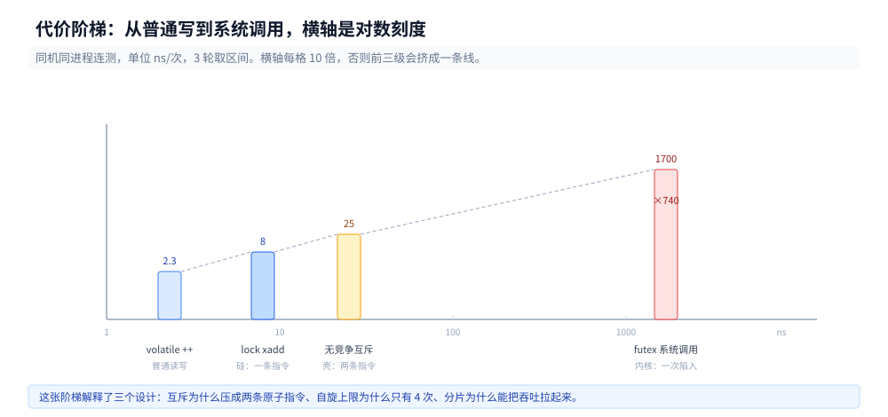
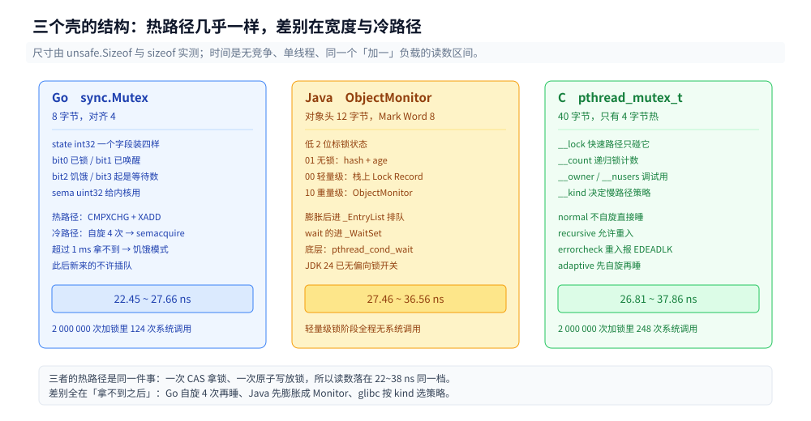

# 互斥的实现

> 覆盖：`sync.Mutex` 的 `Lock` 为什么只有两条原子指令、临界区里到底有没有系统调用、futex 的三态协议与 `EAGAIN` 是什么意思、200 万次加锁进内核几次、一次进内核比一次原子操作贵多少倍、Go / Java / C 三个壳各包了什么、什么时候该怀疑慢路径。
>
> 不覆盖：`lock` 前缀锁的是缓存行、CAS 的成败与重试代价、x86 上四种内存序的指令差 → [原子操作.md](原子操作.md)；屏障要花多少钱、写下去的值多久被另一个核看见 → [内存屏障与内存序的代价.md](../缓存与内存/内存屏障与内存序的代价.md)。
>
> 内容整理自个人学习笔记，素材见 [素材清单](../../../素材清单.md)。Go 读数在 `Intel Core i7-6700HQ @ 2.60GHz`（4 核 8 线程）+ `go1.26.5 windows/amd64` 上实测；C 与 Java 读数在 WSL2 容器里实测（`gcc 12.2.0` / `glibc 2.36` / `Temurin 24.0.2`，`nproc=4`）。

---

## 一、从零：`mu.Lock()` 到底做了什么？

**本节要点**：`mu.Lock()` 编出来是**一条 `lock cmpxchg` 加一个分支**，`mu.Unlock()` 是一条 `lock xadd` 减一。只有分支跳进慢路径时才可能碰内核。这就是「加锁只要 22 ns，而一次系统调用要 1.7 µs」的全部原因。

### 1.1 一个 105 字节的函数

`mu.Lock(); y++; mu.Unlock()` 整个函数编出来 105 字节，其中加锁部分：

```asm
LEAQ    asmlab.mu(SB), CX
MOVL    $1, DX
LOCK
CMPXCHGL DX, (CX)         ; state: 0 → 1
SETEQ   DL
TESTB   DL, DL
JNE     59                ; 成功 → 直接跳到临界区，不进内核
LEAQ    asmlab.mu(SB), AX
CALL    internal/sync.(*Mutex).lockSlow   ; 失败才走慢路径
```

解锁部分：

```asm
MOVL    $-1, BX
LOCK
XADDL   BX, (CX)          ; state -= 1
DECL    BX
JEQ     92                ; 减完为 0 → 直接返回
LEAQ    asmlab.mu(SB), AX
CALL    internal/sync.(*Mutex).unlockSlow
```

两条汇编说明三件事：

1. 无竞争时**没有函数调用、没有系统调用**，只有一次 `cmpxchg`（拿锁）和一次 `xadd`（放锁）；
2. 这解释了无竞争时 `sync.Mutex` 的 22~28 ns：正好约等于两次原子操作（各 8~14 ns）加上分支与函数序言；
3. 「慢路径」是一个独立函数，不执行就不占指令缓存 —— 编译器把热路径压到了最短。

### 1.2 先看一个不可能的比值

同一个「加一」负载，单线程三档：

| 实现 | Go（Windows 原生） | C（WSL2） | Java（WSL2） |
|---|---|---|---|
| 普通 `++` | 2.20~2.43 | 2.24~2.97 | 0.83~1.89 |
| 原子加 | 9.50~10.22 | 9.69~16.73 | 8.16~8.98 |
| 互斥加 | 22.45~27.66 | 26.81~37.86 | 27.46~36.56 |

（单位 ns/op，各三轮区间。）

这里藏着一个矛盾：这批机器上一次系统调用要 **1.6~1.8 µs**（见 3.2），如果每次 `mu.Lock()` 都要进内核，互斥加应该是 **1700 ns 量级**，而不是 25 ns。**差 70 倍。**

结论只能是：绝大多数 `Lock` 根本没进内核。1.1 的汇编给出了机制，本节后面几节给出计数。

### 1.3 本篇走下面两层

原子性由谁保证可以分三层，本篇只看后两层：

| 层 | 提供什么 | 本篇 |
|---|---|---|
| 硅（`LOCK` 前缀、MESI） | 让**一条**读-改-写不可分割 | 见 [原子操作.md](原子操作.md) |
| 内核（futex / sema） | 让**线程**睡下与醒来 | 第 2、3 节 |
| 语言壳（`sync.Mutex`、`ObjectMonitor`、`pthread_mutex_t`） | 把上面两层组合起来 + 排队策略 | 第 4 节 |

三层的分工图在 [原子操作.md](原子操作.md) 第 1.5 节。

---

## 二、慢路径：futex 的三态协议

**本节要点**：Linux 上「睡」与「醒」只有一个系统调用，靠共享内存里一个 32 位整数协调，三种取值对应「空闲 / 已锁无等待者 / 已锁有等待者」。`futex_wait` 的第二个参数让「检查」与「睡下」在内核里变成一个原子动作，堵住丢唤醒。

### 2.1 三个值和三十行 C

| 值 | 含义 |
|---|---|
| 0 | 空闲 |
| 1 | 已上锁，没有等待者 |
| 2 | 已上锁，**有**等待者 |

加锁的完整逻辑（Ulrich Drepper 论文的经典写法）可以用 30 行 C 写完：

```c
static void my_lock(void) {
    int c = 0;
    if (atomic_compare_exchange_strong(&word, &c, 1)) return;  // 快路径，0 次系统调用

    if (c != 2) c = atomic_exchange(&word, 2);   // 声明「有等待者」
    while (c != 0) {
        futex_wait(&word, 2);                    // 睡到 word != 2
        c = atomic_exchange(&word, 2);
    }
}

static void my_unlock(void) {
    if (atomic_fetch_sub(&word, 1) != 1) {       // 原来是 2 → 有等待者
        atomic_store(&word, 0);
        futex_wake(&word, 1);
    }
}
```

关键在 `futex_wait(&word, 2)` 的第二个参数：**内核在睡下去之前会再查一次 `word` 是不是还等于 2**。如果已经被改成 0 了，直接返回 `EAGAIN`，不睡。这一步把「检查」与「睡下」变成了一个原子动作，堵住了「我检查时锁还在，睡下去之后锁已释放」的丢唤醒窗口。


### 2.2 strace 抓到的三种形态

原始行印证了这三态：

```text
[pid 759] futex(0x5c6c5a94d050, FUTEX_WAKE_PRIVATE, 1) = 0      ← 唤了个空：对方还没睡下
[pid 759] <... futex resumed>)        = 1                        ← 这次真唤醒了一个
[pid 759] <... futex resumed>)        = -1 EAGAIN (Resource temporarily unavailable)
```

最后一行是「进了内核才发现不用睡」：内核在真正挂起线程之前会再核一次 futex word 是否还等于 2，不等就立刻返回 `EAGAIN`。这一次运行（4 线程 × 20 万次）里，`WAKE` 返回 0 有 **8** 次、返回 1 只有 **1** 次、`EAGAIN` 有 **49** 次 —— 唤醒时绝大多数情况下对方**还没睡下**，睡下去这个动作本身就来不及。

`FUTEX_WAKE` 返回 0 表示「唤了个寂寞」：放锁的一方以为有人睡，其实对方还在用户态重试。这个返回值在工程上有用 —— 它是「临界区太短、等待者来不及睡」的直接证据。

⚠️ 用 `strace -f` 数调用次数时要注意形态：一次真正的睡眠会以 `<unfinished ...>` 和 `<... futex resumed>) = x` 两行成对出现，只 `grep "= 0"` 会漏掉一半。计数用 `-c`，看形态再单独挑行。

---

## 三、200 万次加锁，只有几百次进内核

**本节要点**：三种实现、200 万次加锁，`strace` 数出来只有 124~556 次 futex 调用（0.006%~0.028%），其中约三成还是 `EAGAIN` 白跑。而一次系统调用比一次原子操作贵 200 倍 —— 这两个数字一起解释了所有锁的设计取舍。

### 3.1 三种实现的调用次数

三种实现、同一个负载（4 线程 × 50 万次判空临界区），`strace -f -c -e trace=futex` 数出来的调用次数：

| 实现 | 加锁次数 | futex 调用 | 其中 `EAGAIN` | 比例 |
|---|---|---|---|---|
| 手写 futex 锁 | 2 000 000 | 556 | 170 | 0.028% |
| `pthread_mutex` | 2 000 000 | 248 | 70 | 0.012% |
| Go `sync.Mutex`（容器内 Linux） | 2 000 000 | 124 | 12 | 0.006% |

三个数据各说明一件事：

- **有竞争 ≠ 每次都进内核。** 临界区只有一条 `counter++`，等待者到达时锁往往已经放掉了，慢路径在「睡」之前就重新拿到了；
- **`pthread_mutex` 比手写版少一半**，因为 glibc 在慢路径上还有一层用户态重试；
- **Go 最少（124 次）**，因为 `lockSlow` 在 `semacquire` 之前先自旋 4 轮，转到就返回。

`EAGAIN` 占手写版 futex 调用的 31%（170/556），也就是说**三分之一的「进内核」是白跑**：进去了，发现不用睡，立刻回来。

⚠️ 这台机器是 Windows + WSL2，Go 的原生实现走的是 `WaitForSingleObject` 而不是 futex；上表的 Go 一行是在 `golang:1.26` 容器内重跑得到的。本机 Go 的 22~28 ns 与容器内 24.5~60 ns 的差异主要来自 WSL2 的调度开销，不是实现差异。

### 3.2 一次进内核到底多少钱

同机同进程连着测五件事，单位 ns/次：

| 动作 | 三轮读数 |
|---|---|
| `volatile` 加一（普通 load+store） | 2.63 / 2.24 / 2.27 |
| `lock xadd`（原子读-改-写） | 8.22 / 7.52 / 7.61 |
| `getpid()`（最快的一类系统调用） | 1610.35 / 1829.24 / 1654.41 |
| `futex(WAKE)` 无等待者 | 1807.86 / 1704.76 / 1719.79 |
| `futex(WAIT)` 值不匹配（`EAGAIN`） | 1825.12 / 1798.20 / 1760.47 |



**原子操作 : 系统调用 ≈ 1 : 210。** 这张阶梯解释了前面所有设计取舍：

- 为什么 `sync.Mutex` 要压成两条指令 —— 一旦落到慢路径，代价就是 200 倍起步，还不算后续的线程唤醒；
- 为什么自旋上限只有 4 次 —— 转一次 8 ns，睡一次 1700 ns，转 200 次才等于睡一次的价钱；
- 为什么 `LongAdder` / 分片能把吞吐拉起来 —— 它们把「所有人争一条缓存行」换成「各争各的」，连原子操作本身都少了一半。

⚠️ 这台机器上 `getpid()` 要 1.6 µs，比裸机 Linux 高一个量级，因为容器跑在 WSL2 里，每次系统调用要穿过虚拟化层。绝对值不能直接当基准用，**倍数关系比绝对值稳定**：本机 `lock xadd` 8 ns 折算约 21 个时钟周期（2.6 GHz），这是裸机也会有的量级；而 1.7 µs 的系统调用是虚拟化放大后的结果，裸机上按公开数据在 300~500 周期（本篇未在裸机 Linux 实测）。

所以后面所有「贵多少倍」的结论都要带上环境：本机是 **200 倍**，裸机上大概率是 **20~30 倍**。倍数变了，但「差两个数量级」的定性不变。

---

## 四、三语言的壳各包了什么？

**本节要点**：三个壳的**热路径**几乎一样（一次 CAS 拿锁、一次原子写放锁），差别在状态字段的宽度、排队策略、以及慢路径落到哪个内核原语上。Go 的 `sync.Mutex` 8 字节，glibc 的 `pthread_mutex_t` 40 字节，Java 的对象头 12~16 字节里塞 8 字节 Mark Word。



### 4.1 Go：一个 int32 装下四种状态

`unsafe.Sizeof(sync.Mutex{})` = **8**，对齐 4：

| 类型 | 大小（本机 go1.26.5 amd64） |
|---|---|
| `sync.Mutex` | 8（`state int32` + `sema uint32`） |
| `sync.RWMutex` | 24（`w Mutex` + `writerSem` + `readerSem` + 计数） |
| `sync.Once` | 12（`done atomic.Uint32` + `m Mutex`） |
| `sync.WaitGroup` | 16（`noCopy` + `state atomic.Uint64` + `sema`） |
| `atomic.Int64` | 8，对齐 8 |

`state` 这 32 位里挤了四种信息：

| 位 | 含义 |
|---|---|
| bit0 `mutexLocked` | 已上锁 |
| bit1 `mutexWoken` | 已唤醒一个等待者 |
| bit2 `mutexStarving` | 饥饿模式 |
| bit3 起 | 等待者计数（`mutexWaiterShift = 3`） |

这解释了 1.1 的汇编为什么是 `CMPXCHG 0→1` 与 `XADD -1`：状态与计数在同一个字里，一次原子操作就能同时完成「加锁」和「记账」。

**正常模式 vs 饥饿模式**：等待者先自旋 4 轮，转不到就排队；如果排队后超过 1 ms 还没拿到锁，把 `mutexStarving` 置位，此后**放锁直接把锁交给队首**，新来的 goroutine 不许插队。这条设计针对的正是「超订时 CAS 抢占有排队者饿死」那个读数（见 [原子操作.md](原子操作.md) 第 3.2 节的 96.48 ns），1 ms 是「忍无可忍」的阈值。

内核侧：`sema` 由 `runtime_SemacquireMutex` 消费，Linux 上落到 futex，Windows 上落到 `WaitForSingleObject`。所以 3.1 表里 Go 只有 124 次 futex，是因为绝大多数等待在自旋阶段就解决了，没走到 `semacquire`。

细节（位域、饥饿模式的状态迁移）见 [并发同步原语.md](../../../01-编程语言/go/并发编程/并发同步原语.md)。

### 4.2 Java：Mark Word 与三次膨胀

Java 的对象头在 64 位 JVM 上是 12 字节（Mark Word 8 + 压缩后的 Klass 指针 4），Mark Word 的 8 字节被复用成四种含义：

| 锁状态 | Mark Word 低 2 位 | 内容 |
|---|---|---|
| 无锁 | `01` | hashCode(31) + 分代年龄(4) + 0 |
| 轻量级锁 | `00` | 指向**栈上 Lock Record** 的指针 |
| 重量级锁 | `10` | 指向 `ObjectMonitor` 的指针 |
| GC 标记 | `11` | — |

加锁的路径就是这三态的迁移：

1. **无锁 → 轻量级**：在当前线程栈帧里分配一个 Lock Record，把 Mark Word 用 CAS 换进去。成功即拿到锁，**全程没有系统调用** —— 这就是 `synchronized` 无竞争时 27~37 ns 的来源。
2. **轻量级 → 重量级（inflate）**：CAS 失败且自旋无效，向 JVM 申请一个 `ObjectMonitor`，把 Mark Word 改成指向它。此后竞争者进入 `_EntryList`，`wait()` 的进 `_WaitSet`，`_owner` 记持有者。
3. **重量级 → 睡**：`ObjectMonitor::enter` 在 Linux 上走 `os::PlatformEvent::park`，底层是 `pthread_mutex` + `pthread_cond_wait`，再往下才是 futex。**一条 `synchronized` 从 CAS 到 futex 隔了三层封装。**

⚠️ 偏向锁已经不存在了：`java -XX:+UnlockDiagnosticVMOptions -XX:+PrintFlagsFinal -version` 在 Temurin 24 上**根本搜不到 `biased` 相关的 flag**（连废弃标记都没有）。所以「偏向锁让无竞争 synchronized 免费」这条经验，在 JDK 15 之后就开始失效，JDK 18 之后彻底作废，别再用它解释现代 JVM 的行为。

队列、可重入计数与 `ReentrantLock` 的对照见 [锁与AQS.md](../../../01-编程语言/java/并发编程/锁与AQS.md)；`synchronized` 与 `AtomicLong` 的吞吐对照见 [原子类与无锁.md](../../../01-编程语言/java/并发编程/原子类与无锁.md)。

### 4.3 C：40 字节里只有 4 字节在热路径

`sizeof(pthread_mutex_t)` 在 glibc 2.36 / x86-64 上是 **40**（`pthread_cond_t` 是 48）：

```c
/* glibc 的 __pthread_mutex_s，字段名可查，顺序按版本会变 */
int __lock;            /* 快速路径只碰这 4 字节 */
unsigned int __count;  /* 递归锁用 */
int __owner;           /* 持有者 tid，调试与健壮性用 */
unsigned int __nusers; /* 使用者计数，用于 robust 语义 */
int __kind;            /* normal / recursive / errorcheck / adaptive */
...
```

只碰 `__lock` 的 4 字节，其余 36 字节是给递归、错误检查、robust 与调试用的。所以「40 字节的锁」和「8 字节的 `sync.Mutex`」在热路径上没有区别 —— 都是一次 `lock cmpxchg`。

`__kind` 决定慢路径策略，四种里 `adaptive` 会先自旋一段：

| kind | 行为 |
|---|---|
| `PTHREAD_MUTEX_NORMAL` | 不自旋，等不到就睡；同线程重入会死锁 |
| `PTHREAD_MUTEX_ERRORCHECK` | 重入返回 `EDEADLK` |
| `PTHREAD_MUTEX_RECURSIVE` | 用 `__count` 记重入次数 |
| `PTHREAD_MUTEX_ADAPTIVE_NP` | 慢路径先自旋再睡（glibc 扩展） |

这也解释了 3.1 表里 `pthread_mutex` 的 futex 次数（248）比手写版（556）少：glibc 的慢路径本身带用户态重试，很多「本来要睡」的场景在重试里就解决了。

### 4.4 三个壳放在一起比

无竞争、单线程、同一个「加一」负载，三语言读数（与 1.2 同一批数据，这里换个看法）：

| 语言 | 普通 `++` | 原子加 | 互斥加 |
|---|---|---|---|
| Go（Windows 原生） | 2.20~2.43 | 9.50~10.22 | 22.45~27.66 |
| C（`volatile`，WSL2） | 2.24~2.97 | 9.69~16.73 | 26.81~37.86 |
| Java（WSL2） | 0.83~1.89 | 8.16~8.98 | 27.46~36.56 |

（单位 ns/op，各三轮区间。）

三个跨语言、跨 OS、跨 JIT/静态编译的读数落在同一档，只有一种解释：**互斥的代价就是两次原子操作，谁也没比谁多进一次内核**。Java 的 `synchronized` 27 ns 与 Go 的 `sync.Mutex` 22 ns 相差 5 ns，还不到一次系统调用的 0.5%。

---

## 五、什么时候该怀疑慢路径？

**本节要点**：`mutex` 比 `atomic` 贵 2~4 倍是正常的，贵 50 倍以上才是慢路径成了热路径。判据是 `strace -c` 里的 `calls` 量级，不是「有没有用锁」。

### 5.1 数系统调用

```bash
strace -f -c -e trace=futex ./prog 4 500000
```

判读三条：

- `calls` 远小于加锁次数（几百 vs 几百万）→ 正常，快路径在工作；
- `errors` 占相当比例（如 170/556）→ 正常，`EAGAIN` 是「进内核前发现不必睡」；
- `calls` 与加锁次数同量级 → 慢路径成了热路径，要么临界区太长，要么等待时间太长，要么根本不该用锁。

配合三档对照更快定位（完整的三档基线在 [原子操作.md](原子操作.md) 第 3.2 节）：`mutex` 是 `atomic` 的 2~4 倍属正常，50 倍以上就直接查这一节。

### 5.2 什么时候别改

| 场景 | 别做 | 该做 |
|---|---|---|
| 读多写少 | 别上 CAS 自旋 | `RWMutex` 或 `atomic.Value` 快照 |
| 只增计数 | 别用互斥 | `LongAdder` / 分片 `atomic.Int64` |
| 临界区里有 IO | 别指望自旋 | 直接睡（mutex），自旋纯浪费 |
| 单核环境 | 别自旋 | `runtime_canSpin` 第一个条件就是 `ncpu > 1` |

最后一条是最容易被忽略的：容器里 `--cpus=1` 时所有自旋优化全部失效，压测数据会和多核环境差一个量级。

---

## 六、三组结论

**本节要点**：无竞争不进内核；进内核贵两个数量级；三个壳的热路径一样，差别只在慢路径落到哪。

### 6.1 无竞争不进内核

| 层 | 代价 | 证据 |
|---|---|---|
| 普通读写 | 2.3 ns | 3.2 表 |
| 一条 `lock` 指令 | 8 ns | 3.2 表 |
| 无竞争互斥（两条原子指令） | 22~38 ns | 4.4 表 |
| 一次系统调用 | 1.7 µs（WSL2） | 3.2 表 |

200 万次加锁只有 124~556 次系统调用（3.1 节），所以「用锁一定慢」是错的，「竞争激烈时用锁一定慢」才对。判断标准是**临界区长度与等待概率**，不是「有没有锁」。

### 6.2 进内核贵两个数量级

本机是 210 倍，裸机大概 20~30 倍。这个数量级决定了三件事的形状：

- `sync.Mutex` 的热路径必须压成两条指令（1.1 节的 105 字节里只有两条是关键路径）；
- 自旋预算只能给几百纳秒（转 200 次 ≈ 睡一次的价钱）；
- 慢路径必须有「进去发现不用睡就立刻回`EAGAIN`」的出口（3.1 节里 31% 的 futex 调用就是这种白跑）。

### 6.3 三个壳热路径一样，差别在慢路径

Go 8 字节、C 40 字节、Java 对象头 12 字节里塞 8 字节 Mark Word —— 宽度差 5 倍，无竞争开销却都在 22~38 ns。差别全在落到哪：

| 语言 | 热路径 | 慢路径落到 |
|---|---|---|
| Go | `lock cmpxchg` + `lock xadd` | `semacquire` → futex / `WaitForSingleObject` |
| Java | 栈上 Lock Record + CAS | `ObjectMonitor` → `pthread_mutex` + `pthread_cond_wait` → futex |
| C | `lock cmpxchg`（只碰 `__lock`） | glibc 用户态重试 → futex |

所以「哪个语言的锁更快」在无竞争时是个伪问题；有竞争时决定胜负的是**慢路径几层封装的厚度**与**自旋策略**，不是结构体大小。

## 校验口径

> ✅ 本篇读数的校验方式与范围（Go 侧 `Intel Core i7-6700HQ @ 2.60GHz` 4 核 8 线程 + `go1.26.5 windows/amd64`；C/Java 侧 WSL2 容器 `nproc=4`、`gcc 12.2.0`、`glibc 2.36`、`Temurin 24.0.2`）：

- **真跑**：第 1.2 / 4.4 节三语言三档吞吐（各 3 轮独立进程）；第 3.1 节 `strace -f -c -e trace=futex`（手写锁 / `pthread_mutex` / Go `sync.Mutex` 各 1 次，Go 在容器内重跑）；第 3.2 节五档代价（3 轮）；第 4 节的 `unsafe.Sizeof` 与 `sizeof(pthread_mutex_t)`
- **编译期即可确定**：第 1.1 节的 `Lock` / `Unlock` 汇编（`go build -gcflags='-S'`）；第 4.1 节的类型尺寸；`-XX:+PrintFlagsFinal` 里没有偏向锁 flag
- **源码直读**：第 1.1 节的 `lockSlow` 调用点与 `internal/sync.Mutex`；第 4.1 节的位域常量；第 4.3 节 glibc 的 `__pthread_mutex_s` 字段
- **未实测**：`PTHREAD_MUTEX_ADAPTIVE_NP` 的自旋轮数；裸机 Linux 的系统调用单价（本机是 WSL2，只有倍数关系可用）；Java 重量级锁在 `ObjectMonitor::enter` 之后的实际唤醒延迟
- **环境差异**：Go 在 Windows 原生跑（`sema` 走 `WaitForSingleObject`），C/Java 在 WSL2 容器内跑（走 futex + `pthread_cond_wait`）；两者的绝对值不可直接相减，只可比量级

| 依赖 | 实际版本 |
|---|---|
| Go | go1.26.5 windows/amd64；容器内 go1.26.8 linux/amd64 |
| GCC / glibc | 12.2.0 / 2.36（Debian 12） |
| JDK | Temurin 24.0.2+12 |
| 内核 | 6.18.54.1-microsoft-standard-WSL2 |
| CPU | Intel Core i7-6700HQ（L1d 32 KB/核、L2 256 KB/核、L3 6 MB 共享） |

## 延伸追问

- **`futex` 能不能自己用？** → 能，第 2.1 节那 30 行就是一个完整实现，3.1 表里的「手写 futex 锁」就是它。但生产代码不该自己写：`FUTEX_WAIT` 的「检查 + 睡」原子性、虚假唤醒、优先级继承、robust 语义，每一条都能让自制的锁在压力下出问题。
- **无竞争时 `sync.Mutex` 22 ns，为什么比 `atomic.Add` 的 10 ns 贵一倍？** → 因为它是两次原子操作（`CMPXCHG` 拿锁 + `XADD -1` 放锁）。`atomic.Add` 只有一次。这个比例（2:1）在三种语言上都成立（4.4 节）。
- **为什么容器里 `getpid()` 要 1.7 µs？** → 虚拟化层。WSL2 的每次系统调用都要穿过 VM 边界，成本从裸机的 100~300 ns 放大到 1.6 µs。所以容器内的「系统调用 vs 原子操作」倍数是 200 倍，裸机上大概只有 20~30 倍 —— 量级结论不变，绝对值别跨环境引用。
- **慢路径里的 4 次自旋是怎么定的？** → 是按「转一次 vs 睡一次」的价钱定的：转一次 8 ns、睡一次 1700 ns，理论上转 200 次才等价。取 4 次是保守值 —— 因为自旋期间占着 CPU，超订时会让持有者更难跑完。
- **把自旋调大能不能提高吞吐？** → 单核或超订环境下会变差。判据是 `nproc` 与并发数的比值：并发数超过核数时，自旋等于抢占持有者的 CPU，宁可直接睡。

## 关联

- **上游/总纲**：[README.md](README.md) — 本册收什么、与微架构 / 缓存与内存的边界
- **同册分工**：[原子操作.md](原子操作.md) — 本篇的 `CMPXCHG` / `XADD` 在那一篇拆到指令层
- **上游机制**：[CPU缓存与缓存行.md](../缓存与内存/CPU缓存与缓存行.md) — 抢锁为什么等于抢一条缓存行
- **上游代价**：[内存屏障与内存序的代价.md](../缓存与内存/内存屏障与内存序的代价.md) — 锁里的屏障各花多少钱
- **实现/落地**：[并发同步原语.md](../../../01-编程语言/go/并发编程/并发同步原语.md) — Go `Mutex` 位域、饥饿模式、`semacquire`
- **实现/落地**：[锁与AQS.md](../../../01-编程语言/java/并发编程/锁与AQS.md) — `synchronized` 的队列与 AQS 的对照
- **实现/落地**：[原子类与无锁.md](../../../01-编程语言/java/并发编程/原子类与无锁.md) — 无锁方案在什么时候比锁划算

> 反向引用（本篇被下列文档引到）：[README.md](README.md)、[原子操作.md](原子操作.md)、[CPU缓存与缓存行.md](../缓存与内存/CPU缓存与缓存行.md)、[并发同步原语.md](../../../01-编程语言/go/并发编程/并发同步原语.md)、[锁与AQS.md](../../../01-编程语言/java/并发编程/锁与AQS.md)
