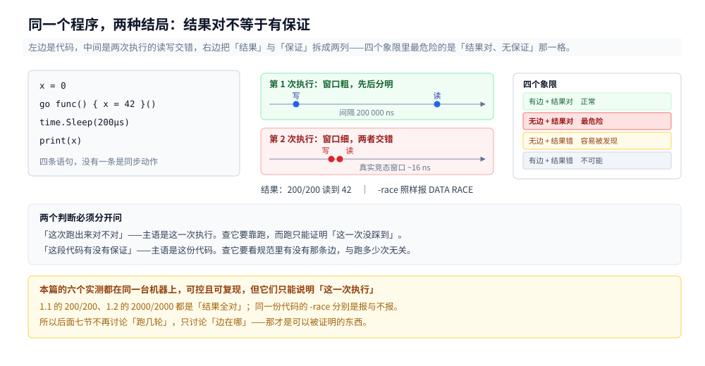
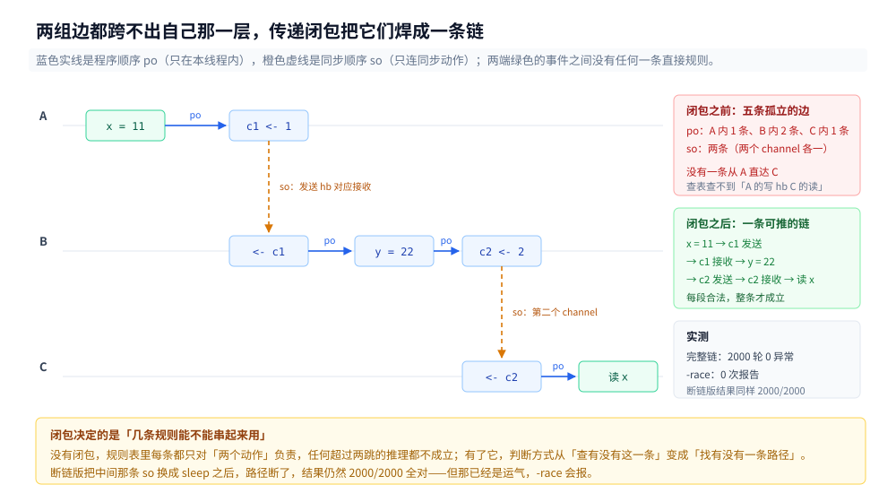
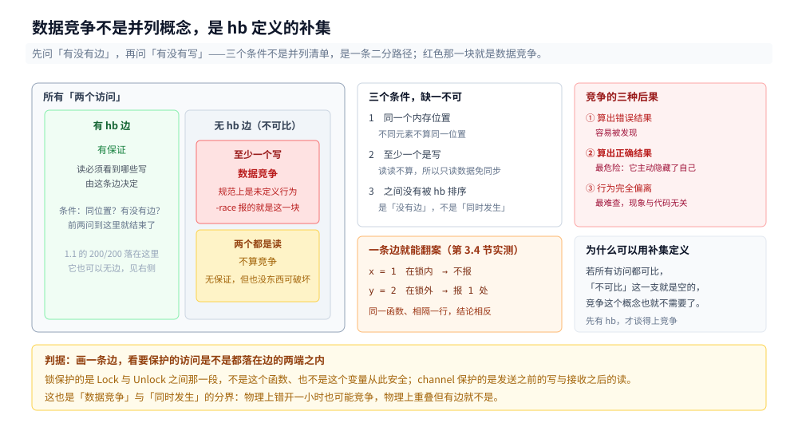
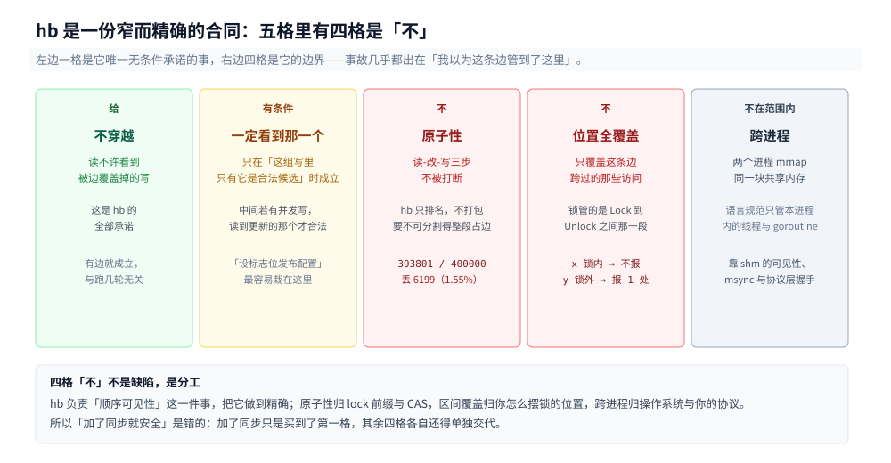

# 内存重排、Happens-Before 与数据竞争

> 这一篇不讲某一种语言规定了哪些边，只讲那套边**共用的构造**：它为什么要长成「偏序 + 传递闭包」、它的补集为什么正好是「数据竞争」、fence 那种写法为什么不够、工具又是怎么把这份声明变成可执行的检查。
>
> 规则清单不在本篇：Go 的九条见 [Go内存模型.md](../../../01-编程语言/go/并发编程/Go内存模型.md) 2.2，Java 的八条见 [JMM与内存屏障.md](../../../01-编程语言/java/并发编程/JMM与内存屏障.md) 3.1，硬件的四种屏障分类见 [内存屏障与内存序的代价.md](../缓存与内存/内存屏障与内存序的代价.md) 2.2~2.6。本篇只在这些表**之间**做判断。
>
> 内容整理自个人学习笔记。

---

## 一、为什么「跑对了」也不能证明没有竞争？

**本节要点**：并发程序的正确性有**两个不同的来源**——「这次跑出来的结果」是执行的性质，「符合规范」是规范的性质。两者可以背离，而且背离的方向往往是**结果看起来对、规范上是错的**。这一节用两个实测把这两件事切开。

### 1.1 从零：一个最简单的程序，两种结局

```go
var x int

func main() {
	x = 0
	go func() { x = 42 }()
	time.Sleep(200 * time.Microsecond)
	fmt.Println(x)
}
```

`go` 语句只保证「子 goroutine 的开始」在它之后，**不保证子 goroutine 里的写会以任何顺序对主 goroutine 可见**。所以主 goroutine 那次读 `x` 与子 goroutine 那次写 `x` 之间，规范上没有任何边——它是一次数据竞争。

跑 200 轮的实际结果：

```text
读到新值 200/200 = 100.0%｜读到旧值 0/200
```

两百次全部读到 42，一次都没读到 0。同一个程序交给 `-race`：

```text
==================
WARNING: DATA RACE
Read at 0x000000620318 by main goroutine:
  main.main()
      /tmp/r/m.go:13 +0x6d

Previous write at 0x000000620318 by goroutine 8:
  main.main.func1()
      /tmp/r/m.go:11 +0x24
==================
Found 1 data race(s)
```

一百次跑对，一百次都是错的。**这两句话不矛盾，因为它们的主语不同**：前一句的主语是「这次执行」，后一句的主语是「这份代码」。

### 1.2 更狠的一刀：结果一样，保证不一样

如果只看上面那个例子，容易得出一个自我安慰的结论：「那说明我的 `Sleep` 足够长，可以当同步用」。第二个实验专门打掉它。

两段程序，唯一差别是中间那条边。**完整版**：A 写 `x` 后往 channel 发一个值，B 收到后写 `y` 再往第二个 channel 发，C 收到后读 `x + y`。**断链版**：把 A 的那次发送换成 `time.Sleep(2 * time.Millisecond)`，其余一字不改。

```go
// 完整版的三段链
go func() { x = 11; c1 <- 1 }()           // A
go func() { <-c1; y = 22; c2 <- 2 }()     // B
go func() { <-c2; done <- x + y }()       // C
```

各跑 2000 轮：

```text
chain：2000 轮，x+y != 33 的轮数 = 0｜读到值分布 = map[33:2000]
broken：2000 轮，x+y != 33 的轮数 = 0｜读到值分布 = map[33:2000]
```

**结果完全一致，2000 轮一次都没错。** 再看 `-race`：

```text
完整版 chain ：0 次报告
断链版 broken：1 次报告
```

同一个结果，一个合法一个非法。这就是本节最要紧的一句：**结果不能反推保证**。拿「我压测过、跑了多少万次都对」来论证并发正确性，论证的其实是「我的观测窗口比竞态的窗口更粗」，而不是「这段代码有保证」。

### 1.3 为什么「跑对」是常态，不是运气

`Sleep` 之所以看起来总是管用，是因为两个时间尺度差得太远：

| 量 | 量级 | 出处 |
|---|---|---|
| 排空写缓冲（`lock or` / `mfence`） | 8~16 ns | [内存屏障与内存序的代价.md](../缓存与内存/内存屏障与内存序的代价.md) 2.5 |
| 上面那个 `Sleep` | 200 000 ns | 1.1 的代码 |

差**四个数量级**。所以在 `Sleep` 那个窗口里，子 goroutine 的写早就传播完了——不是「运气好」，是观测手段粗到看不见误差。真实的竞态窗口在个位数纳秒到几十纳秒这一档，这就是为什么它只在**高并发、频繁交错、负载高**的时候才现形，也是为什么线上第一次出事往往在生产环境而不是本地。

反过来推一条实用判据：**任何「睡一会儿就好了」的同步，都是在赌自己的睡眠时间比竞态窗口大**。这个赌注在开发机上几乎总赢，在生产机上不保证。

### 1.4 「内存重排」到底指什么

到这里可以说清篇名里那三个字了。**重排不是一个现象，是一个自由度。**

你永远观测不到「某条指令被重排了」这件事——你只能观测到「某组读写出现了不许的结果」。中间被省掉的那一步，是「在所有合法的执行顺序里，恰好选中了一个让你出错的那个」。所以更准确的说法不是「CPU 把这两条重排了」，而是「CPU 有重排这两条的自由，这次它用了」。

这份自由度来自三层，三层的规则还各不相同：编译器在单线程语义不变的前提下换序、CPU 乱序执行并把写放进写缓冲、缓存系统让写的传播不是瞬时的（三层的完整表在 [Go内存模型.md](../../../01-编程语言/go/并发编程/Go内存模型.md) 1.1，此处不重列）。

三层叠在一起，可能顺序的数量就爆炸了。**要在这个爆炸里做判断，需要一种只描述「哪些访问之间必须有顺序」、而不描述「具体是哪条指令」的语言**——那门语言就是 happens-before。第一节到这里只证明了一件事：靠结果判断不行，所以必须有一套规范层面的判据。



上下的代码一字不差，差别只在观测窗口。左侧是代码与 `Sleep`，中间是两次实际执行的读写交错，右侧是把「结果对」与「规范上对」两列拆开——它们不等价，而且四个象限里最危险的是「结果对、规范上错」那一格。

---

## 二、happens-before 这套关系是怎么造出来的？

**本节要点**：`happens-before` 不是一个被「定义出来」的直觉概念，它是**两组边取并集、再做一次传递闭包**的结果。闭包那一步不是数学装饰：它决定了零散的单条规则能不能拼成一条跨线程的链——能拼，你才能用几条规则推理任意长的路径。

### 2.1 先把「顺序」这个词拆开

规范给的边只有两组，名字都很朴素：

| 边 | 含义 | 它管到哪为止 |
|---|---|---|
| **程序顺序**（po） | 同一个 goroutine / 线程内，语句的先后 | 只在**单线程内**有效，跨线程立刻失效 |
| **同步顺序**（so） | 跨线程的同步动作之间的先后（同一把锁的解锁与加锁、同一 channel 的发送与接收、`WaitGroup` 的 `Done` 与 `Wait` 返回……） | 只连接**同步动作**，连不到普通变量 |

单看任何一组都不够用：po 出不了本线程，so 落不到普通读写。**而「A 线程的普通写」与「B 线程的普通读」之间要建立关系，恰恰必须同时穿过这两组边。**

### 2.2 传递闭包这一步在做什么

规范把它写成一行：

```text
hb = (po ∪ so)⁺
```

右上角那个加号就是**传递闭包**：把并集里所有能首尾相接的边反复接起来，直到接不出新边为止。写成推导就是那条老规则——`A hb B` 且 `B hb C`，则 `A hb C`。

这一步的用处，用一个三段链看得最清楚：

```text
A: x = 11  ──po──►  c1 <- 1
                        ┊ so
B:                    <-c1  ──po──►  y = 22  ──po──►  c2 <- 2
                                                          ┊ so
C:                                                      <-c2  ──po──►  读 x
```

A 与 C 之间**没有任何一条规则直接相连**：不同 goroutine、不同 channel、规范里也找不到「A 的写 hb C 的读」这样的条款。但沿着上面这条路径，每一段都合法：

1. `x = 11` 与 `c1 <- 1` 之间是 po；
2. `c1 <- 1` 与 `<-c1` 之间是 so（channel 发送 hb 对应接收）；
3. `<-c1` 与 `y = 22` 之间是 po；
4. 中间再由 so 接一段；
5. 最后到 `读 x` 是 po。

闭包把五段拼成一条，于是 `x = 11` hb `读 x`。实测 2000 轮：

```text
chain：2000 轮，x+y != 33 的轮数 = 0｜读到值分布 = map[33:2000]
```

⭐ 关键判断：**没有闭包，你手里的规则表就只是一堆「两个动作之间」的孤立断言，任何超过两跳的推理都不成立。** 有了闭包，「几条规则能不能串起来用」这个问题才有答案——去找路径。

### 2.3 闭包的边界：可传递不等于可推

闭包只在**找得到路径**时生效。找不到路径，结论不是「可能出错」，而是**「规范不做任何承诺」**——比「出错」更强的一种状态：出错至少还是某个具体结果，无承诺意味着连「它一定不出错」都不能说。

这就引出那个最常见的误读：**「不可比」不等于「同时发生」**。两个 goroutine 的操作即使物理上错开了一小时，只要它们之间没有 hb 边，它们在规范意义上就是**并发**的。反过来，两个操作即使物理上重叠在一起，只要有边跨过，就不是竞争。

1.2 的断链实验正是这一条的实证：`Sleep(2ms)` 让两次访问物理上分得很开，`-race` 照样报——因为**判据是「有没有边」，不是「有没有撞上」**。

### 2.4 「happens-before」是个坏名字

名字里带 `happens`，几乎所有人第一反应都是「时间上更早发生」。规范的意思不是这个，它同时断言两件事：

1. **顺序**：A 的执行结果在 B **之前可见**；
2. **可见性**：B 之后**一定**能看到 A 的写。

这两条都不涉及墙上时钟。一个更贴切的名字是「**可见于**」（is-visible-to），但术语已经固化，只能记住它不是时间关系，而是**可见性关系**。

第二件要记住的事：它是**偏序，不是全序**。任意两个操作之间可以既没有 `A hb B` 也没有 `B hb A`，这种「不可比」是常态而不是异常——偏序里允许有不可比的元素对，全序里不允许。这个区别就是并发存在的形式化表达：**如果 hb 是全序，并发就没有容身之处了。**



图的关键在右下那条折线：它从 A 线程一条普通的赋值出发，穿过两次 channel，落到 C 线程一条普通的读取。**这条路径上没有任何一段是「规范专门为这变量写的规定」**，全靠 `po` 与 `so` 交替接力、再由闭包焊接。这也是为什么单看规则表永远看不懂「为什么这行代码可见」——要画路径。

---

## 三、数据竞争为什么是 happens-before 的补集？

**本节要点**：数据竞争不是 hb 旁边并列的另一个概念，它是 hb 定义的**补集**——把「两个访问」按「有没有 hb 边」二分，有边的那一半叫「有保证」，没边的那一半再按「有没有写」二分，有写的那个子集就是数据竞争。理解了这层包含关系，才能理解为什么规范要先定义 hb、再定义竞争。

### 3.1 三个条件同时成立才叫竞争

规范给出的定义极短（以 Go 规范原文为例）：

> A data race is defined as two accesses to the same memory location, at least one of which is a write, that are not ordered by happens-before.

拆成三条，**缺一不可**：

| # | 条件 | 常见误读 |
|---|---|---|
| 1 | 同一个内存位置 | 「同一行代码」不等于同一位置；`a[i]` 与 `a[j]` 两个不同元素不是同一位置 |
| 2 | 至少一个是**写** | 两个都是读不算竞争——这就是「共享只读数据不用同步」的规范依据 |
| 3 | 它们之间**没有被 hb 排序** | 不是「同时发生」，是「没有边」 |

三个语言的说法几乎逐字对应：C11 叫 `conflicting actions`（同一位置、至少一个写）加「没有 hb 排序」，Java 叫 `data race`，判据同样落在这三条上。措辞不同，结构一样——**这说明它是这套模型的内生结论，不是某个语言的偏好**。

### 3.2 它是补集，不是并列

把这件事画成集合就一目了然：

```text
所有「两个访问」
   ├── 有 hb 边 ──────────────► 有保证（读必须看到哪些写由边决定）
   └── 无 hb 边（不可比）
          ├── 至少一个写 ─────► 数据竞争（未定义行为）
          └── 两个都是读 ─────► 良性并发（无保证，但也没有写会被破坏）
```

这张图说明了一件容易被忽略的事：**数据竞争这个概念的存废，完全取决于 hb 的存在**。如果所有访问之间都有边（比如全程序只用一把全局锁），那「不可比」这个分支是空的，竞争也就不存在了。所以不是「先有竞争问题，再用 hb 去解决」，而是**「先用 hb 定义什么叫可比，再用不可比定义什么叫错」**。

这也解释了为什么规范可以写出那句看起来极端的话——「包含数据竞争的程序具有未定义行为」。因为竞争的定义里已经蕴含了「这组访问没有任何顺序承诺」，既然没有承诺，编译器当然可以假设它不存在。

### 3.3 三类形态，一类不算

| 形态 | 例子 | 是竞争吗 | 说明 |
|---|---|---|---|
| **写 + 读** | 一个 goroutine 写标志位，另一个读它 | 是 | 最常见的一类，`-race` 报出来的绝大多数是这个 |
| **写 + 写** | 两个 goroutine 各自给同一个计数赋值 | 是 | 后果是丢更新，且**可能两个都「成功」** |
| **读 + 读** | 两个 goroutine 都只读配置 | **不是** | 只读数据不需要同步；但要注意「读的时候别有人在写」 |

第三行值得多说一句：它之所以不算，不是因为「读不会破坏数据」，而是因为**读读之间没有可观测的顺序差异**——无论按哪种顺序读，结果都一样。这条判据在所有语言、所有硬件上都成立。

### 3.4 「同时发生」不是判据，一条边就能翻案

同一个函数里，两条写相隔一行，结论可以完全相反。实测程序：

```go
go func() { // A
	mu.Lock()
	x = 1          // 写在锁内
	mu.Unlock()
	y = 2          // 写在放锁之后
}()
go func() { // B
	time.Sleep(time.Millisecond)
	mu.Lock()
	rx := x        // 读在锁内
	ry := y        // 读也在锁内
	mu.Unlock()
	fmt.Printf("rx = %d｜ry = %d\n", rx, ry)
}()
```

`-race` 的输出：

```text
WARNING: DATA RACE
Write at 0x000000626328 by goroutine 8:
  main.main.func1()   /tmp/hb/e3/main.go:32
Previous read at 0x000000626328 by goroutine 9:
  main.main.func2()   /tmp/hb/e3/main.go:40
Found 1 data race(s)
```

报告里只出现 `y = 2`（写）与 `ry := y`（读）两处，**`x = 1` 与 `rx := x` 一次都没出现**。原因就在那一行的位置：

- `x` 的写在 `mu.Unlock()` **之前**，而 B 的读在 `mu.Lock()` **之后**——「A 的 Unlock hb B 的 Lock」这条边**跨过了它**，所以有保证，程序打印 `rx = 1`；
- `y` 的写在 `mu.Unlock()` **之后**，落在那条边的覆盖范围**之外**——所以无保证，程序打印 `ry = 2` 纯属运气（值确实读到了，但没有承诺）。

⭐ 这是本节最实用的一条判据：**一条边只覆盖它跨过的那些访问**。锁保护的是「它包住的那几条语句」，不是「整个函数」，也不是「这个变量从此安全」。

### 3.5 竞争的后果不是「随机数」

很多人把「未定义行为」理解成「结果随机」。实际后果有三种，而且**最坏的是第二种**：

| 后果 | 表现 | 危险程度 |
|---|---|---|
| 算出错误结果 | 计数少了、状态错了 | 有，但容易被发现 |
| **算出正确结果** | 1.1 的 200/200 | **最高**——你会以为代码没问题，直到换机器、换版本、加负载 |
| 行为完全偏离 | 循环被优化成死循环、对象状态不可能 | 最难查，因为现象和代码看起来无关 |

第二种之所以最危险，是因为它**主动隐藏了自己**。1.1 的实验跑了 200 轮全对，1.2 的断链版跑了 2000 轮全对——如果只看结果，它们都是「好代码」。



从外往内读这张图：外圈任何两个访问，先问「有没有 hb 边」——有边进中间圈，得到保证；无边再问「有没有写」——有写进内圈（数据竞争），两个都读则落在中间圈与内圈之间的环带上，属于「无保证但也无害」。**三个条件不是并列的清单，是一条二分路径。**

---

## 四、有了 fence，为什么还要 happens-before？

**本节要点**：fence 与 hb 是两种**描述顺序的方式**，不是两种机制。fence 是操作式的（imperative）：你得逐条指明「这里加什么屏障」；hb 是声明式的（declarative）：你只声明「这两个访问之间有没有边」。换成声明式的根本原因不是「更好看」，而是**规格不能随平台变**——同一段发布订阅在 x86 上 0 条指令、在 arm64 上要好几条，如果需求按 fence 写，同一份需求就得写两份规格。

### 4.1 两种写法摆在一起

| | 按 fence 描述 | 按 hb 描述 |
|---|---|---|
| 你写什么 | 「这条 load 之前插 `lfence`，这条 store 之后插 `sfence`」 | 「这个写 happens-before 那个读」 |
| 你要知道什么 | 编译器的所有重排规则 + CPU 的所有重排规则 + 平台差异 | 只需要知道同步动作在哪 |
| 换平台要改什么 | **需求本身**（x86 的 0 条变 arm64 的 `STLR`） | 只改编译器，需求不动 |
| 出错时看什么 | 「我漏了哪条指令」 | 「这两个访问之间没有路径」 |
| 谁负责落地 | 你 | 编译器 + CPU |

两种写法都能表达「先写数据、再写标志、对方先读标志、再读数据」这个需求。差别在于**这份需求写在哪一层**：写在前者，它就和具体平台绑死了；写在后者，它是一份可移植的声明。

### 4.2 平台差异会把规格弄脏

同一段「发布-订阅」，两种架构的落地差得很远：x86 上 `release` store 就是一条普通 `mov`（0 条屏障）、`acquire` load 也是 `mov`；arm64 上分别要 `STLR` 与 `LDAR`，`fence(acquire)` 甚至要独立的 `DMB`。

如果规格按 fence 写，这段需求在 x86 上写出来是「什么都不用加」，在 arm64 上写出来是「加两条」。**同一件事，两份规格**——而且一旦移植，你得重读一遍所有 `ifdef`，确认哪几条屏障在新平台上不再需要、哪些新平台要而旧平台没有。这是把「平台差异」泄漏到了「需求」这一层。

hb 的写法把这份差异**全部收进「编译器怎么翻译」这一层**：需求永远是「这个写 hb 那个读」，x86 的编译器把它翻成 0 条指令、arm64 的编译器把它翻成两条。这也是为什么同一份 Go 代码在两种架构上二进制不同、而语义相同。四种屏障在两种架构上的指令对照见 [原子操作.md](../底层同步/原子操作.md) 4.4。

### 4.3 「可观察行为」：为什么这份声明就够

到这里要回答一个更根本的问题：**凭什么只声明「可见性」，就能替代「逐条指令加屏障」这么细的控制？**

答案是：一个程序能观察到的东西是有限的。并发程序能观察到的，只有两类——

1. **每个读读到了什么值**；
2. **同步动作的成败**（锁拿到了没、channel 发送成功了没、CAS 成功没）。

除此之外没有第三种。而 hb 恰好把第 1 类**完全定义**了：给定一组 hb 边，每个读必须看到哪些写、不许看到哪些写，都是确定的。既然 hb 已经把「能观察到的一切」钉死，那么**中间怎么排、用几条指令排，就都是不可观察的实现细节**——编译器与 CPU 可以随便重排，只要不破坏这些边。

⭐ 这句话是理解整篇的枢纽：**hb 不生成任何指令，因为它的职责不是指挥硬件，而是定义「什么叫观察到」。** 屏障篇 6.4 那句「happens-before 本身不生成任何指令，它只是一份声明」在这里得到解释——它不是「能力不足」，而是「分工如此」：声明归规范，落地归编译器，定价归硅。

### 4.4 代价：它是充分条件，不是必要条件

hb 有一处必须记住的不对称：**有边一定有保证，没边不一定出错**。

没边只是「规范不承诺」，实际执行可能因为时序巧合而正确（1.1、1.2 的 4000 轮就是）。所以反过来推「既然没边也可能对，那不加同步也行」是错的——你放弃的不是「正确」，而是「正确性的来源」。一次机器更换、一次编译器升级、一次负载升高，就可能把那个巧合拿掉。

另一头也有个反直觉的推论：**「多加同步更保险」同样是错的**。同步不是免费的，`lock or` 8 ns、`mfence` 15 ns、一次 `futex` 系统调用 1.7 µs 都是真实价格。按 4.3 的论证，hb 只需要「够用」，多余出来的边不增加任何保证，只增加成本。选型的正确方向是**用最弱的边把事办完**，而不是把边加到最密。

### 4.5 与四类屏障的关系：局部手段与全局规格

现在可以回答一个绕了很久的问题：**hb 与那四种屏障（`LoadLoad` / `LoadStore` / `StoreLoad` / `StoreStore`）到底是什么关系？**

它们是**两个层次的东西**：

| | 四类屏障 | happens-before |
|---|---|---|
| 约束范围 | 相邻的**两次访存** | 任意两个访问（含跨线程、跨函数、跨很多跳） |
| 形态 | 局部：一格一格地挡 | 全局：一个偏序关系 |
| 谁在用 | 编译器拿它当积木去满足规格 | 你写代码时推理的对象 |
| 数量 | 正好 4 种（2 × 2） | 由规则表决定，且有传递闭包 |

一句话：**四类屏障是编译器手里的零件，hb 是它要满足的图纸。** 你在源码里写的是图纸（「这个写 hb 那个读」），编译器把它拆成零件（哪些格子要挡、在 x86 上对应哪条指令）。所以「我的代码里没看见屏障」不等于「没有屏障」——屏障是编译器加的，你看见的只有同步原语。四种屏障的分类维度与各自覆盖哪一格，见 [内存屏障与内存序的代价.md](../缓存与内存/内存屏障与内存序的代价.md) 2.2~2.6。

---

## 五、happens-before 保证了什么、又没保证什么？

**本节要点**：hb 的保证比大多数人以为的**窄**。它不是「加了同步就安全」的通行证，而是四条各有边界的承诺。把这四条边界记清，比记住九条规则表更能避免事故——因为事故几乎都出在「我以为这条边管到了这里」。

### 5.1 保证的是「不穿越」，不是「一定看到那一个」

最常见的误读是「`A hb B` 且 A 写了 `x`，所以 B 读 `x` 一定读到 A 写的值」。**只有在一组写里只有 A 时这才是对的。**

规范的一致性要求是：一个读**不许**看到「被 hb 覆盖掉的」那些写。所以边的作用是划一条下限，不是钉一个具体值：

| 场景 | `A hb R` 时 R 能读到什么 |
|---|---|
| 写 `x` 的只有 A | **必须**读到 A 写的值（唯一的合法选择） |
| A 写 1，之后另一个线程合法地写 2，R 与那个写也有边 | 读到 **2**（更新的那个）才是对的，读到 1 说明边没生效 |
| A 写 1，之后有并发写 2，R 与 2 无边 | 读到 1 或 2 都合法——**这条边不保证你拿到「那一个」** |

所以准确的说法是「**不穿越回更早**」，而不是「一定拿到 A 的值」。第三行是最容易出事的一格：你以为设了标志位、读者就能拿到你写的那份配置，实际上读者可能拿到一份更新的、也可能拿到你写的那份，取决于它跟谁有边。

### 5.2 不保证原子性

这条在概念上最好懂，实际最多人踩。实测程序：每次迭代在锁内读 `counter`、在锁外写回去：

```go
for i := 0; i < N; i++ {
	mu.Lock()
	v := counter    // 读被锁保护
	mu.Unlock()
	v++
	counter = v     // 写没被锁保护
}
```

两个 goroutine 各做 200 000 次：

```text
counter = 393801（期望 400000，丢 6199）
```

丢了 1.55%。读有边、写也有边（各自都被某条 hb 跨过），但**「读-加-写」这三步合起来不是一个不可分割的单元**——中间那段空档里，另一个线程可以合法地插进来读走同一个旧值。

⭐ 判据：**hb 是「顺序」的保证，不是「不可分割」的保证**。需要不可分割，就得让整段都落在同一条边之内（整段加锁），或者改用一条 `lock` 前缀的原子指令。

### 5.3 只覆盖它跨过的位置

3.4 的实测已经量过：同一把锁，锁内的 `x` 有保证、锁外的 `y` 无保证。这里把它归纳成一句可操作的判据：

**找一条 hb 边，然后检查你要保护的所有访问是否都落在这条边的两端之内。** 锁保护的是「`Lock` 与 `Unlock` 之间」这一区间，不是「这个函数」，更不是「这个变量从此安全」。同样地，channel 发送保护的是「发送之前的写」与「接收之后的读」，中间隔着的那段代码不在里面。

### 5.4 不跨进程

语言的内存模型只管同一进程内的线程（或 goroutine）。两个进程 `mmap` 同一块共享内存时，**语言规范一个字都没承诺**——它们之间没有 goroutine 概念、没有 channel、没有 `sync.Mutex` 的跨进程语义。

跨进程共享内存要靠操作系统与硬件的保证（`shm` 的可见性、`msync` 的时机），以及你自己在协议层设计的握手。这条边界经常被忽略，因为代码看起来「就是同一个变量」。

### 5.5 一张表收口

| 你想要的 | hb 给不给 | 缺了会怎样 |
|---|---|---|
| 「我的写别人一定看得见（不穿越）」 | ✅ 给 | 读到更早的值 |
| 「别人一定看到我写的那个值」 | ⚠️ 只在唯一写时给 | 读到更新的一份（合法） |
| 「读-改-写三步不被打断」 | ❌ 不给 | 丢更新（5.2 的 1.55%） |
| 「这个函数里所有变量都安全」 | ❌ 只覆盖边跨过的位置 | 锁外的访问仍是竞争（3.4） |
| 「跨进程共享内存也安全」 | ❌ 不跨进程 | 规范层面无任何承诺 |



五格里有四格是「不」，这正是本节的意义：**hb 是一份窄而精确的合同**，它的价值在于精确，不在于宽泛。凡是合同没写的地方，都得另找依据（原子指令、锁的区间、进程间协议）。

---

## 六、竞争检测器是怎么执行 happens-before 的？

**本节要点**：`-race` 不是「跑很多次看有没有出错」——它是把第二节那个偏序**真的算出来**：给每个线程一个向量时钟，给每个内存位置记住「上次谁访问过」，两者一比就知道有没有边。这个实现方式解释了它的两个特性：为什么同步密集时代价高出一个数量级，以及为什么「不报」不等于「没有竞争」。

### 6.1 把偏序变成可算的东西：向量时钟

单个计数器不行（它只能判「谁更晚」，判不出「可比不可比」）。所以每个线程带一个**向量**：

```text
线程 A 的向量 V_A = [a0, a1, a2, ...]     第 i 位 = A 已知的线程 i 走到的逻辑时刻
```

规则只有两条：

| 动作 | 向量怎么变 |
|---|---|
| 线程自己往前走一步 | `V_A[A] += 1` |
| 发生一次同步（加锁成功、收到 channel、`atomic` 完成） | 与对方的向量**逐位取最大**（合并） |

合并这一步就是「把对方的已知变成我的已知」，也就是在向量层面**建立 hb 边**。判据是：

```text
a hb b  ⟺  V_a 的每一位都 ≤ V_b 的对应位（且至少一位严格小于）
```

有了它，判竞争就变成一次比较：访问 `x` 时，从 shadow memory 里取出 `x` 上次被谁写过（线程 `u`、时刻 `k`），如果当前向量 `V_now[u] < k`，说明**当前线程还不知道那次写**——没有边，报竞争。

⭐ 这套东西的精髓在于：**它不需要知道全局顺序，只需要逐地址记住「上次谁碰过」。** 所以它能在线性开销内跑完，也所以它的判定永远是「相对这一次执行」的。

### 6.2 shadow memory：代价的来源

每个被插桩的内存块都要配一份影子记录（最近几次读、最近一次写的线程与时刻）。这就是 `-race` 吃内存的原因——官方口径是 5~10 倍（**本机只测了时间，没测内存，这一项未实测**）。

更重要的是它对**同步操作**的额外开销：每次 `Lock`/`Unlock` 都要合并向量，而向量长度随线程数增长。所以开销不是常数倍，而是随「同步密度」和「线程数」一起涨。

### 6.3 两档代价，差五倍

同两个程序，只差有没有同步原语，各跑 3 轮取最快：

| 档 | 不开 `-race` | 开 `-race` | 倍数 |
|---|---|---|---|
| 纯计算（400×1024 次乘加，无同步） | 690 455 ns | 2 719 015 ns | **3.94 倍** |
| 同步密集（300 000 次 `Lock`/`Unlock`） | 7 143 165 ns | 139 639 653 ns | **19.55 倍** |

折算到单次操作，后者从 **23.8 ns** 涨到 **465.5 ns**，接近 20 倍。两档差了五倍，说明**「`-race` 慢几倍」这个问题的答案取决于你的程序有多少同步**：I/O 密集或纯计算的程序可能只慢 3~4 倍，而锁密集的服务会慢到 20 倍。这个数字也顺带解释了为什么生产环境不开 `-race`——不是不想，是付不起。

### 6.4 它的判定是动态的，规范是静态的

这是本节最要紧的一段。写一个程序，两个 goroutine 各自在 1/`prob` 的概率下访问 `z`：

```go
go func() { if rand.Intn(prob) == 0 { z = 1 } }()
go func() { if rand.Intn(prob) == 0 { _ = z } }()
```

规范上，这两次访问之间没有任何边（`WaitGroup` 只连接 `Done` 与 `Wait`，不连接两个子 goroutine 之间），所以**代码里恒存在数据竞争**，与 `prob` 取值无关。实测：

```text
prob=1  ，5 轮   → 报 1 次
prob=100，200 轮，跑 3 次 → 报 0 次 / 0 次 / 0 次
```

同一段代码，只把命中概率从「必定」改成「百分之一」，检测器一次都不报。**它没有说谎，它只是没看到。**

⭐ 所以：**`-race` 通过是必要条件，不是充分条件。**「不报」的确切含义是「这次执行没踩到」，而不是「代码没有竞争」。反过来说，`-race` 报了就是真报——竞争的定义是规范层面的，检测器只要能观测到一次，就说明那次确实没有边。

### 6.5 漏报的三种来源

| 来源 | 表现 | 对策 |
|---|---|---|
| 执行没覆盖 | 6.4 那条：窄概率路径、只在特定负载下走到 | 把竞态路径做成必跑（单测覆盖 + 并发压测） |
| 没插桩 | 汇编、`cgo`、标了 `//go:norace` 的函数 | 这部分靠人审 + litmus |
| 容量上限 | 线程数或影子内存超限后退化 | 缩小 `GOMAXPROCS` 复现，或分批跑 |

三条对应三种不同性质的问题：第一条是「测不到」，第二条是「根本没测」，第三条是「测不过来」。**唯一能覆盖全部三种的手段，是回到规范层面找边**——这也是本篇存在的理由。


图的读法：左边是当前线程的向量，中间是某个地址的影子记录，比较的方向是「当前线程知道多少」。只要当前线程在写者的那一维上还落后，就说明两者之间没有边——这就是竞争。

---

## 七、同一个 hb，硬件、语言、分布式各是什么？

**本节要点**：`happens-before` 这个词在三个层次上都在用，但**边的来源、定义者、观测手段三者全不同**。它们的同构部分是「偏序 + 传递 + 不可比即并发」，不同部分是「边从哪来」——看清这一点，才不会拿一层的结论去判另一层。

### 7.1 三张脸

| 层 | 边从哪来 | 谁定义 | 怎么观测 |
|---|---|---|---|
| **硬件** | 屏障指令造成「先被看见」 | Intel SDM、ARM ARM | litmus test（SB、MP） |
| **语言** | 规范列出的同步动作（channel、锁、atomic） | go.dev/ref/mem、JLS 第 17 章、C11 | race detector |
| **分布式** | 程序顺序 + 消息传递（Lamport） | 论文与协议 | 逻辑时钟、向量时钟 |

三处都有实测或既有读数：

- **硬件**：SB litmus 跑 300 000 轮，未加屏障时 29~41 次观测到两边都读到旧值（0.01%），加 `mfence` 后三轮全 0（[内存屏障与内存序的代价.md](../缓存与内存/内存屏障与内存序的代价.md) 1.2）；
- **语言**：本篇第一节到第六节，六组读数；
- **分布式**：Lamport 时钟与向量时钟的判据见 [时钟与顺序.md](../../../04-架构与系统/分布式/理论基础/时钟与顺序.md) 二、四。

### 7.2 三者不能互相代入

三个典型错误，每一个都能在真实讨论里见到：

| 错法 | 为什么错 |
|---|---|
| 拿 Lamport 时钟值判两个语言层操作有没有 hb | Lamport 时钟只保证「有因果则递增」，**不能反推因果**——时钟值大不代表有边 |
| 拿 `-race` 的结论判硬件有没有发生重排 | 工具判的是规范层的边，不是硅上真实发生了什么；硬件重排要靠 litmus 观测 |
| 拿硬件 litmus 的结果直接推程序正确性 | litmus 观测的是「允许发生什么」，程序正确性要靠规范层的边来判 |

三者的关系不是「同一件事的三种说法」，而是**三个不同的问题碰巧用了同一个数学对象**。混淆的后果是拿一层的证据去结另一层的案。

### 7.3 同构在哪，不同在哪

**同构的三点**（这才是「同一个概念」的依据）：

1. 都是**偏序**，不是全序；
2. 都有**传递性**；
3. 都把「可比」之外的元素对叫**并发**，且都不对并发做承诺。

**不同的三点**（这才是「不能互相代入」的依据）：

| | 语言层 | 硬件层 | 分布式 |
|---|---|---|---|
| 边的性质 | **规定**的（可以查表） | **物理**产生的（要测） | **推断**出来的（要时钟） |
| 验证手段 | 查规范 + 检测器 | litmus test | 逻辑时钟、追踪 |
| 能不能穷举 | 能（规则表有限） | 不能（要采样） | 不能（要假设） |

⭐ 一句收口：**语言层的 hb 是「查出来的」，硬件层的是「测出来的」，分布式的是「算出来的」。** 三种「知道」的性质不同，所以三种「证明」的强度也不同——规范能给出确定答案，另外两个只能给出概率或推断。

---

## 八、三组结论

**本节要点**：把八节收成三句可执行的判断。

**第一组：hb 是规范对象，不是执行现象。** 1.1 的 200/200 与 1.2 的 2000/2000 说明「跑对了」证明不了任何事；同一段代码换成 `-race` 就能把「结果对」与「有保证」分开。判据是：**问「这两个访问之间有没有边」，不问「跑了一万次有没有错」。**

**第二组：数据竞争是 hb 的补集，三个条件是一条二分路径。** 先问「同不同位置」，再问「有没有边」，最后问「有没有写」——三问过完才是竞争。3.4 那个「同一个函数里 `x` 有保证、`y` 没保证」的读数，就是「一条边只覆盖它跨过的位置」的直接证据。判据是：**画一条边，看要保护的访问是不是都在边的两端之内。**

**第三组：检测器执行 hb，但只是动态近似。** 6.3 的两档代价（3.94 倍 / 19.55 倍）说明它不是免费的，6.4 的 0/0/0 说明它不是充分的。判据是：**`-race` 报了必信，`-race` 没报不能当作没有竞争——补一次规范审查，去找缺的那条边。**

## 校验口径

- **真跑**：第一节 1.1、1.2（200 轮 / 2000 轮 × 2）、3.4、5.2（200 000 × 2 次）、6.3（各 3 轮取最快）、6.4（prob=1 五轮 / prob=100 三次 × 200 轮）。环境：`golang:1.26-bookworm` 容器，`go1.26.x linux/amd64`，`nproc=4`；`-race` 用容器内自带 gcc + cgo，不经本机（本机 Windows 无 gcc）。
- **只引用未重跑**：SB litmus 的 0.01% 与四种屏障分类（[内存屏障与内存序的代价.md](../缓存与内存/内存屏障与内存序的代价.md) 1.2、2.2~2.6）；x86 / arm64 指令对照（[原子操作.md](原子操作.md) 4.4）；Lamport 时钟与向量时钟判据（[时钟与顺序.md](../../../04-架构与系统/分布式/理论基础/时钟与顺序.md) 二、四）；Go 九条与 Java 八条规则表（两篇语言侧文档，本篇不重列）。
- **未实测**：`-race` 的内存放大（官方 5~10 倍口径，本机只测时间）；arm64 侧行为（本机与容器都是 x86-64）；编译器重排的具体形态（本篇只讲「自由度」，不测「哪一条被挪了」）。

## 延伸追问

- **既然 hb 只保证「不穿越」，那「读到最新值」这件事由谁保证？** 短答：没有人保证。要「某个确定的值」只能靠「某组写里只有一个是合法的候选」——也就是重新设计数据结构（不可变快照、单写者），而不是加更强的同步。这与 [Go内存模型.md](../../../01-编程语言/go/并发编程/Go内存模型.md) 第六节说的「构造完再整体原子替换指针」是同一个思路。
- **为什么 Go 只给 `seq_cst` 一种序，而 C11 给六档？** 因为档位越多，编译器与硬件可利用的自由度越大、代价越低，但写错的概率也越高。Go 的选择是把选择权收走，代价是失去一部分优化空间。三语言在这件事上的对照见 [Go内存模型.md](../../../01-编程语言/go/并发编程/Go内存模型.md) 第六节的表。
- **`-race` 的 19.55 倍能不能降？** 能，方向是减少同步次数而不是换工具：把「每次操作都加锁」改成「分片 + 每片一把锁」或「批量合并」。这也解释了为什么无锁结构在高频路径上仍然有吸引力——不是因为它快在指令数，而是因为它少了向量的合并。
- **分布式系统的 hb 为什么不用 fence？** 因为跨机器没有共享内存，屏障指令无处可施；那里的「顺序」只能靠消息传递来传递，这就是 Lamport 那套规则的出发点。三层对照见第七节。
- **如果一段代码既有语言层竞争又是跨进程共享内存，该按哪套判？** 两套都要满足：进程内按语言规范补边，进程间按操作系统与协议层的握手补顺序。5.4 说的「不跨进程」不是「不重要」，而是「语言不管，得你自己管」。

## 关联

- [README.md](README.md) — 本册总纲：三篇的分工（定义 → 手段 → 价格）与册边界
- [原子操作.md](原子操作.md) — 下游：`lock` 前缀给出的原子性与内存序，是 hb 落在指令上的第一层
- [互斥的实现.md](互斥的实现.md) — 下游：`Lock`/`Unlock` 这条最常用的边，在无竞争时到底花了多少钱
- [内存屏障与内存序的代价.md](../缓存与内存/内存屏障与内存序的代价.md) — 上游：四种屏障的分类与单价，以及 6.4 那张「三类边落在哪一档」的表
- [CPU缓存与缓存行.md](../缓存与内存/CPU缓存与缓存行.md) — 上游：写传播为什么不是瞬时的，这是重排自由度里最贵的一层
- [Go内存模型.md](../../../01-编程语言/go/并发编程/Go内存模型.md) — 语言侧：Go 的九条规则、`-race` 的用法与五类写法坑
- [JMM与内存屏障.md](../../../01-编程语言/java/并发编程/JMM与内存屏障.md) — 语言侧：Java 的八条规则、`volatile` 的边界与安全发布
- [时钟与顺序.md](../../../04-架构与系统/分布式/理论基础/时钟与顺序.md) — 另一层：同一个偏序在分布式里的载体是逻辑时钟
- [目录.md](../../../目录.md) — 全仓知识点索引

