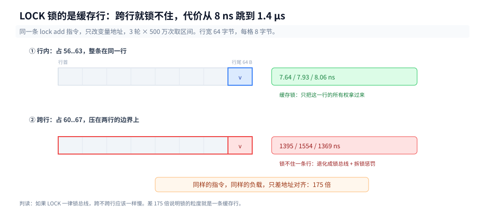

# 原子操作

> 覆盖：`i++` 编译成一条指令为什么还丢、`lock` 前缀锁的是**缓存行**不是总线（跨行贵 175 倍）、`xchg` 为什么不带前缀也原子、CAS 的成败靠哪一位回报、失败重试为什么随竞争非线性上升、x86 上四种内存序的指令差。
>
> 不覆盖：无竞争互斥为什么不进内核、futex 三态协议、三语言锁结构差多少 → [互斥的实现.md](互斥的实现.md)；屏障要花多少钱、跨核可见延迟有多宽 → [内存屏障与内存序的代价.md](../缓存与内存/内存屏障与内存序的代价.md)；MESI 与伪共享 → [CPU缓存与缓存行.md](../缓存与内存/CPU缓存与缓存行.md)；Go `atomic` 的 API 与对齐坑 → [atomic操作.md](../../../01-编程语言/go/并发编程/atomic操作.md)；Java 原子类的字节码链、`LongAdder` 分片、ABA → [原子类与无锁.md](../../../01-编程语言/java/并发编程/原子类与无锁.md)。
>
> 内容整理自个人学习笔记，素材见 [素材清单](../../../素材清单.md)。Go 读数在 `Intel Core i7-6700HQ @ 2.60GHz`（4 核 8 线程）+ `go1.26.5 windows/amd64` 上实测；C 读数在 WSL2 容器里实测（`gcc 12.2.0` / `glibc 2.36`，`nproc=4`）。
>
> ⚠️ 本篇定位：虽然实验代码大量使用 Go，但 MESI 与 `LOCK` 前缀属于硬件底座。Go 仅作为验证工具，原理同样适用于 C/C++/Java/Rust。

---

## 一、从零：三个线程各加一百万次，为什么少了四成？

**本节要点**：`i++` 编译出来只是一条指令，但它在硬件上仍是「读 → 改 → 写」三步，三步之间可以被别人插进来。三语言同一负载的丢失率都在 30%~70%，而且**每轮都不一样**。

### 1.1 同一份逻辑，三种语言

Go 版最短，先看它：

```go
var plainC int64

func work(iters int, wg *sync.WaitGroup) {
	defer wg.Done()
	for i := 0; i < iters; i++ {
		plainC++
	}
}
```

C 版把 `plainC++` 换成 `counter++`，Java 版换成 `plain++`，其余结构一致：起 n 个线程、各加 `iters` 次、汇合后比对期望值。

| 语言 | 线程 | 期望 | 实得（三轮） | 丢失率 |
|---|---|---|---|---|
| Go（8 逻辑核） | 2 | 2 000 000 | 1 025 752 / 1 302 003 / 1 044 180 | 34.9%~48.7% |
| Go | 4 | 4 000 000 | 1 123 360 / 2 289 984 / 1 536 250 | 42.8%~71.9% |
| Go | 8 | 8 000 000 | 3 024 625 / 3 178 346 / 3 451 350 | 56.9%~62.2% |
| C（`volatile`，4 CPU） | 2 | 20 000 000 | 11 635 161 / 12 554 166 / 13 941 607 | 30.3%~41.8% |
| C | 4 | 40 000 000 | 22 140 580 / 19 358 983 / 17 350 059 | 44.6%~56.6% |
| Java（4 CPU） | 2 | 20 000 000 | 10 057 804 / 10 216 613 / 10 255 894 | 48.7%~49.7% |
| Java | 4 | 40 000 000 | 29 064 592 / 21 418 220 / **40 000 000** | 0%~46.5% |

最后一行加粗的那个数字是本节最重要的一个读数：同一份 Java 代码、同一个负载、同一个容器，**第三轮一次都没丢**。

### 1.2 丢失率不是一个常数

三轮之间能差 20 个百分点，是数据竞争的正常表现：谁丢、丢多少，取决于两条指令的交错序列，而交错由操作系统的调度决定，你控制不了。

所以「我跑了一次，结果是对的」这句话**不能作为正确性证据**。判据只能来自两处：

- 工具：Go 的 `-race`、C 的 `-fsanitize=thread`、Java 的 `jcstress`；
- 指令层面：确认生成的是带 `LOCK` 前缀的读-改-写，而不是 `INCQ` / `addq`。

### 1.3 `INCQ` 为什么还是丢

`plainC++` 在 Go 里编成这样一条：

```asm
INCQ    asmlab.x(SB)
```

一条指令，看起来不可分割。但它不是：`INC` 对内存操作数在微架构上展开成「读缓存行 → 加法器 → 写回」三步，中间没有任何机制阻止另一个核同时读同一行。


上图是留一帧就够解释的事：两次加法，一次结果被覆盖。第 2 节开始，我们要么给这条指令加个前缀让三步变成不可分割，要么在指令外面套一个「同一时刻只许一个线程进」的协议。

### 1.4 但在测之前，编译器会先把你骗掉

这是本轮实验里最花时间的一课：**同一份 C 代码，加不加 `volatile`，结论完全相反。**

`long counter; counter++;` 在 `-O2` 下被 GCC 整体提出循环：

| `iters` | 总耗时 | 折算 |
|---|---|---|
| 500 000 | 0.3~0.8 ms | — |
| 5 000 000 | 0.2~0.5 ms | — |
| 50 000 000 | 0.2~0.5 ms | — |

迭代量涨 100 倍、耗时纹丝不动 —— 说明循环根本没跑，编译器把它变成了循环外的一次 `counter += iters`。这一版测出来「4 线程 2 亿次一次不丢」，纯属假象：每个线程只写了一次，写窗口短到撞不上。

加上 `volatile` 之后（1.1 表的 C 行），丢失率立刻回到 30%~57%，且耗时随 `iters` 线性增长 —— 这才是真在跑。

三个自查判据，缺一不可：

| 判据 | 含义 |
|---|---|
| 耗时随 `iters` 线性增长 | 循环没被外提 |
| 单线程结果等于期望值 | 基准本身没写错 |
| 多线程结果**小于**期望值 | 竞争真的发生了（若是「大于」说明统计逻辑有 bug） |

同类的坑 Java 也有：1.1 表第三轮 `t=4` 一次不丢，同时耗时只有 18.6 ms（另两轮 94.7 / 19.9 ms），C2 已经把 `plain++` 的循环收缩了。**看到「一次不丢」先怀疑测量，再怀疑结论。**

### 1.5 本篇只走第一层

原子性由谁保证，可以分成三层，边界清楚，混在一起就说不明白：


| 层 | 提供什么 | 你直接接触到的 |
|---|---|---|
| 硅（`LOCK` 前缀、MESI） | 让**一条**读-改-写不可分割 | `atomic.AddInt64`、`x++` 加不加前缀 |
| 内核（futex / sema） | 让**线程**睡下与醒来 | 只有慢路径才碰得到，代码里看不见 |
| 语言壳（`sync.Mutex`、`ObjectMonitor`、`pthread_mutex_t`） | 把上面两层组合起来 + 排队策略 | `mu.Lock()` |

本篇只走最上面一层（第 2、3 节），再补上「内存序给了哪几条指令」（第 4 节）。下面两层见 [互斥的实现.md](互斥的实现.md) —— 那篇的第一个读数就是：200 万次加锁只有几百次真的进了内核。

---

## 二、`lock` 前缀到底锁了什么？

**本节要点**：它锁的不是「总线」，也不是「变量」，而是**缓存行**。行内操作靠 MESI 拿到独占（7~8 ns），跨界操作锁不住一条行，代价跳到 1.4 µs（175 倍）。

### 2.1 三条指令的对照

同一台机器、同一份 Go 源码，三种写法编出来的东西：

```asm
; atomic.AddInt64(&x, 1)
LEAQ    asmlab.x(SB), CX
LOCK
XADDQ   AX, (CX)          ; f0 48 0f c1 01

; atomic.CompareAndSwapInt64(&x, old, new)
LEAQ    asmlab.x(SB), CX
LOCK
CMPXCHGQ BX, (CX)         ; f0 48 0f b1 19
SETEQ   AL

; x++（无同步）
INCQ    asmlab.x(SB)      ; 48 ff 05 ...
```

三条都是「读-改-写」，差别只有 `f0` 这一个字节。`XADD` 是「交换并相加」，它把旧值留在寄存器里，所以一条指令同时完成「读旧值」和「写新值」；`CMPXCHG` 是「比较并交换」，成功与否由 `ZF` 回报（`SETEQ` 把它搬进 `AL`）。

⚠️ 这里要小心一个常见误解：`LOCK` 不是「锁住这条指令」，它是给**这条指令要访问的那块内存**加一个执行期间的总线/缓存锁定语义。指令结束了锁就没了，剩下的一致性由 MESI 维持（见 [CPU缓存与缓存行.md](../缓存与内存/CPU缓存与缓存行.md) 第四节）。

### 2.2 缓存锁与总线锁：一个能测出来的分界

Intel 的文档说得很清楚：`LOCK` 对**可缓存**内存用 cache locking，只有当操作数跨缓存行、或落在不可缓存区域时，才退化成锁总线。这句话能不能测？能 —— 把同一个 8 字节变量挪到「跨 64 字节边界」的位置。

```c
static char buf[256] __attribute__((aligned(64)));
p_inside = (long *)(buf + 64 + 56);  /* 占 56..63，整条行内 */
p_cross  = (long *)(buf + 64 + 60);  /* 占 60..67，跨 64 边界 */
```

同一条 `lock add`，只改地址：

| 布局 | 三轮读数 |
|---|---|
| 行内（偏移 56） | 7.64 / 7.93 / 8.06 ns |
| 跨行（偏移 60） | **1395.23 / 1554.03 / 1368.86 ns** |
| 全局变量（对照） | 8.58 / 8.01 / 7.87 ns |



**175 倍。** 这个倍数就是「缓存锁 vs 总线锁」的价差，不需要看任何文档就能确认：如果 `LOCK` 一律锁总线，那么跨不跨行应该一样慢。

普通（不带 `LOCK`）的非对齐访问没有这个惩罚，x86 允许任意对齐的 `mov`。惩罚是 `LOCK` 语义独有的 —— 因为一条缓存行的所有权转移无法表达「半条行归你、半条归我」。

工程上的推论只有一条：**被多个线程读写的原子变量，必须保证不跨缓存行**。编译器与运行时会替你保证这一点（8 字节对齐的 `atomic.Int64` 不会跨行，因为 64 是 8 的倍数），但你自己拼的 `unsafe.Pointer` 偏移、`[]byte` 里手工切的 8 字节，就可能踩进去。

### 2.3 为什么 `xchg` 不带前缀也原子

再看另外两条：

```asm
; Go: atomic.StoreInt64(&x, v)
LEAQ    asmlab.x(SB), CX
XCHGQ   AX, (CX)          ; 48 87 01 —— 注意没有 f0

; GCC: __atomic_store_n(&x, v, __ATOMIC_SEQ_CST)
xchgq   x(%rip), %rdi
```

都是普通 store，但生成的不是 `mov` 而是 `xchg`，而且**都没有 `LOCK` 前缀**。

原因在 x86 的指令语义里：`XCHG` 只要操作数涉及内存，硬件就**自动施加锁定**，不需要 `f0`。所以「只有带 `LOCK` 前缀才原子」是错的，准确的说法是「`XCHG` 隐式带锁」。

为什么 seq_cst 的 store 非要编译成 `xchg`？因为 x86 的 `mov` store 只保证 StoreStore 顺序，不保证 StoreLoad；而 `xchg` 隐式带锁，锁语义天然包含「排空写缓冲」，正好补上 StoreLoad。这一点第 4 节还会回来算账。

### 2.4 对齐义务是从哪来的

三语言对原子变量的对齐要求，本质上是同一条：**别跨行**。

| 语言 | 保证方式 | 踩坑点 |
|---|---|---|
| Go | `atomic.Int64` 作为结构体首字段时 8 字节对齐；`sync/atomic` 的函数要求地址对齐 | 64 位原子操作在 32 位平台需 8 字节对齐，`go vet` 会查 |
| C11 | `_Atomic long` 由编译器按 `_Alignof` 对齐 | `packed` 结构体里的原子成员会失去对齐保证 |
| Java | JVM 字段布局保证 `long` / `double` 8 字节对齐（可能插 padding） | 32 位 JVM 上 `AtomicLong` 退化成加锁实现（`VM_SUPPORTS_LONG_CAS=false`） |

Java 那条 32 位的注释值得单独说一句：在 32 位 JVM 上，一个 `volatile long` 的读或写要拆成两条 32 位指令，硬件给不了 64 位原子性，JVM 只能用锁补。这是「原子性不是语言给的，是硬件给的」最直白的例子。

---

## 三、CAS 失败了怎么办？

**本节要点**：`lock cmpxchg` 一条指令完成「比较 + 交换」，成败由 `ZF` 一位回报。失败后重试的代价随竞争度非线性上升（Go 8 goroutine 时 96 ns vs 单线程 15 ns），因为每次重试都要重新抢一次缓存行独占。

### 3.1 成败怎么回报

两条汇编并排看，回报方式完全一样：

```asm
; Go
LOCK
CMPXCHGQ BX, (CX)
SETEQ   AL              ; ZF=1 → AL=1（交换成功）

; GCC 12（__atomic_compare_exchange_n）
lock cmpxchgq  %rsi, x(%rip)
sete           %al
```

`CMPXCHG` 的语义是：比较 `AX/EAX/RAX` 与目标内存，相等则写入源操作数并置 `ZF=1`，不等则把内存值装回 `AX` 并清 `ZF=0`。**失败时它会顺手把当前值带回来**，所以下一次重试不用重新读 —— 这是 CAS 循环能写得这么短的原因。

Go 的 `for { if atomic.CompareAndSwapInt64(&x, old, old+1) { break } }` 编出来是「读一次旧值 + CAS 循环」，每轮失败后 `old` 由 `CMPXCHG` 直接更新，不额外发 `mov`。

### 3.2 重试的代价

同一个「加一」负载，四种实现，瓶颈只在争抢方式：

| 实现 | Go t=1 | t=2 | t=4 | t=8 |
|---|---|---|---|---|
| `atomic.Add` | 10.22 | 22.12 | 24.09 | 25.33 |
| CAS 循环 | 15.44 | 40.59 | 70.59 | **96.48** |
| `sync.Mutex` | 27.66 | 24.81 | 43.87 | 70.68 |
| `plain++` | 2.20 | 2.13 | 0.96 | 1.27 |

（单位 ns/op，Go 侧单轮读数，各档独立进程。）

C 侧（4 CPU，线程数不超过核数）同一张表：

| 实现 | t=1 | t=2 | t=4 |
|---|---|---|---|
| `__atomic_fetch_add` | 9.69 / 10.59 / 16.73 | 14.85 / 15.23 / 9.19 | 21.04 / 24.38 / 14.59 |
| CAS 循环 | 16.95 / 15.13 / 21.84 | 20.75 / 25.90 / 31.26 | 22.55 / 27.46 / 36.68 |
| `pthread_mutex` | 26.81 / 34.96 / 37.86 | 54.96 / 42.30 / 36.59 | 56.62 / 60.79 / 60.78 |

两条判据：

- **CAS 循环在超订时崩得最快。** Go 的 8 goroutine 挤 4 物理核，CAS 从 15.44 涨到 96.48（6.2 倍），而 `xadd` 只从 10.22 涨到 25.33（2.5 倍）。差别在于 `xadd` 无论成败都只走一次「抢行 → 改 → 放行」，CAS 失败要再来一遍。
- **C 侧看不到这个崩溃**，因为 4 线程正好等于 4 核，没有超订。这提醒一件事：**测竞争必须让线程数超过核数**，否则测的是「排队」而不是「争抢」。

### 3.3 忙等与退避的分界

CAS 失败后有三条路：立刻重试、让出 CPU、睡进内核。分界线是**一次重试的成本 vs 一次让出的成本**：

| 动作 | 本机实测代价 | 什么时候划算 |
|---|---|---|
| 重试一次 CAS（`lock cmpxchg`） | 8~15 ns | 临界区极短、冲突概率低 |
| `runtime.Gosched()` / `sched_yield()` | 微秒级（一次调度器往返） | 持有者还需要几微秒才放锁 |
| `futex` 睡下去 | 1.7 µs（本机 WSL2） | 持有者要等毫秒级（IO、另一把锁） |

数量和直觉相反：**自旋的预算上限只有几百纳秒**，一旦估计「还要等更久」，睡比转便宜。这也是为什么 `sync.Mutex` 的自旋上限是固定的 4 次（`active_spin = 4`），而不是「转到拿到为止」。

还有一条硬约束：**单核上根本不值得自旋**。CPU 只有一个，持有者没有机会跑，转到时间片用完也等不到。Go 的 `runtime_canSpin` 第一个条件就是 `ncpu > 1`。

### 3.4 CAS 的三种失败模式

CAS 循环看着简单，出问题的地方都在「失败之后」：

| 模式 | 表现 | 归属 |
|---|---|---|
| ABA | 值改了又改回来，CAS 认为没变过 | 见 [原子类与无锁.md](../../../01-编程语言/java/并发编程/原子类与无锁.md) 第 4 节的确定性复现 |
| 活锁 | 两个线程同步重试，永远撞车 | 需要随机退避或换排队结构 |
| 缓存行抖动 | CAS 的地址是热点，重试次数与核数平方相关 | 本篇 3.2 的 96.48 ns 就是它的读数 |

活锁在小规模下测不出来，因为它需要「两个线程的重试周期完全同相」，实际系统里靠随机化躲过去；一旦躲不过，表现是 CPU 100% 而吞吐为零。

---

## 四、内存序是谁给的？

**本节要点**：x86 的 load 天然是 acquire、store 天然是 release，所以 `atomic.Load` 编成一条 `mov`、`release` store 也编成一条 `mov`；只有 seq_cst 的 store 要补 `xchg`，full barrier 要补 `lock or`。**四种内存序在 x86 上只差一条指令，而 `fetch_add` 连这一条都省不掉。**

> 本节只算「差几条指令」。这些指令各要多少钱、写下去的值多久能被另一个核看见，在 [内存屏障与内存序的代价.md](../缓存与内存/内存屏障与内存序的代价.md)。

### 4.1 一张表看完 x86 的全部差异

`gcc -O2 -S` 的原文，去掉标签与伪指令：

```asm
add_seq:      lock addq   $1, x(%rip)      ; fetch_add, seq_cst
add_relaxed:  lock addq   $1, x(%rip)      ; fetch_add, relaxed —— 一模一样
cas_seq:      lock cmpxchgq %rsi, x(%rip)  ; compare_exchange, seq_cst
              sete        %al
load_seq:     movq        x(%rip), %rax    ; load, seq_cst —— 无前缀
store_seq:    xchgq       x(%rip), %rdi    ; store, seq_cst —— xchg 自带锁
store_rel:    movq        %rdi, x(%rip)    ; store, release —— 与普通 store 同
store_rlx:    movq        %rdi, x(%rip)    ; store, relaxed —— 同上
fence_full:   lock orq    $0, (%rsp)       ; thread_fence, seq_cst
fence_acq:    ret                          ; thread_fence, acquire —— 0 条指令
inc_plain:    addq        $1, x(%rip)      ; 裸 x++
```

把这张表和 Go 的汇编对照，结论完全一致：Go 的 `atomic.LoadInt64` 也是 `MOVQ`，`atomic.StoreInt64` 也是 `XCHGQ`。**两种编译器、两套标准，落在同一组指令上** —— 因为可选的指令本来就这几条。

### 4.2 `fetch_add` 的 relaxed 省不了一条指令

最反直觉的一行是 `add_relaxed` 与 `add_seq` **逐字节相同**。

原因：x86 的 `LOCK` 语义不区分你要哪种序，它一次性给出最强的保证（相当于 full barrier）。所以：

- 想用 `relaxed` 省掉屏障？在 x86 上对**读-改-写**不成立，`lock` 前缀照样得加；
- 对**普通读**成立（本来就是 `mov`），对**普通写**部分成立（`release` 与 `relaxed` 都是 `mov`，只有 seq_cst 要 `xchg`）。

这条差异在 arm64 上才真正体现：`LDADD`（relaxed）/ `LDADDA`（acquire）/ `LDADDAL`（seq_cst）是三条不同的指令。所以「用弱内存序能提性能」这句话，**在 x86 上对原子加法是空话，在 arm64 上才是实话**。

### 4.3 拦重排的两拨人

一次重排可能发生在两个地方，拦的人不同：

| 谁在重排 | 谁拦 |
|---|---|
| 编译器（指令调度、常量提升、循环外提） | 语言的内存模型 + 编译器屏障（`atomic` 调用本身就是屏障） |
| CPU（store buffer、乱序执行、写合并） | `LOCK` / `xchg` / `mfence` / `lfence` / `sfence` |

第 1.4 节那个「循环被外提」的坑，就是第一类：编译器在**它认为没人看**的情况下把写挪了位置。`volatile` 与 `atomic` 都能拦住它，但只有 `atomic` 能同时给出第二类保证。

所以 `atomic` 之于 `volatile`，多出来的不是「禁止缓存」（现代 CPU 不会把普通变量缓存到寄存器以外的意思），而是**编译期与运行期的双重排序约束**。语言层怎么规定的，见 [Go内存模型.md](../../../01-编程语言/go/并发编程/Go内存模型.md) 与 [JMM与内存屏障.md](../../../01-编程语言/java/并发编程/JMM与内存屏障.md)。

### 4.4 换架构就不白送了

x86 是「强模型 + 少数弱序例外」，arm64 是「弱模型 + 显式屏障」，同一段代码的指令数差好几倍：

| 操作 | x86-64 | arm64 |
|---|---|---|
| `load(acquire)` | `mov` | `LDAR` |
| `store(release)` | `mov` | `STLR` |
| `store(seq_cst)` | `xchg` | `STLR`（自带 release，后续 load 由 `LDAR` 兜） |
| `fetch_add(relaxed)` | `lock add` | `LDADD` |
| `fetch_add(seq_cst)` | `lock add` | `LDADDAL` |
| `fence(acquire)` | 0 条 | `DMB ISH` 或 `LDAR` 替代 |

⚠️ 右列未在本机实测（本机是 x86-64，容器也是 x86-64），依据是 AArch64 指令集手册里 `LDAR` / `STLR` / `LDADD` 系列的定义。要复现得换 arm64 机器或用 QEMU，本轮的实验台不具备。

这也解释了一件常被忽略的事：**同一个 `atomic.Add` 在 x86 上可能只有 8 ns，到 arm64 的服务器上会变慢**。跨平台压测时把「原子操作慢」归因到代码上之前，先确认是不是换了架构。

---

## 五、怎么确认你写的真是原子操作？

**本节要点**：先看计数对不对，再看汇编里有没有那个前缀。顺序反了会把「丢更新」当成「锁太慢」。

### 5.1 先分清正确性问题与性能问题

| 现象 | 指向 | 判据 |
|---|---|---|
| 计数偏小、偶发、量随并发升高 | 缺同步 | `-race` 报 `DATA RACE` |
| 计数对，吞吐上不去 | 竞争或伪共享 | CPU/墙钟比 > 核数的一半 |
| 计数对，偶发卡顿 | 慢路径进内核太多 | `strace -c` 看 futex 次数（见 [互斥的实现.md](互斥的实现.md) 第五节） |
| 计数**偏大** | 统计逻辑写错（不是竞争） | 竞争只会丢，不会多 |

最后一行值得记：竞争的表现永远是「丢」，看到「多」直接去查自己的计数逻辑，别在内存模型上找。

### 5.2 看汇编，确认「真的一条指令」

Go 侧：

```bash
go build -gcflags='-S' ./... 2>&1 | grep -A2 -E "LOCK|XADD|CMPXCHG"
```

C 侧：

```bash
gcc -O2 -S bench.c -o - | grep -E "lock|mfence|xchg"
objdump -d ./bench | grep -E "lock|mfence|xchg"
```

两个要点：

- `-S` 看到的是**编译器**的产物，不是最终运行的代码（Go 的链接器还会改）；要看到 CPU 真正执行的，得用 `objdump` 反汇编可执行文件；
- JIT 语言（Java）的 `-S` 这一套不存在，得 `-XX:+PrintAssembly` + hsdis 插件，本轮容器里没有 hsdis，**Java 侧的机器码未实测**（`javap -c` 只能看到字节码层的 `getAndAddLong`）。

还有一个容易白测的坑：只加 `LOCK` 前缀不够，地址本身也得核对。`grep` 到的 `lock add` 如果作用在一个手工偏移出来的指针上，可能落在两条缓存行中间 —— 2.2 节的 175 倍就是这么踩出来的。

---

## 六、三组结论

**本节要点**：原子性来自一条带锁的指令；锁粒度是缓存行；屏障在 x86 上大半是白送的。

### 6.1 原子性是「指令属性」，不是「函数属性」

`atomic.AddInt64`、`i++`、`mu.Lock()` 在源码层看着完全不同，落到机器码只差一个 `f0` 字节。所以判断一段代码有没有原子性，看函数名没用，要看反汇编里有没有 `LOCK` / `XCHG`。

反过来也成立：`XCHG` 不带 `f0` 也是原子的（2.3 节），`INCQ` 带不带都没有（1.3 节）。**前缀不是判据，「指令本身的语义」才是。**

### 6.2 锁的粒度是缓存行，不是总线

同一条 `lock add`，变量在行内 7.64~8.06 ns，跨 64 字节边界 1368~1554 ns，**175 倍**。如果 `LOCK` 一律锁总线，这个差不存在。

推论有两条：原子变量必须落在一条行内（2.4 节的对齐义务就是从这来的）；想减少争抢，得把变量**分到不同的行**，而不是「加更多锁」。

### 6.3 屏障在 x86 上大半是白送的

- `load(acquire)` → `mov`，0 条附加指令；
- `store(release)` → `mov`，0 条附加指令；
- `fence(acquire)` → 0 条指令；
- `fetch_add(relaxed)` 与 `fetch_add(seq_cst)` → **同一个 `lock addq`**。

真正要花钱的只有 seq_cst 的 store（`xchg`）与 full fence（`lock or`）。换到 arm64，这张表全部作废 —— 弱内存序省下来的指令，在强模型上是省不出来的。

## 校验口径

> ✅ 本篇读数的校验方式与范围（Go 侧 `Intel Core i7-6700HQ @ 2.60GHz` 4 核 8 线程 + `go1.26.5 windows/amd64`；C 侧 WSL2 容器 `nproc=4`、`gcc 12.2.0`、`glibc 2.36`）：

- **真跑**：第 1.1 节三语言丢失率（Go / C / Java 各档均为 3 轮独立进程）；第 1.4 节 C 循环外提对照（50 万 / 500 万 / 5000 万次三档）；第 2.2 节跨行 `LOCK`（3 轮 × 500 万次）；第 3.2 节四种实现吞吐（Go 单轮、C 3 轮）
- **编译期即可确定**：第 2.1 与 4.1 节的汇编（`go build -gcflags='-S'`、`gcc -O2 -S`）
- **未实测**：`perf` 侧的 `LOCK` 指令计数（本机 Windows 无 perf）、arm64 的全部指令（第 4.4 节右列，依据 AArch64 手册）、Java 的 JIT 机器码（容器无 hsdis，只有字节码层证据）
- **环境差异**：Go 在 Windows 原生跑，C 在 WSL2 容器内跑，两者的绝对值不可直接相减，只可比量级

| 依赖 | 实际版本 |
|---|---|
| Go | go1.26.5 windows/amd64 |
| GCC / glibc | 12.2.0 / 2.36（Debian 12） |
| 内核 | 6.18.54.1-microsoft-standard-WSL2 |
| CPU | Intel Core i7-6700HQ（L1d 32 KB/核、L2 256 KB/核、L3 6 MB 共享） |

## 延伸追问

- **`lock` 前缀会不会把整个系统卡住？** → 不会。它锁的是缓存行（2.2 节的 175 倍实验证明了这个粒度），不是整条内存总线。只有跨行或不可缓存内存才退化成总线锁，那时确实会拖慢其他核 —— 这也是「原子变量必须对齐到行内」的工程原因。
- **既然 `xchg` 自带锁，为什么 `atomic.Add` 不用 `xchg` 而用 `lock xadd`？** → `xchg` 只能做「交换」，拿不到旧值参与运算；`xadd` 一条指令完成「读旧值 + 加 + 写回」，是硬件给计数器的专用指令。Java 的 `getAndAdd` 在 C2 上也 intrinsic 成 `lock xadd`，`compareAndSet` 才是 `lock cmpxchg`。
- **为什么 `atomic.Add` 单线程也要 10 ns，而普通 `++` 只要 2 ns？** → 差别就是 `lock` 前缀：它要把那条缓存行**独占**到手（MESI 从 `S`/`I` 转 `M`），即使没有别人抢，这次状态迁移本身也要几十个周期。普通 `++` 只需要行在 `M` 态，写缓冲收下就返回。
- **CAS 循环会不会活锁？** → 小规模测不出来，需要「两个线程的重试周期完全同相」。实际系统里靠随机化躲过去；躲不过时表现是 CPU 100% 而吞吐为零。见 3.4。
- **`released` 和 `relaxed` 在 x86 上真的一样吗？** → 对 store 是一样的（都是 `mov`），对 load 也是一样的（都是 `mov`）；只有 seq_cst 的 store 要 `xchg`。所以「x86 上降内存序没收益」这句只对**读-改-写**和 seq_cst store 之外的部分成立 —— 而 `fetch_add` 恰好在例外里（4.2 节）。

## 关联

- **上游/总纲**：[README.md](README.md) — 本册收什么、与微架构 / 缓存与内存的边界
- **同册分工**：[互斥的实现.md](互斥的实现.md) — 本篇只到「一条指令」，那篇接着讲「线程睡下要多少钱」
- **上游机制**：[CPU缓存与缓存行.md](../缓存与内存/CPU缓存与缓存行.md) — MESI 四态与「写一个字节要抢整行」，本篇 2.2 节的前提
- **下游代价**：[内存屏障与内存序的代价.md](../缓存与内存/内存屏障与内存序的代价.md) — 第 4 节那张「差几条指令」的表，在那里换算成纳秒
- **上游机制**：[CPU流水线与乱序执行.md](../微架构/CPU流水线与乱序执行.md) — 写缓冲与 `LOCK` 前缀为什么必须存在
- **实现/落地**：[atomic操作.md](../../../01-编程语言/go/并发编程/atomic操作.md) — Go 侧 atomic 的 API、对齐坑与 `CacheLinePad`
- **实现/落地**：[原子类与无锁.md](../../../01-编程语言/java/并发编程/原子类与无锁.md) — Java 侧字节码链、`LongAdder` 分片、ABA
- **对照/互补**：[Go内存模型.md](../../../01-编程语言/go/并发编程/Go内存模型.md) — `happens-before` 与 atomic 的同步语义
- **对照/互补**：[JMM与内存屏障.md](../../../01-编程语言/java/并发编程/JMM与内存屏障.md) — 语言层规定「什么能重排」

> 反向引用（本篇被下列文档引到）：[README.md](README.md)、[互斥的实现.md](互斥的实现.md)、[CPU缓存与缓存行.md](../缓存与内存/CPU缓存与缓存行.md)、[atomic操作.md](../../../01-编程语言/go/并发编程/atomic操作.md)、[并发同步原语.md](../../../01-编程语言/go/并发编程/并发同步原语.md)、[原子类与无锁.md](../../../01-编程语言/java/并发编程/原子类与无锁.md)、[锁与AQS.md](../../../01-编程语言/java/并发编程/锁与AQS.md)
