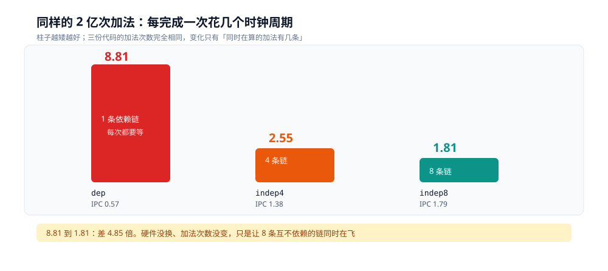

# CPU 怎么执行一条指令

> 同一件事、同样的 2 亿次加法，三种写法耗时 **8.81 / 2.55 / 1.81 个时钟周期每加法**——差别只在「这几条加法之间有没有依赖」。CPU 从来不是「一条指令一个周期」地干活：它同时开着几十条指令在飞，能飞多快由**依赖关系**决定，不由指令条数决定。
>
> 本篇讲「一条指令走完五段」这条主线：**ISA 承诺的「顺序执行」为什么在物理层从没兑现过**、取指从哪拿到地址、译码为什么必须切边界、退休为什么必须有序、每一段的价码怎么量出来、以及编译器会怎么在你测之前就把代码改掉。**指令怎么重叠着走（流水线）、猜错分支要赔多少、乱序与写缓冲如何引出内存屏障**，分别在 [CPU流水线与乱序执行.md](CPU流水线与乱序执行.md) 与 [分支预测.md](分支预测.md)。
>
> 本篇接在 [从可执行文件到第一条指令.md](../../编译原理/从可执行文件到第一条指令.md) 之后：那边把 PC 设成 `e_entry` 就收笔了，这边讲 PC 拿到地址之后，那串字节在 CPU 里发生什么。字节怎么编码见 [机器码、字节码与opcode.md](../../编译原理/机器码、字节码与opcode.md)。
>
> 素材来源：本机 Docker 实测，`perf-lab` 容器（debian:bookworm-slim + `linux-perf 6.1.190` + `gcc 12.2.0`），宿主 Intel i7-6700HQ，WSL2 内核 6.18.54.1，容器 `--privileged`、无 CPU 配额。

---

## 一、程序真的是顺序执行的吗？

**本节要点**：ISA 只承诺「**结果看起来是顺序执行的**」，从没承诺物理上也按顺序执行 —— 这一句之差，就是整册要讲的全部。下面的三份代码证明它：同样的 2 亿次加法，只因依赖结构不同，耗时差 **4.85 倍**。

### 1.1 ISA 对程序员承诺了什么

程序员的直觉模型是一台这样的机器：

```text
取一条指令 → 执行完 → 取下一条 → 执行完 → ...
            （上一条的结果，下一条一定能看到）
```

这叫**顺序语义**（sequential semantics），它是指令集架构（ISA）与软件之间的契约。x86 上 `add %rax, %rbx` 之后再读 `%rbx`，一定读得到新值 —— 这条保证永远不会破。

但契约只管**可观测的结果**，不管**中间怎么折腾**。物理层实际做的是另一套：

| ISA 承诺的 | 物理层实际干的 |
|---|---|
| 一条执行完才执行下一条 | 五条同时分布在五段上（流水线，见 [CPU流水线与乱序执行.md](CPU流水线与乱序执行.md) 第二节） |
| 一个周期最多执行一条 | 一个周期最多退休 4 条（超标量，3.2 节有端口数的证据） |
| 按代码顺序执行 | 有依赖才等，没依赖就打乱（乱序执行） |
| `if` 先判断再跳 | 先猜一个方向往前跑，猜错再撤（[分支预测.md](分支预测.md)） |

⭐ 判据一句话：**只要能保证「单线程看到的结果与顺序执行完全一致」，上表右列怎么折腾都合法**。这个保证不是靠「不许乱来」实现的，而是靠退休阶段的**顺序提交** —— 执行可以乱序，但结果必须按程序顺序才变可见（2.5 节）。

所以本册回答的其实是同一个问题的四个侧面：**CPU 用什么手段偷偷并行，又用什么机制把结果伪装成串行**。下面这组实测就是把这层伪装撕开一个口子 —— 物理上真并行的那一份，快 4.85 倍，而你从结果上分不出区别。

### 1.2 三种循环

```c
/* chain.c —— 三种模式做同样多的加法，只有依赖结构不同 */
#include <stdio.h>
#include <string.h>

volatile long sink;
#define N 200000000L

int main(int argc, char **argv)
{
    if (argc < 2) return 2;

    if (strcmp(argv[1], "dep") == 0) {
        /* 单累加器：每次加法都要等上一次的结果 */
        long a = 0;
        for (long i = 0; i < N; i++) a += i;
        sink = a;
    } else if (strcmp(argv[1], "indep4") == 0) {
        /* 4 个累加器：4 条加法链互不相干 */
        long b0 = 0, b1 = 0, b2 = 0, b3 = 0;
        for (long i = 0; i + 3 < N; i += 4) {
            b0 += i; b1 += i + 1; b2 += i + 2; b3 += i + 3;
        }
        sink = b0 + b1 + b2 + b3;
    } else if (strcmp(argv[1], "indep8") == 0) {
        long b0 = 0, b1 = 0, b2 = 0, b3 = 0, b4 = 0, b5 = 0, b6 = 0, b7 = 0;
        for (long i = 0; i + 7 < N; i += 8) {
            b0 += i;     b1 += i + 1; b2 += i + 2; b3 += i + 3;
            b4 += i + 4; b5 += i + 5; b6 += i + 6; b7 += i + 7;
        }
        sink = b0 + b1 + b2 + b3 + b4 + b5 + b6 + b7;
    }
    return 0;
}
```

三种模式的总加法次数都是 2 亿：`dep` 跑 2 亿轮各 1 次，`indep4` 跑 5000 万轮各 4 次，`indep8` 跑 2500 万轮各 8 次。

⚠️ 这份代码**必须用 `-O0` 编译**。`-O1` 会把 `dep` 那个循环整个换成一条常量——原因和证据见第四节，那是本篇最重要的一个坑。

### 1.3 用 perf 拿读数

```bash
gcc -O0 -o chain0 chain.c

perf stat -e cycles,instructions,uops_issued.any ./chain0 dep
perf stat -e cycles,instructions,uops_issued.any ./chain0 indep4
perf stat -e cycles,instructions,uops_issued.any ./chain0 indep8
```

`perf` 在这个环境要自己装（镜像是精简版），实测可用的最小步骤：

```bash
docker run -d --name perf-lab --privileged debian:bookworm-slim sleep infinity
docker exec perf-lab sh -c "sed -i 's|deb.debian.org|mirrors.aliyun.com|g' \
  /etc/apt/sources.list.d/debian.sources && apt-get update -qq && \
  apt-get install -y -qq linux-perf gcc"
```

`--privileged` 是必需的：`perf_event_open` 要读 PMU 计数器。宿主 `perf_event_paranoid` 是 `2`，允许**测自己启动的进程**，但不允许测系统全局——所以 `perf stat ./prog` 能跑，`perf stat -a` 不行。

### 1.4 8.81 / 2.55 / 1.81

| 模式 | cycles | instructions | IPC | 每加法 cycles |
|---|---|---|---|---|
| `dep`（单累加器） | 1,761,766,012 | 1,002,052,137 | 0.57 | **8.81** |
| `indep4`（4 链） | 509,302,807 | 701,044,017 | 1.38 | **2.55** |
| `indep8`（8 链） | 362,881,617 | 650,931,270 | 1.79 | **1.81** |



读法：左轴是「每完成一次加法平均花几个时钟周期」，右轴是同时开着的独立加法链数量。链条从 1 条加到 8 条，单位成本降到五分之一——**加法次数一个没少，硬件也只是同一块 ALU**。

两点要提前说清楚，否则数字会被误读：

1. **指令数不同不是「做的事不同」**。`dep` 是 5 条指令 1 次加法，`indep8` 是 26 条指令 8 次加法——每 4 次或 8 次加法才付一次循环判断的开销，所以摊到每次加法上的指令数变少了（5.01 → 3.51 → 3.25）。这是循环展开的红利，与本篇的结论无关。
2. **IPC 全部小于 2**。这三份代码都在 `-O0` 下跑，每条加法前后都有一次内存往返（`-O0` 把所有局部变量放在栈上），所以达不到 [CPU流水线与乱序执行.md](CPU流水线与乱序执行.md) 里能看到的 3.17。

---

## 二、原理：一条指令在 CPU 里走五段

**本节要点**：教科书把执行拆成取指 / 译码 / 执行 / 访存 / 写回五段。真实 CPU 的级数远多于此，但**五段的分工**是对的：前两段决定「拿到什么活」，后三段决定「这活什么时候能完」。

### 2.1 取指：地址从哪来

PC（x86 里叫 `RIP`）指着下一条要执行的指令。取指单元按 PC 去 L1i 拿一段字节——不是拿「一条」，是拿**一整段**窗口（Skylake 级别是 16 字节/周期，⚠️ 这个宽度本轮没测，属公开参数），因为 x86 指令是变长的，事先不知道这条有多长。

[从可执行文件到第一条指令.md](../../编译原理/从可执行文件到第一条指令.md) 2.4 节说内核把 `e_entry` 写进 `pt_regs->ip`。那是 PC 的**初值**；之后每一次取指，PC 都在自增或跳转。`e8 e5 ff ff ff` 里的 `-27` 就是跳转时 PC 该往哪偏。

⭐ 这里有个容易忽略的点：**取指是提前的**。CPU 不会等当前指令执行完才取下一条，它顺着预测的路径一直取下去。取错了就整段丢掉——[分支预测.md](分支预测.md) 第二节把这个代价量了出来。

### 2.2 译码：变长字节变成定长微操作

译码器要做两件事：

1. **切边界**。`8b 04 b7` 是 3 字节还是 4 字节？靠边读边算（ModRM 的 `rm=100` 说「后面还有 SIB」）。
2. **翻译成微操作**（micro-op / µop）。x86 的指令语义复杂（`mov (%rdi,%rsi,4),%eax` 一条干四件事），后端执行单元却希望每条活都简单定长。所以前端把它拆成一到几个 µop，后端按 µop 调度。

**这是 x86 唯一一处「CISC 事实上变成了 RISC」的地方**：译码之后，后端看到的是定长、简单的 µop 流。所以「CISC vs RISC」在今天的分界不在指令集，在**前端译码**这一段。

### 2.3 发射与执行：乱序的起点

µop 进入调度器（reservation station），等它的**输入操作数就绪**就发射到执行单元。这里的关键是：

- 「就绪」是看**数据依赖**，不是看程序顺序。`b0 += i` 和 `b1 += i+1` 之间没有依赖，两条可以同时在两个 ALU 端口上跑。
- 这就是 1.4 那张表里 8.81 → 1.81 的全部原因。`dep` 里每次加法都要等上一次的结果，硬件再宽也只能一次一条。

⭐ 乱序执行的边界由**依赖关系图**决定，不由代码行数决定。同一条依赖链再短也是串行的，无关的两条链再长也能并行。重排的具体机制见 [CPU流水线与乱序执行.md](CPU流水线与乱序执行.md) 第四节。

### 2.4 访存

访存单元（load/store unit）管两件事：load 要去 L1d 拿数据，store 要写回。这里有两个独立的延迟：

| 路径 | 典型量级 | 说明 |
|---|---|---|
| L1d 命中 | 4 ~ 5 周期 | 本机 L1d 32 KiB/核 |
| L2 命中 | 十几个周期 | 本机 256 KiB/核 |
| L3 命中 | 几十个周期 | 本机 6 MiB，两核共享 |
| 到内存 | 上百周期 | 需要 MMU 查页表，缺页则进内核 |

`-O0` 的三种模式全部命中 L1d（栈上就那几个变量），所以 8.81 这个数字**不含访存代价**，纯粹是依赖链的串行成本。

⚠️ 上表的周期数量级来自公开资料，**本轮没有逐一测**（要测需要构造不同工作集的逆序访问，本篇没做）。本机实际容量是 `lscpu` 读出来的：`L1d 64 KiB (2 instances)` = 每核 32 KiB。各级延迟的实测口径见 [CPU缓存与缓存行.md](../缓存与内存/CPU缓存与缓存行.md) 第一节（16 KB 1.60 ns → 64 MB 113.63 ns）。

### 2.5 退休：顺序提交

执行完的 µop 不能直接改架构状态（寄存器、内存），要先进入重排缓冲（ROB），**按程序顺序退休**。

为什么要多这一步？为了让**异常和中断是精确的**。如果乱序执行的结果直接生效，某个 µop 触发了缺页，此时更靠后的指令可能已经改了寄存器——现场就没法恢复，`SIGSEGV` 也就没法定位到「到底哪条指令出的事」。

⭐ 所以「乱序执行 + 顺序退休」是一对绑死的设计：**乱序是为了快，顺序是为了对**。

### 2.6 为什么必须是这五段

把五段串起来看，它们各解决一个不可省略的问题：

| 段 | 解决什么 | 去掉会怎样 |
|---|---|---|
| 取指 | 指令从哪来 | 变长编码下无法切边界 |
| 译码 | 复杂语义 → 简单 µop | 后端要为每条指令定制电路，等于回到 CISC 的硬件复杂度 |
| 发射/执行 | 依赖就绪就干 | 只能按顺序等，8.81 那档 |
| 访存 | 数据从哪来 | 寄存器和内存无法交互 |
| 退休 | 状态何时生效 | 异常不精确，中断无法恢复 |

---

## 三、五段各自的价码

**本节要点**：把五段拆成「只换指令类型、其余全不动」的五组微基准，量出 **0.282 / 1.012 / 3.042 / 0.541 / 1.052** 周期每条。这五个数分别对上 4 个 ALU 端口、1 周期延迟、3 周期延迟、2 个 load 端口、1 个 store 端口。**「上限由最窄的那一段决定」在这里第一次变成能按公式算出来的数字。**

### 3.1 让 CPU 只做一种指令

微基准的骨架只有一句话：**外层循环 reps 次，内层用 `.rept` 展开成 64 条同类指令**。读数除以总指令数就是「每条多少周期」。

```c
/* ports.c —— 每轮固定 64 条同类指令 */
static void k_dep(long reps)          /* 64 条 add 首尾相接，串成一条依赖链 */
{
    register long a asm("r8") = 1;
    for (long r = 0; r < reps; r++)
        asm volatile(".rept 64\n\taddq %0,%0\n\t.endr" : "+r"(a));
    asm volatile("" : : "r"(a));      /* 防止 a 整条链被判定为死代码 */
}

static void k_store(long reps)        /* 64 条 store，落在同一缓存行的 8 个偏移上 */
{
    register long v asm("r8") = 1;
    for (long r = 0; r < reps; r++)
        asm volatile(".rept 8\n\t"
                     "movq %0, 0(%1)\n\tmovq %0, 8(%1)\n\t"
                     "movq %0, 16(%1)\n\tmovq %0, 24(%1)\n\t"
                     ".endr"               /* 8 组，共 64 条 */
                     : : "r"(v), "r"(buf) : "memory");
}
```

三个必须处理掉的干扰：

1. **编译器**。整段写在 `asm volatile` 里，且累加器绑定固定物理寄存器（`asm("r8")`），否则 `-O2` 会把重复的加法合并、把循环整个消掉。
2. **循环开销**。每轮 64 条，把循环控制的 3 条摊薄到 4.7%；若每轮只放 4 条，这个开销会占 43%，读数就不是在量加法了。
3. **地址相同的 store**。`store` 档必须用 8 个不同偏移轮转。往同一个地址连续写，写缓冲会把它们合并成一条，量到的是写缓冲的深度，不是 store 端口的吞吐。

```bash
gcc -O2 -o ports ports.c
perf stat -x, -e cycles,instructions taskset -c 2 ./ports dep
```

`-O2` 而不是 `-O0`：这里的计算全在汇编块里，`-O2` 只会把外层循环编得更紧，不会动被量的那部分。`taskset -c 2` 绑核，避免进程迁移到另一个核时 L1 冷启动混进读数。

⭐ 计时用 perf 的 `cycles` 而不是 `rdtsc`。TSC 按标称频率走（2.6 GHz），核心实际跑在约 2.4 GHz（5.2 节反推出来的），用 TSC 会把周期数少算 7%，而 0.282 与 0.25 之间差的正是这个量级。

### 3.2 五个读数，五条理论线

| 指令体 | 实测 cycles/条 | 理论瓶颈 | 理论值 |
|---|---|---|---|
| 64 条独立 `add`（8 个寄存器轮转） | **0.282** | ALU 端口 4 个 | 0.25 |
| 64 条依赖 `add`（同一条链） | **1.012** | `add` 延迟 1 周期 | 1.00 |
| 64 条依赖 `imul` | **3.042** | `imul` 延迟 3 周期 | 3.00 |
| 64 条独立 `load`（同一缓存行内） | **0.541** | load 端口 2 个 | 0.50 |
| 64 条独立 `store`（同一缓存行内） | **1.052** | store 端口 1 个 | 1.00 |


读法：五根柱子从左到右是同一套循环骨架、只换指令体。**同一条 `add`，串成链是 1.012、拆成独立是 0.282，差 3.6 倍**——这就是 1.4 节那组 8.81 / 2.55 / 1.81 去掉访存噪声后的样子。`imul` 的 3.042 更是直接把「延迟 3 周期」写在了读数上。

五个实测值与理论值的偏差都在 1%~8%，唯一大一点的是 `add`：0.282 比 0.25 高 12.8%，其中 4.7% 是每轮 3 条循环控制，剩下的是四条链在两个 ALU 端口组上分配不均。

### 3.3 为什么 store 比 add 贵 3.7 倍

`0.282` 与 `1.052`——两档都是每轮 64 条指令，指令数一个不差，耗时差 3.7 倍。

原因只有一个：**能用的端口数不同**。这一代整数 ALU 有 4 个端口，`add r,r` 可以落到任意一个；store 的数据端口只有 1 个，64 条 store 只能排队，每条等 1 周期。

这正是 [CPU流水线与乱序执行.md](CPU流水线与乱序执行.md) 3.1 那张「木桶短板」表在指令层的实证：上限不由执行单元总数决定，由**这一类指令能用的端口数**决定。`load` 落在中间（2 个端口，0.541）也是同一套解释。

⭐ 一个能立刻用的换算：**一次 store ≈ 4 条 add**。所以「每轮都写一次内存」和「攒在寄存器里最后写一次」在指令层的代价差 4 倍。`-O0` 之所以慢到 8.81 周期每加法，就是因为它把每次加法都变成了一次 store 加一次 load（见 1.4 的第 1 条说明）。

### 3.4 前端也有上限，而且是两个

上面五档算的都是后端：只要端口够，指令就能流过去。但指令得先被取进来、译出来。这一段用 `nop` 当前端的探针——它不写寄存器、不访存、不产生依赖，唯一的成本就是「被取进来并译码」。

把循环体做成 2048 条 nop（超出 µop cache 的容量），只换指令长度：

| nop 长度 | 循环体大小 | cycles/nop | **条/周期** | 折合字节/周期 |
|---|---|---|---|---|
| 1 字节 | 2.0 KB | 0.265 | **3.78** | 3.8 |
| 4 字节 | 8.2 KB | 0.265 | **3.78** | 15.1 |
| 6 字节 | 12.3 KB | 0.333 | **3.00** | 18.0 |
| 8 字节 | 16.4 KB | 0.422 | **2.37** | 19.0 |
| 9 字节 | 18.4 KB | 0.491 | **2.04** | 18.3 |


读法：横轴是 nop 的字节长度，左轴是每周期处理几条，右轴是折合每周期多少字节。**1 字节与 4 字节两档的条数完全相同（3.78），字节数却差 4 倍**——这时卡的是「条数」，字节还远远没到。从 6 字节起条数开始掉，而字节数稳在 18~19——换成「字节」在卡。

所以前端是两个上限叠在一起：

| 上限 | 实测 | 什么时候起作用 | 公开参数 |
|---|---|---|---|
| 条数 | **3.78 条/周期** | 指令短（≤4 字节） | 4 条/周期 |
| 字节带宽 | **18~19 字节/周期** | 指令长（≥6 字节） | 16 字节/周期 |

⚠️ 18~19 比公开资料里这一代的 16 字节/周期略高，本篇按实测写，不当成微架构参数引用。本机无法区分三种可能：取指单元实际略宽、9 字节 nop 在预译码阶段被特殊处理、或者 2048 条 nop 仍有部分被 µop cache 接住。

### 3.5 小循环为什么快：µop cache 的容量边界

同一份 9 字节 nop，只改循环体长度，读数会分两段：

| 循环体 | 代码大小 | cycles/nop | 条/周期 | 折合字节/周期 |
|---|---|---|---|---|
| 64 条 | 576 B | 0.302 | 3.31 | **29.8** |
| 512 条 | 4.6 KB | 0.300 | 3.33 | **30.0** |
| 1024 条 | 9.2 KB | 0.470 | 2.13 | 19.2 |
| 1536 条 | 13.8 KB | 0.459 | 2.18 | 19.6 |
| 2048 条 | 18.4 KB | 0.491 | 2.04 | 18.3 |

前两档做到了 **30 字节/周期**，超出了 3.4 量出来的 18~19 字节带宽 1.6 倍。**这个数字不可能来自取指单元**——它只能说明这段代码根本没走取指路径，而是从 µop cache（DSB）里按微操作供给的。

分界落在 512 条与 1024 条之间。每条 nop 一个微操作，所以这个实验顺带把 µop cache 的**有效容量夹在 512~1024 个微操作之间**——公开资料里这一代的标称是 1536 个条目，实测临界比标称低，因为 DSB 按「每 32 字节代码三行」的组相联结构分配，实际装不满。

⭐ 这解释了一个反直觉的现象：**同样的指令，放在小循环里比放在大循环里快 1.6 倍**。不是缓存命中率的差别（两者都在 L1i 内），是「要不要每次重新译码」的差别。也解释了为什么 3.4 的 nop 长度实验必须用 2048 条：用 64 条时，字节带宽这个上限会被 µop cache 完全遮住。

---

## 四、编译器决定喂给 CPU 什么

**本节要点**：所有「CPU 怎么执行」的测量都有一个前提——**CPU 拿到的是你想测的那份代码**。编译器有两种方式悄悄改掉它：把循环整个算成常量，把分支换成 `cmov`。两种都会让读数变成零信息。

### 4.1 第一种骗法：整个循环变成常量

把 1.2 的 `chain.c` 用 `-O1` 编，`dep` 那个循环的反汇编是：

```text
115a:  mov    $0xbebc200,%edx        ; 200,000,000
115f:  sub    $0x1,%rdx
1163:  jne    115f                   ; ← 空转 2 亿次
1165:  movabs $0x470de4d98c1f00,%rcx ; ← 直接写答案
116f:  mov    %rcx,0x2eaa(%rip)      ; sink = 结果
```

`0x470de4d98c1f00` 是多少？**19,999,999,900,000,000**，正好是 `200000000 × 199999999 / 2`——等差数列求和公式。

编译器把「循环 2 亿次累加」识别成了闭式解，只留一个空循环骗过「有副作用」的判断，然后把结果直接写进 `sink`。用这份代码测「依赖链的延迟」，测到的是 `sub` + `jne` 的循环开销，跟加法毫无关系。

⭐ 这就是 1.2 为什么必须用 `-O0`：`-O0` 不做归纳变量分析，循环是真实的。代价是 `-O0` 把局部变量放在栈上，每次加法带一次内存往返，所以 8.81 这个数字包含访存开销，不是纯 ALU 延迟。

### 4.2 第二种骗法：分支变成 `cmov`

用 `-O1` 编 [分支预测.md](分支预测.md) 第一节那个分支程序，两档读数会**反过来**：

| | cycles | branch-misses |
|---|---|---|
| `random` | 166,143,831 | 18,465 |
| `sorted` | 188,794,706 | 188,432 |

排序反而更慢、分支失败反而更多。原因在反汇编里：

```text
0000000000001190 <clip>:
    1190:  31 d2          xor    %edx,%edx
    1192:  89 f8          mov    %edi,%eax
    1194:  83 ff 7f       cmp    $0x7f,%edi
    1197:  0f 4e c2       cmovle %edx,%eax      ; ← 没有 jcc
    119a:  c3             ret
```

**没有 `jcc` 了**。编译器把「条件跳转 + 赋值」改成了条件传送（`cmov`），于是根本不存在「预测」这件事——两种输入的数据依赖完全一样，耗时差异只剩数据局部性那点噪音。

这就是分支实验为什么也要用 `-O0`：`-O1` 会把你想测的分支删掉。详细读数与判据见 [分支预测.md](分支预测.md) 第四、五节。

### 4.3 怎么判断

在相信任何 CPU 读数之前，先看反汇编：

| 现象 | 判据 |
|---|---|
| 循环次数少了、冒出大常量 | `movabs $0x...` 就是这个循环的答案 |
| 该有分支的地方没有 `jcc` | 被 `cmov` / `setcc` 替换了 |
| 循环体里根本没有 `call` | 递归被完全内联展开了（`fib` 从 49 字节涨到 958 字节） |
| 指令数远少于预期 | 先怀疑优化，再怀疑 perf 坏了 |

```bash
objdump -d --no-show-raw-insn chain | sed -n '/<main>:/,/^$/p'
```

⭐ 一条经验：**测 CPU 行为时，先证明「CPU 拿到的是我以为的那份代码」**。`objdump` 的成本只有一行命令。

---

## 五、出问题按什么顺序查

**本节要点**：看到「CPU 高、QPS 低」，先分清是「算得多」还是「等得多」。IPC 是这两者的判据——不是 CPU 利用率。

### 5.1 五层判据

| 现象 | 先看什么 | 说明 |
|---|---|---|
| CPU 100% 但 QPS 掉 | `perf stat -p <pid> -e cycles,instructions` | IPC 明显低于 1 → 在等（依赖/预测/访存），不是算力不够 |
| IPC 高（> 2）但处理慢 | `perf top` 看热点函数 | 确实是指令多，去看算法本身 |
| `branch-misses` 占比高 | 数据是否随机、分支是否可预测 | [分支预测.md](分支预测.md) 的实验就是这种形状 |
| 多核扩展性差 | 缓存行是否被共享写 | 伪共享：两个核改同一行，`LOCK` 互相排队 |
| 换了编译选项结果全变 | `objdump -d` 对照 | 第四节的两种骗法 |

### 5.2 三个典型误判

**「CPU 利用率高说明在干活」**：错。利用率是「周期有没有被占用」，不是「有没有产出」。分支预测失败时流水线在空转，利用率照样 100%。

**「IPC 低就是代码写得差」**：不完全。`dep` 那种单累加器写法在 `-O0` 下 IPC 0.57，但改成 8 路就是 1.79——同一份逻辑，只改了变量个数。**IPC 是「喂给硬件的并行度」的证据，不是代码质量的证据**。

**「`perf stat` 的数字是绝对的」**：不是。本机读出的频率约 **2.4 GHz**（1,623,051,735 cycles / 0.6666 s = 2.435 GHz；509,054,047 / 0.2153 s = 2.365 GHz），而 `lscpu` 报的基准频率是 2.60 GHz。差的那部分就是降频与容器竞争——**cycles 是 CPU 自己的钟，不是墙钟**。

---

## 六、四组结论

**本节要点**：ISA 承诺顺序语义、物理层从不兑现；五段里每一段都在解决一个不可省略的问题；每一段的价码都能按「端口数 / 延迟」算出来；所有读数都以「CPU 拿到的是你想测的那份代码」为前提。

1. **「程序顺序执行」是 ISA 的承诺，不是物理事实**。流水线、超标量、乱序、分支预测全都在违背这个直觉，但它们合起来保证了「单线程看到的结果一模一样」。判据是「可观测结果」，不是「执行顺序」。
2. **一条指令走五段，每一段都不能省**。取指解决「从哪来」、译码解决「语义太复杂」、发射解决「什么时候能算」、访存解决「数据在哪」、退休解决「什么时候算数」。`-O0` 下 8.81 周期/加法，其中相当一部分是访存往返（`-O0` 把变量放在栈上），不是纯 ALU 延迟。
3. **每一段的价码都能算出来，实测与理论差 1%~8%**。独立 `add` 0.282（4 个 ALU 端口）、依赖 `add` 1.012（延迟 1）、`imul` 3.042（延迟 3）、独立 `load` 0.541（2 个 load 端口）、独立 `store` 1.052（1 个 store 端口）。同一条 `add` 串成链是 1.012、拆成独立是 0.282——差 3.6 倍，差的不是代码质量，是依赖图的形状。
4. **所有读数都以「CPU 拿到的是你想测的代码」为前提**。`-O1` 会把 2 亿次加法算成一个常量（`0x470de4d98c1f00`），会把分支换成 `cmov`。测之前先 `objdump`。

依赖结构怎么换成吞吐上的 4.85 倍、IPC 为什么能到 3.17、写缓冲为什么让 store 看起来提前——见 [CPU流水线与乱序执行.md](CPU流水线与乱序执行.md)。

---

## 校验口径

> ✅ 实测（`perf-lab` 容器 = debian:bookworm-slim + `linux-perf 6.1.190` + `gcc 12.2.0`，`--privileged`，无 CPU 配额；宿主 Intel i7-6700HQ，WSL2 内核 6.18.54.1，`perf_event_paranoid=2`）：

- **依赖结构**：`chain.c` 用 `gcc -O0` 编译，三种模式各跑一次，`perf stat -e cycles,instructions,uops_issued.any`。每加法 cycles = cycles / 200,000,000。
  - ⚠️ **只跑了 1 次，没有取多轮区间**。三档之间的差距（4.85 倍）远大于常见的抖动（同一程序重跑差异通常在 1% ~ 3%），但严格说这是单次读数。
- **编译器删循环的证据**：`chain.c` 用 `gcc -O1` 编出的 `main`，`objdump -d` 里 `dep` 分支只剩 `sub`/`jne` 与 `movabs $0x470de4d98c1f00`。`0x470de4d98c1f00` = 19,999,999,900,000,000 = `200000000*199999999/2`，用十进制展开核对过。
- **`cmov` 的证据**：`bytes.c` 里 `clip(int i) { return i >= 128 ? i : 0; }`，`gcc -O2` 编出 `0f 4e c2`（`cmovle`），无 `jcc`。
- **字节解码**：`e8 e5 ff ff ff` 取自 `fib_O2fnoinline` 的递归调用，手算 `0x1186 + 5 - 27 = 0x1170`，与 `objdump` 显示的 `call 1170 <fib>` 一致。
- **`-O1` 对照**：同一份 `branch.c` 用 `gcc -O1` 再编一次，读数见 3.2（`random` 166,143,831 cycles、`sorted` 188,794,706）。这两个数本篇只用来证明「分支能被消掉」，完整的分支实验在 [分支预测.md](分支预测.md)。
- **端口与延迟的价码**：`ports.c` 用 `gcc -O2` 编译（被量的计算全在 `asm volatile` 里），五个入口各跑 3 轮、`taskset -c 2` 绑核、取 3 轮中最快一轮，`perf stat -x, -e cycles,instructions`，cycles/条 = cycles ÷ 1.92e9（30,000,000 轮 × 64 条）。
  - 541,654,063 / 1,943,421,727 / 5,840,459,789 / 1,038,267,367 / 2,019,544,057 ÷ 1.92e9 = 0.282 / 1.012 / 3.042 / 0.541 / 1.052。
  - ⚠️ 3 轮之间的抖动不小（`add` 541~587M、`store` 2,019~2,117M，约 ±5%）。取最快一轮而不是平均，因为 WSL2 的干扰只会往慢的方向抖。
- **前端的两个上限**：`nop` 阶梯，循环体固定 2048 条，长度 1 / 4 / 6 / 8 / 9 字节（`objdump` 核对过相邻 nop 的地址差就是 1 / 4 / 6 / 8 / 9），各 3 轮取最快。总数 468,750 轮 × 2048 = 9.6e8 条。
  - 254,003,341 / 254,003,341 / 319,692,769 / 405,094,788 / 471,389,956 ÷ 9.6e8 = 0.265 / 0.265 / 0.333 / 0.422 / 0.491，取倒数得 3.78 / 3.78 / 3.00 / 2.37 / 2.04 条每周期。
- **µop cache 的分界**：9 字节 nop，循环体 64 / 512 / 1024 / 1536 / 2048 条，各 3 轮取最快。512 条档 0.300 → 3.33 条/周期 = 30.0 字节/周期；1024 条档 0.470 → 2.13 条 = 19.2 字节/周期。分界在这两档之间。
- **机器信息**：`lscpu`（4 逻辑处理器 / 2 物理核 / L1d 64 KiB 共 2 个实例 / L2 512 KiB 共 2 个实例 / L3 6 MiB）。频率由 cycles ÷ 实测时间反推，与 `lscpu` 的 2.60 GHz 基准对照。

⚠️ **未实测 / 边界**：

- **流水线的级数、译码宽度本身没测**（`perf` 的 `ls_lsd` / `idq` 一类事件本轮没跑）。3.4 实测的是前端的**两个上限**（条数 3.78 条/周期、字节带宽 18~19 字节/周期），不是「译码器有几个槽」；3.5 夹出 µop cache 的**有效容量**在 512~1024 个微操作之间，而公开资料里这一代标称 1536 个条目——**标称容量与有效容量的差额本轮没有单独验证**。
- **没有测缓存层次**。2.4 那张表的周期数量级来自公开资料；本机只验证了容量（`lscpu`），没验证各级命中延迟——实测在 [CPU缓存与缓存行.md](../缓存与内存/CPU缓存与缓存行.md)。
- **`-O0` 的读数混入了访存开销**。8.81 周期/加法里有相当一部分是栈变量的 load/store，不是纯 ALU 延迟。要测纯 ALU 延迟需要 `-O2` 且阻止闭式化（例如让累加不可归纳），本轮没做——因为那会把「依赖链」这个变量和「是否被优化」混在一起。
- **只有 x86-64 的读数**，且是 WSL2 虚拟机内的 4 个逻辑处理器，物理机上的绝对值会不同。

---

## 延伸追问

- **为什么取指一次拿 16 字节而不是一条？** 因为 x86 指令变长（1~15 字节），取指单元事先不知道该切在哪，只能多拿一段再交给译码器切。arm64 是定长 4 字节，取指可以精确到条——这是定长编码在**前端**省下来的成本。
- **`cmov` 为什么不是万能的？** 它把控制依赖变成了数据依赖——两条路都要算（`cmovle` 要等 `edx` 和 `eax` 都就绪），而且分支两端如果有昂贵操作就白算了。所以只在「两个简单值二选一」时划算。这也是为什么 `-O1` 下 `random` 反而比 `sorted` 快：`cmov` 的代价是恒定的，`sorted` 那点「数据局部性好」的红利抵不过 qsort 带来的缓存污染。
- **为什么 `-O0` 的 dep 是 8.81 周期而不是 ALU 的 1 周期？** 因为 `-O0` 把 `a` 放在栈上：每次加法都是 `mov -0x10(%rbp),%rax` → `add %rax,-0x8(%rbp)`，后一条的 load 必须等前一条的 store 完成（store-to-load forwarding，典型 4 ~ 5 周期），再加上循环控制。所以 8.81 ≈ 访存往返 5 + 加法 1 + 循环开销。要测纯 ALU 的 1 周期，得让累加器留在寄存器里（`-O2` + 阻止闭式化）。
- **退休为什么不能「乱序提交」？** 因为异常要求精确现场。如果乱序提交，一条指令缺页时，程序顺序上更靠后的指令可能已经把结果写进了架构状态，`SIGSEGV` 的栈回溯就对不上出事的指令。软件事务内存（TSM/HTM）试过绕开这条，代价是回滚时要把整个窗口的写全部撤销，实测收益一直没起来。

---

## 关联

- [CPU流水线与乱序执行.md](CPU流水线与乱序执行.md) — **下游**。本篇 1.4 的三档读数为什么能换成绩效差，答案在流水线重叠与乱序窗口
- [分支预测.md](分支预测.md) — **下游**。2.1 说「取指是提前的」，那篇把「猜错要赔多少」量成 4.32 倍微操作
- [从可执行文件到第一条指令.md](../../编译原理/从可执行文件到第一条指令.md) — **上游**。`execve` 把 PC 设成 `e_entry`，本篇从这里开始：PC 拿到地址之后发生什么
- [机器码、字节码与opcode.md](../../编译原理/机器码、字节码与opcode.md) — **上游**。那串字节怎么编码（REX / ModRM / SIB / rel32）；本篇 2.2 的「切边界」是它的译码侧
- [AOT、JIT与解释执行.md](../../编译原理/AOT、JIT与解释执行.md) — **互补**。三条路线在启动与峰值上的取舍
- [CPU缓存与缓存行.md](../缓存与内存/CPU缓存与缓存行.md) — **下游**。2.4 那张延迟表的实测口径在那篇第一节
- [README.md](../README.md) — 本目录总纲：三册分工与边界
- [目录.md](../../../目录.md) — 全仓知识点索引

> 反向引用（本篇被下列文档引到）：[README.md](../README.md)、[机器码、字节码与opcode.md](../../编译原理/机器码、字节码与opcode.md)、[AOT、JIT与解释执行.md](../../编译原理/AOT、JIT与解释执行.md)、[用户态内核态与一次IO的内存路径.md](../../操作系统/用户态内核态与一次IO的内存路径.md)、[向量化与SIMD.md](向量化与SIMD.md)
