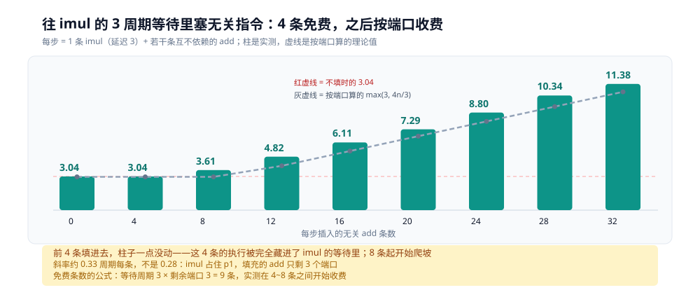

# CPU 流水线与乱序执行

> 同一台机器、同一份「分支判断 + 累加」的代码，IPC 从 **0.55** 到 **3.17**，差 5.8 倍——而指令条数几乎一样。差别的来源只有一个：**同一时刻有几条指令在不同的段上同时在飞**。本篇讲这条线的两头：流水线怎么让延迟与吞吐变成两件事，乱序与写缓冲又为什么把「代码顺序 = 执行顺序」这个直觉毁掉。
>
> 一篇指令走完五段的基础在 [CPU怎么执行一条指令.md](CPU怎么执行一条指令.md)；分支猜错要赔多少在 [分支预测.md](分支预测.md)。第四节的末尾用两组读数回答「乱序到底能吃下多少等待」（1.013→0.279、3.04→11.38），第五节的末尾量出写缓冲的异步在哪一刻结束（1.12 / 4.62 / 15.22）；第六节收口到 `LOCK` 前缀——它是「把乱序欠下的债一次性还清」，代价的实测在 [原子操作.md](../底层同步/原子操作.md)。
>
> 素材来源：本机 Docker 实测，`perf-lab` 容器（debian:bookworm-slim + `linux-perf 6.1.190` + `gcc 12.2.0`），宿主 Intel i7-6700HQ，WSL2 内核 6.18.54.1，容器 `--privileged`、无 CPU 配额。

---

## 一、从零：同一台机器上的三档 IPC

**本节要点**：IPC 是「每个时钟周期退休了几条指令」。它是流水线重叠与超标量的直接证据，不是 CPU 造假。三档读数 0.55 / 1.77 / 3.17 对应三种完全不同的「卡住的位置」。

### 1.1 三档读数

| 程序 | 编译 | IPC | 卡在哪 |
|---|---|---|---|
| 分支随机（[分支预测.md](分支预测.md) 第一节） | `-O0` | **0.55** | 预测失败，流水线反复清空 |
| 分支排序（同上） | `-O0` | **1.77** | 预测几乎全中，但 `-O0` 的访存拖后腿 |
| 分支程序 | `-O1` | **3.17** | 没有冗余访存，前端供得上 |

```bash
gcc -O0 -o branch0 branch.c
gcc -O1 -o branch1 branch.c
perf stat -e cycles,instructions ./branch0 random
perf stat -e cycles,instructions ./branch0 sorted
perf stat -e cycles,instructions ./branch1 random      # ← 3.17 这一档
```

⚠️ 前两档的完整实验（含 `branch-misses`、µop 数）在 [分支预测.md](分支预测.md) 第二节，本篇只借它的 IPC 列做对照；**3.17 这一档是 `-O1` 编出来的，只在本篇出现**——因为它压掉的是「冗余访存」，不是「分支猜错」，属于流水线侧的证据。

### 1.2 为什么 IPC 能当判据

IPC = instructions / cycles。它有两种读法：

- **IPC > 1**：一个周期退休了不止一条指令。单发射的 CPU 在物理上做不到，所以它一定是「多条指令在不同段上重叠」。
- **IPC < 1**：一周期的产出不到一条指令。要么在等（依赖链、预测失败、访存），要么前端供不上。

⭐ 关键认知：**IPC 低不代表慢，IPC 高也不代表代码好**。`dep` 那种单累加器写法 IPC 0.57，改成 8 路并行累加器就是 1.79（[CPU怎么执行一条指令.md](CPU怎么执行一条指令.md) 1.3），同一份逻辑，只改了变量个数。IPC 量的是「喂给硬件的并行度」。

---

## 二、流水线：三条指令同时在飞

**本节要点**：一条指令走五段要 5 个周期，但**单条指令的延迟**和**整体吞吐**是两件事。各段电路独立时，稳态下每周期能完成一条，IPC = 1。

### 2.1 三条指令同时在飞

如果每段各有一套电路，那么第 2 条指令可以在第 1 条进入译码时就开始取指：

| 周期 | 1 | 2 | 3 | 4 | 5 | 6 | 7 |
|---|---|---|---|---|---|---|---|
| 指令 A | 取指 | 译码 | 执行 | 访存 | 退休 | | |
| 指令 B | | 取指 | 译码 | 执行 | 访存 | 退休 | |
| 指令 C | | | 取指 | 译码 | 执行 | 访存 | 退休 |

稳态下每周期完成一条（IPC = 1），而**单条指令的延迟仍是 5 周期**。这两个数字不矛盾——延迟和吞吐是两件事。


读法：横轴是时钟周期，每一行是一条指令。对角线方向看是「同时在第几段」，竖直方向看是「同一周期有哪几条在飞」。第 5 周期开始每格填满，此后每周期退休一条。

### 2.2 装满要付的代价

流水线不是白拿的：

| 代价 | 表现 |
|---|---|
| **启动填充** | 前 5 个周期只有 1 条在跑，短程序里这段占比很大 |
| **清空惩罚** | 分支猜错要把整条流水线倒掉，深度越深赔得越多。**本机实测：一次误判约赔 23 个周期**（从 [分支预测.md](分支预测.md) 6.2 的 12.86 与 2.06 反推：每元素 0.462 次误判，摊掉 10.80 周期） |
| **转发与冒险** | 后一条要用前一条的结果，得靠旁路（forwarding）把值提前送过去，或者插入气泡 |

⭐ 这就是为什么「流水线越深越快」在 2000 年代之后就不成立了：深流水线（Pentium 4 的 31 级）单周期更快，但清空一次赔 31 个周期，分支猜错率一高就全赔回去。现代 x86 回到 14~19 级的折中点，转而用**更宽**（每周期发射更多）而不是**更深**来提性能。

⭐ 那个「赔多少」可以用两组现成读数夹出来，不必去数流水线级数：同一份求和，分支猜得中时 2.06 周期/元素、猜不中时 12.86，而后者每元素有 0.462 次误判。于是

```text
(12.86 − 2.06) ÷ 0.462 ≈ 23.4 周期/次误判
```

**23 个周期**与本机 14~19 级的流水线深度加上前端重新取指的开销是同量级的。这也解释了为什么分支预测失误的代价要用「µop / 指令」这个比值来量（[分支预测.md](分支预测.md) 第四节）——赔的不是一条指令，是整条流水线里所有在飞的活。

### 2.3 超标量：不止一条流水线

IPC = 1 只是「一条流水线装满」的结果。IPC > 1 要求**每个周期同时取、同时译、同时发射多条**——这叫超标量（superscalar）。

实测的 3.17 就是超标量的直接证据：一个时钟周期内退休了 3 条以上指令，单发射的 CPU 做不到。而上限受最窄的那一段约束，见下一节。

---

## 三、上限从哪来

**本节要点**：IPC 的上限由**最窄的那一段**决定，不是由执行单元数量决定。对 x86 而言最窄的常常是**前端译码**，不是 ALU。

### 3.1 木桶的那块短板

| 段 | 这一代的宽度 | 是否常见瓶颈 |
|---|---|---|
| 取指 | 16 字节/周期 | 变长指令下常是 |
| 译码 | 4 ~ 5 条/周期 | ⭐ 最常见的瓶颈 |
| 发射 / 退休 | 4 µop/周期 | 与译码大致对齐 |
| 整数 ALU 端口 | 4 个 | 只在纯算术负载下成为瓶颈 |

对这台机器（Skylake 级别）来说，最窄的是**前端译码**：x86 的变长指令要靠译码器切边界，每周期能处理的指令条数远少于 RISC 的定长指令。

公开资料里这一代的退休宽度是 4 µop/周期，译码是 4 ~ 5 条/周期。**「条数上限」这一条现在有读数了**：用 nop 阶梯量出 **3.78 条/周期**（1 字节与 4 字节两档给出同一个数），而指令长到 6 字节以上后改成 **18~19 字节/周期**在卡——两个上限叠在一起的完整读数在 [CPU怎么执行一条指令.md](CPU怎么执行一条指令.md) 3.4。

### 3.2 为什么 RISC 在这里占便宜

定长 32 位指令的译码几乎是「每 4 字节一条」，不需要边读边算边界，前端可以做得更宽。这是 RISC 在高 IPC 场景的优势来源——**不是指令更简单，是切边界更便宜**。

对照 [AOT、JIT与解释执行.md](../../编译原理/AOT、JIT与解释执行.md) 3.2 的 `fib(32)`：Java 的 JIT 版本比 Go 的 AOT 版本快，本质也是**IPC 的差别**——C2 编出来的代码指令更少、分支更可预测，同样的 cycles 能干更多活。

---

## 四、乱序执行：重排靠什么被允许

**本节要点**：乱序引擎只在一个前提下重排——**重排不改变单线程的可见结果**。做到这一点的机制是寄存器重命名 + 顺序退休。所以「乱序」是可证明安全的，不是碰运气。

### 4.1 寄存器重命名

`b0 += i` 写的是「某个物理寄存器」，不是「架构寄存器 `rax`」。只要输出依赖没建立，两条指令就能同时跑：

```text
架构视角（程序顺序）：       物理视角（重命名后）：
  add rax, rbx                 add p17, rbx, r13     ← 写 p17
  add rax, rcx                 add p18, rcx, r14     ← 写 p18，与 p17 无关
```

两条指令都「写 `rax`」，但在物理上是两个不同的寄存器，所以没有依赖。退休时按程序顺序把 p18 的值提交回架构 `rax`，单线程看到的结果与顺序执行完全一致。

⭐ 这就是第 2.1 节时间表的硬件实现：**程序顺序**决定什么时候能看到结果，**物理顺序**决定什么时候能算完。两者解耦，才有了并行。

### 4.2 判据：数一数有几个累加器

既然硬件按依赖图调度，那么**看代码就能估出并行度**：

- 一个 `sum` 累加：一条链，任何时刻只有 1 条加法就绪，4 个 ALU 端口闲着 3 个（8.81 周期/次）；
- 八个累加器：八条链同时就绪，端口被填满（1.81 周期/次）。

⭐ 这就是为什么手写归约（reduction）时要用 4 路或 8 路累加器，而不是一个 `sum`。编译器的自动向量化也是同一个思路，只是把「多条标量链」换成「一条 SIMD 链」。

### 4.3 窗口是有限的

乱序不是无限往前看。µop 先进重排缓冲（ROB），**窗口满了就不再取指**，直到最老的 µop 退休腾出位置。

现代 x86 的 ROB 在几百条 µop 的量级（Skylake 是 224）。这个数字决定「乱序引擎能看多远」——如果一条依赖链的间隔超过窗口深度，后面的指令就只能在窗口外干等。

⚠️ 窗口深度本轮没测，属公开参数。要测它需要构造「依赖链间隔恰好跨过窗口」的实验（间隔 k 的链在 k 超过 ROB 深度后吞吐突变），本轮没做。

⭐ 但换个问法就能测：**不问「窗口有多深」，问「窗口装进去的活能干多快」**。下面两节分别从「同时开几条链」和「一次塞多少无关指令」两个方向回答，答案都不是「窗口深度」，而是「端口数」。

### 4.4 同时开几条链：4 条就到顶

把独立的加法链从 1 条加到 16 条，每加法周期从 **1.013 一路降到 0.279，然后在 4 条链之后就再也不降了**。不是窗口满了，是 ALU 端口只有 4 个。

实验只有一处变化：每轮执行的加法总数固定 64 条，只改「这 64 条分成几条互不依赖的链」。

```c
/* window.c —— K 条链，每条链内部串行，链与链之间无关 */
DEF_CHAIN(chain4, 4,
    "addq %0,%0\n\taddq %1,%1\n\taddq %2,%2\n\taddq %3,%3\n\t")   /* 每轮 64 组，共 256 条 */
```

| 链数 | cycles/加法 | 相对 1 条链 |
|---|---|---|
| 1 | **1.013** | 1.00× |
| 2 | **0.521** | 1.94× |
| 4 | **0.287** | 3.53× |
| 8 | **0.279** | 3.63× |
| 16 | **0.279** | 3.63× |


读法：横轴是同时推进的加法链条数，纵轴是每加法周期。1 → 2 → 4 一路对折（1.013 / 0.521 / 0.287），**4 之后就平了**，8 条与 16 条给出同一个数（0.279）。

⭐ 平台出现在 4 而不是 8 或 16，原因在 [CPU怎么执行一条指令.md](CPU怎么执行一条指令.md) 3.2 已经量过：**整数 ALU 只有 4 个端口**。第 5 条链再独立，也没有第五个端口让它跑。

顺带解释一个反直觉的细节：8 条链（0.279）比 4 条链（0.287）**还略快一点**。四条链刚好把四个端口占满，任何一次调度失准都会留一个端口空转；八条链给了调度器备选，某个端口忙时换一条顶上。所以「刚好等于端口数」不是最优，**略多于端口数**才最稳。

这也回答了 4.3 留下的疑问：**加宽窗口不会让这个数字变小**。窗口的作用是「让足够多的独立指令同时在飞」，可一旦在飞的指令已经填满 4 个端口，窗口再深也只是多存几条等待中的 µop。

### 4.5 等待能被填满多少：填充扫描

一条 `imul` 依赖链每步要等 3 个周期。往这 3 个周期里塞无关的 `add`：塞 4 条**完全免费**（3.04，与一条不塞一模一样），塞 8 条开始付费，塞 32 条付到 11.38。**能免费塞的条数 = 等待周期 × 可用端口数**——这才是乱序引擎真正的容量。

```c
/* 每步 = imul（延迟 3）+ 4n 条独立 add，n 从 0 到 8 */
asm volatile(".rept 64\n\t"
             ".rept " #n "\n\t" A4 ".endr\n\t"     /* A4 = 4 条 add，8 个累加器轮转 */
             "imulq %0,%0\n\t"
             ".endr"
             : "+r"(acc), "+r"(b0), ... "+r"(b7));
```

| 每步填充 | cycles/步 | 理论 `max(3, 4n/3)` | 与不填相比 |
|---|---|---|---|
| 0 条 | **3.04** | 3.00 | — |
| 4 条 | **3.04** | 3.00 | 0% |
| 8 条 | **3.61** | 3.00 | +19% |
| 12 条 | **4.82** | 4.00 | +59% |
| 16 条 | **6.11** | 5.33 | +101% |
| 20 条 | **7.29** | 6.67 | +140% |
| 24 条 | **8.80** | 8.00 | +190% |
| 28 条 | **10.34** | 9.33 | +240% |
| 32 条 | **11.38** | 10.67 | +274% |



读法：横轴是每步插入的无关 `add` 条数，纵轴是每步耗时。**虚线是「不填」时的 3.04**——前 4 条填进去，柱子一点没动，说明这 4 条的执行被完全藏进了 `imul` 的等待里。8 条起开始爬坡，斜率约 **0.33 周期每条**。

⭐ 斜率 0.33 而不是 [CPU怎么执行一条指令.md](CPU怎么执行一条指令.md) 3.2 量到的 0.282，原因很具体：`imul` 只能用整数乘法那一个端口（`p1`），填充用的 `add` 就只剩 3 个端口可落，32 条 ÷ 3 ≈ 10.67 周期——正好对上表里最后一行的理论值。

所以「乱序能吃掉多少等待」这件事，答案是个乘法：

```text
免费填充条数 ≈ 等待周期 × （端口总数 − 被这条指令占住的端口数）
```

`imul` 延迟 3、占 1 个端口，剩下 3 个可用 → 3 × 3 = 9 条。实测的完全免费区间是 4 条，8 条已开始收费——比公式小，因为端口接近饱和时排队不是阶跃的，而是在 70% 占用率之后就开始显现。

⚠️ 这仍然**没有量出 ROB 深度**。它量的是「窗口里的活能干多快」，而窗口有多深只决定「够不够装下这么多活」——对这台机器的 ALU 负载来说，4 个端口在 224 条窗口里早就够用了，所以窗口深度压根没成为瓶颈。

### 4.6 为什么窗口深度这么难测

测窗口深度的唯一思路是「让无关指令多到装不下」，但同一条思路上的三种做法都会先撞上别的墙。**这不是实验没做好，是这类测量本身有一个前提很难满足**。

三种思路与各自先撞上的墙：

| 思路 | 做法 | 先撞上什么 |
|---|---|---|
| 拉长填充 | imul 链（延迟 3）+ k 条无关 `add` | **端口**：3 个可用端口只能吸收 9 条，k > 9 就开始付费（本轮就是这条路） |
| 拉长等待 | 换成访存链（L3 约 40 周期），配 k 条填充 | **量级对不上**：填满 40 周期要 ~120 条（3 端口 × 40），仍不到 224 的窗口底；换到内存（~200 周期）要 600 条，此时循环体大到会把取指与 µop cache 拖进来 |
| 间接反推 | 用 `perf` 的 `idq` / `ls_lsd` 类事件看前端被堵的比例 | **事件可用性**：这批事件在本机 WSL2 上没跑通，只有 `cycles` / `instructions` / `branches` / `branch-misses` 稳定可读 |

三条路合起来说明一件事：**要测窗口深度，等待周期必须「长到需要几百条无关指令才填满」，同时「填充不能自己成为瓶颈」**。这两个条件在只有 4 个 ALU 端口的机器上几乎同时满足不了——窗口深度是按访存延迟设计的，不是按 ALU 延迟设计的。

⭐ 反过来看，这恰好解释了 4.4 的答案：**大部分真实程序里，卡住流水线的从来不是「窗口不够深」，而是「端口不够宽」或「依赖链太长」**。所以优化方向通常是加并行度（拆链、向量化），而不是指望更深的窗口。

---

## 五、写缓冲：store 为什么看起来提前了

**本节要点**：store 写内存要等缓存行拿到独占权，可能要几十个周期。为了不等，CPU 把 store 先扔进**写缓冲**，指令立刻退休。于是「代码顺序」和「其他核看到的顺序」不再是同一个顺序——内存屏障就是为了把两者重新对齐。

### 5.1 一条 store 要等什么

store 不只是「写一个值」，它要让这条缓存行进入 `M`（或至少 `E`）态：

| 步骤 | 代价 |
|---|---|
| 查 L1d 是否有这一行 | 4 ~ 5 周期 |
| 若不在，向 L2/L3 请求 | 十几 ~ 几十周期 |
| 若别的核有 `S` 态副本，发 invalidate | 一个往返 |
| 拿到独占权，写入 | — |

这几步串起来是几十到上百周期。如果指令原地等，流水线就停了。

### 5.2 写缓冲把等待变成异步

CPU 把 store 塞进写缓冲（store buffer）就当作完成，指令退休。写缓冲在后台去拿独占权、合并连续的写、再真正落到缓存。

代价是出现一个反直觉的现象：

```text
线程 A：             线程 B：
  x = 1;               while (y == 0) {}
  y = 1;               print(x);   // 可能打印 0
```

程序顺序是「先写 x 再写 y」，但 x 可能还躺在写缓冲里，y 已经出去了。这就是**存储-加载重排**（StoreLoad）。

⚠️ x86 的内存模型（TSO）只允许这一种重排：store-store 不重排、load-load 不重排、load-store 不重排。所以上面这段在 x86 上依然可能出问题，而且只在多核、且 B 在另一个核上时。

⚠️ **本轮没有构造出 StoreLoad 重排的实测**。x86 上要观察它需要两个核 + 精确对齐的时序（A 写 x、写 y，B 读 y、读 x，反复几百万次直到抓到两个都读到旧值），本轮没做。这里给的是 TSO 模型的推论 + Intel SDM 的定义。

### 5.3 写缓冲与缓存一致性的分工

两件事容易混：

| 机制 | 管什么 | 保证什么 |
|---|---|---|
| MESI 协议 | 缓存行在多个核之间的状态 | **最终**一致，任意时刻只有一个核能写 |
| 写缓冲 | 单核内 store 的排队与合并 | 让 store 不必等独占权，但**推迟了可见时间** |

MESI 保证「不会有两个人同时改」，写缓冲让「改完了别人什么时候看见」变成一个问题。内存屏障拦的是后者。MESI 四态与「写一个字节要抢整行」的实测在 [CPU缓存与缓存行.md](../缓存与内存/CPU缓存与缓存行.md) 第二节。

### 5.4 什么时候异步必须结束：读回自己刚写的地址

写缓冲的「异步」有一个明确的截止条件：**有人要读这个地址**。这时 CPU 要么从写缓冲里把数据直接递给 load（转发，store-to-load forwarding），要么转发不了、只能等 store 真正落进缓存再读。**两种结局的代价差 3.3 倍，而指令数完全一样。**

```c
/* fwd.c —— 四档只改 store 与 load 的地址关系，骨架都是这三条指令 */
asm volatile("movq %0, 0(%1)\n\t"     /* store 8 字节 */
             "movq 0(%1), %0\n\t"     /* 紧接着从同一地址读回 */
             : "+r"(v) : "r"(p) : "memory");
```

`v` 在每轮里既是 store 的输入又是 load 的输出，构成一条串行链，所以读数就是「store 到 load 这一对要几个周期」：

| 档 | store 地址 | load 地址 | **周期/轮** | 指令/轮 | 发生了什么 |
|---|---|---|---|---|---|
| 无别名·同缓存行 | 8B @ 8 | 8B @ 0 | **1.13** | 4.06 | 地址不同，load 不等 store |
| 无别名·跨缓存行 | 8B @ 0 | 8B @ 64 | **1.12** | 4.05 | 同上，跨行也没区别 |
| 完全匹配 | 8B @ 0 | 8B @ 0 | **4.62** | 4.06 | 转发成功，付转发延迟 |
| 部分重叠 | **4B** @ 0 | **8B** @ 0 | **15.22** | 4.07 | 转发失败，等 store 落进缓存 |

读法：**先看 1.12 与 15.22 这一对——13.6 倍，指令数一模一样（4.05 vs 4.07）**。

- **1.12 就是「写缓冲全部吸收」的样子**。store 和 load 地址不同，谁也不用等谁，循环卡在 store 端口上（每周期一条），所以 1.12 已经贴着 1.0 的下限。这说明单线程里 store 确实是纯异步的：**存完就走，不用等内存**。
- **4.62 是转发成功**。load 必须等 store 的数据，但数据还没走远，直接从写缓冲里递过来。这一档比无别名慢 3.5 周期——**转发不是免费的，只是比不转发便宜**。
- **15.22 是转发失败**。`movl` 写了 4 字节、`movq` 要读 8 字节，读的范围比写的宽，硬件凑不出完整的数据，只能等 store 整条落进 L1 再从 L1 读回。15 周期 ≈ store 提交 + 一次 L1 命中的往返。

⭐ 这一档最有实用价值：**「写小、读大」是能避免的**。

```c
uint32_t len = htonl(n);
memcpy(buf, &len, 4);
uint64_t tag = *(uint64_t *)buf;      /* ← 写了 4 字节，读了 8 字节 */
```

这段在序列化代码里很常见（写长度、写校验和、再整体读出来算 hash）。改成「按写的宽度读」——`uint32_t tag = *(uint32_t *)buf;`——就从 15.22 掉回 4.62 那一档。⚠️ 但这只是延迟层面的建议，不是正确性建议：`(uint64_t *)buf` 这种强转本身还违反严格别名规则，开了 `-O2` 编译器有权把它优化掉，那是另一个坑（[向量化与SIMD.md](向量化与SIMD.md) 5.2 那个让指针重叠的实验就是同一类问题的向量版）。

⚠️ 本节量的都是**单线程、同一地址**的转发。5.2 那个「两个线程看到不同顺序」需要的是跨核可见性，机制不同（要 `mfence` / `LOCK`），本轮仍没构造出来。但两者共用同一套硬件：**写缓冲里躺着没落地的 store，就是所有「顺序」问题的源头**——这也是下一节 `LOCK` 为什么要先清空它。

---

## 六、`LOCK` 前缀在做什么

**本节要点**：`LOCK` 不是「让指令变慢的开关」，它是**把乱序引擎攒下的债一次性还清**：清空写缓冲 + 拿到缓存行独占权。这两件事合起来，就是「顺序一致」在指令层能落地的最小动作集。

### 6.1 汇编证据

[Go内存模型.md](../../../01-编程语言/go/并发编程/Go内存模型.md) 4.1 节给过对照：

```text
main.go:12   LOCK XADDQ AX, 0(CX)     ; ← LOCK 前缀 = 完整内存屏障
main.go:15   INCQ      0(CX)          ; ← 普通加一，什么都不保证
```

那边说的是「清空写缓冲、使其他核心的对应缓存行失效」。这里的补充是**为什么要清**：

- **清写缓冲** → 让之前所有的 store 真正落到缓存一致性协议的视野里，解决 5.2 的重排；
- **拿缓存行的独占权** → 让别的核不能再改这一行，解决「两个核同时改」的竞争；
- 两者合起来，就是「顺序一致」在指令层能落地的最小动作集。

### 6.2 代价：它每次都还清

⭐ `LOCK` 的代价不在「慢」这个字上，而在**它无条件还清所有债**——哪怕这次并没有别的核在看。

所以：

- 单线程里用原子操作，代价是 8 ns 换一个根本没人争的保证；
- 而 `LOCK` 的粒度是**缓存行**，不是总线：同一条 `lock add`，变量在行内 8 ns、跨 64 字节边界 1395 ns（175 倍）。这个实验在 [原子操作.md](../底层同步/原子操作.md) 2.2 节。
- 两个核改同一行时，两边都在抢独占权，`LOCK` 会互相排队——这就是伪共享的物理来源。

---

## 七、五组结论

**本节要点**：延迟与吞吐是两件事；IPC 是喂给硬件的并行度的证据；乱序能吃多少等待由端口定、不由窗口深度定；写缓冲的异步只到「有人读这个地址」为止；它把「代码顺序 = 执行顺序」这个直觉毁掉，`LOCK` 前缀负责把它收回来。

1. **延迟和吞吐是两件事**。单条指令走五段要 5 周期，但流水线装满后每周期能退休一条。所以「这条指令多慢」和「这段代码多快」不能互相换算。
2. **IPC 大于 1 是流水线与超标量的直接证据**。实测 0.55 / 1.77 / 3.17 三档，最高一档说明每周期退休了三条以上指令。IPC 低的时候先查「在等什么」，别急着优化算法。
3. **乱序能吃的等待有上限，上限由端口决定，不由窗口深度决定**。链数从 1 加到 4，每加法从 1.013 降到 0.287；再加到 16 条，还是 0.279——因为 ALU 只有 4 个端口。`imul` 的 3 周期等待能被 4 条无关 `add` 完全免费填满，8 条起开始按「等待周期 × 可用端口数」收费。窗口深度只决定「够不够装」，不决定「能跑多快」。
4. **写缓冲的异步有明确截止条件：读回自己刚写的地址**。地址不同时 1.12 周期/轮（纯 store 吞吐），完全匹配 4.62（转发成功），写 4 字节读 8 字节 15.22（转发失败）——指令数相同，差 13.6 倍。
5. **乱序与写缓冲破坏了「代码顺序 = 执行顺序」**。乱序靠寄存器重命名保证单线程结果不变，写缓冲却让「别的核什么时候看见」变得不确定。`LOCK` 前缀就是把这个不确定性一次性收掉——代价是它每次都收，不管有没有人在看。

---

## 校验口径

> ✅ 实测（`perf-lab` 容器 = debian:bookworm-slim + `linux-perf 6.1.190` + `gcc 12.2.0`，`--privileged`，无 CPU 配额；宿主 Intel i7-6700HQ，WSL2 内核 6.18.54.1，`perf_event_paranoid=2`）：

- **链数饱和**：`window.c` 的 `chain1` / `chain2` / `chain4` / `chain8` / `chain16`，`gcc -O2`、`taskset -c 2` 绑核、`perf stat -x, -e cycles,instructions`，每档 3 轮（`chain4` 因抖动大跑了 5 轮）取最快一轮。
  - 每加法周期 = cycles ÷ (reps × 64 × 链数)。1,296,364,346 / 1.28e9 = 1.013；1,334,681,934 / 2.56e9 = 0.521；1,468,038,681 / 5.12e9 = 0.287；2,856,795,502 / 1.024e10 = 0.279；713,178,573 / 1.024e10 = 0.279（`chain16` 的 reps 减半，ops 相同）。
  - ⚠️ `chain4` 的三轮是 1.468 / 1.719 / 1.602e9（另 5 轮 1.542 / 1.525e9），抖动 ±20%，比其它档大。取最快一轮；若取中位数是 0.301，结论不变。
- **填充扫描**：`window.c` 的 `fill0` ~ `fill8`，同样 3 轮取最快。每步耗时 = cycles ÷ (reps × 64 步)。3.04 / 3.04 / 3.61 / 4.82 / 6.11 / 7.29 / 8.80 / 10.34 / 11.38。
  - 理论列 `max(3, 4n/3)` 里的「3」是 `imul` 延迟、「4n/3」是 4n 条 `add` 摊在 3 个可用端口上。
- **写缓冲转发（5.4）**：`fwd.c` 用 `gcc -O2` 编译（被量的是 `asm volatile`，`-O2` 只把外层循环编紧），`taskset -c 2` 绑核，`perf stat -x, -e cycles,instructions`，四档各 3 轮取最快一轮。
  - 每档 30,000,000 轮串行链，周期/轮 = cycles ÷ 3e7：138,528,450 → 4.62；456,677,518 → 15.22；33,849,034 → 1.13；33,727,831 → 1.12。
  - 四档指令数 121.6M~122.0M（4.05~4.07 条/轮），**这是本实验最关键的控制变量**：只有地址关系不同。
  - ⚠️ `aligned_alloc(64, 256)` + `memset` 清零，四档共用同一块 buffer；`sf8` 与 `sf4_8` 的初始化值都是 1，所以 `movl` 只写低 4 字节时高 4 字节仍是 0，读数不会因未初始化内存抖动。
- **三档 IPC**：`branch.c` 在 `-O0`（`random` / `sorted`）与 `-O1`（`random`）下各跑一次，`perf stat -e cycles,instructions`，IPC = instructions / cycles。0.55 / 1.77 / 3.17 三个数都是这一处算出来的；前两档的完整读数（含 `branch-misses`、`uops_issued`）在 [分支预测.md](分支预测.md)。
- **依赖结构与逐加法成本**：`chain.c` 在 `-O0` 下三档，读数与图在 [CPU怎么执行一条指令.md](CPU怎么执行一条指令.md) 1.3。
- **`LOCK` 的汇编对照**：Go 侧 `go build -gcflags='-S'` 出来的 `LOCK XADDQ` 与 `INCQ`，取自 [Go内存模型.md](../../../01-编程语言/go/并发编程/Go内存模型.md) 4.1；跨缓存行的 8 ns / 1395 ns 对照在 [原子操作.md](../底层同步/原子操作.md) 2.2。

⚠️ **未实测 / 边界**：

- **流水线级数、ROB 深度（224）都不是本机测出来的**，来自公开的微架构资料，只当机制描述。**退休/译码的条数上限**已在 [CPU怎么执行一条指令.md](CPU怎么执行一条指令.md) 3.4 量出（3.78 条/周期），这里不重复。
- **4.4 与 4.5 量的是「窗口里的活能跑多快」，不是「窗口有多深」**。两者容易混：窗口深度决定「装不装得下」，端口数决定「装进去之后多快」。本机的 ALU 负载只需要 4 条并行链就能填满端口，所以窗口深度始终没成为瓶颈，测不出来。
- **没有构造 StoreLoad 重排实验**。5.2 的「可能打印 0」是 TSO 模型的推论，x86 上要观察它需要两个核 + 精确对齐的时序，本轮没做。
- **没有测写缓冲的深度与合并行为**。要测它需要构造「连续 store 的间隔」实验，本轮没做。
- **只有 x86-64 的读数**，且是 WSL2 虚拟机内的 4 个逻辑处理器；arm64 的乱序窗口与屏障语义完全不同，不能照搬。

---

## 延伸追问

- **为什么 IPC 的实测上限是 4 而不是 8？** 因为瓶颈不在执行单元（整数 ALU 端口有 4 个，能同时算 4 个整数加法），而在**前端**：x86 的变长指令要靠译码器切边界，每周期切不出 8 条。RISC-V 那种定长 32 位指令，译码就是「每 4 字节一条」，前端可以做得更宽。
- **乱序窗口有多大，为什么不再加宽？** 现代 x86 的 ROB 在几百条 µop 的量级。加宽窗口的收益递减，因为它同时也加长了「清空一次要赔多少」——窗口越深，分支猜错时丢掉的投机工作越多，而分支密度并没有下降。
- **既然 `LOCK` 每次都还清，为什么不用 `mfence` 而用 `LOCK` 前缀？** `mfence` 只拦重排，不做原子读-改-写；`lock xadd` 一条指令同时完成「原子改」和「屏障」。要做计数器就只能用它。纯屏障场景（例如发布一个指针）上别手写 `mfence`：实测 `mfence` **14.746~16.594 ns**，而 `lock orq $0,(%rsp)` 只要 **7.540~8.109 ns** —— 挡的重排种类完全相同，前者贵一倍，见 [内存屏障与内存序的代价.md](../缓存与内存/内存屏障与内存序的代价.md) 第三节。
- **多发射为什么不能让 IPC 无限涨？** 三个上限叠加：前端供不上（译码）、依赖图不够宽（没那么多独立指令）、窗口填不满（ROB 有限）。实测里 `-O0` 的访存冗余就是第二种——每条加法都带一次栈往返，依赖图被访存节点挤满。

---

## 关联

- [CPU怎么执行一条指令.md](CPU怎么执行一条指令.md) — **上游**。五段分工、端口与延迟的价码（3.2）、前端的两个上限（3.4）
- [分支预测.md](分支预测.md) — **并列**。IPC 0.55 与 1.77 的完整实验在那篇；猜错一分支要丢 4.32 倍微操作
- [原子操作.md](../底层同步/原子操作.md) — **下游**。本篇第六节说的「还清的代价」，在那里量成跨缓存行 175 倍
- [互斥的实现.md](../底层同步/互斥的实现.md) — **下游**。同样是「还清写缓冲」，在锁的场景里被压到 200 万次加锁只有几百次进内核
- [CPU缓存与缓存行.md](../缓存与内存/CPU缓存与缓存行.md) — **上游机制**。MESI 四态与伪共享：写缓冲为什么要等独占权
- [Go内存模型.md](../../../01-编程语言/go/并发编程/Go内存模型.md) — **语言层对照**。`LOCK XADDQ` 与 `INCQ` 的汇编对照在那篇 4.1
- [从可执行文件到第一条指令.md](../../编译原理/从可执行文件到第一条指令.md) — **上游**。程序怎么被装载、PC 从哪来
- [README.md](../README.md) — 本目录总纲：三册分工与边界

> 反向引用（本篇被下列文档引到）：[README.md](../README.md)、[向量化与SIMD.md](向量化与SIMD.md)
