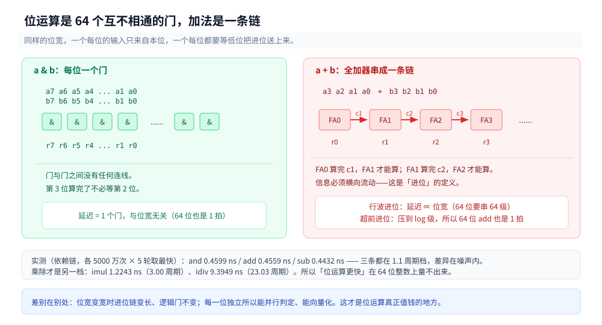
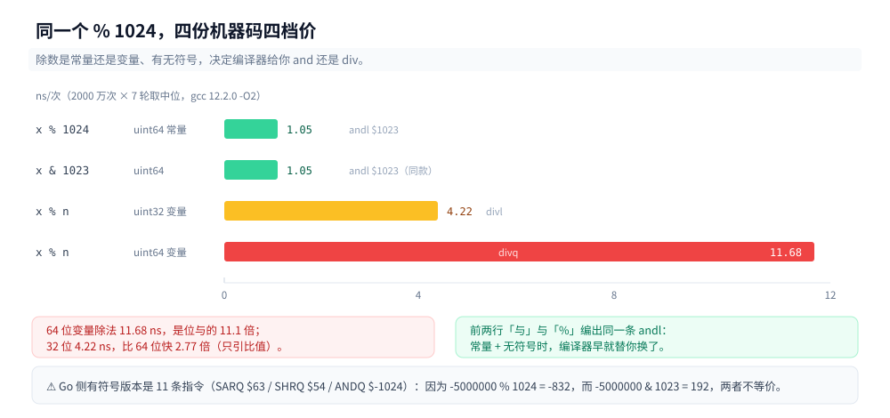
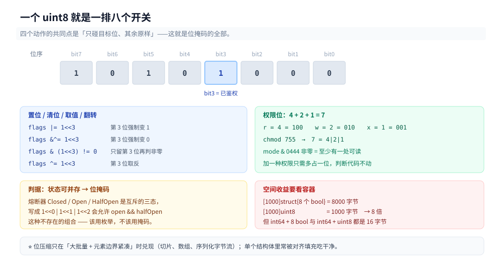
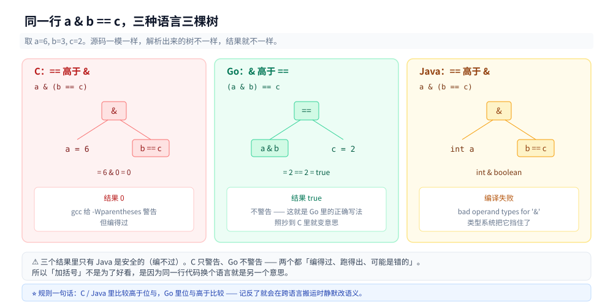

# 位运算

> 覆盖：位运算在硅上是什么（一排互不相通的门，而不是「更快的加法」）、六个操作各自能覆盖哪一格、`% 2ⁿ` 换成 `& (2ⁿ-1)` 的真实价差（实测 11.1 倍）与「谁替你换」的条件（常量 + 无符号）、一个有符号 `%` 为什么换不了（Go 编成 11 条符号修正指令）、位压缩的空间账在哪兑现（数组里 8 倍，单结构体里被填充吃掉）、地址对齐的两个判据（`addr & 63`、`(addr+63) & ~63`）、无分支求最大值的恒等式与「编译器早就替你做完了」、异或的三条性质与工程用途、四个静默出错的坑（优先级 / 右移 / 左移溢出 / 移位超位宽）。
>
> 不覆盖：`x & (x-1)`、`x & -x`、lowbit、线性基、bitset、子集枚举等**解题技巧** → [位运算.md](../../算法/基础算法/数组与序列技巧/位运算.md)；补码的代数推导与加法器门级结构 → [补码与整数运算.md](补码与整数运算.md)；分支预测失败赔多少的完整实测 → [分支预测.md](分支预测.md) 第六节；`[56]byte` 为什么是 56 → [CPU缓存与缓存行.md](../缓存与内存/CPU缓存与缓存行.md) 第三节。
>
> 内容整理自个人学习笔记，素材见 [素材清单](../../../素材清单.md)。读数在 WSL2 容器内实测（`gcc 12.2.0`、`go1.26 linux/amd64`、`OpenJDK 1.8.0_504`，`nproc=4`，宿主 `Intel Core i7-6700HQ @ 2.60GHz`）。周期换算按 [时钟周期与频率.md](时钟周期与频率.md) 的 1 周期 = 0.408 ns。

---

## 一、位运算在硅上是什么？

**本节要点**：它是一条 `and` / `or` / `xor` 指令，走 ALU 里一排**互不相通**的门——第 3 位的结果与第 4 位的输入无关。这件事常被讲成「所以它比加法快」，但实测两者同价（`and` 0.4599 ns vs `add` 0.4559 ns）。真正的差别不在这一条指令有多快，而在**位宽变宽时进位链会变长、逻辑门不会**。

### 1.1 一位与门，六十四位并排

一个 64 位与运算不是一个大门，是 64 个一位与门并排，各算各的：

```text
      a63 ......... a2 a1 a0
      b63 ......... b2 b1 b0
       │             │  │  │
     ┌─┴─┐         ┌─┴┐┌─┴┐┌─┴┐
     │ & │   ...   │& ││& ││& │      ← 64 个门，彼此之间没有一根线
     └─┬─┘         └─┬┘└─┬┘└─┬┘
       │             │  │  │
      r63 ......... r2 r1 r0
```

加法器不是这样。`a + b` 的第 3 位要知道第 2 位有没有进位，第 4 位要知道第 3 位的——**信息必须横向流动**。这就是补码篇第三章那条行波进位链：延迟随位宽线性增长。超前进位（`p` / `g`）把那串依赖压成 log 级，但它没有消除依赖，只是把它算得更早。

⭐ 所以准确的说法是「**位运算是逐位独立函数，加法不是**」。「位运算更快」只是这件事在宽位宽下的一个后果，在 64 位整数上量不出来。



左边 64 个门之间没有一根线，右边每一级都要等前一级的进位——同为 64 位，一个延迟与位宽无关，一个随位宽增长。

### 1.2 把「同价」量出来

沿依赖链各跑 5000 万次，循环体只有「一条被测指令 + `dec` + `jnz`」，三条里只有被测那条在依赖链上。先给一条空循环基线（只有 `dec` + `jnz`）用来扣减循环开销：

```asm
# chain_and 的实际机器码（objdump 确认）
mov    %rdi,%rax
and    %rsi,%rax      ← 被测指令，每轮都依赖上一轮的 %rax
dec    %rdx
jne    1923 <chain_and+0x3>
```

| 指令 | ns/次 | 折合周期 | 相对基线 |
|---|---|---|---|
| 空循环基线（`dec` + `jnz`） | 0.4685 | 1.15 | — |
| `and` | 0.4599 | 1.13 | **1.00** |
| `or` | 0.4340 | 1.06 | 0.94 |
| `xor` | 0.4319 | 1.06 | 0.94 |
| `shl` | 0.4309 | 1.06 | 0.94 |
| `add` | 0.4559 | 1.12 | 0.99 |
| `sub` | 0.4432 | 1.09 | 0.96 |
| `imul` | 1.2243 | 3.00 | **2.67** |
| `idiv` | 9.3949 | 23.03 | **20.5** |

**四条位运算（`and` / `or` / `xor` / `shl`）与两条算术（`add` / `sub`）全部落在 1.06~1.15 周期这一档，差异在测量噪声之内。** 往下只有两档：乘法 3 周期，除法 23 周期。

⭐ 这张表推翻了两个常见说法：一是「位运算比加法快」——不快，同档；二是「位运算是单周期，加法不是」——`add` 也在单周期档，因为超前进位早把 64 位加法压进了 1 拍。真正贵的是**乘除法**，而它们贵的原因不是「有进位」，是 Booth 要迭代、除法器不能流水（见 [补码与整数运算.md](补码与整数运算.md) 第五、六节）。

### 1.3 六个操作各覆盖哪一格

| 操作 | 门 | 单位结果 | 掩码里的用途 |
|---|---|---|---|
| `a & b` | 与门 | 两位都 1 才 1 | **清位**（`x & ~mask`）、**取位**（`x & mask`）、判整除 |
| `a \| b` | 或门 | 有一位 1 就 1 | **置位**（`x \| mask`）、合并标志 |
| `a ^ b` | 异或门 | 两位不同才 1 | **翻转**（`x ^ mask`）、**取消**（`x ^ mask ^ mask == x`） |
| `~a` | 非门 | 逐位取反 | 造掩码的反面（`~mask`）、配合补码算 `-x` |
| `a << n` | 无门，只是接线 | 低位补 0 | 乘 2ⁿ、把标志挪到指定位置 |
| `a >> n` | 无门，只是接线 | 原样搬，空位补 0 或符号位 | 除 2ⁿ、取高位段（⚠️ 见 7.2） |

⭐ 后两个在硬件里**不经过 ALU 的运算部分**——移位器是一套交叉开关（barrel shifter），把线换个接法。所以它连「门延迟」都没有，只有走线延迟。


同一组输入、同一台机器，唯一的变量是运算符。橙框标的不是「掩码管得着的位」，而是「与原始位相比真的翻了值的位」——`x & 0xF0` 只翻 2 位、`x ^ 0xFF` 翻 8 位，因为掩码写 0 的位里本来就有 0，动了等于没动。这一栏也顺手把 `~x = 53` 与 `-x = ~x + 1 = 54` 摆在同一列里，补码关系一眼可见。

### 1.4 位运算唯一做不到的事

用 `&`、`|`、`^`、`~` 这四种**逐位**运算直接拼不出一个 `+`。原因是它们都是**逐位独立函数**：输出第 i 位只看输入第 i 位。`+` 需要「第 2 位有没有进位」这种跨位信息，逐位函数表达不了。

强行拼是可以的——补码篇第三章就是拿 `&`/`|`/`^` 搭出全加器，但那要用 5 个门算一位、再把 64 位串起来，**那就是加法器本身**。所以准确说：位运算不是「更快的算术」，它是加法器的**材料**；反过来，加法是位运算拼出来的复合件。

这也解释了一个常被搞混的点：`^` 被叫「无进位加法」，因为它恰好等于「加法但不传进位」——每一位算 `a+b` 的低位、扔掉要往上传的那一位。想清楚这一句，`^` 在哈希与校验里的所有用法都通了。

---

## 二、`% 1024` 换成 `& 1023`，到底省了多少？

**本节要点**：无符号 64 位、除数在运行时才知道时，`%` 与 `&` 差 **11.1 倍**（11.68 vs 1.05 ns）。但有两级「不用你动手」：除数是编译期常量时编译器自己换成 `&`；除数是有符号类型时它**不敢**换，因为 `%` 与 `&` 对负数不等价。

### 2.1 四档读数

同一段「求和 + 取模」，只换取模的写法，各跑 2000 万次、7 轮：

| 写法 | 编译出的关键指令 | ns/次（中位） | 相对 `&` |
|---|---|---|---|
| `x % 1024`（`uint64`，常量） | `andl $1023` | 1.05 | 1.00 |
| `x & 1023`（`uint64`） | `andl $1023` | 1.05 | 1.00 |
| `x % n`（`uint64`，`volatile n`） | `divq` | **11.68** | **11.1** |
| `x % n`（`uint32`，`volatile n`） | `divl` | 4.22 | 4.0 |

第一行和第三行的差别是本节的要点：**同一个 `% 1024`，除数写成字面量时是位与，写进 `volatile` 变量时是真除法**。前者 1.05 ns，后者 11.68 ns——11 倍之差，而源码只差一个「1024 是不是常量」。

顺带一个与补码篇互证的读数：32 位除法 4.22 vs 64 位 11.68 = **2.77 倍**，方向与那边「32 位 3.62 vs 64 位 13.43 = 3.71 倍」一致（绝对值不同是因为被除数分布不同，只引用比值）。



前两条横条一样长，因为源码不同但机器码相同；后两条才是真除法，64 位那条是位与的 11.1 倍。

### 2.2 谁替你换了

编译器换与不换，取决于三个条件同时成立：**除数是 2 的幂**、**它是编译期常量**、**类型是无符号**。少任何一个都换不成 `and`（常量但非 2 的幂时换的是「乘魔术数 + 右移」，那是另一条路）。

Go 侧的五档对照（`go build -gcflags='-S'`，`GOARCH=amd64`）：

| 写法 | 指令数 | 关键指令 |
|---|---|---|
| `func modU(x uint64) uint64 { return x % 1024 }` | **6** | `ANDL $1023, AX` |
| `func andU(x uint64) uint64 { return x & 1023 }` | **6** | `ANDL $1023, AX` |
| `func modUVar(x uint64) uint64 { return x % n }` | 17 | `MOVQ main.n(SB), CX` + `DIVQ CX` |
| `func modS(x int64) int64 { return x % 1024 }` | **11** | `SARQ $63` / `SHRQ $54` / `ANDQ $-1024` |
| `func modSVar(x int64) int64 { return x % m }` | 21 | 符号修正 + `DIVQ` |

第一行与第二行**编出完全相同的 6 条指令**：你写 `%` 还是 `&`，编译器给的是同一份机器码。所以「把 `%` 改成 `&` 能提速」这句话，在「无符号 + 常量」这个组合下是错的——它本来就已经是 `&` 了。

### 2.3 为什么有符号换不了

因为 `%` 与 `&` 对负数不等价。Go 的 `%` 符号跟被除数：

```go
fmt.Println(5000000 % 1024)    //  832
fmt.Println(-5000000 % 1024)   // -832   ← 负数还是负的
fmt.Println(-5000000 & 1023)   //  192   ← 位与只看低 10 位的位模式
```

`-832` 与 `192` 不是同一个数，也不是「差 1024」的关系——它们根本是两种语义：`%` 给「向零取整的余数」，`&` 给「低 10 位的位模式」。所以编译器在有符号上必须生成一串修正：`SARQ $63` 拿到符号掩码（全 0 或全 1）、`SHRQ $54` 把那个掩码压成 `1023`（64 − 10 = 54）、`ANDQ $-1024` 取整、再减回去——**11 条指令**，比无符号那 6 条多近一倍，但仍远少于 `DIVQ` 的 17 条。

⚠️ 这里有个容易误读的地方：11 条 < 17 条，不表示有符号 `%` 比无符号除法快。两者比的不是同一件事（一个是「常量 + 修正」，一个是「真除法」）。要比就固定常量性：常量下无符号 6 条、有符号 11 条；变量下无符号 17 条（含 `DIVQ`）、有符号 21 条（`DIVQ` + 修正）。

### 2.4 分桶代码的两条纪律

把上面两节压成两条可以直接用的：

1. **分桶数取 2 的幂，索引用 `& (n-1)`，且 `hash` 必须是无符号类型。** 一致性哈希、令牌桶分桶、环形缓冲都适用。用有符号哈希时，`&` 照样算得出结果（位模式不看符号），但它与设计文档里写的「对 n 取余」不是同一个函数——一旦有人按文档算一遍、按代码算一遍，负数上两个结果就对不上。
2. **别手动把常量取模改成位与。** 无符号时编译器已经改了（Go 6 条、C 编出来也是同一条 `andl $1023`）；有符号时你手动改会 **静默改变负数结果**。这一条比第一条更容易踩：改完测试全过，因为测试数据都是正数。

Go 运行时自己就是这么做的。`runq [256]guintptr` 的入队写的是 `(h+1) % 256`，靠的是「容量是编译期常量」这一条让编译器换成掩码：

| 写法 | 指令数 | 含 `DIV` |
|---|---|---|
| `ring[(h+1)%256]` | **9** | 否 |
| `ring[(h+1)&255]` | **9** | 否 |
| `ring[(h+1)%capv]`（容量是变量） | 25 | **是**（`DIVL`） |

前两行指令数相同、都不含除法——源码里那个 `% 256` 与手写掩码是同一份机器码。第三行把容量换成变量，`DIVL` 就回来了。**队列长度 256 这个数字的意义不在于「256 好算」，而在于它是编译期常量且是 2 的幂**（256 的调度含义见 [GMP调度.md](../../../01-编程语言/go/运行时/GMP调度.md) 第三节）。

---

## 三、一个字节怎么装下八个开关？

**本节要点**：用 `|` 置位、`& ~mask` 清位、`& mask` 取值、`^ mask` 翻转。但空间收益要算清楚：**数组里是 8 倍，单个结构体里常被对齐填充全部吃掉**（实测 `int64 + 8 bool` 与 `int64 + uint8` 都是 16 字节）。

### 3.1 四个动作

设 `flags` 是一个 `uint8`，第 3 位表示「已鉴权」：

| 动作 | 写法 | 结果 |
|---|---|---|
| 置位 | `flags \|= 1 << 3` | 第 3 位强制变 1，其余不动 |
| 清位 | `flags &^= 1 << 3` | 第 3 位强制变 0（`&^` 是 Go 的「与非」，C 里写 `flags &= ~(1<<3)`） |
| 取值 | `flags & (1 << 3) != 0` | 只留第 3 位，其余清零，再用「非零」判定 |
| 翻转 | `flags ^= 1 << 3` | 第 3 位取反，其余不动 |

⭐ 四个动作的**共性**是「只碰一位、不动其余」。这就是位掩码的全部——不是某个技巧，是「用一个整数当一排开关」这一个模型。它成立的前提是：每个开关的状态只有两种，且互不影响。

### 3.2 权限位：4 + 2 + 1 = 7

Unix 文件权限是最老也最干净的位掩码：`r=4`、`w=2`、`x=1`，三组（owner / group / other）共 9 位，塞进一个 12 位的 `mode`。`chmod 755` 那个 7 就是 `4|2|1`。

值得学的是它**为什么这么设计**：不是「省空间」，而是「**一次比较就能判一类权限**」。`mode & 0444` 非零表示「至少有一个读权限」；`mode & 0400` 非零表示「owner 可读」。如果换成三个 `bool`，这类判断要写三行 `||`，而且新增一种权限（比如 Linux 的 `s` 位、`t` 位）时要改所有判断点。位掩码把「加一种权限」变成「多占一位」，判断代码不动。

### 3.3 熔断器三态：别用三个 bool

熔断器的 `Closed` / `Open` / `HalfOpen` 是**互斥**的三个状态，不是三个独立开关。写成三个 `bool` 会出现 `open && halfOpen` 这种不存在的组合，然后每个读状态的地方都要处理它。

正确写法是枚举（`iota`）或一个 `uint8` 常量集合。注意：**互斥状态不该用位掩码**，位掩码解决的是「可并存的多个开关」。把三态写成 `1<<0 | 1<<1 | 1<<2` 是常见误用——它允许了非法组合，反而不如一个 `uint8` 枚举。

判据一句话：**状态可并存 → 位掩码；状态互斥 → 枚举。**

### 3.4 空间收益在哪兑现

这是本节最容易被跳过、也最容易算错的一节。Go 实测（`unsafe.Sizeof`）：

| 类型 | 大小 |
|---|---|
| `struct{ a,b,c,d,e,f,g,h bool }` | **8 字节** |
| `struct{ flags uint8 }` | **1 字节** |
| `struct{ n int64; a..h bool }` | **16 字节** |
| `struct{ n int64; flags uint8 }` | **16 字节** |
| `[1000]struct{a..h bool}` | 8000 字节 |
| `[1000]uint8` | **1000 字节** |

第三、四行是关键：**`int64` 后面接 8 个 `bool` 是 16 字节，接 1 个 `uint8` 也是 16 字节**。省下的 7 字节被 `int64` 的 8 字节对齐填充吃干净了，一个字节都没省。

⭐ 所以位压缩的收益只在**大批量、且元素边界紧凑**时兑现：切片、数组、序列化后的字节流（比如协议头、位图、布隆过滤器的位数组）。单个结构体里做位压缩，通常只赚到「判断写得紧凑」，赚不到内存。

⚠️ 还有一条并发上的坑：`flags |= mask` 是「读—改—写」三步，它**不是原子的**。两个 goroutine 同时置不同的位，会丢更新（与 [原子操作.md](../底层同步/原子操作.md) 第一节那个 `i++` 丢更新同源）。要么整字节用 `atomic.Or8`（Go 1.19+），要么加锁。



四个动作都只碰目标位、其余原样；右下角那两行是空间账的反转——数组里省 8 倍，单结构体里被填充吃干净。

---

## 四、地址对齐为什么也是位运算？

**本节要点**：因为对齐判据是「低 k 位全 0」，而「取低 k 位」就是 `& (2ᵏ-1)`。`addr & 63 == 0` 判 64 字节对齐，`(addr + 63) & ~63` 向上取整——两个式子都是「把低 6 位当作余数处理」。

### 4.1 判对齐：`addr & 63 == 0`

64 = 2⁶，所以「能被 64 整除」等价于「低 6 位是 0」：

```text
addr = ...1101 0010 1100 0000
                 └──┬──┘
                 低 6 位 = 0  →  64 字节对齐
```

`addr & 63` 取的就是这 6 位，等于 0 就是对齐。缓存篇第三节讨论「1.2 / 1.3 那两次实验的隐患」时用的正是 `mod 64`（实测 2000 次分配，`mod 64` 落在 0/16/32/48 各 500 次）——同一个判据换成位运算，就是这里的 `& 63`。

### 4.2 向上取整：`(addr + 63) & ~63`

要把任意地址抬到下一个 64 的倍数，两步：

1. `addr + 63`：先加上「最大可能的余数」，这样任何非对齐地址都会跨过下一个边界；
2. `& ~63`：把低 6 位抹掉（`~63` 的低 6 位是 0、高位全 1）。

对 1024 组地址（低 7 位全组合 × 8 个高位段）验证：`(addr+63) & ~63` 与 `((addr+63)/64)*64` **0 处不一致**；`addr & 63 == 0` 与 `addr % 64 == 0` 也是 **0 处不一致**。

几个边界值：

| `addr` | 对齐？ | `(addr+63)&~63` |
|---|---|---|
| 0 | 是 | 0 |
| 1 | 否 | 64 |
| 63 | 否 | 64 |
| 64 | 是 | 64 |
| 65 | 否 | 128 |

⭐ 注意 `addr = 0` 这一行：它对齐，且向上取整还是 0。这不是 bug——「0 已经是对齐的，不需要抬」。但如果你要的是「严格大于 addr 的下一个对齐点」，得写 `(addr + 64) & ~63`，差一个 `63` 与 `64` 的差别。


橙色那 6 位就是余数：判对齐看它是不是全 0，向上取整则先加 63 再把它抹掉。

### 4.3 与 `[56]byte` 那条的关系

缓存篇有一个结构体 `struct{ a int64; _ [56]byte }`，靠手动补 56 字节把下一个元素推到下一条缓存行。那个 56 是怎么来的？`64 - 8 = 56`——也就是 `(64 - sizeof(a))`。

这里没有位运算，但用的是同一个思路：**对齐到 2 的幂的边界，可以用「补到边界」的减法，也可以用「抹掉低位」的掩码**。前者适合编译期算好的常量，后者适合运行时的地址。

⚠️ 但两者不能混用：结构体布局是编译器在编译期定的，你写 `(64-8)` 会得到 56；你在运行时用 `(addr+63)&~63` 抬一个指针，改的是指针的值，不改结构体布局。前者决定「下一个元素落在哪」，后者决定「这一次分配从哪开始」。

---

## 五、无分支写法什么时候真的更快？

**本节要点**：`x ^ ((x^y) & -(x<y))` 确实能无分支算出最大值，恒等式成立。但在这台机器的 `gcc -O2` 下，三元运算符**早就被编成了 `cmov`**——你手写掩码不是「从有分支变成无分支」，而是「把编译器已经做好的事用手写一遍，还写得更慢」。

### 5.1 掩码求最大值的恒等式

```c
static inline int32_t max_branchless(int32_t x, int32_t y) {
    return x ^ ((x ^ y) & -(int32_t)(x < y));
}
```

拆开看：`x < y` 得 `0` 或 `1`；取负得 `0` 或 `-1`（全 1 掩码）；`(x^y) & 掩码` 在 `x<y` 时得 `x^y`、否则得 `0`；再异或回 `x`——`x ^ (x^y) = y`。全程没有跳转。

这条路子对 32 位与 64 位都成立，前提是**类型宽度足够**（`-(x<y)` 要在与 `x^y` 同宽的类型里算，否则高位会被截断）。

### 5.2 编译器早就替你做完了

同一段求和，一版写三元、一版写掩码，都是 `gcc -O2 -fno-tree-vectorize`：

| 版本 | 条件跳转（`jcc`） | `cmov` |
|---|---|---|
| `a[i] > b[i] ? a[i] : b[i]` | 0（循环回边除外） | **1 条 `cmovl`** |
| `max_branchless(a[i], b[i])` | 0（循环回边除外） | **0 条** |

三元那版**一条条件跳转都没有**——`gcc` 直接给了 `cmovl`。所以「三元 = 有分支 = 会猜错」这个前提在 `-O2` 下就不成立。

⚠️ 这跟 [分支预测.md](分支预测.md) 6.1 是同一个坑的另一面：那边说「`-O2` 会把 `if (a[i] >= 128) s += a[i]` 编成 `setg`/`neg`/`and`」，所以那篇的无分支对照必须手写内联汇编才有意义。这里同理：**要测「有分支 vs 无分支」，得先确认测的真是有分支**。

至于速度，两版在这台机器上分别落在 1.28~1.94 与 1.41~2.55 ns/元素之间（7 轮，含容器噪声），区间大面积重叠，不构成结论。要引用确定的倍数，用分支预测篇 6.2 那组：随机数据 12.86 → 2.69 周期、有序 2.06 → 2.69，收益边界在误判率 5%。

### 5.3 判据

| 情形 | 怎么办 |
|---|---|
| 分支误判率 < 5% | **保留分支**，无分支只是白付指令 |
| 误判率 5%~20% | 看两端代价：一边是函数调用/除法就别换 |
| 误判率高 + 两端都能先算出来 | 换掩码，但**先看汇编**确认编译器没替你换 |
| 有副作用（写内存、可能 panic） | **不能换**——掩码要求两边都无条件求值 |

⭐ 最后一行最常被忽略：`x > 0 ? f(x) : 0` 不能改成掩码，因为 `f(x)` 在 `x <= 0` 时不该被调用。无分支的前提是「两边的计算都能安全地先算出来」，不是「把 `if` 换个写法」。

---

## 六、异或为什么被叫「无进位加法」？

**本节要点**：`^` 逐位算和、丢掉进位，所以它满足 `a^a=0`、`a^0=a`、可交换可结合——这三条让「成对消掉」成为可能。工程上用到它的地方，几乎都是这三条的推论。

### 6.1 三条性质各自的用途

| 性质 | 直接推论 | 用在哪 |
|---|---|---|
| `a ^ a = 0` | 同一个值异或两次会消掉 | 找落单的数、交换两个变量、校验 |
| `a ^ 0 = a` | 0 是单位元 | 初始值取 0、累积异或 |
| 交换律 + 结合律 | 顺序无关 | 并行归约（多核分段异或再合并） |

第三条在工程上比前两条值钱：**顺序无关意味着可以分段、可以并行**。一个 1 GB 文件的校验和，可以 8 个核各算一段再异或起来，结果与单线程顺序算完全一致。

### 6.2 找落单的数

把数组全部异或，成对出现的消成 0，剩下的就是落单那个。这一条在 [位运算.md](../../算法/基础算法/数组与序列技巧/位运算.md) 2.3 已有完整推导，这里只补一句它的**边界**：要求「除目标外每个元素都出现偶数次」。出现奇数次不行，两个落单也不行（那要按某一位分组，是另一套技巧）。

### 6.3 校验与混淆

CRC 的核心是「移位 + 异或」：每移出一位，若最高位是 1 就异或一个生成多项式。它不用加法、不用乘法，只要异或与移位，因此**可以只用这两样东西铺成硬件**——这也是为什么网卡、SSD 控制器、SSE4.2 都有 CRC32 指令（16.5 GB/s，见 [向量化与SIMD.md](向量化与SIMD.md) 第七节）。

异或在「混淆」上的用途同理：`x ^ k` 可逆、`(x^k)^k = x`，且加解密用同一份代码。但要清楚它的强度——**固定密钥的异或只是混淆，不是加密**。同一密钥重复使用、明文有规律时，异或会把这些规律原样泄露（两张图异或能看出轮廓，是同一个道理）。

### 6.4 自反性：不用临时变量交换

```go
a ^= b
b ^= a
a ^= b
```

三步之后 `a` 与 `b` 互换。它是 `a^a=0` 的直接推论。但现代编译器对「用临时变量交换」已经优化得一样好，两者编出同一份机器码的场合很常见——**这招的价值是面试题，不是性能**。

---

## 七、这些坑为什么会静默出错？

**本节要点**：四个坑里只有一个会报错（Java 的优先级），其余三个都是「编得过、跑得出结果、结果是错的」。判断依据不是「编译器有没有警告」，而是「这条规则的符号位与位宽边界在哪」。

### 7.1 优先级：三个语言三种解析

同一个表达式 `a & b == c`，取 `a=6, b=3, c=2`：

| 语言 | 解析成 | 结果 | 编译器反应 |
|---|---|---|---|
| C | `a & (b == c)` | **0** | `-Wparentheses` 警告，不报错 |
| Go | `(a & b) == c` | **true** | 不警告（这是正确写法） |
| Java | `a & (b == c)` | 编译失败 | `int & boolean`，类型不匹配 |

三行结论完全不同，根源是 `&` 与 `==` 的优先级顺序在三种语言里不一致：C 里 `==` 高于 `&`，Go 里 `&` 高于 `==`，Java 里 `==` 高于 `&`。

⭐ 所以「加括号」不是为了好看，是因为**同一行代码换个语言就是另一个意思**。Go 里写 `a & b == c` 是对的，把这段逻辑照抄到 C 里就变成 `a & (b == c)`——编得过、警告容易被忽略、结果静默错误。

Java 反而是幸运的：类型系统让它直接编不过（`int & boolean`）。这是「编译错误比运行时错误好」的一个正面例子。



三棵树的分叉点都在「谁先结合」：C 与 Java 让比较先算，Go 让位与先算，结果一个 0、一个 true、一个编不过。

### 7.2 右移：`>>` 与 `>>>`

`>>` 在 C / Go / Java 里都是**算术右移**：高位补符号位。所以 `-8 >> 1` 得 `-4`，不是 `2147483644`。

`>>>` 只有 Java 有（逻辑右移，高位补 0）。C 与 Go 要自己做：先转无符号再移。

```go
x := int32(-8)
x >> 1                    // -4      算术右移
int32(uint32(x) >> 1)     // 2147483644  逻辑右移（转无符号再转回）
```

⚠️ 死循环的经典形态：

```go
for i := n; i >= 0; i >>= 1 { }   // n 为负时 i 永远是负的，永不退出
```

因为算术右移保留符号位，负数右移还是负数，条件 `i >= 0` 永远不成立。`>>` / `>>>` / 强转这三条路在三种语言里怎么写，完整对照在 [位运算.md](../../算法/基础算法/数组与序列技巧/位运算.md) 第四节；移位量超过位宽的行为见 7.4。

### 7.3 左移溢出

`1 << 31` 在 32 位有符号里是 `-2147483648`——符号位被 1 占了，位模式没变，解释变了。这不是 bug，是补码的必然结果（见 [补码与整数运算.md](补码与整数运算.md) 第四节）。

实践里两个规避方式：
- 需要那一位是「标志」时，用**无符号**类型（`1 << 31` 在 `uint32` 里就是 `2147483648`）；
- 需要跨到 64 位时，左操作数要么本身是无类型常量（`uint64(1 << 40)`），要么先转再移（`uint64(x) << 40`）——别拿 32 位变量直接移 40 位。

⚠️ Go 里同一个 `1 << 40` 有三种下场，取决于左操作数是无类型常量、有类型常量还是变量：

```go
var a int64 = 1 << 40          // 1099511627776 —— 无类型常量，宽度由上下文给
var b int32 = int32(1) << 40   // 编译失败：constant 1099511627776 of type int32 overflows int32
var one int32 = 1
n := uint(40)
one << n                       // 0 —— 变量移位，运行期静默归零，不报错
```

三行三种结果，最危险的是第三行：**编译期能抓住的错都是幸运的**。把常量换成变量之后，同一个表达式从「编不过」变成「编得过、值变成 0」，错误从编译期挪到了运行期。

⭐ `go build` 一声不响，`go vet` 才会拦：`x (32 bits) too small for shift of 33`、`y (64 bits) too small for shift of 64`（实测 `go vet` exit 1、`go build` exit 0）。所以 CI 里跑 vet 不是形式主义——**它是唯一会提这件事的环节**，而且只对「移位次数是常量」生效，换成变量就彻底没人管了。对照 C：`(int32_t)1 << 40` 只给一条 `-Wshift-count-overflow` 警告，编得过、结果 `0`。

### 7.4 移位超过位宽

| 语言 | 写法 | 结果 |
|---|---|---|
| Go | `var x uint64 = 1; x << 64` | **0** —— 移位量是常量也一样，规范定义了「≥ 位宽即 0」 |
| Go | `var y uint64 = 1 << 64` | 编译失败：`constant ... overflows` —— 左操作数无类型，先按无限精度算完再往目标类型里装 |
| Java | `1L << 64` / `1 << 32` | **1** —— 只取低 6 / 5 位，`64 & 63 = 0`、`32 & 31 = 0` |
| C（常量） | `int64_t c = 1LL << 64` | **0**，附 `-Wshift-count-overflow` 警告（编译期折叠） |
| C（变量） | `volatile int one = 1; one << 40` | **256** —— x86 的 `shl` 只取低 5 位，`40 & 31 = 8` |

⚠️ 最后两行是同一门语言里的同一件事：`1LL << 64` 编译期折叠出 **0**，`one << 40` 运行期由 `shl` 算出 **256**。这就是「未定义行为」的实测含义——**不是「一定崩」，是「两份答案都合法」**：编译器有权按数学算（0），硬件按位宽掩码算（256）。所以 C 这边唯一能依赖的结论是：别写。

Java 那一行最阴：`1 << 32` 在 `int` 上是 `1` 而不是 `0`。写「取第 n 位」的代码时，`n` 一旦等于位宽就绕回第 0 位，不报错、不越界。

四种设计的代价各不相同：**C 不定义**（合法的自相矛盾，只有警告）；**Java 取模**（行为固定，代价是静默绕回）；**Go 定成 0**（不绕回，代价是「写错的代码看起来一切正常」——7.3 第三行那个 `0` 就是这么来的）；**Java 与 C 在 x86 上的实际结果又恰好一样**，因为硬件掩码与 Java 的 `count & 0x1f` 是同一件事，区别只在「谁敢写进规范」。

---

## 八、三组结论

**本节要点**：把八节收成三句。

1. **位运算不是「更快的算术」，是「逐位独立的运算」。** 在 64 位整数上它与加减同价（`and` 0.4599 vs `add` 0.4559 ns，都在 1.1 周期档）；贵的是乘除（3.0 / 23.0 周期）。它的价值在别处：没有进位链所以能并行、能向量化、能用掩码一次判一类状态。
2. **`% 2ⁿ` 换 `& (2ⁿ-1)` 的 11.1 倍，只在「无符号 + 除数非常量」时是真的收益。** 无符号 + 常量时编译器已经换了（Go 与 C 都编成 `ANDL $1023`，6 条指令）；有符号时它不敢换（`-5000000 % 1024 = -832` vs `& 1023 = 192`），硬换会静默改变负数结果。
3. **位压缩的空间收益要看容器。** 数组/切片/序列化里是 8 倍（`[1000]bool` 8000 字节 vs 1000 字节）；单个结构体里常被对齐填充吃掉（`int64 + 8 bool` 与 `int64 + uint8` 都是 16 字节）。判断「这次压缩值不值」，先算容器边界，再算元素大小。

---

## 校验口径

> ✅ 本篇读数的校验方式与范围（WSL2 容器 `nproc=4`、`gcc 12.2.0`、`go1.26 linux/amd64`、`OpenJDK 1.8.0_504`，宿主 `Intel Core i7-6700HQ @ 2.60GHz`）：

- **真跑（gcc 12.2.0，`-O2 -fno-unroll-loops`）**：第 2.1 节四档取模各 2000 万次 × 7 轮取中位；`-S` 输出确认关键指令为 `andl $1023` / `divq` / `divl`；第 1.2 节九条依赖链各 5000 万次 × 5 轮取最快，`objdump` 确认循环体只有被测指令 + `dec` + `jnz`
- **真跑（Go 1.26，`go build -gcflags='-S'`）**：第 2.2 节五个函数的指令数（6 / 17 / 6 / 11 / 21）与关键指令；第 2.4 节环形队列三档（9 / 25 / 9，含 `DIVL` 的只有变量容量那档）；第 2.3 节运行值 `-5000000 % 1024 = -832`
- **真跑（gcc，正确性对拍）**：第 4.2 节 1024 组地址（低 7 位全组合 × 8 个高位段），`&` 判对齐与 `%` 判整除 0 处不一致、`(addr+63)&~63` 与 `(addr+63)/64*64` 0 处不一致；第 5.1 节两种求最大值写法结果相同
- **真跑（Go，`unsafe.Sizeof`）**：第 3.4 节六个类型的大小（8 / 1 / 16 / 16 / 8000 / 1000）
- **真跑（三语言编译对照）**：第 7.1 节 `a & b == c`——C 得 0 且 `-Wparentheses` 警告、Go 得 `true`、Java 报 `bad operand types for binary operator '&'`；`Prec2.java` 编译失败，加括号版本输出 `1`
- **真跑（本机 Windows 直跑，`go1.26.5 windows/amd64` + 本地 `javac 1.8.0_321`）**：第 7.3 节 `1 << 40` = 1099511627776、`int32(1) << 40` 编译失败（`constant 1099511627776 of type int32 overflows int32`）、变量移位 `one << 40` = 0；第 7.4 节 `x << 64` = 0、`var y uint64 = 1 << 64` 编译失败、`1L << 64` = 1、`1 << 32` = 1；第 7.2 节 `-8 >> 1` = -4、`-8 >>> 1` = 2147483644
- **真跑（gcc 13.5.0 容器 `gcc:13`，`-O0` 与 `-O2` 各跑一遍结果相同）**：第 7.4 节 C 两行——`1LL << 64` 常量折叠得 `0`、`(int32_t)1 << 40` 得 `0`，两者都附 `-Wshift-count-overflow` 警告；`volatile` 变量移位 `one << 40` 得 **256**（`40 & 31 = 8`）、`one << 64` 得 **1**（`64 & 31 = 0`），即编译期 0 与运行期 256 并存
- **只看汇编、未测速度**：第 5.2 节两版的 `jcc` / `cmov` 统计（三元版 1 条 `cmovl`、掩码版 0 条）。两版耗时分别落在 1.28~1.94 与 1.41~2.55 ns/元素（7 轮），区间大面积重叠、差异被容器噪声淹没，因此**不给倍数结论**，倍数引用 [分支预测.md](分支预测.md) 6.2
- **未实测（按原理陈述）**：第 1.1 节 64 个与门并排的示意（无门级仿真）；第 1.3 节「移位器是交叉开关、不经过 ALU 运算部分」；第 1.4 节「逐位函数表达不了进位」的可计算性论证。这三处只讲机制，不引用周期数
- **口径提醒**：第 1.2 节的 ns/次含循环开销（基线 0.4685 ns ≈ 1.15 周期），因此只看各档之间的比值，不把 1.06 当作「与门的绝对延迟」；第 2.1 节的 11.68 ns 是「占住除法器的时长」而非纯延迟，与 [补码与整数运算.md](补码与整数运算.md) 6.3 的 12.48 ns 不可直接相减（被除数分布不同）
- **换算基准**：周期数按 [时钟周期与频率.md](时钟周期与频率.md) 的 1 周期 = 0.408 ns 折算

| 依赖 | 实际版本 |
|---|---|
| GCC | 12.2.0（Debian 12.2.0-14+deb12u1，容器 `golang:1.26-bookworm`） |
| Go | go1.26 linux/amd64（同一容器） |
| JDK | OpenJDK 1.8.0_504（Temurin，容器 `eclipse-temurin:8-jdk`） |
| 第 7.3 / 7.4 节的直跑环境 | go1.26.5 windows/amd64 + javac 1.8.0_321（本机 `D:\Java\jdk1.8`）+ gcc 13.5.0（容器 `gcc:13`） |
| CPU | Intel Core i7-6700HQ @ 2.60GHz，4 核 8 线程（容器内 `nproc=4`） |
| 内核 | 6.18.54.1-microsoft-standard-WSL2 |

## 延伸追问

- **为什么 `% 2ⁿ` 编译器肯换，`/ 2ⁿ` 也肯换，`% 3` 就不肯？** → 因为 `2ⁿ` 的除法与取余只依赖低位，而「除一个任意常数」需要一次乘法加一次移位（乘魔术数），编译器确实也会做，只是换出来的不是 `and` 而是 `imul` + `shr`。所以「除非常量就一定慢」也是错的——慢的是**运行时才知道的除数**。
- **位运算在 SIMD 里为什么收益更大？** → 因为一次能算 8 / 16 个 32 位元素，而逻辑门之间本来就没有依赖，向量化不需要处理进位。加法的向量化要额外处理「每个 lane 各自的进位」，逻辑运算不用。这就是 [向量化与SIMD.md](向量化与SIMD.md) 里 0.810 → 0.105 ns/元素（7.7 倍）的一部分来源。
- **`x & (x-1)` 为什么会清掉最低位的 1？** → 减 1 会把最低位那个 1 变成 0、把它下面所有 0 变成 1；再与原值相与，那一位及其以下全变 0，上面不动。完整推导在 [位运算.md](../../算法/基础算法/数组与序列技巧/位运算.md) 2.1。
- **为什么哈希函数里这么多移位与异或，却很少见加法？** → 移位与异或是**可逆**的（每个都有逆运算），加法在模 2ⁿ 下也可逆，但加法的进位会让「低位影响高位」。混合器希望每一位都影响其他位，所以常用「移位 + 异或 + 乘法」的组合，少用纯加法。这是设计选择，不是性能原因。
- **位域状态为什么不能直接 `|=`？** → 它是读—改—写三步，中间可能被另一个核插进来。Go 1.19+ 有 `atomic.Or8` / `And8`，老版本要么加锁，要么用 `atomic.CompareAndSwapUint32` 自旋。见 [原子操作.md](../底层同步/原子操作.md) 第一节。

## 关联

- **上游/总纲**：[README.md](README.md) — 微架构册收什么、七篇的分工与读序
- **姊妹篇**：[补码与整数运算.md](补码与整数运算.md) — 同一套 ALU 的**另一半**：那篇讲「会进位的算术」（加减乘除怎么落地），本篇讲「不进位的逻辑运算」（为什么它们不用进位链、以及工程上怎么用）
- **上游读数**：[时钟周期与频率.md](时钟周期与频率.md) — 本篇所有「折合周期」都以它的 1 周期 = 0.408 ns 为准
- **下游代价**：[分支预测.md](分支预测.md) — 本篇 5.2 只给「编译器把三元编成 `cmov`」，无分支写法的收益边界（12.86 → 2.69、误判率 5%）在那篇 6.2
- **下游代价**：[向量化与SIMD.md](向量化与SIMD.md) — 位运算无进位链这件事在 512 位 lane 上的后果；CRC32C 16.5 GB/s 在那篇第七节
- **存储侧**：[CPU缓存与缓存行.md](../缓存与内存/CPU缓存与缓存行.md) — 本篇第四节讲对齐判据怎么写，那篇第三节讲为什么必须对齐（`[56]byte` 的 56 怎么来）
- **并发侧**：[原子操作.md](../底层同步/原子操作.md) — 本篇 3.4 的 `flags |= mask` 丢更新，与那篇第一节的 `i++` 同源
- **语言侧**：[位运算.md](../../算法/基础算法/数组与序列技巧/位运算.md)（算法目录，侧重解题）— `x&(x-1)`、lowbit、线性基、bitset、跨语言移位完整对照
- **运行时实例**：[GMP调度.md](../../../01-编程语言/go/运行时/GMP调度.md) — `runq [256]` 的 256 为什么是编译期常量、为什么是 2 的幂
- **素材**：[素材清单.md](../../../素材清单.md)

> 反向引用（本篇被下列文档引到）：[README.md](README.md)、[补码与整数运算.md](补码与整数运算.md)、[CPU缓存与缓存行.md](../缓存与内存/CPU缓存与缓存行.md)、[分支预测.md](分支预测.md)、[位运算.md](../../算法/基础算法/数组与序列技巧/位运算.md)
