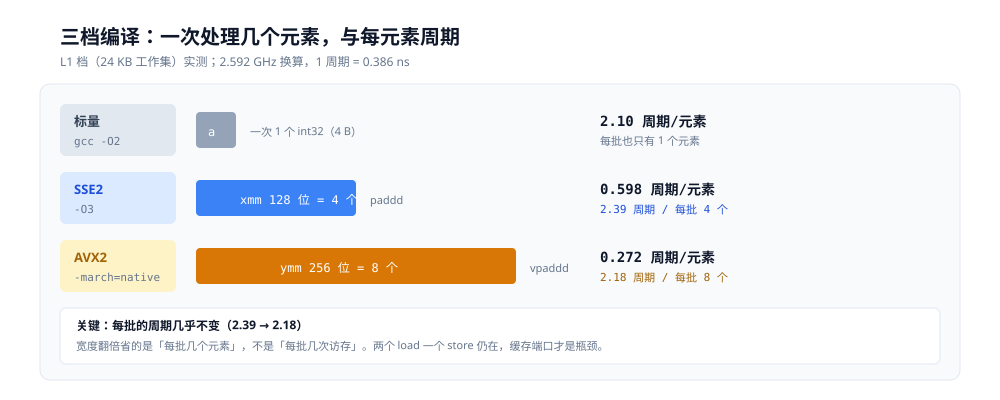
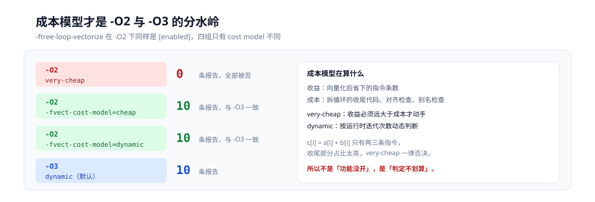
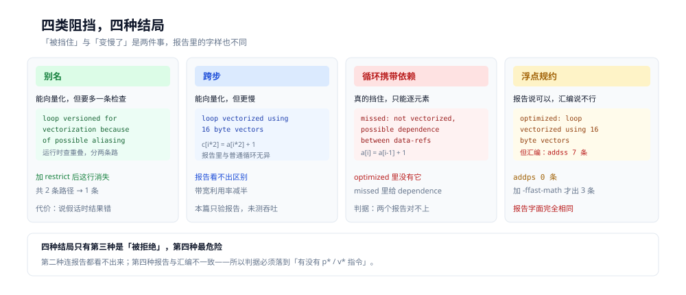
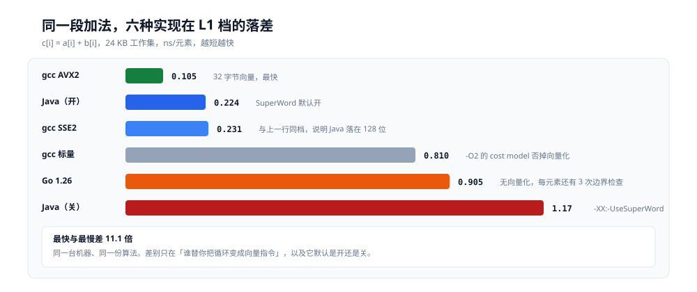

# 向量化与 SIMD

> 同一段 `c[i] = a[i] + b[i]`，同一台机器，只换编译选项：**0.810 ns / 元素 → 0.231 → 0.105**，差 7.7 倍。差别不在算法，不在语言，只在于「一条指令一次处理几个元素」。
>
> 本篇从这组读数出发，回答四个问题：`-O2` 为什么一条都不向量化、16 字节换 32 字节为什么只快一倍、哪些写法挡住了向量化、以及 Go 与 Java 各自的向量化落在哪一档。所有读数在本机容器里真跑，未实测的部分在文末标出。
>
> 内容整理自个人学习笔记。

---

## 一、从零：同一段加法，三档编译差 7.7 倍

**本节要点**：同样是 `c[i] = a[i] + b[i]`，`-O2` 逐元素算、`-O3` 一次算 4 个、`-march=native` 一次算 8 个。加速比随工作集增大而衰减：**7.7 倍 → 4.4 → 2.6 → 1.7**，因为工作集一旦超出缓存，瓶颈就从计算单元换成了内存。

### 1.1 三个数组与四档工作集

实验代码只有一行有效的循环体，其余全是测量脚手架：

```c
void add_basic(int *restrict c, const int *restrict a, const int *restrict b, long n) {
    for (long i = 0; i < n; i++) c[i] = a[i] + b[i];
}
```

`restrict` 的作用在第 5 节展开，这里先认为它表示「三个指针互不重叠」。

「工作集」= 三个数组的总字节数，它决定数据落在哪一层缓存。档位按 L1/L2/L3 的容量切：

| 档 | `n` | 三个数组合计 | 实际落点 |
|---|---|---|---|
| L1 | 2 048 | 24 KB | L1d（32 KB） |
| L2 | 8 192 | 96 KB | L2（每核 256 KB） |
| L3 | 131 072 | 1.5 MB | L3（6 MB） |
| 内存 | 16 777 216 | 192 MB | 内存 |

⚠️ 一开始我把 `n=8192` 标成「L1 32KB」，那是错的：三个数组共 96 KB，早已超出 32 KB 的 L1d。档位名必须按**工作集**算，不能按单个数组算。

### 1.2 三档编译

```bash
gcc -O2                    -o b_o2   vec2.c
gcc -O3                    -o b_o3   vec2.c
gcc -O3 -march=native      -o b_avx2 vec2.c
```

`-march=native` 在本机认到的是 `skylake`，`-mavx2` 为 `[enabled]`。这一点要先确认——很多机器上 `native` 认不全，后面整篇的「32 字节」就无从谈起：

```text
$ gcc -march=native -Q --help=target | grep -E '^\s+-march=|^\s+-mavx2'
  -march=                      skylake
  -mavx2                       [enabled]
```

### 1.3 四档读数

三轮取中位数（各档独立进程，`ns/元素`，越小越快）：

| 实现 | L1 24 KB | L2 96 KB | L3 1.5 MB | 内存 192 MB |
|---|---|---|---|---|
| `-O2`（标量） | 0.810 | 0.809 | 0.804 | 1.39 |
| `-O3`（SSE2，16 B） | 0.231 | 0.344 | 0.330 | 0.829 |
| `-O3 -march=native`（AVX2，32 B） | **0.105** | 0.185 | 0.310 | 0.811 |

把三档之间的倍数摊开，衰减非常干净：

| 档 | `-O2` → `-O3` | `-O3` → AVX2 | 合计 |
|---|---|---|---|
| L1 24 KB | 3.51 倍 | 2.20 倍 | **7.71 倍** |
| L2 96 KB | 2.35 倍 | 1.86 倍 | 4.37 倍 |
| L3 1.5 MB | 2.44 倍 | 1.06 倍 | 2.59 倍 |
| 内存 192 MB | 1.68 倍 | 1.02 倍 | 1.71 倍 |



三档的账要横着看：宽度从 4 字节翻到 32 字节，但「每批」的周期几乎没变（2.39 与 2.18），差距全来自每批装几个元素。

**L3 与内存两档，AVX2 几乎没有增益**（1.06 与 1.02 倍）——工作集一旦超出缓存，每条指令处理几个元素就不再重要，数据搬不进来，算得再快也没用。

这张表就是本篇的纲：**向量化只在计算受限时兑现**。后面五节都在解释「为什么 L1 档是 7.7 倍而不是 8 倍」和「什么时候连 3 倍都拿不到」。

---

## 二、为什么 `-O2` 一条都不向量化？

**本节要点**：`-O2` 的向量化开关是**开着的**，但成本模型是 `very-cheap`，把所有循环都判为「不划算」。改成本模型一个开关，报告从 **0 条**变成 **10 条**——所以「`-O2` 不向量化」不是功能缺失，是代价判断。

### 2.1 报告是空的，但开关是开的

```bash
gcc -O2 -fopt-info-vec-optimized -c vec.c -o /dev/null
```

输出**一行都没有**。但查开关：

```text
$ gcc -O2 -Q --help=optimizers | grep -E 'tree-loop-vectorize|vect-cost'
  -ftree-loop-vectorize        [enabled]
  -ftree-vectorize             [disabled]
  -fvect-cost-model=...        very-cheap
```

`-ftree-loop-vectorize` 明明是 `[enabled]`。所以「没向量化」的原因不在开关，在那行 `very-cheap`。

### 2.2 改成本模型，报告立刻回来

保持 `-O2` 不动，只换成本模型：

| 编译 | `-fvect-cost-model` | `-fopt-info-vec-optimized` 条数 |
|---|---|---|
| `-O2` | `very-cheap`（默认） | **0** |
| `-O2 -fvect-cost-model=cheap` | `cheap` | **10** |
| `-O2 -fvect-cost-model=dynamic` | `dynamic` | **10** |
| `-O3` | `dynamic`（默认） | 10 |

`-O2` + `cheap` 与 `-O3` 的报告条数完全相同。**这一个开关就是 `-O2` 与 `-O3` 在向量化上的全部差别。**



四组编译只差成本模型一项，报告就从 0 条跳到 10 条；右侧写的是它在权衡什么：收益是省下的指令数，成本是收尾代码与各类检查。

成本模型管什么：编译器估算「向量化的收益（省下的指令数）」除以「成本（拆循环的收尾、对齐检查、运行时别名检查）」，`very-cheap` 要求收益远大于成本才动手，循环体太短就一律否决。对 `c[i] = a[i] + b[i]` 这种两三条指令的循环，收尾代码（处理 `n % 4` 的标量尾巴）相对主循环的比例太高，`very-cheap` 认为不值。

### 2.3 这条判据怎么用

遇到「为什么我的循环没被向量化」，查三件事，按顺序：

1. `-fopt-info-vec-optimized` 有没有输出 → 没有就看第 2 步
2. `-Q --help=optimizers` 里的 cost model → `very-cheap` 就换 `cheap` 再试
3. 换了还不出来，就跑 `-fopt-info-vec-missed` 看具体理由（第 4 节）

⚠️ 反过来也成立：`-O3` 报告说「vectorized」不等于汇编里真有向量指令，第 4.4 节有一个反例。

---

## 三、16 字节换 32 字节，为什么只快一倍？

**本节要点**：宽度翻倍，每元素周期只降 2.2 倍（L1 档）。原因是**每次迭代的访存次数没变**——两个 load 一个 store，缓存端口才是瓶颈，不是加法器。

### 3.1 汇编里的 `paddd` 与 `vpaddd`

```text
$ gcc -O3 -S vec.c        # 数指令
paddd   10 条    vpaddd   0 条

$ gcc -O3 -march=native -S vec.c
paddd   11 条    vpaddd  11 条    ymm 引用 43 处
```

`paddd` 操作 `xmm`（128 位，4 个 int32），`vpaddd` 操作 `ymm`（256 位，8 个 int32）。`-O3` 只有前者，`native` 两者都有（尾部用 16 字节收尾）。

报告里也能直接看到宽度：

```text
$ gcc -O3 -fopt-info-vec-optimized -c vec.c -o /dev/null
vec.c:17:24: optimized: loop vectorized using 16 byte vectors

$ gcc -O3 -march=native -fopt-info-vec-optimized -c vec.c -o /dev/null
vec.c:17:24: optimized: loop vectorized using 32 byte vectors
```

### 3.2 把 ns 换算成周期

本机 2.592 GHz，一个周期 = 0.386 ns。换算后：

| 实现 | ns/元素 | 周期/元素 | 每「一批」的周期 |
|---|---|---|---|
| 标量 | 0.810 | 2.10 | 2.10（1 个元素） |
| SSE2 | 0.231 | 0.598 | 2.39（4 个元素） |
| AVX2 | 0.105 | 0.272 | **2.18（8 个元素）** |

关键在最后一列：**SSE2 每 4 个元素花 2.39 周期，AVX2 每 8 个元素花 2.18 周期**。两者都卡在 2 周期附近，几乎是同一个数。

为什么是 2 而不是 1？每次迭代要做 **2 次 load**（`a[i]`、`b[i]`）和 **1 次 store**（`c[i]`）。Skylake 每周期能做 2 次 load、1 次 store，所以 2 次 load 至少占 1 周期；再加上循环自己的 `add/jmp/cmp`，2 周期是合理值。

**这里就是全部答案**：宽度翻倍减少的是「每批的元素数」，但每批的访存次数没变。加法器本来就闲着一半，加宽它不会更快。真正的瓶颈是缓存端口。

这也解释了为什么 L1 档的加速是 7.7 倍而不是 16 倍：标量档 2.10 周期/元素，AVX2 档 2.18 周期/8 元素 = 0.272，比值 7.7。若瓶颈在计算，应该接近 8（128 位 → 256 位）乘 4（标量 → 128 位）的某种组合，但实际被访存端口截住了。

---

## 四、什么挡在向量化前面？

**本节要点**：四类情形，四种不同的结局——别名**能向量化但要多一条运行时检查**，跨步**能向量化但更慢**，循环携带依赖**真的挡住**，浮点规约**报告说可以、汇编说不行**。



四格里只有第三格是「被拒绝」，其余三格都算「能向量化」；第四格最危险，因为报告与汇编说的不是一回事。

### 4.1 别名：能向量化，但要版本化

同一段代码，去掉 `restrict`：

```c
void add_alias(int *c, const int *a, const int *b, long n) {
    for (long i = 0; i < n; i++) c[i] = a[i] + b[i];
}
```

报告里多出一行：

```text
vec.c:22:24: optimized: loop vectorized using 16 byte vectors
vec.c:22:24: optimized:  loop versioned for vectorization because of possible aliasing
```

**versioned** 的意思是：编译器生成两条路径，运行时先检查 `c` 与 `a`、`b` 是否重叠，不重叠走向量路径，重叠走标量路径。全仓只有这一处报告会带 `versioned` 字样——看到它就知道别名检查被插进去了。

用 `restrict` 声明不重叠，这一行消失，检查也消失。

### 4.2 跨步：能向量化，但要多算

`c[i*2] = a[i*2] + 1` 这种跨 2 步的访问，gcc 12 仍然向量化（报告里 `L27` 有 16/32 字节）。代价是每次向量访问要跳着取，实际带宽利用率减半。这一档我没有单独测吞吐，只在报告层面确认「不是被拒绝，是变慢」。

### 4.3 循环携带依赖：真的挡住

```c
void carry_chain(int *restrict a, long n) {
    for (long i = 1; i < n; i++) a[i] = a[i - 1] + 1;
}
```

这个循环的 `optimized` 报告里**完全没有它**，`missed` 报告给出理由：

```text
vec.c:32:24: missed: couldn't vectorize loop
vec.c:32:42: missed: not vectorized, possible dependence between data-refs *_4 and *_6
```

「data-refs 之间有依赖」——第 `i` 次迭代读的是第 `i-1` 次写的值，不能并行。这类循环只能靠「循环展开 + 归纳变量」这类变换，不是向量化。

判据：**`optimized` 里没有、`missed` 里有 `dependence`**，就是这一类。

### 4.4 浮点规约：报告说可以，汇编说不行

单累加器浮点求和：

```c
float fsum(const float *restrict a, long n) {
    float s = 0.0f;
    for (long i = 0; i < n; i++) s += a[i];
    return s;
}
```

`-O3` 的报告说它向量化了：

```text
$ gcc -O3 -fopt-info-vec-optimized -c iso.c -o /dev/null
iso.c:4:24: optimized: loop vectorized using 16 byte vectors
```

但看汇编：

| 编译 | `addss`（标量单精度） | `addps`（向量单精度） |
|---|---|---|
| `-O3` | 7 条 | **0 条** |
| `-O3 -ffast-math` | 7 条 | **3 条** |

**`-O3` 的报告说向量化了，汇编里一条 `addps` 都没有**——只有 7 条 `addss`，是标量 4 路展开。加 `-ffast-math` 后报告字面**完全相同**，汇编里才多出 3 条 `addps`。

原因是浮点加法不满足结合律：`(a+b)+c` 与 `a+(b+c)` 的舍入结果不同。默认 `-fno-fast-math` 下编译器不许重排，规约只能逐元素做。`-ffast-math` 允许重排，规则消失，才能向量化。

这条的结论比「浮点规约不能向量化」更值钱：**`-fopt-info-vec-optimized` 只是「编译器认为可以」,不等于后端生成了向量指令，定案必须看汇编里有没有 `p*` / `v*` 指令。**

---

## 五、`restrict` 是承诺，说谎的代价是错结果

**本节要点**：`restrict` 告诉编译器「这两个指针不会指向同一块内存」。说真话时走向量路径，快；说假话时编译器**照旧生成向量代码，但结果错了**，而且没有任何警告。

### 5.1 版本化的两条路径

对 4.1 节的 `add_alias`（无 `restrict`），让 `c` 与 `a` 指向同一块内存，运行时检查会发现重叠，降级为标量逐元素算——**结果仍然正确**，只是慢了。

对声明了 `restrict` 的版本，检查不存在，向量代码直接跑。

但 `c[i] = a[i] + b[i]` 这个负载即使重叠也不会算错，因为每个元素只依赖自己。要让「说假话」暴露出来，循环必须有**跨迭代依赖**：

```c
void shift_r(int *restrict c, const int *restrict a, long n) {
    for (long i = 1; i < n; i++) c[i] = a[i - 1] + 1;
}
```

### 5.2 让 `c` 与 `a` 重叠，看结果

数组先全部置 1，然后传 `shift(a2, a2, n)`（输出与输入是同一块内存）。正确语义是前缀累加：`a[i] = a[0] + i`，即 `1, 2, 3, 4, ...`。

```text
滑动+重叠: no-restrict 正确=1   restrict 正确=0
  差异 i=2: restrict=2 ref=3
  差异 i=3: restrict=2 ref=4
  差异 i=4: restrict=2 ref=5
```

`restrict` 版本从 `i=2` 就开始错：正确值 3，它算出 2。

原因是向量化一次处理 4 个元素（`i=1..4`），读 `a[0..3]` 的**旧值**再加 1，得到 `2,2,2,2`；而逐元素语义要求 `a[2]` 读到的是刚被写成 2 的 `a[1]`。

⚠️ 这类错误不会崩溃、不会告警，只是数字不对。而且**只在「调用方真的传了重叠指针」时才发生**——单测里传两个独立数组，永远测不出来。

### 5.3 什么时候能放心用

`restrict` 成立的条件是「同一块内存在这个函数的执行期间，只通过这一个指针访问」。工程上有三条实用判据：

| 情形 | 能不能加 `restrict` |
|---|---|
| 入参与出参是不同 `malloc` 出来的块 | 能 |
| 出参可能是入参的切片（`f(buf, buf + 4, n)`） | **不能** |
| 结构体成员指向同一个池 | 不能，除非能证明区间不交 |

第二条最容易踩：API 设计成「原地变换」时，`f(x, x, n)` 是正常用法，加了 `restrict` 就是 UB。

---

## 六、Go 与 Java 的向量化在哪里？

**本节要点**：Go 1.26 **完全没有通用循环向量化**，靠手写汇编覆盖少数标准库函数；Java 的 C2 有 `SuperWord`，开与关差 **5.2 倍**，实测落在 **128 位档**（与 gcc SSE2 同档），不到 AVX2。

### 6.1 Go 1.26：每个元素一条 `ADDL` 加三次边界检查

同一段数组加法，`go build -gcflags='-S'` 看汇编：

```text
main.addBasic STEXT nosplit size=70 args=0x48 ...
	ADDL	(R9)(CX*4), DX      ← b[i] 加到 a[i]
	MOVL	DX, (AX)(CX*4)      ← 写入 c[i]
	INCQ	CX
	CMPQ	BX, CX
	JLE	53
	CMPQ	SI, CX              ← 边界检查 1
	JLS	60
	MOVL	(DI)(CX*4), DX      ← 再读一次 a[i]
	CMPQ	R10, CX             ← 边界检查 2
	JHI	23
```

每个元素：1 条 `MOVL`、1 条 `ADDL`、1 条 `MOVL`，外加 **3 次 `CMPQ` + 条件跳转**（`range` 的上界检查、两次切片索引检查）。整个函数里**没有任何 `PADDD` / `VPADDD` / `ADDPS`**。

文件里确实有 3 条 `MOVUPS`，但它们出现在 `main.go:48` —— 那是 `make` 初始化数组时的零值填充（`X15` 是零寄存器），不是计算循环。**Go 只对「已知是 memset」的场景用手写向量，不做通用循环向量化。**

吞吐印证了这一点：Go 的 L1 档 **0.905 ns/元素**，比 gcc 标量版的 0.810 还慢 12%——向量化没有，边界检查倒是一个不少。

### 6.2 Java：`SuperWord` 开与关差 5.2 倍

C2 的自动向量化叫 `SuperWord`，默认开。同一个循环，只加 `-XX:-UseSuperWord`：

| 实现 | L1 24 KB | L2 96 KB | L3 1.5 MB | 内存 192 MB |
|---|---|---|---|---|
| Java 24（默认） | **0.224** | 0.257 | 0.337 | 1.24 |
| Java 24（`-XX:-UseSuperWord`） | 1.17 | 1.13 | 1.10 | 1.45 |

L1 档 1.17 → 0.224，**5.2 倍**。这与 gcc 的「标量 → 向量」比例（3.5 倍）同量级，说明关掉之后确实退到标量。

相关开关：

```text
$ java -XX:+UnlockDiagnosticVMOptions -XX:+PrintFlagsFinal -version | grep -E 'UseSuperWord|UseAVX|MaxVectorSize'
   intx MaxVectorSize  = 32   {C2 product} {default}
   int  UseAVX         = 2    {ARCH product} {default}
   bool UseSuperWord   = true {C2 product} {default}
```

`UseAVX=2`（AVX2）、`MaxVectorSize=32`，看起来该用 32 字节。但实测 0.224 与 gcc SSE2 的 0.231 几乎重合，而比 AVX2 的 0.105 慢一倍——**吞吐落在 128 位档**。容器里没有 `hsdis`，跑不了 `-XX:+PrintAssembly`，所以「C2 实际生成的向量宽度」这一条**未实测确认**，只能给出「吞吐与 16 字节档一致」这个事实。

### 6.3 三种语言的同负载对照

L1 档（24 KB 工作集）、`c[i] = a[i] + b[i]`、整数加：

| 实现 | ns/元素 | 相对 gcc 标量 | 相对 gcc AVX2 |
|---|---|---|---|
| gcc `-O2`（标量） | 0.810 | 1.00 | 7.7 倍慢 |
| gcc `-O3`（SSE2） | 0.231 | 3.51 倍快 | 2.2 倍慢 |
| gcc `-O3 -march=native`（AVX2） | **0.105** | 7.71 倍快 | 1.00 |
| Java 24（SuperWord 开） | 0.224 | 3.62 倍快 | 2.1 倍慢 |
| Go 1.26.8 | 0.905 | 1.12 倍慢 | 8.6 倍慢 |
| Java 24（关 SuperWord） | 1.17 | 1.44 倍慢 | 11.1 倍慢 |



同一台机器、同一份算法，最快与最慢差 11.1 倍；中间的 Java 与 gcc SSE2 两行几乎等长，这就是「落在 128 位档」的直观依据。

这张表的结论不是「C 比 Go 快」——换了负载会变（Go 在规约与分支密集的代码上并不吃亏）。它说明的是：**同一台硬件、同一份算法，最终差多少倍取决于「谁替你把循环变成向量指令」**。C 的交给了编译器且可以调，Java 的交给 JIT 且默认开，Go 的交给了你自己。

---

## 七、什么时候该手写 SIMD？

**本节要点**：三个条件同时满足才值得手写——自动向量化没生效、负载是计算受限、且能拿到 2 倍以上的实测收益。手写不一定更快：本机上手写的 AVX2 版本在 64 MB 档**反而比自动向量化的慢 31%**。

### 7.1 手写的三个前提

| 前提 | 怎么确认 |
|---|---|
| 自动向量化没生效 | `-fopt-info-vec-missed` 里是 `dependence` 或 `unsupported type`，而不是被 cost model 否掉 |
| 负载计算受限 | L2 以内的读数明显快于 L3/内存档；否则加宽宽度没有意义（第 1.3 节） |
| 有 2 倍以上收益 | 手写版本与自动向量化版本同负载对拍 |

第二条最容易被忽略。第 1.3 节已经给出反例：L3 档 AVX2 只比 SSE2 快 1.06 倍，内存档 1.02 倍——那种负载上手写 32 字节版本纯属白费。

### 7.2 手写为什么不总是更快

在同一份实验里加一个手写 `intrinsics` 版本：

```c
void add_avx2(int *restrict c, const int *restrict a, const int *restrict b, long n) {
    long i = 0;
    for (; i + 8 <= n; i += 8) {
        __m256i va = _mm256_loadu_si256((const __m256i *)(a + i));
        __m256i vb = _mm256_loadu_si256((const __m256i *)(b + i));
        _mm256_storeu_si256((__m256i *)(c + i), _mm256_add_epi32(va, vb));
    }
    for (; i < n; i++) c[i] = a[i] + b[i];
}
```

在 64 MB 档，手写版 **1.399 ns/元素**，自动向量化版 **1.064**——手写**慢 31%**。

原因不神秘：内存档的瓶颈是预取与带宽，`loadu`（非对齐）指令的拆分行为、以及手写循环里少掉的软件预取，都在这个档位放大。自动向量化版本借用了 gcc 的循环优化（版本化、对齐分析、预取插入），手写的只拿到了宽度。

所以手写的适用面比想象中窄：**计算受限 + 编译器确实没做 + 编译器那套优化你也自己补上了**，三者缺一不可。真正值得手写的是标准库（`memcpy`、`strlen`、矩阵乘微内核），那里上面三条全满足且被反复调优。

---

## 八、三组结论

**本节要点**：向量化省的是「指令条数」，不是「访存次数」；能不能兑现取决于瓶颈在哪一层；`-O2` 与 `-O3` 的差别只是一个成本模型开关。

**一、`-O2` 不向量化不是功能缺失，是代价判断。** `-ftree-loop-vectorize` 在 `-O2` 下就是 `[enabled]`，拦住它的是 `-fvect-cost-model=very-cheap`。换成 `cheap`，报告从 0 条变 10 条，与 `-O3` 完全一致。

**二、宽度翻倍只换来 2.2 倍，因为瓶颈不在加法器。** SSE2 每 4 元素 2.39 周期、AVX2 每 8 元素 2.18 周期，两者都被「每次迭代 2 次 load + 1 次 store」的缓存端口卡住。加速比随工作集衰减：7.7 → 4.4 → 2.6 → 1.7 倍，到 L3 与内存档 AVX2 已经无用（1.06 / 1.02 倍）。

**三、报告与汇编要一起看。** 单累加器浮点求和，`-O3` 的 `-fopt-info-vec-optimized` 说它「vectorized using 16 byte vectors」，汇编里却是 7 条 `addss`、0 条 `addps`。加 `-ffast-math` 后报告字面相同，汇编里才出现 3 条 `addps`。**`-fopt-info` 报的是「编译器认为可以」，定案要看指令。**

---

## 校验口径

本节标出哪些读数是真跑、哪些没测。

**真跑**（容器 `elflab` = golang:1.26-bookworm / gcc 12.2.0、`java-lab` = Temurin 24.0.2，宿主 i7-6700HQ 2.592 GHz，WSL2 内核 6.18.54.1）：

- 三档编译的向量化报告条数（`-O2` 0 条 / `cheap` 10 条 / `dynamic` 10 条 / `-O3` 10 条）
- 汇编宽度计数（`paddd` 10 / `vpaddd` 0 / `ymm` 0；native 档 11 / 11 / 43）
- 四档吞吐 × 三档编译 × 三轮（C 侧）；Go 三轮；Java 开与关各三轮
- 循环携带依赖的 `missed` 文本（`possible dependence between data-refs`）
- 别名版本化的 `versioned` 报告行
- `restrict` 说谎时的错值（`i=2` 给 2，正确 3）与 `no-restrict` 降级后仍正确
- Go 汇编（`main.addBasic` 全函数，确认无 `PADDD`/`VPADDD`）
- Java 的 `UseSuperWord` / `UseAVX=2` / `MaxVectorSize=32` 三个默认值

**只编译未实测**：

- 跨步（`c[i*2]`）的吞吐——只确认了「报告说向量化」，没单独测它的带宽损失
- `-ffast-math` 版本的吞吐——只数了 `addps` 条数，没测速度

**未实测**：

- Java C2 实际生成的向量宽度（容器无 `hsdis`，`-XX:+PrintAssembly` 跑不了）；「落在 128 位档」是从吞吐与 gcc SSE2 同档**推断**，不是直接观测
- `perf stat` 的 IPC/指令数（WSL2 下 `perf` 不可用，只有 wall clock）
- arm64 的 NEON / SVE 宽度与指令（只有 x86-64 实验台）
- 真机（非 WSL2）上的绝对读数——虚拟化会放大系统调用与内存延迟，本篇全部是 ns/元素 的比值，不跨机器引用

**测量坑**（写进代码注释，也是本篇的负结果）：

| 坑 | 现象 | 修法 |
|---|---|---|
| 计时器量化 | `0.2930 × 2048 = 600.0 ns`、`0.7812 × 2048 = 1600.0 ns` 全是整百纳秒，C 与 Java 给出**相同数字** | 小数组按 `reps` 累积计时再除 |
| `-O3` 折叠重复调用 | `add` 档读数 0.0003 ns/元素 | 函数指针加 `volatile` |
| 内联后整体折叠 | `dot1`/`dot4` 读数 0.0000 | 加 `__attribute__((noinline))` |
| 工作集标错 | 把 `n=8192`（三数组 96 KB）当 L1 | 按**工作集总字节**分档 |

---

## 延伸追问

**为什么 `-O3` 报告说向量化了、汇编里却没有？**

`-fopt-info` 的 `optimized` 是 tree 层 `vect` pass 的决策记录，它记的是「这轮分析通过、标记为向量化」。之后的 pass（RTL 展开、ifcvt、去优化）仍可能把这套代码改回去，而报告不会回滚。对浮点规约，`vect` 先按「可向量化」通过，后端生成时受 `-fno-fast-math` 约束又退回标量。所以判据必须落到汇编。

**手写 intrinsics 在什么负载上真能赢？**

要同时满足「计算远多于访存」与「自动向量化确实没做」。典型的是小尺寸矩阵乘的微内核（一次 load 反复用）、CRC、以及 `memcpy` 这种可被反复调优的库函数。反例就是本篇第 7.2 节的数组加法——访存受限，手写拿不到好处。

**AVX-512 会不会让情况变好？**

宽度从 256 到 512，但同样受缓存端口限制，且 Skylake-X 之后的 AVX-512 有频率下压。对本篇这种「2 load + 1 store」的负载，加宽的收益仍然会被端口吃回去。要真受益，得是计算密度更高的负载（例如 int8 量化推理的乘加）。

**Go 会不会加自动向量化？**

Go 的编译器后端（SSA）长期没有循环向量化器，标准库靠手写汇编覆盖热点函数。这条路线的代价是「普通用户代码拿不到 SIMD」，好处是编译快、汇编可审计。从 1.26 的实测看这条路没有变。

---

## 关联

- [README.md](README.md) — 本册总纲：三篇的分工与读序
- [CPU怎么执行一条指令.md](CPU怎么执行一条指令.md) — 上游：编译器会怎么把你要测的东西删掉（第 3 节的两个骗法，与本篇 2.3 / 校验口径里的坑是同一类）
- [CPU流水线与乱序执行.md](CPU流水线与乱序执行.md) — 上游：IPC 与超标量，本篇「每批 2.18 周期」的参照系
- [CPU缓存与缓存行.md](../缓存与内存/CPU缓存与缓存行.md) — 工作集为什么决定档位，L1/L2/L3 的容量与延迟
- [内存屏障与内存序的代价.md](../缓存与内存/内存屏障与内存序的代价.md) — 另一类「指令单价」：屏障与原子指令
- [机器码、字节码与opcode.md](../../编译原理/机器码、字节码与opcode.md) — 更下一层：`paddd` 这几个字节是怎么编出来的
- [目录.md](../../../目录.md) — 全仓索引
