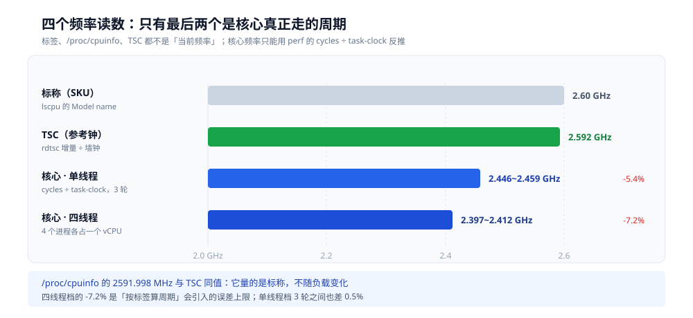
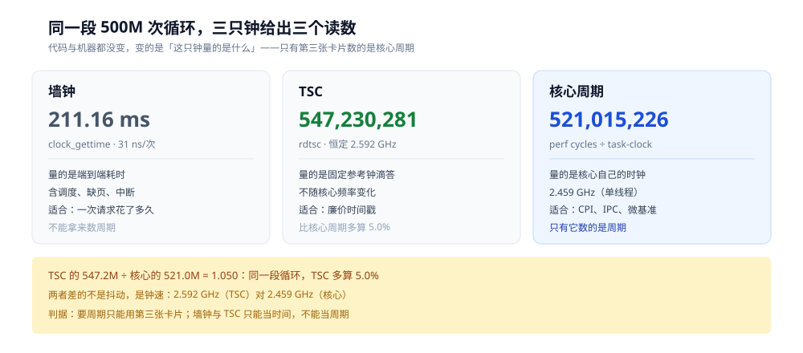
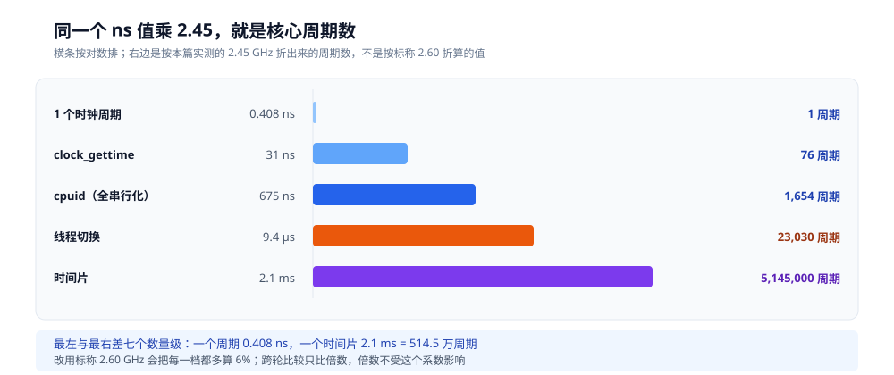

# 时钟周期与频率

> 同一句「1.2 ns」，按标称 2.60 GHz 算是 **3.1 个周期**，按本机实测的 2.45 GHz 算是 **2.9 个**——差 6%。这台机器的标签写着 **2.60 GHz**，`/proc/cpuinfo` 报 **2591.998 MHz**，`rdtsc` 每轮都稳定在 **2.592 GHz**，而 `perf` 数出的核心实际频率只有 **2.446~2.459 GHz**。四个读数里，只有最后一个能拿来算核心周期。
>
> 本篇讲三件事：**时钟周期是什么、它和一条指令的耗时为什么不是一回事**；**标称 / TSC / 实际三种频率各量的是什么**；**手上这个 ns 读数该乘哪个数才变成周期**。同册四篇里每一个「多少周期」都建立在这次换算上：五段价码 0.282 / 1.012 / 3.042、IPC 0.55~3.17、分支误判的 4.32 倍、SIMD 的 0.810 / 0.231 / 0.105 ns 每元素。一条指令在流水线里怎么走见 [CPU怎么执行一条指令.md](CPU怎么执行一条指令.md)，多条同时飞见 [CPU流水线与乱序执行.md](CPU流水线与乱序执行.md)，猜错分支的赔偿见 [分支预测.md](分支预测.md)，一条指令装几个元素见 [向量化与SIMD.md](向量化与SIMD.md)。
>
> 素材来源：本机 Docker 实测，`perf-lab` 容器（debian:bookworm-slim + `linux-perf 6.1.190` + `gcc 12.2.0`），宿主 Intel i7-6700HQ，WSL2 内核 6.18.54.1，容器 `--privileged`、无 CPU 配额。

---

## 一、时钟周期到底是一个什么量？

**本节要点**：频率是「一秒多少个节拍」，周期是它的倒数；**一个节拍不等于一条指令**——现代 CPU 一个周期能发射、退休好几条指令，所以「多少周期」必须先说清是「谁的钟、量的是什么」。

### 1.1 频率的倒数，不是固定时间单位

```text
2.45 GHz = 2.45 × 10^9 个节拍 / 秒
T = 1 / 2.45e9 = 0.408 ns
```

换成 2.60 GHz，同一个式子给出 **0.385 ns**。周期是**由频率定义的变量**，不是「CPU 的一个固定常数」——频率一降，周期就变长；换算时用错频率，后面每个周期数都跟着错。

频率来自主板上的晶振，经 PLL 倍频得到。倍频系数可调，所以同一颗核在空载、满载、温度高时跑的数字可以不一样（2.3 节有本机读数）。

### 1.2 一条指令可以不到一个周期

[CPU怎么执行一条指令.md](CPU怎么执行一条指令.md) 量出的独立 `add` 是 **0.282 周期/条**，换成时间就是 **0.115 ns/条**。小于一个周期，说明「每条指令多少周期」不是「一条指令占多久」，而是**多条指令在同一批端口上并行摊薄之后的结果**：这一代有 4 个 ALU 端口，四条互不依赖的加法可以在一个周期里一起算。

同一条 `add` 串成依赖链则是 **1.012 周期/条**——受延迟限制，只能一条等一条。两个数差 3.6 倍，代码一模一样，只是依赖图的形状不同。

⭐ 判据：**周期/条 < 1 一定是吞吐；> 1 可能是延迟，也可能是在等内存**。所以周期数不能单独使用，必须配上 IPC 或依赖结构，否则「8.81 周期/加法」会被误读成「加法要 8.81 个周期」。

### 1.3 「周期」有三只钟，只有一只是核心的

| 钟 | 谁在走 | 本机读数 | 拿来算什么 |
|---|---|---|---|
| 墙钟 | 内核维护的单调时间 | 500M 次循环 211.16 ms | 端到端耗时 |
| TSC | 固定频率的参考计数器 | 2.592 GHz | 墙钟的廉价替代 |
| 核心周期 | 核心自己的时钟 | 2.446~2.459 GHz（空载） | CPI、IPC、微基准 |

只有第三只是「周期」。用前两只去除指令数，得到的是「每条指令多少 ns」或「多少 TSC 滴答」，**不是周期**。分母用错，误差从 5% 起步，负载高时到 8%。

---

## 二、标称频率为什么对不上实测？

**本节要点**：三种频率、四个读数，差值最大 5.9%；`/proc/cpuinfo` 里的 `2591.998 MHz` 是最容易骗人的一个——它看着像「当前频率」，量的其实是标称。

### 2.1 三种频率、四个读数

| 来源 | 读数 | 量的是什么 |
|---|---|---|
| `lscpu` 的 `Model name` | 2.60 GHz | 厂商标在 SKU 上的基准频率 |
| `/proc/cpuinfo` 的 `cpu MHz` | 2591.998（×4） | TSC 的固定频率，**不是核心当前频率** |
| `rdtsc` 增量 ÷ 墙钟 | 2.592 GHz | 固定参考钟的实际速率 |
| `perf cycles ÷ task-clock` | 2.446~2.459 GHz | 核心真实周期（单线程空载） |

`/proc/cpuinfo` 与 TSC 是同一个数的两种写法（2591.998 MHz ≈ 2.592 GHz）。容器里没有 `/sys/devices/system/cpu/cpu0/cpufreq` 目录，`turbostat` 也没装，所以很多环境里**能看到的「频率」只有这一个**——而它根本不随负载变。

### 2.2 单线程：2.446~2.459 GHz

被量的循环由 GCC 编成 4 条指令：两条互不依赖的 `add`、一条 `cmp`、一条 `jg`，`-O2` 下 IPC 3.72~3.84，每轮 1.04 个周期。它只是个稳定负载，不测 CPI。

```bash
perf stat -e cycles,instructions,task-clock -x, -- /root/clock_lab 500000000
```

```text
chain n=500000000 wall_ns=211160424 tsc_delta=547230281 tsc_GHz=2.592
521015226,,cycles,211884100,100.00,2.459,GHz
2001151472,,instructions,211884100,100.00,3.84,insn per cycle
211.88,msec,task-clock,211884100,100.00,0.996,CPUs utilized
```

| 轮次 | 程序自测 wall | TSC 增量 | `perf cycles` | cycles ÷ task-clock |
|---|---|---|---|---|
| 1 | 211.16 ms | 547,230,281 | 521,015,226 | **2.459 GHz** |
| 2 | 215.71 ms | 559,007,881 | 530,493,979 | **2.452 GHz** |
| 3 | 219.16 ms | 567,965,806 | 537,676,635 | **2.446 GHz** |

比标称 2.60 GHz 低 **5.4%~5.9%**。<br/>⚠️ 同册 [CPU怎么执行一条指令.md](CPU怎么执行一条指令.md) 5.2 节另一轮测到的是 **2.435 / 2.365 GHz**：前者与本篇相差不到 1%，后者低 3%；具体原因（宿主负载还是降频）本轮没有复查。**同一台机器不同轮次的频率可以差 3%**，这是所有绝对值的误差底噪。

### 2.3 四路并行：2.397~2.412 GHz

把同样的负载同时跑在 1 个、2 个、4 个 vCPU 上，各进程分别算自己的频率：

| 同时跑的进程 | 绑核 | cycles ÷ task-clock | 单进程 wall | TSC |
|---|---|---|---|---|
| 1 | cpu0 | 2.446~2.459 GHz | 211~219 ms | 2.592 GHz |
| 2 | cpu0 + cpu2 | 2.441~2.455 GHz | 232~243 ms | 2.592 GHz |
| 4 | cpu0~3 | **2.397~2.412 GHz** | **300~324 ms** | 2.592 GHz |

两个读数要分开看：

- **频率只掉了约 2%**（2.459 → 2.412）。
- **每个进程却慢了 1.42~1.53 倍**（211~219 ms → 300~324 ms）。

慢的主体不是掉频，是抢执行单元。`lscpu` 报的是 2 核 4 线程（`Core(s) per socket: 2`、`Thread(s) per core: 2`），4 个 vCPU 不提供 4 个独立核的吞吐。这个结论与 [调度与时间片.md](../../操作系统/调度与时间片.md) 5.2 不冲突：那一节证明的是「本机测不出 SMT 兄弟核的差别」，这里证明的是「4 个 vCPU 的总吞吐不够 4 份单线程」。

### 2.4 容器里读不到「现在多少 GHz」

```bash
cat /sys/devices/system/cpu/cpu0/cpufreq/scaling_cur_freq
# cat: .../cpu0/cpufreq/scaling_cur_freq: No such file or directory
```

没有 cpufreq，就没有「当前频率」这个文件可读。唯一能反推的式子：

```text
核心频率 = perf cycles ÷ perf task-clock
```

分母必须是 `task-clock`（任务真正在 CPU 上的时间），不能是墙钟——被抢占的那段时间里核心没在为这个任务走周期。3.3 节解释为什么。



图里从左到右是三个读数越来越接近「核心真正走了多少周期」：标签 2.60 是 SKU 基准，TSC 2.592 是固定参考钟，只有 2.459 与 2.412 两档是 `perf` 从 PMU 数出来的核心周期。四线程档比标称低 7.2%，这 7.2% 就是「按标签算周期」会引入的误差上限。

---

## 三、计时用哪个钟？

**本节要点**：墙钟、TSC、核心周期是三套独立的时间来源，同一段循环量出 211.16 ms / 547.2M / 521.0M 三个数；选错口径不会报错，只会静默多算 5%。

### 3.1 墙钟：`clock_gettime` 31 ns 一次

```c
clock_gettime(CLOCK_MONOTONIC, &ts);
```

本机 1000 万次取平均：`CLOCK_MONOTONIC` **31.03 / 31.13 ns 每次**，`CLOCK_REALTIME` **31.92 / 29.69 ns 每次**。

31 ns 只可能是 vDSO 路径。同一台机器上真进内核的调用要贵两个数量级：[用户态内核态与一次IO的内存路径.md](../../操作系统/用户态内核态与一次IO的内存路径.md) 3.3 节测到 `clock_gettime` 走 vDSO 是 31.8~41.8 ns、`getpid` 是 1500.8~1588.3 ns（约 40 倍）。本轮的 31 ns 与那一档完全吻合，说明容器里的 vDSO 是通的。

墙钟适合测「一次请求花了多久」，不适合测「这段代码用了多少周期」——它包含调度、缺页、中断，且分辨率在十几纳秒量级。

### 3.2 TSC：恒定的 2.592 GHz

`rdtsc` 读的是时间戳计数器。它在本机每一轮、每一种负载下的增量除以墙钟，都是 **2.592 GHz**：

| 场景 | TSC 频率 |
|---|---|
| 单线程 3 轮 | 2.592 / 2.592 / 2.592 GHz |
| 双线程 2 进程 | 2.592 / 2.592 GHz |
| 四线程 4 进程 | 2.592 / 2.592 / 2.592 / 2.592 GHz |
| 被宿主播走的 4 进程 | 2.592 GHz（全部 4 个） |

内核时钟源也印证这一点：

```text
$ cat /sys/devices/system/clocksource/clocksource0/current_clocksource
hyperv_clocksource_tsc_page
```

`cpuinfo` 里另有 `tsc_known_freq` 标志。Hyper-V 通过一页共享内存把 TSC 频率告诉客人，读它不触发 VM exit——这也是为什么 31 ns 的 vDSO 调用能成立。

⭐ 关键：**TSC 是「墙钟的廉价拷贝」，不是「周期计数器」**。它按标称频率走，核心降频它不降；拿它当周期数，就是把 2.592 当成 2.45，多算 5%。

### 3.3 `perf cycles`：核心真实周期

PMU 的 `cycles` 事件数的是**核心自己的时钟**。它和 TSC 的差别不是实现细节，是物理事实：一个跟着核心的 PLL 走，一个跟着固定参考钟走。

两个分母要分清：

```text
cycles ÷ wall        → 被抢占时偏低，算出来不是频率
cycles ÷ task-clock  → 任务真正在 CPU 上的时间，这才是频率
```

本机单线程那一轮 `wall = 211.16 ms`、`task-clock = 211.88 ms`，只差 0.3%，两种除法的结果看起来差不多；四线程被抢占的轮次里 `task-clock` 只有 `wall` 的 0.50~0.61，两个分母就会给出完全不同的答案（5.1 节）。

### 3.4 同一段循环，三个读数

| 口径 | 读数 | 换算成频率 | 与核心周期的差 |
|---|---|---|---|
| 墙钟 | 211.16 ms | — | — |
| TSC | 547,230,281 | 2.592 GHz | **+5.0%**（相对 521.0M） |
| `perf cycles` | 521,015,226 | 2.459 GHz | 基准 |



图里三张卡片对应三只钟：墙钟给的是 211.16 ms，TSC 给的是 547.2M 个滴答，`perf` 给的是 521.0M 个核心周期。后两者差 5.0%——这段代码没变、机器没变，只是换了钟。底部那行是判据：**要周期，只能用第三张卡片**。

---

## 四、ns 怎么换成周期？

**本节要点**：只有一个公式，`cycles = ns × f`；`f` 必须来自实测，用标称值算出来的叫「按标签折算」，不能写成实测。差 6% 对倍数结论无感，对跨阈值判断致命。

### 4.1 公式与两个方向

```text
周期数 = ns × f(GHz)
ns     = 周期数 ÷ f(GHz)
```

- 2.45 GHz：`1 ns = 2.45 周期`，`1 周期 = 0.408 ns`。
- 2.60 GHz：`1 ns = 2.60 周期`，`1 周期 = 0.385 ns`。

### 4.2 一张换算表

| 时间 | 周期 @2.45 GHz（实测） | 周期 @2.60 GHz（标称） | 差 |
|---|---|---|---|
| 0.408 ns | **1** | 1.06 | 6% |
| 1 ns | **2.45** | 2.60 | 6% |
| 31 ns（`clock_gettime`） | **76** | 81 | 6% |
| 1 µs | **2,450** | 2,600 | 6% |
| 9.4 µs（线程切换） | **23,030** | 24,440 | 6% |
| 1 ms | **2,450,000** | 2,600,000 | 6% |
| 2.1 ms（时间片） | **5,145,000** | 5,460,000 | 6% |

反方向也一样：独立 `add` 的 0.282 周期 = **0.115 ns**；依赖 `add` 的 1.012 周期 = **0.413 ns**；`imul` 的 3.042 周期 = **1.242 ns**。



图里五档从左到右跨了七个数量级，每档右边都标了「按 2.45 GHz 折成多少周期」。最左是 1 个周期 0.408 ns，最右是 2.1 ms 的时间片 514.5 万周期——**同一个「周期」单位，在微观与宏观两头差了七个数量级**，这也是 [调度与时间片.md](../../操作系统/调度与时间片.md) 1.2 节提醒「两种尺度不能混着算」的原因。

### 4.3 哪些结论经得起 6% 的误差

| 结论类型 | 例子 | 6% 误差的影响 |
|---|---|---|
| 数量级 / 倍数 | 200 倍、175 倍、4.85 倍 | 无感——分子分母同乘一个系数，比值不变 |
| 跨阈值判断 | 是否大于 1 个周期、是否跨 64 字节缓存行、是否跨 4 KB 页 | 可能翻结论，必须用实测频率 |
| 精确 CPI / 周期价码 | 0.282 / 1.012 / 3.042 | 直接用 `perf cycles`，不经过 ns |

全仓四处「ns → 周期」的换算点，在用错频率时会偏这么多：

| 位置 | 原文 | 用 2.45 GHz 重算 |
|---|---|---|
| [内存屏障与内存序的代价.md](../缓存与内存/内存屏障与内存序的代价.md) 3.3 | 675 ns ≈ 1800 周期 | **1,654** |
| [互斥的实现.md](../底层同步/互斥的实现.md) 3.2 | `lock xadd` 8 ns ≈ 21 周期 | **19.6** |
| [JIT与执行引擎.md](../../../01-编程语言/java/运行时/JIT与执行引擎.md) 1.2 | 1.2 ns ≈ 3 周期 | **2.94** |
| [机器码、字节码与opcode.md](../../编译原理/机器码、字节码与opcode.md) 2.1 | 译码器必须在一个时钟周期内切边界 | 一个周期 = **0.408 ns** |

四处原文都按 2.6 GHz 量级折算，误差 6% 上下，不影响各自的定性结论（1800 与 1654 都是「千级」）。本册不返工改数，只把校准点指回这里：**要精确值，用该篇当时的实际频率重算；要倍数，2.6 与 2.45 等价**。

---

## 五、容器与虚拟化里，读数为什么不可信？

**本节要点**：同一份脚本前后跑两次，一次每个进程只拿到 50%~61% 的 CPU、一次拿到 98%；被抢走的那一轮里 `wall`、`task-clock`、`cycles/task-clock` 三个数互相矛盾，整轮作废。唯一稳的是 TSC 的 2.592。

### 5.1 同一脚本，两次跑出两种世界

四进程绑四个 vCPU，同一份二进制、同一个 500M 次循环：

| 轮次 | 单进程 wall | task-clock ÷ wall | cycles ÷ task-clock |
|---|---|---|---|
| 第一次 | **675~740 ms** | **0.50~0.61** | **1.91~2.12 GHz** |
| 第二次 | **300~324 ms** | **0.98** | **2.397~2.412 GHz** |

第一次那一轮不能只当「慢」：如果 CPU 真的降到 2.0 GHz，`task-clock` 应该仍等于 `wall`（任务一直在 CPU 上）；如果只是被抢占，`cycles/task-clock` 应该仍是 2.4。两个数同时偏离，说明在虚拟化的 vCPU 上，**PMU 与调度器的记账被宿主切断了**，这一轮的三组绝对值互相矛盾，只能整轮丢弃。

第二次那一轮才可用：利用率 98%，频率 2.397~2.412，与单线程的 2.446~2.459 差 2%。

### 5.2 唯一稳定的是 TSC 的 2.592

被抢走的那一轮里，四个进程打印的 `tsc_GHz` 仍然全是 2.592；空载、满载、被抢占，它都不变。原因在 3.2：TSC 是固定参考钟，不跟核心频率走。

⭐ 这给出一个实用判据：**在容器里做跨轮比较，用 TSC 比值当时间基准，用倍数当结论；绝对周期数只在同一轮内比较**。

### 5.3 报读数必须带分母

「9.4 µs」本身不是结论，`9.4 µs × 2.45 = 23,030 周期`才是。写微基准读数时至少带上三样：

```text
读数 + 频率来源（实测 / 标称 / TSC）+ 分母（wall / task-clock）
```

本册所有「倍数」类结论（200 倍、175 倍、4.85 倍）在 2.45 与 2.60 下都成立，因为比值把频率约掉了；所有「多少周期」的绝对值都只在当轮有效。

---

## 六、应用场景：周期与频率落在哪些真实系统里？

**本节要点**：凡是「用时间换周期」或「用频率估容量」的地方，都要先过这一关。写错频率不会报错，只会让所有周期数静默偏 5%~6%——这在小倍数上无所谓，在「刚好过没过阈值」上就是结论反转。

### 6.1 八个落点

| 场景 / 系统 | 用到哪一块 | 为什么值得注意 |
|---|---|---|
| 微基准报告读数 | `cycles = ns × f` | 用标称频率算出来的叫「按标签折算」，不能写成实测（4.1） |
| 云厂商 vCPU 选型 | 标称 GHz | 标称是「最高睿频」，不是持续频率；按它估容量会高估 20% 以上 |
| 容器里的性能回归 | `task-clock` vs `cycles` | 两个数互相矛盾时整轮作废（5.1），只能信比值 |
| 超时与退避的计算 | ns → 周期 | 「9.4 µs」不是结论，`9.4 × 2.45 ≈ 23,030 周期`才是（5.3） |
| 调度器时间片 | 周期换算 | 本机时间片 2.1 ms ≈ 514 万周期，量级感来自这一步换算 |
| 加密 / 压缩的吞吐 | 周期/字节 | 报 MB/s 会随频率漂，报「周期/字节」才可跨机器比 |
| 功耗与降频 | 实际频率 | 满载久了会掉到基频，此时同一代码的 ns 读数整体变长 |
| 与 TSC 相关的日志 | 三种钟 | `dmesg` 的 `tsc: Detected ... MHz` 是参考钟，不是核心频率 |

### 6.2 三条共性

1. **三只钟各量各的，只有 `perf cycles` 能算核心周期**：标称、TSC（2.592 GHz）、核心（2.446~2.459 GHz）三者差最多 5.9%（2.1）。
2. **换算公式只有一个，`f` 必须实测**：`cycles = ns × f`。用 2.60 与用 2.45，同一句「1.2 ns」得到 3.1 与 2.9 个周期（4.1）。
3. **容器与虚拟化里只信比值，不信绝对值**：被抢走 CPU 的那一轮，`wall` / `task-clock` / `cycles` 三个数互相矛盾（5.1）。

⚠️ 反向提醒：`/proc/cpuinfo` 里的 `cpu MHz` 看着像「当前频率」，量的却常是标称（2.1）。要当前值只有两条路——`perf stat -e cycles,task-clock` 自己算，或在裸机上读 MSR。

## 七、具体使用：量一次本机频率，再把换算写对

**本节要点**：三条命令拿到三个数，一个公式做换算。整个过程五分钟，但能挡掉后面所有「周期数对不上」的争论。

### 7.1 三条命令

```bash
# ① 标称频率（不是当前频率）
grep -m1 'model name' /proc/cpuinfo

# ② 看着像当前频率，实际常是标称 —— 不要用它算核心周期
grep -m1 'cpu MHz' /proc/cpuinfo

# ③ 核心真实周期 vs 墙上时间：两个数相除就是实测频率
perf stat -e cycles,task-clock ./prog
#   频率 = cycles / (task-clock 毫秒 / 1000)
```

### 7.2 一个 TSC 探针

```c
#include <stdio.h>
#include <time.h>
#include <x86intrin.h>

/* 返回 TSC 频率（GHz）。注意：这是固定参考钟，不等于核心频率 */
static double tsc_ghz(void) {
    struct timespec t0, t1;
    clock_gettime(CLOCK_MONOTONIC, &t0);
    unsigned long long c0 = __rdtsc();
    struct timespec req = {1, 0};
    nanosleep(&req, NULL);
    clock_gettime(CLOCK_MONOTONIC, &t1);
    unsigned long long c1 = __rdtsc();
    double dt = (t1.tv_sec - t0.tv_sec) + (t1.tv_nsec - t0.tv_nsec) / 1e9;
    return (double)(c1 - c0) / dt / 1e9;
}
```

⭐ 这个探针的用途是**验证 TSC 是否稳定**（本机每轮都是 2.592），不是拿来算核心周期——那要用 `perf cycles`。

### 7.3 换算写在哪

| 场景 | 写法 | 说明 |
|---|---|---|
| 报告单个延迟 | `1.2 ns × 2.45 = 2.9 周期` | 标注「f 取实测 2.45 GHz」 |
| 报告吞吐 | 「0.282 周期/条」而非「0.115 ns/条」 | 周期可跨机器比，ns 不行 |
| 跨阈值判断 | 两边用同一个 f | 差 6% 在阈值附近会反转结论（4.3） |
| 容器内报告 | 只报比值，不报绝对 GHz | 被抢 CPU 时绝对值无意义（5.1） |

### 7.4 症状对照表

| 现象 | 指向 | 下一步 |
|---|---|---|
| 自己算的周期与别人差 5% | 一方用了标称频率 | 统一用实测 f，并注明来源 |
| 同一脚本两次读数差一倍 | CPU 被抢 / 降频 | 看 `task-clock` 与 `cycles` 是否互相矛盾 |
| `cpu MHz` 与 `perf` 差 6% | 前者是标称，后者是实测 | 信 `perf` |
| 满载一段时间后整体变慢 | 热降频 | 记录频率随时间的变化，别只取一次 |

## 八、六组结论

**本节要点**：周期是频率的倒数；一条指令可以不到一个周期；三种频率只有一种能算核心周期；三个计时口径差 5%；容器里只信比值，不信绝对值。

1. **周期是变量，不是常数**。2.45 GHz 下 1 周期 = 0.408 ns，2.60 GHz 下 0.385 ns，差 6%。
2. **一条指令可以不到一个周期**。独立 `add` 0.282 周期/条 = 0.115 ns/条，靠的是 4 个 ALU 端口并行摊薄；周期/条必须配 IPC 或依赖结构才读得懂。
3. **三种频率、四个读数**：标称 2.60 GHz、`/proc/cpuinfo` 2591.998 MHz、TSC 2.592 GHz、核心实测 2.446~2.459 GHz。只有最后一个是「周期」。
4. **四路并行降到 2.397~2.412 GHz（-2%），但每个进程慢 1.42~1.53 倍**。慢的主体是抢执行单元，不是掉频；WSL2 报的是 2 核 4 线程。
5. **同一段循环，TSC 比 `perf cycles` 多 5.0%**（547.2M vs 521.0M）。用 `rdtsc` 当周期数，就是把这 5% 静默加进每个 CPI。
6. **容器里唯一稳的是 TSC 比值**。宿主一借走 vCPU，`wall` / `task-clock` / `cycles` 的记账就会互相矛盾（0.50~0.61 利用率那一轮），跨轮只能比倍数。

后面 `LOCK` 的 8 ns、屏障的 675 ns、切换的 9.4 µs 都可以按 4.2 那张表换成周期，但记住：**换算的前提是分母选对了钟**。

---

## 校验口径

> ✅ 实测（`perf-lab` 容器 = debian:bookworm-slim + `linux-perf 6.1.190` + `gcc 12.2.0`，`--privileged`，无 CPU 配额；宿主 Intel i7-6700HQ，WSL2 内核 6.18.54.1，`perf_event_paranoid=2`）：

- **测试程序**：`clock_lab.c`，`gcc -O2` 编译；循环体被编成 `add $1,%r8` / `add $1,%rcx` / `cmp %rcx,%rbx` / `jg`（`objdump -d` 核对），每轮 2 条独立加法，`-O2` 下 IPC 3.72~3.84。
  - 计时用 `clock_gettime(CLOCK_MONOTONIC)` 包夹循环，同时用 `__rdtsc()` 读起止，程序自己打印 `wall_ns`、`tsc_delta`、`tsc_GHz`。
- **单线程频率（2.2）**：`perf stat -e cycles,instructions,task-clock -x, -- /root/clock_lab 500000000`，3 轮。
  - cycles：521,015,226 / 530,493,979 / 537,676,635；task-clock：211.884 / 216.383 / 219.839 ms → 2.459 / 2.452 / 2.446 GHz。
  - TSC 增量：547,230,281 / 559,007,881 / 567,965,806，除以各自 wall 均为 2.592 GHz。
- **负载扩展（2.3）**：同一二进制，`taskset -c` 绑核后并行起 1 / 2 / 4 个进程，每档各算各的 `cycles ÷ task-clock`。
  - 2 进程（cpu0、cpu2）：599,462,614 / 244.188 ms = 2.455 GHz；566,985,116 / 232.310 ms = 2.441 GHz。
  - 4 进程（cpu0~3）：758,042,581 / 316.235 = 2.397；707,342,696 / 293.364 = 2.412；763,325,906 / 316.743 = 2.410；754,470,170 / 314.076 = 2.402 GHz。
  - 同一脚本另一次 4 进程运行：wall 675~740 ms、task-clock ÷ wall 0.50~0.61、cycles ÷ task-clock 1.91~2.12 GHz，三个数互相矛盾，整轮不计入结论（5.1）。
- **`clock_gettime` 单价（3.1）**：1000 万次调用取平均，两轮。
  - `CLOCK_MONOTONIC`：31.03 / 31.13 ns；`CLOCK_REALTIME`：31.92 / 29.69 ns。
- **时钟源（3.2）**：`cat /sys/devices/system/clocksource/clocksource0/current_clocksource` = `hyperv_clocksource_tsc_page`；`available_clocksource` 另有 `hyperv_clocksource_msr`、`acpi_pm`；`cpuinfo` 含 `tsc_known_freq`。
- **拓扑（2.3）**：`lscpu` 报 `CPU(s): 4`、`Core(s) per socket: 2`、`Thread(s) per core: 2`；`BogoMIPS: 5183.99`（= 2 × 2591.998 MHz）；`/proc/cpuinfo` 的 `cpu MHz` 四行均为 2591.998。

⚠️ **未实测 / 边界**：

- **没有 cpufreq 读数**。容器内不存在 `/sys/devices/system/cpu/cpu0/cpufreq`，`turbostat` 未安装；「为什么单线程也跑不到 2.60」本轮无法区分是降频、turbo 不可见还是虚拟化开销。
- **只有 x86-64 + WSL2**。ARM 的 `cntvct_el0`、裸机 Linux 的 `cpufreq` 与 turbo 档位都没有读数；本机的绝对值不可跨机器引用。
- **4 路并行的减速没有拆因**。1.42~1.53 倍里 SMT 争用、宿主竞争、缓存争用各占多少，本轮没有对照实验；[调度与时间片.md](../../操作系统/调度与时间片.md) 5.2 已说明本机的 SMT 兄弟拓扑测不出差别。
- **`perf cycles` 在虚拟化下的准确性没有独立校验**。本轮只能确认同一轮内 `cycles ÷ task-clock` 与 TSC 的关系稳定，不能证明 PMU 没有系统性偏差。

---

- **只作写法对照**：第 7 节的三条命令与 TSC 探针为写法对照，未在本轮重跑；本篇所有读数仍来自第 1~5 节的真跑实测。

## 延伸追问

- **为什么 TSC 不随核心频率变？** 它是独立的固定频率计数器（本机由 Hyper-V 的 TSC page 提供），设计目标是给操作系统与应用程序一个跨核、跨频率一致的时钟。正因为它不变，才不能拿它数核心周期。
- **为什么本机单线程也跑不到 2.60 GHz？** 读不到 cpufreq，只能看到结果：2.60 是 SKU 基准，实际 2.446~2.459。可能是宿主电源策略、虚拟化开销或散热，本轮无法区分。
- **`rdtsc` 跨核一致吗？** 本机四进程分别跑在四个 vCPU 上，各自算出的 TSC 频率都是 2.592，说明这一层是同步的。要严格保证「先读后读不倒退」还需 `rdtscp` 或序列化指令，跨 NUMA 节点的裸机另说。
- **为什么 `perf` 的 `task-clock` 会小于 `wall`？** `task-clock` 只累计任务真正在 CPU 上的时间，被抢占、等 IO 的部分不算。用它当分母才能得到「CPU 在为你走周期」的速率。
- **31 ns 为什么能说明是 vDSO？** 真进内核的 `getpid` 在本机是 1500~1588 ns，差 40 倍；31 ns 连一次内核陷入的零头都不够，只能是用户态读共享页。
- **2.1 ms 的时间片是多少周期？** 5,145,000 个（2.45 GHz）。这个数放在 [调度与时间片.md](../../操作系统/调度与时间片.md) 2.1 的 `se.slice` 旁边看，才能体会「毫秒级切分」在核心眼里有多长。

---

## 关联

- [CPU怎么执行一条指令.md](CPU怎么执行一条指令.md) — **上游**。五段价码 0.282 / 1.012 / 3.042 周期与 8.81 周期/加法都从这里来；本篇 1.2 把它们换成 ns，4.3 给换算的误差边界
- [CPU流水线与乱序执行.md](CPU流水线与乱序执行.md) — **上游**。IPC 0.55 / 1.77 / 3.17 是「一个周期退休几条」的另一面；本篇的 cycles 口径是它的量具
- [分支预测.md](分支预测.md) — **对照**。4.32 倍 µop 比与 3.19 倍 cycles 都是比值，不受 6% 频率误差影响（4.3 第一行）
- [向量化与SIMD.md](向量化与SIMD.md) — **对照**。0.810 / 0.231 / 0.105 ns 每元素是墙钟口径；要在同频下比，先按本篇 4.1 换成周期
- [内存屏障与内存序的代价.md](../缓存与内存/内存屏障与内存序的代价.md) — **下游**。675 ns ≈ 1800 周期是 2.6 GHz 口径，按本篇为 1,654 周期
- [互斥的实现.md](../底层同步/互斥的实现.md) — **下游**。`lock xadd` 8 ns ≈ 21 周期，按本篇为 19.6 周期；系统调用 1.6 µs 与 `clock_gettime` 31 ns 的差是 3.1 节的反面
- [调度与时间片.md](../../操作系统/调度与时间片.md) — **下游**。2.1 ms 时间片 = 5,145,000 周期，9.4 µs 切换 = 23,030 周期；1.2 节已提醒两种尺度不能混算
- [用户态内核态与一次IO的内存路径.md](../../操作系统/用户态内核态与一次IO的内存路径.md) — **互补**。3.3 的 vDSO 读数（31.8~41.8 ns）与 `getpid`（1500~1588 ns）是 3.1 节的同一把尺
- [JIT与执行引擎.md](../../../01-编程语言/java/运行时/JIT与执行引擎.md) — **下游**。1.2 ns ≈ 3 周期的原始口径，按本篇为 2.94 周期
- [机器码、字节码与opcode.md](../../编译原理/机器码、字节码与opcode.md) — **上游**。译码器「一个时钟周期内切边界」的那个周期，在本机是 0.408 ns
- [README.md](README.md) — 本册导读：五篇的分工、读序与实测坐标
- [目录.md](../../../目录.md) — 全仓知识点索引
