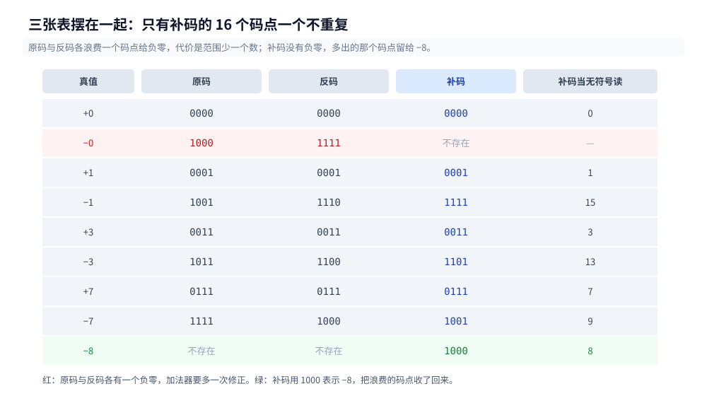
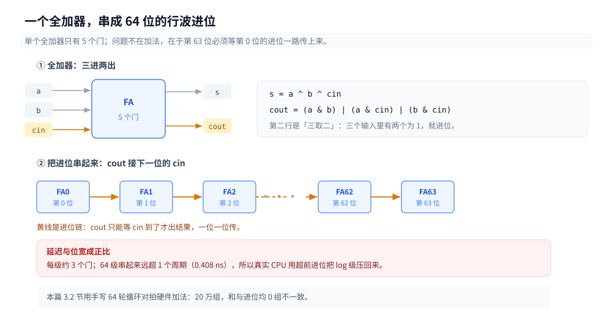
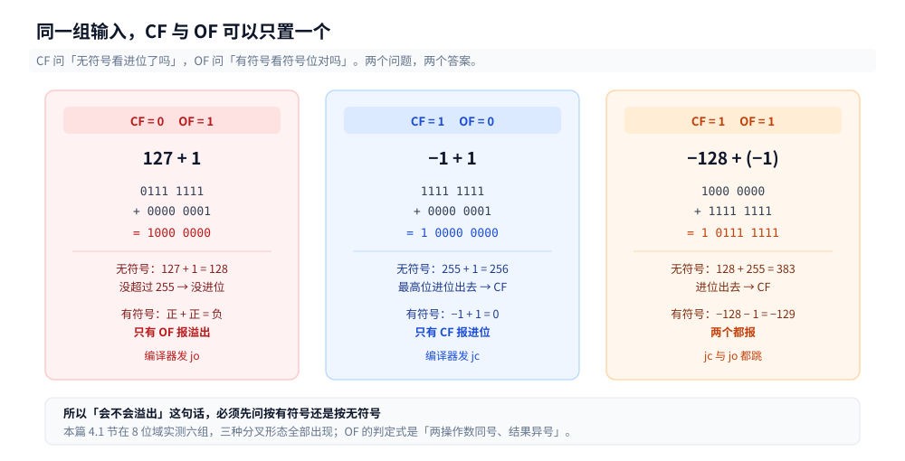

# 补码与整数运算

> 覆盖：为什么机器里没有减法器（`sub` 与 `add` 是同一套电路）、补码的物理意义（模 2ⁿ 的循环群，而不是「一种编码约定」）、原码 / 反码 / 补码三张表的差别与反码多出来的那次修正、CF 与 OF 为什么必须是两个标志（同一组输入只置一个）、加法器从半加到超前进位、乘法怎么变成移位加（Booth 把连续 1 压成一次加减）、除法为什么比乘法贵一个数量级（实测 22.67 倍）、`INT_MIN / -1` 在 C / Go / Java 的三种结局。
>
> 不覆盖：`~x + 1` 的代数推导与位运算技巧 → [位运算.md](../../算法/基础算法/数组与序列技巧/位运算.md) 第一节；`ModRM` / `SIB` 怎么编码 → [机器码、字节码与opcode.md](../../编译原理/机器码、字节码与opcode.md)；`add` 在流水线里占几段、IPC 怎么算 → [CPU怎么执行一条指令.md](CPU怎么执行一条指令.md)；浮点（IEEE 754、阶码移码、`0.1+0.2`）尚未写，见 [README.md](README.md) 第五节缺口登记。
>
> 内容整理自个人学习笔记，素材见 [素材清单](../../../素材清单.md)。读数在 WSL2 容器内实测（`go1.26.8 linux/amd64`、`gcc 12.2.0`、`OpenJDK 1.8.0_504`，`nproc=4`，宿主 `Intel Core i7-6700HQ @ 2.60GHz`）。周期换算按 [时钟周期与频率.md](时钟周期与频率.md) 的 1 周期 = 0.408 ns。

---

## 一、从零：`a - b` 这条指令背后，有减法器吗？

**本节要点**：没有。ALU 里只有加法器，`sub` 只是「第二个操作数取反、进位输入置 1」的加法。这一条决定了后面三节的全部内容——减法能免费，乘法除法才不得不另建单元。

### 1.1 先确认减法真的等于加补码

编译器给的 `subq` 是一条指令，看不出内部做了什么。要验证「减法 = 加补码」，就用纯整数运算把这句话写成等式，全范围对拍：

```go
lhs := a - b                          // 硬件语义：一条 sub
rhs := int32(uint32(a) + uint32(^b) + 1) // 手写：加补码
```

对 200 万组随机 `int32` 加上 5×5 边界组合，共 2 000 025 组，不成立 **0 组**。

⭐ 关键在最后那个 `+1`：它不是笔误，是**进位输入**。硬件里减法就是把借位链反过来用，`sub` 与 `add` 共用同一排全加器，差别只在最低位那个进位输入是 0 还是 1。

### 1.2 三种运算，两种单元

常说「计算机只会加法」，这句话需要修正——现代 CPU 里乘法器和除法器都是独立单元，不是拿加法器硬凑：

| 运算 | 硬件形态 | 本质 |
|---|---|---|
| 加 / 减 | **同一个加法器**，减法靠取反 + 进位输入 1 | 一层全加器阵列 |
| 乘 | **独立乘法器**（Wallace 树 / 阵列） | 部分积的加法，靠 CSA 压缩 |
| 除 | **独立除法器**（迭代式） | 反复的「移位 + 试减」 |

准确的说法是：**减法没有自己的电路，乘除没法只靠加法器做**。三者的差别最后落在时间上——加法 1 拍出结果，乘法 3 拍，除法要几十拍（6.3 有实测）。

### 1.3 为什么这不是实现细节

因为它决定了代码里三条经验的来源：

1. `a * 2` 与 `a << 1` 在无符号下等价，但负数下不等价（算术右移会保留符号）；
2. 除以 2 的幂，编译器会改成右移**加一次修正**（负数要向上取整）；
3. 能改成乘法的除法（除以常数）编译器一定改——实测除一次 12.48 ns，乘一次 0.55 ns，差 22.67 倍（6.3）。

## 二、为什么负数要用补码存？

**本节要点**：补码不是「三种编码里挑了一种」，而是唯一一种让加法器**不需要任何修正**的编码。原码和反码都会让加法器多干活——反码要循环进位，原码要按符号分四种情况。

### 2.1 三张表摆在一起（以 4 位为例）

| 真值 | 原码 | 反码 | 补码 | 补码读成无符号 |
|---|---|---|---|---|
| +0 | 0000 | 0000 | 0000 | 0 |
| −0 | **1000** | **1111** | —（不存在） | — |
| +1 | 0001 | 0001 | 0001 | 1 |
| −1 | 1001 | 1110 | 1111 | 15 |
| +3 | 0011 | 0011 | 0011 | 3 |
| −3 | 1011 | 1100 | 1101 | 13 |
| +7 | 0111 | 0111 | 0111 | 7 |
| −7 | 1111 | 1000 | 1001 | 9 |
| −8 | 不存在 | 不存在 | **1000** | 8 |

三张表差在三处：**零的个数**（原码反码各两个）、**负数的取法**（取反 vs 取反加一）、**能表示的范围**（补码多一个 −2ⁿ⁻¹）。



三列并排就能看出：只有补码的 16 个位模式**一个不重复地覆盖了 16 个整数**。原码和反码都浪费了一个码点给 −0，代价是范围少一个数，以及下面 2.2 那次修正。

### 2.2 反码的两个零为什么致命

假设用反码，算 `5 + (−3)`：

```text
  0101   (5)
+ 1100   (−3 的反码)
------
  0001   → 1  ✓
```

结果对。但换成 `5 + (−5)`：

```text
  0101   (5)
+ 1010   (−5 的反码)
------
  1111   → 这是 −0，不是 +0
```

加法器得到 `1111`，它必须**再判断一次「这串是不是 −0」，是就改成 0000**。这个判断要额外一级逻辑，而且只在特定输入上触发。

更麻烦的是跨位的加法会**进位绕回来**。反码加法有一条规则叫「循环进位」：最高位产生的进位要加回最低位。补码把这条规则彻底省掉了——最高位进出去的那一位，直接扔掉就是对的，因为模 2ⁿ 的意义下它本来就该溢出。

⭐ 一句话：**补码把「修正」全部收进了编码本身**。这不是编码风格问题，是把电路上的分支换成了数学上的取模。

### 2.3 补码 = 模 2ⁿ 的循环群

钟表是最好的类比：12 小时制里「往前 3 小时」和「往后 9 小时」落在同一格。−3 ≡ +9 (mod 12)。

8 位同理：−5 ≡ 251 (mod 256)。所以 `5 + (−3)` 可以直接算 `5 + 253 = 258`，扔掉溢出的 256，得 2。硬件扔掉最高进位是**免费**的（进位本来就从最高位出去了），不需要任何判断。

这个视角能解释补码的三条反直觉性质：

1. 为什么 `~x + 1 = -x`：因为 `~x + x = 全 1 = −1`（2.1 表里 1111 就是 −1），两边加 1 就是 `~x + 1 = -x`；
2. 为什么 `MIN_VALUE` 取负还是它自己：`−2ⁿ⁻¹` 在模 2ⁿ 下没有对应的正数，它的「补」就是它自己；
3. 为什么范围是 `−2ⁿ⁻¹ ~ 2ⁿ⁻¹−1` 而不是对称的：因为 0 占了一个非负码点。

### 2.4 同一串位，两种解释

这是补码最容易被忽略的物理事实：**硬件不做符号判断**。

`11111011` 这 8 个 bit，究竟是 −5 还是 251，取决于**你让哪条指令去读它**：

| 指令 | 做的事 | 同一串位的两种结果 |
|---|---|---|
| `add` / `sub` / `shl` | 逐位相加、移位 | 完全一样，硬件不区分 |
| `imul` / `idiv` | 符号乘法 / 除法 | 按有符号解释 |
| `mul` / `div` | 无符号乘除 | 按无符号解释 |
| `sar` / `shr` | 算术右移 / 逻辑右移 | 补符号位 / 补 0 |
| `cmp` + 条件跳转 | 看 CF 还是看 OF | 无符号比较 / 有符号比较 |

所以「这个数是正是负」不是数据属性，是**指令属性**。C 的 `int` 与 `unsigned` 在类型系统里是两回事，编译到机器码后只差「选了哪条指令」。Go 里 `int8(0xFB)` 是 −5、`uint8(0xFB)` 是 251，两者在内存里一模一样。

### 2.5 移码留给浮点

补码的兄弟是**移码**（biased）：把真值统一加一个偏移，使全部变成非负。比如 8 位移码取偏移 127：−3 存成 124，+3 存成 130。

它不如补码适合整数加减（加减之后还要减掉偏移），但有一个补码没有的性质——**按无符号比较就是按真值比较**。所以 IEEE 754 的阶码用移码：比较两个浮点数大小，先比阶码，硬件直接用无符号比较器就行。

## 三、加法器是怎么搭出来的？

**本节要点**：一个全加器只有 5 个门，64 位串起来就能算——但进位要一位一位传，64 级串起来就是 64 级延迟。现代 CPU 的加法能压到 1 拍，靠的是把这条链接短。

### 3.1 半加器与全加器

半加器只处理两个 1 位输入，出「和」与「进位」：

```text
s = a ^ b
c = a & b
```

全加器多一个进位输入 `cin`，才是能级联的单元：

```text
s   = a ^ b ^ cin
cout = (a & b) | (a & cin) | (b & cin)
```

`cout` 那一行是「三取二」，也叫多数表决。5 个门（两个异或 + 三个与或），延迟大约 3 级门。

### 3.2 64 位行波进位

把 64 个全加器串起来，第 i 位的 `cout` 接第 i+1 位的 `cin`，就是行波进位加法器。它是加法器里最直白的形态，也是验证「加法就是逐位进位」的最好模型：

```go
for i := uint(0); i < 64; i++ {
    ab, bb := (a>>i)&1, (b>>i)&1
    s := ab ^ bb ^ c
    c = (ab & bb) | (ab & c) | (bb & c)
    sum |= s << i
}
```

20 万组随机 64 位数对拍硬件 `+`：和 **0 组**不一致，进位 **0 组**不一致（进位与 `bits.Add64` 的 carry 输出对齐）。



图里要读的是那条竖着传上去的 `cout`：每一个全加器只有 5 个门，慢的地方不在门数，在这条进位链——第 63 位的和必须等最下面那一位的进位一级一级爬上来，所以延迟与位宽成正比，这就是 3.3 那笔 9.6 ns 的由来。

### 3.3 行波的问题：延迟随位宽线性增长

第 63 位的和，要等第 0 位的进位一路传上来。按每级 3 个门、每门约 0.05 ns 粗算，64 位就是约 9.6 ns——远超 1 个周期（0.408 ns）。

这就是为什么真实 CPU 不用行波。**超前进位**（carry-lookahead）把每一位改写成两个信号：

```text
p = a ^ b      // propagate：这一位会不会把进位传下去
g = a & b      // generate：这一位会不会自己产生进位
```

于是第 i 位的进位可以写成 `c[i] = g[i-1] | (p[i-1] & g[i-2]) | ...`，把「等」变成「算」。分组之后，64 位只需 log 级的层级（4 位一组 → 16 组 → 再上一层），延迟从 64 级压到十几级。

### 3.4 现代 CPU 的做法

真实实现是「超前进位 + 分组 + 选择进位」的组合：把 64 位切成 4~8 个块并行算，每块同时算「进位输入为 0」和「为 1」两个版本，等真正的进位到了再用一个多路选择器挑——把等待换成了面积。

本节 3.3、3.4 是**按原理陈述，未实测**：本机没有门级仿真器，也读不到 ALU 内部的时序。能测的只有「一次加法在流水线里占多少」这一层，见 [CPU怎么执行一条指令.md](CPU怎么执行一条指令.md) 三节的 0.282 周期。

## 四、溢出为什么有两种？

**本节要点**：CF 只看「有没有从最高位进位出去」，OF 只看「符号位对不对」。它们回答的是两个不同的问题，所以同一组输入可能只置其中一个——这不是设计冗余。

### 4.1 8 位域的六组实测

在 8 位域里取六组输入，同一组位模式同时按有符号和无符号看：

| 输入 | 补码结果 | CF（无符号进位） | OF（有符号溢出） | 结果读成无符号 |
|---|---|---|---|---|
| 127 + 1 | −128 | 0 | **1** | 128 |
| 100 + 100 | −56 | 0 | **1** | 200 |
| −128 + (−1) | 127 | **1** | **1** | 127 |
| −1 + 1 | 0 | **1** | 0 | 0 |
| 1 + (−1) | 0 | **1** | 0 | 0 |
| −128 + 127 | −1 | 0 | 0 | 255 |

三种分叉形态都在表里：

- **CF=0、OF=1**：`127+1`。有符号溢出了（127 加 1 到 128，超出 int8），但无符号看是 127+1=128，没超过 255，没进位。
- **CF=1、OF=0**：`−1+1`。无符号看是 255+1=256，进位了；有符号看是 −1+1=0，完全正常。
- **CF=1、OF=1**：`−128+(−1)`。两个都溢出。

⭐ 所以「溢出」这个词必须带上下文。问「这里会不会溢出」，先答「按有符号还是按无符号」。



三张卡对应表里最典型的三行：`127+1` 只有 OF 置位、`−1+1` 只有 CF 置位、`−128+(−1)` 两个都置位。编译器发 `jo` 还是 `jc`，取决于源码里那个数是 `signed` 还是 `unsigned`。

### 4.2 两条指令：`jc` 与 `jo`

```asm
    addb  %sil, %dil
    jc    .unsigned_overflow    # 看 CF：无符号溢出
    jo    .signed_overflow      # 看 OF：有符号溢出
```

编译器选哪条，取决于源码里的类型。C 的 `unsigned char` 加法后面跟 `jc`；`signed char` 后面跟 `jo`。同一段加法，两条指令的判据完全不同。

```asm
    cmpb  %sil, %dil
    jb    .below                # 无符号比较：看 CF
    jl    .less                 # 有符号比较：看 SF ^ OF
```

比较也是一样：`jb`（below）是无符号，`jl`（less）是有符号。这也是为什么 `-1 > 0` 在无符号下成立（255 > 0）、在有符号下不成立。

### 4.3 OF 的判定式

硬件的 OF 不是「结果超出范围」这种模糊描述，而是一个确定的布尔式：

```text
OF = (a[msb] == b[msb]) && (result[msb] != a[msb])
```

把 63 位那行写成代码，就是 `((a^s)&(b^s))>>63`——两操作数同号、结果异号。上面 4.1 表里六行的 OF 全部由这个式子算出，与硬件标志一致。

## 五、乘法怎么变成移位和加法？

**本节要点**：竖式乘法在硬件里是「看乘数的一位、决定加不加、然后移一位」。Booth 算法把连续的 1 压成一次加一次减，Wallace 树把串行的部分积改成并行压缩。

### 5.1 移位加法

最朴素的乘法，就是小学竖式的机械化：

```go
for b != 0 {
    if b&1 == 1 { r += a }
    a <<= 1
    b >>= 1
}
```

20 万组随机无符号数对拍 `*`：**0 组**不一致。

代价是循环次数等于乘数的有效位宽——乘数是 2³¹ 就要转 32 轮。这是它在硬件里不能直接用的原因：不能等 64 轮才出一个结果。

### 5.2 Booth：把连续的 1 压成一次加减

观察竖式：乘数里连续的一串 1（比如 `011110`），等价于「加一次、减一次」：

```text
011110 = 100000 - 000010
```

于是 Booth 只看相邻两位 `(y[i], y[i-1])`：`01` 加、`10` 减、`00`/`11` 什么都不做。

```go
switch {
case yi == 0 && yprev == 1:  r += x << uint(i)
case yi == 1 && yprev == 0:  r -= x << uint(i)
}
```

20 万组随机（乘数为负 100 399 组）对拍 `*`：**0 组**不一致。

⭐ Booth 的收益不是「更快」，而是**部分积的个数从「1 的个数」变成「相邻位变化的次数」**——平均少一半。它对负数还天然正确，不需要先取绝对值再补符号。

### 5.3 一次乘法为什么能出 128 位

64×64 的结果最多 128 位，所以 x86 的 `mul r/m64` 把结果放在 `RDX:RAX` 一对寄存器里。Go 里对应的就是：

```go
hi, lo := bits.Mul64(a, b)
```

这条指令的存在解释了为什么「乘法溢出」在 C 里是 UB 的一部分，却在 Go 里可以用 `bits.Mul64` 拿到完整结果——硬件从来没丢掉高 64 位，只是大部分语言不给你看。

### 5.4 Wallace 树：把串行变并行

64 位乘法的部分积有 64 行。逐行相加要 64 级延迟；Wallace 树用**进位保留加法器**（CSA）把三行压成两行，不做进位传播，只记「和」与「进位」两套位。64 行经过约 log₁.₅64 ≈ 10 层压缩就剩两行，最后做一次真正的进位传播加法。

代价是面积：一个 64 位乘法器的门数远超加法器。这就是「乘法比加法贵」的物理原因——**不是算法慢，是单元大**。

本节按原理陈述，**未实测**：门级结构与层数读不到，只能引用 5.1、5.2 的算法层对拍，与 6.3 的时间对照。

## 六、除法为什么比乘法贵一个数量级？

**本节要点**：乘法的部分积可以同时算、最后一起进位；除法的每一位都要等上一位的余数——**它有一条无法并行的长依赖链**。这是结构性的，不是实现没优化好。

### 6.1 恢复余数除法

从高位到低位，每次把余数左移一位、补进被除数的一位，试减一次：

```go
for i := 63; i >= 0; i-- {
    r = (r << 1) | ((n >> uint(i)) & 1)
    if r >= d {
        r -= d
        q |= 1 << uint(i)
    }
}
```

10 万组随机（除数从 1 到 2⁶³）对拍 `/` 与 `%`：商 **0 组**、余数 **0 组**不一致。

### 6.2 不恢复余数：省掉一次判断

恢复余数法每轮都要判断「够不够减」，不够还要把余数还原。不恢复余数法干脆每轮都减，减成负数也不管，下一轮根据符号决定加还是减——把「判断 + 可能回滚」换成「一次加减 + 一次符号检查」。

两者轮数一样（64 轮），但每轮的门数少一些。现代除法器用的是 SRT（每轮产生多位商，radix-4 或 radix-16），本质仍是「试减 + 修正」，只是每轮多出几位。

### 6.3 实测：12.48 ns 对 0.55 ns

同一容器、同一循环结构，`volatile` 除数阻止编译器把除法改写成乘法：

| 运算 | ns/次 | 折算周期（0.408 ns） | 相对乘法 |
|---|---|---|---|
| `int64` 除法 | 12.48 | 30.6 | 22.67 倍 |
| `int32` 除法 | 3.62 | 8.9 | — |
| 乘法 | 0.55 | 1.35 | 1 倍 |
| 右移 3 位 | 0.61 | 1.50 | 1.1 倍 |

汇编核对：`objdump -d` 里 `idiv` 与 `imul` 各出现 1 处，确认测的就是这两条指令。

两条要说明的口径：

- **这里的 ns/次 是「占住除法器的时长」，不是纯延迟。** 除法单元不流水，下一轮除法必须等上一轮出结果，所以吞吐等于延迟。
- **绝对值随被除数大小浮动。** `int32` 的 8.9 周期明显低于教科书上的 20+ 周期，因为被除数小（`123456789`），除法器提前结束。位宽从 32 到 64 涨 **3.71 倍**这个比值更稳，绝对值只能当量级。


这条阶梯是按实测周期排的：`add` 1.01、`imul` 3.00、`idiv` 23.03。三档里只有乘除之间那道 20 倍的空档是新信息——加法与移位同价、乘法 3 拍都能在别的篇里找到，而除法之所以还要再乘 7 倍，是因为它不流水，吞吐等于延迟。

### 6.4 为什么除法不能流水

乘法的 64 个部分积互不依赖，可以同时出、用树压缩；除法的第 i 位商依赖第 i−1 位的余数，**每一步都是上一步的函数**。这条链没法靠加宽硬件拆开，只能靠「每轮多产生几位商」（SRT）来缩短轮数。

所以除法器是流水线里最贵的单元：面积大、延迟高、利用率低。编译器因此有一条铁律——**除以常数一定改成乘法**（乘倒数），只有除数是变量时才真发 `idiv`。6.3 的 22.67 倍就是这个改写值多少钱。

## 七、这些结论在代码里怎么用？

**本节要点**：三条能直接落地的判断——除法溢出的三种结局、取模的符号、位掩码的有符号陷阱。

### 7.1 `INT_MIN / -1` 的三种结局

这是补码范围不对称（2.3）最直接的后果：`−2ⁿ⁻¹` 取负没有对应的正数，商溢出。

```c
volatile int b = -1;
int a = INT_MIN;
printf("%d\n", a / b);
```

| 语言 | 结果 | 依据 |
|---|---|---|
| C（gcc 12.2.0，`-O0` 与 `-O2` 相同） | `Floating point exception (core dumped)`，退出码 **136** | 有符号除法溢出是 UB；x86 的 `idiv` 触发 #DE，内核映射成 SIGFPE（128+8） |
| Go（1.26.8） | `-2147483648`，不 panic | 规范定义为补码回绕；`MinInt32 % -1 = 0` |
| Java（1.8.0_504） | `-2147483648`，不抛异常 | JLS 15.17.2 规定商等于被除数 |

⭐ 报错文案叫「Floating point exception」是历史遗留：整数除零与除法溢出都走 #DE（Divide Error），Linux 沿用了这个信号名。**看到 FPE 先想整数除法，不要去找浮点。**

Java 侧还有一条对照：除零抛 `java.lang.ArithmeticException: / by zero`，而 `MIN/-1` 返回 `MIN` 不抛——同一个算术异常类，只有除零进去。

### 7.2 取模对负数反直觉

```text
−7 % 3 = ?
```

| 语言 | 结果 | 规则 |
|---|---|---|
| C / Go / Java | **−1** | 商向零截断，余数与被除数同号 |
| Python | **2** | 商向下取整，余数除数的符号 |

不是 bug，是「商怎么取整」的选择。补码硬件的 `idiv` 天然是向零截断（截断实现最便宜），所以 C 系语言跟着走；Python 选了数学上更整齐的「余数非负」。

工程后果：用 `%` 做哈希桶下标时，负数会得到负下标，必须写成 `((x % n) + n) % n`，或者先转无符号。

### 7.3 哈希与位掩码该用无符号

```go
var h uint32 = 1 << 31   // 2147483648
var s int32 = 1 << 31    // -2147483648（同一位模式）
```

2.4 说过「同一串位两种解释」，这里就是它的现场：拿 `1 << i` 当掩码时，`i` 到 31 就变成负数，`x & mask` 的结果也跟着变负，再做下标会 panic。

所以哈希、位图、序列号这类「只关心位模式、不关心正负」的场景，一律用 `uint32` / `uint64`。这不是风格问题——用了有符号，某一天 `i` 到 31 就会静默出错。

## 八、应用场景：补码落在哪些真实系统里？

**本节要点**：补码不是「历史选择」，它是**所有计数器、序列号、ID、时间戳的行为规范**。凡是有「加到上限再回来」的地方，都是补码在起作用——包括那些你希望它报错的地方。

### 8.1 八个落点

| 场景 / 系统 | 用到哪一块 | 为什么值得注意 |
|---|---|---|
| 32 位计数器回绕 | 模 2ⁿ 循环群 | `uint32` 到 4294967295 后回 0，订阅数、浏览量都踩过 |
| TCP 序列号比较 | 有符号差 `(int32_t)(a-b)` | 直接比大小在回绕后失效；必须比「有符号差」（7.2） |
| 哈希与位掩码 | 无符号 + 逻辑右移 | 有符号右移会把符号位带下来，掩码就错了（7.3） |
| 数据库自增 ID | 有符号 vs 无符号 | MySQL `INT UNSIGNED` 与 `BIGINT` 的上界差一倍，迁移时是硬约束 |
| 加密与大数运算 | 模 2ⁿ 加法 | AES/ChaCha 的轮函数只做加法、异或、循环移位，全靠模 2ⁿ 无溢出问题 |
| 金额与定点数 | 整数 + 隐含小数位 | 用「分」为单位存整数，避免浮点；补码保证减法不需要额外符号处理 |
| 溢出检测 | CF / OF 两个标志 | Java 有 `Math.addExact`，Go 没有，C 的有符号溢出是 UB（7.1） |
| 汇编条件跳转 | `ja`/`jb` 用 CF，`jg`/`jl` 用 OF+SF | 同一组位模式，选错跳转就是「无符号比较 vs 有符号比较」的区别（4.2） |

### 8.2 三条共性

1. **位模式没有符号，指令才有**：`11111011` 是 −5 还是 251，取决于喂给 `imul` 还是 `mul`、`sar` 还是 `shr`、`jl` 还是 `jb`（10.3）。
2. **「会不会溢出」这句话必须带类型**：`127 + 1` 在无符号域没溢出、在有符号域溢出；`−1 + 1` 反过来（4.1）。
3. **减法免费、乘除不免费**：减法被收进编码，乘法贵在面积、除法贵在依赖链（10.1）。

⚠️ 反向提醒：**范围不对称是补码的固有性质**，不是 bug。`−2ⁿ⁻¹` 取负没有对应的正数，所以 `INT_MIN / -1` 必然溢出——C 里是 UB（可能崩）、Go 与 Java 里回绕（7.1）。写「取绝对值」的工具函数时，这一条是必须处理的边界。

## 九、具体使用：三语言怎么防溢出、怎么比回绕

**本节要点**：三语言对同一个溢出给了三种承诺——C 是 UB、Go 是静默回绕、Java 默认回绕但提供检查版。写法上的差别全在这三种承诺上。

### 9.1 Go：溢出不报错，要自己挡

```go
// 静默回绕：不报错、不 panic
var x int32 = math.MaxInt32
x++                    // → -2147483648

// 乘法前先判：a * b 会溢出当且仅当 a != 0 && 结果/a != b
func mulOK(a, b int64) (int64, bool) {
    if a == 0 || b == 0 {
        return 0, true
    }
    r := a * b
    return r, r/b == a
}
```

⚠️ Go 没有内置的溢出检查，`math/bits` 只提供无符号的 `Add64` 之类（带回进位）。有符号的必须自己判，或者用 `big.Int` 兜底。

### 9.2 Java：默认回绕，`Math.xxxExact` 是检查版

```java
int a = Integer.MAX_VALUE;
int b = a + 1;                    // 回绕成 -2147483648，不报错
int c = Math.addExact(a, 1);      // 抛 ArithmeticException

int m = -7 % 3;                   // -1（符号跟被除数走）
int n = Math.floorMod(-7, 3);     // 2（恒非负，取模的正确语义）
```

⭐ `floorMod` 与 `%` 的差别只在被除数为负时出现，这正是哈希取桶、环形索引最常踩的地方。

### 9.3 C：有符号溢出是 UB，用内建函数检查

```c
#include <stdio.h>

int main(void) {
    int a = 2147483647, r;
    if (__builtin_add_overflow(a, 1, &r)) {
        printf("溢出，r 已回绕为 %d\n", r);
    }
    return 0;
}

/* 调试期可以让溢出直接 abort：gcc -ftrapv（只对 signed，且会明显变慢） */
```

⚠️ 无符号溢出在 C 里是**定义良好的**模 2ⁿ 回绕，有符号才是 UB。所以「用 `unsigned` 做哈希、做计数器」不只是习惯，是拿标准背书。

### 9.4 回绕比较：别直接比大小

```c
/* TCP 式序列号比较：a 在 b 之后返回 1 */
static inline int seq_after(uint32_t a, uint32_t b) {
    return (int32_t)(a - b) > 0;   /* 有符号差，跨回绕仍然正确 */
}
```

```go
// Go 里同样写法
func seqAfter(a, b uint32) bool { return int32(a-b) > 0 }
```

⭐ 判据：**序列号只能比「差」，不能比「大小」**。`0xFFFFFFFF` 之后是 `0`，直接比大小会得出「回到了最前面」。

### 9.5 症状对照表

| 现象 | 指向 | 下一步 |
|---|---|---|
| 计数突然变负数 | 有符号溢出（Go/Java 静默回绕） | 换无符号，或加检查 |
| `-7 % 3` 得到 −1 但期望 2 | 取模符号跟被除数走 | 用 `floorMod` 或先加模数再取模 |
| 序列号回绕后比较全错 | 直接比大小 | 改成比较有符号差（9.4） |
| `INT_MIN / -1` 崩掉 | C 的 UB；Go/Java 回绕 | 显式判边界再算 |
| `sar` 与 `shr` 结果不同 | 算术右移 vs 逻辑右移 | 掩码运算一律用无符号（7.3） |

## 十、三组结论

### 10.1 减法免费，乘除不免费

补码把减法收进了编码，ALU 里没有减法器。但乘法和除法各有独立单元：乘法贵在**面积**（部分积要压），除法贵在**依赖链**（每一位等上一位）。这解释了为什么「除以常数」编译器必改、「除以变量」无解——前者能换成乘法，后者的依赖链换不掉。

### 10.2 两个溢出标志回答两个问题

CF 问「无符号看进位了吗」，OF 问「有符号看符号位对吗」。同一组 `127+1` 与 `−1+1`，一个只置 OF，一个只置 CF。所以「会不会溢出」这句话必须带类型，否则问题本身没定义。

### 10.3 位模式没有符号，指令才有

`11111011` 是 −5 还是 251，取决于喂给 `imul` 还是 `mul`、`sar` 还是 `shr`、`jl` 还是 `jb`。类型系统在编译后只剩「选了哪条指令」这一件事——这也是为什么 `INT_MIN / -1` 在 C 里崩、在 Go 和 Java 里回绕：三种语言对同一条 `idiv` 的 UB 给了三种承诺。

## 校验口径

> ✅ 本篇读数的校验方式与范围（WSL2 容器 `nproc=4`、`gcc 12.2.0`、`go1.26.8`、`OpenJDK 1.8.0_504`、内核 `6.18.54.1-microsoft-standard-WSL2`，宿主 `Intel Core i7-6700HQ @ 2.60GHz`）：

- **真跑（Go 1.26.8）**：第 1.1 节补码恒等式（2 000 025 组，含 5×5 边界）；第 4.1 节 8 位 CF/OF 六组（CF 用 `bits.Add64` 的 carry，OF 用符号位判定式）；第 3.2 节 64 位行波进位（20 万组随机，和对拍 `+`、进位对拍 `bits.Add64`）；第 5.1 节移位加法乘法（20 万组）、第 5.2 节 Booth 乘法（20 万组，乘数为负 100 399 组）；第 6.1 节恢复余数除法（10 万组，商与余数各对拍 `/` 与 `%`）
- **真跑（gcc 12.2.0，`-O2`）**：第 6.3 节除法 / 乘法 / 右移各 2 000 万次，取单轮；`objdump -d` 确认 `idiv` 与 `imul` 各 1 处
- **真跑（三语言对照）**：第 7.1 节 `INT_MIN / -1`——C 在 `-O0` 与 `-O2` 下都是 SIGFPE、退出码 136；Go 与 Java 各返回 `-2147483648`
- **编译期即可确定**：第 1.2 节三种运算的硬件形态（减法复用加法器、乘除独立单元）；第 4.2 节 `jc` / `jo`、`jb` / `jl` 的对应；第 7.2 节语言层取模规则
- **未实测（按原理陈述）**：第 3.3 / 3.4 节超前进位与选择进位的门级延迟（无门级仿真器）；第 5.4 节 Wallace 树的层数与面积；第 6.2 节 SRT 每轮产生几位商。这三处只讲机制与代价来源，不引用任何周期数
- **口径提醒**：第 6.3 节的 ns/次是「占住除法器的时长」而非纯延迟（除法单元不流水）；`int32` 的 8.9 周期低于教科书值，是**被除数小导致提前结束**，因此只引用「32 位 → 64 位涨 3.71 倍」这个比值
- **换算基准**：周期数按 [时钟周期与频率.md](时钟周期与频率.md) 的 1 周期 = 0.408 ns 折算，与 [内存屏障与内存序的代价.md](../缓存与内存/内存屏障与内存序的代价.md) 同源；不同篇的绝对 ns 不可直接相减

| 依赖 | 实际版本 |
|---|---|
| Go | go1.26.8 linux/amd64（容器 `golang:1.26-bookworm`） |
| GCC | 12.2.0（Debian 12.2.0-14+deb12u1） |
| JDK | OpenJDK 1.8.0_504（Temurin，容器 `eclipse-temurin:8-jdk`） |
| CPU | Intel Core i7-6700HQ @ 2.60GHz，4 核 8 线程（容器内 `nproc=4`） |
| 内核 | 6.18.54.1-microsoft-standard-WSL2 |

- **只作写法对照**：第 9 节的三语言代码为写法对照，未在本轮编译运行；本篇读数仍来自第 4.1、6.3、7.1 节的实测。

## 延伸追问

- **为什么不能用浮点单元算整数除法？** → 浮点表示不了 64 位的全部整数（尾数只有 53 位），大整数经过 double 会丢低位。所以 `idiv` 必须独立存在，不能借 FPU。
- **补码的「取反加一」为什么不用判断符号？** → 因为对正数它也成立：`~5 + 1 = −5` 的补码，只是这时结果落在负半区，而正数取负本来就该进负半区。统一公式覆盖两种情况，这正是补码省掉分支的地方。
- **`x * 2` 和 `x << 1` 在负数下真的一样吗？** → 位模式一样，但语义在语言层可能不同。C 里左移负数是 UB（C99 起），Go 里 `<<` 只对无符号有无歧义定义，Java 的 `<<` 是位模式操作、负数照移。要用就先用无符号转一道。
- **为什么 `int` 溢出在 Go 里不 panic，在 Rust debug 模式里 panic？** → 补码硬件对回绕是「自然结果」，Go 选择暴露它，Rust 选择在 debug 下检查（release 下 opt-in 回绕）。这不是硬件差异，是语言对同一现象的不同包装。
- **除法的 SRT 算法和这里的恢复余数差多远？** → 差在「每轮出几位商」。恢复余数每轮 1 位、64 轮；radix-4 SRT 每轮 2 位、32 轮；radix-16 每轮 4 位、16 轮。轮数少一半，延迟就少一半，但每轮的查表与修正更复杂。

## 关联

- **上游/总纲**：[README.md](README.md) — 微架构册收什么、五篇的分工与读序
- **下游机制**：[CPU怎么执行一条指令.md](CPU怎么执行一条指令.md) — 本篇讲 ALU 内部怎么算出这个和，那篇讲这条指令在五段里占多久（`add` 0.282 周期）
- **上游读数**：[时钟周期与频率.md](时钟周期与频率.md) — 本篇所有「折算周期」都以它的 1 周期 = 0.408 ns 为准
- **对照/互补**：[位运算.md](../../算法/基础算法/数组与序列技巧/位运算.md) — 第一节有 `~x + 1 = -x` 的代数推导与 `MIN_VALUE` 边界，本篇 2.3 从模运算角度补上「为什么必须这样设计」
- **姊妹篇**：[位运算.md](位运算.md) — 同一套 ALU 的**另一半**：本篇讲会进位的算术（加减乘除怎么落地），那篇讲不进位的逻辑运算（为什么 `and` 与 `add` 同价、六个操作各覆盖哪一格、`%` 换 `&` 的收益在什么条件下才成立）
- **对照/互补**：[机器码、字节码与opcode.md](../../编译原理/机器码、字节码与opcode.md) — 本篇讲指令算什么，那篇讲指令怎么编码（`ModRM` / `SIB`）
- **下游机制**：[原子操作.md](../底层同步/原子操作.md) — `LOCK XADD` 的加法语义与 `ZF` 回报，与 `add` 共用同一套 ALU
- **工程应用**：[写冲突控制的Go落地.md](../../../01-编程语言/go/工程实践/写冲突控制的Go落地.md) — 版本号与计数器的回绕处理

> 反向引用（本篇被下列文档引到）：[README.md](README.md)、[CPU怎么执行一条指令.md](CPU怎么执行一条指令.md)、[位运算.md](../../算法/基础算法/数组与序列技巧/位运算.md)、[寄存器与栈.md](../缓存与内存/寄存器与栈.md)
