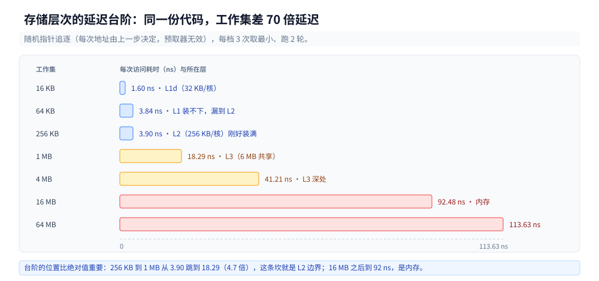
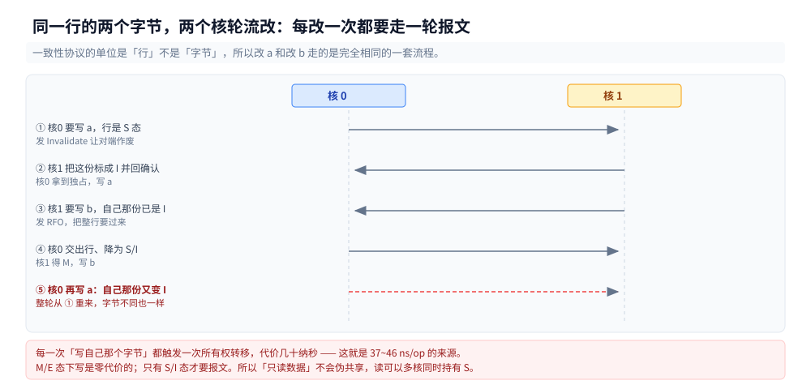

# CPU 缓存与缓存行

> 覆盖：一次访存落在哪一层、缓存行为什么是 64 字节、MESI 四态怎么解释「写一个字节要抢整行」、伪共享的判据（**地址间隔**，不是「用了 pad 类型」）、怎么测出来、四类测不出来的假阴性、现场排查顺序。
>
> 不覆盖：地址翻译（TLB / 页表 / 缺页）见 [用户态内核态与一次IO的内存路径.md](../../操作系统/用户态内核态与一次IO的内存路径.md)；语言层的内存序（`happens-before`、屏障语义）见 [JMM与内存屏障.md](../../../01-编程语言/java/并发编程/JMM与内存屏障.md) 与 [Go内存模型.md](../../../01-编程语言/go/并发编程/Go内存模型.md)；Java 的 `@Contended` 字段布局实测见 [原子类与无锁.md](../../../01-编程语言/java/并发编程/原子类与无锁.md)。
>
> 内容整理自个人学习笔记，素材见 [素材清单](../../../素材清单.md)。本篇读数在 `Intel Core i7-6700HQ @ 2.60GHz`（4 核 8 线程，L1d 32 KB/核、L2 256 KB/核、L3 6 MB 共享）+ `go1.26.5 windows/amd64` 上实测。
>
> ⚠️ 本篇定位：虽然实验代码大量使用 Go，但探讨的 MESI 协议、LOCK 指令、futex 系统调用属于操作系统与硬件底座。Go 仅作为验证工具，原理同样适用于 C/C++/Java/Rust。
---

## 一、从零：两个 goroutine 各加各的，为什么比一个还慢？

**本节要点**：两个 goroutine 各自往**自己的**计数器上加，逻辑上没有任何共享，却比单线程慢 4 倍。原因不是锁，是它们的数据落在了**同一条缓存行**上。

### 1.1 最朴素的写法

两个 worker，各自加自己的计数器，互不相干：

```go
var c struct {
	a atomic.Int64
	b atomic.Int64
}

func main() {
	var wg sync.WaitGroup
	wg.Add(2)
	go func() { defer wg.Done(); for i := 0; i < n; i++ { c.a.Add(1) } }()
	go func() { defer wg.Done(); for i := 0; i < n; i++ { c.b.Add(1) } }()
	wg.Wait()
}
```

`a` 与 `b` 是两个不同的变量、两个不同的 goroutine、两条不同的 `LOCK XADD` 指令。没有锁、没有共享写、没有数据竞争 —— `-race` 也不报。

但实测每次操作要 **37.55 / 44.07 / 45.57 ns**（三轮，每轮 200 万次）。

### 1.2 第一次尝试：每个 worker 一份

直觉的修法是「分片」—— 每个 worker 拿数组里自己的那个元素，不再共享同一个结构体：

```go
var shard [2]struct {
	a, b atomic.Int64
}
// worker i 只碰 shard[i].a
```

实测 **38.16 / 36.37 / 42.45 / 29.90 / 31.12 ns** —— 一点没好转。

`shard[0].a` 与 `shard[1].a` 是两个完全独立的变量，地址相差 16 字节。**分片了，但仍然在同一条缓存行上。**

### 1.3 第二次尝试：把两份拉开

同样两个 worker、同样两个变量，只把地址间隔从 16 拉到 64：

```go
var shard [2]struct {
	a atomic.Int64
	_ [56]byte // 8 + 56 = 64，下一个元素的 a 落在下一条行
}
```

实测 **8.550 / 11.65 / 8.232 ns** —— 快了 4~5 倍，代码逻辑一个字没改。

### 1.4 这条线索指向什么

三次实验只动了一个东西：**两个被频繁写的地址之间隔多远**。间隔 16 慢、间隔 64 快，中间没有别的原因可解释。

所以问题不在「共不共享变量」，在「共不共享缓存行」。下面几节把这件事拆开：一层一层是哪些存储、行为什么是 64、写一个字节为什么要动整行。

---

## 二、存储层次里哪一层归硬件管？

**本节要点**：L1/L2/L3 是**硬件自动**搬的，程序看不见也管不着；TLB 与页表是**地址翻译**，归操作系统；本篇只讲前者。

### 2.1 实测的延迟台阶

随机指针追逐（每次访问的地址由上一步决定，硬件预取器无从下手），工作集从小到大：

| 工作集 | 第 1 轮 | 第 2 轮 | 落在哪一层 |
|---|---|---|---|
| 16 KB | 2.55 ns | 1.60 ns | L1d（32 KB/核） |
| 64 KB | 3.84 ns | 4.04 ns | L1 装不下，开始漏到 L2 |
| 256 KB | 4.84 ns | 3.90 ns | L2（256 KB/核）刚好装满 |
| 1 MB | 18.29 ns | 18.66 ns | L3（6 MB 共享） |
| 4 MB | 49.76 ns | 41.21 ns | L3 深处 |
| 16 MB | 92.67 ns | 92.48 ns | 内存 |
| 64 MB | 113.63 ns | 112.37 ns | 内存 + TLB 失效 |



台阶的位置比绝对值更重要：256 KB → 1 MB 之间从 4.8 ns 跳到 18.3 ns（**4 倍**），这条坎就是 L2 的边界；16 MB 之后到 92 ns，是内存。**同一份代码只改工作集大小，延迟差 70 倍**，这是缓存存在的全部意义。

### 2.2 四层各自的归属

| 层 | 谁管 | 程序能做主的 | 典型延迟 |
|---|---|---|---|
| 寄存器 | 编译器（寄存器分配） | 写不写 `-O`、变量活多久 | 0（不进内存） |
| L1d / L1i | CPU 硬件 | **只有数据布局** | 1~3 ns |
| L2 | CPU 硬件 | 只有数据布局 | 4~5 ns |
| L3 | CPU 硬件（多核共享） | 只有数据布局 + 线程绑定 | 15~20 ns |
| TLB | 硬件查、**OS 填** | 大页、`mmap` 策略 | 命中不进内存 |
| 内存 | 硬件 + OS 分配 | 分配策略、NUMA | 80~120 ns |
| 磁盘 / SSD | OS + 文件系统 | 页缓存、`O_DIRECT` | µs~ms |

⭐ 判断标准只有一条：**这一层的未命中由谁负责填**。L1~L3 由硬件自己搬，你改不了换入换出策略，**能动的只有「放什么、放多近」**；TLB 与页表由内核填，那部分归 `操作系统/`；磁盘归文件系统。

### 2.3 与操作系统篇的分界

两件事常被混成一句「缓存」：

- **物理缓存**（本篇）：`mov` 一条指令，地址已经算好，去 L1 取不到就去 L2、L3、内存。全程硬件自动。
- **地址翻译**（`操作系统/`）：虚拟地址 → 物理地址，走 TLB，TLB 不命中要查页表（多级），页表项不在内存还要缺页中断。

顺序上**翻译在前、缓存访问在后**：先拿到物理地址，才谈得上命中哪条缓存行。这也是为什么缺页的代价（µs 级）远大于一次缓存未命中（ns 级）。

---

## 三、缓存行到底是几字节？

**本节要点**：x86-64 是 64 字节，但这不是「应该记住的常识」，是**能夹逼出来的**。做法是固定起点、只改两个计数器的地址间隔，看性能在哪一档突变。

### 3.1 夹逼的做法

上一节 1.2 / 1.3 的两次实验有个隐患：结构体在堆上的**起始地址对 64 取模是随机的**（实测 2000 次分配，`mod 64` 落在 0/16/32/48 各 500 次）。起点不对齐时，「字段偏移 32」也可能碰巧跨行，读数就不可信。

所以先把起点**强制对齐到 64**，再扫间隔：

```go
raw := make([]byte, 4096)
base := uintptr(unsafe.Pointer(&raw[0]))
off := (64 - base%64) % 64
p := unsafe.Pointer(&raw[off])           // p 一定 64 对齐
a := (*atomic.Int64)(p)                  // A@0
b := (*atomic.Int64)(unsafe.Add(p, gap)) // B@gap
```

### 3.2 六档间隔的读数

每档两个 goroutine 各加 200 万次，三轮独立进程：

| 间隔 | 第 1 轮 | 第 2 轮 | 第 3 轮 | 判定 |
|---|---|---|---|---|
| 8 B | 37.55 | 44.07 | 45.57 | 慢 |
| 32 B | 39.23 | 48.99 | 44.82 | 慢 |
| 56 B | 44.32 | 37.87 | 46.76 | 慢 |
| **64 B** | **8.550** | **11.65** | **8.232** | 快 |
| 72 B | 9.654 | 8.027 | 9.270 | 快 |
| 128 B | 7.793 | 9.102 | 8.924 | 快 |


**分界点正好落在 56 与 64 之间**。间隔 56 仍是 37~46 ns（和间隔 8 同档），间隔 64 掉到 8~11 ns。行宽 ∈ (56, 64]，且 64 是 2 的幂 —— 结论是 **64 字节**。

⭐ 这条夹逼比查文档更有用的一点，是它同时否掉了另一个流行说法：「只要两个变量不是同一个变量就不算伪共享」。间隔 56 的那一档证明**同一行内的不同偏移全都算**。

### 3.3 换架构就不是 64 了

`64` 是 x86-64 的值。Go 标准库 `internal/cpu` 里按 GOARCH 分了不同的常量：

| GOARCH | `CacheLinePadSize` |
|---|---|
| amd64 / 386 | 64 |
| arm / mips / mips64x | 32 |
| **arm64 / ppc64x** | **128** |
| s390x | **256** |
| loong64 / riscv64 / wasm | 64 |

`cpu.CacheLineSize` 直接等于这个常量，注释里写明「OS 不告诉我们真实值，所以用 per-GOARCH 常量近似」。**写死的 `64` 在 arm64 上只覆盖了半条行**，这是跨架构代码用常量填充时要小心的地方。

### 3.4 行内还分 sector

x86 的 L1 在做填充时按 **32 字节 sector** 搬（一条 64 字节行 = 2 个 sector），所以「一条行」与「一次搬多少」不是一回事。这也解释了为什么间隔 32 的档位（第 2 行）和间隔 8 的档位（第 1 行）读数几乎一样 —— 都在同一行内，坏处一样。

---

## 四、MESI 怎么解释「写一个字节要抢整行」？

**本节要点**：缓存的**一致性单位是行，不是字节**。两个核改同一行的不同字节，硬件也必须先把整行的所有权在核间转移，这就是伪共享的物理来源。

### 4.1 四个状态

每条缓存行在每个核的 L1/L2 里带一个状态：

| 态 | 含义 | 本核能直接做 | 别的核有副本吗 |
|---|---|---|---|
| **M**（Modified） | 只在本核，且被改过 | 读、写 | 没有（是唯一副本） |
| **E**（Exclusive） | 只在本核，未改 | 读、**直接写**（不用问） | 没有 |
| **S**（Shared） | 多核都有，都是干净的 | 读；**写要先申请独占** | 有 |
| **I**（Invalid） | 本核这份是废的 | 什么都不行，得重新取 | — |

写操作只有两种起点：**M/E 直接写**，**S/I 要先拿到独占**。从 S 变 M 要发 Invalidate 让其他核作废，等全部确认；从 I 变 M 要先读进来（RFO，Read For Ownership）。这两步都要走核间互连，代价是几十纳秒。

### 4.2 伪共享的完整时序

两个核各改同一行的不同 8 字节：

```text
核0: 写 a  →  行处于 S，需独占  →  发 Invalidate  →  核1 把它标 I  →  核0 得 M，写
核1: 写 b  →  自己那份是 I      →  发 RFO        →  核0 交出行、降 S/I  →  核1 得 M，写
核0: 再写 a → 自己那份又变 I    →  再来一轮
```

每一轮都重复「发报文 → 等对端作废 → 转移所有权」。**字节不同、逻辑无关、硬件照样串行化**，因为一致性协议只有「行」这个粒度。



图的重点是第 ⑤ 步：核0 第二次写自己的 a，还要再来一轮 —— **没有任何机制能让它「记住上次已经拿到过」**，因为中间核1 已经把这一行拿走了。

### 4.3 为什么不能按字节做一致性

理论上可以，但代价是每条缓存行要维护 64 个状态位、每次写都要广播字节级目录。历史上确实有过字节级或 sector 级一致性方案，最终都输给了「行 + 目录 + 报文合并」这套：**用粗粒度换取状态开销与报文数量的平衡**。所以 64 这个数字是工程折中，不是物理极限。

### 4.4 `lock` 前缀与 MESI 的关系

`atomic.Add` 在 x86 上编译成 `LOCK XADD`。`LOCK` 做的事是「**把这次写的效果变成全局可见的原子操作**」：早期实现是锁总线，现在多数情况是「保证本核拿到该行的独占（M 态）并阻止其他核在读改写期间插手」——也就是把 MESI 的独占流程变成不可分割的一步。

更细的 `LOCK` 语义见 [原子操作.md](../底层同步/原子操作.md) 第 2 节；三语言的封装链路见 [互斥的实现.md](../底层同步/互斥的实现.md) 第 4 节。

---

## 五、伪共享的判据是什么？

**本节要点**：判据是**两个被频繁写的地址的物理间隔 ≥ 一条缓存行**。「用了 pad 类型」「每个 goroutine 一份」「放在不同结构体里」都不是判据。

### 5.1 三种布局，只有第三种对

回到第一节的三次实验，把地址关系画清楚：

| 布局 | 两个热点地址的关系 | 实测 |
|---|---|---|
| `struct{a, b}` 共享 | 相差 8 B，同一行 | 37.55 / 44.07 / 45.57 |
| `[2]struct{a,b}`，各用 `[i].a` | 相差 **16 B**，同一行 | 38.16 / 36.37 / 42.45 / 29.90 / 31.12 |
| `[2]struct{a,[56]byte}` | 相差 **72 B**，不同行 | 12.03 / 11.90 |
| 手工对齐 + 间隔 64 | 相差 **64 B**，不同行 | 8.550 / 11.65 / 8.232 |


第二行是最容易写错的一格：**「每个 worker 一份」听起来已经解决了共享，但数组元素紧挨着，元素之间只隔一个结构体的大小**。分片要生效，元素之间的间隔必须 ≥ 行宽。

### 5.2 为什么是 56

`atomic操作.md` 里用的 `_ [56]byte`，56 的来源是算术：

```text
a 占 8 字节（offset 0..7）
_ [56]byte 占 8..63
b 从 64 开始          ← 正好是下一条行的起点（在结构体起点对齐的前提下）
```

所以「56」不是经验值，是 `64 - 8`。同理，如果两个字段各占 4 字节（`atomic.Int32`），填充应该是 `64 - 4 = 60`。

### 5.3 换 `cpu.CacheLinePad` 行不行

Go 标准库里确实有这个名字，但**外部模块拿不到**：

```text
main.go:5:2: use of internal package internal/cpu not allowed
```

`internal/cpu.CacheLinePad` 是 `struct{ _ [CacheLinePadSize]byte }`，只给标准库自己用。能用的是 `golang.org/x/sys/cpu.CacheLinePad`（同样 64 字节，但多一个外部依赖）。

即使换过去，收益也不成立：

| 写法 | 结构体 size | B 的偏移 | 两 goroutine 各加 |
|---|---|---|---|
| `a; _ [56]byte; b` | 72 | **@64** | 10.62 / 10.80 ns |
| `a; _ cpu.CacheLinePad; b` | 80 | @72 | 10.72 / 13.17 ns |

三条理由：**多占 8 字节**（72 → 80）、**偏移从 64 变 72**（不再落在行首，只靠「间隔 ≥ 64」侥幸生效）、**跨架构会漂移**（arm64 上 `CacheLinePadSize` 是 128，`[56]byte` 是写死的）。

⭐ 结论：**不换**。该补的不是类型，是那句话——「判据是间隔 ≥ 行宽，不是用了某个 pad 类型」。

### 5.4 标准库自己怎么做的

三处可以对照着看：

- `sync.Pool` 的 `poolLocal`：`pad [128 - unsafe.Sizeof(poolLocalInternal{})%128]byte`。补到 **128** 的整数倍，为的是 `[]poolLocal` 里**每个元素的起点都进同一条行**（128 是行宽的整数倍，也是部分 CPU 的行宽）。
- `runtime.p`：用 `_ cpu.CacheLinePad` 把几十个字段按功能隔开，因为 P 会被不同 M 抢。
- `Striped64`（Java）：`Cell` 带 `@Contended`，由 JVM 在字段前后插 128 字节。**默认 `+RestrictContended` 下应用代码的这个注解完全无效**，实测见 [原子类与无锁.md](../../../01-编程语言/java/并发编程/原子类与无锁.md) 第六节。

三种做法的共同点：**都不是「给字段加个 pad 类型」，而是让「两份会被不同核碰的数据」之间隔开整条行**。

### 5.5 什么情况不该 pad

- **只读数据**：读是共享的，多核可以同时持有 S 态，不需要独占，没有伪共享。
- **写频率极低**：一行几十纳秒的代价被调用频率摊薄，pad 占的内存反而不划算。100 万个 36 B 的对象变 20 B 能省 15 MB，反过来加 pad 就是加内存。
- **本来就在同一临界区里**：已经用一把锁串行化了，再加填充只是浪费。

判据是三问：**会被不同核写吗？写得频繁吗？这份数据量级大到 pad 的内存成本要紧吗？**

---

## 六、怎么测，什么情况测不出来？

**本节要点**：伪共享的实测有**四类假阴性**，每一种都能让「看起来没问题」的结论站不住。最常见的是单核跑和对象被优化掉。

### 6.1 假阴性一：单核

同一份代码，`GOMAXPROCS=1` 下三档间隔的读数：

| 间隔 | 8 核下 | **1 核下** |
|---|---|---|
| 8 B | 37.55 / 44.07 / 45.57 | 16.31 / 15.04 |
| 64 B | 8.550 / 11.65 / 8.232 | 15.98 / 14.90 |
| 128 B | 7.793 / 9.102 / 8.924 | 15.31 / 15.30 |

单核下三档全部 15~16 ns，**差异完全消失**。原因很直接：一致性协议是**核间**协议，一个核上不存在「两个核抢同一行」。

推论：容器只给了 1 个 CPU 配额时，伪共享测不出来，生产上也不会有这个问题（但吞吐也上不去）。

### 6.2 假阴性二：对象被标量替换

```go
type A struct{ v int64 }   // 36 B 的对象（含其他字段），只写不读
for i := 0; i < 2_000_000; i++ { arr[i] = &A{} }
```

两百万个对象只涨 295 KB —— ESC 分析发现这个数组从头到尾没被读，整个分配被消掉了。测出来的「内存开销」是假的。

修法：留一个能被观测的出口（`static volatile Object[] keep = arr`），让数组真的逃逸。

### 6.3 假阴性三：常量折叠

```go
final int g = 7;
// 期望读到 123，实际永远 7
```

`-Xint` 下同样读回 7 —— 这不是 JIT 干的，是 `javac` 在编译期就把常量内联了。测「改 `final` 能不能生效」时，若不看字节码，很容易把编译期行为记成运行时行为。

### 6.4 假阴性四：编译器把循环删了 / 提到循环外

```go
long sink = 0;
for (...) { sink += atomic.get(); }   // sink 非 volatile，整段被提出循环
```

读数会掉到 0.5 ns（比一次 L1 命中还快），一眼就该怀疑。修法是把结果写进**不会被消除的位置**（数组元素、volatile 字段、`runtime.KeepAlive`）。

### 6.5 用 perf 数未命中

Linux 上最直接的证据是硬件计数器：

```bash
perf stat -e cache-references,cache-misses,LLC-load-misses ./prog
```

判读顺序：

1. 先看 `cache-misses / cache-references` 的比值，**同一程序两个版本对比**才有意义，绝对值依赖工作集。
2. 伪共享的特征是 **`LLC-load-misses` 不涨但耗时涨** —— 数据在 L1 里，只是反复易主，不算「未命中」，算「一致性流量」。
3. 要抓后者得用 `perf c2c`（需 `CONFIG_DEBUG_SHARED_MEM` 与较新内核），它直接报「哪些地址被哪两个核共享写」。

⚠️ 本篇未实测 `perf stat` 与 `perf c2c`（本机 Windows，无 perf；容器侧读数为本机 Go 基准代替），命令与判读按文档给出。真要在容器里跑，需要 `--privileged` 且 `perf_event_paranoid=2`。

---

## 七、现场按什么顺序查？

**本节要点**：从「CPU 烧满而吞吐不涨」出发，按「是不是共享写 → 地址间隔够不够 → 才轮得到 pad」的顺序查，前面两步没排除就加 pad 是碰运气。


四步里最容易跳过的是第 4 步的「单核档」：改动只在多核下有效，加一档单核对照就能证伪「其实是别的原因」。

### 7.1 第一步：确认是共享写

| 观察 | 指向 |
|---|---|
| CPU 使用率高，单核接近 100%，吞吐上不去 | 单点竞争（一把锁、一个计数器） |
| 多核都高、总吞吐不涨 | **共享行反复易主** |
| 加线程吞吐反降，CPU/墙钟 > 核数的一半 | 同上，且已经有自旋 |
| `perf c2c` 报同一地址被两个核写 | 直接确认 |

Go 侧可以粗看 `runtime.NumGoroutine` 与 `GOMAXPROCS` 的关系，但真正的证据是 **CPU/墙钟比值**：两个 goroutine 烧掉 2 个核却只完成 1 个核的活，多出来的时间就在核间报文上。

### 7.2 第二步：量地址间隔

不是看字段偏移，是看**运行时真实地址**：

```go
fmt.Printf("A@%d  B@%d  间隔 %d  行偏移 %d/%d\n",
    uintptr(unsafe.Pointer(&x.a)), uintptr(unsafe.Pointer(&x.b)),
    uintptr(unsafe.Pointer(&x.b))-uintptr(unsafe.Pointer(&x.a)),
    uintptr(unsafe.Pointer(&x.a))%64, uintptr(unsafe.Pointer(&x.b))%64)
```

判据两条：

- **间隔 < 64** → 确定有问题（第 3 节第 1~3 行的档位）；
- **间隔 ≥ 64** → 不可能同一条行，不用再查（第 3 节第 4~6 行的档位）。

### 7.3 第三步：改布局，先改分片

改的顺序有讲究，**先改数据分片，再考虑 pad**：

1. 能不能让每个 worker 拿**独立分配**的计数（不在同一个数组里）——最省事；
2. 做不到就把切片元素补到行宽的整数倍（`sync.Pool` 的做法：补到 128）；
3. 最后才是给单个结构体的两个字段之间插 pad。

第 1 步常常就够了：`per-P` / `per-worker` 的独立分配天然跨行（相邻对象之间还有分配器的元数据）。

### 7.4 第四步：确认改完真的生效

改完必须复测，不能只看代码。三条对照：

- 同负载、同线程数、**改前改后各跑 3 轮**；
- 加一档 `GOMAXPROCS=1` 的对照（改动只应在多核下有效，单核下应该没差别）；
- 看 `-benchmem` 的 `allocs/op` 有没有被 pad 带涨（内存换性能要能看到代价）。

---

## 八、三组结论

**本节要点**：三句话可以带走——粒度是行、判据是间隔、测法是控变量。

### 8.1 一致性以行为单位

两个核改同一行的不同字节，硬件照样串行化。M/E/S/I 四态里，**写操作只有在 M/E 下才不花代价**，S/I 都要先拿独占。这一条决定了后面所有结论。

### 8.2 判据是物理间隔，不是类型或分片

- 间隔 8 / 32 / 56 → 37~49 ns；间隔 64 及以上 → 8~12 ns（第 3 节）。
- `[2]struct{a,b}` 各用一个元素，间隔只有 16，**分片了仍然慢**（第 5.1 节）。
- `cpu.CacheLinePad` 换过去会让偏移从 64 变 72，多占 8 字节，不值得（第 5.3 节）。

### 8.3 测之前先排除四类假阴性

单核、标量替换、常量折叠、循环被提出 —— 四个都会让结论反着写。最省事的自查是**加一档单核对照**：单核下差异消失，才说明差异真的来自核间一致性。

## 校验口径

> ✅ 本篇读数的校验方式与范围（`Intel Core i7-6700HQ @ 2.60GHz` 4 核 8 线程，`go1.26.5 windows/amd64`）：

- **真跑**：第 1、3、5 节的间隔/分片/填充对照（`go test -bench`，每档 200 万次，3 轮独立进程取区间）；第 6.1 节单核对照（`-cpu=1`，2 轮）；第 2 节的层次延迟（随机指针追逐，3 次取最小，2 轮）
- **编译期即可确定**：第 5.3 节的结构体大小与字段偏移（`unsafe.Sizeof` / `reflect.StructField.Offset`）；`internal/cpu` 的导入报错原文
- **源码直读**：第 3.3 节的 `CacheLinePadSize` 按 GOARCH 分支；第 5.4 节 `sync.Pool` 的 pad 表达式
- **未实测**：`perf stat` / `perf c2c` 的读数（本机 Windows 无 perf）、arm64 与 s390x 上的行宽、sector 级填充的实际行为、NUMA 下的跨节点延迟
- **环境差异**：本机为 4 核 8 线程（超线程），两个 goroutine 可能落在同一物理核的两个线程上，共享 L1/L2，伪共享依然成立；纯物理核数下的绝对值会不同

| 依赖 | 实际版本 |
|---|---|
| Go | go1.26.5 windows/amd64 |
| golang.org/x/sys | v0.48.0（仅用于对照 `CacheLinePad` 的尺寸） |
| CPU | Intel Core i7-6700HQ（L1d 32 KB/核、L2 256 KB/核、L3 6 MB 共享） |

## 延伸追问

- **伪共享和「缓存一致性」是同一个问题吗？** → 不是。一致性是**必须的保证**（读到别人写过的值），伪共享是**这项保证的副作用**（不相干的字节被迫共享一致性单位）。协议本身没错，是数据布局撞上了协议的粒度。
- **为什么间隔 32 的那一档也慢？一条行不是 64 吗？** → 正因为是 64。两个地址相差 32，仍落在同一条行内，一致性协议照样要转移整行所有权。第 3.2 节的第 1~3 行是同一档。
- **`volatile` 能解决伪共享吗？** → 不能。`volatile` 保证的是**可见性与顺序**，不改变数据落在哪条行。加了 `volatile` 反而要求每次写都同步到一致性协议里，代价更高。
- **把计数器放寄存器里不就行了？** → 编译器已经会这么做（局部变量），但**要跨 goroutine / 线程共享的计数必须落内存**。真正能绕开的是「每个 worker 各自累加到局部变量，最后汇总一次」，那是分片不是寄存器。
- **面试问「缓存行多大」怎么答才有区分度？** → 答 64 只是及格。加上「x86-64 是 64、arm64 常见 128、s390x 256」，再说「行内还分 32 字节 sector」「一致性以行为单位所以同行的不同字节也会互相拖慢」，才是知道原理而不是背数字。

## 关联

- **上游/总纲**：[README.md](../README.md) — 本目录收什么、与编译原理 / 操作系统的边界
- **下游机制**：[原子操作.md](../底层同步/原子操作.md) — `LOCK` 前缀怎样把「拿独占」变成不可分割的一步，跨行时为什么退化成锁总线（175 倍）
- **下游机制**：[互斥的实现.md](../底层同步/互斥的实现.md) — 抢锁为什么等于抢一条缓存行，无竞争时为什么连内核都不进
- **对照/互补**：[CPU流水线与乱序执行.md](../微架构/CPU流水线与乱序执行.md) — IPC、写缓冲与 `LOCK` 前缀：一次访存在 CPU 内部怎么走
- **对照/互补**：[用户态内核态与一次IO的内存路径.md](../../操作系统/用户态内核态与一次IO的内存路径.md) — 地址翻译（TLB / 页表 / 缺页），本篇的「翻译」前置步骤
- **对照/互补**：[JMM与内存屏障.md](../../../01-编程语言/java/并发编程/JMM与内存屏障.md) — 语言层规定的「什么能重排」，本篇解释「为什么硬件本来就会重排」
- **实现/落地**：[atomic操作.md](../../../01-编程语言/go/并发编程/atomic操作.md) — Go 侧 `_ [56]byte` 的用法与实测
- **实现/落地**：[原子类与无锁.md](../../../01-编程语言/java/并发编程/原子类与无锁.md) — Java 侧 `@Contended` 与 `Striped64` 的字段布局
- **实现/落地**：[树的缓存局部性对比.md](../../数据结构/树/进阶与总结/树的缓存局部性对比.md) — 数据结构层面的同一味药

> 反向引用（本篇被下列文档引到）：[atomic操作.md](../../../01-编程语言/go/并发编程/atomic操作.md)、[原子类与无锁.md](../../../01-编程语言/java/并发编程/原子类与无锁.md)、[README.md](../README.md)、[向量化与SIMD.md](../微架构/向量化与SIMD.md)
