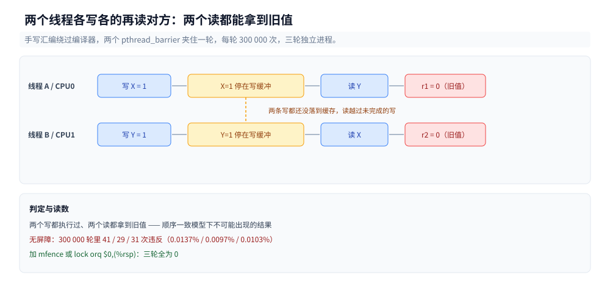
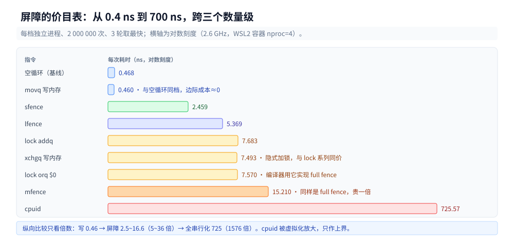
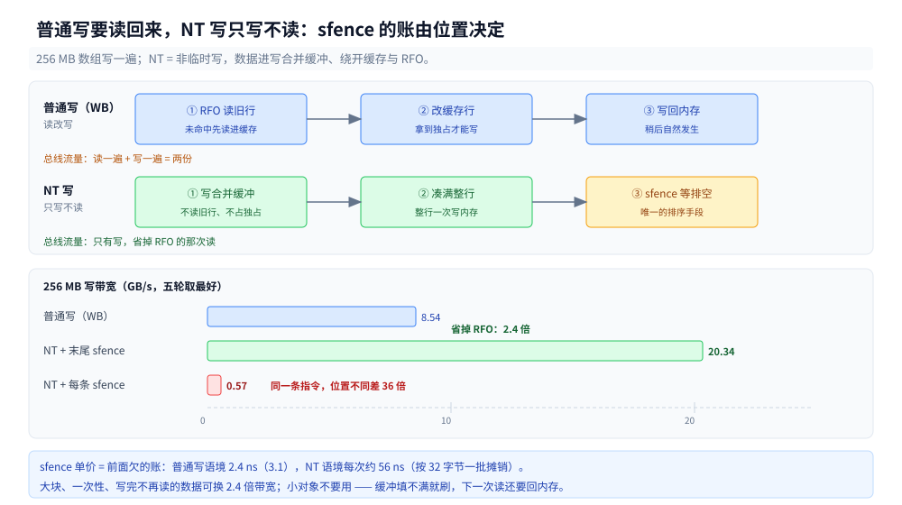

# 内存屏障与内存序的代价

> 覆盖：两个线程「各写各的再读对方」为什么能同时读到旧值（300 000 轮实测 29~41 次）、x86 的四种重排只漏哪一种、`mfence` / `lfence` / `sfence` / `lock or` / `lock xadd` 各要多少钱（九档价目表）、为什么 `mfence` 是 `lock or` 的两倍、编译器屏障与硬件屏障差在哪、换成 NT store 之后 `sfence` 为什么从 2.4 ns 变成约 56 ns（20.34 vs 0.57 GB/s）。
>
> 不覆盖：x86 上「哪些内存序不需要额外指令」（那是**指令数**维度，见 [原子操作.md](../底层同步/原子操作.md) 第四节）；MESI 四态与伪共享 → [CPU缓存与缓存行.md](CPU缓存与缓存行.md)；写缓冲为什么存在 → [CPU流水线与乱序执行.md](../微架构/CPU流水线与乱序执行.md)。
>
> 内容整理自个人学习笔记，素材见 [素材清单](../../../素材清单.md)。读数在 WSL2 容器内实测（`gcc 12.2.0` / `glibc 2.36` / `nproc=4` / 内核 `6.18.54.1-microsoft-standard-WSL2`，宿主 `Intel Core i7-6700HQ @ 2.60GHz`）。

---

## 一、从零：两个线程各写各的，为什么能同时读到旧值？

**本节要点**：线程 A 写 `X` 再读 `Y`，线程 B 写 `Y` 再读 `X` —— 两边都读到 0 是**可能**的。300 000 轮里发生了 29~41 次（0.010%~0.014%），加一条 `mfence` 之后三轮全为 0。

### 1.1 测试怎么写

要测的是「硬件会不会把读提到写前面」，所以必须**绕过编译器**——手写汇编，让两条命令的先后在机器码里是死的：

```c
/* 写自己那边，再读对方那边；两个线程都这么干 */
__asm__ __volatile__("movl $1, (%0)\n\t"     /* 写 X = 1 */
                     "movl (%1), %%eax\n\t"  /* 读 Y */
                     "movl %%eax, (%2)\n\t"  /* 存进 r1 */
                     : : "r"(&X), "r"(&Y), "r"(&r1)
                     : "eax", "memory");
```

两个线程用 `pthread_barrier` 对齐起跑线，每轮先清零再跑，然后检查 `r1 == 0 && r2 == 0` —— 两个写都执行过了，两个读却都拿到旧值，这种结果在「顺序一致」的机器上不可能出现。

⚠️ 这里有两个坑，都在第一版踩过：

- 记录变量必须传 `&r1` 而不是 `r1`。写成 `"r"(r1)` 是把**值**塞进寄存器，汇编里 `movl %%eax, (%2)` 就变成往地址 0 写 —— 直接段错误。
- 交换类指令（`xchg`）的操作数**不能是循环计数器**。写成 `"r"(i)` 时，汇编把计数器换成了旧值，循环提前退出，2M 次迭代的读数是 `0.000 ns/op`。**读数小得离谱，先查自己的汇编。**

### 1.2 三轮读数

每次跑 300 000 轮，三种屏障形态各三轮：

| 屏障 | 第 1 轮 | 第 2 轮 | 第 3 轮 | 违反率 |
|---|---|---|---|---|
| 无 | 41 | 29 | 31 | 0.0097%~0.0137% |
| `mfence` | 0 | 0 | 0 | 0 |
| `lock orq $0,(%rsp)` | 0 | 0 | 0 | 0 |

（分子是「两边都读到 0」的轮数，分母 300 000。）



图里两个写都还在写缓冲、尚未全局可见，对方的读只能拿到缓存中的旧值 —— 这不是编译器重排，也不是原子性问题，而是 store 的可见性被延迟了。

### 1.3 这 0.01% 是从哪来的

x86 的 store 不是「写进缓存就返回」，而是先进**写缓冲**（store buffer）。写缓冲的作用是让 store 不必等缓存行到手就能退休 —— 这正是它便宜的原因（下面 3.2 会看到，一条 `mov` 的边际成本几乎是 0）。

代价是：写还在缓冲里的时候，缓存里还是旧值。而 x86 允许**一条 load 越过前面尚未完成的 store**（不同地址），于是：

1. A 把 `X = 1` 放进写缓冲，还没落到缓存；
2. A 立刻读 `Y`，`Y` 还在缓存里且是 0 —— 读到了；
3. 同一时刻 B 做对称的事，也读到 `X` 为 0。

两个人各自「先写后读」都成立，合起来就是一个不可能的交错。

### 1.4 比例这么小，为什么还要在意

0.01% 听起来可以忽略，但它是**每次都会丢数据**的那种错，不是性能问题：

- 它随负载、核数、缓存压力变化，压测跑不出来不等于线上不出现；
- 它不可复现 —— 同一份代码三轮是 41 / 29 / 31，没有稳定触发路径；
- 唯一能证明「没有」的手段是**加屏障后仍为 0**，而不是「我跑了很久没遇到」。

这也是为什么这 0.01% 值得单独做实验：它是「必须加屏障」唯一可量化的一句证据。

### 1.5 加一条指令就没了

同一份汇编，只把 `mfence` 插在写和读之间，300 000 轮一次违反都没有。**这就是屏障的全部作用**：让写缓冲在继续执行之前排空（或者说，让后面的读等到前面的写「全局可见」）。

下面两节回答两个问题：为什么只需要管一种重排（第二节），以及这条指令要多少钱（第三节）。

---

## 二、x86 的四种重排只漏一种

**本节要点**：四种重排里 x86 只允许 StoreLoad 一种，所以只需要一个方向的屏障；而 `LOCK` 前缀与 `xchg` 顺手把这一种也包了，于是「大多数屏障是白送的」。

### 2.1 四种重排与 x86 的答案

| 重排 | 含义 | x86-64 允许？ |
|---|---|---|
| LoadLoad | 后面的读越过前面的读 | 否 |
| StoreStore | 后面的写越过前面的写 | 否 |
| LoadStore | 后面的读越过前面的读以外的写 | 否 |
| StoreLoad | 后面的**读**越过前面的**写** | **是**（唯一） |

这张表就是 1.2 那个实验的理论解释：只有第三行最后那种交错会出现，前面三种硬件自己就拦住了。x86 因此被称作「强模型」——它只在一个格子上松口。

### 2.2 为什么只有 StoreLoad 要花钱

因为前三种重排的拦截是「免费搭车」的：读写都按程序顺序进出一致性域，不需要额外指令。而 StoreLoad 要拦，就得**等写缓冲排空** —— 那是一次真实的等待，无法用指令调度掩盖。


所以三道关的顺序是：编译器先可能改顺序（用 `atomic` / 编译器屏障拦），CPU 的写缓冲再可能让写延迟可见（用 `mfence` / `lock` 拦），最后缓存行所有权还要在核间转移（用 MESI，谁也拦不了，只能少抢）。

### 2.3 四种屏障指令各挡什么

| 指令 | 挡什么 | 代价（第 3 节实测） |
|---|---|---|
| `sfence` | StoreStore | 2.42~2.48 ns |
| `lfence` | LoadLoad（且是派发串行化点） | 5.01~7.03 ns |
| `mfence` | 全部四种 | 14.75~16.59 ns |
| `lock orq $0,(%rsp)` | 全部四种（`lock` 语义自带 full barrier） | 7.54~8.11 ns |
| `lock xadd` / `lock cmpxchg` | 全部四种 + 一次原子读-改-写 | 7.40~9.56 ns |
| `xchg`（内存操作数） | 全部四种（隐式加锁） | 7.45~8.51 ns |

⭐ 表里最有用的一行是 `mfence` 与 `lock or` 的对比：**同样挡四种重排，后者便宜一半**。这解释了为什么 GCC 把 `atomic_thread_fence(seq_cst)` 编成 `lock orq $0,(%rsp)` 而不是 `mfence`  —— 只在需要「纯屏障、不修改变量」时，编译器也宁可借用一条假写。

（`lock` 前缀为什么能同时给出原子性与屏障，见 [原子操作.md](../底层同步/原子操作.md) 第 2 节；它在 x86 上「顺带把内存序也给了」这件事，见同篇 4.2。）

---

## 三、一条屏障指令要多少钱？

**本节要点**：九档价目表 —— 普通写 0.4 ns（等于空循环）、`sfence` 2.4 ns、`lfence` 5~7 ns、`lock` 系列 7.4~9.6 ns、`mfence` 14.7~16.6 ns、`cpuid` 675~761 ns。**屏障的价格跨度是三个数量级。**

### 3.1 九档价目表

同一个进程里每档独立跑 3 轮（`bar cost <op> 2000000`，取最快一轮），单位 ns/次：

| 指令 | 第 1 轮 | 第 2 轮 | 第 3 轮 | 折算周期（2.6 GHz） |
|---|---|---|---|---|
| 空循环（基线） | 0.468 | 0.416 | 0.496 | ~1.2 |
| `movq` 写内存 | 0.460 | 0.703 | 0.408 | ~1.2 |
| `sfence` | 2.459 | 2.480 | 2.421 | ~6 |
| `lfence` | 7.030 | 5.369 | 5.006 | ~15 |
| `lock addq` | 9.563 | 7.402 | 7.683 | ~21 |
| `xchgq` 写内存 | 8.513 | 7.447 | 7.493 | ~20 |
| `lock orq $0` | 8.109 | 7.570 | 7.540 | ~20 |
| `mfence` | 16.594 | 15.210 | 14.746 | ~40 |
| `cpuid` | 760.697 | 675.926 | 725.574 | ~1800 |



横轴是对数刻度，否则除了 `cpuid` 之外全部会缩成一条线。读这张图只需要看三段：写本身几乎不要钱、屏障落在 2.4~16.6 ns、全串行化落在 700 ns。

### 3.2 三个反直觉

**① 一条 `mov` 写内存的边际成本是 0。** 0.408~0.703 ns 与空循环的 0.416~0.496 落在同一档，说明循环体里那条 store 被完全重叠掉了。原因就是 1.3 节说的写缓冲：store 进了缓冲就退休，不等缓存行。

这一条是整篇的枢轴：**写之所以便宜，是因为它欠着账**。屏障贵的本质就是「还账」，所以屏障的价格 ≈ 欠账的规模。

**② `mfence` 比 `lock or` 贵一倍。** 14.7~16.6 ns vs 7.54~8.11 ns。两者挡的重排种类完全相同，差的是实现路径 —— 这里只报读数，不去猜微码细节。工程含义很直接：**不要手写 `mfence`**，需要 full fence 时用编译器给的 `atomic_thread_fence`，让它替你选指令。

**③ `sfence` 在普通写语境里几乎免费（2.4 ns），`lfence` 不是（5~7 ns）。** 因为 `sfence` 只排 store 的序，而 x86 的普通 store 本来就有序，所以它没有实质工作；`lfence` 是派发串行化点，会把后续指令的取指与派发挡住，代价真实存在。⚠️ 这个「几乎免费」只对普通写成立 —— 换成 NT store，同一批 store 改了路径，`sfence` 要等写合并缓冲排空，单价涨到约 56 ns（3.4 实测）。

### 3.3 `cpuid` 作为上界参照

`cpuid` 是全串行化指令（挡一切，连流水线都清空），本机 675~761 ns，是 `mfence` 的 **45 倍**。

⚠️ 这个数不能当裸机用：675 ns 折算约 1800 个时钟周期，远超 `cpuid` 在裸机上常见的 100~200 周期。容器跑在 WSL2 里，`cpuid` 大概率触发了 VM exit（一次陷入虚拟化层再回来）。所以这一档只用来**标定上界**，不参与任何倍数推论。

### 3.4 `sfence` 什么时候才不是白给？

**本节要点**：3.2 说 `sfence` 2.4 ns「几乎免费」，那是**普通写**的语境 —— x86 的普通 store 本来就有序，它没事可做。换成**非临时写（NT store）**，写绕过缓存进写合并缓冲，`sfence` 才真正开始还账：放在末尾一条是 20.3 GB/s，每写 32 字节放一条就掉到 0.57 GB/s。

**两种写的差别在哪。** 普通写要先拿到这一行的独占权 —— 如果行不在缓存里，得先读进来，这就是 [CPU缓存与缓存行.md](CPU缓存与缓存行.md) 第 4.1 节的 RFO；所以「只写不读」的负载，实际在总线上跑的是「读一遍 + 写一遍」。NT store（`movntdq` / `_mm256_stream_pd`）告诉硬件「这行写完不会再读」，于是不进缓存、不申请独占、直接写内存。

代价是顺序：NT store 绕开了缓存一致性那条正常路径，它之间、以及它与后续普通 store 之间都不保证顺序，`sfence` 是唯一的排序手段。**所以 NT store 不是「不用屏障」，是「必须显式还账」**。



图上半段是普通写的 RFO：一条行要先读进缓存、拿到独占，再改；下半段是 NT 写：数据进写合并缓冲、凑满整行直接写内存，不读旧值。右侧三种方式的写带宽说明，账怎么还是由 `sfence` 的位置决定的。

256 MB 数组，三种写法各五轮：

| 方式（256 MB） | 五轮 GB/s | 最好 |
|---|---|---|
| 普通写（WB） | 6.56 / 7.74 / 6.97 / 8.54 / 7.06 | 8.54 |
| NT 写 + 末尾一次 `sfence` | 20.34 / 20.31 / 17.18 / 12.08 / 13.26 | **20.34** |
| NT 写 + 每条 `sfence` | 0.56 / 0.57 / 0.53 / 0.53 / 0.56 | 0.57 |

三条读数：

**① 省掉 RFO，写带宽翻了一倍多。** 最好一轮 20.34 vs 8.54 GB/s（2.4 倍）。这与「普通写实际跑的是读+写」对得上：省掉那次读，总线上的流量少一半。

**② 同一条 `sfence`，位置不同差 36 倍。** 末尾放一次是 17~20 GB/s；每写 32 字节放一次是 0.57 GB/s。按 32 字节一批折算，每次 `sfence` 实际花掉约 **56 ns**，远超 3.1 测的 2.4 ns。

**③ 差的不是指令本身，是它有多少账要还。** 3.1 的 2.4 ns 是「前面没有 NT store」时的派发开销，等于空账；这里每次 `sfence` 都要等写合并缓冲排空（一次内存往返），账是真的。**屏障的单价由「欠了多少」决定，不由指令名决定** —— 这正是 3.2 第 ① 条那个视角的极端情形。

工程判据：大块、一次性、写完不再读的数据（日志落盘、序列化大对象、清零大页、`memcpy` 的尾部）可以用 NT store，配**一次批量写 + 末尾一条 `sfence` + 再发布信号**；小对象不要用 —— 写合并缓冲填不满就刷，既拿不到带宽，还让下一次读要回内存。

---

## 四、编译器屏障与硬件屏障不是一件事

**本节要点**：`asm volatile("" ::: "memory")` 编译后是 **0 条指令**，它只告诉编译器「别动顺序」，对 CPU 的重排毫无作用。1.2 表里「无屏障」那一行就是它的效果。

### 4.1 两个关口，两种手段

| 关口 | 会做什么 | 拦它的手段 | 代价 |
|---|---|---|---|
| 编译器 | 指令调度、常量提升、循环外提、死代码消除 | `atomic` 调用 / `asm volatile("" ::: "memory")` | 0 条指令 |
| CPU | 写缓冲、乱序执行、写合并 | `mfence` / `lock` / `xchg` | 2.4~16.6 ns（第 3 节） |

两个关口是**串联**的：编译器把读挪到写前面，加多少硬件屏障都没用，因为屏障本身的位置也已经被改了。所以顺序是「先锁住编译器，再谈硬件」。

### 4.2 只挡编译器会发生什么

`asm volatile("" ::: "memory")` 在机器码里什么都不生成。把它插在 1.1 那段汇编的写与读之间，生成的指令序列与不插完全一样 —— 所以 1.2 表里「无屏障」那一行的 29~41 次违反，就是它的真实效果。

同理，`fence(acquire)` 在 x86 上编出来也是 **0 条指令**（[原子操作.md](../底层同步/原子操作.md) 4.1 的 `fence_acq: ret`）。它在语言层有意义（拦住编译器、给编译器一个「这里不能动」的点），但**不要指望它挡住写缓冲** —— acquire 语义在 x86 上由 load 天然满足，本来就不需要指令。

### 4.3 三语言怎么表达

| 语言 | 纯屏障 | 顺带屏障的原子操作 |
|---|---|---|
| C11 | `atomic_thread_fence(memory_order_seq_cst)` → `lock orq $0,(%rsp)` | `atomic_thread_fence(acquire)` → 0 条指令 |
| Go | 没有裸屏障 API，只能用 `atomic` 操作表达 | `atomic.Load` / `atomic.Store` 自带需要的语义 |
| Java | 没有裸屏障 API | `volatile` 读写、`VarHandle` 的 `acquire`/`release`/`fullFence` |

Go 与 Java 都不给你「只加一个屏障」的语法，这是有意的：语言层用 `happens-before` 描述你要什么，指令选择交给编译器。见 [Go内存模型.md](../../../01-编程语言/go/并发编程/Go内存模型.md) 与 [JMM与内存屏障.md](../../../01-编程语言/java/并发编程/JMM与内存屏障.md)。

---

## 五、什么时候该用哪一种？

**本节要点**：先问「要拦的是编译器还是 CPU」，再问「是发布数据还是改计数器」。答案只有四种，不要用 `mfence` 当万能药。

| 场景 | 要拦谁 | 用什么 | 本机代价 |
|---|---|---|---|
| 只有编译器可能乱序（单线程可见性，如 `signal_handler` 标志） | 编译器 | `asm volatile("" ::: "memory")` / `atomic` | 0 |
| 发布数据（先写数据、再写标志，别的核要读） | 编译器 + CPU | release store（`mov` + 编译器屏障）或 `lock` 指令 | 0~8 ns |
| 消费数据（先读标志、再读数据） | 编译器（x86 上 CPU 侧白送） | acquire load（`mov`） | 0 |
| 两边都要、且要一次原子读-改-写 | 编译器 + CPU | `lock xadd` / `lock cmpxchg` | 7.4~9.6 ns |
| 大块写、写完不再读（日志落盘、序列化大对象） | CPU（NT 写之间及与后续普通写） | NT store + **末尾一次** `sfence` | 单次约 56 ns，但换掉整条 RFO |

表里最后一行与上面四行不同：前四行是「要不要加屏障」，这一行是「写了 NT store 之后**必须**加屏障」——NT 写绕开了 MESI 的正常路径，没有任何隐含顺序，漏了 `sfence` 可能读到写了一半的数据。代价那一列也不一样：56 ns 是**一次 fence** 的价格，摊到整块数据上远比一次 RFO 便宜（3.4 的 20.34 vs 8.54 GB/s）。

三条常见错误：

- **用 `volatile` 当屏障**：`volatile` 只挡编译器（对应第一行），挡不住写缓冲 —— 1.2 表里那 29~41 次违反就是 `volatile` 级别代码的真实风险。
- **手写 `mfence`**：同样挡四种，比 `lock or` 贵一倍（3.2 第 ②条）；
- **以为「加了屏障就一定对」**：屏障只保证顺序，不保证原子性。计数器该用 `lock xadd` 还得用。

---

## 六、结论

**本节要点**：x86 只漏一种重排，这一种能被量化观测到（0.01%）；屏障的价格跨三个数量级；写便宜是因为欠账，屏障贵是因为还账。

### 6.1 StoreLoad 是唯一需要证据的一种

四种重排里只有它在 x86 上被允许，所以也只有它需要实验证明「加了屏障真的有用」：300 000 轮无屏障 29~41 次违反，加 `mfence` 或 `lock or` 三轮全 0。这个 0.01% 是「必须加屏障」唯一可量化的证据。

### 6.2 屏障的价格跨三个数量级

0.4 ns（普通写）→ 2.4 ns（`sfence`）→ 5~7 ns（`lfence`）→ 8 ns（`lock` 系列）→ 15 ns（`mfence`）→ 700 ns（`cpuid`，且被虚拟化放大）。跨度三个数量级，所以「加个屏障」不是一个可以随口说的优化动作。

### 6.3 写便宜是因为欠账，屏障贵是因为还账

一条 `mov` 的边际成本约等于 0（3.2 第 ①条），因为它进写缓冲就退休。屏障之所以要 2.4~16.6 ns，是因为它必须等这笔账落地。这个视角能解释三个常见的困惑：为什么顺序写同一个变量快到不像话、为什么「加一个屏障」有时比「多做一次原子操作」还贵，以及为什么同一条 `sfence` 在普通写里值 2.4 ns、在 NT 写里值 56 ns —— 3.4 的两种写法只是换了「账」的规模，指令一个字没变。

## 校验口径

> ✅ 本篇读数的校验方式与范围（WSL2 容器 `nproc=4`、`gcc 12.2.0`、`glibc 2.36`、内核 `6.18.54.1-microsoft-standard-WSL2`，宿主 `Intel Core i7-6700HQ`）：

- **真跑**：第 1.2 节 SB litmus（三种屏障形态 × 3 轮 × 300 000 轮）；第 3.1 节九档单价（各档独立进程 × 3 轮 × 2 000 000 次，取最快一轮）；第 3.4 节 NT 写三档（普通写 / NT + 末尾 `sfence` / NT + 每条 `sfence`，256 MB 数组 × 5 轮，取最好一轮算带宽）
- **编译期即可确定**：第 2.3 节的指令对照（`gcc -O2 -S`）；第 4.2 节「`fence(acquire)` 是 0 条指令」；第 3.4 节 `gcc -O2 -mavx -S` 里 `_mm256_stream_pd` 展开为 2 条 `vmovntpd`、共 4 条 `sfence`
- **未实测**：`perf` 侧的缓存行所有权转移计数（本机 Windows 无 perf）；arm64 的 `DMB ISH` 单价（本机与容器都是 x86-64）；裸机的 `cpuid` 周期数（本机是 WSL2，读数被虚拟化放大）
- **由读数推算、未直接观测**：第 3.4 节「省掉 RFO 所以带宽翻倍」是从 20.34 / 8.54 与「普通写 = 读 + 写」两条推出的，没有总线计数器；「每次 `sfence` 约 56 ns」按 256 MB / 32 字节 = 8 388 608 次批量、0.57 GB/s 折算，是**平均摊销**而非单次计时
- **环境差异（第 3.4 节）**：WSL2 下内存带宽本身有 ±40% 波动（同一档五轮 12~20 GB/s），所以第 3.4 节只比较「三档之间的倍数」，不引用任何绝对 GB/s 作为裸机指标
- **试过但放弃**：跨核 store 可见延迟（两个核互相等对方写入的 ping-pong），三轮测出 15 / 26 / 84 ns 每跳、总量在 3.0~20.0 ms 之间波动，**同一配置波动 6 倍**，WSL2 的调度噪声盖过了要测的量。这项不做读数引用。
- **环境差异**：`cpuid` 的 675~761 ns 折算约 1800 周期，远超裸机的 100~200 周期，怀疑触发 VM exit；这一档只作上界参照，不参与倍数推论

| 依赖 | 实际版本 |
|---|---|
| GCC / glibc | 12.2.0 / 2.36（Debian 12） |
| 内核 | 6.18.54.1-microsoft-standard-WSL2 |
| CPU | Intel Core i7-6700HQ（4 核 8 线程，L1d 32 KB/核、L2 256 KB/核、L3 6 MB 共享） |
| 容器 | `golang:1.26-bookworm`，`nproc=4`；第 3.4 节的 C 探针（`<immintrin.h>` 的 AVX 内联）在同一容器的 gcc 12.2.0 下编译 |

## 延伸追问

- **为什么违反率只有 0.01%，而不是 50%？** → 因为要撞上需要两条指令几乎同时执行：A 的写还在缓冲里，B 的读刚好到达。两个 `pthread_barrier` 之间的窗口只有几十个周期，绝大多数轮次两边都错开了。比例小不代表风险小 —— 它随核数、缓存压力、负载变化，且不可复现。
- **能不能用 `volatile` 代替屏障？** → 只能代替「编译器屏障」那一半（4.1）。对 CPU 的写缓冲完全无效，1.2 表的「无屏障」组就相当于 `volatile` 级别的代码。
- **`mfence` 为什么比 `lock or` 贵一倍？** → 本篇只给读数（14.7~16.6 vs 7.54~8.11 ns），不猜微码。工程结论是确定的：需要 full fence 时用编译器生成的 `lock or`，不要手写 `mfence`。
- **`sfence` 为什么在普通写里几乎免费、在 NT 写里不免费？** → 屏障的代价不是指令属性，是「前面有多少账没落地」。普通 store 进写缓冲就退休，`sfence` 前面没有待还的账，只剩 2.4 ns 的派发开销；NT store 直接进写合并缓冲、绕开缓存一致性路径，`sfence` 必须等它排空（一次内存往返），实测约 56 ns。同一条指令，账的规模变了 20 多倍（3.4）。
- **ARM 上这些数字还有意义吗？** → 没有。arm64 是弱模型，四种重排都可能发生，acquire/release 都是**真实指令**（`LDAR` / `STLR`），不再白送。本篇的「大半屏障免费」是 x86 特有的结论，换架构整张表作废。

## 关联

- **上游/总纲**：[README.md](README.md) — 本册收什么、与底层同步的边界
- **对照/互补**：[CPU缓存与缓存行.md](CPU缓存与缓存行.md) — MESI 与伪共享，本篇 1.3 节的前提
- **指令数维度**：[原子操作.md](../底层同步/原子操作.md) — 第四节讲「差几条指令」，本篇讲「这几条各多少钱」
- **上游机制**：[CPU流水线与乱序执行.md](../微架构/CPU流水线与乱序执行.md) — 写缓冲为什么存在，本篇 1.3 的由来
- **对照/互补**：[Go内存模型.md](../../../01-编程语言/go/并发编程/Go内存模型.md) — 语言层怎么描述「你需要哪种顺序」
- **对照/互补**：[JMM与内存屏障.md](../../../01-编程语言/java/并发编程/JMM与内存屏障.md) — Java 的四种屏障与 `VarHandle` 的内存序参数

> 反向引用（本篇被下列文档引到）：[README.md](README.md)、[原子操作.md](../底层同步/原子操作.md)、[互斥的实现.md](../底层同步/互斥的实现.md)、[CPU缓存与缓存行.md](CPU缓存与缓存行.md)、[CPU流水线与乱序执行.md](../微架构/CPU流水线与乱序执行.md)、[向量化与SIMD.md](../微架构/向量化与SIMD.md)
