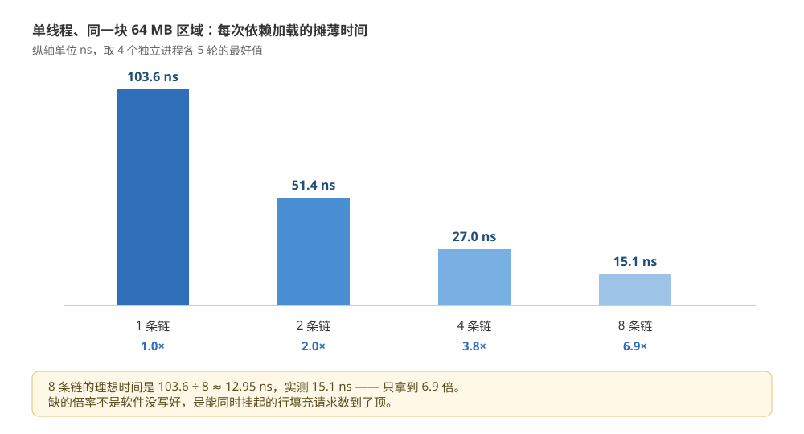
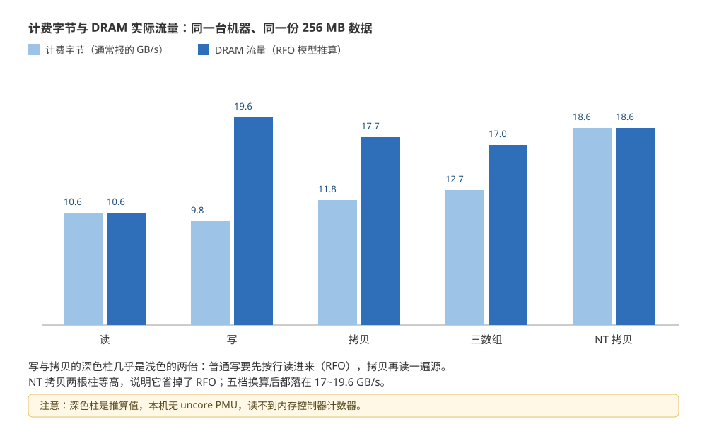

# 内存带宽与访存并行度

> 覆盖：同一条内存为什么能同时给出「延迟 110 ns」和「带宽 10.6 GB/s」两个数、它们靠什么连起来；一个核怎么用多路独立加载接近带宽上限；读 / 写 / 拷贝 / 三数组的 GB/s 为什么不能直接比；多核扩展比为什么在本机测不出来。
>
> 不覆盖：缓存行宽、MESI 与伪共享见 [CPU缓存与缓存行.md](CPU缓存与缓存行.md)；屏障单价与 NT store 的 `sfence` 见 [内存屏障与内存序的代价.md](内存屏障与内存序的代价.md)；缺页、页表与一次 IO 的拷贝次数见 [用户态内核态与一次IO的内存路径.md](../../操作系统/用户态内核态与一次IO的内存路径.md)。
>
> 内容整理自个人学习笔记。实测口径：第 1、2、4、5 节的读数在 `perf-lab` 容器（`debian:bookworm-slim`、`gcc 12.2.0`、`nproc=4`、内核 6.18.54.1-microsoft-standard-WSL2）里由 4 个独立进程各跑 5 轮取得；第 6 节的多线程读数实测了但**不可作证**，原因写在 6.2。

---

## 一、从零：为什么「延迟 110 ns」算不出「带宽 10.6 GB/s」？

**本节要点**：延迟量的是**一次依赖加载**要走多久，带宽量的是**很多次加载同时在飞**时的稳态吞吐。拿 64 字节除带宽会得到 6 ns，比实测的 110 ns 小 18 倍——差的不是测量误差，是「同时在飞多少个」这个未知量。

### 1.1 两条读数，同一块内存

同一个容器、同一段时间，两个探针给出的数：

| 探针 | 访问形态 | 读数 |
|---|---|---|
| 64 MB 随机指针追逐 | 后一次加载的地址由前一次的结果决定，**一次只能有一个在飞** | 103.1 ~ 122.3 ns / 次 |
| 256 MB 顺序读（8 个累加器） | 地址连续，**多个加载可以同时在飞**，硬件还会预取 | 7.1 ~ 10.6 GB/s |

指针追逐那一档，每次加载的地址指向上一个元素随机指向的位置，CPU 没法猜、也没法提前发第二次请求——**这就是「延迟」的干净测量**：一次依赖加载的往返时间。

顺序读那一档，循环体是 8 个互不依赖的累加器，`gcc` 编译后是 8 条独立的标量 `vaddsd`（不是 AVX，见 2.1 的汇编），每轮同时发 8 个 8 字节加载。8 个请求同时在飞，**这就是「带宽」的测量**：单位时间内能搬多少字节。

两者相差约 18 倍（110 ns vs 6 ns），但只要换一个问法就不矛盾：110 ns 是「一问一答」的时间，6 ns 是「很多人同时在问」时摊到每次的份额。

### 1.2 用延迟除字节，错在哪

最常见的错法是：

```text
64 B / 10.6 GB/s = 6.0 ns   ← 把带宽当成「一次访问的耗时」
```

这等于假设「内存一次只服务一个请求」。真机不是这样：内存控制器有成队的请求缓冲，缓存有一组 miss 处理项（line fill buffer），一两个请求在路上时，后面的请求可以继续发。带宽是**流水线的吞吐**，不是**单个请求的延迟**。

反过来也错：用 `1 / 110 ns` 得到 9.1 M 次/秒，再乘 64 B 得到 0.58 GB/s，说「内存只有 0.58 GB/s」——这是把**单链**的吞吐当成了硬件上限。只要把链拆成几条互不依赖的，同一个硬件就能给出十几倍的数（第 2 节）。

### 1.3 把两个数接起来：Little 定律

排队论里的 Little 定律在内存上照样成立，形式极简：

```text
在飞请求数 = 带宽 × 延迟
```

代入本机的数（单线程顺序读取 10.6 GB/s，延迟取 110 ns）：

```text
10.6e9 B/s × 110e-9 s ≈ 1.17 KB ≈ 18.3 条缓存行
```

也就是说，顺序读之所以能跑出 10.6 GB/s，是因为**平均有约 18 条缓存行同时在路上**——8 个软件加载只解释 8 条，另外 10 条是硬件预取器替它发的（第 3 节）。这条推算不是计数器读数，但它和两端的实测自洽，可以用来判断「现在受限于延迟还是带宽」。


图里左边是一次依赖加载的往返（110 ns、64 字节一条行、真正用到的只有 4 字节），右边是顺序读的稳态（10.6 GB/s）。中间那条公式是唯一的桥：带宽乘延迟得到在飞字节数，顺序读约 18 行、随机 8 链约 6.9 行，差的 11 行就是预取器的贡献。

图中的三个数字都可以在正文里找到出处：110 ns 来自 1.1 的延迟读数，10.6 GB/s 来自 1.1 的带宽读数，6.9 来自 2.2 的并行度读数。

---

## 二、一个核能吃掉多少带宽？

**本节要点**：单线程顺序读能到 10.6 GB/s，用的还是**标量 8 字节加载**；把随机访问拆成 8 条互不依赖的链，每次加载的摊薄时间从 103.6 ns 降到 15.1 ns（6.9 倍）。一个核的上限不在指令宽度，在**同时在飞的请求数**。

### 2.1 探针怎么写

带宽档的关键是**别让算术成为瓶颈**。单累加器 `s += a[i]` 是一条依赖链，每次加法都要等上一次的结果，测出来的是加法延迟而不是带宽。8 个累加器把这条链拆开：

```c
static double sum8(const double *a, size_t n)
{
    double s0 = 0, s1 = 0, s2 = 0, s3 = 0;
    double s4 = 0, s5 = 0, s6 = 0, s7 = 0;
    size_t i = 0;
    for (; i + 8 <= n; i += 8) {
        s0 += a[i];   s1 += a[i+1]; s2 += a[i+2]; s3 += a[i+3];
        s4 += a[i+4]; s5 += a[i+5]; s6 += a[i+6]; s7 += a[i+7];
    }
    for (; i < n; i++) s0 += a[i];
    return s0 + s1 + s2 + s3 + s4 + s5 + s6 + s7;
}
```

`gcc -O2 -mavx2` 编出来**没有向量化**，是 8 条独立的标量 `vaddsd`：

```text
loop:  vaddsd (%rax),%xmm0,%xmm0
       vaddsd -0x38(%rax),%xmm7,%xmm7
       vaddsd -0x30(%rax),%xmm6,%xmm6
       ...（共 8 条，各自一个累加器）
       add $0x40,%rax
       cmp %rdx,%r12
       jae loop
```

这一点很重要：10.6 GB/s 不是靠 AVX 的宽加载堆出来的，**标量 8 字节加载就够吃满**。带宽的上限由「同时在飞多少个」决定，而不是「一条指令搬几字节」。

### 2.2 读数：8 条链换来 6.9 倍

同一块 64 MB 区域，单线程，1 / 2 / 4 / 8 条互不依赖的指针链交错推进（`idx[j] = nxt[idx[j]]` 循环展开），每次依赖加载的摊薄时间：

| 链数 | 每进程 5 轮的最好值 | 相对 1 链的倍率 | 理想倍率 |
|---|---|---|---|
| 1 | 103.6 ns | 1.0× | 1× |
| 2 | 51.4 ns | 2.0× | 2× |
| 4 | 27.0 ns | 3.8× | 4× |
| 8 | 15.1 ns | 6.9× | 8× |

4 个独立进程的 5 轮读数都落在同一档内：1 链 103.6~137.7，2 链 51.4~64.5，4 链 27.0~40.4，8 链 15.1~21.4。



图里四根柱是 8 条链的相对高度：103.6 → 51.4 → 27.0 → 15.1 ns。前两档几乎线性，第 4 档开始掉队，第 8 档只拿到 6.9 倍——差的 1.1 条链不是丢在软件上，是硬件能同时处理的 miss 数到顶了。

### 2.3 为什么 8 条链只换来 6.9 倍

用 1.3 的公式反推：15.1 ns 对应 `103.6 / 15.1 ≈ 6.9` 条真正在飞。核心里能挂起的行填充请求数有限（一般十几条，且要和预取、写缓冲共用），8 条链已经接近这个数目；再往上加链，多出来的请求只能排队。

这条读数还解释了另一件事：**随机访问的「有用带宽」有多低**。每次加载只取 4 字节（`unsigned`），却要搬回一整条 64 字节的行：

```text
64 B / 15.1 ns ≈ 4.24 GB/s   ← 行的流量
 4 B / 15.1 ns ≈ 0.26 GB/s   ← 真正用到的字节
```

对照顺序读的 10.6 GB/s，差 40 倍。这个差距不是「内存变慢了」，是**每条行只用了 1/16**——[CPU缓存与缓存行.md](CPU缓存与缓存行.md) 2.4 节量的「顺序 vs 随机快 132 倍」，是同一个现象在不同尺子上的表现。

---

## 三、访存并行度在代码里长什么样？

**本节要点**：MLP 不需要线程，也不需要 SIMD，只要让**几个加载互不依赖**。编译器能自动做的叫展开与预取，做不了的（随机、指针追逐）只能手写多链。

### 3.1 三种写法，一种目的

| 写法 | 怎么让请求同时在飞 | 典型场景 |
|---|---|---|
| 循环展开 + 多个累加器 | 展开后 8 个 `vaddsd` 互不依赖，同时发 8 个加载 | 求和、校验、扫描、过滤 |
| 软件预取（`__builtin_prefetch`） | 提前把后面要用的行拉进来，把等待挪到不关键的位置 | 链表遍历、哈希探测、图遍历 |
| 多路独立指针链 | 显式维护 2~4 个游标，各自推进 | 随机访问、A/B 两个数组各走各的 |
| 多线程 | 每个核各自有一组在飞请求 | 前提是单核已经接近带宽上限（第 6 节） |

最后一行是易错点：**加核之前先看单核有没有吃满**。单线程只有 0.26 GB/s 的有用带宽时，加 4 个线程也只是把它变成 1 GB/s，离硬件上限还远——那叫「并行度不够」，不叫「内存带宽不够」。

### 3.2 预取器就是硬件替你写的 MLP

顺序读那 18 条在飞里，8 条来自软件，约 10 条来自预取器。它做的工作和 3.1 的第三行完全一样：看到地址有规律，就提前把下一行发出去。区别在于**它猜不到没有规律的地址**——[CPU缓存与缓存行.md](CPU缓存与缓存行.md) 2.4 节的跨步表已经量过：64 B、512 B 的固定步长它接得住，随机就完全失效。

所以「访存并行度」这件事在两种访问形态下是两种工作：

- **有规律**：你什么都不用做，预取器已经给了 18 条在飞；
- **没规律**：软件必须自己拆链，8 条链才追得回 6.9 倍。

### 3.3 手写多链的代价

多链不是免费的：每多一条链就多一个指针、多一份寄存器占用，还会挤掉预取器的容量。经验落点是 **2~4 条**——本机 4 链已经拿到 3.8 倍，8 链只多拿到 1.8 倍，而寄存器和乱序窗口的开销继续线性增长。

---

## 四、读和写为什么不对称？

**本节要点**：读一笔就是读一笔；普通写要先**把整行读进来**（RFO）再改，所以写一条 64 字节的行，DRAM 上要跑两趟。NT store 跳过这次读，代价是失去缓存与无序语义。

### 4.1 写要先读一遍

x86 的普通写（WB 内存类型）是写分配 + 写回：要改一行里的一部分字节，必须先拿到这行的独占所有权——也就是**先读进来**。这条规则在 [CPU缓存与缓存行.md](CPU缓存与缓存行.md) 第 4 节（MESI 的 E/M 态）和 [内存屏障与内存序的代价.md](内存屏障与内存序的代价.md) 3.4 节（RFO）都出现过，这里只取它的带宽后果：

```text
写 n 字节（普通写）→ DRAM 上：读 n（RFO）+ 写 n（写回）= 2n
读 n 字节         → DRAM 上：读 n                        =  n
```

所以「写带宽」和「读带宽」在**计费口径**下看着差不多（9.8 vs 10.6 GB/s），在**DRAM 实际流量**下差一倍（19.6 vs 10.6）。这就是 5.1 要单独讲口径的原因。

### 4.2 省掉那次读：NT store

`movntdq` / `_mm256_stream_pd` 这类非临时写直接进写合并缓冲，绕过缓存，也就不需要 RFO：

```c
for (size_t i = 0; i < n; i += 4) {
    __m256d v = _mm256_loadu_pd(a + i);
    _mm256_stream_pd(b + i, v);        /* 不经过缓存，不需要 RFO */
}
_mm_sfence();                          /* 写完必须自己保证顺序 */
```

本机同样 256 MB 的拷贝：普通拷贝计费 10.8~11.8 GB/s，NT 拷贝计费 12.6~18.6 GB/s。按 5.1 的口径换成 DRAM 流量，普通拷贝是 16.2~17.7（3n），NT 拷贝是 12.6~18.6（2n）——**NT 用更少的字节跑完了同样的活**。

### 4.3 与屏障篇那个 56 ns 不是一回事

[内存屏障与内存序的代价.md](内存屏障与内存序的代价.md) 3.4 节量到「NT 写里每次 `sfence` 摊销约 56 ns」，那是**每条 fence 的等待代价**，探针是纯写、没有读。本节量的是**拷贝的吞吐**，一个 `sfence` 摊在 256 MB 上，单价可以忽略。

两个数不矛盾，也不该互相代入：一个问「一道栅栏要等多久」，一个问「整段拷贝能跑多快」。引用时把口径带上，否则会把 56 ns 当成 NT 写的固定开销。

---

## 五、同样是 GB/s，copy 和 triad 为什么不能直接比？

**本节要点**：`GB/s` 里的「字节」有三种算法——计费字节、DRAM 实际流量、有用字节。不写明是哪一种，10.8 和 18.6 就没法比较；统一到 DRAM 流量后，五档都落在 17~19.6 GB/s 这一条上限附近。

### 5.1 三种口径

| 操作 | 计费字节（通常报的那个数） | DRAM 实际流量（RFO 模型推算） | 有用字节 |
|---|---|---|---|
| 读 `s += a[i]` | n | n | n |
| 写 `b[i] = c` | n | 2n（RFO + 写回） | n |
| 拷贝 `b[i] = a[i]` | 2n | 3n（读 a + RFO b + 写回 b） | 2n |
| 三数组 `c[i] = a[i] + b[i]` | 3n | 4n（读 a、读 b + RFO c + 写回 c） | 3n |
| NT 拷贝 | 2n | 2n（读 a + 写 b，无 RFO） | 2n |

本机的单价与推算：

| 档 | 计费 GB/s（两进程最好值） | 换算 DRAM 流量 |
|---|---|---|
| 读 | 10.6 | 10.6 |
| 写 | 9.8 | 19.6 |
| 拷贝 | 11.8 | 17.7 |
| 三数组 | 12.7 | 17.0 |
| NT 拷贝 | 18.6 | 18.6 |



图里每一档两根柱：浅色是计费字节、深色是按 RFO 模型推算的 DRAM 流量。读完是 10.6 对 10.6 不动，写和拷贝的深色柱几乎是浅色的两倍——这就是「copy 11.8 > read 10.6 不代表拷贝比读快」的全部原因。

⚠️ 深色柱是**推算**不是读数：WSL2 里拿不到内存控制器的计数器（没有 uncore PMU），RFO 的「读 n」是按 x86 写分配语义推出来的。它的价值在于**把五档放到同一把尺子上**，不在绝对值。

### 5.2 统一口径后，它们落在同一个上限

把五档都换算成 DRAM 流量：10.6、19.6、17.7、17.0、18.6。后四档全部落在 **17~19.6 GB/s**，也就是说：

- 看上去 copy 比 read 快了 11%，是因为它的分母是 2n；
- 看上去 NT 拷贝比普通拷贝快了 58%，是因为它省掉了 RFO 的 1n；
- 真正的硬件上限在 18 GB/s 上下，五档没谁能超过它。

这个「收敛」本身就是最好的自检：如果某一档换算后明显超过 19.6，八成是口径算错了（比如把 triad 的写回漏掉），而不是硬件破例。

### 5.3 三个坑

1. **不对称的读写**：写要付 RFO，读不用。拿「写 9.8 GB/s」和「读 10.6 GB/s」说「写慢一点」，在 DRAM 上其实是慢一倍。
2. **全行写优化**：如果编译器把写循环向量化成整行 64 字节写，部分硬件会省掉 RFO（因为整行都会被覆盖）。本机拿不到计数器，无法确认这一档是否发生，所以 5.1 的表按「不省」的保守模型算。
3. **单核标量 vs 向量**：10.6 GB/s 是标量 8 字节加载跑出来的（2.1 的汇编），不代表「AVX 能更快」——它已经贴着本机的带宽上限，再宽的指令也只是把在飞请求数填得更快。

---

## 六、加核能加多少带宽？

**本节要点**：本机 1 / 2 / 4 线程的读带宽落在同一档（7.6~10.6 GB/s），加核没有带来任何提升。但这条读数**不能**用来论证「加核无用」——cgroup 的 4 CPU 配额会把多线程的墙上时间算歪，这是环境限制而不是硬件结论。

### 6.1 读数：三档没有差别

256 MB 数组，每线程切一段，各自绑到不同 CPU（`sched_setaffinity`），每个档 5 轮、两个独立进程：

| 线程数 | 读最好值 | 读区间 |
|---|---|---|
| 1 | 10.64 | 7.08~10.64 |
| 2 | 9.65 | 7.93~9.65 |
| 4 | 10.29 | 7.64~10.29 |

单线程 10.6 已经是全表最高值。2 线程没有翻倍，4 线程也没有——**在计费口径下，多核没有带来额外带宽**。

### 6.2 为什么这条读数不可作证

三个原因叠在一起，任何一个都足以否掉「扩展比」这个结论：

- **cgroup 配额**：容器限制 4 个 CPU，多线程跑久一点就会碰到 CPU 带宽（CFS quota）节流。墙上时间被拉长，算出来的「多线程带宽」自然不涨，甚至倒挂。
- **WSL2 虚拟化**：内存控制器由宿主共享，容器里读不到 uncore 计数器，也看不到通道占用，无法区分「内存饱和」和「虚拟机被别的负载抢了」。
- **轮间抖动**：同一档五轮里，单线程读出现过 4.01 GB/s 的离群轮，拷贝出现过前三轮 5.4~5.9、后两轮 8.6~9.3 的跳变。多线程读数只会更抖。

所以第 6 节的正确用法是：**只用来证明「单核已经接近上限」**（单线程 10.6 ≈ 五档收敛的 18 GB/s 的一半多一点），不用来证明「4 核 = 2 倍」或「加核无用」。

### 6.3 能带走的判据

想判断一段程序是「延迟受限」还是「带宽受限」，量三样：

1. **单线程的有用带宽**：用单线程跑一遍，看它离硬件上限（本机约 18 GB/s 的 DRAM 流量）还有多远；
2. **并行度**：把内层循环展开成 4 条独立链，看摊薄时间是否下降——下降说明在等延迟，不降说明在等带宽；
3. **加线程**：单线程已经贴近上限时，加线程只会争同一条总线；没贴近时，先查并行度而不是加核。

前两步在本机能稳定复现，第三步要换到物理机或带 uncore 的机器上才作数。

---

## 七、下游哪些断言卡在这条线上？

**本节要点**：仓库里至少五处结论默认「瓶颈在内存带宽」，它们此前没有 primary 读数。本节给的数只能支持到「量级 + 单核饱和」，支持不了「几核几倍」。

| 原文断言 | 本节能支持到哪一步 |
|---|---|
| [Redis 多核利用与部署方案.md](../../../03-数据与中间件/数据存储/NoSQL/Redis/多核利用与部署方案.md)：「瓶颈在内存带宽与网络 IO，不在 CPU」 | 单核顺序读 10.6 GB/s、DRAM 上限约 18 GB/s：一个核确实能吃掉大半，命令处理单线程并非算术瓶颈 |
| [ForkJoin与并行流.md](../../../01-编程语言/java/并发编程/ForkJoin与并行流.md)：「2 路到 4 路几乎没差别，四个核抢同一条内存总线」 | 本机 2/4 线程读带宽与单线程同档，方向一致；但扩展比受 cgroup 配额影响，不可作精确依据（6.2） |
| [零拷贝.md](../../操作系统/零拷贝.md)：「同一份数据搬 4 次，浪费内存带宽」 | 5.1 的拷贝档：一次拷贝按 DRAM 流量是 3n（读 + RFO + 写回），四次拷贝的浪费可以按这个系数算 |
| [用户态内核态与一次IO的内存路径.md](../../操作系统/用户态内核态与一次IO的内存路径.md)：「一次拷贝等于读一遍写一遍」 | 与 4.1 的 2n 一致；若目的端整行覆盖，硬件可能省掉 RFO（5.3 第 2 条），按 3n 算是保守上界 |
| [压缩算法.md](../../算法/压缩算法.md)：「解压同样吃带宽，省了盘却堵在总线上」 | 解压是读 n + 写 n 的形态，与拷贝档同一口径；是否划算取决于原带宽与压缩率，可用 5.1 的系数估 |
| [堆外内存与内存映射.md](../../../01-编程语言/java/运行时/堆外内存与内存映射.md)：「省一次 64 KB 级别的拷贝」 | 省下的是 3n 里的一次读 + 一次写，按 10.6 GB/s 量级估算 |

⚠️ 这张表只做「口径对齐」：把下游的定性判断换算成本节的字节模型，不改变原结论，也不给它们补新的实测。

---

## 八、三组结论

**本节要点**：延迟和带宽由「在飞请求数」连接；GB/s 必须带口径；单核饱和不等于多核线性。

### 8.1 两个数只有一把桥

- 一次依赖加载 110 ns，稳态带宽 10.6 GB/s；`带宽 × 延迟 ≈ 18 条行在飞`。
- 单链吞吐（0.26 GB/s 有用字节）不是硬件上限，是「在飞请求只有 1 个」的结果。
- 判断受限类型，先看并行度是否还能提高（3.3、6.3），别一上来就加线程。

### 8.2 报带宽必须报口径

- 计费字节：读 n、写 n、拷贝 2n、三数组 3n、NT 拷贝 2n。
- DRAM 流量：读 n、写 2n、拷贝 3n、三数组 4n、NT 拷贝 2n。
- 五档统一后落在 17~19.6 GB/s；`copy 比 read 快` 只是分母不同。
- 转述别人的带宽数字时，先问「n 是怎么数的」，再比大小。

### 8.3 单核饱和 ≠ 多核线性

- 本机单线程已到 10.6 GB/s，2/4 线程不增。
- 但 cgroup 配额让扩展比不可作证（6.2），所以结论只能写到「单核接近上限」，不能写「4 核等于几倍」。
- 真正需要扩展比时，换物理机 + uncore PMU，用第 6.3 的三步复测。

## 校验口径

> ✅ 本篇读数的校验方式与范围（`perf-lab` = `debian:bookworm-slim` + `linux-perf 6.1.190` + `gcc 12.2.0`，`--privileged`，cgroup 限额 4 CPU，内核 6.18.54.1-microsoft-standard-WSL2，宿主 Intel Core i7-6700HQ）：

- **真跑**：1.1 的延迟（64 MB 指针追逐，4 个独立进程 × 5 轮，103.1~122.3 ns）与顺序读带宽（256 MB、8 累加器，2 个独立进程 × 5 轮）；2.2 的并行度四档（1/2/4/8 链，4 个独立进程 × 5 轮取各进程最好值）；4.2 的普通拷贝 vs NT 拷贝；6.1 的 1/2/4 线程读带宽
- **编译期即可确定**：2.1 的汇编形态（`gcc -O2 -mavx2` 后 8 条独立 `vaddsd`、无向量化）；写档的常量存储是单条 `vmovsd`（改之前用 `(double)(i&255)` 时被 `vcvtsi2sd` 拖住，读数偏低，已弃用）
- **由读数推算、未直接观测**：5.1 的 DRAM 流量系数（RFO 模型）、1.3 与 2.3 的在飞行数（Little 定律反推）；本机无 uncore PMU，拿不到访存计数器
- **未实测**：全行写优化是否在本机发生（5.3 第 2 条）；物理机上的多核扩展比；NUMA 下的远端带宽；DDR 通道数与频率的实际占用
- **环境差异**：同档五轮波动明显（写 6.4~9.8、拷贝 5.4~11.8），所以正文只比「同一进程内的倍数」与「五档收敛后的量级」；4.01 GB/s 那一轮按离群处理并已注明。锚点：单线程读 7.1~10.6 GB/s、延迟 103~122 ns、DRAM 流量上限约 18 GB/s

| 依赖 | 实际版本 |
|---|---|
| 容器 | `debian:bookworm-slim` + `gcc 12.2.0` + `linux-perf 6.1.190` |
| 内核 | 6.18.54.1-microsoft-standard-WSL2 |
| CPU（宿主） | Intel Core i7-6700HQ @ 2.60 GHz，4 核 8 线程，cgroup 限额 4 CPU |
| 探针 | `bwprobe2.c`（256 MB 三数组 + 64 MB 指针环；`-O2 -mavx2 -fno-builtin-memset -pthread`） |

## 延伸追问

- **为什么随机访问每次只取 4 字节，却要搬 64 字节？** → 因为一致性最小单位是缓存行而不是字节（[CPU缓存与缓存行.md](CPU缓存与缓存行.md) 第 3 节）。硬件没有「只搬 4 字节」的选项，只能整行搬。
- **单线程已经 10.6 GB/s，为什么多线程不涨？** → 两个可能：内存子系统已经饱和，或 cgroup/虚拟化把时间算歪。本机分不开这两者（6.2），所以只能确认「单核接近上限」，不能确认「总线上限就是 10.6」。
- **`memcpy` 和手写拷贝循环差多少？** → 本机手写标量循环 10.8~11.8 GB/s（计费 2n）。`memcpy` 会用 AVX 与非临时写，通常更高；但计费口径相同，比较时必须同时说明是否用了 NT。
- **Little 定律能用来估算并发连接数吗？** → 能，形式完全一样：并发 = 吞吐 × 延迟。区别是内存的「在飞」由硬件队列决定，网络的「在飞」由客户端与服务端窗口决定（[TCP滑动窗口.md](../../网络/传输层/tcp/TCP滑动窗口.md) 讲的就是这个窗口怎么变）。
- **为什么 `read` 用 8 个累加器而不是 4 个？** → 4 个也够拆开加法链，但 8 个能多塞几个加载在飞，读数更接近带宽上限。代价是寄存器占用，超过 8 个之后收益很快消失。
- **本机的 18 GB/s 上限能代表 DDR4-2133 双通道吗？** → 不能。理论峰值远高于这个数，虚拟机里的实测受配额、宿主争用、页表等多重影响。本篇只用它做「五档是否收敛」的自洽检查，不作为硬件规格。

## 关联

- **上游/总纲**：[README.md](README.md) — 本册收什么、三篇的分工与阅读顺序
- **对照/互补**：[CPU缓存与缓存行.md](CPU缓存与缓存行.md) — 延迟台阶与行宽；本篇的 110 ns 是它 2.1 节延迟表在 64 MB 档的同口径延伸
- **下游机制**：[内存屏障与内存序的代价.md](内存屏障与内存序的代价.md) — 本篇 4.2 的 NT store 在那里有 `sfence` 单价（3.4 节），两处口径不同，不可互相代入
- **下游机制**：[原子操作.md](../底层同步/原子操作.md) — `LOCK` 跨行时的总线锁，是访问同一份内存的另一种代价
- **下游机制**：[互斥的实现.md](../底层同步/互斥的实现.md) — 加锁路径上的原子操作同样要吃这条带宽
- **边界**：缺页、页表与一次 IO 的拷贝次数见 [用户态内核态与一次IO的内存路径.md](../../操作系统/用户态内核态与一次IO的内存路径.md)
