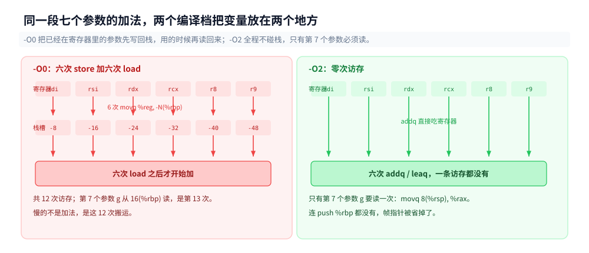
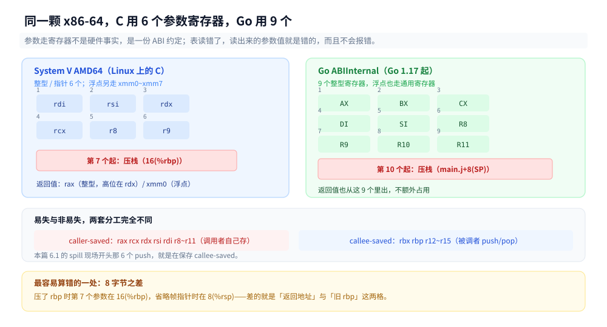
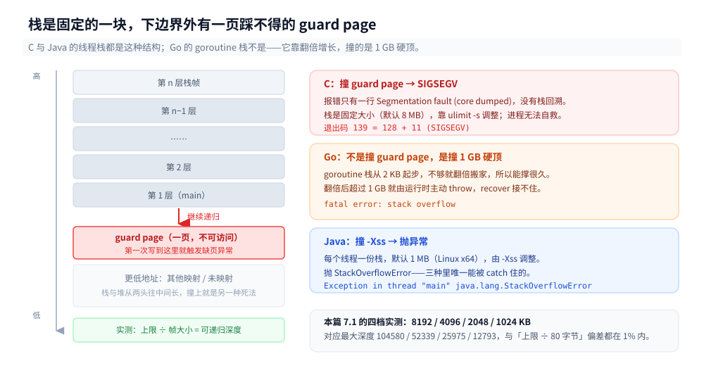

# 寄存器与栈

> 覆盖：一个局部变量到底住在哪（寄存器 / 栈 / 堆三种去向，以及谁决定的）、寄存器为什么比 L1 还快一个数量级又为什么只有十几个、栈为什么必须存在（LIFO 恰好匹配调用的生命周期）、一次调用的栈帧物理布局（参数区 / 返回地址 / 旧 `rbp` / 局部变量 / 对齐填充 / 红区）、谁规定参数放寄存器还是放栈（System V 的 6+8 与 Go 的 9 的对照）、寄存器不够时的溢出（16 路展开 5 个累加器落栈）、栈多大与三种语言各自的溢出现场。
>
> 不覆盖：Go 自己的寄存器传参实测与 `-S` 伪寄存器读法 → [函数调用与栈.md](../../../01-编程语言/go/类型与语法/函数调用与栈.md)；JVM 的抽象栈帧（局部变量表、操作数槽、`-Xss` 的 JVM 侧读数）→ [运行时数据区与栈帧.md](../../../01-编程语言/java/运行时/运行时数据区与栈帧.md)；缓存行与 MESI → [CPU缓存与缓存行.md](CPU缓存与缓存行.md)；架构寄存器与物理寄存器的映射 → [CPU流水线与乱序执行.md](../微架构/CPU流水线与乱序执行.md)。
>
> 内容整理自个人学习笔记，素材见 [素材清单](../../../素材清单.md)。读数在 WSL2 容器内实测（`gcc 12.2.0`、`go1.26.8`、`OpenJDK 1.8.0_504`，`nproc=4`，宿主 `Intel Core i7-6700HQ @ 2.60GHz`）。周期换算按 [时钟周期与频率.md](../微架构/时钟周期与频率.md) 的 1 周期 = 0.408 ns。

---

## 一、一个局部变量到底存在哪？

**本节要点**：同一段源码，`-O0` 下所有变量都在栈上、每次用都要走一次内存；`-O2` 下它们都在寄存器里。这个差别不是「优化开了多少」，而是「变量有没有地址」这件事在编译器眼里的两种处理。

### 1.1 同一段源码，两个编译档

拿一个七个参数的函数，`-O0` 与 `-O2` 各编一次：

```c
long f7(long a, long b, long c, long d, long e, long f, long g) {
    return a + b + c + d + e + f + g * 2;
}
```

`-O0` 的前六行就把六个参数**从寄存器搬回了栈**——它们明明已经在寄存器里了：

```asm
	movq	%rdi, -8(%rbp)      # a 写回栈
	movq	%rsi, -16(%rbp)     # b 写回栈
	movq	%rdx, -24(%rbp)
	movq	%rcx, -32(%rbp)
	movq	%r8,  -40(%rbp)
	movq	%r9,  -48(%rbp)
	...
	movq	-8(%rbp), %rdx      # 用的时候再从栈读
	movq	16(%rbp), %rax      # 第 7 个参数：从调用者的栈上读
```

`-O2` 全程不碰栈，第 7 个参数才去栈上取：

```asm
	addq	%rsi, %rdi          # a + b，两个都在寄存器
	movq	8(%rsp), %rax       # 第 7 个参数在 8(%rsp)
	addq	%rdx, %rdi
	addq	%rcx, %rdi
	addq	%r8, %rdi
	addq	%r9, %rdi
	leaq	(%rdi,%rax,2), %rax  # f + g*2
	ret
```

⭐ 两版都没有 `subq $N, %rsp`：`-O2` 版连帧指针 `rbp` 都没 `push`。这说明**栈帧不是调用的必需品**，只有当函数需要「一块自己的、可变大小的、有地址的」空间时才会真的分配（4.4）。



左边是 `-O0` 的路径——六个参数先进寄存器、立刻写回栈，算的时候再一条条读回来；右边是 `-O2` 的路径——全程留在寄存器里，只有第 7 个参数因为寄存器不够必须去栈上取一次。

### 1.2 三种去向，三个决定者

| 去向 | 谁决定 | 什么情况下落这里 | 生命周期 |
|---|---|---|---|
| 寄存器 | 编译器（寄存器分配） | 变量小、类型简单、不取地址、活跃区间短 | 函数调用之间（caller-saved 会被覆盖） |
| 栈 | 编译器 + 调用约定 | 取了地址（`&x`）、太大、太多、被 `volatile`、需要按索引访问 | 从进函数到出函数 |
| 堆 | 逃逸分析 / 运行时 | 生命周期超过函数（被返回、被闭包捕获、大小在运行时才定） | 由 GC 或手动释放决定 |

三者的判据不是「快慢」，而是**生命周期与地址需求**：

- 只要有人拿走 `&x`，`x` 就必须有一个跨调用稳定的地址——寄存器没有地址，所以它必须去栈或堆；
- 只要 `x` 要活过函数返回，栈就不行（返回即销毁），只能去堆；
- 剩下的、短命又不取地址的，才轮得到寄存器。

这也是 Go 里 `-gcflags="-m"` 报 `moved to heap`、Java 里 JIT 做标量替换（把对象拆成几个寄存器里的标量）的同一个判据——**「有没有人需要它作为一个地址存在」**。

### 1.3 `&x` 为什么一定让 `x` 离开寄存器

寄存器在 CPU 里，没有内存地址。`&x` 要返回一个指针，这个指针必须能解引用、能跨函数传、能被别人看到——只有内存地址满足。

所以编译器看到 `&x` 只有两条路：把 `x` 放到栈上（地址是 `rbp - N`），或者放到堆上（Go 的逃逸分析在跨函数时选这条）。**没有任何编译器能把 `&x` 变成「寄存器编号」**，因为那不是一个可以放进指针宽度的东西。

这就是「寄存器比栈快」的第一层代价：**快，但拿不到地址**。第二层代价在 2.3。

## 二、为什么需要寄存器，又为什么不能全放寄存器？

**本节要点**：寄存器在 ALU 旁边，不在存储层次里——它不是「更快的缓存」，而是操作数的直接来源。它快的原因和它少的原因是同一个：**离运算单元太近，成本太高**。

### 2.1 寄存器在哪个位置

[CPU缓存与缓存行.md](CPU缓存与缓存行.md) 2.2 那张四层归属表的第一行写着「寄存器 / 编译器管 / 0 延迟」。这个 0 不是四舍五入，是**它根本不经过访存**：

| 层 | 从发出请求到拿到数据 | 谁管 |
|---|---|---|
| 寄存器 | 0（操作数直接在指令里编码） | 编译器 |
| L1d | 约 1.6 ns（4 周期） | CPU 硬件 |
| L2 | 约 4.4 ns | CPU 硬件 |
| L3 | 约 15 ns | CPU 硬件 |
| 内存 | 约 113 ns | 操作系统 + 硬件 |

⭐ 关键区别：访问 L1 是「发一条 load 指令、等数据回来」；用寄存器是「这条 `add` 指令的两个操作数就写在指令编码里」。前者有地址、有等待，后者连地址都没有。

这也是 2.3 那条「不能取地址」的物理根源——寄存器不在地址空间里。

### 2.2 实测：同一个累加，5.09 倍

把累加器钉死在寄存器 / 钉死在栈上，其余完全一样（同一个循环、同样的次数、同样的内联汇编屏障，只换约束）：

```c
__asm__ volatile("" : "+r"(s));   /* 强制 s 每轮落在通用寄存器 */
__asm__ volatile("" : "+m"(s));   /* 强制 s 每轮落在内存（栈） */
```

各跑 2 亿次：

| 累加器位置 | ns/次 | 折算周期 | 相对 |
|---|---|---|---|
| 寄存器 | 0.432 | 1.06 | 1 倍 |
| 栈（内存） | 2.198 | 5.39 | **5.09 倍** |

这个 5.39 周期正好是 store-to-load forwarding 的量级：`add` 写回内存、下一轮再读回来，即使命中 L1、即使转发命中，也要走一次访存路径。**「在 L1 里」不等于「不花钱」**。

### 2.3 五条硬约束

不能「所有变量都放寄存器」不是工程取舍，是五条独立的天花板：

| 约束 | 具体是什么 | 后果 |
|---|---|---|
| **数量固定** | x86-64 只有 16 个通用寄存器，其中 `rsp` 是栈指针、`rbp` 常作帧指针 | 可分配的最多 14~15 个 |
| **不能取地址** | 寄存器不在地址空间里 | `&x` 一定让 `x` 走内存（1.3） |
| **跨调用不保活** | `call` 会覆盖 caller-saved 的寄存器 | 调用前要存、调用后要取回 |
| **不能按索引访问** | 没有「第 i 个寄存器」这种寻址 | 数组、`p[i]` 一定在内存 |
| **编码只有 4 位** | `ModRM` 的 reg 字段 3 位，加 `REX.R` 扩 1 位 | **指令格式只留了 16 个位置，想加也加不进去** |

最后一条最硬：这不是「CPU 厂商舍不得加」，是 x86-64 的指令编码在 `ModRM` 里给寄存器号留的位数就那么多。要更多寄存器就得换指令集（ARM64 有 31 个通用寄存器，编码是 5 位）。

### 2.4 十六个通用寄存器怎么分工

| 寄存器 | 角色 | 在调用中的归属 |
|---|---|---|
| `rax` | 累加器、返回值 | caller-saved |
| `rbx` | 通用 | **callee-saved** |
| `rcx` | 计数、第 4 个参数 | caller-saved |
| `rdx` | 第 3 个参数、乘除的高位 | caller-saved |
| `rsi` | 第 2 个参数、源串 | caller-saved |
| `rdi` | 第 1 个参数、目的串 | caller-saved |
| `rbp` | 帧指针（可省） | **callee-saved** |
| `rsp` | 栈指针 | 专用，不参与分配 |
| `r8` ~ `r11` | 第 5、6 个参数 / 通用 | caller-saved |
| `r12` ~ `r15` | 通用 | **callee-saved** |

外加两个不参与分配的专用寄存器：`rip`（下一条指令的地址，`call` / `ret` 隐式改它）、`rflags`（CF / OF / ZF 等标志，[补码与整数运算.md](../微架构/补码与整数运算.md) 第四节那张表就是它）。

⭐ 为什么要有 callee-saved：被调函数如果用 `rbx`，必须自己 `push` 保存、`ret` 前 `pop` 恢复。这让调用者可以放心把长期值放在 `rbx` / `r12~r15` 里跨调用。`-O2` 的 spill 现场里那 6 个 `push`（6.1）就是干这个的。

## 三、为什么需要栈？

**本节要点**：因为函数调用天然是 LIFO 的——最后进去的最先出来。栈把这个结构做成了硬件级的 O(1) 操作：分配一个帧只改一个寄存器的值。

### 3.1 LIFO 恰好匹配调用

A 调 B、B 调 C，退出顺序必然是 C → B → A。这个「后进先出」不是人为约定，是**控制流的结构决定的**：`ret` 必须回到「调用我的那一条指令的下一条」，而那条指令属于最近一次还没返回的调用。

栈天然满足这个结构，而且不需要任何分配器、不需要记录空闲块、不需要 GC。

### 3.2 分配是 O(1)：只改 `rsp`

分配一个栈帧，就是 `subq $N, %rsp`；释放就是 `addq $N, %rsp`（或直接 `pop` / `leave`）。

```asm
	subq	$48, %rsp      # 分配 48 字节，一条指令
	...
	addq	$48, %rsp      # 释放，一条指令
	ret
```

对比堆分配：要找一个够大的空闲块、可能要分裂、可能要合并、可能要进内核要页。栈分配连「找」这一步都没有——**地址就是 `rsp` 往下减**。这是栈能便宜到接近免费的全部原因。

### 3.3 线程私有：并发安全不花锁

每个线程有自己的栈（由内核在创建线程时映射），所以栈上的变量**天然不共享**，不需要任何同步。这不是优化，是定义：一个线程的 `rsp` 只被它自己改。

这条性质解释了一个常见困惑——「局部变量为什么不用加锁」不是因为它是局部变量，是因为**它在一块只有这个线程能访问的内存上**。

### 3.4 为什么不全用堆

| 项 | 栈 | 堆 |
|---|---|---|
| 分配 | 一条 `sub` 指令 | 找空闲块 + 可能分裂 / 合并 / 系统调用 |
| 释放 | 一条 `add` 指令 | 显式释放或等 GC |
| 碎片 | 不存在（LIFO 天然紧凑） | 存在 |
| 生命周期 | 严格等于函数调用 | 任意 |
| 共享 | 线程私有 | 全进程 |
| 大小 | 上限固定（C 默认 8 MB） | 只受物理内存与地址空间限制 |

所以判据很清楚：**短命、私有、大小编译期可定 → 栈；其余 → 堆**。第三列的「大小固定」是栈的硬伤，也是第七节三种溢出结局的由来。

## 四、一次调用的栈帧长什么样？

**本节要点**：栈帧的布局是**倒着长**的——高地址在参数区，低地址在局部变量。中间夹着返回地址和旧的 `rbp`，最下面还有 128 字节红区。

### 4.1 物理布局

调用发生时，`call` 指令自动把返回地址压栈，被调函数再决定要不要压旧 `rbp`、留多少局部空间：

```text
        高地址
   ┌──────────────────────┐
   │  调用者的栈帧          │
   ├──────────────────────┤
   │  第 7 个及以后的参数    │  ← 调用者准备，被调者用 rbp+16、rbp+24 读
   ├──────────────────────┤
   │  返回地址              │  ← call 指令自动压入；ret 弹出
   ├──────────────────────┤
   │  保存的旧 rbp           │  ← 被调函数 pushq %rbp
   ├──────────────────────┤  ← rbp 指向这里
   │  局部变量 / 溢出槽       │  ← rbp-8、rbp-16 ……
   ├──────────────────────┤  ← rsp 指向栈顶
   │  红区 128 字节          │  ← 叶函数可直接用，不必先动 rsp
   └──────────────────────┘
        低地址（栈向下生长）
```

对照 1.1 的两份汇编：`-O0` 版里 `a` 在 `-8(%rbp)`、第 7 个参数 `g` 在 `16(%rbp)`——正好是图上「返回地址 + 旧 rbp」各占 8 字节之后。`-O2` 版没有 `push rbp`，于是第 7 个参数变成 `8(%rsp)`（只剩返回地址那 8 字节在前）。

⭐ 这个「8 字节之差」是最容易算错的地方：**有没有压 `rbp`，会让同一个参数在 `rbp` 相对与 `rsp` 相对两种写法下差 8**。


图里的六层从上到下就是地址递减的方向：调用者的帧、第 7 个起的参数、返回地址、旧 `rbp`、局部变量、红区。`rbp` 指向旧 `rbp` 那一格的底部，`rsp` 指向局部变量区的底部——两者之间就是本函数真正能用的空间。

### 4.2 16 字节对齐是硬要求

System V ABI 规定：**每次 `call` 之前，`rsp` 必须是 16 的倍数**。`call` 压入 8 字节返回地址，所以进入函数时 `rsp % 16 == 8`。

不满足会怎样？不是慢一点，是**直接崩**。因为 SSE 的对齐版指令（`movaps`、`movdqa`）要求操作数 16 字节对齐，不对齐就触发 #GP，内核映射成 SIGSEGV：

```c
char buf[64] __attribute__((aligned(16)));
__asm__ volatile("movaps (%0), %%xmm0" ::"r"(buf));      // 对齐：通过
__asm__ volatile("movaps (%0), %%xmm0" ::"r"(buf + 1));  // 错开 1 字节：崩
```

实测输出：

```text
buf 地址 = 0x7ffc18c3b490, buf%16 = 0
对齐地址上 movaps：通过
Segmentation fault (core dumped)
退出码=139
```

⭐ 所以「编译器为什么要塞那么多 `subq $8, %rsp` 这种看起来没用的调整」有了答案：它在凑 16 的倍数。手写汇编调用 C 函数时栈不对齐，症状就是「函数体里某条 SSE 指令莫名崩了」，且报错位置与被调函数看起来毫无关系。

### 4.3 红区：叶函数可以不碰 `rsp`

ABI 还留了 128 字节的「红区」：`rsp` 以下、当前栈帧之外的那一段，**信号处理与中断不会踩它**（内核会跳过红区）。所以叶子函数（不再调别人）可以直接用 `-8(%rsp)` 存东西，不调整 `rsp`。

这就是为什么很多小函数编译出来一条 `sub` 都没有——它们靠红区过日子。

### 4.4 帧指针不是必须的

`rbp` 的唯一作用是「给局部变量一个固定的参照」，因为 `rsp` 会随 `push` / `sub` 变动。但现代编译器能静态算出每个变量相对 `rsp` 的偏移，于是**省略帧指针**（`-fomit-frame-pointer`，`-O1` 起默认开）。

1.1 的 `-O2` 版本就是现场：没有 `push rbp`、没有 `mov rsp, rbp`，全部用 `8(%rsp)` 这种相对寻址。代价是调试器拿不到干净的调用栈（要靠 `.cfi_*` 指令重建），所以 `perf` 与 gdb 常建议 `-fno-omit-frame-pointer`。

## 五、谁决定参数放寄存器还是放栈？

**本节要点**：不是硬件，是 **ABI**——同一颗 x86-64，Linux 用 6 个整型参数寄存器，Windows 只用 4 个。这证明「调用约定」是软件层的约定，不是硅层的限制。

### 5.1 System V AMD64：6 个整型 + 8 个浮点

| 位置 | 整型 / 指针参数 | 浮点参数 |
|---|---|---|
| 第 1 个 | `rdi` | `xmm0` |
| 第 2 个 | `rsi` | `xmm1` |
| 第 3 个 | `rdx` | `xmm2` |
| 第 4 个 | `rcx` | `xmm3` |
| 第 5 个 | `r8` | `xmm4` |
| 第 6 个 | `r9` | `xmm5` |
| 第 7 个起 | 从右往左压栈 | `xmm6`、`xmm7`，再多也压栈 |
| 返回值 | `rax`（高 64 位在 `rdx`） | `xmm0` |

两条容易记错的细节：

1. **两套寄存器是分开计的**。`f(int a, double b, int c)` 里 `a` 在 `rdi`、`b` 在 `xmm0`、`c` 在 `rsi`——不是「第 3 个参数就在 `rdx`」。
2. **栈上传参是从右往左压**，所以第 7 个参数在最低地址（`8(%rsp)` 或 `16(%rbp)`），第 8 个在它上面。

### 5.2 Go 的 9 个：另一套约定

Go 从 1.17 起用寄存器传参，但**寄存器集合与 System V 不同**：

| 项 | System V（C） | Go（ABIInternal） |
|---|---|---|
| 整型参数寄存器 | `rdi` `rsi` `rdx` `rcx` `r8` `r9`（6 个） | `AX` `BX` `CX` `DI` `SI` `R8` `R9` `R10` `R11`（9 个） |
| 第 7 个整型参数 | 压栈 | 仍在 `R9` |
| 溢出点 | 第 7 个 | 第 10 个 |
| 返回值 | `rax` / `rdx` | 也从这 9 个里出 |

所以同一个「10 个 int 参数的函数」，C 版本要压 4 个到栈上，Go 版本只压 1 个。Go 的那份实测（`sumBig` 第 10 个参数落在 `main.j+8(SP)`）在 [函数调用与栈.md](../../../01-编程语言/go/类型与语法/函数调用与栈.md) 3.1~3.3，本篇不重放。

⭐ 这条对照是本节最该记住的：**「参数走寄存器」不是一个通用事实，是一份具体的表**。跨语言手写汇编、做 FFI、看 cgo 的汇编时，用错表就会读到错误的参数。



同一个物理 CPU，两列格子的数量与顺序都不一样。图下方那条分色带标的是另一件容易混的事：**哪些寄存器由调用者保存、哪些由被调者保存**——它决定了函数开头那串 `push` 的长度。

### 5.3 caller-saved 与 callee-saved

| 归属 | 寄存器 | 谁负责保存 |
|---|---|---|
| caller-saved（易失） | `rax` `rcx` `rdx` `rsi` `rdi` `r8`~`r11` | **调用者**：如果调用后还要用，自己先存 |
| callee-saved（非易失） | `rbx` `rbp` `r12`~`r15` | **被调者**：用了就必须 `push` 保存、`pop` 恢复 |

这条分工决定了两件事：

1. 为什么 `-O2` 的复杂函数开头有一串 `push`（6.1 里 6 个）——它在保存自己要用到的 callee-saved；
2. 为什么编译器倾向把「跨调用还要活」的值放进 callee-saved——放 caller-saved 就得自己存。

### 5.4 第 7 个参数去哪了

1.1 的 `-O2` 版里那一行 `movq 8(%rsp), %rax` 就是答案：它不在任何寄存器里，在**调用者的栈上**。被调函数想用它，只能读一次内存。

这也解释了为什么「参数太多」有性能代价：不是传参本身贵，是**从第 7 个起每个参数都要一次访存**（约 5 周期，与 2.2 的栈累加同档）。

## 六、寄存器不够时会发生什么？

**本节要点**：编译器把一部分变量写回栈，这叫 spill。它不是「优化失败」，是 14 个寄存器装不下 19 个活跃值的必然结果。

### 6.1 16 路展开的溢出现场

把 16 个累加器手动展开，加上指针、计数、边界，活跃值 19 个：

```c
long s0 = 0, s1 = 0, ..., s15 = 0;
for (long i = 0; i + 15 < n; i += 16) {
    s0 += p[i];  s1 += p[i + 1];  ...  s15 += p[i + 15];
}
```

`gcc -O2 -fno-tree-vectorize -S` 的结果：

```asm
	pushq	%r15          # 先保存 6 个 callee-saved
	pushq	%r14
	pushq	%r13
	pushq	%r12
	pushq	%rbp
	pushq	%rbx
	...
	movq	%rax, -8(%rsp)    # 这几个累加器只能放栈上
	movq	%rax, -24(%rsp)
	movq	%rdx, -16(%rsp)
	movq	$0, -32(%rsp)
	movq	$0, -40(%rsp)
	addq	%rax, -40(%rsp)   # 连加法都直接对内存做
	addq	%rax, -32(%rsp)
	addq	%rdx, -24(%rsp)
```

**5 个累加器落在 `-8` ~ `-40(%rsp)`**，剩下的 11 个在寄存器里。`addq %rax, -40(%rsp)` 这种「读内存、加、写回」正是 2.2 测出 5.09 倍的那条路径。

⚠️ 这里必须加 `-fno-tree-vectorize`：默认 `-O2` 会把它变成 4 条 `vpaddq`，一个 spill 都不会有。**想看 spill 现场，先关向量化**。

### 6.2 编译器按什么挑落栈的

按**活跃区间**（live range）：一个值从「被定义」到「最后一次被使用」之间，如果同时在活的值超过可用寄存器数，就必须有值落栈。挑选规则通常是「下次使用最远的那个先落栈」（Belady 式启发），因为它挪到栈上之后要等最久才被读回。

这条规则解释了 6.1 的现象：16 个累加器里，有 5 个在下一次循环迭代中「最后才用到」，于是优先被赶下栈。

### 6.3 这是语言无关的

- **Go**：第 10 个参数溢出到栈（9 个寄存器），见 [函数调用与栈.md](../../../01-编程语言/go/类型与语法/函数调用与栈.md) 3.2；
- **Java**：JIT 编译后同样受 x86-64 的 14~15 个寄存器限制，溢出的值落在 JIT 自己的帧里；解释执行时则全在局部变量表（抽象层没有寄存器概念），见 [运行时数据区与栈帧.md](../../../01-编程语言/java/运行时/运行时数据区与栈帧.md)。

三种语言在这里的差别只是「谁在分配」——C/Go 是编译器，Java 是 JIT——**物理上限一样**。

## 七、栈多大、溢出了怎么查？

**本节要点**：栈大小是一个固定上限，撞上就死。三种语言的差别不在「会不会死」，在「死的时候说多少话」。

### 7.1 四档上限，崩点线性跟着变

同一个递归函数（每帧 80 字节），把 `ulimit -s` 调成四档，二分找最大深度：

| 栈上限 | 实测最大深度 | 相对 1024 KB | 理论值（上限 ÷ 80） |
|---|---|---|---|
| 8192 KB | 104 580 | 8.17 倍 | 104 857 |
| 4096 KB | 52 339 | 4.09 倍 | 52 428 |
| 2048 KB | 25 975 | 2.03 倍 | 26 214 |
| 1024 KB | 12 793 | 1 倍 | 13 107 |

实测与「上限 ÷ 帧大小」的偏差都在 1% 以内——**栈可容纳的深度就是上限除以帧大小，没有别的隐藏系数**。这也是估算递归风险的唯一方法：先量一帧多少字节，再除以栈上限。

### 7.2 三种栈，三种死法

| 语言 | 撞上限后 | 报错原文 | 退出码 |
|---|---|---|---|
| C（`ulimit -s`） | 撞 guard page → SIGSEGV | `Segmentation fault (core dumped)` | **139** |
| Go（goroutine 栈） | 翻倍增长到超过 1 GB 硬顶 → 运行时 `throw` | `runtime: goroutine stack exceeds 1000000000-byte limit` / `fatal error: stack overflow` | 2 |
| Java（`-Xss`） | 抛 `StackOverflowError` | `Exception in thread "main" java.lang.StackOverflowError` | 1 |

三者的机制完全不同：

- **C**：栈是**固定大小的一块映射**，下边界外是一页不可访问的 guard page。`rsp` 越过它，第一次写就触发缺页异常，内核发现地址在 guard 区内 → SIGSEGV。进程无法自救，也没有栈回溯。
- **Go**：goroutine 栈是**可增长的连续栈**。不够时运行时分配一块两倍大的、把旧的搬过去，所以起始只有 2 KB 却能用很久。代价是这条路径有硬顶（默认 1 GB），翻倍到超过就 `fatal error`。⚠️ 这个 `fatal error` 是**运行时主动终止**，不是崩溃，`recover` 接不住。
- **Java**：`-Xss` 是**每个线程的栈上限**（Linux x64 默认 1 MB），撞上抛 `StackOverflowError`，它是 `Error` 不是 `Exception`，但**可以被 `catch` 住**——这是三种里唯一能优雅处理的。



左边是 C 与 Java 共用的结构：栈从高地址往低地址长，长到 guard page 就出事。右边三张卡分别是三种死法——Go 不在这张图里，它的 goroutine 栈靠翻倍搬家，撞的是 1 GB 硬顶而不是 guard page。

### 7.3 三个旋钮

| 场景 | 旋钮 | 默认 | 怎么选 |
|---|---|---|---|
| C / 系统线程 | `ulimit -s`（或 `pthread_attr_setstacksize`） | 8 MB | 深递归调大；线程极多时调小（每线程一份） |
| Go | `debug.SetMaxStack` | 1 GB | 一般不动；确实要深递归时调大，并接受更大的 GC 扫描成本 |
| Java | `-Xss` | 1 MB | 深递归调大；线程数上万时调小（`-Xss` × 线程数 ≈ 常驻虚拟内存） |

⭐ 一条容易踩的：**Go 的栈上限不是 `ulimit -s`**。goroutine 栈是运行时自己管的堆上内存，改 `ulimit` 对它无效。反过来，`debug.SetMaxStack` 对 C 线程栈也无效。

## 八、三组结论

### 8.1 寄存器快，但换取快的方式是放弃地址

寄存器的 0 延迟来自「不经过访存」，代价是它不在地址空间里：不能取地址、不能按索引访问、不能跨调用保活。所以「变量放哪」的判据从来不是「哪里快」，而是**有没有人要它的地址、它要活多久**。`&x` 一出现，讨论就结束了——一定在内存。

### 8.2 栈的便宜来自结构，不是来自优化

O(1) 分配、无需 GC、线程私有免锁，三条都不是「实现得好」，是 LIFO 这个结构与调用控制流天然同构的结果。也因此它的上限是硬的：大小固定、不能跨函数存活。这两条限制就是 7.2 三种死法的共同根源。

### 8.3 「参数走寄存器」是一张具体的表，不是一个通用事实

同一颗 x86-64，Linux 的 C 用 6 个、Windows 的 C 用 4 个、Go 用 9 个。看汇编、写 FFI、调 cgo 时读错表，症状是「参数值莫名其妙不对」，而不是报错。第 7 个参数在 `8(%rsp)` 还是 `16(%rbp)`，取决于有没有压 `rbp`——这 8 字节之差是最常见的算错点。

## 校验口径

> ✅ 本篇读数的校验方式与范围（WSL2 容器 `nproc=4`、`gcc 12.2.0`、`go1.26.8`、`OpenJDK 1.8.0_504`、内核 `6.18.54.1-microsoft-standard-WSL2`，宿主 `Intel Core i7-6700HQ @ 2.60GHz`）：

- **真跑（gcc 12.2.0）**：1.1 节 `-O0` / `-O2` 两份 `-S` 输出（七参数函数的完整函数体）；2.2 节寄存器与栈两版累加各 2 亿次（内联汇编 `+r` / `+m` 约束，`noinline` 防止折叠）；4.2 节 `movaps` 对齐与错位各一次（后者 SIGSEGV，退出码 139）；6.1 节 16 路展开的 spill 现场（`-O2 -fno-tree-vectorize -S`）；7.1 节四档 `ulimit -s` 二分找崩点（每档约 11 次试跑）
- **真跑（三语言溢出对照）**：7.2 节——C 退出码 139；Go 运行时输出 `goroutine stack exceeds 1000000000-byte limit` 与 `fatal error: stack overflow`；Java 输出 `java.lang.StackOverflowError`
- **编译期即可确定**：2.3 节五条约束（16 个通用寄存器、`ModRM` 的 3 位 + `REX.R`、专用寄存器分工）；2.4 节寄存器归属表；5.1 / 5.2 节两套 ABI 的参数寄存器表；5.3 节 caller / callee-saved 划分
- **未实测（按 ABI 文档陈述）**：4.2 节「`call` 前 `rsp` 必须 16 字节对齐」的规则本身；4.3 节红区 128 字节的内核跳过行为（本机没做信号处理测试）；5.1 节浮点参数走 `xmm0~7`（本篇探针全是整型）
- **口径提醒**：7.1 节四档读数是**同一进程外二分**得到的，每档都是独立启动；2.2 节的 5.09 倍是**单次操作边际成本**，不含跨核传播（那是 [CPU缓存与缓存行.md](CPU缓存与缓存行.md) 的账）
- **换算基准**：周期数按 1 周期 = 0.408 ns 折算，与 [时钟周期与频率.md](../微架构/时钟周期与频率.md) 同源

| 依赖 | 实际版本 |
|---|---|
| GCC | 12.2.0（Debian 12.2.0-14+deb12u1） |
| Go | go1.26.8 linux/amd64（容器 `golang:1.26-bookworm`） |
| JDK | OpenJDK 1.8.0_504（Temurin，容器 `eclipse-temurin:8-jdk`） |
| CPU | Intel Core i7-6700HQ @ 2.60GHz，4 核 8 线程（容器内 `nproc=4`） |
| 内核 | 6.18.54.1-microsoft-standard-WSL2 |

## 延伸追问

- **为什么 `-O0` 要把已经在寄存器里的参数再写回栈？** → 因为 `-O0` 要保证「每个变量在任何时刻都能被调试器读到」。寄存器里的值调试器不一定能取（可能已被覆盖），栈上的地址是稳定的。所以 `-O0` 牺牲性能换可调试性，这也是它慢 5~10 倍的主要原因之一。
- **红区为什么是 128 字节，不是 64 或 256？** → 它是 ABI 定的一个折中：够叶函数放几个临时值，又不会让信号处理栈帧太大。具体数值来自 System V ABI 文档，不是硬件限制——所以换 ABI（比如 Windows x64）就没有红区。
- **Go 的栈既能增长，为什么还要 1 GB 上限？** → 因为「搬到更大的栈」这一步需要同时存在两份（旧栈 + 新栈），深度越大，峰值内存翻倍越狠。设上限是防止一次递归把整机内存吃光。这也是 `debug.SetMaxStack` 谨慎使用的原因。
- **`-Xss` 调大是不是就能跑任意深递归？** → 不是。每个线程一份栈，`-Xss 1g` 配 1000 个线程就是 1 TB 虚拟地址空间（虽然按需提交，但地址空间会先耗尽）。深递归该改成显式栈（迭代 + 自己维护的 slice）。
- **为什么手写汇编里 `push` 的数量总是偶数？** → 因为在 16 字节对齐的前提下，`push` 一次减 8，只有偶数次才能让 `rsp` 回到 16 的倍数。奇数个 `push` 后面通常跟一个 `subq $8` 补齐——4.2 那条规则的直接后果。

## 关联

- **上游/总纲**：[README.md](README.md) — 缓存与内存册收什么、三篇（现四篇）的分工与读序
- **下游机制**：[CPU缓存与缓存行.md](CPU缓存与缓存行.md) — 2.2 节那张四层归属表的顶行由本篇展开；寄存器之下的那一层从那里接起
- **上游机制**：[CPU流水线与乱序执行.md](../微架构/CPU流水线与乱序执行.md) — 架构寄存器只有 16 个，物理寄存器更多，靠重命名撑起乱序窗口
- **上游读数**：[时钟周期与频率.md](../微架构/时钟周期与频率.md) — 本篇所有「折算周期」的换算基准
- **算法层依据**：[补码与整数运算.md](../微架构/补码与整数运算.md) — `rflags` 里的 CF / OF 怎么产生，本篇 2.4 只列了名字
- **语言侧落地**：[函数调用与栈.md](../../../01-编程语言/go/类型与语法/函数调用与栈.md) — Go 的 9 个参数寄存器、`-S` 伪寄存器、`sumBig` 的溢出实测
- **语言侧落地**：[运行时数据区与栈帧.md](../../../01-编程语言/java/运行时/运行时数据区与栈帧.md) — JVM 的抽象栈帧与 `-Xss` 的实测，与本篇的物理栈帧互为对照
- **上游起点**：[从可执行文件到第一条指令.md](../../编译原理/从可执行文件到第一条指令.md) — 进程启动时 `rsp` 指向 `argc`，是本篇栈帧故事的起点

> 反向引用（本篇被下列文档引到）：[README.md](README.md)、[CPU缓存与缓存行.md](CPU缓存与缓存行.md)、[CPU流水线与乱序执行.md](../微架构/CPU流水线与乱序执行.md)、[从可执行文件到第一条指令.md](../../编译原理/从可执行文件到第一条指令.md)、[函数调用与栈.md](../../../01-编程语言/go/类型与语法/函数调用与栈.md)、[运行时数据区与栈帧.md](../../../01-编程语言/java/运行时/运行时数据区与栈帧.md)
