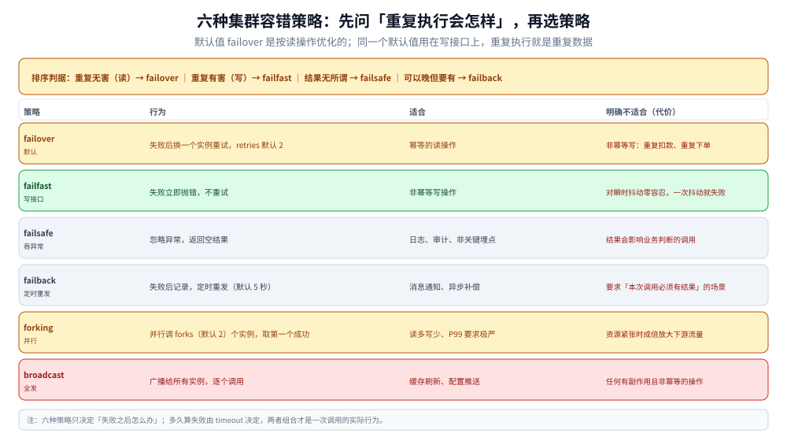

# Dubbo 服务治理

> 覆盖：服务发现的两种粒度（接口级 / 应用级）、路由与权重的实际作用点、五种负载均衡的取舍、六种集群容错策略各自适合什么、默认超时与重试为什么会放大故障，以及 tag 路由怎么做灰度。
>
> 不覆盖：链路对象与扩展点位置（→ [调用链路.md](调用链路.md)）；报文与序列化（→ [通信协议.md](通信协议.md)）；治理能力该放框架内还是基础设施（→ [RPC框架选型对比.md](../RPC框架选型对比.md) 第八节）；Java 侧配置写法（→ [接入Dubbo.md](../../../../01-编程语言/java/工程实践/接入Dubbo.md)）。
>
> 内容整理自个人学习笔记。⚠️ **本篇不含本机实测**：没有起过注册中心与 provider 集群，路由与容错的读数一项都没有。策略语义按 Dubbo 3.x 官方文档核对，默认值标注了版本差异，逐块口径见文末 [校验口径](#校验口径)。

---

## 一、一句话定位：治理能力「在框架内」意味着什么

**本节要点**：Dubbo 的治理不是一套独立服务，而是**六个可配置的决策点**，全部在消费端的调用路径上。

```text
服务列表（Directory） → 排除一部分（Router） → 选一个（LoadBalance）
                                            → 失败怎么办（Cluster） → 兜底（Mock）
        ↑ 列表从哪来（注册中心 / 应用级发现）        ↑ 多久算失败（Timeout）
```

⭐ 与「gRPC + 基础设施」的差别不在能力多少，而在**这些旋钮归谁管**：
Dubbo 里它们是配置项（改一个 YAML 就生效），另一条路上它们是网关 / Mesh 的规则（要部署、要下发、要一套控制面）。
**代价对比见 [RPC框架选型对比.md](../RPC框架选型对比.md) 第八节，本篇只讲这些旋钮本身怎么转。**

## 二、服务发现：接口级与应用级

**本节要点**：3.x 把注册中心的**注册单位**从「接口」改成了「应用」。这是数据量级别的改动，不是命名调整。

| | 2.x 接口级 | 3.x 应用级 |
|---|---|---|
| 注册单位 | 每个 `interface` 一个节点 | 每个**应用**一个节点 |
| 注册中心数据量 | `接口数 × 实例数` | `应用数 × 实例数` |
| 消费端怎么知道接口 | 直接订阅接口节点 | 订阅应用 + 从**元数据中心**取「接口 → 应用」映射 |
| 扩缩容影响 | 所有引用该接口的消费端都要刷新 | 只影响应用节点，接口映射不变 |
| 代价 | 数据量随接口数爆炸 | 多一个元数据中心依赖 |

⭐ 一条判据：**接口数上百、实例数上几十之后，接口级注册的瓶颈是注册中心本身**（推送风暴、内存、连接数）。
此时升应用级不是「尝鲜」，是必要的容量动作。

⚠️ 但升级不等于「配置一改就完事」：应用级发现要求**每个接口都声明归属哪个应用**，
历史项目里「一个应用暴露了几百个接口、没登记应用名」的形态会在这里暴露出来。

## 三、路由：先把候选集缩小

**本节要点**：路由回答的是「这次调用**允许**用哪些实例」，与「选哪一个」是两件事（后者是负载均衡）。

| 路由类型 | 依据 | 典型用途 | 踩坑点 |
|---|---|---|---|
| 条件路由（Condition） | 表达式，形如 `host = 10.0.0.1 => host != 10.0.0.2` | 机房就近、黑名单、单元化 | `=>` 左边是消费端条件、右边是提供端条件，**写反了会「谁都不匹配」** |
| 标签路由（Tag） | 消费端带 `dubbo.tag`，只匹配同 tag 的提供者 | 灰度、蓝绿 | 见第七节：`force` 决定找不到时是报错还是退化 |
| 脚本路由（Script） | JS 脚本，入参是调用上下文与地址列表 | 复杂自定义规则 | 规则在每次调用时求值，**别写重逻辑** |
| 网状规则路由（MeshRule，3.x） | Istio 风格的路由规则 | 与 Mesh 统一规则面 | 与条件路由同时存在时**优先级要查版本** |

⭐ **路由之后为空**是一个独立的故障态：注册中心明明有 provider，调用却报 `No provider available`。
判据是**去 `dubbo-admin` 看「服务提供者」列表非空、但「路由后」为空** —— 这时问题在规则，不在注册中心。

## 四、负载均衡：五种算法各错在哪

**本节要点**：没有「更好的算法」，只有「你的流量形态适合哪个」。每条都要记住它的**失效场景**。

| 算法 | 怎么选 | 适合 | 失效场景 |
|---|---|---|---|
| `random`（默认） | 加权随机 | 大多数场景，实现最简单 | 权重差异大 + 样本少时会短时倾斜 |
| `roundrobin` | 加权轮询 | 实例规格一致、请求耗时均匀 | **慢节点会拖垮整轮**：轮询不看当前负载 |
| `leastactive` | 选当前活跃调用数最少的 | 请求耗时差异大（长任务混杂） | 活跃数统计有窗口，突发时反应滞后 |
| `consistenthash` | 对参数哈希，同参数落同一实例 | 有本地缓存、需要「同一 key 打同一台」 | 扩容/缩容时**部分 key 会迁移**，缓存命中率会掉 |
| `shortestresponse`（3.x） | 按滑动窗口的最短响应时间加权 | 节点性能不均 | 需要足够样本；冷启动时统计不可信 |

⚠️ **`roundrobin` 的坑最隐蔽**：它按「权重 + 轮次」机械分配，
所以某个实例变慢时它**仍然把等量请求发过去**，队列越积越长，最终拖慢整体 P99。
`leastactive` 天然规避这一点（慢的实例活跃数高 → 少发），代价是统计滞后。

⭐ 与「预热」联动：新实例刚启动时 JIT 未热、缓存空，直接按满权重接流量会有一段时间的尖刺。
Dubbo 的 `warmup` 让权重在启动后的一段时间里线性爬坡 —— **这个配置存在的原因就是上面这条**。

## 五、集群容错：六种策略的适用边界

**本节要点**：策略选错不是「效果差一点」，而是**要么丢请求、要么放大流量**。

| 策略 | 行为 | 适合 | 明确不适合 |
|---|---|---|---|
| `failover`（默认） | 失败后换一个实例重试，`retries` 默认 2 | **幂等的读操作** | 非幂等写（会重复扣款 / 重复下单） |
| `failfast` | 失败立即抛错，不重试 | 非幂等写操作 | 瞬时抖动敏感的场景（一次抖动就失败） |
| `failsafe` | 忽略异常，返回空结果 | 日志、审计、非关键埋点 | 任何「结果会影响业务判断」的调用 |
| `failback` | 失败后记录，定时重发（默认 5 秒） | 消息通知、异步补偿 | 要求「本次调用必须有结果」的场景 |
| `forking` | 并行调 `forks`（默认 2）个实例，取第一个成功 | 读多写少、P99 要求极严 | 资源紧张时（**成倍放大下游流量**） |
| `broadcast` | 广播给所有实例，逐个调 | 缓存刷新、配置推送 | 任何有副作用且非幂等的操作 |

⭐ **一条排序判据**：先问「重复执行会怎样」——

```text
重复执行无害（读）      → failover（默认，能吃瞬时抖动）
重复执行有害（写）      → failfast，配 retries=0
结果完全无所谓          → failsafe
结果可以晚一点但要有    → failback
```



表格里最该看的是最右一列 —— 前四种的「不适合」都是**业务语义上的错配**（把读策略用在写上），
后两种（`forking` / `broadcast`）的代价则是**资源与副作用**：一个成倍放大下游流量，一个把所有实例都改成写入。

## 六、超时与重试：默认值为什么危险

**本节要点**：`timeout=1000` 与 `retries=2` 单独看都合理，**组合起来是「一次业务调用最多发 3 次、每次等 1 秒」**。

```text
业务调用
  ├─ 第 1 次：等 1000ms 超时 → 换一个 provider 重试
  ├─ 第 2 次：等 1000ms 超时 → 再换一个
  └─ 第 3 次：等 1000ms 超时 → 抛 TimeoutException
总耗时上限 ≈ 3 秒，而不是你以为的 1 秒
```

⭐⭐ **最危险的一点：超时也会触发重试。**
下游其实已经处理完了，只是响应慢于 1 秒 —— 于是同一条写请求被发了 3 次。
如果接口不是幂等的，结果是**三倍数据**，而监控上只看得到「超时」。

| 配置 | 默认 | 该怎么改 |
|---|---|---|
| `timeout` | 1000 ms | 按**调用链总预算**逐跳分配（见 [重试与超时.md](../../../../04-架构与系统/分布式/稳定性/重试与超时.md)） |
| `retries` | 2（即总共 3 次） | **非幂等接口设 0**；只有最外层允许重试 |
| `cluster` | `failover` | 写操作改 `failfast` |
| `actives` | 0（不限） | 限制单客户端对该方法的并发，防单点打爆 |
| `executes` | 0（不限） | 限制服务端该方法的并发，与线程池配合 |

⚠️ **重试的放大效应是乘法**：三跳链路每跳都配 `retries=2`，最坏情况最下游收到 `3 × 3 × 3 = 27` 次调用。
所以规矩是：**只在链路最外层重试，内层全部 `retries=0`**（同 [分布式与微服务.md](../../../../04-架构与系统/分布式/分布式与微服务.md) 5.3）。

## 七、灰度：tag 路由怎么用

**本节要点**：Dubbo 的灰度是**按实例标签**分流，不是按比例分流 —— 这两件事常被混为一谈。

```java
// 消费端：给这次调用打标
RpcContext.getClientAttachment().setAttachment("dubbo.tag", "gray");
```

| 环节 | 做法 |
|---|---|
| 提供方 | 启动时声明自己的 tag（配置项 / 环境变量） |
| 消费方 | 按业务条件设置 `dubbo.tag`（如「内部员工才走 gray」） |
| 路由 | `TagRouter` 只保留同 tag 的 provider |
| `dubbo.force.tag` | `true`：找不到同 tag 的 provider 直接报错；`false`：**退化到全部 provider** |

⚠️ **`force` 的选择就是灰度的安全边界**：
- `false`（退化）→ 灰度实例全挂时流量回到稳定版，可用但**灰度效果消失**；
- `true`（报错）→ 灰度实例全挂时**这部分用户的调用直接失败**，但不会污染稳定版。

⭐ 与 Nginx 那套的区别：`split_clients` 是**按比例**在入口分流（见 [网关选型对比.md](../../网关与代理/网关选型对比.md) 3.4），
Dubbo 的 tag 是**按实例**分流。**按比例灰度要给消费端做**（或交给 Mesh / 网关），框架层的 tag 只能表达「整条链路走哪个版本」。
两者组合使用才是完整方案：入口按比例决定「谁进灰度」，链路内 tag 保证**灰度请求只在灰度实例间流转**。

## 八、降级：`mock` 的三种写法

**本节要点**：降级不是「异常吞掉」，而是**显式声明「这个调用失败时返回什么」**。

| 写法 | 行为 | 用途 |
|---|---|---|
| `mock=force:return null` | **不发起远程调用**，直接返回 null | 下游已知不可用、要立即止血 |
| `mock=fail:return null` | 正常调用，失败时返回 null | 非关键依赖的兜底 |
| `mock=com.x.XxxMock` | 失败时调 Mock 实现类 | 返回有意义的降级数据（如缓存快照） |

⚠️ `force:return` 是**最容易忘的一条**：止血时大家都去关流量、摘节点，而 `force:return` 是一行配置就能让调用直接短路，
不用等注册中心推送，也不用重启。**但它同样是「静默」的** —— 必须配监控，否则降级开着没人知道。

---

## 校验口径

> ⚠️ 本篇的校验方式与范围：

- **零实测**：没有起注册中心、没有起多实例 provider，因此**路由过滤、负载均衡分布、重试次数、tag 灰度**这四类读数一项都没有。
- **默认值口径**：`timeout=1000`、`retries=2`、`cluster=failover`、`forking.forks=2`、`failback` 重发间隔 5 秒 —— 这些在 2.x / 3.x 文档中一致；**但都可由配置中心或注解覆盖**，生产排查必须看 `URL` 里的实际值（见 [调用链路.md](调用链路.md) 第四节）。
- **有版本差异的两处**：① 网状规则路由（MeshRule）与条件路由的优先级；② 应用级发现的默认开关在 3.x 各小版本的推进节奏。文中未断言具体版本，标注「查版本」。
- **未编译**：第七节的 `RpcContext` 写法是 3.x 的客户端 attachment API；2.7 以前的 `RpcContext.getContext().setAttachment()` 语义不同（服务端与客户端共用），迁移时要改。
- **待实测项**：① 三实例 + `random` / `roundrobin` / `leastactive` 的分布对比；② 一个慢实例对 `roundrobin` 的 P99 影响；③ `dubbo.force.tag=false` 时灰度实例全挂的退化行为；④ `retries=2` 下非幂等接口的重复写入行数。

| 依赖 | 版本口径 |
|---|---|
| Dubbo | 3.x 文档（服务治理章节），未指定补丁版本 |
| 注册中心 | 未连接（Nacos / Zookeeper 都没起） |
| provider 实例数 | 0（未运行） |

## 延伸追问

- **`failover` 是默认值，为什么说它危险？** →
  因为它对「失败」的定义包含**超时**。超时意味着对端可能已经处理成功，重试就是重发。
  读操作重发无害，写操作重发就是重复数据。**默认值是按读操作优化的**，写接口必须显式改。
- **`leastactive` 一定比 `roundrobin` 好吗？** →
  不一定。它依赖「活跃调用数」这个统计，请求都很快时统计噪声大；
  而且对「慢在客户端侧」的问题无感（比如消费端序列化慢，与服务端无关）。它的优势只在**耗时差异大**时明显。
- **条件路由写反了会怎样？** →
  最坏的表现是**静默地把候选集清空**：`host = A => host = B` 这种写法语义上要求「消费端在 A 且提供端在 B」，
  写反之后没有任何实例满足，于是所有调用都报 `No provider available` —— 而注册中心一切正常。
- **`dubbo.force.tag` 到底该设 true 还是 false？** →
  看你更怕哪种后果：怕「灰度没生效」（流量悄悄回到稳定版）→ `true`；怕「灰度挂了导致用户失败」→ `false`。
  ⚠️ 无论选哪个，都要有「灰度实例健康度」的告警，否则两种后果都是静默的。
- **应用级服务发现会不会影响灰度？** →
  不影响灰度语义（tag 路由仍然按实例），但会影响**变更的传播速度**：接口级时新增接口立即被订阅，
  应用级时要等元数据中心刷新映射。灰度期间做接口变更时，这个延迟要算进去。

## 关联

- **上游/总纲**：[RPC框架选型对比.md](../RPC框架选型对比.md) — 治理放框架内还是基础设施，怎么取舍
- **上游/总纲**：[调用链路.md](调用链路.md) — 本篇的六个决策点在链路上的位置
- **对照/互补**：[通信协议.md](通信协议.md) — 治理之下那一层：报文与序列化
- **对照/互补**：[灰度发布与流量路由.md](../../../../06-工程实践/部署/灰度发布与流量路由.md) — 按比例灰度的完整流程（框架 tag 只管实例）
- **对照/互补**：[重试与超时.md](../../../../04-架构与系统/分布式/稳定性/重试与超时.md) — 超时预算与重试放大的一般判据
- **对照/互补**：[多副本共享状态.md](../../../../04-架构与系统/分布式/稳定性/多副本共享状态.md) — 限流阈值在多实例下被放大的同一类问题
- **运维/配置**：[Nacos.md](../../注册与配置中心/Nacos.md) — 注册中心与动态配置的载体
- **反向引用（本篇被下列文档引到）**：[README.md](README.md)、[调用链路.md](调用链路.md)、[通信协议.md](通信协议.md)
