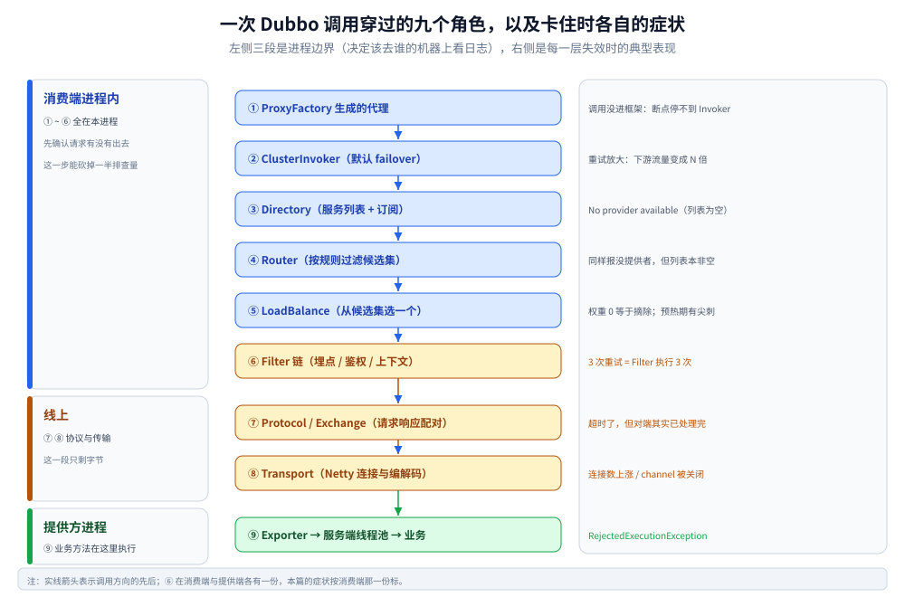

# Dubbo 调用链路

> 覆盖：一次调用在消费端与服务端各穿过哪些角色、`Invoker` 这个统一抽象为什么能把「本地调用 / 集群调用 / 远程调用」压成同一个接口、六条扩展点分别挂在哪一步，以及「请求没到业务代码」时按什么顺序定位。
>
> 不覆盖：报文长什么样、序列化怎么选（→ [通信协议.md](通信协议.md)）；路由规则与六种容错策略（→ [服务治理.md](服务治理.md)）；Java 侧怎么配怎么启（→ [接入Dubbo.md](../../../../01-编程语言/java/工程实践/接入Dubbo.md)）；该不该选 Dubbo（→ [RPC框架选型对比.md](../RPC框架选型对比.md)）。
>
> 内容整理自个人学习笔记。⚠️ **本篇不含本机实测**：跑通 Dubbo 需要 JDK + Maven 依赖 + 注册中心三样齐备，本机没有搭过。文中的类名、默认值、链路顺序按 Dubbo 3.x 官方文档与源码核对，逐块口径见文末 [校验口径](#校验口径)。素材见 [素材清单.md](../../../../素材清单.md)。

---

## 一、一句话定位：把「远程调用」伪装成本地方法的代价在哪

**本节要点**：Dubbo 的全部复杂度都来自一件事 —— 它想让 `orderService.create(req)` 这种写法在跨进程时**看起来没变**。伪装得越像，中间要垫的层就越多。

```java
// 消费端看到的
OrderVO vo = orderService.create(req);

// 实际发生的（一句话版）
// 查服务列表 → 过滤 → 选一个 → 序列化 → 建连/复用连接 → 发送
// → 服务端反序列化 → 线程池分发 → 找 Invoker → 业务执行 → 回传 → 反序列化
```

每个「→」在框架里都是一个**可替换的扩展点**。这也解释了两个高频困惑：

| 困惑 | 原因 |
|---|---|
| 「我明明换了序列化方式，为什么没生效？」 | 换的是 `Protocol` 侧的配置，实际生效点在 `URL` 参数里，配置没进 `URL` 就等于没配 |
| 「加了 Filter 却拦不到某个调用」 | Filter 织在 `Invoker` 链上，绕过 `Invoker` 的路径（如泛化调用的某些分支、直连 `Channel`）不经过它 |

⭐ 记住这条：**Dubbo 的每一层都在包装同一个东西 —— `Invoker`**。看不懂链路，多半是没抓住这个收敛点（第三节展开）。

## 二、九个角色：一次调用穿过哪些对象

**本节要点**：从上到下是「越来越接近字节」。定位问题时先判断「卡在第几层」，比逐层加日志快得多。

| 序 | 角色 | 所在层 | 职责 | 出问题的典型症状 |
|---|---|---|---|---|
| ① | `ProxyFactory` 生成的代理 | 服务模型（最上） | 把接口方法调用转成一次 `Invocation` | 调用没进入框架（断点不停在 `Invoker`） |
| ② | `ClusterInvoker` | 集群容错 | 按策略调一个或多个 `Invoker`，负责重试 | 重试放大、超时时间被重试吃光 |
| ③ | `Directory` | 服务目录 | 持有服务列表，订阅注册中心变更 | 拿到空列表（`No provider available`） |
| ④ | `Router` | 路由 | 按条件 / tag 过滤列表 | 路由后为空（同样报没提供者，但列表原本非空） |
| ⑤ | `LoadBalance` | 负载均衡 | 从过滤后的列表里选一个 | 流量倾斜、预热期打到新节点就抖 |
| ⑥ | `Filter` 链 | 拦截 | 埋点、鉴权、限流、上下文透传 | 埋点缺失、trace 断了 |
| ⑦ | `Protocol` / `Exchange` | 协议与交换 | 组装请求、配对请求与响应 | 拿到 `TimeoutException` 而对端日志显示已处理完 |
| ⑧ | `Transport`（Netty） | 传输 | 连接、编解码、心跳 | 连接数暴涨、`channel` 被关闭 |
| ⑨ | 服务端 `Exporter` → 业务 | 提供方 | 反序列化、分发线程池、找到实现类执行 | 线程池满、`RejectedExecutionException` |

⭐ **①②③④⑤ 全在消费端进程内，⑥ 两侧都有，⑦⑧ 是线缆两侧，⑨ 在提供方进程内**。
这个分界决定了「该去谁的机器上看日志」——`No provider available` 是消费端问题，`RejectedExecutionException` 是提供方问题。



三段对应三种排查现场：①~⑥ 是**本进程**，⑦⑧ 是**线上**，⑨ 是**对方进程**。
右侧那列症状要和第三、四、五节的说法对上 —— 把 `No provider available` 当成网络问题去查，就是在第三、四步之外的地方找原因。

## 三、`Invoker`：为什么所有扩展点最后都收敛成一次 invoke

**本节要点**：Dubbo 把「调用一个方法」抽象成五个方法，**代理、集群、远程、本地实现四种东西全实现了它** —— 这是链路能被逐层包装的前提。

```java
public interface Invoker<T> extends Node {
    Class<T> getInterface();
    Result invoke(Invocation invocation) throws RpcException;
    // 另有 getUrl() / isAvailable() / destroy()（来自 Node）
}
```

四种实现，各代表链路的一段：

| 实现 | 在哪 | 它包的是什么 | 换成它的意义 |
|---|---|---|---|
| `AbstractProxyInvoker` | 提供方 | 真实业务对象（`ref`） | 业务代码变成一个可被框架调度的东西 |
| `InvokerInvocationHandler` | 消费方 | 代理对象收到的调用 | JDK 动态代理 → `Invoker.invoke` 的桥 |
| `ClusterInvoker` | 消费方 | 一组 `Invoker` | **一个接口对 N 个提供者**，重试/容错在这里 |
| `Protocol$Adaptive` 产出的 `Invoker` | 消费方 / 线缆 | 一个远程连接 | 真正发出报文的那一层 |

⭐ **一条判据**：看到 `Invoker` 就是看到了「一次可以被拦截、被重试、被代理的调用」。
所以 Filter、Mock、泛化、异步都挂在 `Invoker` 上，而不是挂在某个具体协议上 —— 这也是为什么**换协议不用换治理逻辑**。

⚠️ 反过来说：**任何绕过 `Invoker` 的路径都不吃这些能力**。典型是直接操作 `Channel` 或者自己维护连接池的「优化」，
它看起来更快，但会同时丢掉 Filter、超时、重试与上下文透传。

## 四、消费端：从代理到字节流的六步

**本节要点**：六步里前五步都可能在**没有网络参与**的情况下失败，所以「调不通」先别怀疑网络。

```text
① ReferenceConfig.get()   → 组装 URL（把注解 / 配置里的参数全塞进 URL）
② Protocol.refer()        → 按 URL 里的 protocol 选实现（dubbo / tri / rest）
③ Registry 订阅           → Directory 拿到 provider 列表并缓存到本地
④ Cluster.join(directory) → 包一层 ClusterInvoker（默认 failover）
⑤ ProxyFactory.getProxy() → 生成代理对象，交给业务注入
⑥ 调用发生：Router → LoadBalance → Filter → Protocol → Transport
```

三个容易踩的点：

| 点 | 说明 |
|---|---|
| **配置全部汇进 `URL`** | 注解、XML、配置中心、`-D` 参数最终都变成 `URL` 的键值对。**排查「配置不生效」的第一动作是打印 `URL`**（`invoker.getUrl()` 或 `dubbo-admin` 的服务详情） |
| **列表来自本地缓存** | 注册中心挂掉后消费端仍能用旧列表继续调（这是刻意的容灾），代价是**新上线的提供者不会被发现** |
| **`check=true` 是默认值** | 启动时找不到提供者直接启动失败。想「先起来再说」要显式 `check=false`，但那样会把错误推迟到第一次调用 |

⭐ 第 ③ 步的 URL 形态值得单独记（以 2.x 的接口级注册为例）：

```text
dubbo://10.0.0.12:20880/com.example.OrderService?timeout=1000&retries=2&serialization=hessian2
        ↑ 地址        ↑ 端口    ↑ 接口全名                     ↑ 参数，全部是可覆盖的
```

## 五、服务端：从字节流到业务方法的五步

**本节要点**：服务端多了一个消费端没有的环节 —— **线程池**。线上「请求进来了但业务日志没打」绝大多数发生在这里。

```text
① Netty 收到字节 → 解码成一个 Request
② Dispatcher 派发    → 默认 all：请求 / 响应 / 连接事件 / 心跳全进线程池
③ 找到 Exporter      → 用 serviceKey（接口 + 分组 + 版本）定位
④ Filter 链（提供方侧）→ 与消费端同一套 SPI，方向相反
⑤ 反射调用业务方法   → AbstractProxyInvoker → 你的实现类
```

⚠️ **线程池是这条链路上唯一会「静默丢请求」的地方**，两件事必须分清：

| 现象 | 机理 | 判据 |
|---|---|---|
| 请求排队、延迟整体上升 | 队列有界且已满，任务在等 | 线程池活跃数打满、队列长度持续 > 0 |
| 直接抛 `RejectedExecutionException` | `SynchronousQueue` 语义：**没有空闲线程就立刻拒** | 日志里有拒绝异常，业务代码一行没执行 |

⭐ 默认线程池是 `fixed`，线程数 200；**队列类型随版本变过**（2.7.5 起默认 `SynchronousQueue`，之前是无界队列）。
这个差别决定了过载时的表现：前者「快速失败」，后者「堆积到 OOM」。
⚠️ 升级或排查前**先去 `URL` 里看 `threadpool` / `queues` 的实际值**，别按记忆里的默认值下结论。

## 六、六条扩展点：想改行为该挂在哪一步

**本节要点**：选错扩展点是最贵的错 —— 写完了发现「拦不住 / 拿不到上下文 / 跟重试冲突」。

| 你的需求 | 该挂的扩展点 | 为什么不是别的 |
|---|---|---|
| 加 trace / 打点 / 鉴权 / 透传上下文 | **Filter**（消费端与提供端各挂一次） | 它在 `Invoker` 链上，重试与路由都已完成，拿得到最终目标 |
| 改「选哪个提供者」 | **Router**（先过滤）+ **LoadBalance**（再选一个） | 两者职责不同：Router 决定候选集，LB 决定选谁 |
| 改「失败之后怎么办」 | **Cluster**（容错策略） | 重试、并行、广播都是「多次调用」的编排，只能在 Cluster 层做 |
| 换序列化 / 换协议 | **Protocol** + **Serialization** | 前者决定线缆形态，后者只管字节 |
| 换线程模型 | **Dispatcher** + **ThreadPool** | 前者决定「哪些事件进池」，后者决定「池长什么样」 |
| 在调用前后改参数 | **Filter**（改 `Invocation` 的 attachments） | 改在更外层会被重试复制成多份，改在更内层已经序列化完 |

⚠️ **Filter 与重试的顺序**是这里最容易搞错的一处：Filter 在 `ClusterInvoker` 的**内层**，
所以一次业务调用触发 3 次重试时，**Filter 会执行 3 次**。
埋点写在这里就要按「物理调用次数」记，而不是「业务请求数」——否则重试会让指标翻倍。

## 七、调用没到业务代码：按链路顺序定位

**本节要点**：按「链路顺序」而不是「错误类型」排查，能少走一半弯路。

| 症状 | 最可能卡在 | 下一步 |
|---|---|---|
| `No provider available for the service` | ③④：目录为空，或路由后为空 | 先看注册中心有没有这个服务，再看 tag / 条件路由是否把它全过滤了 |
| `Forbidden` / 无可用提供者但列表非空 | ⑤：LB 与权重 | 看 `weight` 是否为 0（权重 0 等于摘除） |
| `TimeoutException`，提供方日志显示已处理完 | ⑦：**消费端先超时**，响应晚到被丢弃 | 调 `timeout` 或减少重试；不要只看服务端耗时 |
| 业务日志一行没有、提供方有拒绝异常 | ⑤（服务端侧）：线程池 | 看 `threads` / `queues` / `executes` |
| 消费端报错但提供方完全没收到请求 | ⑧：连接 | 看连接数、心跳、是否有 `channel` 被关闭 |
| 重试后下游流量是预期的 3 倍 | ②：failover 的默认重试 | 非幂等接口设 `retries=0`（见 [服务治理.md](服务治理.md)） |

⭐ 一条通用判据：**先确认「请求有没有出本进程」**。
消费端 `Invoker` 断点进了、Netty 编码没走 → 卡在本进程；编码走了但对端无日志 → 卡在网络或对端入口。
这一步能把排查范围砍掉一半。

---

## 校验口径

> ⚠️ 本篇的校验方式与范围：

- **未起服务、未实测**：全篇没有任何运行读数。链路顺序、类名、默认值来自 Dubbo 3.x 官方文档（架构设计 / SPI 扩展 / 服务调用）与源码结构，**没有在本机跑过 provider-consumer 调用**。
- **未编译**：第三节的 `Invoker` 接口是**删减版签名**（省略了 `Node` 的继承与泛型约束），不能单独编译；用于说明「四种实现同一个接口」这一事实，不是可直接使用的代码。
- **默认值有版本差异**：`threads=200` / `threadpool=fixed` 在 2.x 与 3.x 一致；**队列类型在 2.7.5 前后不同**（无界队列 → `SynchronousQueue`），正文已按「接版本前核对 `URL`」处理，未给出「某版本一定是某值」的断言。
- **配置形态是示意**：第四节末尾的 `dubbo://` URL 是**接口级注册**的形态；3.x 默认走应用级服务发现，`URL` 里不再逐接口出现地址，但「参数进 `URL`」这条判据不变。
- **待实测项**：线程池过载的两种表现（排队 vs 拒绝）、Filter 在重试时的执行次数、`No provider` 与「路由后为空」的日志差异 —— 这三项都可以用一个本地 provider-consumer + 手工改配置复现，本轮未做。

| 依赖 | 版本口径 |
|---|---|
| Dubbo | 3.x（文档与源码结构），未指定补丁版本 |
| JDK | 未使用（未编译） |
| 注册中心 | 未连接 |

## 延伸追问

- **为什么不让消费端直接拿 `Channel` 去发请求，少几层不是更快？** →
  少掉的正是治理能力：`ClusterInvoker` 承担重试与容错，`Filter` 承担埋点与鉴权，`Directory` 承担服务列表刷新。
  直连 `Channel` 在这三件事上全部退化，而且**退化是静默的**（能调通，只是没有重试、没有埋点、列表不会更新）。
- **`Directory` 和 `Router` 都在「拿列表」，为什么要分两层？** →
  `Directory` 管的是**事实**（现在有哪些提供者），`Router` 管的是**策略**（这次调用允许用哪些）。
  混在一起会导致「路由规则一变就要重连注册中心」，而分开后路由规则可以热更新且不影响订阅。
- **配置为什么都塞进 `URL`？不嫌它长吗？** →
  因为 `URL` 是 Dubbo 里唯一的「不可变配置载体」：它能在进程间传递、能被注册中心存、能被覆盖规则改写。
  ⚠️ 代价是 `URL` 会变得很长（上百个参数），且**覆盖优先级靠字符串拼接实现** —— 所以「配置不生效」的正确排查动作永远是打印 `URL`。
- **服务端已经有超时了，消费端为什么还要设？** →
  两者的作用不同：消费端超时决定「我等多久就放弃」，服务端超时决定「我算多久就中断」。
  只设服务端，消费端会一直挂在等待上；只设消费端，服务端会继续算一个没人要的结果（浪费资源，且日志里看不出异常）。
- **`Filter` 执行在重试外层还是内层？** →
  内层 —— 每个 `ClusterInvoker` 选出的 `Invoker` 各带一遍 Filter。所以 3 次重试 = 3 次 Filter，
  埋点要按物理调用计数，否则会得出「流量是业务量的 3 倍」这种吓人的结论。

## 关联

- **上游/总纲**：[RPC框架选型对比.md](../RPC框架选型对比.md) — 该不该用 Dubbo、和 gRPC 怎么取舍
- **下游机制**：[通信协议.md](通信协议.md) — 第六步之后，字节在线上长什么样
- **下游机制**：[服务治理.md](服务治理.md) — 第三到五步里 Router / LoadBalance / Cluster 的策略细节
- **对照/互补**：[基础概念.md](../gRPC/基础概念.md) — 同一件事在 gRPC 里的形态（只有四层，治理外置）
- **对照/互补**：[接入Dubbo.md](../../../../01-编程语言/java/工程实践/接入Dubbo.md) — Java 侧把这些配置写在哪
- **运维/配置**：[Nacos.md](../../注册与配置中心/Nacos.md) — 第三、四步依赖的注册中心
- **下游机制**：[限流算法.md](../../../../04-架构与系统/分布式/稳定性/限流算法.md) — Filter 里挂限流时的算法选择
- **反向引用（本篇被下列文档引到）**：[README.md](README.md)
