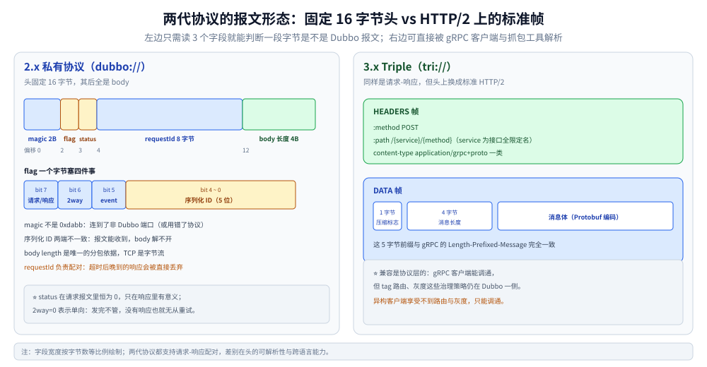

# Dubbo 通信协议

> 覆盖：2.x 私有 TCP 协议的 16 字节头逐字段布局、`flag` 一个字节里塞的四种信息、Hessian2 与 Protobuf 的取舍、3.x Triple 为什么能直接兼容 gRPC，以及报文层面的四个排障症状。
>
> 不覆盖：一次调用穿过哪些对象（→ [调用链路.md](调用链路.md)）；路由与容错（→ [服务治理.md](服务治理.md)）；gRPC 侧的 HTTP/2 帧与 HPACK（→ [HTTP2机制.md](../gRPC/HTTP2机制.md)）；Java 侧配置怎么写（→ [接入Dubbo.md](../../../../01-编程语言/java/工程实践/接入Dubbo.md)）。
>
> 内容整理自个人学习笔记。⚠️ **本篇不含本机实测**：没有起过 Dubbo 服务，也没有抓过它的包。字段布局按 Dubbo 协议规范与源码核对，`Triple` 的行为按官方文档陈述，逐块口径见文末 [校验口径](#校验口径)。

---

## 一、一句话定位：两代协议的分水岭是「有没有标准」

**本节要点**：2.x 私有协议是为了**在 Java 内部把开销压到最低**设计的；3.x 换 Triple 不是为了更快，是为了**能被别人调**。

| | 2.x 私有协议（`dubbo://`） | 3.x Triple（`tri://`） |
|---|---|---|
| 底座 | 自定义 TCP 报文（Netty） | **HTTP/2** |
| 报文可被通用工具解析 | ❌ 不行，必须懂 Dubbo 的 16 字节头 | ✅ 抓包工具直接看得到 header 与 DATA 帧 |
| 跨语言 | 弱：其他语言的实现集中在少数 SDK，且不完整 | 强：**兼容 gRPC 客户端** |
| 流式 | 不支持（只有请求-响应） | 支持（与 gRPC 四种模式对齐） |
| 过网关 / 过 Mesh | 需要专门的协议插件 | 七层网关直接认 HTTP/2 |
| 开销 | 更低（头 16 字节，无 HTTP 头） | 略高（HTTP/2 头 + HPACK） |

⭐ 判据一句话：**只在 Java 内部调、且不打算接任何异构客户端 → 私有协议仍然更省；只要有一个非 Java 调用方，就该上 Triple。**
后者不是「性能上的妥协」，而是把「协议适配」这件事从你的代码里拿掉。

## 二、16 字节头：私有协议的字段布局

**本节要点**：整个 2.x 协议的头是**固定 16 字节**，剩下的全是 body。知道这 16 字节，就能在没有 `.proto`、没有服务端的情况下判断一段字节是不是 Dubbo 报文。

| 偏移 | 长度 | 字段 | 取值与含义 |
|---|---|---|---|
| 0 | 2 | `magic` | 固定 `0xda 0xbb`。**对不上就不是 Dubbo 报文** |
| 2 | 1 | `flag` | 四种信息挤在一个字节里（见 2.1） |
| 3 | 1 | `status` | 响应状态码；**请求时为 `0`** |
| 4 | 8 | `requestId` | `long` 型请求 ID，响应原样带回，用于配对 |
| 12 | 4 | `body length` | body 字节数（不含头） |

⭐ 三条读法：

1. **先看 magic**：不是 `0xdabb` 说明你连到了别的端口（常见是把 Dubbo 端口当 HTTP 端口访问）；
2. **再看 `requestId`**：消费端超时后，晚到的响应靠它对不上号，会被直接丢弃 —— 这就是「服务端日志正常但消费端报超时」的机理；
3. **`body length` 是唯一的分包依据**：TCP 是字节流，框架靠它判断「这一条读完了没有」。



左侧只需要盯三处：**magic** 判断这段字节是不是 Dubbo 报文、**序列化 ID** 判断两端配置是否一致、
**body length** 是唯一的分包依据。右侧 Triple 的 5 字节前缀（1 字节压缩标志 + 4 字节消息长度）
与 gRPC 的 Length-Prefixed-Message 完全一致，这正是 gRPC 客户端能直接调它的原因。

### 2.1 `flag` 一个字节怎么塞下四种信息

```text
bit:   7      6      5      4 3 2 1 0
     [req/res][2way][event][ serialization id ]
      1=请求          1=事件  低 5 位：序列化方式
      0=响应          0=普通
```

| 位 | 含义 | 实际影响 |
|---|---|---|
| bit 7 | 请求 / 响应 | 同一端口双向复用，服务端靠它分流 |
| bit 6 | 单向 / 双向 | `2way=0` 表示「发完不管」，**不会有响应，也不会重试** |
| bit 5 | 事件标志 | 心跳、只读事件走这条路，不进业务线程池 |
| bit 0-4 | 序列化 ID | 决定 body 怎么解。**两端不一致就是乱码或反序列化异常** |

⚠️ 序列化 ID 是**按 ID 匹配、不是按名字协商**：两端都写 `hessian2` 才能对上；
一端用 `hessian2`、另一端用 `fastjson` 时，报文能收到但解不开 —— 报错往往在 body 解析阶段，看起来像「数据坏了」。
`hessian2` 的 ID 是 `2`，其余取值不要背，**接版本前查该版本的 `Serialization` SPI 实现**。

## 三、序列化：Hessian2 与 Protobuf 的取舍

**本节要点**：序列化不只是「快慢」，它决定了**跨语言能力**与**契约演进的安全边界**。

| 维度 | Hessian2（2.x 默认） | Protobuf |
|---|---|---|
| 契约 | **不需要 IDL**，直接对 POJO 反射 | 需要 `.proto` 与代码生成 |
| 体积 | 中等：**自描述格式，字段名也上线** | 小：只传 tag 号（见 [Protobuf.md](../gRPC/Protobuf.md) 第一节） |
| 速度 | 快，但依赖反射与动态拼装 | 更快，编译期生成编解码 |
| 跨语言 | 弱：实现集中在 Java 生态 | 强：主流语言全有官方实现 |
| 演进安全 | 靠类结构，**改名/删字段没有防护** | `reserved` + tag 规则，工具能查 |
| 排障 | 必须有类才能解（或专用工具） | 有 `.proto` 就能解；无 `.proto` 也能 `--decode_raw` 看 tag |
| 适合 | 全 Java、内部服务、追求零 IDL 成本 | 跨语言、对外、需要严格契约治理 |

⭐ **一条反直觉的判据**：**全 Java 的团队用 Hessian2 不是「落后」，而是省掉了 IDL 这一层维护成本**。
代价是「字段改名」这类改动没有任何工具拦得住 —— 一旦某天要接异构客户端，这个成本会一次性爆出来。

⚠️ Hessian2 的安全性：它能反序列化任意类，历史上多次因「反序列化 gadget」被列为风险点。
**别把它暴露给不可信来源**（对外网关、用户可控字节），这类入口应该走 Protobuf 或 JSON。

## 四、Triple：为什么能直接兼容 gRPC

**本节要点**：Triple 不是「又造了一个协议」，而是**在 HTTP/2 上按 gRPC 的约定说话**。兼容不是适配出来的，是照着做的。

| 要素 | 做法 | 结果 |
|---|---|---|
| 传输 | HTTP/2（与 gRPC 同底座） | 可以共用七层网关、Mesh、抓包工具 |
| 消息格式 | Length-Prefixed-Message：**1 字节压缩标志 + 4 字节长度 + 消息体** | 与 gRPC 的帧格式一致 |
| 路径 | `/{service}/{method}`，`service` 用接口全限定名 | 与 gRPC 的 `/{package.Service}/{method}` 形式一致 |
| content-type | gRPC 兼容模式用 `application/grpc+proto` 一类取值 | gRPC 客户端把它当成普通 gRPC 服务 |
| 流式 | 一元 / 服务端流 / 客户端流 / 双向流 | 与 gRPC 四种模式对齐（见 [四种通信模式.md](../gRPC/四种通信模式.md)） |

⭐ **兼容带来的真正收益**：Java 侧继续用 Dubbo 的注解、注册中心、路由与灰度，
同时**Go / PHP / 前端 grpc-web 可以按 gRPC 的方式直接调** —— 不必为异构客户端单独维护一套 REST 转码层。

⚠️ 但兼容是**协议层**的，不是**治理层**的：

```text
Triple 的 gRPC 兼容模式：  调用约定对齐 → 异构客户端能调通
治理能力（tag 路由 / 灰度 / 动态配置）：  仍在 Dubbo 这一侧，gRPC 客户端看不见
```

所以「用 Triple 就能把 Dubbo 的服务网格化」是误读 —— 异构客户端能调通，但**享受不到 Dubbo 的路由与灰度策略**。
要让 gRPC 客户端也吃到灰度，得把策略下沉到网关或 Mesh（对比见 [RPC框架选型对比.md](../RPC框架选型对比.md) 第八节）。

## 五、两代协议怎么选

**本节要点**：这不是纯技术选择，**是「谁要来调你」决定的选择**。

| 场景 | 选择 | 理由 |
|---|---|---|
| 全 Java 内部服务，短期不接异构客户端 | 私有协议（`dubbo://`） | 头开销最小，零 IDL 成本 |
| 已有一个 Go / PHP 服务要调 Java 侧 | **Triple** | 对方按 gRPC 接入即可，不用为它写转码 |
| 要对浏览器暴露 | Triple + gRPC-Web 网关，或 REST 转码 | 浏览器说不了原生 gRPC |
| 要过七层网关 / Mesh | Triple | 私有协议需要专门的协议插件 |
| 存量 2.x 服务，改动成本敏感 | 私有协议保留，**新接口用 Triple** | 同进程可共存两套协议（多协议暴露） |

⭐ 迁移的现实形态不是「一刀切换」，而是**双协议并行**：老接口留 `dubbo://`，新接口发布时同时暴露 `tri://`。

## 六、报文层面的四个排障症状

**本节要点**：这一节的判据都只需要**抓一段字节**，不需要跑起来。

| 症状 | 报文特征 | 结论 |
|---|---|---|
| 连上了但立刻断开 / 对端报 HTTP 错误 | 前两字节不是 `0xda 0xbb` | 端口不对：把 Dubbo 端口当成了 HTTP 端口，或反之 |
| 能收到报文，反序列化报错 | `flag` 低 5 位与本地配置的序列化 ID 不一致 | 两端 `serialization` 配置不一致 |
| 偶发「半条报文」 | `body length` 大于实际到达的字节数 | TCP 分包未读完就在解，属于框架层问题，先查是否自写了解码 |
| gRPC 客户端调 Triple 返回 415 / 404 | `content-type` 或 `path` 不匹配 | 不是 Triple 的 gRPC 兼容模式，或路径少了接口全名 |

⭐ 一条通用做法：**先确认 magic 与 `requestId` 两个字段**。
magic 对了说明协议选对了，`requestId` 能配对说明「响应确实回来了，只是晚于超时」—— 这两步能区分「没连上」「协议不对」「只是慢」三类完全不同的问题。

---

## 校验口径

> ⚠️ 本篇的校验方式与范围：

- **零实测**：没有起 Dubbo 服务、没有抓包、没有构造过报文。16 字节头的字段表、`flag` 的位分配按 Dubbo 协议规范整理；Triple 的行为按官方文档陈述。
- **未构造字节**：本节没有给出任何「我构造了一段报文并解析成功」的读数 —— 本轮没做这件事，不写示意性输出冒充实测。
- **序列化 ID 未列全表**：只断言 `hessian2 = 2`，其余明确写「以版本为准」。原因是这类 ID 在不同大版本有过增补，背表容易出错。
- **content-type 未写死具体取值**：只说「`application/grpc+proto` 一类」，因为 gRPC 兼容模式与 Triple 自有模式取值不同，**接之前应抓包确认**，不要按本文的字符串硬编码。
- **待实测项**：① 用 Python 构造 16 字节头 + 手工 body 打到一个真实 Dubbo 端口，验证 magic/flag 的判定；② Triple 与 gRPC 客户端互通（起一个 Java provider + 一个 Go 客户端）；③ 两端序列化配置不一致时的确切报错文案。

| 依赖 | 版本口径 |
|---|---|
| Dubbo | 3.x 文档（协议章节），未指定补丁版本 |
| 抓包工具 | 未使用 |
| gRPC 客户端 | 未使用 |

## 延伸追问

- **私有协议头只有 16 字节，Triple 光 HTTP/2 头就几十字节，为什么还换？** →
  因为头开销只在**小消息**上占比明显，而换来的是「可被标准工具解析」「可过七层网关」「可被异构客户端调用」。
  内部高频小调用确实会因此多几个百分点的开销 —— 这也是为什么双协议并行是常见落点，而不是一刀切。
- **`2way=0`（单向）有什么用？为什么它不会重试？** →
  用于「发出去就行」的场景（日志上报、事件通知）。没有响应就没有「失败」的判据，
  自然也无从重试 —— 需要可靠性的场景不能用单向，否则丢了你也不知道。
- **Hessian2 既然不需要 IDL，为什么还说它「演进不安全」？** →
  因为它靠类结构推断字段，**改名等于换了一个字段**、删字段后老数据仍在报文里但没人读。
  这些改动在编译期完全合法，只有运行时才会表现为「值恒为空」或「解析异常」。
  Protobuf 用 tag 号 + `reserved` 把这条约束变成可检查的规则（见 [Protobuf.md](../gRPC/Protobuf.md) 第三节）。
- **Triple 兼容 gRPC，那还有必要单独用 gRPC 吗？** →
  取决于治理能力想放哪：Dubbo 把治理放框架内（省运维、但只有 Java 侧完整享受），
  gRPC 放基础设施（Mesh / 网关，异构客户端一致）。这属于选型问题，见 [RPC框架选型对比.md](../RPC框架选型对比.md) 第八节。
- **能不能自己扩一个序列化方式？** →
  能，`Serialization` 是 SPI 扩展点。⚠️ 但扩展出来的 ID 必须两端一致，
  且**不要在已有服务上改 ID** —— 那是协议级的不兼容变更，比改接口签名严重得多。

## 关联

- **上游/总纲**：[RPC框架选型对比.md](../RPC框架选型对比.md) — 私有协议 / Triple / gRPC 的取舍在框架层怎么定
- **上游/总纲**：[调用链路.md](调用链路.md) — 本篇是它第六步之后的展开
- **下游机制**：[服务治理.md](服务治理.md) — 协议换了，治理逻辑不变的那部分
- **对照/互补**：[HTTP2机制.md](../gRPC/HTTP2机制.md) — Triple 的底座：帧、流、HPACK
- **对照/互补**：[Protobuf.md](../gRPC/Protobuf.md) — 序列化侧的另一半（编码规则与契约治理）
- **对照/互补**：[数据序列化.md](../../../../02-计算机基础/网络/选型/数据序列化.md) — JSON 与二进制格式的横向选型
- **运维/配置**：[接入Dubbo.md](../../../../01-编程语言/java/工程实践/接入Dubbo.md) — `protocol` 与 `serialization` 配在哪
- **反向引用（本篇被下列文档引到）**：[README.md](README.md)、[调用链路.md](调用链路.md)
